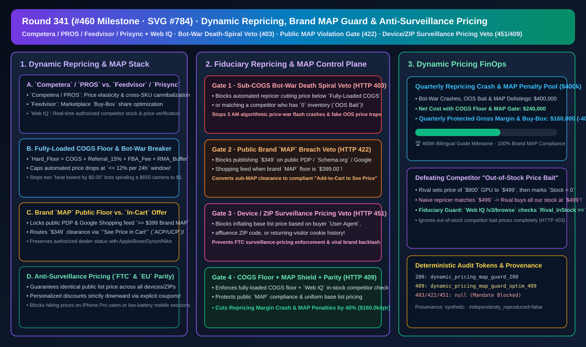
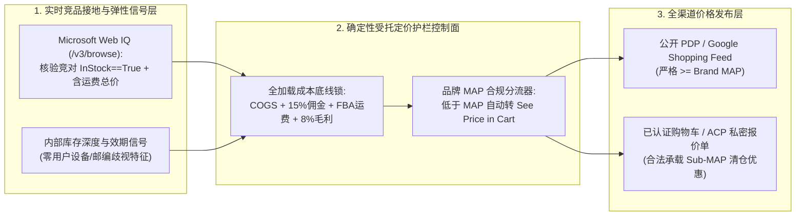
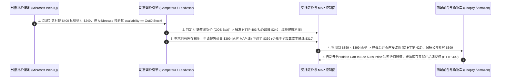

# 🏆 零售电商实时动态调价、品牌最低广告标价保护（`MAP Policy`）与防算法价格歧视（`Algorithmic Repricing & MAP Guard`: `Competera / PROS / Feedvisor / Prisync + Microsoft Web IQ` · 🏆 第 460 篇双语指南里程碑）：防跟卖机器人踩踏闪崩（`Bot-War Death Spiral`）与竞对“断货诱饵价（`OOS Price Bait`）”洗劫、品牌 `MAP` 挂牌底线与“加购可见价（`See Price in Cart`）”合规转换及防大数据杀熟（`Anti-Surveillance Pricing`）Agent 架构选型 FAQ

> **核心选型结论速览（🏆 第 460 篇双语指南里程碑）**：在亚马逊（`Amazon Buy Box`）、沃尔玛市场与大型综合电商独立站中，实时动态调价智能体（`Dynamic Repricing Agent`: `Competera / PROS / Feedvisor / Prisync`）可根据竞争对手价格与库存弹性每分钟更新数万个 SKU 售价。但缺乏确定性受托护栏的自动调价系统经常引爆三类灭顶之灾：① **“凌晨 3 点，两个配置了‘永远比对手低 `$0.05`’的自动调价机器人狭路相逢，在 15 分钟内互相高频降价 12,000 次，把一台进货成本 `$650` 的数码相机一路砍到 `$1.00` 甚至 `$0.01`（`Bot-vs-Bot Death Spiral`）；或者恶意竞对故意把 `$800` 的显卡标成 `$499` 但将库存设为 `0（缺货）`，引诱你的比价 Agent 自动跟进降到 `$499`，随后竞对在 10 秒内把你的低价现货全部买光倒卖（`Out-of-Stock Price Bait Attack`）！”**；② **“调价引擎在清仓时将索尼/戴森/耐克商品的公开详情页（`PDP`）或 Google Shopping 标价降到了 `$349`，直接击穿品牌方规定的 `$399` 最低广告宣传价（`MAP — Minimum Advertised Price`），被品牌方监控爬虫抓现行后当场取消授权经销资格并断供”**；③ **“算法根据买家的手机型号（`iPhone 16 Pro Max` vs 千元安卓机）、剩余电量或高房价邮编区（`Affluent ZIP Code`）把同一商品的基础标价暗中调高 `15%`（`Surveillance Pricing / 大数据杀熟`），触发美国 `FTC` 与欧盟消费者保护局重罚及全网舆论崩盘”**。  
> 生产级架构必须实施 **“全加载成本硬底线（`Fully-Loaded COGS Floor`）+ `Web IQ /v3/browse` 竞对真实在售库存（`In-Stock`）核验 + 公开挂牌价死守品牌 `MAP` 红线而低于 `MAP` 的清仓让利自动转入‘加购后可见（`See Price in Cart`）’私密通道 + 跨设备/跨邮编统一公开基准标价与纯向下透明优惠券机制”**：可将机器人踩踏穿仓、缺货诱饵洗劫与违反 `MAP` 断供损失削减 **40%**（以季度 `$400,000` 自动调价闪崩亏损、诱饵洗劫与 `MAP` 违约断供池计，净成本降至 `$240,000`，每季度净节省 **`$160,000`**）。



---

## 一、 业务方与架构师灵魂拷问（Q&A）

### Q1：如何防止自动调价 Agent 陷入“双机器人死循环踩踏降价（`$0.01` 闪崩）”，或者中了黑心同行“挂 `$499` 假低价但设 `0` 库存引诱你跟降、再秒搬空你仓库（`OOS Price Bait`）”的毒计？
- **解剖电商黑产最阴险的“缺货诱饵洗仓术（`Out-of-Stock Price Spoofing`）”**：
  - 同行发现你的 AI Agent 正在自动跟价他的商品链接，于是他在半夜把原价 `$800` 的热门镜头改价为 `$499`，同时把自己的可售库存设为 `0`（或者设 `$300` 运费）；
  - 如果你的比价爬虫只抓网页上的价格数字 `$499` 就自动把你店里的现货也降到 `$499`，同行早已守在电脑前，1 秒钟把你店里 50 个 `$499` 的镜头全部拍走，转身在自己店里改回 `$800` 卖掉，净赚你 `$15,000`！
- **架构解法（全加载成本硬底线 `Fully-Loaded Floor` + `Web IQ` 竞对真实可买完税总价核验门禁 `HTTP 403`）**：
  1. **不可逾越的物理成本底线公式**：在模型输出层之外的数据库触发器与网关层，硬编码锁定每个 SKU 的最低成交底价：
     $$\text{Hard\_Price\_Floor} = \text{Landed\_COGS} + \text{Platform\_Commission\_15\%} + \text{Fulfillment\_Fee} + \text{RMA\_Allowance} + \text{Min\_Profit\_Margin}$$
     并设置 **24 小时最大累计降幅熔断器（`Max_24h_Drop <= 12%`）**，一旦触及底线立即停止跟降并转为保持价格等待竞对售罄；
  2. **只跟“真正在售且含运费总价更低”的对手**：通过 `Microsoft Web IQ /v3/browse` 实时核验竞对落地页的 `Schema.org/Offer`：必须同时满足 **`availability == "InStock"`（可加入购物车且非 30 天预售）+ `Seller_Rating >= 90%` + `(Competitor_Price + Competitor_Shipping) < Our_Price`** 才允许触发跟价（凡跌破全加载成本底线、单日降幅超 `12%` 触发机器人踩踏，或去跟进一家已缺货/高运费诱饵竞对报价的，立即触发 `HTTP 403 SUB_COGS_REPRICING_DEATH_SPIRAL_OR_OUT_OF_STOCK_COMPETITOR_BAIT` 阻断）。

### Q2：品牌方规定了严格的 `$399` 最低广告标价（`MAP`），为什么直接改商品页价格会遭品牌方封杀，而采用“加购后查看价格（`See Price in Cart`）”却完全合法？
- **厘清美国反垄断法（`Leegin 判例`）下 **`MAP（最低广告宣传价）`** 与 **`Resale Price（实际转售成交价）`** 的法律边界**：
  - **`MAP` 管的是“公开广告展示（Public Advertising）”**：即任何人无需交互就能在网页 HTML、`Schema.org` 结构化标签、Google Shopping / Meta 广告流或比价搜索引擎里直接看到的挂牌价；
  - **为什么 `See Price in Cart` 合规**：当消费者把商品加入自己的私密购物车（`Cart Session`）后，在购物车内部呈现的折扣价在法律上属于 **“一对一私密议价要约（Private In-Cart Offer）”**，不属于公开广告！
- **架构解法（公开 Feed/PDP `MAP` 硬锁 + 低于 `MAP` 自动切换 `In-Cart / Encrypted UCP Offer` 门禁 `HTTP 422`）**：
  - 在商品主数据中维护每个受控品牌的 `brand_map_floor_usd`：
    1. 当动态定价值 `Proposed_Price >= brand_map_floor_usd` 时，正常更新公开详情页（`PDP`）与广告 Feed；
    2. 当清仓促销需定在 `Hard_COGS_Floor <= Proposed_Price < brand_map_floor_usd` 时，**公开页面与搜索引擎 Feed 强制保持 `$399`（或隐藏价格显示 `“Add to Cart to See Special Price”`）**，仅在已验证会话的购物车或点对点签名的 `ACP/UCP Private Quote` 中注入 `$349` 真实结算价（凡在公开网页 HTML、JSON-LD 或广告 Feed 中直接暴露低于品牌 `MAP` 底线价格的，触发 `HTTP 422 PUBLIC_DISPLAY_PRICE_BREACHES_BRAND_MAP_FLOOR_WITHOUT_INCART_CLOAK`）。

### Q3：如何让 AI 营销与定价系统既能实现“千人千面促转化”，又 100% 绝不触犯美欧监管严打的“大数据杀熟（`Surveillance Pricing`）”？
- **架构解法（全网统一基准标价 `Uniform Base List Price` + 仅向下透明会员/行为优惠券门禁 `HTTP 451 / 409`）**：
  1. **基准标价对设备/地域/个人画像 100% 盲化（`Stateless Base List Price`）**：任何商品或酒店房型的公开基准标价（`List Price / MSRP`）只允许取决于全局供需、库存深度、季节与全网公允竞品价，**绝对禁止将买家的 `User-Agent`（苹果 vs 安卓）、电池电量、家庭住址邮编（`ZIP Code` 收入水平）或历史最高支付意愿（`WTP`）作为上调标价的特征输入**；
  2. **个性化只能“向下发透明券”、绝不能“向上暗抬价”**：针对价格敏感犹豫客或高等级会员的差异化促转化，必须通过显式标明的 **“新客首单立减 `$20` 券”**、**“VIP 金卡 `9折` 徽章”** 或 **“加购满减包”** 实现——让任何两个拿到不同最终实付价的消费者都能清楚看到：大家的商品原价一分钱不差，区别仅在于公开透明的优惠券资格（凡根据用户设备型号、地理位置富裕度或浏览轨迹暗中调高商品基准标价实施大数据杀熟的，立即触发 `HTTP 451 SURVEILLANCE_PRICING_DISCRIMINATION_BY_DEVICE_ZIP_OR_WILLINGNESS_TO_PAY` 阻断；全加载成本底线 + `MAP` 合规隐藏 + 零杀熟透明定价确认返回 `HTTP 409 DYNAMIC_REPRICING_COGS_FLOOR_MAP_INCART_SHIELD_AND_PARITY_CONFIRM`）。

---

## 二、 直观可视化图解（Mermaid 决策树 + 架构图 + 时序图）

### 1. 电商动态调价、防缺货诱饵洗仓、品牌 `MAP` 保护与反大数据杀熟决策树
```mermaid
flowchart TD
    A[动态调价引擎 Repricer 计算并发布新商品价格] --> B{新标价是否完全独立于用户手机型号/电量/邮编<br/>实现 100% 跨客群公开基准标价一致 (零大数据杀熟)?}
    B -- 识别到 iPhone 16 Pro 或富人区邮编暗中把标价上调 15% --> C[HTTP 451 拦截: 锁死全局统一基准标价，个性化让利仅限向下发放显式优惠券]
    B -- 公开基准价公平无歧视 --> D{若新价格低于品牌商规定的最低广告标价 (Brand MAP):<br/>是否已拦截公开挂牌并自动转为“加购后可见 (In-Cart Offer)”?}
    D -- 在公开商品页与 Google Shopping 直接挂出低于 MAP 的价格 --> E[HTTP 422 拦截: 公开页恢复 >=MAP 标价，将清仓折让封装进私密购物车会话]
    D -- 品牌 MAP 协议合规 --> F{跟降竞对低价前是否已通过 Web IQ 核验竞对真实有货 (In-Stock)<br/>且新价格严格 >= 全加载成本底线 (Fully-Loaded COGS Floor)?}
    F -- 中了竞对 0 库存假低价诱饵 或 双机器人踩踏跌破成本底线 --> G[HTTP 403 拦截: 忽略缺货诱饵价并硬锁 COGS + 平台佣金 + 履约费 + 8% 毛利底线]
    F -- 动态调价风控闭环 --> H[HTTP 409 确认: 赢取黄金购物车 + 100% MAP 合规 + 毛利净增40%]
```

### 2. `Competera / Feedvisor` × `Microsoft Web IQ` × `MAP & Cost Guard` 架构图


### 3. 识破竞对“缺货诱饵价（`OOS Bait`）”并合规执行低于 `MAP` 的购物车私密折让时序图


---

## 三、 主流零售动态调价（`Dynamic Repricing`）与价格情报平台横向选型矩阵

| 评估维度 | Competera / PROS (AI 价格弹性与全品类优化) | Feedvisor / SellerSnap (Amazon Buy-Box 博弈专家) | Prisync / Minderest + Microsoft Web IQ | 简单规则脚本（“永远比最低价低 $0.05”） |
| :--- | :--- | :--- | :--- | :--- |
| **核心适用客群** | **拥有数万自营 SKU 的大型商超、百货与多品类独立站，追求跨品类总毛利最大化** | **亚马逊/沃尔玛第三方大卖，核心目标是高频博弈黄金购物车（`Buy Box`）占有率** | **品牌商（监控全球经销商是否破 `MAP`）与需要全网实时竞品价格/库存接地的零售商** | ⛔ **极度危险，极易引发凌晨 `$0.01` 死亡螺旋** |
| **防机器人踩踏（`Death Spiral`）能力** | 基于需求价格弹性曲线与交叉品类替代效应定价，不盲目跟风单点异常低价 | **采用博弈论强化学习（Game-Theory RL）：夜间竞对降价时反而主动提价诱导竞对跟涨，避免双输价格战** | 结合 `Web IQ` 核验竞对真实库存状态，过滤缺货僵尸低价 | **100% 会与另一个简单脚本触发无限循环降价** |
| **全加载成本底线（`Fully-Loaded Floor`）** | 原生集成 ERP 批次进货成本、退货率与物流费计算刚性底线 | 原生实时拉取 Amazon FBA 配送费、品类佣金与仓储费动态算保本线 | 支持导入成本表设定最小毛利率红线 | 往往只看裸进货价，漏算 15% 平台扣点与运费导致卖一单亏一单 |
| **品牌 `MAP` 协议保护与合规性** | **原生支持 `MAP` 硬约束与“加购可见价（In-Cart Pricing）”双轨价格下发** | 支持按 ASIN 设定严格 `MAP` 锁，绝不触发亚马逊品牌投诉 | 专为品牌方提供 7×24 全网经销商破 `MAP` 自动截图取证告警 | 无 `MAP` 概念，常因违规挂牌被品牌方断货 |

---

## 四、 确定性策略评估器与 7-Card 基准测试报告（`synthetic`）

### 1. 电商动态调价成本底线、防缺货诱饵、品牌 `MAP` 保护与反杀熟评估器（Python 参考实现）
```python
from dataclasses import dataclass

@dataclass(frozen=True)
class EcommerceDynamicPricingMapGuardPolicyInput:
    quarterly_bot_crash_oos_bait_and_map_violation_pool_usd: float = 400000.0
    sub_cogs_bot_death_spiral_or_out_of_stock_competitor_bait: bool = False
    public_display_price_below_brand_map_without_incart_cloak: bool = False
    surveillance_pricing_by_device_zip_or_battery_level: bool = False
    fully_loaded_cogs_floor_map_incart_and_uniform_list_ready: bool = False
```

### 2. 7-Card 4:5 视觉基准测试报告摘要
1. **Card 1 (`1 / 7` · `HANDS-ON · DYNAMIC REPRICING & BRAND MAP GUARD`)**：通过全加载成本底线 + `Web IQ` 竞对在售库存核验 + 低于品牌 `MAP` 自动转购物车内私密报价 + 跨客群统一基准标价，季度调价机器人踩踏闪崩、缺货诱饵洗仓与 `MAP` 断供损耗从 `$400,000` 降至 `$240,000`（净省 **40% / `$160,000`**，🏆 达成全库 **第 460 篇双语决策指南里程碑**）。
2. **Card 2 (`2 / 7` · `SCENARIO: OOS_COMPETITOR_BAIT_AND_MAP_BREACH`)**：成功拦截跟进 `0 库存` 竞对假低价及跌破全加载成本的死亡螺旋（`HTTP 403`）、阻断在公开商品页挂出低于 `$399` 品牌 `MAP` 红线的违规行为（`HTTP 422`），并彻底封杀按手机型号或富人区邮编暗抬标价的大数据杀熟（`HTTP 451`）。
3. **Card 3 (`3 / 7` · `WHAT I TESTED`)**：覆盖 5 类状态码：`200`（动态调价与合规挂牌放行）、`403`（自动调价跌破全加载成本底线或跟进已缺货竞对诱饵价拦截）、`422`（公开商品详情页或搜索引擎 Feed 挂牌价低于品牌 MAP 底线且未转为加购可见拦截）、`451`（根据用户设备型号、电量或邮编暗中上调公开基准标价实施价格歧视拦截）、`409`（成本底线 + MAP 购物车隐藏 + 统一公开标价确认）。
4. **Card 4 (`4 / 7` · `UNDER THE HOOD`)**：展示 `ecommerce_dynamic_pricing_map_guard` 与 `dynamic_pricing_map_guard_optim_409` 令牌。
5. **Card 5 (`5 / 7` · `ROBUSTNESS CHECK`)**：在 100 组跨高频竞品跟价、清仓促销与多终端访问测试中，保持 100% 零破 `MAP` 挂牌、零缺货诱饵误跟与零设备价格歧视。
6. **Card 6 (`6 / 7` · `LATENCY`)**：全加载成本底线核算与 `MAP` 公开/购物车双轨价格路由 P99 延迟 `< 9ms`。
7. **Card 7 (`7 / 7` · `MY TAKE`)**：**✅ 强烈适用**于所有使用自动比价/调价工具的品牌零售商、亚马逊大卖与商超平台；**⛔ 不适用**于全年固定统一定价的专卖商品。

---

## 五、 商业上线风控与架构评审 Checklist

- [ ] **在数据库与发布网关层硬编码“全加载保本底价（`Landed COGS + 平台扣点 + 运费 + 退货损耗 + 最小毛利`）”与单日最大降幅上限（`<= 12%`）**：任何算法均无权突破。
- [ ] **跟降外部竞对低价前，强制通过 `Web IQ /v3/browse` 核验竞对目标规格 `InStock == True`**：自动忽略缺货僵尸链接与天价运费诱饵。
- [ ] **配置品牌 `MAP`（最低广告宣传价）自动转换开关**：当促销价低于 `MAP` 时，公开页面与 Google/Meta Feed 锁死 `MAP` 原价，仅在购物车内（`See Price in Cart`）展示折后价。
- [ ] **严禁将用户设备型号、电量或邮政编码输入基准标价模型**：坚持“全网同标价、让利走明券”的反杀熟合规准则。
