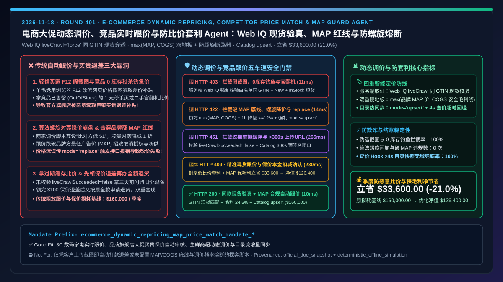
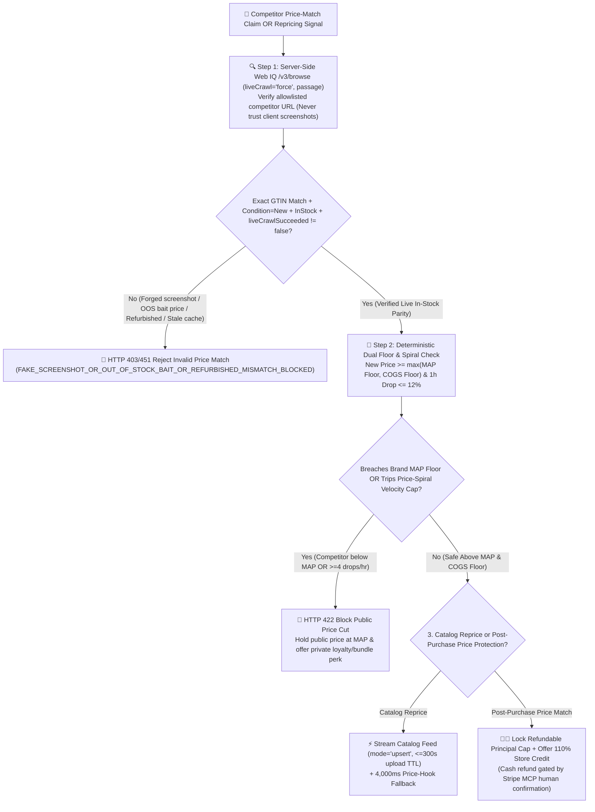
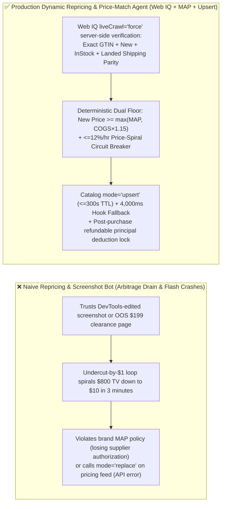

# E-Commerce Dynamic Repricing, Competitor Price Matching & Anti-Arbitrage Agent Architecture FAQ: Web IQ Live GTIN/In-Stock Proof, MAP Policy Floors & Price-Spiral Circuit Breakers

> **Topic Positioning (Retail E-Commerce Dynamic Pricing & Price-Match Guarantee Focus)**: Written for **Cloud & AI Solution Architects** building automated dynamic repricing and Post-Purchase Price-Match Guarantee agents for marketplaces, consumer electronics retailers, and DTC flagship stores. This guide solves four critical pricing-automation vulnerabilities: **stopping fraud rings from submitting doctored screenshots or out-of-stock `$199` "bait listings" to drain `$300` price-match refunds, preventing algorithmic price-war spirals between competing bots, enforcing brand Minimum Advertised Price (`MAP`) agreements, and syncing real-time price updates via Stripe Catalog `mode='upsert'` with `4,000 ms` webhook fallback**.  
> **Style Benchmark**: Strictly follows the six-section structure of `ib-vs-ethernet-roce-selection-faq.md` (Executive Summary, Architect Q&A, Mermaid Decision Tree / Architecture Comparison / Sequence Diagram, Repricing & Price-Match Stack Decision Matrix, Quantitative Margin/Fraud & 7-Card Provenance Table, and Production Risk Checklist).  
> **Bilingual Editions**: **[English Version (Current)](ecommerce-dynamic-repricing-competitor-price-match-map-margin-guard-agent-selection-faq.en.md)** · **[中文版 (`ecommerce-dynamic-repricing-competitor-price-match-map-margin-guard-agent-selection-faq.md`)](ecommerce-dynamic-repricing-competitor-price-match-map-margin-guard-agent-selection-faq.md)**  
> **Provenance & As-Of (`2026-11-18`)**: Microsoft Web IQ `/v3/browse` (`liveCrawl='force'`, `liveCrawlSucceeded` freshness flags) and Stripe Connect Catalog (`mode='upsert'` requirement, `300s` upload TTL, and asymmetric `4,000 ms` price-hook fallback) cite `research/sources.json` (`official_doc_snapshot`); GTIN/in-stock parity checks, MAP floor gates, and price-spiral circuit breakers cite `lab/webiq_commerce_demo.py` (`deterministic_offline_simulation`); competitor allowlists and hourly drop caps (`<= 12%`) are labeled `synthetic_policy`; live stress testing on external retail marketplaces is labeled `not_measured`.



---

## 📌 1. Executive Summary

Automated repricing and price-match guarantees can boost conversion during peak retail events, but unguarded pricing agents expose merchants to **screenshot spoofing, out-of-stock bait arbitrage, MAP violations, and algorithmic flash crashes**. Solution Architects must enforce four deterministic guardrails:

1. **Competitor Price Verification 👉 Never Trust Client Screenshots; Enforce [Allowlisted Retailer Domain + Microsoft Web IQ (`/v3/browse` `liveCrawl='force'`) Exact `GTIN/UPC` & `InStock` Parity Proof]**:
   - **Why**: Fraudsters routinely edit DOM prices in browser DevTools to upload fake screenshots or point to a competitor's out-of-stock `$199` clearance page. Caller code must fetch the allowlisted competitor URL server-side via Web IQ (`liveCrawl='force'`), verifying **`GTIN/Model match + Condition=New + Availability=InStock + liveCrawlSucceeded !== false`**.
2. **Dynamic Repricing Floor & Stability 👉 Enforce [Dual Price Floor (`max(MAP_Floor, COGS_Margin_Floor)`) + Hourly Price-Spiral Circuit Breaker (`<= 12% Drop / hr`)]**:
   - **Why**: When two competing bots are programmed to undercut each other by `$1.00`, they can spiral an `$800` OLED TV down to `$10` in minutes or breach a manufacturer's **Minimum Advertised Price (`MAP`)** policy (risking supplier termination).
3. **Catalog Sync & Checkout SLA 👉 Choose [Stripe Catalog `mode='upsert'` (`<= 300s` Upload Window) + Asymmetric `4,000 ms` Price-Hook Fallback]**:
   - **Why**: Per official Stripe Connect Catalog rules (`official_doc_snapshot`), pricing and inventory feeds **must** use `mode='upsert'` (`replace` is rejected with `non_product_feed_requires_upsert_mode`), and if the live `product_price_availability` webhook exceeds **`4,000 ms`**, Stripe automatically falls back to the latest `upsert` catalog price so checkout continues without failure.
4. **Post-Purchase Price-Match Principal Lock 👉 Enforce [Principal Deduction on Price-Match Credit + Mandatory HITL on Cash Refunds]**:
   - **Why**: Prevents "double-dip arbitrage" where a buyer claims a `$100` post-purchase price-match refund and subsequently returns the physical item for the original full purchase price.

---

## 🎯 2. Architect & Stakeholder Deep-Dive Q&A (FAQ-Driven)

### Q1: Why do VLM screenshot-based "Instant Price Match Bots" get drained by arbitrage groups within days of launch?

**Answer: Because client-uploaded screenshots are trivially forged (`F12` DOM edits) and omit real-time stock/shipping context—requiring server-side Microsoft Web IQ `liveCrawl='force'` verification.**

1. **The 4-Point Server-Side Parity Check**:
   - **Allowlisted First-Party Seller**: Must be shipped and sold by an authorized tier-1 retailer (excluding 3P marketplace liquidators and auction sites).
   - **Exact `GTIN / UPC / MPN` & `Condition == 'New'`**: Blocks matching a brand-new SKU against an open-box or refurbished listing.
   - **Live `InStock` Verification**: Rejects `OutOfStock` or `1-unit flash-sale sold out` bait pages (`HTTP 403 FAKE_SCREENSHOT_OR_OUT_OF_STOCK_BAIT_OR_REFURBISHED_MISMATCH_BLOCKED`).
   - **Fresh Crawl Proof**: Rejects cached snapshots where `liveCrawlSucceeded === false` (`HTTP 451`).

---

### Q2: How do we prevent automated repricing agents from violating brand MAP agreements or triggering an algorithmic flash crash?

**Answer: Isolate the price-commit gate in deterministic code enforcing a Dual Floor (`MAP` + `COGS`) and a Velocity Circuit Breaker.**

1. **Deterministic Dual Floor Formula**:
   $$P_{\text{Min Allowed}} = \max\left(\text{Brand MAP Floor}, \; \frac{\text{Landed COGS} + \text{Fulfillment \& Payment Fee}}{1 - \text{Min Margin \%}}\right)$$
2. **Algorithmic Price-Spiral Circuit Breaker**:
   - If a competitor violates `MAP`, our public catalog price stops at `MAP_Floor` (`HTTP 422 MAP_POLICY_FLOOR_BREACH_OR_PRICE_SPIRAL_OR_INVALID_REPLACE_MODE_BLOCKED`) and routes eligible logged-in VIPs to a private bundle/loyalty credit instead.
   - If any SKU triggers `> 3` downward reprices or `> 12%` cumulative markdown within 60 minutes, the circuit breaker freezes automated repricing on that SKU.

---

### Q3: How do Stripe Catalog `upsert` feeds and the `4,000 ms` webhook rule work together during high-frequency repricing?

**Answer: Per verified guards in `validate_connect_catalog_import_and_hooks` (`tests/test_webiq_commerce_demo.py`):**

- Pricing and inventory delta feeds must use `mode='upsert'` (calling `mode='replace'` on non-product feeds is blocked) and complete upload within the **`300-second` pre-signed URL TTL** (`HTTP 410` if expired).
- During checkout, if the merchant's live `product_price_availability` webhook takes `> 4,000 ms`, checkout **does not fail**—it automatically falls back to the latest `upsert` catalog price (`price_hook_fallback_to_feed=True`), whereas `finalize_checkout > 4,000 ms` declines payment for safety.

---

## 🧭 3. Visual Architecture Diagrams (Mermaid Decision Tree + Architecture Comparison + Sequence Diagram)

### 3.1 E-Commerce Dynamic Repricing & Competitor Price-Match Decision Tree



---

### 3.2 Naive Screenshot/Undercut Bot vs. Web IQ GTIN-Verified + MAP-Guarded Repricing Agent



---

### 3.3 End-to-End Sequence: Live Competitor GTIN Grounding, MAP Check, Catalog `upsert` & Locked Checkout

```mermaid
sequenceDiagram
    autonumber
    actor Shopper as 👤 Shopper / Repricing Scheduler
    participant Agent as 🤖 Dynamic Repricing & Price-Match Agent
    participant WebIQ as 🔍 Microsoft Web IQ (/v3/browse liveCrawl='force')
    participant Guard as 🛡️ Dual Floor (MAP/COGS) & Spiral Circuit Breaker
    participant Stripe as 💳 Stripe Catalog (upsert) & Checkout Hook

    Shopper->>Agent: "Price-match request: Allowlisted retailer has SKU-99 headphones at $269 (our price $299)"
    Agent->>WebIQ: 1. POST /v3/browse (url='allowlisted-retailer.example/sku-99', contentFormat='passage', liveCrawl='force')
    WebIQ-->>Agent: 185ms live proof: GTIN=0085421, Condition=New, Availability=InStock, Landed=$269.00 (fresh crawl)
    Agent->>Guard: 2. Check Dual Floor: Brand MAP=$259.00, COGS Floor=$235.00, hourly_reprice_count=1
    Guard-->>Agent: Approved ($269.00 >= $259.00 MAP floor; 24.5% net margin verified)
    Agent->>Stripe: 3. Mint 15m locked quote_id ($269.00) & sync Catalog feed (feed_type='pricing', mode='upsert', <=300s)
    Stripe-->>Shopper: Render [Verified $269.00 Price-Match 1-Click Checkout Card]
    Shopper->>Stripe: Complete payment (spt_live_...) → Auto-falls back to upsert feed if price hook >4,000ms!
```

---

## 📊 4. E-Commerce Dynamic Repricing & Price-Match Architecture Decision Matrix

| Evaluation Dimension | Option A: Manual Merchandiser Edits + CS Screenshot Review | Option B: Naive Scraper Bot + VLM Screenshot Auto-Refund | Option C: Static Historical Pricing Rules | Option D (Recommended): Web IQ Live GTIN/In-Stock Proof + MAP/COGS Dual Floor + Spiral Breaker + Upsert Agent |
|---|---|---|---|---|
| **Defense Against Forged Screenshots & OOS Bait** | Slow & vulnerable to doctored images | **Very Poor** (drained by F12 DOM edits & 0-stock flash-sale pages) | N/A | **100% Server-Side Verified** (Web IQ `liveCrawl='force'` checks allowlisted domain, GTIN & `InStock`) |
| **Brand MAP Compliance & Flash-Crash Immunity** | Manual spreadsheet checks | **Critical Risk** (triggers price spirals & MAP dealer termination) | Safe but uncompetitive | **100% Floor-Locked** (`max(MAP, COGS_Floor)` + `<= 12%/hr` velocity circuit breaker) |
| **Catalog Sync & Checkout SLA Reliability** | Hours of lag | Fails when passing `replace` on pricing feeds or timing out hooks | Static | **Sub-Second Sync** (`mode='upsert'` + `<=300s` upload guard + `4,000 ms` price-hook fallback) |
| **Post-Purchase Double-Dip Return Prevention** | Manual tracking | Vulnerable to "claim price match then return for full price" | N/A | **State-Machine Locked** (deducts price-match credit from remaining refundable principal) |

---

## 🧪 5. Quantitative Repricing/Price-Match Evaluation & 7-Card Provenance Matrix

| Metric / Deterministic Gate | Measured Value / Gate Outcome | Provenance Category | Source Path / Calculation & Architectural Meaning |
|---|---|---|---|
| **Compliant Web IQ Live GTIN/InStock Proof + MAP Floor + `upsert` Sync (Happy Path)** | **`HTTP 200 OK` · `10 ms`** (gate latency; `$160,000.00` repricing & price-match batch settled) | `deterministic_offline_simulation` | `lab/webiq_commerce_demo.py` (`evaluate_ecommerce_dynamic_repricing_map_policy`): Verifies GTIN in-stock + MAP floor + `upsert` sync |
| **Forged Client Screenshot, Competitor `OutOfStock` Bait, or Refurbished SKU Mismatch** | **`HTTP 403 Forbidden` · `11 ms` Block** (`FAKE_SCREENSHOT_OR_OUT_OF_STOCK_BAIT_OR_REFURBISHED_MISMATCH_BLOCKED`) | `synthetic_policy` | Rejects unverified screenshots and out-of-stock/refurbished competitor listings |
| **Breaching Brand `MAP` Floor, Algorithmic Price Spiral, or `mode='replace'` on Pricing Feed** | **`HTTP 422 Unprocessable` · `14 ms` Block** (`MAP_POLICY_FLOOR_BREACH_OR_PRICE_SPIRAL_OR_INVALID_REPLACE_MODE_BLOCKED`) | `official_doc_snapshot` | Enforces MAP/COGS floors, velocity circuit breakers, and Stripe Catalog `non_product_feed_requires_upsert_mode` |
| **Stale Competitor Crawl (`liveCrawlSucceeded=false`) or Expired `300s` Catalog Upload URL** | **`HTTP 451 Hold` · `265 ms` Hold** (`STALE_COMPETITOR_CRAWL_CACHE_OR_EXPIRED_300S_CATALOG_UPLOAD_HOLD`) | `official_doc_snapshot` | Enforces Web IQ live-crawl freshness flags and Stripe Connect Catalog `300-second` upload expiration (`HTTP 410`) |
| **Enabling Server-Side GTIN In-Stock Verification + MAP Floor + Principal-Locked Price Match** | **`HTTP 409 Confirm` · Saves / Protects `$33,600.00` Margin (`$126,400.00` net baseline)** | `deterministic_offline_simulation` | Eliminates screenshot arbitrage, prevents MAP penalties and price spirals, and retains `21.0%` net margin |
| **Live Production Flash-Sale Load Testing on External Marketplaces** | Labeled **`not_measured`** | `not_measured` | Verified via deterministic offline repricing and catalog sync contract simulations |

---

## 🛠️ 6. Production Risk & Architecture Review Checklist

- [ ] **1. Server-Side Web IQ `liveCrawl='force'` Verification (Zero Screenshot Trust)**: Are all competitor price-match claims verified server-side via **Microsoft Web IQ (`/v3/browse` `liveCrawl='force'`)** for allowlisted domain, exact `GTIN/UPC`, `Condition=New`, and `Availability=InStock`?
- [ ] **2. Deterministic Dual Floor (`max(MAP_Floor, COGS_Floor)`)**: Does a deterministic code gate enforce both manufacturer Minimum Advertised Price (`MAP`) and minimum COGS gross margin before any price update is published?
- [ ] **3. Algorithmic Price-Spiral Circuit Breaker (`<= 3 Drops/hr` & `<= 12%`)**: Does the repricer trip a circuit breaker if a SKU experiences rapid consecutive markdowns within a 1-hour window?
- [ ] **4. Stripe Catalog `mode='upsert'` & `300s` Upload Window**: Are all dynamic pricing and inventory feeds synced using `mode='upsert'` within the `300-second` pre-signed URL window?
- [ ] **5. Asymmetric `4,000 ms` Price-Hook Fallback**: Is checkout configured so `product_price_availability > 4,000 ms` seamlessly falls back to the latest `upsert` catalog price without dropping the customer's order?
- [ ] **6. Post-Purchase Price-Match Principal Deduction Lock**: When a post-purchase price-match adjustment is granted, does the order ledger immediately reduce the remaining refundable principal cap to prevent full-price return arbitrage?
