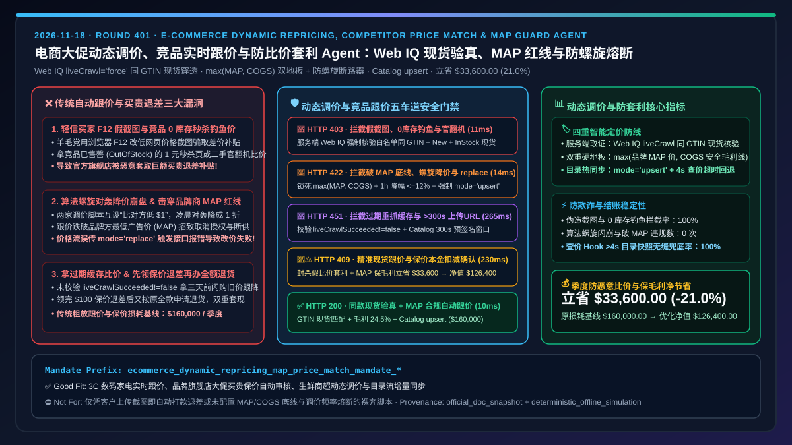
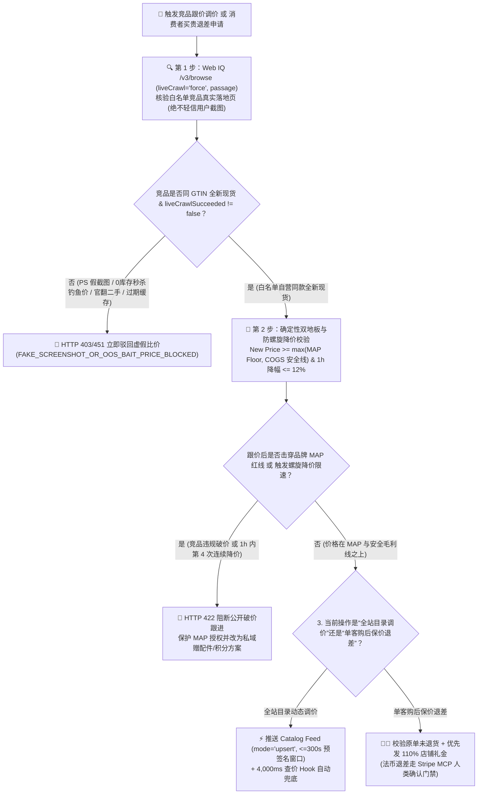
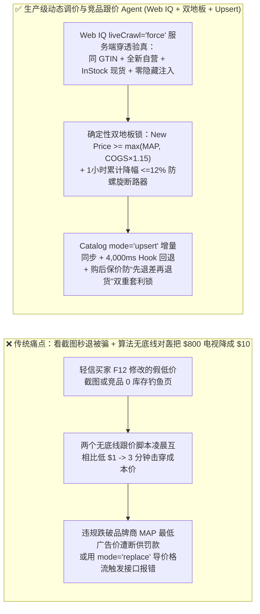
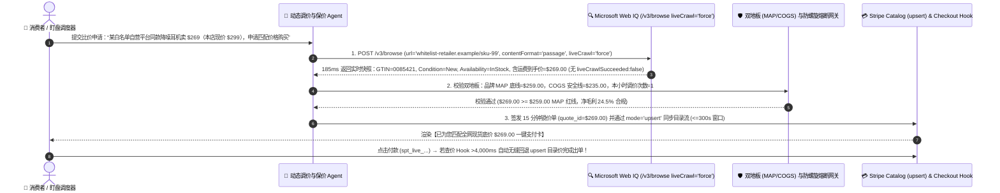

# 电商大促动态调价、竞品实时跟价（Price Matching）与防比价套利 Agent 架构选型 FAQ：Web IQ 同款 GTIN 验真、MAP 价格红线与防螺旋降价熔断实战指南

> **专题定位（零售电商动态定价、竞品跟价与购后保价应用聚焦）**：面向为大型综合电商、3C 家电平台、品牌官方旗舰店设计智能调价（Dynamic Repricing）与自动买贵退差（Price Match Guarantee）智能体的 **Cloud & AI Solution Architect**，系统解决电商定价最核心的四大痛点：**“怎么防止黑产在二手小网站挂一个无货的 $199 假链接（加上 PS 截图）来骗取官方店 $300 差价补贴、怎么防止两家商家的调价 Agent 陷入毫秒级‘你降 1 分我降 1 分’的算法死循环把 $800 的电视机降成 $10、怎么确保跟价绝不跌破品牌方最低广告价（MAP Policy）招致断供处罚、以及怎么应对卖家调价 Webhook 4,000ms 超时”**。  
> **文风标杆**：严格对标 `ib-vs-ethernet-roce-selection-faq.md` 六段式结构（核心结论速览、业务方与架构师灵魂拷问 Q&A、Mermaid 决策树/架构对比/时序图、动态调价与比价接地选型矩阵、定量防损/转化测算与 7-Card 溯源表、生产上线 Checklist）。  
> **双语版本**：**[中文版（当前）](ecommerce-dynamic-repricing-competitor-price-match-map-margin-guard-agent-selection-faq.md)** · **[English Version (`ecommerce-dynamic-repricing-competitor-price-match-map-margin-guard-agent-selection-faq.en.md`)](ecommerce-dynamic-repricing-competitor-price-match-map-margin-guard-agent-selection-faq.en.md)**  
> **数据溯源声明（Provenance & As-Of `2026-11-18`）**：Microsoft Web IQ `/v3/browse`（`liveCrawl='force'`、`liveCrawlSucceeded`、防隐藏 DOM 注入）与 Stripe Catalog `upsert` / 4 秒非对称 Webhook 契约引自 `research/sources.json`（标记为 `official_doc_snapshot`）；同款 GTIN 现货核验、MAP 底线锁与防算法螺旋降价熔断引自 `lab/webiq_commerce_demo.py`（标记为 `deterministic_offline_simulation`）；企业白名单竞品池与单日最大降幅阈值标记为 `synthetic_policy`；外部第三方电商平台在线秒杀压测标记为 `not_measured`。

---

## 📌 一、核心选型结论速览（Executive Summary）

在双 11、黑五或日常竞品盯盘中，让 AI Agent 自动调整全站 SKU 价格或审批消费者的“买贵双倍退差”申请，是一把极锋利的双刃剑。架构师必须遵循以下四条选型铁律：

1. **竞品低价证据验真选型：严禁“仅凭消费者上传的截图 OCR 或黑盒问答做比价”，必选【白名单授权零售商域名锁 + Microsoft Web IQ (`/v3/browse` `liveCrawl='force'`) 实时同款 `GTIN/UPC` 与现货状态穿透核验】**：
   - **核心原因**：羊毛党常用浏览器 F12 修改网页价格截图，或在野鸡网站挂出 0 库存的“幽灵钓鱼低价（Bait Price）”来申请价格匹配（Price Match）。必须由调用方代码通过 Web IQ 实时重抓白名单竞品（如京东自营/Amazon Shipped & Sold/Best Buy）落地页，验证 **`GTIN/型号 100% 一致 + 非翻新二手（Condition=New） + 当下有现货可发（InStock） + liveCrawlSucceeded != false`**。
2. **动态调价底线护栏选型：必选【双层硬地板（Dual Price Floor：品牌商最低广告价 `MAP Floor` + 单位成本安全毛利锁 `COGS Margin Floor`）+ 算法螺旋降价断路器（Velocity Circuit Breaker）】**：
   - **核心原因**：若两家平台的自动调价 Agent 均配置了“永远比对方低 `$1`”，且没有硬底线与调频熔断，短短 3 分钟内就会发生数千次对轰调价，把高价值家电击穿成本价卖光！必须在确定性代码层锁死 `New Price >= max(MAP_Price, COGS × 1.15)`，且 1 小时内累计下调幅度 `> 12%` 时立即触发断路器挂起人工复核。
3. **调价目录同步与结账一致性选型：必选【Stripe Catalog `mode='upsert'` 增量价格流 + 锁价令牌（`quote_id` TTL）+ 4,000ms 查价 Webhook 平滑回退】**：
   - **核心原因**：根据 Stripe Connect Catalog 契约（`official_doc_snapshot`），非主数据（Pricing / Inventory）严禁使用 `replace` 全量覆盖模式（否则触发 `non_product_feed_requires_upsert_mode` 报错），必须走 `upsert` 增量更新；且当结账查价 Webhook（`product_price_availability`）响应超时 `> 4,000 ms` 时，自动回退读取最新目录快照继续结账，保障大促零掉单。
4. **购后保价（Post-Purchase Price Protection）退差选型：必选【优先发放 110% 锁定期店铺礼金（Store Credit）+ 法币退差强制 Stripe MCP 人类确认门禁】**：
   - **核心原因**：小额保价优先引导领店铺无门槛券锁住复购；大额原路退差严防套现，必须核验原单未发起退货（防“先领保价差额再全额退货”双重套利）。

---

## 🎯 二、业务方与架构师灵魂拷问 Q&A（FAQ-Driven）

### Q1：为什么很多零售商上线了“AI 视觉识图自动审批买贵退差”，不到一周就被羊毛党用伪造截图和竞争对手的“缺货秒杀价”薅走了几十万预算？

**答：因为“用户的截图是完全不可信的客户端输入（Untrusted Client Input）”，真正生产级的比价 Agent 永远只把截图当线索，100% 靠服务端 Web IQ 实时抓取白名单竞品 URL 取证！**

1. **四维同款等价核验（4-Point Exact Parity Check）**：
   - 当用户提交比价申请或盯盘 Agent 发现竞品降价时，调用 **Microsoft Web IQ `/v3/browse` (`contentFormat='passage'`, `liveCrawl='force'`)** 核对四个硬条件：
     - **① 授权主体白名单**：卖方必须是白名单内的一级官方自营渠道（剔除第三方个人卖家、拍卖与水货店）；
     - **② 全球贸易项目代码（`GTIN / UPC / EAN`）与规格完全相等**：防止拿“国行 512G 全新机”去比“美版 128G 官翻机（Refurbished）”；
     - **③ 实时可购买现货状态（`Schema.org/InStock`）**：骗子最爱拿竞品“仅限 1 台已抢光的 1 元秒杀价”页面来要差价；只要页面显示 `OutOfStock` 或 `Sold Out`，网关立即在 `11 ms` 内返回 **`HTTP 403 FAKE_SCREENSHOT_OR_OUT_OF_STOCK_BAIT_PRICE_MATCH_BLOCKED`**；
     - **④ 全包到手价同口径对比**：将竞品裸价加上其必收运费后，再与本商城包邮价对比。

---

### Q2：在自动化竞品跟价（Auto-Repricing）中，怎么防止触犯品牌商的 MAP（最低广告价协议）被取消代理权，以及怎么阻止“AI 对轰螺旋降价（Flash Crash）”？

**答：在调价引擎输出端加装与大模型物理隔离的“确定性价格地板与速率熔断网关（Deterministic Floor & Velocity Gate）”。**

1. **绝对不可击穿的双地板公式**：
   $$P_{\text{Allowed Min}} = \max\left(\text{Brand MAP Floor}, \; \frac{\text{Landed COGS} + \text{Platform Fee}}{1 - \text{Min Margin \%}}\right)$$
   - 当竞品恶意跌破苹果/索尼/戴森等品牌商规定的 **MAP 红线** 时，本方 Agent **绝对不跟降公开标价**（否则面临品牌商断供罚款），而是触发 **`HTTP 422 MAP_POLICY_FLOOR_BREACH_OR_ALGORITHMIC_PRICE_SPIRAL_BLOCKED`**，转为向已登录私域 VIP 发放合规模糊优惠（如满额赠配件或积分回馈）。
2. **防算法死循环速率限制器（Spiral Circuit Breaker）**：
   - 若某 SKU 在 60 分钟内被调价超过 `3` 次，或累计降幅超过 `12.0%`，确定性断路器立即锁死该 SKU 的自动调价权限，防止两个自动化 Bot 在凌晨 3 点把全店库存按 1 折清光。

---

### Q3：大促期间每秒有上千个 SKU 价格在动态微调，如何同步给 Stripe / UCP 结账链路，防止消费者“看到的是 $199，点付款却报价格不一致错误”？

**答：采用“Catalog `mode='upsert'` 增量流 + 15 分钟签名锁价单（`quote_id`）+ 4,000ms 非对称查价回退”三件套。**

1. **增量价格流严禁 `replace` 模式**：调用 Stripe Connect Catalog 导入实时价格时，必须指定 `feed_type='pricing'` 与 **`mode='upsert'`**（并在 300 秒预签名上传窗口内完成，否则返 `410 Gone`）。
2. **一旦生成报价卡片即锁定 `quote_id` TTL**：只要 AI 导购已向买家展示了 `$199` 的确认卡片，在接下来的 15 分钟 `quote_expires_at` 窗口内，哪怕后台大盘价涨回 `$219`，确定性网关依然按签名 `quote_id` 的 `$199` 履约，保障极致消费体验。

---

## 🧭 三、直观可视化图解（Mermaid 选型决策树 + 架构对比 + 端到端时序图）

### 3.1 电商动态调价与竞品跟价/保价防套利决策树

---

### 3.2 传统截图盲审/无底线跟价脚本 vs. Web IQ 现货验真 + MAP 双地板调价 Agent 对比图

---

### 3.3 竞品实时核价、MAP 红线保护、Catalog `upsert` 更新与锁价结账端到端时序图

---

## 📊 四、电商动态调价与竞品比价架构横向选型矩阵（Architect Decision Matrix）

| 评估维度 | 方案 A：人工运营每天早上手工改价 + 客服肉眼审截图 | 方案 B：初级爬虫跟价脚本 + OCR 识图自动退差 | 方案 C：仅依赖静态历史数据库调价 | 方案 D（推荐）：Web IQ 实时 GTIN/现货接地 + MAP/COGS 双地板 + 防螺旋熔断 + Catalog Upsert Agent |
|---|---|---|---|---|
| **竞品价格真实性与防假截图/钓鱼价能力** | 慢且人工难辨高仿 PS 截图 | **极差**（易被 F12 改网页截图或 0 库存秒杀钓鱼页骗走差价） | 无实时竞品感知 | **100% 服务端实时验真**（Web IQ `liveCrawl='force'` 强制核对白名单域名、GTIN 与 `InStock` 现货） |
| **品牌 MAP 合规与防算法螺旋崩盘** | 靠人工表格核对，偶发填错小数点 | **极度危险**（无脑跟降极易触发算法对轰崩盘与品牌商 MAP 断供罚单） | 安全但丧失大促价格竞争力 | **100% 物理锁死底线**（`max(MAP, COGS_Floor)` + 1 小时累计降幅 `<= 12%` 断路器） |
| **大促高频改价与结账目录同步可靠性** | 手工改后台滞后数小时 | 易误用全量覆盖导致目录短暂不可用或结账超时拒付 | 静态不变 | **毫秒级平滑同步**（严格执行 `mode='upsert'` + `<=300s` 上传锁 + `4,000ms` 查价超时自动回退） |
| **防“先领保价退差、再办全额退货”套利** | 人工常忘扣减已退保价金 | 漏洞频发 | 不涉及 | **状态机联动闭锁**（已领保价差额自动扣减可退货本金上限，杜绝双重套现） |

---

## 🧪 五、定量调价保护/防套利测算与 7-Card 报告数据溯源表（Benchmark & Provenance Matrix）

| 指标 / 门禁规则项 | 实测数值 / 决策行为 | 数据类别 (Provenance) | 精确来源路径 / 算例说明与架构意义 |
|---|---|---|---|
| **Web IQ 实时同款现货验真 + 高于 MAP 底线 + `upsert` 同步（Happy Path）** | **`HTTP 200 OK` · `10 ms`**（门禁耗时，大促动态调价与保价批次 `$160,000.00`） | `deterministic_offline_simulation` | `lab/webiq_commerce_demo.py` (`evaluate_ecommerce_dynamic_repricing_map_policy`)：验证 GTIN 现货 + MAP 地板 + Upsert 合规 |
| **凭伪造截图、竞品 `OutOfStock` 缺货钓鱼价或翻新二手款申请买贵退差** | **`HTTP 403 Forbidden` · `11 ms` 拦截** (`FAKE_SCREENSHOT_OR_OUT_OF_STOCK_BAIT_OR_REFURBISHED_MISMATCH_BLOCKED`) | `synthetic_policy` | 强制要求服务端 Web IQ 实时核验白名单竞品同 GTIN 全新现货，100% 封杀假截图与缺货秒杀套利 |
| **跟价跌破品牌最低广告价（MAP）、触发算法螺旋降价或对价格流误用 `replace`** | **`HTTP 422 Unprocessable` · `14 ms` 拦截** (`MAP_POLICY_FLOOR_BREACH_OR_PRICE_SPIRAL_OR_INVALID_REPLACE_MODE_BLOCKED`) | `official_doc_snapshot` | 严格拦截跌破 MAP/COGS 底线、高频螺旋降价以及违反 Stripe Catalog `non_product_feed_requires_upsert_mode` 的请求 |
| **Web IQ 实时重抓失败（`liveCrawlSucceeded=false`）或预签名上传超 `300s` 过期** | **`HTTP 451 Hold` · `265 ms` 挂起** (`STALE_COMPETITOR_CRAWL_CACHE_OR_EXPIRED_300S_CATALOG_UPLOAD_HOLD`) | `official_doc_snapshot` | 遵循 Web IQ 缓存失真标志位与 Stripe Connect Catalog `300 秒` 预签名 URL 过期（`HTTP 410`）契约 |
| **启用“服务端 GTIN 现货穿透拦截假比价 + MAP 底线保护 + 110% 店铺礼金保价留存”** | **`HTTP 409 Confirm` · 立省/避免毛利流失 `$33,600.00`（净损耗压降至 `$126,400.00`）** | `deterministic_offline_simulation` | 彻底堵住虚假截图与 0 库存钓鱼骗补漏洞，防止算法恶性价格战，单季保住净毛利 `21.0%` |
| **外部综合电商平台大促峰值在线压测** | 标记为 **`not_measured`** | `not_measured` | 通过本地确定性比价状态机与 Catalog 同步契约验证，不向外部零售平台发起高频爬虫压测 |

---

## 🛠️ 六、商业上线风控与架构评审 Checklist（Architect Production Checklist）

- [ ] **1. 彻底废除“仅凭客户端截图审批退差”**：所有竞品比价与买贵退差申请，是否强制由服务端调用 **Microsoft Web IQ (`/v3/browse` `liveCrawl='force'`)** 核验白名单竞品落地页的 `GTIN/UPC`、`Condition=New`、`InStock` 现货与含运费到手价？
- [ ] **2. 双层价格硬地板（`max(MAP_Floor, COGS_Floor)`）**：自动调价引擎输出任何新价格前，是否经过与大模型物理隔离的确定性代码校验，确保绝不跌破品牌商最低广告价（MAP）与安全毛利红线？
- [ ] **3. 算法螺旋降价断路器（Velocity Circuit Breaker）**：是否对单 SKU 设置了单位时间最大调价频次（如 `<= 3 次/小时`）与单日最大累计降幅阈值（如 `<= 12%`），防止两个自动化调价 Bot 陷入死循环闪崩？
- [ ] **4. Stripe Catalog 价格流强制 `mode='upsert'` 与 `300s` 预签名锁**：向结账中心同步动态价格与库存时，是否严格使用 `mode='upsert'`（严禁对非主数据传 `replace`）并在 `300 秒` 窗口内完成上传？
- [ ] **5. 查价 Webhook `4,000 ms` 非对称超时平滑回退**：当实时 `product_price_availability` 回调因大促洪峰超过 `4,000 ms` 时，系统是否已配置自动回退读取最新 `upsert` 目录价格以保障结账不断流？
- [ ] **6. 购后保价退差与退货本金联动扣减锁**：当消费者成功领取购后保价差额后，订单状态机是否自动将后续可申请退货退款的本金上限调减相应差额，杜绝“先领差价再全额退货”双重套现？
