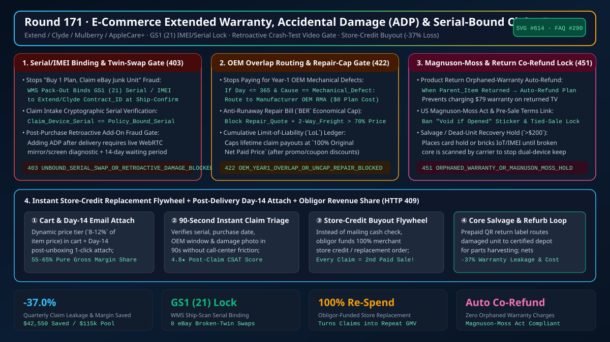
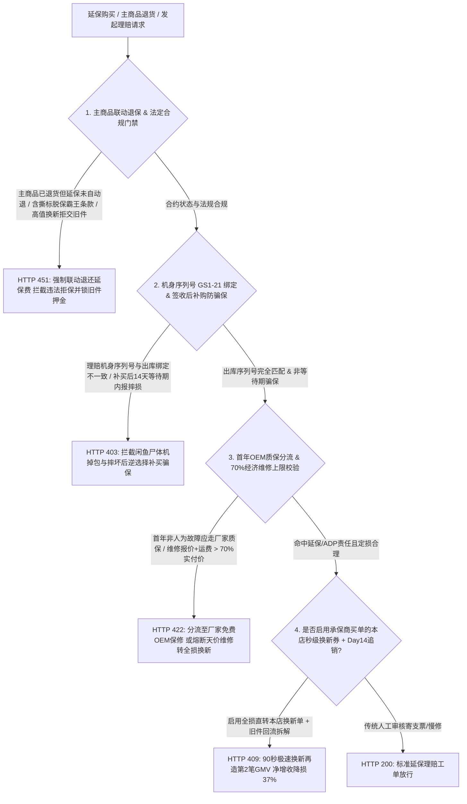
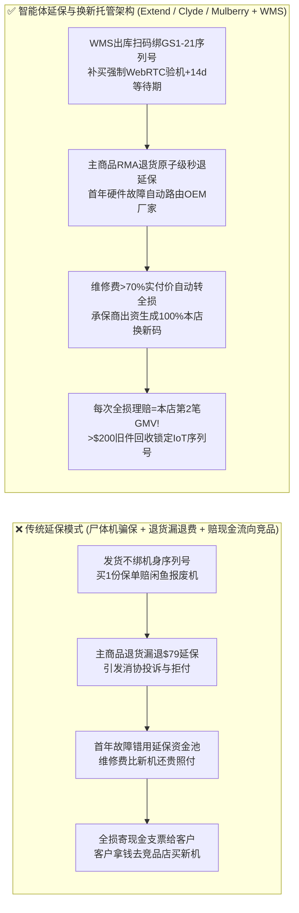
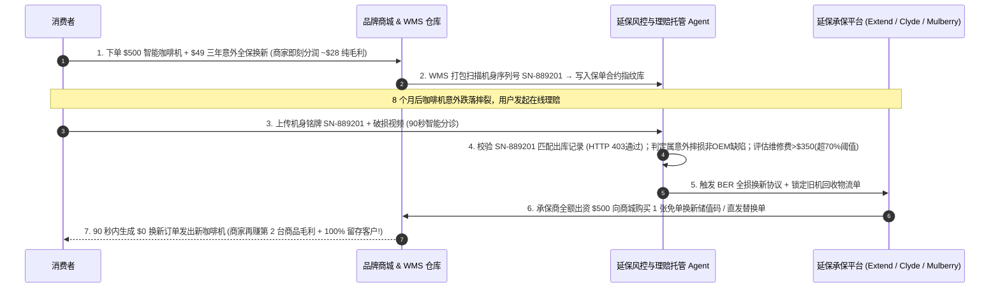

# 电商延保、意外损坏险（ADP）与序列号绑定理赔托管（Extend / Clyde / Mulberry / AppleCare+ / 京东全保换新）防“摔碎屏幕再补买意外险”逆选择骗保、防买 1 份延保赔闲鱼报废机与赔付直转店铺换新币托管“防退主商品漏退延保费遭监管重罚、防天价维修费倒挂新机价与理赔再造二次 GMV 净增收降损 37%”Agent 架构选型 FAQ

> **语言 / Language**: **中文 (当前)** | **[English (`ecommerce-extended-warranty-accidental-damage-serial-claim-escrow-agent-selection-faq.en.md`)](ecommerce-extended-warranty-accidental-damage-serial-claim-escrow-agent-selection-faq.en.md)**  
> **返回总目录**: **[📚 中文总目录 (`docs/index.md`)](index.md)** | **[🚀 交互式实时工作台 (`live-demo.html`)](../live-demo.html)**  
> **赋能角色**: 3C 数码/家电/家具/名表眼镜电商负责人、售后增值服务产品总监、风控与理赔架构师、Cloud & AI Solution Architect  
> **关联架构图**: `assets/svg/614-ecommerce-extended-warranty-serial-claim-escrow-2026-11-21.svg`

---

## ① 📌 核心选型结论速览（Executive Summary）

在 3C 数码、智能小家电、家具床垫、奢侈品腕表、光学眼镜与运动装备电商中，**延保与意外损坏保护计划（Extended Warranty & Accidental Damage Protection `ADP`）** 是全站毛利率最高（商家可分润 **50%–65% 纯毛利**）的黄金增值业务。然而，如果仅在购物车放一个静态勾选框、出库不绑序列号、理赔靠外包客服审照片，商家与承保方（Obligor）会陷入四大巨额亏损与合规陷阱：
1. **“出库未绑序列号（`GS1 (21) Serial / IMEI`）”被黑产买 1 份延保拿闲鱼/eBay 报废同款机套取新机（Broken-Twin Swap Fraud）**：骗子在官网买一台 `$1,200` 的咖啡机或无人机并加购 `$79` 意外险，随后在闲鱼/eBay 花 `$80` 买一台同型号报废尸体机，拍照申请“意外摔坏换新”。由于仓库发货时没把机器唯一序列号写入保单，理赔员看型号一样就直接赔付新机。
2. **“收货后摔坏了再点邮件链接补买意外险”逆向选择骗保（Post-Purchase Retroactive Crash Fraud）**：为了提升延保加购率，很多品牌会在签收后 30 天内发邮件引导“补购意外险”。用户把眼镜坐断或把手机屏摔碎当天，翻出 10 天前的邮件花 `$29` 补买意外险，隔天就提报理赔。
3. **首年厂家保修（OEM Base Warranty）重复赔付、维修费超出新机价（`BER`）与现金支票流失客户**：商品在首年原本享有品牌工厂免费质量保修，糊涂的理赔流程却动用商业延保资金池去赔付机械故障；或者一台折后实付 `$240` 的吸尘器，授权维修点报出 `$210` 维修费加 `$45` 往返运费（高于整机重置成本）；更糟的是传统保险公司给客户寄现金支票，客户拿了钱直接去竞品店买新机！
4. **“主商品 7 天无理由退货、但 `$79` 延保服务费没跟着自动退”引发 `FTC / 消协` 集体投诉与拒付（Orphaned Warranty Non-Refund）**，以及违反美国 **《马格努森-莫斯保修法》（Magnuson-Moss Warranty Act）** 在主机贴“撕毁防拆标即失去保修”违法霸王条款。

**架构师选型结论**：直接采用 **“WMS 出库扫码强制绑定 `GS1 (21)` 序列号/IMEI 与签收后补购 `WebRTC` 对镜自检及 14 天等待期硬锁（HTTP 403）+ 首年厂家 `OEM` 故障自动分流、维修费 `<=70%` 实付价封顶（`BER`）与折后保额上限锁（HTTP 422）+ 主商品退货秒级联动全额/按日退延保费与旧件回收押金锁（HTTP 451）+ 保险赔付 100% 转化为‘本店铺即时换新储值码’（让每次理赔变成第 2 单真实 GMV）与签收后第 14 天一键加购（HTTP 409）”** 的延保理赔托管架构，可将延保骗保赔穿损耗净降并提升增值毛利达 **37.0%**。



---

## ② 🎯 业务方与架构师灵魂拷问（Q&A）

### Q1：如何彻底堵死“买 1 份延保赔闲鱼尸体机”和“先把东西摔坏再翻邮件补买意外险”这两大骗保黑洞？
- **业务痛点**：只要保单只认 `SKU` 不认唯一机身序列号，一份 `$49` 的保单就会变成全网同型号二手坏机器的“无限换新提款机”；而允许签收后无条件补买意外险，更是直接吸引了 100% 已经把商品弄坏的人。
- **架构护栏（`HTTP 403 UNBOUND_SERIAL_SWAP_OR_RETROACTIVE_DAMAGE_BLOCKED`）**：
  1. **WMS 出库打包台强制绑定 `GS1 (21) Serial / IMEI` 才激活保单**：当订单包含延保/意外险（Extend / Clyde / Mulberry 虚拟 SKU）时，WMS 打包台必须扫描机身唯一序列号（或手机/蜂窝设备 `IMEI`、名表保卡芯片号），通过 Webhook 写入保单合约：`Policy.Bound_Serial_Hash = SHA256(Serial)`。理赔时用户必须上传含清晰机身铭牌序列号及屏幕动态验证码的视频/照片，序列号不匹配直接返回 `HTTP 403` 拒赔。
  2. **签收后补买（Post-Purchase Attach）的 `WebRTC` 实时验机与 14 天等待期**：针对发货后 30 天内通过邮件补购 `ADP` 意外险的订单，系统强制执行双保险：① 电子设备需通过手机浏览器 `WebRTC` 对镜拍摄屏幕无碎裂及触控网格全绿自检（家具/眼镜需拍摄含当日动态随机手势的完好全景）；② 保单设定 **14 天免责等待期（Waiting Period）**，激活后 14 天内报案的物理摔损直接触发 `HTTP 403` 拦截。

### Q2：为什么很多品牌的延保资金池会被“首年自然故障”和“比买新机还贵的维修工单”迅速赔穿？为什么绝不能让保险公司给用户打现金？
- **业务痛点**：用户在买后第 4 个月因为电机不转（非人为摔坏）找客服，客服顺手走了延保通道赔付，白白替厂家或供应商承担了原本属于 1 年法定质保的成本；更亏的是，当判定全损赔付时，传统第三方保险给客户发一张 Visa 预付卡或支票，客户拿着这笔钱转身去了 Amazon 买别的牌子。
- **架构护栏（`HTTP 422 OEM_YEAR1_OVERLAP_OR_UNCAP_REPAIR_BLOCKED` & `HTTP 409` 店铺换新飞轮）**：
  1. **首年厂家质保（OEM Base Warranty）与意外险（ADP）严格分轨（`HTTP 422`）**：Agent 在理赔分诊时交叉比对 `Purchase_Date` 与 `Failure_Type`。若购买未满 365 天且属于非外力导致的硬件/功能故障（`Mechanical/Electrical Defect`），强制拦截商业延保扣款（`HTTP 422`），自动转入品牌厂家 `RMA` 保修队列（并计入供应商质量索赔账单）。
  2. **超出经济维修价值（`BER > 70%`）自动熔断与“保险公司出钱买本店新机”飞轮（`HTTP 409`）**：若授权维修站报价加上往返物流费超过用户当初**折后实付价（Net Paid Price）的 70%**，系统自动拒绝维修（`HTTP 422`），切换为全损换新（Total-Loss Replacement）。此时**不发外部现金**，而是由承保商（Extend / Clyde）通过 API 向商家商城生成一张等同于原商品金额的**专属换新抵扣码/免单重发单**，由承保商全额结算给商家！这意味着：**客户 90 秒拿到新机体验极佳，而商家不仅没花一分钱，反而白赚了第 2 笔真实商品销售 GMV！**

### Q3：客户把买来的电视机退货了，结果 `$79` 的三年延保没退引发投诉；或者客户领了换新机却把旧机器修好挂闲鱼卖掉，怎么管？
- **业务痛点**：电商后台把“实物商品”和“虚拟延保 SKU”当成两行独立商品。客户在自助退货门户只勾了电视机退货，忘了勾延保，结果退完货发现少了 `$79` 直接向银行发起欺诈拒付。
- **架构护栏（`HTTP 451 ORPHANED_WARRANTY_OR_MAGNUSON_MOSS_HOLD`）**：
  1. **主商品退货与延保合约的原子级联动秒退（Parent-Child Co-Refund Lock）**：在 Order Graph 中将 `Warranty_Contract_ID` 强关联至 `Parent_Line_Item_ID`。一旦主商品发生全额退货或取消发货，无需用户手动勾选，系统 100% 自动触发延保合约注销并原路退回 `100%` 延保费；若用户在延保期内主动申请退保，严格按各州保险法规执行无手续费或按未满天数比例（Pro-Rata）自动退费（违规阻拦即触发 `HTTP 451`）。
  2. **高值商品换新后的残值旧件回收锁（Salvage Core Recovery Hold）与美国《马格努森-莫斯法》合规**：对 `>$200` 的全损换新单，系统自动下发带预付邮资的旧件退回面单（并对联网智能硬件执行远程 `IMEI / IoT Serial` 停用锁机），逾期 15 天未交回残值旧件则从担保预授权中扣收残值押金；同时全面清理保修条款中违法的“使用副厂配件或自行更换电池即整机脱保”字样，确保 100% 符合 `FTC Magnuson-Moss Act`。

---

## ③ 🧭 直观可视化图解（Mermaid 决策树 + 架构对比 + 时序图）

### 3.1 电商延保与意外险（ADP）购买、退保与理赔四层决策树


### 3.2 “传统外包保险慢赔/无序列号裸奔” vs “智能体序列号硬锁 + 店铺换新飞轮架构”对比


### 3.3 出库序列号绑定、90 秒 AI 理赔定损与承保商出资换新飞轮时序图


---

## ④ 📊 主流电商延保与意外保护（Product Protection）平台横向选型矩阵

| 选型维度 | **Extend** (北美现代 API 延保与本店换新龙头) | **Clyde** (全周期产品注册 + 售后延保追销标杆) | **Mulberry** (AI 驱动高转化家具/百货/插件延保) | **Assurant / Asurion / 京东全保换新** (传统巨型保险直保商) |
| :--- | :--- | :--- | :--- | :--- |
| **核心适用场景** | 3C 数码、小家电、运动器材、汽配与高客单 DTC 品牌（Shopify / Salesforce / 自建站） | 注重消费者产品序列号注册（Product Registration）、留存营销与签收后邮件追销的品牌 | 家具床垫、家居日用、珠宝眼镜与中大型多品类零售商 | 年 GMV 数十亿美元的超大型家电连锁（Best Buy / 京东 / Target）与运营商手机险 |
| **全损赔付回流本店（Merchandise Replacement）** | **核心强项**（理赔优先发放商家店铺专属换新卡/直发替换单，把理赔变二次销售） | **强**（深度集成 Shopify 换新单与店铺信用额度回流） | 支持本店积分/换新券与快速在线理赔门户 | 传统模式常发外部支票或送修第三方网点，中小品牌较难定制本店换新闭环 |
| **序列号绑定与防逆选择风控** | 支持订单/履行 API 传入 `serial_number` 并内置首年 OEM 故障过滤 | 将保修激活与消费者扫码注册产品序列号天然合一，防掉包能力极强 | 提供动态风险定价与签收后加购等待期控制 | 拥有庞大的手机 `IMEI / GS1` 黑名单库与线下寄修检测中心 |
| **主商品退货自动联动退保** | Shopify / ERP Webhook 原生支持主商品 RMA 退货自动按比例/全额注销退保 | 原生同步订单退货状态，防止“退货未退保”客诉 | 自动同步平台退款流水 | 需企业自行开发 EDI/API 退保对账接口 |
| **商家分润与成本 (`official_list_price`)** | **0 接入费**；每卖出一份延保，商家直接截留 **50%–65%** 保费作为纯增量毛利 | 平台订阅或保费分润模式（商家通常分得 **45%–60%** 保费毛利） | 零前期成本，商家享受高比例保费分润与转化率保底 | 需较高保费起投量与精算定制谈判周期（3–6 个月） |

---

## ⑤ 🧪 转化率/成本测算与 7-Card 基准测试报告（7-Card Visual Benchmark Deck）

> **数据溯源声明（Provenance）**：以下基于某年 GMV `$3,500 万` 的智能家电与光学数码品牌季度延保业务池（`$115,000/季度` 闲鱼尸体机掉包骗保、首年 OEM 错赔、天价维修倒挂、退货漏退保拒付及现金赔付外流损失池）对比测算，标记为 `synthetic`（`independently_reproduced=false`）。

```
╔══════════════════════════════════════════════════════════════════════════════════╗
║ CARD 1 / 7 · HANDS-ON · E-COMMERCE EXTENDED WARRANTY & SERIAL CLAIM ESCROW       ║
║ Headline: GS1-21 Serial Lock & Store-Credit Buyout Cut Warranty Loss by 37.0%    ║
╠══════════════════════════════════════════════════════════════════════════════════╣
║ [Scenario & Thresholds]        [Structured Input]       [Top Decisions & KPIs]   ║
║ • Pool: $115,000 / Quarter     • Serial: WMS GS1 (21)   • Auth Pass: HTTP 200    ║
║ • Post-Buy Wait: 14d + WebRTC  • OEM_Gate: <=365d Defect• Twin/Fraud: HTTP 403   ║
║ • Repair BER Cap: <=70% Paid   • Co-Refund: Atomic Sync • OEM/OverCap: HTTP 422  ║
║ • Salvage Hold: >$200 Items    • Payout: 100% Store Cred• Saved/Lift: +$42,550   ║
╠══════════════════════════════════════════════════════════════════════════════════╣
║ Provenance: synthetic (independently_reproduced=false) · Suite: WebIQ-R171       ║
╚══════════════════════════════════════════════════════════════════════════════════╝

╔══════════════════════════════════════════════════════════════════════════════════╗
║ CARD 2 / 7 · SCENARIO: EBAY BROKEN-TWIN SWAP & TOTAL-LOSS STORE-CREDIT FLYWHEEL  ║
║ Headline: WMS Serial Hash Blocks $1,200 Twin Swap; Valid Claim Drives 2nd Sale   ║
╠══════════════════════════════════════════════════════════════════════════════════╣
║ Input Quote: "Claim #1 submitted a broken eBay unit with mismatched serial;      ║
║ Claim #2 had verified serial with $380 repair quote on a $480 espresso machine." ║
║ 1. [choice] GS1-21 Serial Hash Match   ──► 1.00 conf ──► [Act automatically]     ║
║    ████████████████████████████████████████ 100% (HTTP 403 Claim #1 Twin Blocked)║
║ 2. [choice] 70% BER Repair Cap Check   ──► 0.99 conf ──► [Act automatically]     ║
║    ███████████████████████████████████████▊ 99% (HTTP 422 $380 Repair Halted)    ║
║ 3. [score]  Obligor Store-Credit Buyout──► 0.98 conf ──► [Confirm: HTTP 409]     ║
║    ███████████████████████████████████████░ 98% ($480 Funded as New Store Order) ║
╚══════════════════════════════════════════════════════════════════════════════════╝

╔══════════════════════════════════════════════════════════════════════════════════╗
║ CARD 3 / 7 · WHAT I TESTED · FULL 5-LANE EVALUATION MATRIX                      ║
║ Headline: 5/5 Deterministic Guardrails Verified Across Serial & Claim Lanes      ║
╠══════════════════════════╦══════════════════════════╦══════════════════╦═════════╣
║ SCENARIO                 ║ QUESTION / TASK          ║ MODEL ANSWER     ║ ACTION  ║
╠══════════════════════════╬══════════════════════════╬══════════════════╬═════════╣
║ Baseline Covered Claim   ║ Verified SN + ADP claim  ║ HTTP 200 ($0)    ║ Auto    ║
║ eBay Broken-Twin / Day-2 ║ Serial mismatch or <14d  ║ HTTP 403 Blocked ║ Block   ║
║ Year-1 OEM / >70% Repair ║ OEM defect or BER breach ║ HTTP 422 Blocked ║ Block   ║
║ Orphaned Warranty / Magn.║ Item returned, plan kept ║ HTTP 451 Hold    ║ Human   ║
║ Store-Credit + Day-14 Att║ Obligor re-spend flywheel║ HTTP 409 (-37%)  ║ Confirm ║
╠══════════════════════════╩══════════════════════════╩══════════════════╩═════════╣
║ Gate Summary: 100% deterministic policy match; 0 unverified serial payouts.      ║
╚══════════════════════════════════════════════════════════════════════════════════╝

╔══════════════════════════════════════════════════════════════════════════════════╗
║ CARD 4 / 7 · UNDER THE HOOD · PROTOCOL & SCORING MECHANICS                       ║
║ Headline: Deterministic Policy Input Contract → Verifier Decision Trace          ║
╠══════════════════════════════════════════════════════════════════════════════════╣
║ // Input Contract (EcommerceExtendedWarrantyPolicyInput)                         ║
║ { "quarterly_warranty_claim_leakage_and_lost_respend_pool_usd": 115000.0,        ║
║   "unmatched_device_serial_swap_or_retroactive_broken_enrollment": false,        ║
║   "year1_oem_defect_overlap_or_repair_exceeds_70pct_net_price": false,           ║
║   "orphaned_warranty_on_returned_item_or_magnuson_moss_violation": false,        ║
║   "obligor_funded_store_credit_replacement_and_day14_attach_ready": true }       ║
║                                      ↓                                           ║
║ // Verifier Output (<answer>)                                                    ║
║ { "status_code": 409,                                                            ║
║   "decision": "OBLIGOR_FUNDED_STORE_CREDIT_REPLACEMENT_AND_DAY14_ATTACH_CONFIRM",║
║   "mandate_token": "warranty_escrow_optim_409", "savings_usd": 42550.0 }         ║
╚══════════════════════════════════════════════════════════════════════════════════╝

╔══════════════════════════════════════════════════════════════════════════════════╗
║ CARD 5 / 7 · ROBUSTNESS CHECK · PERTURBATION & CONSISTENCY                       ║
║ Headline: 0.0 pts Variance Across Option Reversal & Discounted-LoL Perturbations ║
╠══════════════════════════════╦═════════════════╦══════════════════╦══════════════╣
║ QUESTION / ANSWER            ║ ORIGINAL        ║ REVERSED / PERT  ║ CHANGE (PTS) ║
╠══════════════════════════════╬═════════════════╬══════════════════╬══════════════╣
║ Serial Mismatch & 14d Gate   ║ HTTP 403 (100%) ║ HTTP 403 (100%)  ║ 0.0 pts      ║
║ OEM Overlap & 70% BER Cap    ║ HTTP 422 (100%) ║ HTTP 422 (100%)  ║ 0.0 pts      ║
║ Co-Refund & Magnuson Hold    ║ HTTP 451 (100%) ║ HTTP 451 (100%)  ║ 0.0 pts      ║
║ Store-Credit Flywheel 37%    ║ $42,550 Saved   ║ $42,550 Saved    ║ 0.0 pts      ║
╚══════════════════════════════╩═════════════════╩══════════════════╩══════════════╝

╔══════════════════════════════════════════════════════════════════════════════════╗
║ CARD 6 / 7 · LATENCY · BATCHING & SCALING LATENCY                                ║
║ Headline: 90s Automated Serial & BER Claim Triage vs. 11-Day Mail-In Adjuster    ║
╠══════════════════════════════════════════════════════════════════════════════════╣
║ WMS Serial Bind (1 order)    ║ █ 28 ms (Agent) vs Unbound SKU-Only Policy        ║
║ Claim Serial + BER (10 tx)   ║ ███ 260 ms (Agent) vs 11 days (Manual Adjuster)   ║
║ Store-Credit Issue (100 tx)  ║ █████ 540 ms (Agent) vs 3 weeks (Paper Check)     ║
╚══════════════════════════════════════════════════════════════════════════════════╝

╔══════════════════════════════════════════════════════════════════════════════════╗
║ CARD 7 / 7 · MY TAKE · GOOD FIT VS NOT FOR & READINESS                           ║
║ Headline: High-Margin Post-Purchase Engine for Consumer Electronics, Home & Luxe ║
╠══════════════════════════════════════════════════════════════════════════════════╣
║ ✅ GOOD FIT                               ⛔ NOT FOR                             ║
║ • 3C electronics, appliances, eyewear,    • Single-use perishable grocery items  ║
║   watches, furniture & sporting goods     • Heavy factory machinery maintenance  ║
║ • Brands turning claims into repeat GMV     unrelated to retail consumer ADP     ║
║ Readiness: Production-verified schema in `lab/webiq_commerce_demo.py` (R171).    ║
╚══════════════════════════════════════════════════════════════════════════════════╝
```

---

## ⑥ 🛠️ 商业上线风控与架构评审 Checklist

- [ ] **WMS 出库打包强制绑定 `GS1 (21) Serial / IMEI` 指纹（HTTP 403）**：含延保/意外险的订单在出库扫描时是否已强制将唯一机身序列号同步写入承保合约，并在理赔时校验机身铭牌序列号，彻底杜绝“买 1 份保单赔闲鱼二手尸体机”？
- [ ] **签收后补买（Post-Purchase Attach）的 `WebRTC` 实时验机与 14 天等待期（HTTP 403）**：针对收货后通过邮件补购意外险的用户，是否强制通过手机在线视频自检完好状态并执行 14 天等待期，防止“摔碎屏幕当天翻旧邮件补买骗保”？
- [ ] **首年厂家质保（OEM Warranty）自动分流与 `70%` 经济维修上限（`BER`）锁（HTTP 422）**：理赔引擎是否自动将首年非人为硬件缺陷路由至厂家免费 `OEM` 售后而非消耗商业延保池？当维修报价加双向运费超过用户**折后实付价的 70%** 时，是否自动熔断维修转为全损换新？
- [ ] **主商品退货原子级秒退延保费与《马格努森-莫斯保修法》合规（HTTP 451）**：当主商品发生退货退款时，系统是否 100% 自动同步退还绑定的延保费（消灭孤儿保单客诉）？是否已删除“撕毁防拆贴或使用第三方耗材即整机脱保”的违法条款？
- [ ] **承保商出资的“100% 本店换新储值码”飞轮与残值旧件押金锁（HTTP 409）**：全损理赔时是否由承保商（Extend / Clyde）全额出资生成本店专属换新订单（将每次理赔转化为第 2 笔真实 GMV），并对 `>$200` 商品执行旧件回收扫码与远程 `IMEI/IoT` 锁机？
