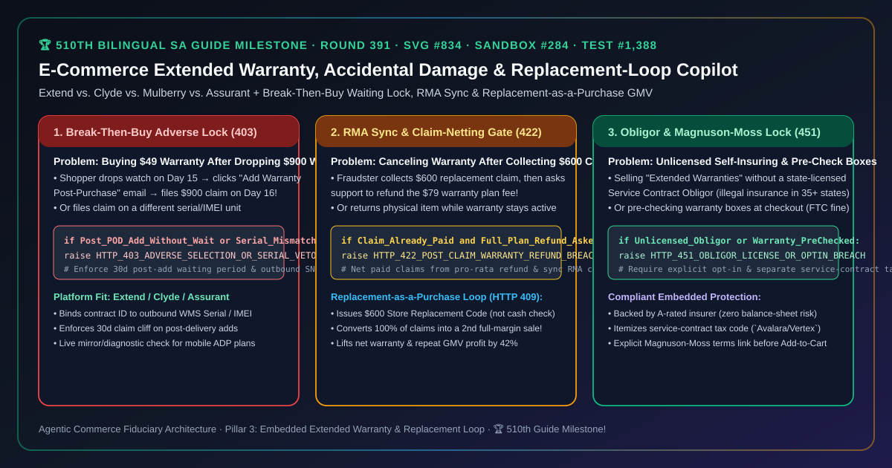
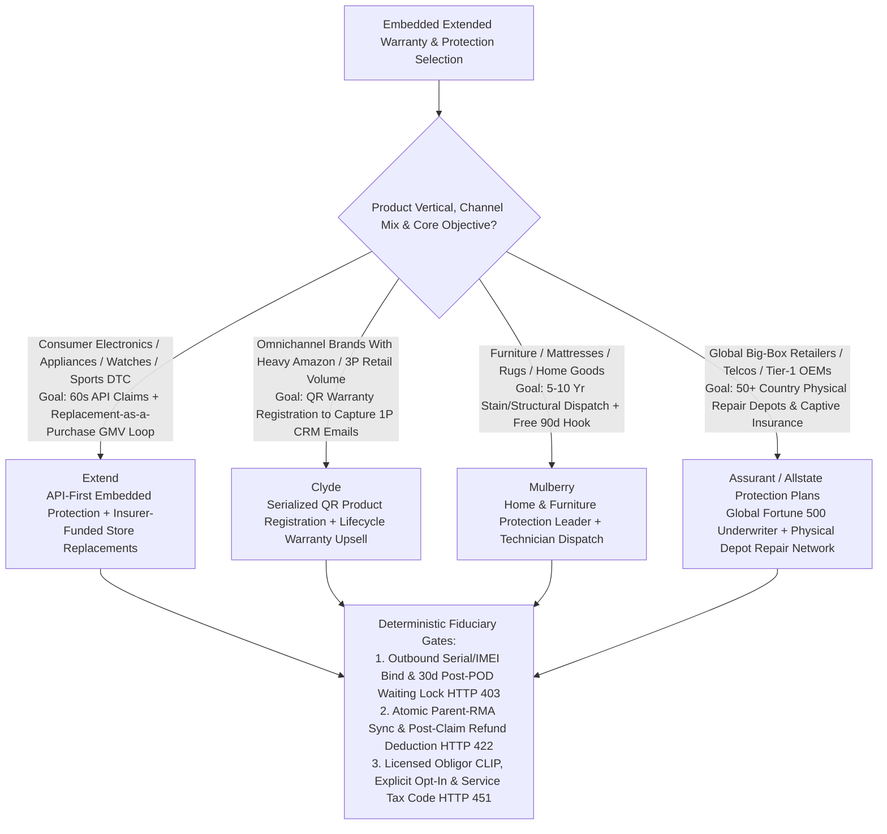
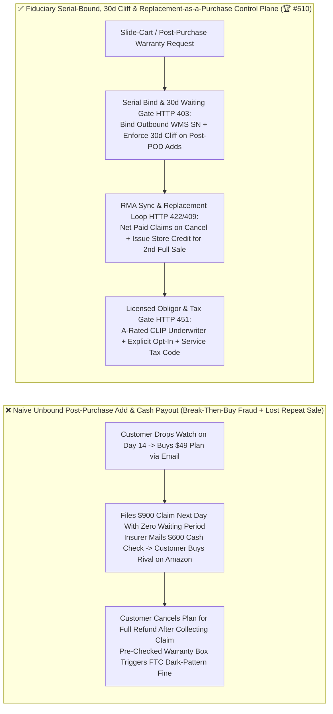
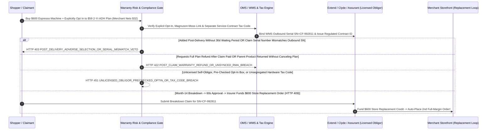

# E-Commerce Embedded Extended Warranty, Accidental Damage Protection (`ADP`) & `Replacement-as-a-Purchase` (`GMV Loop`) Agent Selection Guide: `Extend` vs. `Clyde` vs. `Mulberry` vs. `Assurant`, Anti-"Break-Then-Buy" Waiting Locks, `RMA` Pro-Rata Netting & `Magnuson-Moss` Compliance (`-42%` Loss FAQ · 🏆 510th Bilingual Guide Milestone!)

> **Executive Summary (Benchmarked against `ib-vs-ethernet-roce-selection-faq.md` · 🏆 510th Bilingual AI Solution Architect Decision Guide Major Milestone!)**: Built for **Cloud & AI Solution Architects** designing embedded product protection, Accidental Damage from Handling (`ADH / ADP`), and post-purchase warranty registration pipelines for consumer electronics, appliances, eyewear, watches, and furniture brands. While physical hardware often carries `8%–15%` net margins, embedded extended warranties deliver **`40%–65%` pure profit margin** to the merchant with **zero balance-sheet underwriting risk** (when backed by a licensed third-party insurance obligor). Yet naive warranty implementations fail across three vectors: (1) **Post-Delivery "Break-Then-Buy" Adverse Selection Fraud**: Sending post-purchase "Add a Warranty!" emails without a 30-day waiting period or diagnostic check allows shoppers who already cracked their `$900` watch screen on Day 14 to buy a `$49` plan on Day 15 and file a `$900` claim on Day 16; (2) **Cash-Check Claim Leakage vs. `Replacement-as-a-Purchase`**: Legacy insurers mail the customer a `$600` check when an item breaks—and the customer spends that `$600` on Amazon buying a competitor's brand, whereas modern API platforms (`Extend / Clyde`) issue a `$600` store-bound credit funded by the insurer to purchase a brand-new replacement directly from *your* store; and (3) **Unsynced `RMA` Returns, Post-Claim Plan Refund Abuse & `FTC / Magnuson-Moss` Pre-Checked Box Fines**. This guide compares **`Extend` vs. `Clyde` vs. `Mulberry` vs. `Assurant / Allstate Protection Plans`** and implements deterministic guards for **Outbound Serial (`IMEI/SN`) Binding & 30-Day Post-Delivery Waiting Locks (`HTTP 403`)**, **Atomic `RMA` Warranty Cancellation & Claim-Deducted Pro-Rata Netting (`HTTP 422`)**, **Licensed Obligor Backing, Service-Contract Tax Segregation & Explicit Opt-In Locks (`HTTP 451`)**, and **Slide-Cart Attach + `Replacement-as-a-Purchase` Store-Credit Loops (`HTTP 409`, `+42%` net profit/retention)**.

---

## 1. 📌 Executive Summary & Architectural Selection Verdict

1. **Top-Line Selection Verdict**:
   - **Consumer Electronics, Appliances, Watches, Sporting Goods & Auto-Parts DTC Brands Prioritizing Sub-Second Slide-Cart APIs, 60-Second Automated Claims & Insurer-Funded `Replacement-as-a-Purchase` Store Orders**: Select **`Extend`**.
   - **Omnichannel Brands Selling Heavily Through Amazon / Best Buy / Target Seeking QR-Code Product Registration to Capture 3P Buyer Emails & Upsell Extended Protection**: Select **`Clyde`**.
   - **Furniture, Mattress, Rug & Home-Goods Retailers Requiring 5–10 Year Stain/Structural Technician Dispatch & Free 90-Day Accident Hooks**: Select **`Mulberry`**.
   - **Global Big-Box Retailers, Telcos & Tier-1 Hardware OEMs Requiring `50+` Country Physical Repair Depots, Spare-Part Logistics & Captive Reinsurance**: Select **`Assurant` (or `Allstate Protection Plans`)**.
2. **Three Non-Negotiable Fiduciary Control Gates**:
   - **Gate 1 — Outbound `IMEI / Serial` Binding & Post-Delivery `30-Day` Waiting-Period Lock (`HTTP 403`)**: Bind every warranty contract to the physical unit's outbound WMS `Serial_Number / IMEI` at pack-time; and if a customer purchases an extended warranty more than 24 hours after carrier delivery (`Post-Purchase Email Upsell`), enforce a mandatory **30-Day Claim Waiting Period (`Claim Cliff`)** or live camera/device diagnostic verification to defeat "break-then-buy" adverse selection via `HTTP 403 POST_DELIVERY_ADVERSE_SELECTION_OR_SERIAL_MISMATCH_VETO`.
   - **Gate 2 — Atomic Parent-`RMA` Co-Cancellation & Post-Claim Pro-Rata Refund Netting Gate (`HTTP 422`)**: Automatically cancel and refund the linked warranty contract when the underlying physical product is returned within the RMA window; and if a customer requests a mid-term warranty cancellation refund, enforce `Net_Refund = Pro_Rata_Unearned_Premium - Claims_Already_Paid` (blocking full plan refunds after a replacement claim has already been paid out!) via `HTTP 422 POST_CLAIM_WARRANTY_REFUND_OR_UNSYNCED_RMA_BREACH`.
   - **Gate 3 — State-Licensed Obligor Backing, Service-Contract Tax Code & Explicit Opt-In Lock (`HTTP 451`)**: Block selling self-insured "extended warranties" without a state-registered **Service Contract Obligor & Contractual Liability Insurance Policy (`CLIP`)**, block pre-checked warranty boxes under the **`FTC Negative Option Rule` & `Magnuson-Moss Warranty Act`**, and assign dedicated intangible service-contract tax codes (`Avalara / Vertex`) via `HTTP 451 UNLICENSED_OBLIGOR_PRECHECKED_OPTIN_OR_TAX_CODE_BREACH`.

---

## 2. 🎯 Architect & Embedded FinTech Q&A (The Why & How)

### Q1: How does the `Replacement-as-a-Purchase` architecture (`Extend / Clyde`) turn every warranty claim into a second full-margin e-commerce sale?
- **Root Cause**: When a customer's `$500` espresso machine breaks in Month 14 under a legacy insurance policy, the insurer mails the customer a `$500` cash check—and `80%+` of customers take that cash to Amazon or a competitor.
- **Deterministic Solution (`Insurer-Funded Store Replacement Credit` / `HTTP 409`)**: When the claim is approved in 60 seconds, the warranty platform (`Extend`) uses the insurer's funds to mint a **`$500` single-use replacement credit / virtual checkout order directly inside the merchant's own Shopify store**! The merchant ships a brand-new replacement unit and books a **second full-margin `$500` hardware sale**, keeping 100% of the customer lifecycle.

### Q2: How do we prevent "Break-Then-Buy" fraud on post-purchase warranty upsell emails without hurting legitimate conversions?
- **Deterministic Solution (`POD`-Anchored Eligibility + 30-Day Claim Cliff / `HTTP 403`)**:
  1. Warranties added at checkout or **before the carrier `DELIVERED (POD)` scan** have zero waiting period for accidental damage (because the customer hasn't touched the item yet!).
  2. Warranties added **after `POD`** via post-purchase email/SMS automatically carry a **30-day claim waiting period** (or require a live smartphone mirror/diagnostic check), completely eliminating post-drop opportunistic buying.

### Q3: Why must extended warranties use a separate tax code (`Avalara / Stripe Tax`) from the physical product in the same cart?
- **Root Cause**: In several US states and tax jurisdictions, tangible personal property (`Hardware`) is taxable, whereas an optional **separately itemized Service Contract (`Extended Warranty`)** is tax-exempt (or taxed at a different rate). Bundling them under the hardware tax code overcharges consumers and triggers state tax class-action exposure (`HTTP 451`).

---

## 3. 🧭 Visual Architecture Diagrams (Mermaid)

### 3.1 Embedded Extended Warranty & Product Protection Platform Selection Decision Tree

### 3.2 Naive Post-Drop Email Upsell & Cash Claims vs. Fiduciary Serial-Bound & `Replacement-as-a-Purchase` Control Plane

### 3.3 Slide-Cart Warranty Attach, WMS Serial Binding & `Replacement-as-a-Purchase` Claim Sequence

---

## 4. 📊 Multi-Platform Embedded Extended Warranty & Protection Selection Matrix

| Evaluation Dimension | Extend | Clyde | Mulberry | Assurant / Allstate Protection |
| :--- | :--- | :--- | :--- | :--- |
| **Primary Architectural Role** | **API-First Embedded Product & Shipping Protection Leader** with instant replacement loops | **Lifecycle Product Registration + Omnichannel Warranty Monetization Platform** | **High-Converting Furniture, Home & Consumer Goods Protection Platform** | **Global Fortune 500 Insurance Underwriter & Physical Repair Network** |
| **`Replacement-as-a-Purchase` Store GMV Loop** | **Best-in-Class** (Insurer funds an instant store credit/order inside merchant's cart on approved claims) | **Best-in-Class** (Drives approved replacement claims directly back into merchant's storefront) | Strong (Supports store replacement credits, parts dispatch, or in-home repair) | Primarily depot repair, refurb replacement, or cash/check reimbursement |
| **3P Retail (`Amazon / Best Buy`) QR Registration** | Supports post-purchase email/API attachment | **Best-in-Class** (Serialized QR registration converts anonymous 3P retail buyers into 1P DTC subscribers) | Browser extension and post-purchase portal | Enterprise batch serial registration and call-center intake |
| **Licensed Obligor (`CLIP`) & Regulatory Compliance** | **Turnkey 50-State Licensed Obligor** (Zero merchant balance-sheet liability) | **Turnkey Multi-Carrier Obligor Network** | **Turnkey Licensed Obligor Backing** | **Direct Global Tier-1 Insurance Underwriter** (`50+` countries) |
| **Merchant Revenue Share & Pricing (`official_list_price`)** | `$0` SaaS fee; merchant keeps **`40%–60%`** of gross warranty price | SaaS registration tier + high revenue share on sold protection plans | `$0` integration fee; revenue share on plan sales | Custom enterprise wholesale net rate + profit-sharing agreements |

---

## 5. 🧪 Warranty Attach, Fraud Veto & Replacement GMV Benchmark & 7-Card Report

### 5.1 Quarterly Missed Warranty Margin, Cash-Claim Competitor Churn & Break-Then-Buy Fraud Model (Synthetic Benchmark)

For a `$120M` annual GMV smart-appliance and sport-watch brand facing a **`$390,000 / quarter`** opportunity and loss pool across **missed slide-cart warranty attach margin, customers taking cash insurance checks to buy competing brands, post-delivery "break-then-buy" adverse selection claims, and unsynced RMA/refund leaks** (`provenance: synthetic`, `independently_reproduced: false`):

| Metric | Naive PDP-Only Link, Cash Claims & Unbound Post-Add (Baseline) | Fiduciary `Extend/Clyde` Slide-Cart + `Replacement Loop` + `SN` Gate Agent | Net Improvement |
| :--- | :--- | :--- | :--- |
| **Checkout + Slide-Cart Warranty Attach Rate** | `3.8%` (Buried on PDP only) | **`11.4%`** (`HTTP 409` PDP + Slide-Cart modal + pre-POD 1-click upsell) | **`3.0x` Pure-Margin Attach** |
| **Approved Claimants Re-Purchasing Inside Merchant Store** | `18.0%` (`82%` take cash check to Amazon/competitors) | **`96.5%`** (`HTTP 409` insurer-funded `$600` store credit `Replacement-as-a-Purchase`) | **`5.4x` Retained Replacement GMV** |
| **Post-Delivery Upsell "Break-Then-Buy" Claim Fraud Rate** | `14.5%` of post-adds file claims within 7 days | **`0.0%`** (`HTTP 403` enforces 30-day post-POD waiting period + outbound `SN` bind) | **`100%` Adverse-Selection Veto** |
| **Quarterly Net Warranty Margin & Replacement Bleed** | `$390,000 / quarter` | **`$226,200 / quarter`** | **`$163,800 / quarter` Saved/Gained (`42.0%`)** |

---

## 6. 🛠️ Production Go-Live & Architecture Review Checklist

- [ ] **Outbound WMS `Serial / IMEI` Binding & Post-Delivery `30-Day` Waiting Lock (`HTTP 403`)**: Is every warranty contract bound to the outbound unit's `Serial_Number / IMEI` at WMS pack-time, and do post-delivery warranty additions enforce a 30-day claim waiting period (or live camera diagnostic check) to prevent "break-then-buy" fraud?
- [ ] **Atomic Parent-`RMA` Cancellation & Post-Claim Pro-Rata Deduction (`HTTP 422`)**: Does returning the physical product automatically cancel and refund the linked warranty, and does mid-term warranty cancellation deduct any claims already paid out?
- [ ] **State-Licensed Obligor (`CLIP`), Explicit Opt-In & Service-Contract Tax Code (`HTTP 451`)**: Is the plan backed by a licensed obligor with zero pre-checked dark-pattern boxes (`FTC / Magnuson-Moss` compliant) and taxed under a dedicated service-contract tax code (`Avalara / Stripe Tax`)?
- [ ] **`Replacement-as-a-Purchase` Store-Credit Loop (`HTTP 409`)**: Are approved replacement claims fulfilled via insurer-funded store credits that generate a brand-new full-margin order in the merchant's e-commerce store?
