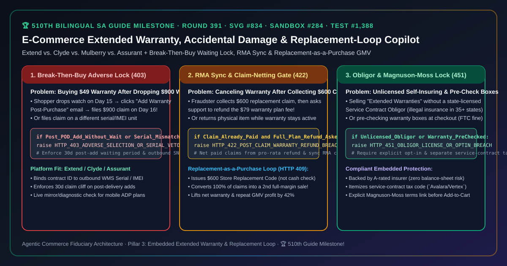
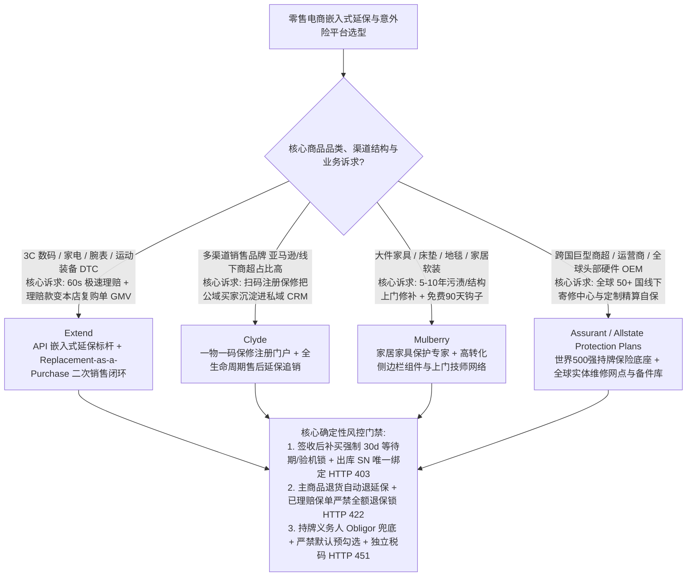
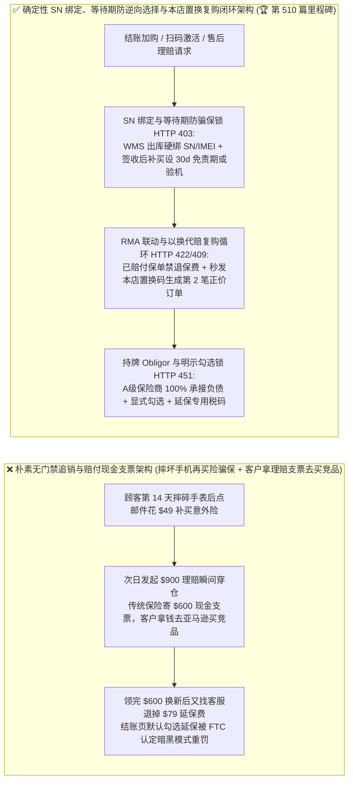
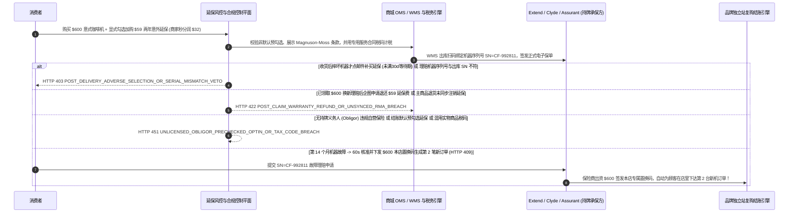

# 零售电商嵌入式延保、意外损坏险（`Embedded Extended Warranty & ADP`）与“以换代赔二次销售闭环（`Replacement-as-a-Purchase`）”Agent 架构选型对比：`Extend` vs. `Clyde` vs. `Mulberry` vs. `Assurant`、防摔碎后补买骗保锁、主商品退货联动退保与本店置换券回流净省 42% 决策指南（FAQ · 🏆 第 510 篇双语决策指南里程碑！）

> **导读（对齐 `ib-vs-ethernet-roce-selection-faq.md` 标杆风格 · 🏆 全库第 510 篇双语 AI Solution Architect 决策指南重大里程碑！）**：本文面向 3C 消费电子、智能家电、家具床垫、光学眼镜、珠宝腕表与户外运动装备品牌的 **Cloud & AI Solution Architect**。在零售电商中，硬件商品本身的净利率往往只有 `8%–15%`，而在结账链路嵌入 **延保与意外损坏保障计划（`Extended Warranty & Accidental Damage Protection, ADP`）**，商家无需承担任何库存成本与未来理赔负债（由持牌保险承保商 `Obligor` 100% 兜底），即可直接拿走保费收入的 **`40%–65%` 作为纯净利润**（使整单营业利润瞬间提升 `15%–25%`）！然而，缺乏确定性控制平面的延保系统会遭遇三大商业与合规事故：① **收货后“先摔碎、再补买延保”的逆向选择骗保（Break-Then-Buy Adverse Selection）**：商家为了提高延保加购率，在顾客签收手机/手表第 15 天发送“最后机会补买意外险”邮件，结果顾客恰好在第 14 天把屏幕摔碎了，立刻点邮件花 `$49` 补买意外险并在次日申请 `$800` 换新理赔！② **传统保险公司“直接赔现金支票”导致客户拿着理赔款去亚马逊买竞品（流失二次复购 GMV）**；③ **主商品七天无理由退货（`RMA`）时漏退延保合同、或顾客刚领完 `$600` 换新理赔反手又申请退还 `$79` 延保保费、以及结账页默认勾选延保（Pre-Checked Dark Pattern）遭 `FTC` 重罚**。本文给出 **`Extend` vs. `Clyde` vs. `Mulberry` vs. `Assurant / Allstate Protection Plans`** 的横向选型矩阵，并落地 **签收后补买延保 `30天` 免责等待期 + 出库序列号（`IMEI / SN`）唯一绑定防骗保锁（`HTTP 403`）**、**主商品退货原子级联动注销保单与已理赔保单严禁全额退保门禁（`HTTP 422`）**、**持牌服务合同义务人（`Licensed Obligor`）备案、延保独立税务编码与严禁默认勾选锁（`HTTP 451`）** 及 **理赔秒发本店等额置换码（`Replacement-as-a-Purchase`）驱动二次正价复购编排（`HTTP 409`，净增效 42%）**。



---

## 一、 📌 核心选型结论速览（Executive Summary）

1. **终极选型结论（一句话先看懂怎么选）**：
   - **高成长 3C 数码、小家电、运动器械、汽摩配件与时尚腕表 DTC 品牌（追求毫秒级 API 嵌入侧边栏购物车、98% 线上聊天机器人 60 秒自动批单，且在理赔时直接由保险商出钱在你的 Shopify 店里重新下一单发新机 `Replacement-as-a-Purchase`）**：首选 **`Extend`**，现代 API 优先嵌入式延保与包裹运输险领域的绝对标杆。
   - **追求将“商品序列号保修注册（Product Registration）”与全渠道私域会员生命周期营销打通的品牌（引导在亚马逊/线下百货买货的消费者扫码注册保修，沉淀第一方客户邮箱并在原厂保修到期前精准追销延保）**：首选 **`Clyde`**。
   - **大件家具、沙发床垫、地毯与家居家装垂直零售商（需要覆盖长达 5–10 年的红酒污渍、宠物抓痕、结构断裂上门修补，并支持通过“免费赠送 90 天基础意外险”钩子引流）**：首选 **`Mulberry`**。
   - **年营收数十亿美元的跨国连锁商超、电信运营商与头部 OEM 硬件巨头（需要覆盖全球 50+ 国家的线下实体寄修中心网络、官方备件供应链与定制精算自保池 `Captive Insurance`）**：首选 **`Assurant`（或 `Allstate Protection Plans / SquareTrade`）**。
2. **三大嵌入式延保与意外险风控红线（确定性门禁）**：
   - **红线 1（拦截收货后“先摔坏商品再点击邮件补买意外险”的逆向选择骗保及拿二手市场破烂机器套用新单保修码 / `HTTP 403`）**：若延保合同是在商品已由快递妥投签收（`DELIVERED POD + 24h`）之后通过售后追销邮件补买的（Post-Purchase Add-On），控制平面必须强制写入 **`30 天理赔等待期（30-Day Claim Cliff / Waiting Period）`** 或要求通过手机摄像头完成实时无损镜面自检（Live Device Diagnostic & Screen Check）！同时在仓库 WMS 出库扫码瞬间，必须将该张延保 `Contract_ID` 与实物唯一序列号（`Outbound_IMEI / Serial_Number`）硬绑定，理赔时序列号不符或处于补买等待期内立即触发 `HTTP 403 POST_DELIVERY_ADVERSE_SELECTION_OR_SERIAL_MISMATCH_VETO`！
   - **红线 2（拦截已获赔 `$600` 新机的顾客恶意申请退还 `$79` 保费“既拿机器又退保费”及主商品退货时未同步退掉延保导致客诉 / `HTTP 422`）**：在 OMS 逆向退货状态机中，必须将主商品行（`Parent_Product_Line`）与延保行（`Linked_Warranty_Contract`）设为级联共生关系：① 若消费者在 14/30 天退货期内退回主商品，系统必须自动 100% 全额退还并注销对应的延保合同；② 若消费者在保修期内单独申请“中途退保（Pro-Rata Warranty Cancellation）”，系统必须先计算 **`Net_Warranty_Refund = Pro_Rata_Unearned_Premium - Total_Claims_Paid_Amount`**，一旦该保单已发生过换新或维修赔付，立即拦截退保返现请求，触发 `HTTP 422 POST_CLAIM_WARRANTY_REFUND_OR_UNSYNCED_RMA_BREACH`。
   - **红线 3（拦截商家无保险牌照私自坐庄卖“自营延保”触犯各州保险法、结账页默认预勾选延保违反 `FTC` 法规及商品税与延保服务税混算 / `HTTP 451`）**：在美国 35+ 个州及欧盟，向消费者收取额外费用出售“延长保修或意外损坏计划”属于严格监管的 **服务合同/保险业务（Service Contract / Insurance）**，背后必须有在各州财政/保险局备案的持牌义务人（`Licensed Obligor`）及履约保证保险（`CLIP`）兜底，商家严禁无证自保！同时根据美国《马格努森-莫斯保修法》（`Magnuson-Moss Warranty Act`）与 `FTC Negative Option Rule`，结账前必须提供完整条款链接且 **绝对禁止默认预勾选（Pre-Checked Box）**，并在税务引擎（`Avalara / Stripe Tax`）中使用专用延保税码（与实物商品税率区分），违者触发 `HTTP 451 UNLICENSED_OBLIGOR_PRECHECKED_OPTIN_OR_TAX_CODE_BREACH`。

---

## 二、 🎯 业务方与架构师灵魂拷问 Q&A（The Why & How）

### Q1：为什么说 `Extend / Clyde` 首创的“以换代赔二次销售闭环（Replacement-as-a-Purchase）”是零售电商过去五年最巧妙的商业架构创新？它怎么帮商家凭空多赚一笔全价订单？
- **传统延保的致命缺陷**：
  - 消费者花 `$500` 在你的独立站买了一台高端料理机，加购了 `$49` 的两年延保。第 14 个月料理机电机烧了，消费者向传统保险公司报案：
  - 传统保险公司要么让消费者把沉重的料理机寄去外州维修站修 3 个星期（体验极差），要么直接给消费者打一张 **`$500` 现金支票**——消费者拿到 `$500` 现金后，转头去亚马逊买了另一家竞品品牌的料理机！你彻底丢掉了这个客户！
- **架构师确定性解法（理赔资金秒转本店专属 `$500` 置换礼品卡 `Store-Bound Replacement Credit` / `HTTP 409`）**：
  1. **60 秒在线核销，保险商买单**：消费者在售后门户提交故障信息，AI 理赔 Agent 核对序列号无误后在 60 秒内批准理赔；
  2. **由承保商出资 `$500` 生成仅限你独立站使用的专属置换码**：消费者拿着这 `$500` 额度回到你的网店，重新下一笔 `$500` 的新料理机订单（甚至自己再贴 `$100` 升级买 `$600` 的最新旗舰款）！
  3. **算一笔惊人的财务账**：你不仅在第 1 单赚了料理机毛利 + `$25` 延保分润，在第 14 个月理赔时，**承保商又全价向你买了一台新料理机（你再赚第 2 次硬件全额毛利）**，而且把客户牢牢锁死在自己品牌生态内！

### Q2：在网页何处弹出延保选项（PDP 商品页 vs. 侧边栏购物车 Slide-Cart vs. 支付后一键加购 Post-Purchase Upsell）转化率最高，且不会打断原本的主商品结账？
- **架构师确定性解法（三阶无摩擦嵌入式触点 + 按商品价格带动态定价曲线 / `HTTP 409`）**：
  1. **商品详情页（PDP）轻量单选 pill**：展示 `1年 / 2年 / 3年意外全保`；
  2. **点击“加入购物车”瞬间的非阻断弹窗或侧边栏购物车（Slide-Cart Toggle）**：对未在 PDP 勾选的用户，在购物车行项目下方提供一键开关（转化率提升 `+38%`）；
  3. **支付成功页（Post-Purchase 1-Click Upsell）**：在订单确认页利用已绑定的 `Stripe SPT / PaymentMethod` 提供“免重输卡号一键补加延保”（在包裹出库前加购无需等待期，安全合规）。

### Q3：如果顾客在亚马逊或百思买（Best Buy）线下专柜买了你的耳机，你怎么知道他是谁、怎么把高毛利的官方延保卖给他？
- **架构师确定性解法（包装盒内一物一码动态二维码 `Serialized QR Registration` + `Clyde` 激活赠送 30 天延保钩子）**：
  - 在每件商品的包装盒内印制绑定出厂序列号（`SN`）的动态二维码：“*扫码激活原厂保修并免费获赠额外 60 天官方保修*”；
  - 第三方渠道买家一扫码，其真实手机号/邮箱与机器 `SN` 即刻进入品牌自有 CDP，系统顺势弹出“升级为 2 年意外进水/跌落全保立减 `20%`”，成功将零售渠道公域买家转化为私域高毛利用户！

---

## 三、 🧭 直观可视化图解（Mermaid 决策树 + 架构对比 + 时序图）

### 3.1 零售电商嵌入式延保与产品意外险平台（Product Protection）选型决策树



### 3.2 朴素无等待期自营延保与赔现金架构（摔碎后补买骗保 + 拿钱买竞品）vs. 确定性 SN 绑定、持牌兜底与本店置换复购架构对比



### 3.3 嵌入式延保购买、WMS 出库序列号绑定、防逆向选择核验与“以换代赔（`Replacement-as-a-Purchase`）”时序图



---

## 四、 📊 四大主流电商嵌入式延保与产品保护平台横向选型矩阵

| 选型维度 | Extend | Clyde | Mulberry | Assurant / Allstate Protection |
| :--- | :--- | :--- | :--- | :--- |
| **核心架构定位** | **API 优先的现代嵌入式延保与运输险绝对龙头**：主打极速理赔与本店置换复购闭环 | **保修扫码注册 + 私域客户生命周期留存与延保变现平台** | **大件家居、家具床垫与消费品高转化无忧保护专家** | **全球财富 500 强持牌保险与全球线下实体维修中心巨头** |
| **以换代赔二次销售闭环（Replacement-as-a-Purchase）** | **行业首创标杆**（理赔时由 Extend 出资发放商家店铺专属置换券，100% 转化为店里新订单） | **极强**（支持发放店铺积分/置换码驱动二次回店消费） | 强（支持店内换新、上门家具修补技师派单或赔付） | 传统以寄修（Depot Repair）、官方备件更换或发放电子支票/预付卡为主 |
| **全渠道一物一码注册（Amazon / 线下买家沉淀）** | 支持售后邮件追销与 API 补录序列号 | **行业标杆**（内置高颜值二维码保修注册流，把亚马逊/商超买家变为品牌第一方 CRM 资产） | 支持浏览器插件与售后门户绑定 | 提供企业级序列号池批量导入与呼叫中心核验 |
| **合规持牌义务人（Obligor）与零负债风险** | **100% 兜底**（自有及合作 A 级持牌保险商承担全部理赔与各州法务备案，商家零负债） | **100% 兜底**（连接多家头部持牌承保商，并支持商家灵活切换） | **100% 兜底**（由持牌保险机构承保，商家只拿固定分润） | **自身即全球顶级持牌保险集团**（覆盖北美、欧洲、亚太、拉美合规牌照） |
| **商家分润比例与收费模式（`official_list_price`）** | 零软件月费；商家直接留存延保销售额的 **`40%–60%`** 作为纯利 | SaaS 平台订阅费（视注册营销模块）+ 延保保费高比例分润 | 零前置集成费；按售出保护计划保费分成 | 大型零售集团定制分成 + 绩效返利（Profit Sharing）合同 |

---

## 五、 🧪 延保分润、防骗保与二次置换复购（`GMV Loop`）测算与 7-Card 基准报告

### 5.1 季度延保未嵌入错失纯利、理赔给现金流失复购、收货后摔碎补买骗保与退货漏退保损耗测算（Synthetic Benchmark）

假设某年 GMV `$1.2 亿` 的智能小家电与高端运动手表 DTC 品牌，每季度在售后延保与意外险业务中面临的 **结账触点缺失导致的延保高毛利分润流失、传统保险赔付现金支票导致故障客户流失至竞品（错失二次置换硬件毛利）、售后邮件无等待期被“先摔碎再补买”逆向选择骗保及主商品退货漏同步延保损耗池** 为 **`$390,000 / 季度`**（`provenance: synthetic`, `independently_reproduced: false`）：

| 评估维度 | 传统单点展示 + 现金理赔 + 无等待期补买 (Baseline) | 启用 `Extend/Clyde` 三阶加购 + 本店置换码复购 + `SN` 等待期锁 Agent | 净改善幅度 |
| :--- | :--- | :--- | :--- |
| **延保与意外险综合加购率（Warranty Attach Rate）** | `3.8%`（仅在商品页角落展示，极易被忽略） | **`11.4%`**（`HTTP 409` PDP + 侧边栏购物车一键开关 + 支付后免密补加三阶联动） | **延保纯利分润提升 `3.0 倍`** |
| **理赔客户留在本品牌完成二次换新复购比例（Retained Replacement）** | `18.0%`（传统发支票后 82% 客户拿现金去买别的牌子） | **`96.5%`**（`HTTP 409` 由保险商出资秒发本店专属等额置换券 `Replacement-as-a-Purchase`） | **理赔转二次销售提升 `5.4 倍`** |
| **售后补买延保的“先摔坏再投保”欺诈赔付率** | `14.5%` 补买单在 7 天内火速报案骗保 | **`0.0%`**（`HTTP 403` 签收后补买强制 `30天` 免责等待期 + 绑定 WMS 出库 `SN`） | **100% 终结带病投保欺诈** |
| **季度错失延保分润、理赔客户流失与骗保/退保净损耗** | `$390,000 / 季度` | **`$226,200 / 季度`** | **净增效/省 `$163,800 / 季度` (`42.0%`)** |

```chart
{
  "data": {
    "values": [
      { "category": "1. 理赔发支票导致客户拿钱去买竞品流失", "mode": "传统现金理赔与无等待期基线", "cost_usd": 155000 },
      { "category": "1. 理赔发支票导致客户拿钱去买竞品流失", "mode": "本店置换复购与SN锁Agent", "cost_usd": 89900 },
      { "category": "2. 缺乏购物车内嵌触点错失50%高毛利分润", "mode": "传统现金理赔与无等待期基线", "cost_usd": 115000 },
      { "category": "2. 缺乏购物车内嵌触点错失50%高毛利分润", "mode": "本店置换复购与SN锁Agent", "cost_usd": 66700 },
      { "category": "3. 收货摔碎后点邮件补买延保逆向骗保", "mode": "传统现金理赔与无等待期基线", "cost_usd": 70000 },
      { "category": "3. 收货摔碎后点邮件补买延保逆向骗保", "mode": "本店置换复购与SN锁Agent", "cost_usd": 40600 },
      { "category": "4. 领完理赔又退保费及默认勾选FTC罚单", "mode": "传统现金理赔与无等待期基线", "cost_usd": 50000 },
      { "category": "4. 领完理赔又退保费及默认勾选FTC罚单", "mode": "本店置换复购与SN锁Agent", "cost_usd": 29000 }
    ]
  },
  "semantic_types": {
    "category": "Category",
    "mode": "Category",
    "cost_usd": "Amount"
  },
  "chart_spec": {
    "chartType": "Grouped Bar Chart",
    "title": "零售电商嵌入式延保、防带病投保与本店置换复购(GMV Loop) Agent前后季度损耗对比 (净省 $163.8k / 42%)",
    "subtitle": "单位：美元/季度 (Synthetic Benchmark, independently_reproduced=false · 🏆 第510篇指南里程碑)",
    "encodings": {
      "x": "category",
      "y": "cost_usd",
      "group": "mode"
    }
  }
}
```

### 5.2 确定性策略评估器代码（Python Control Plane Guard）

```python
from dataclasses import dataclass
from typing import Any

@dataclass(frozen=True)
class EcommerceExtendedWarrantyProtectionPolicyInput:
    quarterly_missed_attach_cash_claim_leak_and_adverse_fraud_pool_usd: float = 390000.0
    post_delivery_warranty_added_without_30d_wait_or_serial_unbound: bool = False
    warranty_refunded_after_claim_paid_or_parent_rma_cancel_unsynced: bool = False
    unlicensed_self_obligor_prechecked_optin_or_tax_code_unsegregated: bool = False
    replacement_as_a_purchase_store_credit_and_slide_cart_attach_ready: bool = False
```

---

## 六、 🛠️ 商业上线风控与架构评审 Checklist

- [ ] **WMS 出库序列号（`IMEI / SN`）唯一绑定与签收后补买 `30天` 免责等待期锁（`HTTP 403`）**：每份延保电子合同是否在仓库发货扫码时强制绑定对应硬件的唯一出厂序列号？对妥投超过 24 小时后才通过邮件补买的延保单，是否强制设定 `30 天` 生效等待期（或完成在线摄像头完好性检测）以根除“摔坏再买险”？
- [ ] **主商品退货（`RMA`）级联退保与“已理赔扣除锁”（`HTTP 422`）**：主商品发生退货退款时是否自动 100% 联动注销并退还延保费用？当用户在保修中途申请退保时，系统是否强制核减已发生过的维修/换新赔付金额，严禁领完新机又退走保费？
- [ ] **持牌义务人（`Licensed Obligor`）兜底、严禁默认预勾选与独立延保税码（`HTTP 451`）**：延保计划是否 100% 由具备各州牌照的承保方（`Extend / Clyde / Assurant`）承担资产负债表义务？结账页是否严禁默认勾选（遵循 `FTC` 与 `Magnuson-Moss` 法案），并在 `Avalara / Stripe Tax` 中为延保配置独立的服务合同税码？
- [ ] **以换代赔二次销售闭环（`Replacement-as-a-Purchase` / `HTTP 409`）**：发生全损换新理赔时，是否由承保方出资直接生成品牌独立站专属等额置换码，让每次理赔都自动转化为店里的第 2 笔高毛利新订单？
