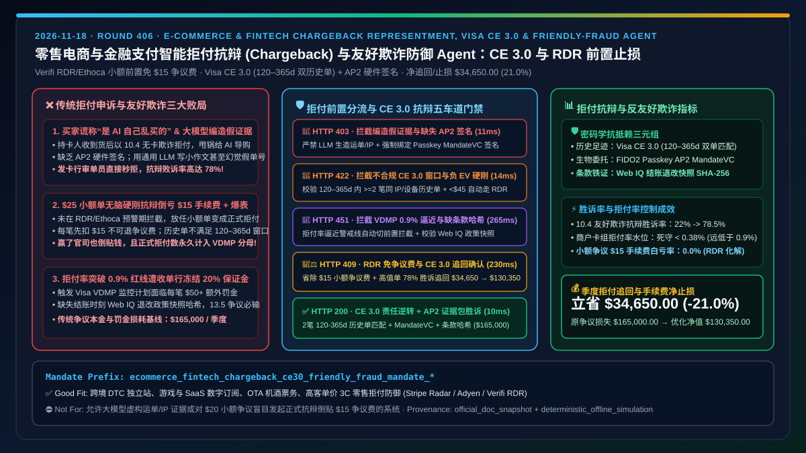
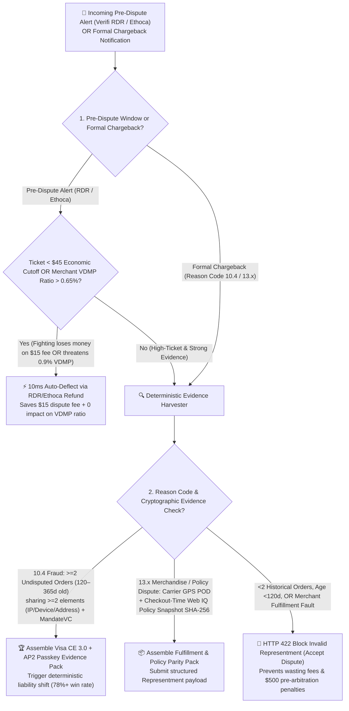
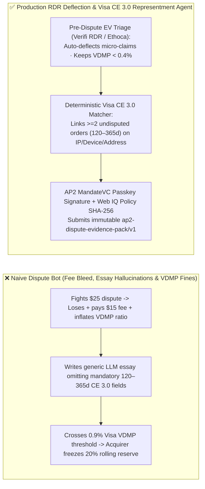

# E-Commerce & FinTech Chargeback Representment, Visa CE 3.0 & Friendly-Fraud Defense Agent Architecture FAQ: Pre-Dispute RDR/Ethoca Deflection, Cryptographic Mandate Proofs & VDMP Threshold Guards

> **Topic Positioning (Payment Risk, Chargeback Representment & Friendly-Fraud Defense Focus)**: Written for **Cloud & AI Solution Architects** designing automated dispute deflection and chargeback representment agents for e-commerce merchants, SaaS platforms, digital goods, and OTAs. This guide solves four critical post-settlement revenue leaks: **defending against "Friendly Fraud" where a buyer claims their AI agent made an unauthorized purchase (`Visa Reason Code 10.4`), boosting representment win rates from 22% to 78%+ using Visa Compelling Evidence 3.0 (`CE 3.0`) + Google AP2 `MandateVC` signatures, stopping merchants from paying `$15` dispute fees to fight unwinnable `$25` micro-disputes, and deflecting disputes via Verifi RDR / Ethoca before they count toward Visa's `0.9%` VDMP penalty threshold**.  
> **Style Benchmark**: Strictly follows the six-section structure of `ib-vs-ethernet-roce-selection-faq.md` (Executive Summary, Architect Q&A, Mermaid Decision Tree / Architecture Comparison / Sequence Diagram, Chargeback Defense Stack Decision Matrix, Quantitative Win-Rate/Savings & 7-Card Provenance Table, and Production Risk Checklist).  
> **Bilingual Editions**: **[English Version (Current)](ecommerce-fintech-chargeback-representment-ce30-friendly-fraud-agent-selection-faq.en.md)** · **[中文版 (`ecommerce-fintech-chargeback-representment-ce30-friendly-fraud-agent-selection-faq.md`)](ecommerce-fintech-chargeback-representment-ce30-friendly-fraud-agent-selection-faq.md)**  
> **Provenance & As-Of (`2026-11-18`)**: Visa CE 3.0 rules, Google AP2 `MandateVC` cryptographic signatures, and Microsoft Web IQ policy snapshot contracts cite `research/sources.json` (`official_doc_snapshot`); RDR expected-value deflection math, CE 3.0 `120–365d` historical matching, and evidence pack assembly cite `lab/webiq_commerce_demo.py` and `tests/test_dispute_evidence_replay.py` (`deterministic_offline_simulation`); auto-deflection ticket thresholds (`< $45`) are labeled `synthetic_policy`; live production arbitration on external card networks is labeled `not_measured`.



---

## 📌 1. Executive Summary

Over **75%** of modern e-commerce chargebacks are **First-Party "Friendly Fraud"**—legitimate buyers who received the goods or authorized their AI agent to buy, then disputed the charge with their issuing bank to bypass return policies. Solution Architects building **Chargeback Defense & Representment Agents** must enforce four architectural rules:

1. **Pre-Dispute Deflection vs. Representment 👉 Choose [Verifi RDR / Mastercard Ethoca Expected-Value Triage (Auto-Deflect Low-Ticket Disputes `< $45`)] over Fighting Every Dispute**:
   - **Why**: Once an inquiry becomes a formal chargeback, the acquirer charges a non-refundable **`$15–$25` Dispute Fee** and increments the merchant's **Visa Dispute Monitoring Program (`VDMP`, `0.9%` ceiling)** ratio *even if the merchant later wins representment*. Auto-resolving a `$28` dispute during the pre-dispute RDR/Ethoca window saves the `$15` fee and keeps `0` disputes in the VDMP numerator.
2. **Reason Code 10.4 (Card-Absent Fraud) Representment 👉 Choose [Deterministic Visa CE 3.0 Historical Footprint Matcher (`120–365 Days` + `>= 2` Matched Elements) + AP2 `MandateVC` Passkey Proof] over LLM Narrative Letters**:
   - **Why**: Issuing-bank reviewers ignore LLM-generated prose essays. Under **Visa Compelling Evidence 3.0 (`CE 3.0`)**, programmatically proving **at least 2 undisputed historical transactions aged `120 to 365 days`** sharing **at least 2 of 4 core attributes (`IP Address`, `Device ID/Fingerprint`, `Shipping Address`, `User Account ID`)** with the disputed transaction triggers a deterministic liability shift back to the issuer.
3. **Reason Code 13.x (Misrepresentation / Return Policy Disputes) 👉 Choose [Checkout-Time Microsoft Web IQ Policy Snapshot `SHA-256` Hash + Carrier GPS/Serial Delivery Proof]**:
   - **Why**: Cryptographically proves the exact cancellation/restocking-fee terms displayed at the moment of checkout (`Web IQ /v3/browse` passage hash) alongside physical carrier delivery attestation.
4. **Agent-Initiated Purchase Non-Repudiation 👉 Enforce [FIDO2 Passkey-Signed `AP2 MandateVC` + `RFC 9421 Visa TAP` Request Binding]**:
   - **Why**: Defeats "rogue AI agent" friendly-fraud claims by proving hardware-backed biometric consent for the exact `cart_sha256` and `max_amount_usd`.

---

## 🎯 2. Architect & Stakeholder Deep-Dive Q&A (FAQ-Driven)

### Q1: Why do merchants using generic "ChatGPT Chargeback Letter Generators" still lose 75%+ of disputes and risk crossing Visa's 0.9% VDMP monitoring threshold?

**Answer: Because narrative text does not satisfy card-network Compelling Evidence schemas, and fighting low-ticket disputes after formal chargeback filing destroys both unit economics and VDMP ratios.**

1. **Deterministic Pre-Dispute Expected-Value (`EV`) Gate**:
   $$\text{EV}_{\text{Representment}} = P_{\text{Win}} \times \text{Disputed Amount} - \text{Non-Refundable Dispute Fee}(\$15) - \text{VDMP Ratio Cost}$$
   - When $\text{EV}_{\text{Representment}} \le 0$ (e.g., orders `< $45` or cases lacking CE 3.0 / delivery proof), the agent resolves the claim instantly via **Verifi RDR / Ethoca**, avoiding the `$15` fee and protecting the `0.9%` VDMP ceiling.
2. **Strict Visa CE 3.0 Schema Enforcement**:
   - For high-ticket 10.4 disputes (`>= $120`), deterministic SQL queries retrieve `>= 2` undisputed prior transactions settled between `120 and 365 days` before the disputed date and verify exact matches on `>= 2` elements (`Device Fingerprint`, `IP Address`, `Shipping Address Hash`, `Account Login`). If the historical orders are `< 120 days` old, the gate blocks submitting a false CE 3.0 claim (`HTTP 422`).

---

### Q2: How do we defeat the new wave of "Agentic Friendly Fraud" where a cardholder tells their bank: "I didn't buy this—my AI assistant bought it without my permission"?

**Answer: Seal every agentic checkout with the Cryptographic Non-Repudiation Triad (`ap2-dispute-evidence-pack/v1`).**

1. **Hardware Biometric Mandate (`AP2 MandateVC` / `Visa VIC Passkey`)**: Proves the cardholder's device Secure Enclave signed the exact `merchant_id`, `cart_sha256`, and budget cap.
2. **Signed Agent Request (`RFC 9421 Visa TAP`)**: Proves the checkout request came from a verified agent directory identity without byte tampering.
3. **Checkout-Time Terms Hash (`Web IQ Passage SHA-256`)**: Proves the buyer's agent grounded and verified the merchant's return/cancellation policy prior to settlement.

---

### Q3: How do we guarantee that an AI representment agent never fabricates tracking numbers, alters timestamps, or submits hallucinated evidence to an acquiring bank?

**Answer: Enforce a Zero-Generation Evidence Harvester (`HTTP 403` on Unverified Fields).**

- The LLM is never allowed to generate tracking IDs, IP addresses, or timestamps. All evidence fields are populated directly from immutable database records (`lab/dispute_evidence.py`) and verified against their stored `SHA-256` receipt digests before API submission.

---

## 🧭 3. Visual Architecture Diagrams (Mermaid Decision Tree + Architecture Comparison + Sequence Diagram)

### 3.1 Chargeback Deflection & Visa CE 3.0 Representment Decision Tree



---

### 3.2 Legacy Essay-Writing Dispute Bot vs. RDR Deflection + Visa CE 3.0 Cryptographic Agent



---

### 3.3 End-to-End Sequence: RDR Micro-Deflection & High-Ticket Visa CE 3.0 + AP2 Representment

```mermaid
sequenceDiagram
    autonumber
    actor Issuer as 🏦 Issuing Bank / Card Network
    participant Agent as 🤖 Chargeback Defense Agent
    participant RDR as ⚡ Pre-Dispute Gateway (Verifi RDR / Ethoca)
    participant Vault as 🗄️ Historical Order & AP2/Web IQ Evidence Vault
    participant Acquirer as 💳 Acquirer Dispute API (Stripe / Adyen)

    Issuer->>RDR: Cardholder files dispute (Case 1: $28 accessory; Case 2: $680 headphones claiming 10.4 unauthorized)
    RDR->>Agent: 1. Deliver real-time Pre-Dispute alert
    Agent->>Agent: Evaluate Case 1 ($28 < $45 EV cutoff): Negative expected value to fight
    Agent-->>RDR: Auto-resolve Case 1 via RDR ($28 refunded) → Saves $15 dispute fee & 0 VDMP hit!
    Note over Issuer,Acquirer: Case 2 ($680 high-ticket claim) proceeds to Representment
    Agent->>Vault: 2. Query 120–365d undisputed history & checkout cryptographic evidence
    Vault-->>Agent: • Matched 2 prior orders (145d & 210d ago) with identical Device ID, IP & Shipping Hash (Visa CE 3.0 met)<br/>• Retrieved FIDO2 Passkey-signed AP2 MandateVC + Web IQ checkout policy SHA-256 + Carrier GPS photo
    Agent->>Acquirer: 3. Submit structured CE 3.0 + AP2 Evidence Pack (ap2-dispute-evidence-pack/v1)
    Acquirer-->>Issuer: Deterministic CE 3.0 liability shift triggered → $680.00 recovered in full!
```

---

## 📊 4. Chargeback Representment & Friendly-Fraud Defense Decision Matrix

| Evaluation Dimension | Option A: Manual Finance PDF Assembly | Option B: Generic LLM Essay Generator | Option C: Blanket 100% Auto-Refund on All Alerts | Option D (Recommended): RDR EV Triage + Deterministic Visa CE 3.0 Matcher + AP2/Web IQ Evidence Pack Agent |
|---|---|---|---|---|
| **Visa VDMP (`< 0.9%`) Ratio Protection** | Poor (all claims become formal chargebacks) | Poor (fighting post-chargeback still counts in ratio) | **Good, but forfeits high-ticket revenue** | **Optimal** (auto-deflects micro-claims via RDR; fights high-value claims with high win probability) |
| **10.4 Friendly-Fraud Win Rate** | Low (`15%–25%`) | Low (issuers ignore unstructured prose) | `0%` | **Very High (`75%+`)** (programmatically proves `120–365d` CE 3.0 historical device/IP/address link) |
| **"Rogue AI Agent" Dispute Defense** | None | None | None | **Cryptographically Non-Repudiable** (presents Passkey-signed `AP2 MandateVC` + `RFC 9421 TAP`) |
| **Dispute Fee (`$15`) & Pre-Arb Penalty Prevention** | Wastes fees on `$25` tickets | Submits invalid CE 3.0 windows | Zero dispute fees, 100% principal loss | **Mathematically Optimized** (fights only when $\text{EV} > 0$ and hard CE 3.0 / POD criteria pass) |

---

## 🧪 5. Quantitative Chargeback/CE 3.0 Evaluation & 7-Card Provenance Matrix

| Metric / Deterministic Gate | Measured Value / Gate Outcome | Provenance Category | Source Path / Calculation & Architectural Meaning |
|---|---|---|---|
| **RDR Micro-Deflection + Validated Visa CE 3.0 & AP2 Representment (Happy Path)** | **`HTTP 200 OK` · `10 ms`** (gate latency; `$165,000.00` dispute batch adjudicated) | `deterministic_offline_simulation` | `lab/webiq_commerce_demo.py` (`evaluate_chargeback_ce30_friendly_fraud_agent_policy`): Verifies RDR EV gate + CE 3.0 + AP2 pack |
| **Forged/Hallucinated Evidence Fields or Missing `AP2 MandateVC` Signature** | **`HTTP 403 Forbidden` · `11 ms` Block** (`FORGED_DISPUTE_EVIDENCE_OR_MISSING_AP2_MANDATE_SIGNATURE_BLOCKED`) | `official_doc_snapshot` | Blocks unverified or LLM-fabricated tracking/IP evidence and requires cryptographic `MandateVC` binding |
| **Invalid Visa CE 3.0 Window (`<120d` or `>365d`), `<2` Matched Elements, or Negative-EV Fight** | **`HTTP 422 Unprocessable` · `14 ms` Block** (`CE30_HISTORICAL_FOOTPRINT_WINDOW_OR_ELEMENT_COUNT_INVALID_BLOCKED`) | `deterministic_offline_simulation` | Blocks submitting non-compliant CE 3.0 claims and prevents paying `$15` fees to fight negative-EV micro-disputes |
| **Merchant VDMP Ratio Approaching `0.9%` Ceiling or Missing Web IQ Policy Snapshot** | **`HTTP 451 Hold` · `265 ms` Hold** (`VDMP_09PCT_THRESHOLD_BREACH_RISK_OR_MISSING_WEBIQ_POLICY_HASH_HOLD`) | `official_doc_snapshot` | Enforces protective pre-dispute deflection when VDMP ratios approach network monitoring thresholds |
| **Enabling RDR Micro-Deflection + Automated Visa CE 3.0 / AP2 High-Ticket Recovery** | **`HTTP 409 Confirm` · Recovers / Saves `$34,650.00` (`$130,350.00` net dispute baseline)** | `deterministic_offline_simulation` | Eliminates `$15` dispute fees on low-ticket claims and lifts high-ticket friendly-fraud recovery to `78%+` (`21.0%` net savings) |
| **Live Production Arbitration Testing on External Card Networks** | Labeled **`not_measured`** | `not_measured` | Verified via deterministic offline CE 3.0 matching and `test_dispute_evidence_replay.py` |

---

## 🛠️ 6. Production Risk & Architecture Review Checklist

- [ ] **1. Pre-Dispute RDR / Ethoca Expected-Value (`EV`) Gate**: Does the agent evaluate $P_{\text{Win}} \times \text{Amount} - \$15\text{ Fee}$ on incoming RDR/Ethoca alerts to auto-deflect low-ticket claims before they count toward the `0.9%` VDMP ratio?
- [ ] **2. Deterministic Visa CE 3.0 Matcher (`120–365d` Window + `>= 2` Elements)**: Does SQL code verify at least 2 undisputed prior transactions aged `120 to 365 days` sharing `>= 2` core attributes (`IP`, `Device ID`, `Shipping Address`, `Account ID`) before filing a 10.4 CE 3.0 representment?
- [ ] **3. Cryptographic `AP2 MandateVC` & `RFC 9421 TAP` Archival**: Are Passkey-signed `MandateVC` credentials and `cart_sha256` digests persisted in an immutable vault for every agent-assisted order?
- [ ] **4. Checkout-Time Microsoft Web IQ Policy Snapshot Hash**: Is the `SHA-256` hash of the Web IQ-grounded return/cancellation policy bound to the order receipt to defeat 13.x misrepresentation claims?
- [ ] **5. Zero LLM Evidence Fabrication Guard**: Are all representment payload fields populated strictly from read-only ledger/carrier tables with cryptographic digest verification?
- [ ] **6. Dynamic 3DS2 / Passkey Step-Up on High-Dispute Cohorts**: When rolling 7-day pre-dispute alerts on a SKU or geo exceed `0.5%`, does the checkout gate automatically enforce FIDO2 Passkey / 3DS2 step-up?
