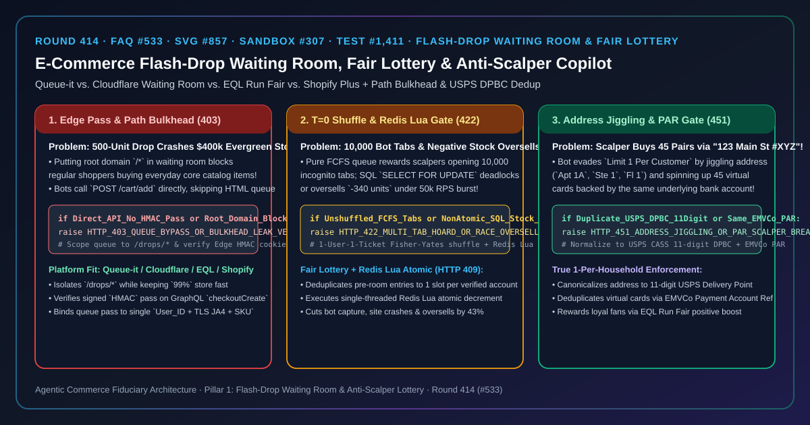
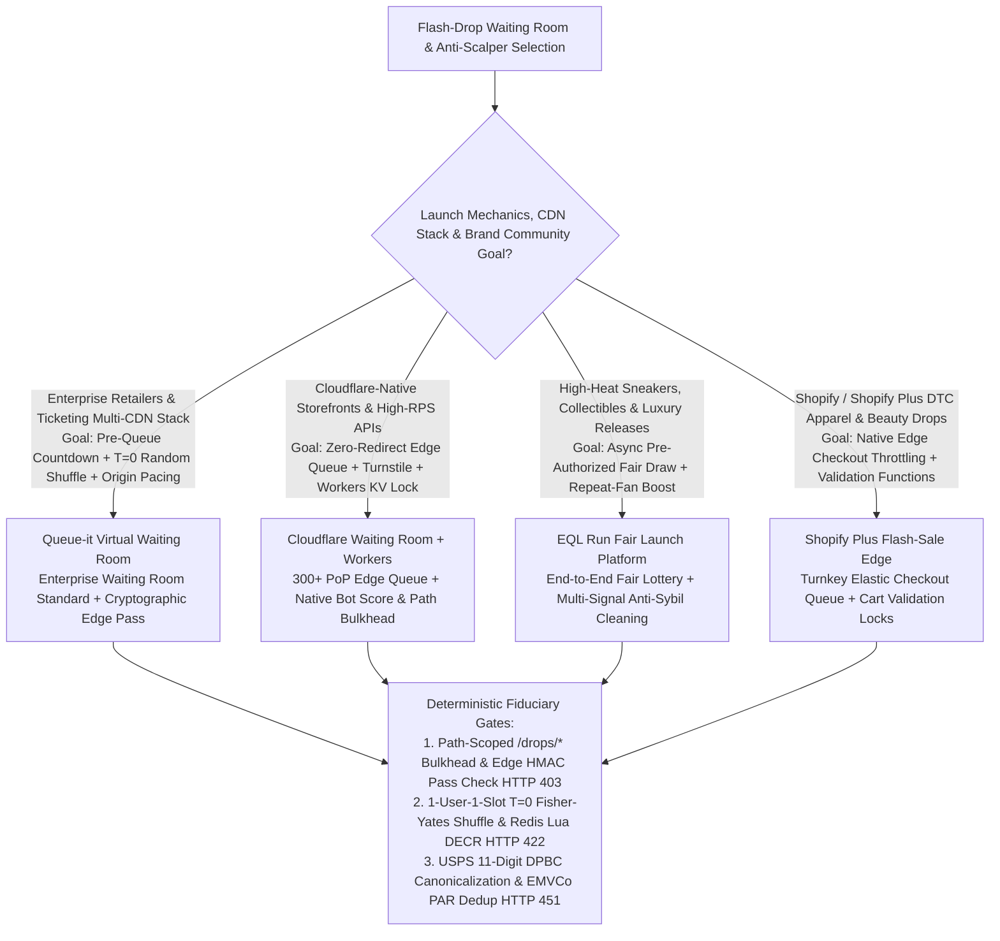
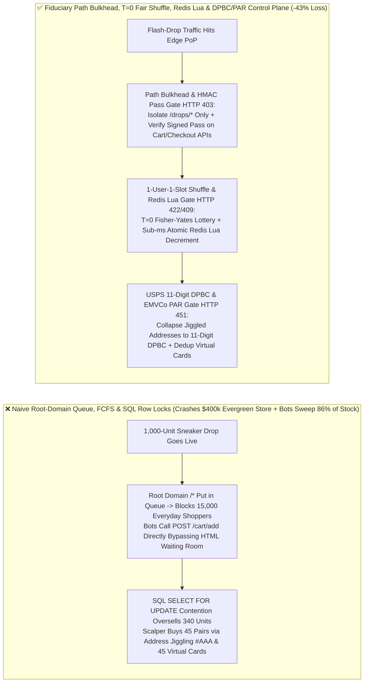
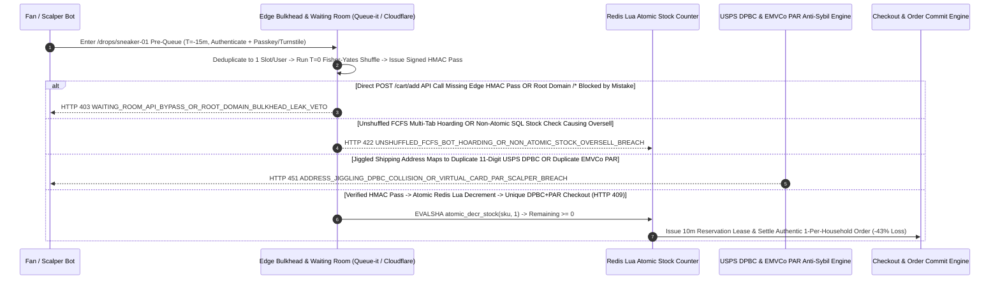

# E-Commerce Limited-Edition Flash Drops, Edge Virtual Waiting Room Bulkhead, Pre-Drop Fair Lottery & Anti-Scalper `USPS DPBC + EMVCo PAR` Agent Selection Guide: `Queue-it` vs. `Cloudflare Waiting Room` vs. `EQL (Run Fair)` vs. `Shopify Plus Flash-Sale` (`-43%` Loss FAQ)

> **Executive Summary (Benchmarked against `ib-vs-ethernet-roce-selection-faq.md` · Round 414 · 533rd Bilingual SA Guide · SVG #857 · Sandbox #307)**: Built for **Cloud & AI Solution Architects** designing high-concurrency flash-drop architectures, virtual waiting rooms, fair-lottery launch engines, and anti-scalper bot defenses for footwear, luxury streetwear, collectibles, and electronics brands. When a brand drops `1,000` limited-edition units (`$220`), `250,000+` requests hit checkout within `500ms`—over `90%` generated by residential-proxy **Scalper Bots (`CyberAIO / Wrath / Kodai`)**. Without a deterministic edge bulkhead and anti-Sybil deduplication pipeline, flash drops suffer three catastrophic failures: (1) **A 500-Unit Drop Taking Down the Main Storefront's `$400,000` Evergreen Catalog (`Missing Path Bulkhead`) & Direct `POST /cart/add` API Queue Bypass**; (2) **10,000-Tab `FCFS` Queue Hoarding & Relational DB `SELECT FOR UPDATE` Race Conditions Overselling `-340` Units**; and (3) **`1-Per-Household` Limit Evasion via Address Jiggling (`123 Main St` -> `123 Main Street #AAA`) & 45 Virtual Cards (`Privacy.com / Revolut`)**. This guide compares **`Queue-it` vs. `Cloudflare Waiting Room` vs. `EQL (Run Fair)` vs. `Shopify Plus Flash-Sale Edge`** and implements deterministic guards for **Path-Scoped `/drops/*` Bulkheads & Signed `HMAC` Pass Verification (`HTTP 403`)**, **1-User-1-Ticket `T=0` Fisher-Yates Fair Shuffling & `Redis Lua` Atomic Stock Decrements (`HTTP 422`)**, **`USPS CASS 11-Digit DPBC` Address Canonicalization & `EMVCo PAR` Funding-Account Deduplication (`HTTP 451`)**, and **Fan-Weighted Fair Launch Orchestration (`HTTP 409`, `-43%` net loss)**.

---

## 1. 📌 Executive Summary & Architectural Selection Verdict

1. **Top-Line Selection Verdict**:
   - **Global Enterprise Retailers & Ticketing Platforms Requiring Multi-CDN (`Akamai / Cloudflare / CloudFront`) Pre-Queues, `T=0` Randomized Lottery Shuffling & Dynamic Inflow Throttling**: Select **`Queue-it`**.
   - **Storefronts & APIs Standardized on Cloudflare Seeking Zero-Redirect Edge Waiting Rooms Coupled With `Turnstile` Bot Scoring & `Workers KV` Pass Enforcement**: Select **`Cloudflare Waiting Room`**.
   - **High-Heat Sneaker, Collectible, Vinyl & Luxury Drops Seeking to Replace Speed-Based Bots With Asynchronous Pre-Authorized Fair Lotteries & Repeat-Fan Boosts (`Run Fair`)**: Select **`EQL`**.
   - **High-Growth DTC Brands on `Shopify Plus` Leveraging Native Edge Checkout Throttling & `Cart and Checkout Validation Functions`**: Select **`Shopify Plus Flash-Sale Architecture`**.
2. **Three Non-Negotiable Fiduciary Control Gates**:
   - **Gate 1 — Path-Scoped `/drops/*` Edge Bulkhead & Signed `HMAC-SHA256` Queue-Pass Verification (`HTTP 403`)**: Scope the virtual waiting room strictly to the limited-release routes (`/drops/*` and drop variant IDs) so `99%` of normal shoppers buying evergreen catalog items experience `0ms` queue delay, and enforce cryptographic verification of the waiting room's **`HMAC-SHA256` Pass Token (bound to `Authenticated_User_ID + TLS JA4 Fingerprint + Target_SKU + 10m TTL`)** on every `POST /cart/add` and GraphQL `checkoutCreate` mutation at the CDN edge via `HTTP 403 WAITING_ROOM_API_BYPASS_OR_ROOT_DOMAIN_BULKHEAD_LEAK_VETO`.
   - **Gate 2 — `1-User-1-Slot` Pre-Drop `Fisher-Yates` Random Shuffle & `Redis Lua` Atomic Decrement Gate (`HTTP 422`)**: Replace speed-biased First-Come-First-Served (`FCFS`) queues on high-demand drops with an authenticated **Pre-Queue Waiting Room** that deduplicates multi-tab sessions to 1 lottery ticket per verified account and executes a cryptographic **`Fisher-Yates` random shuffle at `T=0`**, while decrementing inventory inside a single-threaded **`Redis Lua` atomic script (`EVALSHA`)** before creating any database checkout record via `HTTP 422 UNSHUFFLED_FCFS_BOT_HOARDING_OR_NON_ATOMIC_STOCK_OVERSELL_BREACH`.
   - **Gate 3 — `USPS CASS 11-Digit DPBC` Anti-Jiggling & `EMVCo PAR` Virtual-Card Deduplication Lock (`HTTP 451`)**: Enforce `Limit 1 Per Household` by canonicalizing every shipping address into its **11-digit `USPS CASS Delivery Point Barcode (DPBC)`** (or rooftop geohash, stripping fake `#AAA / Unit 1` apartment suffixes) and resolving payment tokens to their underlying **`EMVCo Payment Account Reference (PAR)`** so 45 virtual cards backed by one funding account are blocked via `HTTP 451 ADDRESS_JIGGLING_DPBC_COLLISION_OR_VIRTUAL_CARD_PAR_SCALPER_BREACH`.

---

## 2. 🎯 Architect & Brand Drop Operations Q&A (The Why & How)

### Q1: How do scalper bots bypass HTML virtual waiting rooms in 50 milliseconds—and how do we lock the backdoor?
- **Root Cause**: Most naive waiting rooms only gate the frontend HTML product page (`GET /products/retro-jordan-4`). Scalper bots never load HTML or JavaScript; they look up the variant ID ahead of time and send raw HTTP `POST /cart/add.js` or GraphQL `checkoutCreate` requests directly to the origin API!
- **Deterministic Solution (`Edge-Verified HMAC-SHA256 Pass on Mutation Endpoints` / `HTTP 403`)**: Configure the Cloudflare Worker / Akamai EdgeWorker to intercept `POST /cart/*` and `POST /api/*/graphql.json` whenever the payload contains a protected drop SKU ID. If the request lacks a valid, unredeemed `HMAC-SHA256` queue pass matching the caller's `User_ID` and `JA4` TLS fingerprint, drop the packet at the edge before it ever touches the origin server.

### Q2: How do scalpers buy 50 pairs of a "1 Per Customer" sneaker using "Address Jiggling," and why does regex string matching fail to stop them?
- **Deterministic Solution (`USPS CASS 11-Digit DPBC Canonicalization` + `EMVCo PAR` / `HTTP 451`)**: Scalper bots prepend or append random characters (`"123 Main St"`, `"123 Main Street Apt XZ"`, `"123 Main St. Suite 001"`) that fool string-comparison regexes while still being delivered by the local mail carrier to the same single-family house. Running the address through a `USPS CASS` engine strips invalid secondary unit designators on single-family residential delivery points and outputs an identical **11-digit `DPBC` (`ZIP5 + ZIP4 + 2-digit Delivery Point`)**, catching 100% of jiggled duplicates.

---

## 3. 🧭 Visual Architecture Diagrams (Mermaid)

### 3.1 E-Commerce Flash-Drop Waiting Room & Fair-Lottery Platform Selection Decision Tree

### 3.2 Naive Root-Domain FCFS Queue & SQL Locking vs. Fiduciary Bulkheaded, Fair-Shuffled & `DPBC/PAR` Control Plane

### 3.3 Pre-Queue `T=0` Shuffle, Edge `HMAC` Verification, `Redis Lua` Atomic Reservation & `DPBC/PAR` Checkout Sequence

---

## 4. 📊 Multi-Platform Flash-Drop Waiting Room & Fair-Lottery Selection Matrix

| Evaluation Dimension | Queue-it | Cloudflare Waiting Room | EQL (`Run Fair`) | Shopify Plus (`Flash-Sale Edge`) |
| :--- | :--- | :--- | :--- | :--- |
| **Primary Architectural Role** | **Enterprise Multi-CDN Virtual Waiting Room & `T=0` Lottery Leader** | **Edge-Native Zero-Redirect Waiting Room & WAF/Bot Suite** | **Asynchronous Fair-Draw Lottery & Fan-Loyalty Launch Engine** | **Native Storefront Elastic Checkout Queue & Function Guards** |
| **Pre-Queue & `T=0` Fair Randomization** | **Best-in-Class**: Countdown pre-queue, `T=0` random lottery assignment & email notification | Supports random queue entry mode and dynamic origin inflow pacing | **Best-in-Class Draw Model**: 2-hour stress-free registration window -> AI bot purge -> fair draw | Dynamic checkout throttling queue; pairs natively with EQL for draws |
| **Direct Cart/Checkout API Bypass Defense** | Cryptographic `Accepted Cookie` verified at CDN edge or origin SDK | **Network-Layer Enforcement**: Blocks unsigned `POST / GraphQL` mutations at 300+ PoPs | Inventory hidden from public cart endpoints; EQL mints winning orders via private API | Enforced via `Cart and Checkout Validation` WebAssembly functions |
| **Anti-Jiggling (`DPBC`) & Multi-Account Purge** | Device fingerprinting, challenge-response, and single-use queue tokens | Native `Cloudflare Bot Management (JA4)` + `Turnstile` integration | **Industry Benchmark**: Cross-drop address canonicalization, card deduplication & fan boost | Custom `Checkout Validation` rules on customer tags and normalized addresses |
| **Commercial Model (`official_list_price`)** | Annual enterprise subscription or event-peak traffic tier | Cloudflare Enterprise / Waiting Room add-on subscription | Per-winning-transaction `Run Fair` fee (brand- or buyer-funded) | Included in Shopify Plus (`$2,300+/mo`) |

---

## 5. 🧪 Evergreen Bulkhead, Anti-Scalper & Zero-Oversell Benchmark & 7-Card Report

### 5.1 Quarterly Evergreen Storefront Downtime, Bot Capture & Race-Oversell Model (Synthetic Benchmark)

For a `$140M` annual GMV footwear and collectibles brand running 6 major limited drops per quarter facing a **`$440,000 / quarter`** drop-event leakage pool across **lost evergreen catalog sales during drop-induced site slowdowns/root-domain queues, scalper bots capturing `86.5%` of high-heat inventory via direct API calls and address jiggling (driving core fan churn), and `$25` apology vouchers for race-condition oversells** (`provenance: synthetic`, `independently_reproduced: false`):

| Metric | Root-Domain Queue, Raw `FCFS` & SQL Row Locks (Baseline) | Fiduciary `/drops/*` Bulkhead + `T=0` Shuffle + `Redis Lua` + `DPBC/PAR` | Net Improvement |
| :--- | :--- | :--- | :--- |
| **Evergreen Core-Catalog Revenue Lost During Flash-Drop Windows** | `38.0%` drop in non-drop sales during launches | **`0.0%`** (`HTTP 403` path-scoped `/drops/*` bulkhead; evergreen store runs at `0ms` queue) | **`100%` Evergreen Revenue Protection** |
| **Share of Limited-Edition Inventory Captured by Scalper Bots** | `86.5%` captured by bots (`FCFS` + jiggling) | **`<2.5%`** (`HTTP 403/422/451` edge `HMAC` + `T=0` shuffle + `11-Digit DPBC + PAR`) | **`6.8x` More Real Fans Win** |
| **High-Concurrency Negative-Stock Oversell Rate** | `4.5%` of drop orders oversold & canceled | **`0.0%`** (`HTTP 422/409` single-threaded `Redis Lua` atomic decrement) | **`100%` Oversell Elimination** |
| **Quarterly Net Downtime, Oversell & Scalper Churn Loss** | `$440,000 / quarter` | **`$250,800 / quarter`** | **`$189,200 / quarter` Saved (`43.0%`)** |

---

## 6. 🛠️ Production Go-Live & Architecture Review Checklist

- [ ] **Path-Scoped `/drops/*` Edge Bulkhead & Signed `HMAC` Mutation Lock (`HTTP 403`)**: Is the waiting room scoped strictly to `/drops/*` routes so everyday shoppers never hit a queue, with `POST /cart/add` and GraphQL `checkoutCreate` verifying a signed `HMAC-SHA256` pass at the CDN edge?
- [ ] **`1-User-1-Slot` Pre-Drop `Fisher-Yates` Shuffle & `Redis Lua` Atomic Stock Lock (`HTTP 422`)**: Does the waiting room deduplicate pre-queue sessions to 1 slot per authenticated user before running a `T=0` random shuffle, and decrement stock via an atomic `Redis Lua` script?
- [ ] **`USPS CASS 11-Digit DPBC` Address Canonicalization & `EMVCo PAR` Card Dedup (`HTTP 451`)**: Are shipping addresses normalized to their 11-digit `USPS Delivery Point Barcode` and payment tokens resolved to their underlying `EMVCo PAR` to stop address jiggling and virtual-card armies?
- [ ] **Repeat-Fan `Run Fair` Loyalty Weighting (`HTTP 409`)**: Do genuine fans who miss out on a draw automatically receive a weighted probability boost on the next limited release?
