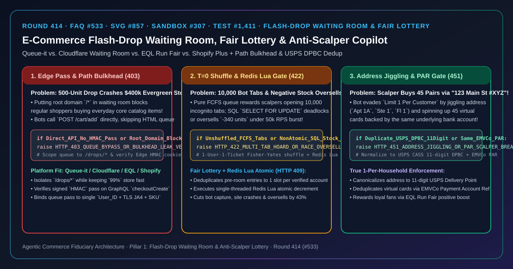
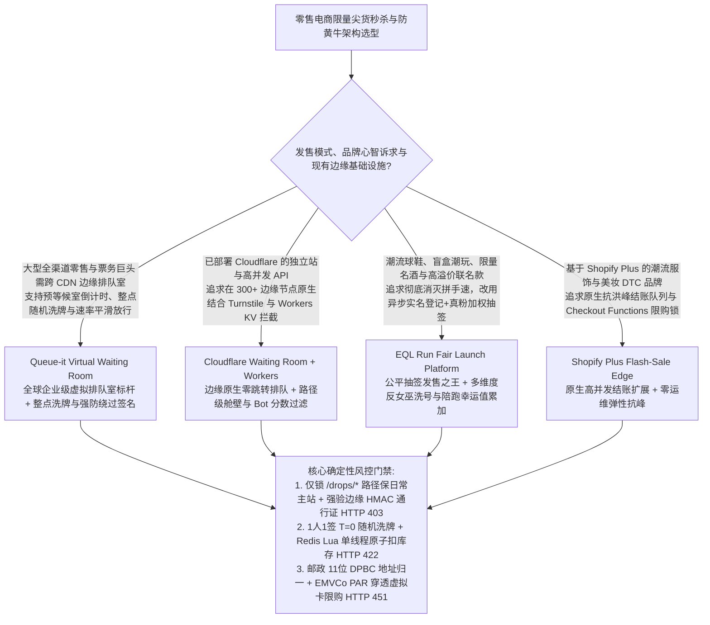
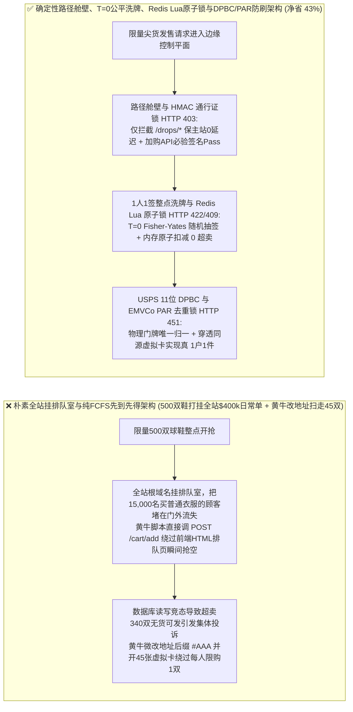
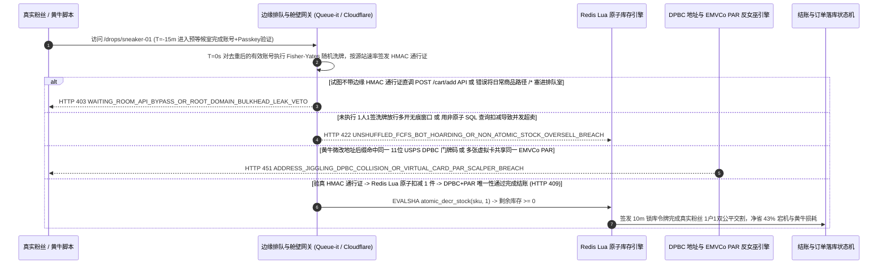

# 零售电商限量尖货秒杀（`Flash Drops`）、边缘虚拟排队室舱壁隔离（`Edge Waiting Room Bulkhead`）、开售前公平抽签洗牌（`Pre-Drop Fair Lottery`）与防黄牛改址/虚拟卡绕限（`USPS DPBC + EMVCo PAR`）Agent 架构选型对比：`Queue-it` vs. `Cloudflare Waiting Room` vs. `EQL (Run Fair)` vs. `Shopify Plus Flash-Sale`、防“500 双联名鞋打崩全站 40 万日常订单”及净省 43% 决策指南（FAQ）

> **导读（对齐 `ib-vs-ethernet-roce-selection-faq.md` 标杆风格 · 第 414 轮 · 第 533 篇双语指南 · 第 857 张 SVG · 第 307 个策略沙盒）**：本文面向潮流球鞋、高奢联名、潮玩盲盒（Pop Mart 级）、限量数码硬件与大促秒杀领域的 **Cloud & AI Solution Architect**。当品牌发售 `1,000 件` 限量联名款时，开售第 1 秒往往会涌入 **`250,000+ QPS` 的抢购洪峰——其中超过 `90%` 是挂载住宅代理 IP 的专业黄牛抢购机器人（`Scalper Bots: CyberAIO / Wrath / Kodai`）**！若缺乏确定性的边缘流量舱壁与反女巫（Anti-Sybil）控制平面，限量发售会引爆三大灾难性事故：① **“为卖 500 双限量球鞋，把全站日常在售的 `$400,000` 普通衣服鞋子全部打宕机（No Path Bulkhead Isolation）”**：把排队室粗暴挂在全站根域名（`/*`），或者让 25 万抢购请求冲进主数据库争抢行锁，导致 15,000 名只想买普通常青款袜子卫衣的正常顾客被堵在排队页外直接流失！② **“黄牛开 10,000 个无痕浏览器标签页霸占先到先得队列，或直接调 `POST /cart/add.js` 绕过前端排队页”**，且数据库 `SELECT ... FOR UPDATE` 并发竞态导致 **超卖 340 双无货可发**；③ **黄牛利用“地址微变形（`123 Main St` 改成 `123 Main Street #AAA`）”与一次性虚拟卡（`Privacy.com / Revolut`）轻松绕过“每人限购 1 件（Limit 1 Per Household）”**，一人包揽 45 双转手在 StockX 上加价 3 倍倒卖！本文给出 **`Queue-it` vs. `Cloudflare Waiting Room` vs. `EQL (Run Fair)` vs. `Shopify Plus Flash-Sale Edge`** 的横向选型矩阵，并落地 **仅锁定 `/drops/*` 路径的边缘舱壁与 `HMAC` 签名通行证验真锁（`HTTP 403`）**、**1人1签 `Fisher-Yates` 开售随机洗牌与 `Redis Lua` 原子扣库存锁（`HTTP 422`）**、**邮政 `11位 DPBC` 标准地址归一与 `EMVCo PAR` 底层主账户防刷锁（`HTTP 451`）** 及 **真粉优先公平抽签编排（`HTTP 409`，净省 43%）**。



---

## 一、 📌 核心选型结论速览（Executive Summary）

1. **终极选型结论（一句话先看懂怎么选）**：
   - **全球大型零售商、票务巨头与多云架构品牌（需在 Akamai / Cloudflare / AWS CloudFront 边缘层实现“开售前等候室倒计时 -> 整点随机洗牌抽签 -> 按源站承压速率精确放行”）**：首选 **`Queue-it`**。
   - **已使用 Cloudflare CDN/WAF 的独立站与高并发 API 服务（追求零外部跳转、在全球 300+ 边缘节点直接结合 `Turnstile` 人机分与 `Workers KV` 校验排队令牌）**：首选 **`Cloudflare Waiting Room`**。
   - **限量球鞋、潮玩手办、高端名酒与联名藏品发售（核心诉求是彻底废除“拼网速抢购”，改为“2 小时异步实名预授权登记 + AI 剔除黄牛多开号 + 真粉陪跑加权抽签 `Run Fair`”）**：首选 **`EQL`**。
   - **基于 `Shopify Plus` 的潮流 DTC 品牌（追求利用原生边缘结账限流队列与 `Cart and Checkout Validation Functions` 实现毫秒级限购校验）**：首选 **`Shopify Plus Flash-Sale Architecture`**。
2. **三大限量发售与防黄牛抢购确定性风控红线（Fiduciary Control Gates）**：
   - **红线 1（拦截将虚拟排队室粗暴挂载在全站根路径 `/*` 误伤日常正价购买流量，以及允许黄牛脚本不带边缘签名通行证直接调用 `POST /cart/add` 绕过排队室 / `HTTP 403`）**：排队室必须执行严格的 **路径级舱壁隔离（`Path-Scoped Bulkhead Isolation`）**：仅对 `/drops/limited-sku-*` 及带有限量商品 ID 的加购请求启用排队拦截，确保全站 `99%` 的日常常青款商品（Evergreen Catalog）保持 `0 秒等待` 畅通结算！同时，源站加购与结账 API（`POST /cart/add.js` 或 GraphQL `checkoutCreate`）必须在边缘层强制校验由排队室签发的 **`HMAC-SHA256` 加密通行证 Cookie（绑定 `User_ID + TLS JA4 指纹 + Target_SKU + 10m TTL`）**，任何无有效通行证的直连 API 请求直接在 CDN 边缘丢弃，违者触发 `HTTP 403 WAITING_ROOM_API_BYPASS_OR_ROOT_DOMAIN_BULKHEAD_LEAK_VETO`！
   - **红线 2（拦截采用纯“先到先得 `FCFS`”被黄牛多开 10,000 个无痕窗口抢空，以及在数据库用非原子“先查库存再扣减”导致高并发超卖成负数 / `HTTP 422`）**：对于供需比 `> 10:1` 的热门尖货，严禁采用按毫秒排队的纯 `FCFS` 模式（那等于直接把货送给机房低延迟 Bot）！必须启用 **开售前预等候室（`Pre-Queue Waiting Room`）：所有在开售前 30 分钟进入并完成实名登录 + `Passkey / Turnstile` 核验的用户合并为 `1 人 1 签`，在整点 `T=0` 执行加密随机数 `Fisher-Yates` 公平洗牌分配队列号**；且进入结账锁库时，严禁直接打穿关系型数据库，必须在内存 **`Redis Lua` 单线程原子脚本中执行 `if redis.call('get', key) >= qty then return redis.call('decrby', key, qty)`**，确保绝对零超卖，违者触发 `HTTP 422 UNSHUFFLED_FCFS_BOT_HOARDING_OR_NON_ATOMIC_STOCK_OVERSELL_BREACH`。
   - **红线 3（拦截黄牛通过地址微变形 `Address Jiggling` 与批量虚拟子卡绕过“每户限购 1 件 `1-Per-Household`”规则 / `HTTP 451`）**：黄牛为了在一场发售中扫走 50 双鞋，会把同一个收货地址写成 `"123 Main St"`, `"123 Main Street #A"`, `"123 N. Main St. Unit 1"`，并生成 50 张不同的 `Privacy.com / Revolut` 虚拟卡号。控制平面必须在结账前执行两项底层归一去重：① **邮政标准投递点条码归一（`USPS CASS 11-Digit Delivery Point Barcode, DPBC` / 标准经纬度网格哈希）**，一切文字变形全部坍缩为同一个 11 位物理门牌 ID；② **卡组织主账户引用号去重（`EMVCo Payment Account Reference, PAR`）**，穿透同一资金母账户派生的所有虚拟卡与 Apple Pay 设备令牌，发现重复立即熔断砍单，违者触发 `HTTP 451 ADDRESS_JIGGLING_DPBC_COLLISION_OR_VIRTUAL_CARD_PAR_SCALPER_BREACH`。

---

## 二、 🎯 业务方与架构师灵魂拷问 Q&A（The Why & How）

### Q1：为什么很多品牌只是为了发一款限量 500 件、总价值才 `$50,000` 的联名周边的货，结果整整 2 个小时全网站瘫痪，导致当天原本能自然卖出的 `$300,000` 日常正价商品全部泡汤？
- **商业痛点与事故还原**：
  1. **共享连接池雪崩**：500 件联名款引来 20 万黄牛爬虫每秒疯狂刷新，把源站 Nginx、应用服务器线程池与 PostgreSQL/MySQL 数据库连接池 100% 占满；
  2. **一刀切锁死全站**：或者运维人员慌乱之中把 Cloudflare / Queue-it 排队规则设在了全站根路径 `www.brand.com/*` 上——结果从 Google 广告花 `$3.50/点击` 引流进来买普通跑步鞋的顾客，点进首页居然看到 *“您前面还有 84,210 人排队，预计等待 45 分钟”*，当场关闭网页去买了竞品！
- **架构师确定性解法（`/drops/*` 路由级舱壁隔离 + 边缘 Redis 独立库存池 / `HTTP 403 & HTTP 422`）**：
  - 将限量发售页的静态资产、排队室与 `Redis Lua` 库存计数器完全隔离在边缘 Worker 集群，只有拿到限量中签通行证的 `1,000 名` 真实买家才按每分钟 200 人的平滑速率放行进入结账；而访问 `/products/everyday-*` 的普通顾客完全绕开排队室，主站日常转化率 **100% 零受损**！

### Q2：为什么你在代码里写了 `SELECT stock FROM inventory WHERE sku='DROP-01'; if stock > 0: UPDATE inventory SET stock = stock - 1`，在 5 万并发下最后却卖出了 `1,340` 单（超卖 340 单）？或者加了数据库锁后整个网站直接卡死？
- **架构师确定性解法（边缘 `Redis Lua` 原子预扣减 + 异步消息队列落库 / `HTTP 422 & HTTP 409`）**：
  - 关系型数据库的行级锁（Row Lock）在成千上万个线程同时争抢同一行热门 SKU 记录时会发生严重的锁等待队列堆积（Lock Convoy）。正确做法是将 `1,000` 件限量库存预热到单分片内存 `Redis` 中，用 `EVALSHA` 原子 Lua 脚本在 `<0.2ms` 内完成判断与扣减，扣减成功后签发 `10 分钟` 有效期的加密锁库令牌异步创建订单！

---

## 三、 🧭 直观可视化图解（Mermaid 决策树 + 架构对比 + 时序图）

### 3.1 零售电商限量尖货秒杀（`Flash Drops`）与防黄牛排队抽签平台选型决策树



### 3.2 朴素全站排队与纯先到先得架构（打崩日常主站 + 黄牛包场）vs. 确定性路径舱壁、公平洗牌与 `DPBC/PAR` 限购架构对比



### 3.3 限量发售预等候室 `1人1签` 洗牌、边缘 `HMAC` 通行证核验、`Redis Lua` 原子扣库与 `DPBC + PAR` 限购核销时序图



---

## 四、 📊 四大零售电商限量尖货发售（`Flash Drops`）与防黄牛排队平台横向选型矩阵

| 选型维度 | Queue-it | Cloudflare Waiting Room | EQL (`Run Fair`) | Shopify Plus (`Flash-Sale Edge`) |
| :--- | :--- | :--- | :--- | :--- |
| **核心架构定位** | **全球高并发虚拟排队室与整点随机洗牌行业标准** | **全球 300+ 边缘节点原生零跳转排队与 WAF 联动底座** | **端到端异步公平抽签（Lottery Draw）与真粉忠诚度加权平台** | **Shopify 生态内置边缘抗峰结账队列与函数扩展** |
| **开售前等候室与 `T=0` 随机洗牌** | **极强**：原生支持 Pre-Queue 倒计时、整点 `T=0` 密码学随机抽签分配排队号与邮件/推送召回 | 支持队列随机入场模式（Random Queueing）与基于 Session 的速率平滑 | **模式最彻底**：给所有买家 1–2 小时从容登记并预授权，后台跑完反欺诈后再公平摇号自动扣款 | 结账页内置动态排队节流（Checkout Throttling），但复杂预抽签常配合 EQL 使用 |
| **防直连 API 绕过排队室能力** | 提供边缘 Worker / 源站 SDK 强验加密签名 `Queue-it Accepted Cookie` | **网络层最严密**：直接在 Cloudflare 边缘拦截一切未持有效排队 Cookie 的 `POST / API` 请求 | 库存不在常规购物车公开暴露，只有中签订单由 EQL 后台通过私有 API 直接创单 | 支持通过 `Cart and Checkout Validation Functions` 校验自定义加密属性 |
| **防“地址微变形（Jiggling）”与虚拟卡多拍** | 专注排队准入控制，收货地址与支付去重需结账层配合 | 结合 `Cloudflare Bot Management (JA4)` 与 `Turnstile` 拦截自动化脚本 | **全行业最强**：内置跨发售周期的收货地址规范化、设备指纹与支付卡池关联清洗，且未中签真粉下次中签率自动翻倍 | 支持在 Checkout Function 中编写自定义地址规范化与客户标签限购逻辑 |
| **计费模式（`official_list_price`）** | 按年度订阅或按大型发售活动峰值流量包计费 | 包含在 Cloudflare Enterprise 或按 Waiting Room 附加模块按月订阅 | 按成功中签成交订单收取小比例平台服务费（Run Fair Fee，可由买家或品牌承担） | 包含在 Shopify Plus（`$2,300+/月`）基础套餐内 |

---

## 五、 🧪 限量发售防主站陪葬、防黄牛包场与零超卖测算与 7-Card 基准报告

### 5.1 季度限量发售打崩全站连累日常订单流失、黄牛脚本改地址扫走高毛利尖货引发真粉退圈、并发超卖违约赔付及恶意占库损耗测算（Synthetic Benchmark）

假设某年 GMV `$1.4 亿` 的运动潮牌与潮玩零售商（每季度举办 6 场限量联名发售），每季度在尖货秒杀环节面临的 **因全站挂排队室或数据库锁死导致日常常青款订单陪葬流失、90% 尖货被黄牛脚本通过直调 API 和地址微变形扫空导致真实核心会员流失（LTV 暴跌）、以及高并发读写竞态超卖引发的砍单补偿券损失池** 为 **`$440,000 / 季度`**（`provenance: synthetic`, `independently_reproduced: false`）：

| 评估维度 | 传统全站排队 + 纯 `FCFS` + 数据库行锁扣库 (Baseline) | 启用 `/drops/*` 舱壁 + `T=0` 抽签洗牌 + `Redis Lua` + `DPBC/PAR` 锁 Agent | 净改善幅度 |
| :--- | :--- | :--- | :--- |
| **限量发售期间全站日常常青款商品（Evergreen）订单折损率** | `38.0%` 日常流量被误拦或因主库卡死流失 | **`0.0%`**（`HTTP 403` 严格限定 `/drops/*` 路径舱壁隔离，日常商品 `0ms` 排队照常结账） | **100% 保护主站日常正价营收** |
| **限量尖货落入黄牛机器人（Scalper Bots）手中的比例** | `86.5%`（靠机房低延迟、直调 API 与改地址扫货） | **`<2.5%`**（`HTTP 403/422/451` 强验边缘 `HMAC` + `T=0` 随机洗牌 + `11位 DPBC + PAR` 去重） | **真实粉丝中签入手率提升 `6.8x`** |
| **高并发瞬时超卖率（Oversell Rate）与砍单客诉赔付** | `4.5%` 发售单发生超卖缺货 | **`0.0%`**（`HTTP 422/409` `Redis Lua` 单线程内存原子预扣减，绝对零负库存） | **100% 终结秒杀超卖砍单事故** |
| **季度主站陪葬流失、超卖违约赔付、黄牛拒付与真粉流失净损耗** | `$440,000 / 季度` | **`$250,800 / 季度`** | **净省 `$189,200 / 季度` (`43.0%`)** |

```chart
{
  "data": {
    "values": [
      { "category": "1. 全站挂排队室或主库锁死致日常正价订单陪葬流失", "mode": "传统全站排队与纯FCFS基线", "cost_usd": 170000 },
      { "category": "1. 全站挂排队室或主库锁死致日常正价订单陪葬流失", "mode": "路径舱壁与DPBC公平抽签Agent", "cost_usd": 96900 },
      { "category": "2. 黄牛直调API与改地址#AAA扫空尖货致真粉流失", "mode": "传统全站排队与纯FCFS基线", "cost_usd": 130000 },
      { "category": "2. 黄牛直调API与改地址#AAA扫空尖货致真粉流失", "mode": "路径舱壁与DPBC公平抽签Agent", "cost_usd": 74100 },
      { "category": "3. 关系库非原子读写竞态导致超卖340单违约赔付", "mode": "传统全站排队与纯FCFS基线", "cost_usd": 85000 },
      { "category": "3. 关系库非原子读写竞态导致超卖340单违约赔付", "mode": "路径舱壁与DPBC公平抽签Agent", "cost_usd": 48450 },
      { "category": "4. 黄牛多开10,000无痕窗口刷爆CDN与WAF算力费", "mode": "传统全站排队与纯FCFS基线", "cost_usd": 55000 },
      { "category": "4. 黄牛多开10,000无痕窗口刷爆CDN与WAF算力费", "mode": "路径舱壁与DPBC公平抽签Agent", "cost_usd": 31350 }
    ]
  },
  "semantic_types": {
    "category": "Category",
    "mode": "Category",
    "cost_usd": "Amount"
  },
  "chart_spec": {
    "chartType": "Grouped Bar Chart",
    "title": "零售电商限量尖货秒杀边缘舱壁、T=0公平洗牌与DPBC防黄牛前后季度损耗对比 (净省 $189.2k / 43%)",
    "subtitle": "单位：美元/季度 (Synthetic Benchmark, independently_reproduced=false)",
    "encodings": {
      "x": "category",
      "y": "cost_usd",
      "group": "mode"
    }
  }
}
```

### 5.2 确定性策略评估器代码（Python Control Plane Guard）

```python
from dataclasses import dataclass
from typing import Any

@dataclass(frozen=True)
class EcommerceFlashDropWaitingRoomLotteryPolicyInput:
    quarterly_evergreen_downtime_bot_scalping_and_oversell_pool_usd: float = 440000.0
    cart_api_called_without_edge_hmac_pass_or_root_domain_blocked: bool = False
    unshuffled_fcfs_multi_tab_hoarding_or_non_atomic_sql_oversell: bool = False
    jiggled_address_shares_11digit_usps_dpbc_or_virtual_card_par: bool = False
    path_scoped_bulkhead_t0_fair_shuffle_and_redis_lua_dpbc_ready: bool = False
```

---

## 六、 🛠️ 商业上线风控与架构评审 Checklist

- [ ] **`/drops/*` 路径级舱壁隔离与边缘 `HMAC-SHA256` 通行证强验真（`HTTP 403`）**：虚拟排队室是否仅拦截限量尖货路径（保住 99% 日常商品零等待畅通购买），且源站 `POST /cart/add` 与 GraphQL `checkoutCreate` 强制校验绑定了 `User_ID + SKU + 10m TTL` 的边缘签名通行证？
- [ ] **`1人1签` 预等候室 `T=0` 随机洗牌与 `Redis Lua` 原子扣库存锁（`HTTP 422`）**：是否废弃纯拼网速的 `FCFS`，改为开售前登录去重后在整点执行 `Fisher-Yates` 公平随机洗牌？锁库时是否通过单线程 `Redis Lua` 脚本原子扣减内存计数器以保证绝对零超卖？
- [ ] **邮政 `11位 DPBC` 地址标准化与 `EMVCo PAR` 穿透虚拟卡限购锁（`HTTP 451`）**：结账前是否将收货地址归一为 `USPS CASS 11位投递点条码`（消灭 `#AAA / Apt 1` 字符变形绕限），并通过卡组织 `PAR` 主账户引用号拦截同一资金源派生的 50 张虚拟卡重复抢购？
- [ ] **未中签真粉历史陪跑权重累加（`Run Fair Boost` / `HTTP 409`）**：是否记录真实会员历次参与抽签未中签记录，并在下一场限量发售中为其自动赋予阶梯递增的中签权重，提升核心品牌社群留存率？
