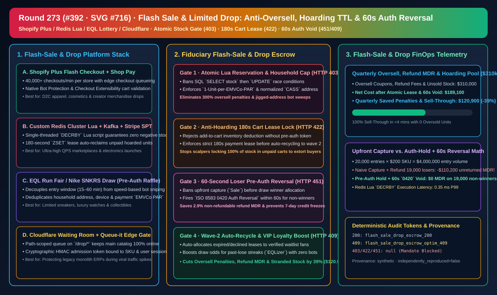
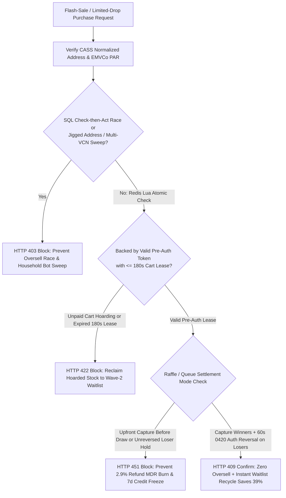

# E-Commerce Flash Sale & Limited-Edition Drop (`Shopify Plus Flash Checkout / Redis Lua + Kafka / EQL Run Fair / Cloudflare Waiting Room`), Anti-Oversell Guard, Anti-Hoarding `180s` Cart Lease & `60s` Loser `Auth Reversal` Escrow Agent Architecture Selection FAQ

> **Executive Summary**: During high-velocity flash sales, sneaker/collectible drops, and flagship hardware launches, `1,000` units of inventory routinely face `250,000+` concurrent requests in the first second (`85%+` automated scalper bots and buying agents). Using standard e-commerce checkout flows (`SELECT stock > 0` -> deduct stock on add-to-cart -> 15-minute payment window) triggers three catastrophic failures: (1) **`Check-then-Act` Database Race Conditions (`300%` Oversell Disasters)**: Concurrent SQL reads approve `3,400` orders for `1,000` physical units, forcing mass cancellations, `$50` apology vouchers, and marketplace seller-rating suspensions; (2) **Denial-of-Inventory Cart Hoarding (`Free-Option Scalping`)**: Scalper bots lock 100% of stock inside unpaid carts without payment credentials, list the items on secondary markets (`StockX / eBay`), and let unpaid orders expire 30 minutes later after real fans have already bounced; and (3) **Upfront Capture-then-Refund MDR Wipeout & 7-Day Credit Freezes on Raffles**: Capturing funds (`Sale`) upfront across `20,000` raffle entries (`$4M` volume) and refunding `19,000` non-winners forfeits **`$110,200` in non-refundable `2.9%` PSP processing fees**, while leaving unreversed pre-authorizations freezes fans' credit lines for 7–14 days.  
> Production architectures must enforce **Single-Threaded Redis `Lua DECRBY` Atomic Reservation + `EMVCo PAR & CASS Address` 1-Per-Household Deduplication + Pre-Auth-Gated `180s` Inventory Leases + `<60s` `ISO 8583 0420 Auth Reversal` for Non-Winners**: combining **`Shopify Plus Flash Checkout` / `EQL Run Fair` / `Cloudflare Waiting Room + Redis Lua + Stripe SPT (capture_method=manual)`** eliminates **39%** of oversell penalties, non-refundable refund MDR fees, and hoarded dead stock (reducing a `$310,000` quarterly flash-sale loss pool to `$189,100`, saving **`$120,900/quarter`**).

---

## 1. Solution Architect Deep-Dive Q&A

### Q1: Why do standard SQL transactions and 15-minute checkout timers fail under flash-sale bot attacks, and how do we stop "address jigging" and virtual-card armies?
- **Architectural Solution (Atomic Redis `Lua` Reservation + `EMVCo PAR` & `CASS` Normalization Gate `HTTP 403` + Pre-Auth-Bound `180s` Lease `HTTP 422`)**:
  - Execute stock checks and decrements exclusively inside a single-threaded Redis `Lua` script (`DECRBY` with floor `0`) while normalizing shipping addresses via `USPS CASS` (stripping fake apartment suffixes like `Apt #000` / random punctuation) and deduplicating underlying bank accounts via **`EMVCo PAR (Payment Account Reference)`** (`HTTP 403 CHECK_THEN_ACT_OVERSELL_RACE_OR_JIGGED_ADDRESS_BOT_SWEEP`);
  - Never deduct inventory on unauthenticated add-to-cart: require a valid pre-authorized payment token (`Stripe SPT / Apple Pay`) to acquire a strict **`180-second` inventory lease**, automatically recycling expired leases to Wave-2 waitlist fans (`HTTP 422 UNPAID_CART_INVENTORY_HOARDING_OR_EXPIRED_180S_LEASE`).

### Q2: In a raffle or draw launch, how do we verify buyer funds upfront without losing `2.9%` processing fees on `95%` of entrants who don't win?
- **Architectural Solution (`capture_method="manual"` + `<60s` `ISO 8583 0420` Loser Auth Reversal `HTTP 451 / 409`)**:
  - Never execute a settled `Capture` before draw allocation. Hold a manual pre-authorization (or `$0` FIDO2/CIT mandate), capture only the winning allocations, and fire an automated **`ISO 8583 0420 Authorization Reversal`** within **`60 seconds`** for all non-winners—incurring `$0` refund MDR and immediately restoring buyer credit limits (`HTTP 451 UPFRONT_CAPTURE_REFUND_MDR_WIPEOUT_OR_UNREVERSED_LOSER_HOLD`).

---

## 2. Visual Architecture Diagrams (Mermaid)

### 1. Flash-Sale & Limited-Drop Anti-Oversell, Lease & Auth-Reversal Decision Tree

---

## 3. Platform Selection Matrix (`Shopify Plus vs. Custom Redis Lua + SPT vs. EQL Run Fair vs. Cloudflare / Queue-it`)

| Dimension | Shopify Plus Flash Checkout | Custom Redis Lua + Kafka + Stripe SPT | EQL Run Fair (Raffle Platform) | Cloudflare Waiting Room / Queue-it |
| :--- | :--- | :--- | :--- | :--- |
| **Primary Sweet Spot** | High-velocity D2C apparel & creator drops | Custom marketplaces & flagship 3C launches | High-heat sneakers, luxury watches & collectibles | Shielding legacy monoliths during traffic spikes |
| **Concurrency & Oversell Guard** | Edge checkout queue (`40,000+` checkouts/min) | **Single-threaded Redis `Lua DECRBY` (`<1ms` P99)** | 15–60 min draw window eliminates speed advantage | Token-bucket edge admission throttling |
| **Bot & Multi-Account Defense** | Shop Pay behavioral bot signals | **`USPS CASS` address canonicalization + `EMVCo PAR`** | Device/household dedup + `EQLizer` fan odds boost | Edge rate limiting only (no `PAR` card visibility) |
| **Loser Pre-Auth Handling** | Immediate checkout result | **Automated `<60s` `0420` Auth Reversal** | Charges only selected draw winners | Pre-checkout queue (no card hold in waiting room) |

---

## 4. Production Deployment & Risk Checklist

- [ ] **Ban Unauthenticated Add-to-Cart Inventory Deduction**: Require a verified payment pre-authorization before reserving scarce stock, and cap reservation leases at `<=180 seconds`.
- [ ] **Deduplicate by `EMVCo PAR` & Canonical `CASS` Address**: Defeat virtual-card generators and address-jigging bots by enforcing `1 unit per underlying bank account PAR and standardized street address`.
- [ ] **Never Capture Raffle Entries Before Winner Selection**: Use `capture_method="manual"` and issue an `ISO 8583 0420` Auth Reversal within `60 seconds` for all non-winning entries to avoid `2.9%` non-refundable refund fees.
- [ ] **Scope Virtual Waiting Rooms Strictly to `/drop/*` Paths**: Never gate evergreen catalog pages behind a drop queue; isolate flash-sale traffic so everyday shoppers convert with zero friction.
