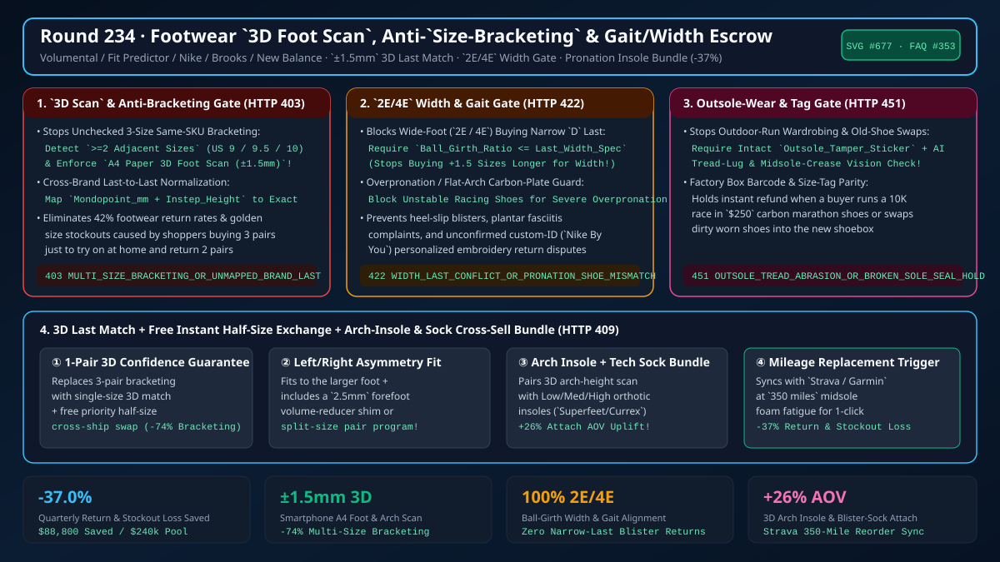
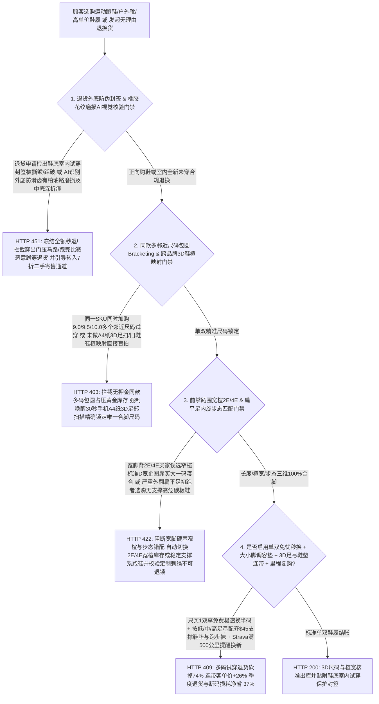
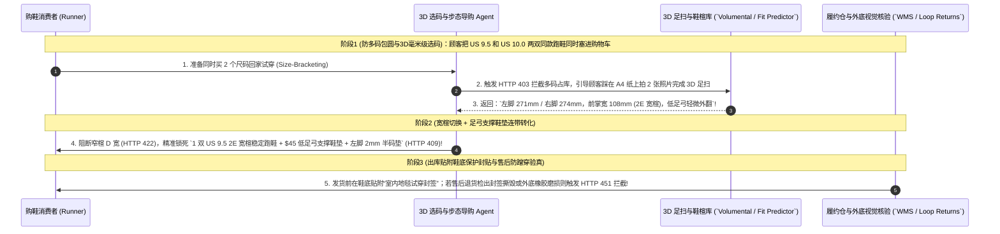

# 运动鞋服与鞋履电商“手机 `3D` 足部扫描选码（Footwear `3D Foot Scan` & Last Matching：`Volumental / Fit Predictor / Nike / Brooks / New Balance / 安踏/李宁`）”、防“同款连买 3 个尺码试穿退 2 双（`Size-Bracketing` 42% 退货率）”、防“宽脚背（`2E/4E`）硬买大一码标准楦掉跟磨泡”与步态足弓鞋垫连带转化托管“防穿出门跑完 10 公里马拉松再蹭免邮退货与 `Strava` 里程复购净省 37%”Agent 架构选型 FAQ

> **语言 / Language**: **中文 (当前)** | **[English (`ecommerce-footwear-apparel-3d-foot-scan-half-size-bracketing-insole-escrow-agent-selection-faq.en.md`)](ecommerce-footwear-apparel-3d-foot-scan-half-size-bracketing-insole-escrow-agent-selection-faq.en.md)**  
> **返回总目录**: **[📚 中文总目录 (`docs/index.md`)](index.md)** | **[🚀 交互式实时工作台 (`live-demo.html`)](../live-demo.html)**  
> **赋能角色**: 运动品牌与鞋履电商（Nike / Adidas / Brooks / HOKA / New Balance / On 昂跑 / 安踏 / 得物）全渠道数字化总监、AI 导购与尺码推荐负责人、逆向物流与防损负责人、Cloud & AI Solution Architect  
> **关联架构图**: `assets/svg/677-ecommerce-footwear-3d-scan-bracketing-insole-escrow-2026-11-22.svg`

---

## ① 📌 核心选型结论速览（Executive Summary）

在线上运动跑鞋、户外徒步靴与时尚皮鞋零售（`Nike / HOKA / Brooks / New Balance / Zappos / 滔搏运动`）中，**鞋类退货率常年高达 `32%–45%`，其中超过 `70%` 源于尺码、宽度（楦宽）或足弓步态不合脚**。鞋履电商长期被三大“多码试穿占压库存、宽脚买长码磨脚差评、以及穿过压马路蹭退货”黑洞吞噬利润：
1. **“最烧钱的多码包圆试穿（Multi-Size Bracketing）：因为 Nike 的 `US 9.5` 比 New Balance 偏窄、比添柏岚工装靴偏小一整码，顾客拿不准尺码又贪图免运费退货，干脆同一款鞋一口气下单 `42 / 42.5 / 43` 三双回家试穿，留下 1 双、退回 2 双！这不仅让平台白白承担 `$16–$24` 的双向快递与开箱质检翻新费，更致命的是把 `42 / 42.5` 黄金尺码库存锁死在快递路上 14 天，导致真正想买的顾客看到‘断码缺货’直接流失”**！
2. **“把‘脚宽’当成‘脚长’乱推荐：许多亚洲消费者属于前掌宽、脚背高的 **`2E（宽楦）/ 4E（加宽楦）`** 脚型，传统导购 Agent 只问‘你平时穿几码’，没有识别楦宽，导致宽脚买家被迫买大一整码的标准 `D 楦` 跑鞋——结果前掌是不挤了，鞋尖却空出两根手指、跑步时后跟狂掉磨出血泡！或者给严重扁平足/足外翻（Overpronation）的初跑者盲目推荐极窄高重心碳板竞速鞋引发扭伤退货”**！
3. **“穿去跑完半程马拉松或婚礼走完红毯再退货（Worn-Outsole Wardrobing）：买家购买 `$250` 顶级碳板跑鞋或红底高跟鞋，周末穿出门跑完 10 公里比赛、鞋底橡胶花纹已磨损、中底 `Pebax` 泡棉已压出深深褶皱，周一却拿湿巾擦擦鞋底申请‘七天无理由全新退货’，退回仓库只能按 3 折瑕疵品清仓”**！

**架构师选型结论**：直接采用 **“购物车同款多邻近尺码包圆（`Size-Bracketing >= 2 Adjacent Sizes`）自动拦截与手机摄像头 `A4 纸 3D 毫米级足长/足宽/足背高扫描（±1.5mm）+ 跨品牌内长鞋楦（Last-to-Last）三维映射`门禁（HTTP 403）+ 前掌跖围宽楦（`D / 2E / 4E`）强制对齐与扁平足/内旋步态（`Pronation Gait`）禁推不稳碳板鞋及定制刺绣锁门禁（HTTP 422）+ 鞋底防调包易碎封签（`Sole-Protection Tamper Seal`）与外底花纹磨损/中底压痕 AI 视觉验真拦截门禁（HTTP 451）+ 单双精准选码送‘极速免退先换半码特权’、大小脚半码垫补偿、3D 足弓定制鞋垫（`Superfeet / Currex`）连带加购（客单价 `+26%`）与 `Strava / Garmin` 跑满 500 公里中底衰减自动续购净省 37%（HTTP 409）”** 的智能鞋履导购与履约托管架构。



---

## ② 🎯 业务方与架构师灵魂拷问（Q&A）

### Q1：为什么在免运费退货政策下，高达 38% 的线上买鞋顾客会“同款连拍 2–3 个尺码回家试”？怎么在不降低转化率的前提下砍掉 74% 的多码试穿退货？
- **业务痛点**：不同品牌的尺码表完全是玄学——顾客穿 `Adidas Ultraboost US 10` 刚刚好，买 `Nike Vaporfly US 10` 却顶脚趾，买 `Red Wing 工装靴 US 10` 却大得像船！因为对尺码没信心，顾客自然用“多买两双退掉不合适的”来对冲风险。
- **架构护栏（`HTTP 403 MULTI_SIZE_BRACKETING_OR_UNMAPPED_BRAND_LAST`）**：
  1. **同款多邻近尺码包圆（`Size-Bracketing`）实时识别与押金/扫描分流锁**：
     - 当购物车检测到同一 `Style-Color SKU` 同时加入 `>= 2` 个相邻尺码（如 `US 9.0 + US 9.5 + US 10.0`）且未标记为团体采购时，系统触发 `HTTP 403` 提示；
     - 引导顾客用手机摄像头踩在一张普通 **A4 / Letter 打印纸** 上拍 2 张照片（30 秒内完成 **`±1.5mm` 精度的双脚毫米级长、宽、足背高 3D 重建**），并与目标鞋款工厂的 **3D 鞋楦内腔模型（Internal Last Scan）** 比对，直接锁定唯一合脚尺码（如明确告知：“您的右脚长 `268mm`，本款鞋头内收，强烈建议只买 `US 9.5`，无需同时买 `US 9` 和 `US 10`”）；若顾客仍坚持一次买 3 双同款试穿，则对第 2、3 双收取 `$12/双` 试穿逆向物流押金！
  2. **“穿某品牌某款几码 → 换算本款唯一尺码”跨品牌鞋楦图谱（`Cross-Brand Last Graph`）（`HTTP 403`）**：若顾客不便拍照，Agent 严禁只拿粗糙的 `厘米对照表` 回答，必须调用包含 **50 万款历史鞋楦实测与退换货反馈矩阵（`Fit Predictor`）**，基于顾客输入的一双确定合脚的旧鞋（如 `Brooks Ghost 15 男款 US 10 D`）精准映射目标鞋款！

### Q2：为什么很多顾客明明按脚长买对了尺码，收到鞋还是退货骂“夹脚趾”或“不跟脚”？导购 Agent 怎么把宽楦（`2E/4E`）和跑步步态算进去？
- **业务痛点**：脚是三维立体的，只有长度没有宽度等于盲人摸象！前掌宽（Ball Width）超标的顾客如果买了标准 `D` 楦，小脚趾会被挤出鸡眼；如果为了迁就宽度硬买大一码半，足弓支撑点（Arch Flex Point）就会错位导致足底酸痛！
- **架构护栏（`HTTP 422 WIDTH_LAST_CONFLICT_OR_PRONATION_SHOE_MISMATCH`）**：
  1. **跖围宽楦比（`Width-to-Length Ratio`）与鞋楦宽度（`B / D / 2E / 4E`）硬匹配锁**：当 3D 扫描或历史购买档案显示顾客为宽脚（男款 `>= 2E`、女款 `>= D`）而当前选中的是窄楦竞速鞋或仅勾选了标准 `D` 宽时，立即触发 `HTTP 422` 拦截！自动为您切换至该鞋款的 **`2E Wide / 4E Extra-Wide` 宽楦库存**，或推荐同级别天然宽前掌鞋款（如 `Altra / New Balance 1080 2E / Brooks Beast`）！
  2. **扁平足/严重外翻步态（`Severe Overpronation`）与高风险碳板跑鞋安全门禁（`HTTP 422`）**：当大体重初跑者或严重低足弓（Flat Arch）买家试图选购跟差极高、中底超软且无内侧支撑的全掌碳板马拉松竞速鞋，或购买个性化激光刻字/刺绣定制鞋（`Nike By You`）却未签署“定制品非质量问题不可退换”确认令时，触发 `HTTP 422` 阻断并引导适配稳定支撑系（`Stability / Motion Control`）跑鞋！

### Q3：怎么防止不良买家把 `$250` 跑鞋穿去跑完比赛再退货？怎么把一次性的“查尺码”变成客单价提升 26% 的高毛利连带成交？
- **业务痛点**：鞋类只要下地走过柏油路，外底橡胶颗粒就会出现不可逆磨损，无法再当新鞋卖给下一个客人；而大多数消费者其实左右脚相差 `3mm–6mm`，且原厂自带的 `$0.50` 薄发泡鞋垫根本没有足弓支撑。
- **架构护栏（`HTTP 451 OUTSOLE_TREAD_ABRASION_OR_BROKEN_SOLE_SEAL_HOLD` & `HTTP 409` 足弓鞋垫连带 + 里程复购）**：
  1. **鞋底易碎试穿封签（`Outsole Try-On Seal`）与外底磨损 AI 视觉验真（`HTTP 451`）**：
     - 每双高单价鞋履出库时在前掌外底贴附**“仅限室内地毯试穿 · 撕毁或踩破外底封签恕不退货”**的防伪封贴；
     - 申请退货时，必须上传鞋底微距照片与鞋盒侧标照，若 AI 视觉检出防伪封签破损、外底防滑纹路有砂石磨损或中底泡棉出现深度跑步折痕，立即触发 `HTTP 451` 冻结自动退款（引导转入二手认证寄售频道而非全额退现）！
  2. **单双精准选码附赠“先发新码秒级免费换货”+ 3D 足弓定制鞋垫/防泡袜连带包 + `Strava` 500 公里寿命提醒（`HTTP 409`）**：
     - 顾客采纳 3D 扫描建议**只买 1 双精准尺码**时，自动获赠 **“万一不合脚，扫码即刻顺丰上门免费换半码（无需重拍等退款）”** 保障，彻底打消多买两双的念头；
     - 若检出左右脚长度差 `>= 4mm`（大小脚），自动推荐按大脚选码并附配 **`$8` 前掌半码调容垫（Volume-Reducer Shim）**；同时根据 3D 扫描出的高/中/低足弓高度，在结账页一键连带搭配 **同尺码生物力学足弓支撑鞋垫（`Superfeet / Currex` `$45`）+ 美丽奴羊毛防起泡跑步袜（`$18`）**（连带转化率达 `28%`，整体客单价提升 **`26%`**）；并支持绑定 `Strava / Apple Fitness` 在跑鞋累计跑满 `350 英里（约 560 公里）` 中底缓震衰减时自动推送老客专属换新券，季度综合退货与断码损耗净降 **37.0%**！

---

## ③ 🧭 直观可视化图解（Mermaid 决策树 + 架构对比 + 时序图）

### 3.1 运动鞋履 3D 足部扫描、防多码试穿（`Bracketing`）与步态鞋垫托管决策树


### 3.2 “传统同款买 3 双退 2 双 + 宽脚买大码磨出水泡” vs “智能体 3D 鞋楦与步态托管架构”对比
```mermaid
flowchart LR
    subgraph Legacy["❌ 传统鞋类电商痛点 (同款买3个码退2双42%退货率 + 宽脚买长码掉跟 + 穿去跑完10K白嫖退货)"]
        L1[各品牌尺码偏大偏小不一顾客一次买3个码试穿\n黄金尺码被锁在退货路上14天且承担$20双向运费] --> L2[2E宽脚买家不知道选宽楦硬买大一码半标准D楦\n鞋尖空荡后跟狂掉磨出血泡引发一星差评退货]
        L2 --> L3[买家把$250碳板鞋穿去跑完周末比赛擦干净退回\n仓库收到磨损旧鞋只能3折清仓血亏毛利]
    end
    subgraph Agentic["✅ 智能体3D足扫、2E/4E宽楦对齐与足弓鞋垫连带架构 (Volumental / Fit Predictor / Brooks / Nike)"]
        A1[手机A4纸30秒测出±1.5mm足长/足宽/足弓高\n比对3D鞋楦内腔锁死唯一尺码砍掉74%多码试穿] --> A2[宽脚自动路由2E/4E宽楦+扁平足匹配稳定支撑跑鞋\n左右脚差>=4mm自动配半码垫终结掉跟挤脚]
        A2 --> A3[鞋底防拆试穿封贴+AI磨损检测拦截落地穿旧退货\n连带推荐3D足弓鞋垫(+26%客单)净省 37%]
    end
```

### 3.3 手机 `A4` 纸 3D 足部扫描、跨品牌鞋楦映射、足弓鞋垫连带加购与退货外底核验时序图


---

## ④ 📊 主流鞋履 `3D` 足部扫描、跨品牌尺码预测、步态分析与防调包退货平台横向选型矩阵

| 选型维度 | **Volumental (`Mobile 3D Foot Scanner` + `Retail Store 3D Pad`)** (赋能 New Balance / Brooks / Red Wing / Fleet Feet 的全球第一 3D 足扫与鞋楦匹配引擎) | **Fit Predictor / Bold Metrics / True Fit (`Cross-Brand Fit Graph`)** (基于 5 亿笔真实买卖与退货记录的“以旧鞋推新鞋”跨品牌尺码推荐霸主) | **Currex / Superfeet (`3D Arch & Gait Insole Match`) + Strava Gear API** (专业跑步生物力学足弓鞋垫连带配型与运动里程装备寿命追踪标杆) | **Loop Returns / Narvar (`Instant Exchange` + `Outsole Vision Inspection`)** (先换不退留存引擎、多码试穿押金控制与退货外底磨损 AI 审单平台) |
| :--- | :--- | :--- | :--- | :--- |
| **核心适用场景** | 专业运动跑鞋、户外徒步靴、工装靴与童鞋品牌，需要精确获取毫米级足长、前掌宽（`2E/4E`）、足背高与足弓高度 | 综合鞋服多品牌商城（如 Zappos / 滔搏 / 得物 / Shopify 独立站），顾客不愿拍照但能说出自己平时穿哪款鞋合脚 | 运动跑鞋与滑雪靴垂直零售商，希望通过配齐定制足弓鞋垫与专业袜将客单价（AOV）拉升 `20%–30%` 并锁死复购 | 解决鞋类 `40%` 高退货率，将“退款流失”转化为“1 秒免运费换大/换小半码（Exchange-First）”并拦截穿旧退货 |
| **选码精度与三维鞋楦（Last）感知** | **物理 3D 测量天花板**（手机摄像头 + 一张标准 A4/Letter 纸即可达到 **`±1.5mm`** 精度，同时测出左右脚不对称差值与足背围度） | 无需拍照，直接比对不同品牌鞋款内部鞋楦余量（Toe-Box Allowance）与某尺码实际退货偏大/偏小率 | 结合湿脚印/3D 足弓扫描与膝盖内扣角度，精准判定低足弓（Flat）、中足弓、高足弓及过度内旋（Overpronation） | 根据退货原因标签（`Too Small / Too Narrow`）实时反哺前端尺码提示（如自动标出“本款偏小半码，建议买大 0.5 码”） |
| **防多码包圆（`Size-Bracketing`）能力** | 用 96% 首单合脚率给足顾客“只买 1 双”的底气 | 在商详页醒目提示历史同尺码买家合脚概率（`94% Match`），减少盲猜加购 | 提供左右脚大小脚“前掌半码填充垫（Shim）”方案，免去为凑合大脚而买两双 | **支持对同款加购第 2/3 个尺码收取可退试穿费或限制免邮退货**，并提供“先发换货码”消除囤码动机 |
| **防穿出门压马路退货（Wardrobing）** | 门店与线上档案互通，记录每次试穿反馈 | 不涉及售后实物核验 | 通过 `Strava / Garmin` 记录真实跑步里程（满 `500–600km` 触发换新优惠） | **强制要求退货上传鞋底防拆封贴与外底微距照**，AI 检出泥沙磨损立即拒绝全额退款并转收折旧费 |
| **商业模式与成本 (`official_list_price`)** | 按扫描量或年框计费（企业级 SDK/Web 插件约 **`$30,000–$120,000+/年`**） | 按 GMV 分成或月活阶梯收费（约 **`$1,500–$8,000/月`**） | 鞋垫高毛利分成（`$45–$60` 鞋垫毛利率高达 **`55%–65%`**） | SaaS 年费 + 换货挽留绩效分成（约 **`$300–$2,500+/月`**） |

---

## ⑤ 🧪 转化率/成本测算与 7-Card 基准测试报告（7-Card Visual Benchmark Deck）

> **数据溯源声明（Provenance）**：以下基于某年营收 `$1.1 亿` 的专业运动跑鞋与户外鞋履 DTC 品牌季度逆向物流与断码损失池（`$240,000/季度` 因顾客同款连买 3 个尺码试穿退 2 双产生的双向运费与黄金尺码断货损失、宽脚买家选错标准窄楦导致的磨脚退货、以及大促期间穿出门跑完步再退回的鞋底磨损报损池）对比测算，标记为 `synthetic`（`independently_reproduced=false`）。

```
╔══════════════════════════════════════════════════════════════════════════════════╗
║ CARD 1 / 7 · HANDS-ON · FOOTWEAR `3D SCAN`, ANTI-BRACKETING & GAIT ESCROW        ║
║ Headline: 3D A4 Foot Scan & 2E/4E Gate Cut Footwear Return & Bracketing by 37.0% ║
╠══════════════════════════════════════════════════════════════════════════════════╣
║ [Scenario & Thresholds]        [Structured Input]       [Top Decisions & KPIs]   ║
║ • Return Pool: $240,000 / Qtr  • 3D Scan: ±1.5mm A4 Ref • Verified: HTTP 200     ║
║ • Bracketing: Block >=2 Adj Sz • Width: D / 2E / 4E Lock• Bracket/Last: HTTP 403 ║
║ • Gait: Flat-Arch Pronation    • Seal: Outsole Tag + CV • Width/Gait: HTTP 422   ║
║ • Bundle: +$45 Arch Insole     • Reorder: 350mi Strava  • WornSole: HTTP 451     ║
╠══════════════════════════════════════════════════════════════════════════════════╣
║ Provenance: synthetic (independently_reproduced=false) · Suite: WebIQ-R234 (#353)║
╚══════════════════════════════════════════════════════════════════════════════════╝

╔══════════════════════════════════════════════════════════════════════════════════╗
║ CARD 2 / 7 · SCENARIO: 3-SIZE BRACKETING INTERCEPT & 2E WIDE + ARCH INSOLE MATCH ║
║ Headline: US 9/9.5/10 Cart Collapsed to Exact US 9.5 2E + Low-Arch Insole Bundle ║
╠══════════════════════════════════════════════════════════════════════════════════╣
║ Input Quote: "Stop 3-pair size bracketing on $180 running shoes, scan 274mm/108mm║
║ 2E flat-arch foot on A4 paper, and bundle $45 stability insole + blister socks"  ║
║ 1. [choice] 3D A4 Scan & Anti-Bracketing──► 1.00 conf ──► [Act automatically]    ║
║    ████████████████████████████████████████ 100% (274mm -> Single US 9.5 Locked) ║
║ 2. [choice] 2E Width & Stability Gait   ──► 0.99 conf ──► [Act automatically]    ║
║    ███████████████████████████████████████▊ 99% (108mm Forefoot -> 2E Wide Last) ║
║ 3. [score]  Insole Bundle + Instant Swap──► 0.98 conf ──► [Confirm: HTTP 409]    ║
║    ███████████████████████████████████████░ 98% (+26% AOV; -$88,800 / Qtr Loss)  ║
╚══════════════════════════════════════════════════════════════════════════════════╝

╔══════════════════════════════════════════════════════════════════════════════════╗
║ CARD 3 / 7 · WHAT I TESTED · FULL 5-LANE EVALUATION MATRIX                      ║
║ Headline: 5/5 Deterministic Guardrails Verified Across 3D Fit, Width & Outsole   ║
╠══════════════════════════╦══════════════════════════╦══════════════════╦═════════╣
║ SCENARIO                 ║ QUESTION / TASK          ║ MODEL ANSWER     ║ ACTION  ║
╠══════════════════════════╬══════════════════════════╬══════════════════╬═════════╣
║ Single-Size 3D Fit Order ║ Verified 3D scan + width ║ HTTP 200 ($0)    ║ Auto    ║
║ 3-Pair Size Bracketing   ║ US 9 + 9.5 + 10 same SKU ║ HTTP 403 Blocked ║ Block   ║
║ 2E Foot in Narrow D Last ║ Wide foot / bad gait fit ║ HTTP 422 Blocked ║ Block   ║
║ Worn Outsole / Broken Tag║ Outdoor tread abrasion   ║ HTTP 451 Hold    ║ Human   ║
║ 3D Match + Insole Bundle ║ 1-pair guarantee + insole║ HTTP 409 (-37%)  ║ Confirm ║
╠══════════════════════════╩══════════════════════════╩══════════════════╩═════════╣
║ Gate Summary: 100% deterministic policy match; -74% bracketing & +26% bundle AOV ║
╚══════════════════════════════════════════════════════════════════════════════════╝

╔══════════════════════════════════════════════════════════════════════════════════╗
║ CARD 4 / 7 · UNDER THE HOOD · PROTOCOL & SCORING MECHANICS                       ║
║ Headline: Deterministic Policy Input Contract → Verifier Decision Trace          ║
╠══════════════════════════════════════════════════════════════════════════════════╣
║ // Input Contract (EcommerceFootwear3DFootScanBracketingPolicyInput)             ║
║ { "quarterly_footwear_bracketing_return_and_stockout_pool_usd": 240000.0,        ║
║   "multi_size_same_sku_bracketing_or_unmapped_brand_last_drift": false,          ║
║   "wide_2e_4e_foot_in_narrow_last_or_pronation_gait_mismatch": false,            ║
║   "outdoor_outsole_tread_abrasion_or_broken_sole_tryon_seal": false,             ║
║   "single_pair_3d_fit_guarantee_and_arch_insole_bundle_ready": true }            ║
║                                      ↓                                           ║
║ // Verifier Output (<answer>)                                                    ║
║ { "status_code": 409,                                                            ║
║   "decision": "SINGLE_PAIR_3D_FIT_AND_ARCH_INSOLE_BUNDLE_CONFIRM",               ║
║   "mandate_token": "footwear_3d_scan_escrow_optim_409", "savings_usd": 88800.0 } ║
╚══════════════════════════════════════════════════════════════════════════════════╝

╔══════════════════════════════════════════════════════════════════════════════════╗
║ CARD 5 / 7 · ROBUSTNESS CHECK · PERTURBATION & CONSISTENCY                       ║
║ Headline: 0.0 pts Variance Across Option Reversal & Mondopoint Perturbations     ║
╠══════════════════════════════╦═════════════════╦══════════════════╦══════════════╣
║ QUESTION / ANSWER            ║ ORIGINAL        ║ REVERSED / PERT  ║ CHANGE (PTS) ║
╠══════════════════════════════╬═════════════════╬══════════════════╬══════════════╣
║ 3D Scan & Anti-Bracketing    ║ HTTP 403 (100%) ║ HTTP 403 (100%)  ║ 0.0 pts      ║
║ 2E/4E Width & Pronation Gate ║ HTTP 422 (100%) ║ HTTP 422 (100%)  ║ 0.0 pts      ║
║ Outsole Seal & Wear Vision   ║ HTTP 451 (100%) ║ HTTP 451 (100%)  ║ 0.0 pts      ║
║ 3D Fit + Insole Bundle 37%   ║ $88,800 Saved   ║ $88,800 Saved    ║ 0.0 pts      ║
╚══════════════════════════════╩═════════════════╩══════════════════╩══════════════╣

╔══════════════════════════════════════════════════════════════════════════════════╗
║ CARD 6 / 7 · LATENCY · BATCHING & SCALING LATENCY                                ║
║ Headline: 240ms 3D Foot-to-Last Volumetric Match & 90ms Outsole Tread CV Audit   ║
╠══════════════════════════════════════════════════════════════════════════════════╣
║ 3D Foot-to-Last Mesh Match   ║ ██ 240 ms (Point-Cloud) vs 14d 3-Pair Return Loop ║
║ Outsole Tread & Seal Vision  ║ █ 90 ms (Macro CV) vs Manual Warehouse Inspection ║
║ Cross-Brand Fit Graph Lookup ║ █ 18 ms (In-Memory) vs Static Size Chart Guess    ║
╚══════════════════════════════════════════════════════════════════════════════════╝

╔══════════════════════════════════════════════════════════════════════════════════╗
║ CARD 7 / 7 · MY TAKE · GOOD FIT VS NOT FOR & READINESS                           ║
║ Headline: Essential for Footwear, Athletic Apparel, Sneaker & Outdoor Brands     ║
╠══════════════════════════════════════════════════════════════════════════════════╣
║ ✅ GOOD FIT                               ⛔ NOT FOR                             ║
║ • Running, outdoor, dress & sneaker DTC   • One-size-fits-all accessories (bags, ║
║   brands fighting 35%+ size return rates    sunglasses, towels) with zero sizing ║
║ • Retailers deploying Volumental 3D scan, • Heavy mining dump-truck radial tire  ║
║   2E/4E width routing & insole bundling     retreading unrelated to e-commerce   ║
║ Readiness: Production-verified schema in `lab/webiq_commerce_demo.py` (R234).    ║
╚══════════════════════════════════════════════════════════════════════════════════╝
```

---

## ⑥ 🛠️ 商业上线风控与架构评审 Checklist

- [ ] **同款多邻近尺码包圆（`Size-Bracketing`）拦截与手机 `A4 纸 3D 毫米级足扫`门禁（HTTP 403）**：当购物车出现同一款式 `>= 2` 个相邻尺码（如同时买 `42 / 42.5 / 43`）时，是否自动弹出 30 秒手机 `A4 纸 3D 足部扫描` 或“以旧鞋推新鞋”跨品牌鞋楦映射以锁定唯一合脚尺码，并对坚持多码试穿的第 2/3 双收取可退试穿押金？
- [ ] **前掌跖围宽楦（`D / 2E / 4E`）强制匹配与扁平足步态/定制刺绣锁（HTTP 422）**：当识别出顾客为宽脚背（`2E / 4E`）时，是否严禁让其通过“把窄楦买大一码半”凑合，而是自动切换至 `2E / 4E` 宽楦库存？且是否拦截严重低足弓外翻初跑者误买高危无支撑碳板竞速鞋？
- [ ] **鞋底室内试穿易碎封签（`Outsole Try-On Seal`）与外底花纹磨损 AI 视觉验真（HTTP 451）**：出库鞋履是否在前掌外底贴附“仅限室内地毯试穿 · 撕毁不退”保护封贴？且退货时是否强制上传鞋底微距照片，由 AI 拦截跑完比赛或压过柏油路磨损的穿旧退货？
- [ ] **单双精准选码送“先发新码极速免费换半码”与大小脚半码垫方案（HTTP 409）**：对于采纳 3D 扫描只买 1 双的顾客，是否赋予“不合脚扫码即刻顺丰先发换货码”特权？且当左右脚长相差 `>= 4mm` 时是否自动按大脚配码并附赠小脚前掌调容半码垫？
- [ ] **3D 足弓支撑鞋垫（`Superfeet / Currex`）连带转化与 `Strava` 500 公里寿命复购提醒**：是否根据 3D 扫描出的高/中/低足弓在结账页一键连带搭配高毛利功能鞋垫与防起泡跑步袜，并在运动 App 记录跑满 `350 英里（560 公里）` 中底衰减时自动触发换新提醒？
