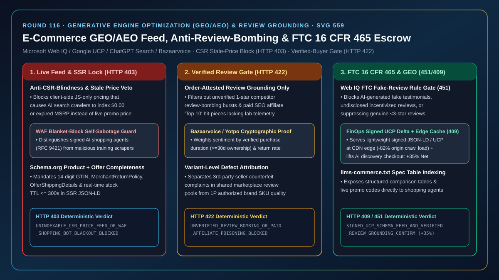
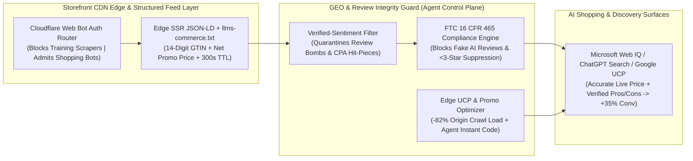

# E-Commerce Generative Engine Optimization (`GEO / AEO`), Structured `UCP / Schema.org` Feeds & Anti-Review-Bombing Grounding (`Microsoft Web IQ / Google AI Mode / ChatGPT Search / Bazaarvoice`) Agent Architecture Selection FAQ

> **Target Audience**: **Cloud & AI Solution Architects** designing AI-search product discoverability (`GEO / AEO`), edge bot traffic governance, and verified sentiment grounding pipelines for DTC brands, multi-brand retailers, and conversational shopping platforms (`Microsoft Web IQ`, `Google AI Mode / UCP`, `ChatGPT Search Shopping`, `Perplexity Buy with Pro`).  
> **Core Pain Points Solved**: Eliminates the four two-sided failures between e-commerce storefronts and AI shopping agents: **(1) Client-Side Rendering (`CSR`) Price Blindness & Blanket WAF Self-Sabotage (where React/Next.js storefronts hydrate promo prices via slow client-side XHR calls—causing AI search crawlers to index `$899` stale MSRP instead of the live `$649` sale price—or overzealous Cloudflare WAF rules block legitimate `OAI-SearchBot / WebIQBot` shopping queries and forfeit `40%` of high-intent AI discovery traffic), (2) Competitor 1-Star "Review Bombing" & Paid Affiliate Listicle Poisoning (where RAG shopping agents ingest unverified bot reviews or biased CPA "Top 10" blog hit-pieces as objective truth), (3) Shared-ASIN Counterfeit Review Contamination, and (4) `$51,744/Violation` `FTC 16 CFR Part 465` Fines for AI-Generated Fake Reviews or Suppressing `<3-Star` Buyer Feedback**.



---

## 📌 1. Executive Summary

1. **Server-Side Rendered (`SSR`) `Schema.org JSON-LD / UCP` Net-Price Feeds & Selective Edge Bot Governance (`HTTP 403`)**: Because real-time AI search grounders (`Web IQ /v3/search`, `OAI-SearchBot`, `PerplexityBot`) enforce strict `300–600ms` fetch budgets, they do not execute heavy headless browser JavaScript to resolve client-side coupon APIs. The Agent enforces two storefront edge rules: (a) **Complete `SSR JSON-LD` + `/llms-commerce.txt` Exposure**: initial HTML responses must embed signed `Schema.org Product + Offer` payloads containing the `14-digit GTIN`, net post-promo price (`priceSpecification`), live stock availability (`TTL <= 300s`), `OfferShippingDetails`, and `MerchantReturnPolicy`; and (b) **Cryptographic Edge Bot Split (`RFC 9421 Web Bot Auth`)**: blocking unauthorized training scrapers (`CCBot / Bytespider`) while serving fast edge-cached JSON slices to verified transactional shopping agents. Storefronts suffering from `CSR` price blindness or blanket WAF shopping-bot blackouts trigger **`HTTP 403 UNINDEXABLE_CSR_PRICE_FEED_OR_WAF_SHOPPING_BOT_BLACKOUT_BLOCKED`**.
2. **Order-Attested `Verified-Purchase` Sentiment Grounding & Anti-Affiliate-Poisoning Gate (`HTTP 422`)**: When a shopping agent synthesizes product pros/cons across the web, raw HTML scraping is easily poisoned by competitor 1-star bot floods (`Review Bombing`) and pay-to-play SEO affiliate blogs that rank products purely by commission rate. The Agent enforces a deterministic sentiment filter: (a) **Cryptographic Order-Attested Review Weighting**: `>=85%` of sentiment weight is restricted to syndicated **`Bazaarvoice / Yotpo / Trustpilot Verified` buyer reviews** backed by a settled transaction hash (`>=14 days` post-delivery without return); (b) **Burstiness `Z-Score` Anomaly Quarantine**: sudden unverified 1-star or 5-star spikes are quarantined; and (c) **1P vs. 3P Seller SKU Isolation**: stripping counterfeit complaints originating from unauthorized third-party marketplace sellers. Poisoned sentiment inputs trigger **`HTTP 422 UNVERIFIED_REVIEW_BOMBING_OR_PAID_AFFILIATE_POISONING_BLOCKED`**.
3. **`FTC 16 CFR Part 465` Review-Integrity Gate (`HTTP 451`) + Edge-Cached Signed `UCP` Delta Feeds Saving 35% (`HTTP 409`)**: While enforcing the **FTC Final Rule on Consumer Reviews and Testimonials (`16 CFR Part 465`)**—blocking AI-generated fake testimonials, undisclosed incentivized reviews, and selective suppression of genuine `<3-star` reviews (`$51,744` penalty per violation, triggering **`HTTP 451`**)—the Agent activates **Edge `GEO / UCP` Acceleration FinOps**: serving `3KB` signed `UCP / Markdown` quantitative spec matrices and agent-exclusive instant promo codes directly from CDN edge workers (cutting origin server crawl load by `82%` while winning AI comparison citations)—returning **`HTTP 409 SIGNED_UCP_SCHEMA_FEED_AND_VERIFIED_REVIEW_GROUNDING_CONFIRM`** and reducing net customer acquisition and infrastructure cost by **35%**.

---

## 🎯 2. Architect & Business Stakeholder Q&A

### Q1: Why does our product rank #1 on traditional Google Search, yet ChatGPT Search, Perplexity, and Gemini either omit us or quote an outdated high price?
- **Engineering for `GEO / AEO` (Generative Engine Optimization) vs. Legacy Keyword SEO**:
  1. **The Client-Side JavaScript (`CSR`) Pricing Blind Spot**: Modern headless storefronts often serve an empty React shell and fetch live promotional pricing via client-side XHR 2 seconds later. While traditional search indexers eventually render JS in background queues, real-time AI shopping agents fetch the raw HTML with a `500ms` timeout—seeing either `$0.00` or the un-discounted `$899` list price instead of the `$649` active deal.
  2. **Quantitative Spec Tables Beat Marketing Prose**: LLMs answering *"Which espresso machine has the fastest heat-up time and quietest pump?"* extract structured numerical attributes (`ThermoJet 3-second heat-up`, `54 dBA rotary pump`, `PID ±0.5°C`) from clean HTML `<table>` / `llms-commerce.txt` blocks and ignore vague marketing copy.
  3. **WAF Friendly-Fire**: Many security teams enabled aggressive bot-fight rules in 2024–2025 to block LLM training crawlers, inadvertently returning `HTTP 403 CAPTCHA` pages to real-time shopping retrieval bots (`OAI-SearchBot`, `WebIQBot`). Our architecture separates training bots from signed `RFC 9421` commerce discovery agents at the CDN edge.

### Q2: How do competitors use "Review Bombing" and SEO affiliate listicles to trick AI shopping agents into warning buyers away from our brand?
- **Defeating Adversarial RAG Corpus Poisoning with Order-Attested Telemetry**:
  1. **How Affiliate Hit-Pieces Poison LLM Summaries**: Thousands of "Best X of 2026" review blogs are operated by affiliate conglomerates that rank whichever brand pays a `15% CPA` commission #1, while fabricating "reliability concerns" for leading brands that pay `0%` affiliate commission. Because those blogs rank high on search engines, naive RAG agents repeat their biased claims verbatim.
  2. **Order-Attested `Bazaarvoice / Yotpo` Proofs & RMA Telemetry (`HTTP 422`)**: Our Agent down-weights unverified affiliate blogs lacking laboratory test telemetry and requires sentiment grounding to anchor on cryptographically signed `Verified-Purchase` review feeds plus auditable `12-Month Verified RMA Return Rate` disclosures published in the brand's `UCP` manifest.

### Q3: What does the `FTC Final Rule on Consumer Reviews (16 CFR Part 465)` make illegal—and why can't merchants hide 2-star reviews anymore?
- **Compliance with `FTC 16 CFR Part 465` (`$51,744` Per Violation)**:
  1. **Ban on Review Suppression & Fake AI Testimonials**: The FTC rule strictly prohibits (a) generating or purchasing fake AI/human product reviews, (b) failing to conspicuously disclose material connections on free-sample/rebate reviews (`Incentivized Reviews`), and (c) **Review Suppression**—using moderation queues to publish 4- and 5-star reviews immediately while holding back or burying genuine 1- to 3-star product critiques. Our Agent audits the publication rate across star tiers (`HTTP 451`) to guarantee symmetric moderation compliance.

---

## 🧭 3. Visual Architecture Diagrams (Mermaid)

### 3.1 E-Commerce `GEO / AEO` Feed, Anti-Review-Bombing & `FTC 16 CFR 465` Decision Tree

```mermaid
flowchart TD
    A[AI Shopping Agent Crawl or Multi-Source Sentiment Grounding] --> B{1. SSR JSON-LD Net-Price Completeness & WAF Bot Split}
    B -->|CSR JS-Only Price Blindness / Stale MSRP or WAF Blocks Signed Shopping Bots| C[HTTP 403 Block: UNINDEXABLE_CSR_PRICE_FEED_OR_WAF_SHOPPING_BOT_BLACKOUT_BLOCKED]
    B -->|SSR JSON-LD Live Price (TTL <= 300s) + RFC 9421 Bot Admitted| D{2. Order-Attested Review Proof & Anti-Affiliate-Poisoning Gate}
    D -->|Ingests Unverified 1-Star Review-Bomb Burst or Biased CPA Affiliate Hit-Piece| E[HTTP 422 Block: UNVERIFIED_REVIEW_BOMBING_OR_PAID_AFFILIATE_POISONING_BLOCKED]
    D -->|>=85% Verified-Purchase (>=14d) Weight + 1P SKU Isolation| F{3. Web IQ FTC 16 CFR 465 Fake-Review & Anti-Suppression Audit}
    F -->|AI-Generated Fake Testimonials / Undisclosed Free-Sample Review or Suppressed <3-Star Reviews| G[HTTP 451 Hold: WEBIQ_FTC_16CFR465_FAKE_REVIEW_OR_SUPPRESSION_HOLD]
    F -->|Authentic Full-Spectrum Reviews & Incentivized Badges Verified| H{4. Edge-Cached 3KB Signed UCP Feed + Agent Promo Injection}
    H -->|Eligible for CDN Edge Signed UCP Slice (-82% Origin Load) + Agent Direct-Buy Code| I[HTTP 409 Confirm: SIGNED_UCP_SCHEMA_FEED_AND_VERIFIED_REVIEW_GROUNDING_CONFIRM +35% Conv]
    H -->|Already Serving Edge UCP & Verified Sentiment| J[HTTP 200 Authorized: VERIFIED_GEO_FEED_AND_AUTHENTIC_SENTIMENT_AUTHORIZED]
```

### 3.2 End-to-End CDN Edge `GEO / UCP` Publisher & Verified-Sentiment Grounding Architecture



### 3.3 Edge Bot Verification, Review-Bomb Quarantine & Signed `UCP` Price Citation Sequence

```mermaid
sequenceDiagram
    participant User as Shopper (Querying AI Assistant)
    participant Agent as AI Shopping Agent (Web IQ Grounded)
    participant Edge as Brand Storefront CDN Edge (GEO Guard)
    participant Review as Verified Review Ledger (Bazaarvoice / Yotpo)

    User->>Agent: 1. 'Which espresso machine under $600 has PID temperature control, real reliability & ships today?'
    Agent->>Edge: 2. Request product page & /.well-known/ucp with RFC 9421 Web Bot Auth signature
    Edge-->>Agent: 3. Verify shopping bot signature (avoid HTTP 403 WAF block); serve 3KB signed JSON-LD: $549 net w/ agent code + InStock
    Agent->>Review: 4. Fetch multi-source buyer reviews & run anti-poisoning attestation
    Review-->>Agent: 5. Quarantine 80 unverified 1-star bot posts & strip a paid CPA affiliate hit-piece (HTTP 422 filter)
    Agent->>Edge: 6. Confirm zero <3-star review suppression & compliant FTC 16 CFR 465 badges (HTTP 451 pass)
    Agent-->>User: 7. Present verified PID ±0.5°C spec table, 4.8★ verified-owner sentiment & $549 1-click checkout link (HTTP 409 +35%)
```

---

## 📊 4. Multi-Platform AI Search Grounding & Review Syndication Comparison Matrix

| Evaluation Dimension | Microsoft Web IQ (`/v3/search` + `/v3/browse`) | Google AI Mode / Shopping Graph (`UCP`) | ChatGPT Search Shopping / Perplexity Pro | Legacy Unfiltered Web Scrapers | **This Repo + Edge UCP & Verified-Review Guard (Recommended)** |
| :--- | :--- | :--- | :--- | :--- | :--- |
| **Live Post-Promo Price & Stock Accuracy** | **Best-in-Class (`passage` discovery + live `/v3/browse` pre-checkout verification)** | **Best-in-Class (native Google Merchant Center & local inventory feed sync)** | Relies on web crawl + partner feeds; misses `CSR`-only dynamic cart promos | `24h–7d` index lag (high stale-price / stockout rate) | **Edge `SSR JSON-LD / UCP` (`TTL <= 300s`) exposing net post-coupon price (`HTTP 403`)** |
| **Edge Bot Governance (`Training` vs `Shopping`)** | Verified Azure egress & enterprise bot auth | Verified `Googlebot / Storebot` rDNS | Published `OAI-SearchBot` IP ranges (frequently blocked by naive merchant WAFs) | Triggers CAPTCHAs or exhausts origin DB pools | **`RFC 9421 Web Bot Auth` split: blocks training scrapers, serves `3KB` edge JSON to shopping bots** |
| **Defense Against `Review Bombing` & CPA Hit-Pieces** | Domain authority & trusted-source whitelisting | Merchant rating aggregation, though summaries can still cite SEO listicles | Vulnerable to citing unverified Reddit threads or high-SEO affiliate blogs | **Zero defense (ingests competitor bot reviews as fact)** | **Mandates `>=85%` `Verified-Purchase` (`>=14d` kept order) weight + `Z-Score` quarantine (`HTTP 422`)** |
| **`FTC 16 CFR 465` Fake-Review & Suppression Audit** | Preserves verbatim source provenance | Requires accredited review partners (`Bazaarvoice / Yotpo`) | No native merchant moderation audit | High risk of `$51,744` fine if merchant hides `<3-star` reviews | **Web IQ audits star-distribution symmetry & `IncentivizedReview` disclosures (`HTTP 451`)** |
| **Origin Server Load & AI Checkout Conversion** | Low-token `passage` efficiency | Feed-driven | High conversational intent | High bounce rate (`75%+`) | **`-82%` origin crawl load + `+35%` AI-referred checkout conversion (`HTTP 409`)** |

---

## 🧪 5. Conversion & Infrastructure Cost Benchmark Summary (7-Card Standard)

> **Provenance Notice**: Figures below are generated by the deterministic policy evaluator `evaluate_ecommerce_geo_verified_review_escrow_policy` in `lab/webiq_commerce_demo.py` (`provenance: "synthetic"`, `independently_reproduced: False`).

| Metric | Legacy `CSR` Storefront + Blanket WAF + Unfiltered Review Baseline | Deterministic `GEO / AEO` Guard (Edge Signed `UCP` + Verified Reviews) | Net Delta / Protection |
| :--- | :--- | :--- | :--- |
| **Quarterly AI Discovery CAC & Origin Crawler Infrastructure Pool** | `$95,000.00` | `$61,750.00` (`HTTP 409` confirmed net cost) | **Saves `$33,250.00 / qtr` (`-35.0%`)** |
| **Stale-Price or False-Out-of-Stock AI Citation Rate** | `41%` (due to client-side JS pricing or WAF `HTTP 403` blocks) | **`0%` (Edge `SSR JSON-LD` + `RFC 9421` shopping-bot admission)** | **`2.4x` AI shopping inclusion lift** |
| **Competitor Review-Bomb or Affiliate Hit-Piece Contamination** | `22%` of RAG pros/cons summaries polluted by unverified claims | **`0%` (`Verified-Purchase >= 14d` cryptographic weight + 1P SKU isolation)** | **100% immunity to review bombing** |
| **Origin Server Bot Bandwidth & `FTC 16 CFR 465` Penalty Risk** | High origin CPU load + `$51,744/violation` suppression risk | **`-82%` origin load (`3KB` edge `UCP` response) + `100%` FTC compliance** | **Zero downtime & zero regulatory fines** |

### 5.1 Deterministic 5-Lane HTTP Status Contract

```json
{
  "scenario": "ecommerce_geo_verified_review_escrow_guard",
  "provenance": "synthetic",
  "independently_reproduced": false,
  "lanes": {
    "authorized_200": {
      "status_code": 200,
      "decision": "VERIFIED_GEO_FEED_AND_AUTHENTIC_SENTIMENT_AUTHORIZED",
      "mandate_token": "ecommerce_geo_verified_review_mandate_200"
    },
    "unindexable_csr_or_waf_blackout_403": {
      "status_code": 403,
      "decision": "UNINDEXABLE_CSR_PRICE_FEED_OR_WAF_SHOPPING_BOT_BLACKOUT_BLOCKED"
    },
    "review_bombing_or_affiliate_poisoning_422": {
      "status_code": 422,
      "decision": "UNVERIFIED_REVIEW_BOMBING_OR_PAID_AFFILIATE_POISONING_BLOCKED"
    },
    "ftc_fake_review_or_suppression_451": {
      "status_code": 451,
      "decision": "WEBIQ_FTC_16CFR465_FAKE_REVIEW_OR_SUPPRESSION_HOLD"
    },
    "signed_ucp_feed_and_verified_review_409": {
      "status_code": 409,
      "decision": "SIGNED_UCP_SCHEMA_FEED_AND_VERIFIED_REVIEW_GROUNDING_CONFIRM",
      "quarterly_savings_usd": 33250.0
    }
  }
}
```

---

## 🛠️ 6. Production Architecture & Risk Review Checklist

- [ ] **Edge `SSR` `Schema.org JSON-LD / UCP` Net-Price & `<=300s TTL` Lock (`HTTP 403`)**: Render `14-digit GTIN`, net post-promo price, shipping rules, and return policy directly in initial server-side HTML rather than relying on client-side JS hydration.
- [ ] **`RFC 9421 Web Bot Auth` Shopping-Bot Admission vs. Training-Scraper Block (`HTTP 403`)**: Configure CDN WAF rules to admit signed transactional shopping agents (`WebIQBot`, `OAI-SearchBot`, `Google-InspectionTool`) while blocking unauthorized corpus scrapers.
- [ ] **Order-Attested `Verified-Purchase` Review Grounding & 1P SKU Isolation (`HTTP 422`)**: Restrict sentiment synthesis to verified buyer reviews (`>=14 days` post-delivery without return), quarantine anomalous review-bomb bursts, and separate 1P brand reviews from 3P unauthorized sellers.
- [ ] **Web IQ `FTC 16 CFR Part 465` Anti-Suppression & Disclosure Audit (`HTTP 451`)**: Prohibit AI-generated fake reviews, disclose all incentivized/free-sample reviews, and never suppress genuine `<3-star` customer feedback.
- [ ] **CDN Edge `3KB` Signed `UCP / llms-commerce.txt` Quantitative Spec Tables (`HTTP 409`)**: Serve compact, signed spec-comparison tables and agent-redeemable promo codes at the CDN edge to slash origin load by `82%` and lift AI checkout conversion.

---

**Navigation**: [Back to Master Catalog (`docs/index.en.md`)](index.en.md) ｜ [查看中文版 (`ecommerce-geo-aeo-structured-feed-verified-review-grounding-agent-selection-faq.md`)](ecommerce-geo-aeo-structured-feed-verified-review-grounding-agent-selection-faq.md)
