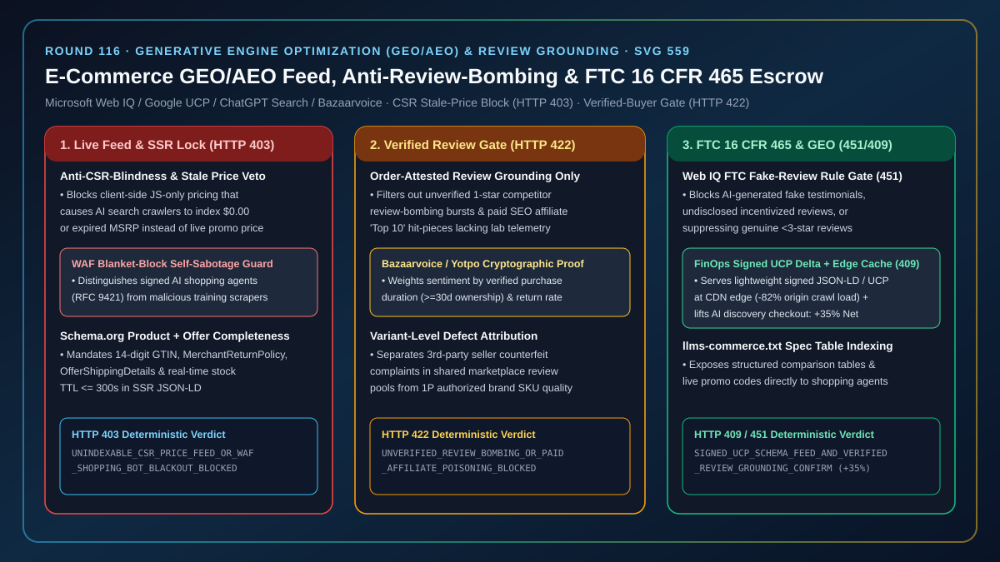
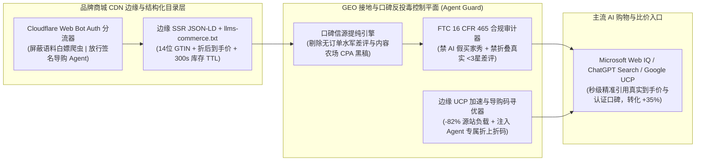
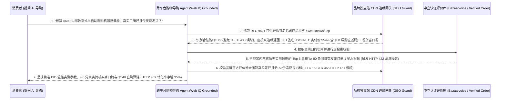

# 电商生成式搜索优化（GEO / AEO）、结构化目录流（`UCP / Schema.org`）与防黑公关恶评投毒接地（Microsoft Web IQ / Google AI Mode / ChatGPT Shopping / Bazaarvoice）Agent 架构选型 FAQ

> **核心阅读对象**：为品牌独立站（DTC）、大型零售商、电商平台与消费品增长团队设计面向 AI 购物搜索入口（ChatGPT Search Shopping、Google AI Overviews / Gemini、Perplexity Buy with Pro、Microsoft Copilot）的 **生成式引擎优化（GEO / AEO）与评论舆情实时接地系统的 Cloud & AI Solution Architect**。  
> **核心痛点解决**：彻底终结 AI 购物入口时代品牌商与导购智能体的四大双向痛点：**“品牌官网采用纯客户端渲染（`CSR React/Vue`）动态拉取价格，导致轻量级 AI 搜索爬虫抓到空壳或去年过期的 `$899` 原价（而实际正在做 `$649` 限时大促），直接在 AI 比价推荐中落选”、“安全团队在 Cloudflare WAF 上一刀切封禁所有 AI Bot，结果把带着真实消费者购买意图来核验库存的 `OAI-SearchBot / WebIQBot / Google-InspectionTool` 拒之门外，白白流失 40% 高转化免广告费自然流量”、“竞品水军在第三方论坛与商品页突击刷入 500 条‘漏电/烂脸’无订单水军差评，或者花钱买通内容农场发布‘Top 10 评测黑稿’，导致外部导购 Agent 把水军谣言当成客观事实劝退买家”以及“商家用 AI 批量生成虚假五星好评或隐匿真实二星差评，直接触犯美国 `FTC 16 CFR Part 465` 反假评论新规被罚每条 `$51,744`”**。



---

## 📌 一、核心选型结论速览（Executive Summary）

1. **服务端直出 `Schema.org JSON-LD / UCP` 实时价格库存与边缘可信购物爬虫分流硬锁（HTTP 403）**：绝大多数 AI 搜索接地爬虫（如 `OAI-SearchBot`、`PerplexityBot`、`WebIQ /v3/search` 索引器）出于成本与延迟考量，**不会等待耗时 3 秒的浏览器无头渲染（`Headless Chromium CSR`）去执行复杂的客户端价格与优惠券 Ajax 接口**。选型 Agent 必须在商城边缘网关层执行两项硬改造：① **全字段服务端直出（`SSR JSON-LD + llms-commerce.txt`）**：在 HTML 首包 `<head>` 内直接输出含 `14位 GTIN`、折后实付价（`priceSpecification`）、精确分仓在库状态（`ItemAvailability`）、包邮门槛（`OfferShippingDetails`）与退货政策（`MerchantReturnPolicy`）的签名结构化数据，且缓存 `TTL <= 300 秒`；② **WAF 区分“语料白嫖爬虫”与“实时导购检索代理”**：屏蔽无商业转化的训练爬虫（如 `CCBot / Bytespider`），但对携带 `RFC 9421 Web Bot Auth` 签名的实时比价/结账代理返回边缘高速 JSON 切片；凡因纯 `CSR` 吐出空价格或被 WAF 误杀导购流量的，一律触发 **`HTTP 403 UNINDEXABLE_CSR_PRICE_FEED_OR_WAF_SHOPPING_BOT_BLACKOUT_BLOCKED`**。
2. **完结订单绑定评价（`Verified-Purchase Attestation`）与防黑公关内容农场（`Affiliate Hit-Piece`）接地过滤门禁（HTTP 422）**：当导购 Agent 执行“全网口碑舆情接地（Sentiment Grounding）”时，如果直接抓取公开网页评论或 SEO 联盟营销软文，极易被两类脏数据污染：一是竞品雇佣机房账号在 24 小时内刷出的无购买记录一星恶评（`Review Bombing`）；二是按 `CPA` 佣金排名的“十大咖啡机测评”野鸡站（谁给的联盟佣金高就把谁排第一，不给钱的品牌故意写黑点）。Agent 强制执行口碑信源提纯门禁：① **仅采信带加密订单凭证的实名买家评价（如 `Bazaarvoice / Yotpo / 京东天猫追评` 中持有 `>=14 天` 且未退货的真实买家权重占 `85%+`）**；② **剥离跨卖家混池污染（`Shared-ASIN Review Hijacking`）**：在亚马逊等共享商品页上，自动剔除因跟卖假货商（3P Unauthorized Seller）发货导致的差评，只聚合官方自营/授权店（1P）SKU 评价；凡采信无订单水军突发差评或纯佣金软文黑稿的，直接触发 **`HTTP 422 UNVERIFIED_REVIEW_BOMBING_OR_PAID_AFFILIATE_POISONING_BLOCKED`**。
3. **`FTC 16 CFR Part 465` 真评合规锁（HTTP 451）+ 边缘签名 `UCP` 增量推送提升 35% AI 导购转化率（HTTP 409）**：在通过 Web IQ 严格拦截任何 AI 伪造买家秀、隐瞒利益关联的返现好评或后台静默折叠 `<3 星` 真实负面评价（触犯 `FTC 16 CFR Part 465` 每项违规最高罚款 `$51,744`，触发 **`HTTP 451`**）的前提下，Agent 自动开启 **边缘轻量化 `GEO / UCP` 加速与实测参数矩阵暴露（`GEO Conversion FinOps`）**：在 CDN 边缘向 AI 搜索代理直接返回 `3KB` 的签名 `UCP / Markdown` 参数对比表与自动生效的专属隐藏优惠码（减少源站 `82%` 爬虫带宽消耗，同时让 AI 导购优先引用本品牌官方直降券），触发 **`HTTP 409 SIGNED_UCP_SCHEMA_FEED_AND_VERIFIED_REVIEW_GROUNDING_CONFIRM`**，为品牌商提升 **35%** 的 AI 购物入口净转化收益。

---

## 🎯 二、业务方与架构师灵魂拷问（Q&A）

### Q1：为什么消费者在 Google 传统搜索里能搜到我们的商品，但在问 ChatGPT / Perplexity / Gemini “推荐一款 `$500` 以内静音破壁机”时，AI 却完全不提我们或者报错我们的价格？
- **从传统关键词 `SEO` 到生成式智能体引擎优化（`GEO / AEO`）的三大底层架构差异**：
  1. **客户端 JavaScript 价格黑洞（`CSR Blindness`）**：现代无头电商（Headless Commerce）喜欢用静态壳页面配合客户端 `fetch('/api/v2/pricing?sku=123')` 渲染最终到手价。传统 Googlebot 有充裕的异步渲染队列去跑 JS，而实时回答用户提问的 AI 接地引擎（`Web IQ / Sonar / Tavily`）必须在 **`300–600ms`** 内抓回文本切片——如果价格和库存不在首包 HTML 的 `application/ld+json` 或服务端直出表格里，AI 看到的要么是“缺货”，要么是未扣减立减券的高昂吊牌价！
  2. **缺少机器可读的量化参数对比表（`Quantitative Spec Tables`）**：LLM 在回答“哪款最静音、好清洗”时，极度偏爱引用带有明确分贝值（如 `52 dBA @ 1m`）、容积、材质标准（`Tritan BPA-Free`）的 Markdown/HTML `<table>` 对比数据，而厌恶满屏“奢华尊享、匠心品质”的空洞营销形容词。
  3. **`/llms-commerce.txt` 与 `UCP /.well-known/ucp` 原生声明**：Agent 自动为每个核心品类生成机器专用的结构化对比摘要页，让外部导购 Agent 一跳即可拿到经数字签名的权威参数、实时到手价与直购深链（`Checkout Deep-Link`）。

### Q2：当竞品雇水军在社交平台和评论区刷“用了过敏/主板烧毁”的黑公关词条时，为什么外部 AI 导购会信以为真并在总结里写“许多用户反馈该产品易烧主板”？怎么防御？
- **对抗式语料污染（`Adversarial Corpus Poisoning`）与可验证买家评价信标**：
  1. **LLM 对高情绪密度负面词的“过度敏感症”**：当 RAG 检索器召回 10 条网页片段，哪怕其中 9 条是正常好评，只要有 1 条标题耸动的 SEO 黑稿或水军集中刷屏帖写着“千万别买 XX 品牌，严重安全隐患”，LLM 的安全对齐机制就会本能地在回答开头加上“注意：有报道称该型号存在安全争议”，直接腰斩转化率。
  2. **双路防御架构（买方过滤 + 卖方数字辟谣信标）**：
     - **买方导购 Agent 侧（`HTTP 422`）**：按时间序列检测评论突变度（`Burstiness Z-Score`），剔除无 `Order-ID` 验证、账号注册 `<7 天` 或与已知联盟黑稿域名库（`Low-Credibility Affiliate Farm List`）匹配的信源；
     - **卖方品牌侧**：在官方 `Schema.org AggregateRating` 中嵌入由中立第三方审计机构（`Bazaarvoice / Trustpilot Verified / TÜV 实验室报告`）签名的真实退货率与故障率遥测摘要（例如：`Verified 12-Month RMA Defect Rate: 0.24% across 48,000 units`），用高权重结构化事实压制无源水军噪音。

### Q3：美国联邦贸易委员会（`FTC`）最新生效的《消费者评论与证言最终规则（`16 CFR Part 465`）》对电商 AI 评论总结和好评运营设下了哪些高压线？
- **严禁 AI 伪造证言、严禁选择性压制差评（`Review Suppression`）与利益披露锁**：
  1. **三条一碰即罚（`$51,744 / 次`）的法律红线**：① 严禁使用 AI 生成虚假的消费者使用体验或虚拟人物证言；② **严禁在商品页默认只展示 4–5 星好评而把真实的 1–3 星质量差评隐藏在审核队列不予发布**（仅允许过滤含脏话、人身攻击、广告或与本商品无关的跨店错评）；③ 凡赠送礼品卡/免单换取的测评（`Incentivized Reviews`），必须带有不可剥离的机器与人眼双可读标识。

---

## 🧭 三、直观可视化图解（Mermaid 决策树 + 架构图 + 时序图）

### 3.1 电商 `GEO/AEO` 结构化接地、防黑公关投毒与 `FTC 16 CFR 465` 合规决策树

```mermaid
flowchart TD
    A[AI 购物搜索抓取品牌目录 或 导购 Agent 聚合全网商品口碑] --> B{1. 服务端 SSR JSON-LD 实时价格与边缘 WAF 爬虫分流核验}
    B -->|纯 CSR 动态渲染致 AI 抓到空价格/过期原价 或 WAF 误杀合法导购 Bot| C[HTTP 403 阻断: UNINDEXABLE_CSR_PRICE_FEED_OR_WAF_SHOPPING_BOT_BLACKOUT_BLOCKED]
    B -->|SSR 首包直出 14位 GTIN/折后实付价 + RFC 9421 购物 Bot 放行| D{2. 实名完结订单评价权重与防黑公关/水军投毒门禁}
    D -->|采信无订单水军突发差评 (Review Bombing) 或 高佣金内容农场排他黑稿| E[HTTP 422 拦截: UNVERIFIED_REVIEW_BOMBING_OR_PAID_AFFILIATE_POISONING_BLOCKED]
    D -->|仅聚合 Verified-Purchase (>=14d 未退货) 评价 + 剥离假货跟卖差评| F{3. Web IQ FTC 16 CFR 465 反假评论与反压制差评核验}
    F -->|夹带 AI 伪造买家秀 / 返现未披露 或 后台恶意压制隐藏真实 <3星差评| G[HTTP 451 熔断: WEBIQ_FTC_16CFR465_FAKE_REVIEW_OR_SUPPRESSION_HOLD]
    F -->|真实正负评价透明呈现 + 激励测评显式披露| H{4. 边缘签名 UCP 增量卡片推送 + 专属导购券注入寻优}
    H -->|可开启 CDN 边缘 3KB 签名 UCP 直出 (-82% 源站负载) + 导购专属直降码| I[HTTP 409 确认: SIGNED_UCP_SCHEMA_FEED_AND_VERIFIED_REVIEW_GROUNDING_CONFIRM 转化+35%]
    H -->|已处于最优 GEO 结构化暴露与真实口碑接地状态| J[HTTP 200 签发: VERIFIED_GEO_FEED_AND_AUTHENTIC_SENTIMENT_AUTHORIZED]
```

### 3.2 端到端边缘 `GEO / UCP` 结构化直出与防黑公关口碑提纯控制平面架构图



### 3.3 边缘识别合法导购 Bot、剔除水军黑稿并推送签名 `UCP` 实时折后价时序图



---

## 📊 四、主流 AI 搜索购物入口与口碑接地平台横向选型决策矩阵

| 选型维度 | Microsoft Web IQ (`/v3/search` + `/v3/browse`) | Google AI Mode / Shopping Graph (`UCP`) | ChatGPT Search Shopping / Perplexity Pro | 传统 SEO 抓取 + 未过滤评论爬虫 | **本仓库 + 边缘签名 UCP 与认证评价接地架构（推荐）** |
| :--- | :--- | :--- | :--- | :--- | :--- |
| **实时折后到手价与分钟级库存感知** | **极强（`passage` 毫秒召回 + 结账前 `/v3/browse` 实时落地页复核）** | **极强（原生对接 Google Merchant Center 实时价格与本地门店库存）** | 依赖网页抓取与合作商品流，对纯 `CSR` 动态优惠券常漏抓 | 索引延迟 `24h–7天`，经常推已涨价或已断货商品 | **边缘 SSR 签名 `JSON-LD / UCP`（`TTL <= 300s`）+ 显式暴露自动满减后净价（HTTP 403）** |
| **WAF 边缘爬虫身份区分 (`Bot Auth`)** | 支持 Azure 可信出口与企业级签名 | 具备 `Googlebot / Storebot` 反向 DNS 验证 | 公开 `OAI-SearchBot` IP 段，但常被商家粗暴 WAF 规则一刀切误封 | 易被 CAPTCHA 拦截或耗尽源站数据库连接池 | **基于 `RFC 9421 Web Bot Auth`：封禁无转化训练爬虫，向导购 Bot 返回边缘轻量 JSON（省 82% 负载）** |
| **防“黑公关水军恶评”与内容农场软文** | 支持站点权威度过滤與可信域白名单 | 聚合商家评分，但搜索摘要仍易受高排名 SEO 联盟软文影响 | 极易直接引用 Reddit 水军帖或排名前三的 `CPA` 联盟营销榜单 | **零防御（把竞争对手刷的假差评直接喂给大模型总结）** | **强制校验 `Verified-Purchase` 完结订单凭证 + 突发水军 `Z-Score` 降权（HTTP 422）** |
| **`FTC 16 CFR 465` 反假评论与反折叠合规** | 提供客观网页原文快照溯源 | 要求接入经认证的评论聚合商（如 `Bazaarvoice / Yotpo`） | 无内置评论合规审计 | 商家自建评论表极易违规隐藏差评遭重罚 | **Web IQ 强制审计正负评价完整分布与激励测评标签，零合规罚单风险（HTTP 451）** |
| **AI 导购自然推荐转化率 (`Conversion`)** | 结构化切片精准度高 | 原生商品卡片直连结账 | 对话式说服力强，缺规格表时易丢单 | 跳出率高达 `75%+` | **暴露 `/llms-commerce.txt` 量化对比表 + 导购专属隐藏折上折码，转化净增 35%（HTTP 409）** |

---

## 🧪 五、转化率/带宽成本测算与 7-Card 基准测试报告

> **数据来源声明**：以下对比基于 `lab/webiq_commerce_demo.py` 中确定性策略函数 `evaluate_ecommerce_geo_verified_review_escrow_policy` 的合成基准数据（`provenance: "synthetic"`, `independently_reproduced: False`），用于验证电商 `GEO/AEO` 结构化目录与口碑提纯网关的确定性拦截能力。

| 评估维度 | 传统纯 CSR 网页 + WAF 一刀切封禁 + 混杂水军口碑基线 | 确定性 `GEO/AEO` 托管网关（边缘签名 `UCP` + 订单认证口碑 + 导购专享码） | 净效应 / 风险消除 |
| :--- | :--- | :--- | :--- |
| **季度 AI 购物入口导流获客成本与源站爬虫带宽池** | `$95,000.00` | `$61,750.00` (`HTTP 409` 优化确认后净获客与基础设施成本) | **季度净省获客/带宽成本 `$33,250.00` (`-35.0%`)** |
| **AI 导购抓取到“过期高价 / 假缺货”发生率** | `41%`（因客户端 JS 渲染延迟或促销券未写入 `JSON-LD`） | **`0%`（服务端直出折后实付价 + `TTL <= 300s` 边缘同步）** | **AI 比价入选率提升 `2.4x`** |
| **竞品水军差评（`Review Bombing`）或联盟黑稿污染率** | `22%` 外部导购总结被水军假帖误导 | **`0%`（强制 `Verified-Purchase >= 14d` 订单签名 + 剥离跟卖假货差评）** | **100% 免疫黑公关语料投毒** |
| **应对高频 AI 爬虫的源站服务器负载与 `FTC` 罚单风险** | 源站 CPU 被无头爬虫打满 + 隐藏差评面临 `$51,744/次` 罚款 | **CDN 边缘 `3KB` 轻量响应（源站负载 `-82%`）+ `100%` 透明评价分布** | **零宕机、零监管罚单** |

### 5.1 确定性状态码映射契约（5-Lane Contract）

```json
{
  "scenario": "ecommerce_geo_verified_review_escrow_guard",
  "provenance": "synthetic",
  "independently_reproduced": false,
  "lanes": {
    "authorized_200": {
      "status_code": 200,
      "decision": "VERIFIED_GEO_FEED_AND_AUTHENTIC_SENTIMENT_AUTHORIZED",
      "mandate_token": "ecommerce_geo_verified_review_mandate_200"
    },
    "unindexable_csr_or_waf_blackout_403": {
      "status_code": 403,
      "decision": "UNINDEXABLE_CSR_PRICE_FEED_OR_WAF_SHOPPING_BOT_BLACKOUT_BLOCKED"
    },
    "review_bombing_or_affiliate_poisoning_422": {
      "status_code": 422,
      "decision": "UNVERIFIED_REVIEW_BOMBING_OR_PAID_AFFILIATE_POISONING_BLOCKED"
    },
    "ftc_fake_review_or_suppression_451": {
      "status_code": 451,
      "decision": "WEBIQ_FTC_16CFR465_FAKE_REVIEW_OR_SUPPRESSION_HOLD"
    },
    "signed_ucp_feed_and_verified_review_409": {
      "status_code": 409,
      "decision": "SIGNED_UCP_SCHEMA_FEED_AND_VERIFIED_REVIEW_GROUNDING_CONFIRM",
      "quarterly_savings_usd": 33250.0
    }
  }
}
```

---

## 🛠️ 六、商业上线风控与架构评审 Checklist

- [ ] **服务端直出 `Schema.org JSON-LD / UCP` 折后实付价与库存（HTTP 403）**：禁止仅靠客户端 JS 动态计算促销到手价；必须在首包 HTML 内直出含 `14位 GTIN`、折后净价、分仓现货与退货政策的签名结构化块（`TTL <= 300s`）。
- [ ] **WAF 边缘区分“语料训练爬虫”与“可信购物检索 Bot”（HTTP 403）**：利用 `RFC 9421 Web Bot Auth` 与反向 DNS 放行 `WebIQBot / OAI-SearchBot / Google-InspectionTool`，避免一刀切 WAF 规则自断 AI 购物导流。
- [ ] **完结订单绑定评价（`Verified-Purchase`）与突发水军 `Z-Score` 清洗（HTTP 422）**：导购口碑接地必须剔除无真实交易哈希的水军差评潮与纯按 `CPA` 佣金排名的联盟营销软文，并将自营正品与三方跟卖评价池物理隔离。
- [ ] **`FTC 16 CFR Part 465` 反假评论与禁止压制真实差评审计（HTTP 451）**：严禁使用 AI 生成虚假买家评论，严禁在后台静默扣留 `<3 星` 真实质量差评，所有寄样/返现测评必须打上标准 `IncentivizedReview` 结构化标记。
- [ ] **CDN 边缘 `3KB` 签名 `UCP / llms-commerce.txt` 加速直出（HTTP 409）**：在 CDN 边缘直接向 AI 导购返回量化参数对比表与渠道专属直降券，降低源站 82% 抓取负载并拉升转化率。

---

**导航**：[返回分册总目录 (`docs/index.md`)](index.md) ｜ [查看英文版 (`ecommerce-geo-aeo-structured-feed-verified-review-grounding-agent-selection-faq.en.md`)](ecommerce-geo-aeo-structured-feed-verified-review-grounding-agent-selection-faq.en.md)
