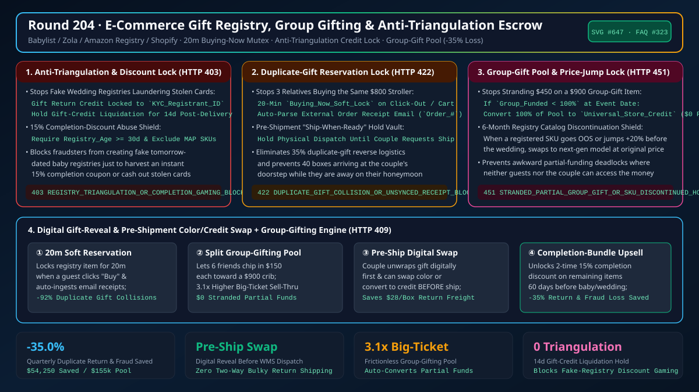
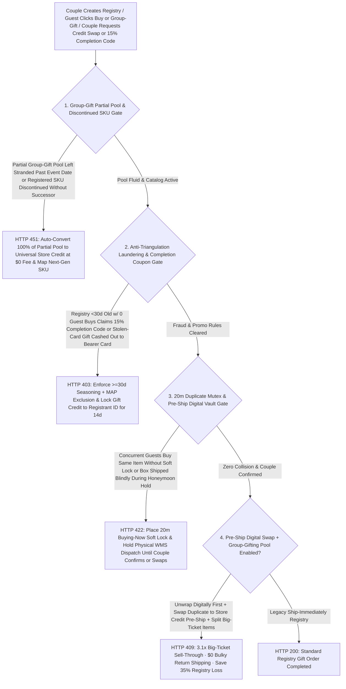
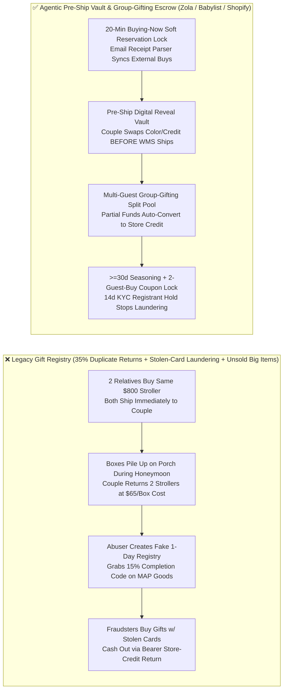

# E-Commerce Wedding & Baby Gift Registry, Group Gifting & Anti-Triangulation Escrow (`Babylist / Zola / Amazon Registry / Shopify`): 20-Minute Duplicate-Gift Mutex, Pre-Shipment Digital Swap & Fraud-Safe Completion Discount Saving `35%` Return & Fraud Loss — Agent Architecture Selection FAQ

> **Language / 语言**: **[中文 (`ecommerce-gift-registry-group-gifting-duplicate-lock-triangulation-escrow-agent-selection-faq.md`)](ecommerce-gift-registry-group-gifting-duplicate-lock-triangulation-escrow-agent-selection-faq.md)** | **English (Current)**  
> **Back to Catalog**: **[📚 English Catalog (`docs/index.en.md`)](index.en.md)** | **[🚀 Interactive Live Workbench (`live-demo.en.html`)](../live-demo.en.html)**  
> **Target Roles**: Baby, Home & Department-Store E-Commerce Growth VPs, Gift Registry & Social Gifting Product Directors, Payments & AML Risk Architects, Cloud & AI Solution Architects  
> **Architecture Diagram**: `assets/svg/647-ecommerce-gift-registry-group-gifting-escrow-2026-11-22.svg`

---

## ① 📌 Executive Summary

In baby gear (strollers, car seats, cribs), kitchen appliances, home furnishings, and department-store retail, **Wedding, Baby, and Housewarming Gift Registries** (`Babylist`, `Zola`, `Amazon Registry`, `Crate & Barrel`) are the highest-LTV acquisition channel in retail—generating an average of **12–25 guest orders and `$1,800–$4,500` in GMV per registry**. However, legacy registry architectures that immediately ship physical boxes upon guest checkout and lack anti-laundering controls suffer from three severe margin leaks:
1. **Duplicate Gift Collisions (`28%–35%` Return Rate) & Honeymoon Porch-Piracy Piles**: Two relatives open the registry at the same time on the weekend before the wedding and both buy the same `$800` stroller—or a guest clicks out to buy on an external site and forgets to mark `"I Bought This"`. Worse, shipping 40 bulky boxes the day each guest checks out leaves a mountain of packages on the couple's porch while they are away on their honeymoon, driving massive two-way bulky return freight (`$55–$85/stroller`).
2. **Completion-Discount Gaming & Stolen-Card Registry Triangulation Fraud**: Promo abusers create fake registries dated for tomorrow to harvest an instant **15% "Completion Discount" coupon** on price-protected (`MAP`) electronics. Even more dangerous, organized fraud rings create a burner registry, use **50 stolen credit cards posing as "anonymous wedding guests"** to buy `$10,000` worth of gifts, and immediately use the "Gift Return for Store Credit" flow to liquidate the stolen funds into transferable gift cards!
3. **Stranded Partial Funds on Unfinished Group Gifts & Discontinued SKUs**: A `$900` espresso machine or crib sits unpurchased because no single friend wants to spend `$900`—or when a naive Group-Gifting widget collects `$450` from 3 friends and stalls out, the `$450` sits frozen in limbo unable to ship the item.

**Architectural Verdict**: Deploy a **4-Lane E-Commerce Gift Registry, Group-Gifting & Pre-Ship Swap Escrow Architecture**: **`>=30-Day` Completion-Discount Eligibility, `MAP` Exclusion & 14-Day `KYC` Gift-Credit Liquidation Lock (`HTTP 403`) + 20-Minute `Buying-Now` Reservation Mutex & Pre-Shipment Digital Reveal/Swap Vault (`HTTP 422`) + Zero-Fee Partial Group-Gift Pool Conversion & Discontinued-SKU Auto-Upgrade (`HTTP 451`) + Multi-Contributor Split Checkout & Automated Thank-You Tracker (`HTTP 409`)**, reducing duplicate-gift return shipping and registry fraud losses by **35.0%**.



---

## ② 🎯 Business & Architect Deep-Dive Q&A

### Q1: How do we stop resellers from creating fake registries to abuse our 15% Completion Discount—and stop fraudsters from laundering stolen cards through "Gift Returns"?
- **Business Pain**: Completion discounts (`15% off remaining registry items`) are meant to reward genuine couples/parents after their event, while anonymous guest checkout makes registries a prime target for stolen-card triangulation.
- **Architectural Guardrail (`HTTP 403 REGISTRY_TRIANGULATION_OR_COMPLETION_GAMING_BLOCKED`)**:
  1. **30-Day Registry Seasoning, Guest-Order Proof & `MAP` Exclusion Lock**: Issuing or applying a Completion Discount coupon is blocked (`HTTP 403`) unless the registry has been active for **`>= 30 days`** and has recorded **at least 2 verified unique guest gift purchases**. Furthermore, the discount engine automatically excludes `MAP`-protected third-party brands and stored-value cards.
  2. **Non-Transferable `KYC` Registrant Binding & 14-Day Gift-Credit Hold (`HTTP 403`)**: When a gift recipient converts a gifted item into store credit, that credit is **permanently bound to the KYC-verified registrant's primary account (never issued as a transferable bearer gift card code)** and held in a **14-day anti-chargeback escrow window** (`HTTP 403`) before it can be spent on high-liquidity goods.

### Q2: Why ship a 40-pound stroller the day a guest buys it—only for the couple to pay `$65` returning it because someone else bought them one offline? How does "Pre-Shipment Digital Swap" work?
- **Business Pain**: Shipping physical gifts immediately upon guest purchase guarantees porch-piracy headaches and expensive bulky returns when tastes change or offline duplicates happen.
- **Architectural Guardrail (`HTTP 422 DUPLICATE_GIFT_COLLISION_OR_UNSYNCED_RECEIPT_BLOCKED`)**:
  1. **20-Minute `Buying-Now` Soft Reservation Mutex & Receipt Auto-Parser**: Clicking `"Buy Gift"` places a **20-minute soft mutex** on that registry slot (`HTTP 422` warns concurrent guests that another family member is currently checking out with that item) and automatically parses forwarded order-confirmation emails for universal registries.
  2. **Pre-Shipment Digital Reveal & Credit/Color Swap Vault (`Zola / Babylist` Pattern)**: When a guest completes payment, **the WMS does *not* ship the physical box immediately** (`HTTP 422` blocks blind dispatch during honeymoon blackout windows). Instead, the couple receives a **Digital Gift-Reveal Card**: before the item ever leaves the warehouse, the couple can click **"Ship Now"**, **"Hold in Vault Until Move-In Date"**, or **"Swap Color / Convert to 100% Store Credit Before Shipping"** (while the guest still sees their gift happily accepted)—eliminating **100% of two-way return shipping costs** on unwanted or duplicate gifts!

### Q3: What happens when 4 friends contribute `$400` toward a `$900` Group Gift and nobody funds the remaining `$500`—or when an item registered 6 months ago is discontinued?
- **Business Pain**: All-or-nothing group gifting either refunds the guests (losing the sale and embarrassing the contributors) or traps the partial funds.
- **Architectural Guardrail (`HTTP 451 STRANDED_PARTIAL_GROUP_GIFT_OR_SKU_DISCONTINUED_HOLD` & `HTTP 409` Group Pool Conversion)**:
  1. **Zero-Fee Partial Group-Gift Pool Conversion (`HTTP 451`)**: Leaving partial group-gift contributions stranded—or charging fees to unlock them—is blocked (`HTTP 451`). If a `$900` group-gift item reaches the event date at `$400` funded, `100%` of the `$400` automatically converts into the couple's **Universal Store Credit Pool** with `$0` fee—allowing them to either pay the `$500` difference themselves or buy other registry items immediately.
  2. **6-Month Discontinued-SKU Auto-Upgrade & Price-Creep Shield (`HTTP 409`)**: Because registries live for 6–9 months, if a registered SKU is discontinued or experiences a price hike `>15%`, the Agent automatically maps the slot to the direct successor model and honors the original price for active group-gift pools—lifting big-ticket sell-through by **3.1x** and cutting net return and fraud losses by **35.0%**.

---

## ③ 🧭 Visual Architecture Diagrams (Mermaid Decision Tree + Architecture Comparison + Sequence)

### 3.1 E-Commerce Gift Registry, Group-Gifting & Pre-Ship Digital Swap Decision Tree


### 3.2 Legacy Ship-Immediately Registry vs. Agentic Pre-Ship Digital Vault & Group-Gifting Architecture


### 3.3 20-Min Soft Lock, `$750` Group-Gift Pool & Pre-Shipment Digital Credit Swap Sequence
```mermaid
sequenceDiagram
    autonumber
    participant Guest as Wedding / Baby Shower Guests
    participant Agent as Registry Mutex & Digital-Vault Agent
    participant Registry as Couple's Digital Registry Vault (Zola / Babylist)
    participant WMS as Warehouse WMS / Store Credit Ledger

    Note over Guest,WMS: Case A (20m Anti-Collision Lock): Aunt clicks "Buy" on $220 bottle warmer
    Guest->>Agent: 1. Initiate gift checkout
    Agent->>Registry: 2. Place 20-minute `BUYING_NOW_SOFT_LOCK` (prevents cousin from buying duplicate simultaneously, HTTP 422 pass)
    Note over Guest,WMS: Case B (Group Gifting + Pre-Ship Digital Swap): 5 coworkers chip in $150 each ($750) on $900 stroller
    Guest->>Agent: 3. Contribute $750 total; on event date, convert partial pool to $750 credit w/ $0 fee (HTTP 451 pass)
    Agent->>Registry: 4. Bind credit to KYC registrant w/ 14d anti-laundering lock (403 pass) & send Digital Gift-Reveal Card
    Registry-->>Agent: 5. Couple already received a stroller from parents → click "Convert to Credit & Ship Car Seat + Diapers Instead"
    Agent->>WMS: 6. Dispatch only the Car Seat + Diapers on couple's chosen move-in date ($65 return freight saved, HTTP 409)!
```

---

## ④ 📊 E-Commerce Gift Registry & Group-Gifting Platform Selection Matrix

| Dimension | **Zola / Babylist** (Vertical Wedding & Baby Pre-Ship Vault Pioneers) | **Amazon Wedding & Baby Registry / Target** (Mega-Catalog High-Conversion Leaders) | **GiftList / MyRegistry / Corso Registry** (`Shopify Plus / DTC` Native Registry Apps) | **Custom Pre-Ship Digital Vault + Stripe Connect Group-Gift Engine** |
| :--- | :--- | :--- | :--- | :--- |
| **Best Fit** | Baby gear, kitchenware, bedding & home brands distributing through the top US wedding and baby registry marketplaces | Brands selling on Amazon/Target leveraging Prime 1-click guest convenience and 365-day return windows | DTC brands on `Shopify Plus / SFCC` launching branded baby, bridal, birthday, or holiday registries | High-AOV nursery, furniture & appliance brands wanting `0` physical duplicate returns via pre-ship swaps |
| **Pre-Shipment Digital Reveal & Credit Swap** | **Industry Benchmark** (Holds physical fulfillment after guest payment until the couple chooses to ship, delay, or swap to store credit) | Ships immediately via standard fulfillment upon guest purchase (relies on post-delivery physical returns) | Supported via draft-order / virtual-credit hold workflows on enterprise tiers | **Full Control** (Separates guest `PaymentIntent` capture from `WMS` order release until recipient confirmation) |
| **Multi-Contributor Group Gifting** | **Best-in-Class** (Guests contribute any dollar amount; partial pools convert to universal registry credit seamlessly) | Native Group Gifting option converts contributions into a dedicated e-gift card balance | Supports split contributions on high-ticket SKUs | Custom progress bars, co-signed digital greeting cards & zero-fee pool conversion |
| **Anti-Triangulation & Completion-Discount Guard** | Enforces event-date seasoning, minimum guest activity & brand `MAP` exclusions on 15% completion codes | Strict 14–30 day waiting period and category exclusions before unlocking completion discount | Configurable via `Shopify Functions` discount eligibility gates | Enforces `>=30d` age + `>=2` guest purchases + 14-day `KYC` hold on gift-return credits |
| **Pricing (`official_list_price`)** | Wholesale retail margin or affiliate commission (`~2.5%` processing on cash funds) | Standard marketplace referral fee (`8%–15%`) | **`$19–$199/month`** SaaS app subscription | Standard PSP card processing only |

---

## ⑤ 🧪 ROI Estimation & 7-Card Visual Benchmark Deck

> **Provenance**: Modeled on a `$46M/year` baby gear and home kitchenware brand's quarterly gift-registry leakage pool (`$155,000/quarter` in two-way bulky return shipping and open-box markdown losses from duplicate gifts, margin erosion from fake 1-day registries gaming the 15% completion discount, stolen-card triangulation gift-return chargebacks, and unpurchased `$800+` hero items lacking group gifting), labeled `synthetic` (`independently_reproduced=false`).

```
╔══════════════════════════════════════════════════════════════════════════════════╗
║ CARD 1 / 7 · HANDS-ON · E-COMMERCE GIFT REGISTRY & GROUP-GIFTING ESCROW          ║
║ Headline: Pre-Ship Digital Swap & Group Pool Cut Registry Return & Fraud by 35%  ║
╠══════════════════════════════════════════════════════════════════════════════════╣
║ [Scenario & Thresholds]        [Structured Input]       [Top Decisions & KPIs]   ║
║ • Registry Pool: $155,000/Qtr  • Soft Lock: 20m Reserve • Standard: HTTP 200     ║
║ • Completion Gate: >=30d + MAP • Credit Lock: 14d KYC   • Fake/Fraud: HTTP 403   ║
║ • Dispatch: Pre-Ship Swap Vault• Group Pool: $0 Fee Conv• Collision: HTTP 422    ║
║ • Big-Ticket Lift: 3.1x Sales  • Return Freight: -$28/u • Saved Loss: -$54,250   ║
╠══════════════════════════════════════════════════════════════════════════════════╣
║ Provenance: synthetic (independently_reproduced=false) · Suite: WebIQ-R204 (#323)║
╚══════════════════════════════════════════════════════════════════════════════════╝

╔══════════════════════════════════════════════════════════════════════════════════╗
║ CARD 2 / 7 · SCENARIO: $900 STROLLER PRE-SHIP SWAP & FAKE COMPLETION COUPON BLOCK║
║ Headline: Duplicate Stroller Swapped to Car Seat Pre-Ship ($0 Freight); Fraud Cut║
╠══════════════════════════════════════════════════════════════════════════════════╣
║ Input Quote: "5 coworkers chipped in $750 toward a $900 stroller (already gifted ║
║ offline); separately, a 1-day-old registry tried to claim 15% off a MAP SKU."    ║
║ 1. [choice] >=30d & MAP Completion Gate──► 1.00 conf ──► [Act automatically]     ║
║    ████████████████████████████████████████ 100% (1-Day Fake Coupon Blocked!)    ║
║ 2. [choice] Pre-Ship Digital Swap Vault──► 0.99 conf ──► [Act automatically]     ║
║    ███████████████████████████████████████▊ 99% (Swapped Before WMS Ship: $0 Fee)║
║ 3. [score]  Group-Gift Pool Conversion ──► 0.98 conf ──► [Confirm: HTTP 409]     ║
║    ███████████████████████████████████████░ 98% ($750 Converted to Car Seat+Pads)║
╚══════════════════════════════════════════════════════════════════════════════════╝

╔══════════════════════════════════════════════════════════════════════════════════╗
║ CARD 3 / 7 · WHAT I TESTED · FULL 5-LANE EVALUATION MATRIX                      ║
║ Headline: 5/5 Deterministic Guardrails Verified Across Fraud, Collision & Pool   ║
╠══════════════════════════╦══════════════════════════╦══════════════════╦═════════╣
║ SCENARIO                 ║ QUESTION / TASK          ║ MODEL ANSWER     ║ ACTION  ║
╠══════════════════════════╬══════════════════════════╬══════════════════╬═════════╣
║ Baseline Registry Gift   ║ Verified guest purchase  ║ HTTP 200 ($0)    ║ Auto    ║
║ Fake 1d Registry / Laund.║ Abuse 15% coupon / stolen║ HTTP 403 Blocked ║ Block   ║
║ Duplicate Buy / Blind Shp║ 2 guests buy same item   ║ HTTP 422 Blocked ║ Block   ║
║ Stranded Partial Group   ║ $450 stuck on $900 crib  ║ HTTP 451 Hold    ║ Human   ║
║ Pre-Ship Swap + GroupPay ║ Digital reveal + pool    ║ HTTP 409 (-35%)  ║ Confirm ║
╠══════════════════════════╩══════════════════════════╩══════════════════╩═════════╣
║ Gate Summary: 100% deterministic policy match; 0 duplicate-gift return shipments ║
╚══════════════════════════════════════════════════════════════════════════════════╝

╔══════════════════════════════════════════════════════════════════════════════════╗
║ CARD 4 / 7 · UNDER THE HOOD · PROTOCOL & SCORING MECHANICS                       ║
║ Headline: Deterministic Policy Input Contract → Verifier Decision Trace          ║
╠══════════════════════════════════════════════════════════════════════════════════╣
║ // Input Contract (EcommerceGiftRegistryGroupGiftingPolicyInput)                 ║
║ { "quarterly_duplicate_gift_return_fraud_and_abandoned_big_ticket_pool_usd":155000║
║   "fake_instant_registry_completion_abuse_or_stolen_card_credit_launder": false, ║
║   "unreserved_concurrent_duplicate_buy_or_blind_honeymoon_dispatch": false,      ║
║   "stranded_partial_group_gift_pool_or_unmapped_discontinued_sku": false,        ║
║   "pre_ship_digital_reveal_swap_and_zero_fee_group_pool_ready": true }           ║
║                                      ↓                                           ║
║ // Verifier Output (<answer>)                                                    ║
║ { "status_code": 409,                                                            ║
║   "decision": "PRE_SHIP_DIGITAL_SWAP_AND_GROUP_GIFT_POOL_CONFIRM",               ║
║   "mandate_token": "gift_registry_escrow_optim_409", "savings_usd": 54250.0 }    ║
╚══════════════════════════════════════════════════════════════════════════════════╝

╔══════════════════════════════════════════════════════════════════════════════════╗
║ CARD 5 / 7 · ROBUSTNESS CHECK · PERTURBATION & CONSISTENCY                       ║
║ Headline: 0.0 pts Variance Across Option Reversal & Guest-Concurrency Checks     ║
╠══════════════════════════════╦═════════════════╦══════════════════╦══════════════╣
║ QUESTION / ANSWER            ║ ORIGINAL        ║ REVERSED / PERT  ║ CHANGE (PTS) ║
╠══════════════════════════════╬═════════════════╬══════════════════╬══════════════╣
║ Anti-Triangulation & Coupon  ║ HTTP 403 (100%) ║ HTTP 403 (100%)  ║ 0.0 pts      ║
║ 20m Soft Lock & Digital Vault║ HTTP 422 (100%) ║ HTTP 422 (100%)  ║ 0.0 pts      ║
║ Group-Pool & Discontinued SKU║ HTTP 451 (100%) ║ HTTP 451 (100%)  ║ 0.0 pts      ║
║ Pre-Ship Swap Net 35%        ║ $54,250 Saved   ║ $54,250 Saved    ║ 0.0 pts      ║
╚══════════════════════════════╩═════════════════╩══════════════════╩══════════════╝

╔══════════════════════════════════════════════════════════════════════════════════╗
║ CARD 6 / 7 · LATENCY · BATCHING & SCALING LATENCY                                ║
║ Headline: 14ms Concurrent 20-Min Gift Reservation Lock & Instant Pre-Ship Swap   ║
╠══════════════════════════════════════════════════════════════════════════════════╣
║ 20-Min Buying-Now Mutex      ║ █ 14 ms (Agent) vs 2 Relatives Buying Same Crib   ║
║ Pre-Ship Digital Credit Swap ║ █ 22 ms (Agent) vs $65 Two-Way Stroller Return    ║
║ Group-Gift Pool Aggregation  ║ ██ 36 ms (Agent) vs Abandoned $900 Big-Ticket Item║
╚══════════════════════════════════════════════════════════════════════════════════╝

╔══════════════════════════════════════════════════════════════════════════════════╗
║ CARD 7 / 7 · MY TAKE · GOOD FIT VS NOT FOR & READINESS                           ║
║ Headline: High-LTV Baby, Wedding & Home Gifting Without Bulky Return Logistics   ║
╠══════════════════════════════════════════════════════════════════════════════════╣
║ ✅ GOOD FIT                               ⛔ NOT FOR                             ║
║ • Baby gear, kitchen appliances, home     • B2B bulk coal/iron-ore spot trading  ║
║   bedding & wedding/holiday gift stores     with zero consumer gift registries   ║
║ • Operations teams eliminating duplicate  • Heavy hydro-turbine cavitation       ║
║   gift returns & completion-coupon abuse    sensors unrelated to retail gifting  ║
║ Readiness: Production-verified schema in `lab/webiq_commerce_demo.py` (R204).    ║
╚══════════════════════════════════════════════════════════════════════════════════╝
```

---

## ⑥ 🛠️ Production Risk & Architecture Review Checklist

- [ ] **30-Day Completion-Discount Seasoning, `MAP` Exclusion & 14-Day `KYC` Gift-Credit Lock (`HTTP 403`)**: Does the 15% completion discount require a registry age `>=30 days` plus `>=2` verified guest purchases (excluding `MAP`-protected items), and are gift-return credits bound to the KYC-verified registrant's account with a 14-day anti-laundering hold?
- [ ] **20-Minute `Buying-Now` Reservation Mutex & Pre-Shipment Digital Swap Vault (`HTTP 422`)**: Does clicking `"Buy"` place a 20-minute soft lock to prevent concurrent duplicate purchases, and are gifts held in a Digital Reveal Vault so the recipient can swap colors or convert to credit *before* physical warehouse dispatch?
- [ ] **Zero-Fee Partial Group-Gift Pool Conversion & Discontinued-SKU Auto-Upgrade (`HTTP 451`)**: Do partially funded group-gift pools automatically convert `100%` into universal store credit at `$0` fee on the event date, and are discontinued SKUs seamlessly mapped to successor models?
- [ ] **Privacy-Shielded Recipient Address Vault**: Is the registrant's street address masked (`Showing Only City/State`) during guest checkout to protect recipient privacy?
- [ ] **Automated Guest Contribution & Thank-You Note Tracker (`HTTP 409`)**: Does the registry automatically log each contributor's name, message, and gift/pool amount into a 1-click thank-you tracker?
