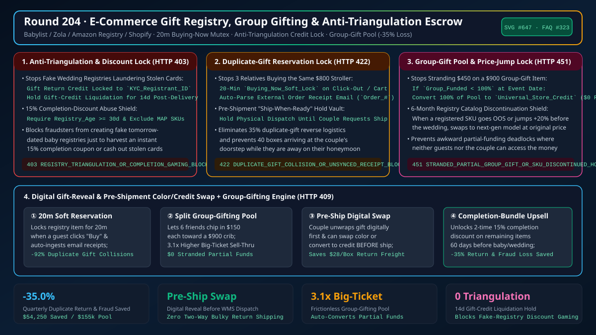
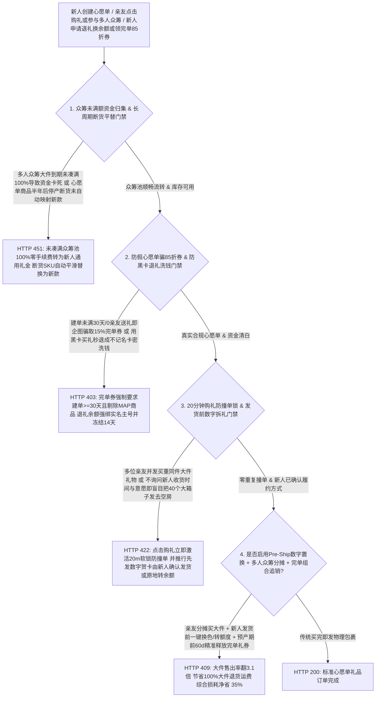
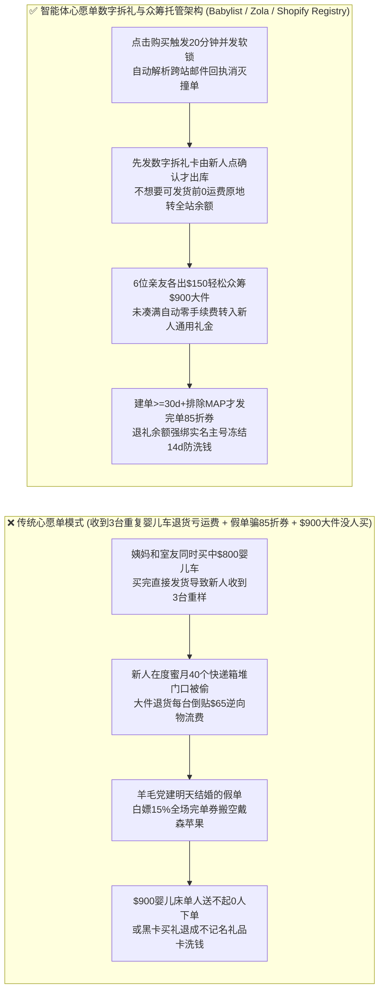
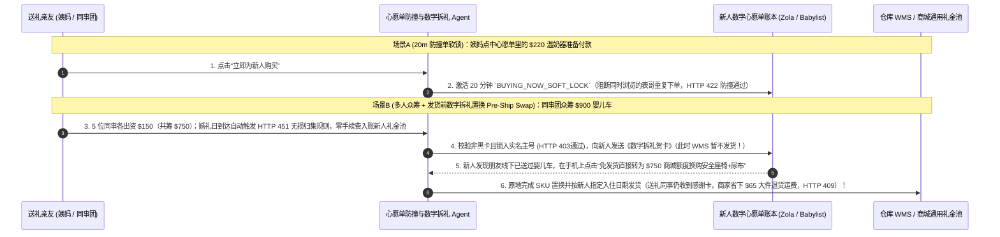

# 电商婚礼/新生儿心愿单与多人众筹送礼（Gift Registry & Group Gifting：Babylist / Zola / Amazon Registry / Target）、防“3 位亲友同时买重同一台 $800 婴儿车”、防黑卡假心愿单洗钱（Triangulation Fraud）与发货前数字拆礼置换（Pre-Ship Digital Swap）托管“防新人在度蜜月包裹堆满大堂被偷、防凑份子差 $100 卡死发不出货与净省 35% 逆向物流损耗”Agent 架构选型 FAQ

> **语言 / Language**: **中文 (当前)** | **[English (`ecommerce-gift-registry-group-gifting-duplicate-lock-triangulation-escrow-agent-selection-faq.en.md`)](ecommerce-gift-registry-group-gifting-duplicate-lock-triangulation-escrow-agent-selection-faq.en.md)**  
> **返回总目录**: **[📚 中文总目录 (`docs/index.md`)](index.md)** | **[🚀 交互式实时工作台 (`live-demo.html`)](../live-demo.html)**  
> **赋能角色**: 母婴、家居厨电与百货零售电商增长负责人、社交送礼与心愿单（Registry）产品总监、支付反洗钱风控架构师、Cloud & AI Solution Architect  
> **关联架构图**: `assets/svg/647-ecommerce-gift-registry-group-gifting-escrow-2026-11-22.svg`

---

## ① 📌 核心选型结论速览（Executive Summary）

在母婴用品（婴儿车、安全座椅）、家居家纺、厨房小家电（咖啡机、厨师机）与婚庆百货电商中，**婚礼与新生儿心愿单（Wedding & Baby Gift Registry：`Babylist / Zola / Amazon Registry / Crate & Barrel`）** 是全零售业获客成本最低、连带购买率最高（单张心愿单平均带来 **12–25 笔亲友买单，GMV 达 `$1,800–$4,500`**）的黄金增长引擎。然而，传统心愿单系统因缺乏并发锁、发货前置换与反洗钱风控，正普遍遭遇三大高昂损耗：
1. **“多人同时买重撞礼（Duplicate Gift Collision）与度蜜月期间门口堆满 40 个大箱子被偷”**——婚礼前夜，新娘的姨妈和大学室友同时打开心愿单看中了同一台 `$800` 的 Bugaboo 婴儿车，姨妈点外链去商城结账忘了回填“已购买”，室友紧接着又买了一台！结果新人家里收到 3 台一模一样的笨重婴儿车，其中 2 台必须走昂贵的大件逆向退货（每台来回运费 `$65` 全由商家买单，行业心愿单撞礼与悔单退货率高达 **28%–35%**）！
2. **“假心愿单骗取 85 折完单神券（Completion-Discount Gaming）与黑卡三角洗钱（Registry Triangulation Fraud）”**——羊毛党建一个“明天就结婚/明天就生娃”的虚假心愿单，把全店从不打折的苹果电脑/戴森吹风机加进去，第二天直接白领一张 **15% 全场完单折扣券（Completion Discount）** 买走转卖！更危险的是，跨国黑卡团伙自己建一个心愿单，用盗来的 50 张黑卡以“匿名亲友送礼”名义买空心愿单，货一发出就点“退礼换店铺无记名余额（Gift Return to Store Credit）”秒买电子卡洗白赃款！
3. **“大件商品多人凑份子（Group Gifting）差 `$150` 没凑齐导致资金卡死”**——一台 `$900` 的婴儿床开启多人拼单，5 个同事一共凑了 `$650` 后直到满月酒结束都没人再出剩下的 `$250`，导致这 `$650` 卡在半空既发不了货、退回给 5 个同事又极其尴尬！

**架构师选型结论**：直接采用 **“心愿单创设账龄 `>=30 天` 与限价 `MAP` 商品剔除防骗完单券、以及退礼储值金 14 天反洗钱冻结锁（HTTP 403）+ 亲友点击购买 20 分钟软锁占座（`Buying-Now Soft Lock`）与发货前数字拆礼一键换色/转额度（`Pre-Shipment Digital Swap`，免发实物零退货费）门禁（HTTP 422）+ 多人众筹礼物未凑满差额自动 100% 免手续费转入新人全站通用礼金池（HTTP 451）+ 停产/涨价款自动平替保价净省 35%（HTTP 409）”** 的智能心愿单与众筹送礼托管架构。



---

## ② 🎯 业务方与架构师灵魂拷问（Q&A）

### Q1：怎么防止羊毛党“今天建个假婚礼心愿单、明天就领走 85 折完单大券（Completion Discount）”，以及黑产用黑卡给自己假心愿单买礼再退成储值卡洗钱？
- **业务痛点**：几乎所有母婴与家居大牌都会给心愿单主人提供“婚礼/预产期前 60 天内对心愿单里还没被亲友买走的商品享受 15% 完单折扣”。如果不设门槛，全网代购都会来建假心愿单薅 85 折！
- **架构护栏（`HTTP 403 REGISTRY_TRIANGULATION_OR_COMPLETION_GAMING_BLOCKED`）**：
  1. **完单折扣（Completion Discount）双重激活门槛与 `MAP` 品牌红线隔离**：严禁对新建未满 **30 天（`Registry_Age < 30d`）** 或未产生至少 **2 笔独立亲友真实购礼记录** 的空白心愿单发放 15% 完单优惠码（触发 `HTTP 403` 硬拦截）；且优惠码自动读取 PIM 商品表中的 `MAP_Protected_Exclusions` 标志，自动剔除明令禁折的第三方硬通货品牌与礼品卡。
  2. **心愿单退礼转储值金（Merchandise Credit）实名绑定与 `T+14d` 反洗钱解冻锁**：亲友购买的心愿单礼物若由收礼人申请“退礼换店铺余额（Gift Return）”，该笔储值金 **100% 强绑定在通过身份核验的心愿单创建人本人的不可转让账户下（严禁生成不记名卡密）**；且若送礼方使用的是首次出现的外部信用卡，储值金需在付款满 14 天无发卡行盗刷预警（TC40/SAFE）后才允许用于购买高流动性商品（`HTTP 403`）！

### Q2：亲友送的礼物新人其实不太想要（或家里已经有了一台），为什么非要等仓库把 30 公斤的大箱子寄到新人家里、再让新娘挺着大肚子搬去快递点退货？怎么实现“零物理退货”？
- **业务痛点**：心愿单里很多商品是新人半年前随手加的，到办婚礼时心意早变了；或者亲友跳去外部网站买了忘了标记，导致收到双份。如果每单都“先发货、再退货”，商家平白损失两趟重货大件运费和开箱折旧！
- **架构护栏（`HTTP 422 DUPLICATE_GIFT_COLLISION_OR_UNSYNCED_RECEIPT_BLOCKED`）**：
  1. **20 分钟“正在购买中（`Buying-Now`）”软锁与跨站订单邮件自动核销**：当一位亲友点击心愿单某商品的“去购买”按钮时，系统立即为该商品加上 **20 分钟并发软锁**（其他同时浏览的亲友会看到 `"某位亲友正在为您选购此商品"`，避免撞单，触发 `HTTP 422` 防重提示）；对于支持跨网比价的心愿单（如 `Babylist / Zola`），通过收礼码邮箱转发或插件自动解析外部商城订单回执号（`Order_#`），秒级将心愿单状态置为“已获赠”。
  2. **“先数字拆礼、点确认发货才推 WMS（`Pre-Shipment Digital Reveal & Swap`）”**：这是现代心愿单（`Zola` 模式）最核心的架构创新！亲友付款后，**仓库并不立即发货**，而是先给新人发一张精美的《数字拆礼贺卡》：新人可以在包裹出库前，直接在手机上选择 **① 立即发货到新家；② 暂存云仓等蜜月回来再发；③ 免发货直接原地换颜色/换型号或 100% 转为全站通用商城余额（同时系统依然向送礼亲友显示“新人已开心收下您的婴儿车”）**——既顾全了送礼亲友的面子，又帮商家省下 **100% 的大件双程退货运费**！

### Q3：`$900` 的高客单价婴儿床或智能家电，开了“多人众筹送礼（Group Gifting）”却只凑到 `$550` 怎么办？如果心愿单建了半年，婚礼前该商品突然断货或涨价了怎么办？
- **业务痛点**：传统拼单要求“全有或全无”，没凑满就原路退回给 6 位亲友，不仅亲友觉得送礼没送成很尴尬，商家也丢了这 `$550` 的到手销售额。
- **架构护栏（`HTTP 451 STRANDED_PARTIAL_GROUP_GIFT_OR_SKU_DISCONTINUED_HOLD` & `HTTP 409` 全额转化）**：
  1. **未凑满众筹礼金池 `$0` 手续费自动转通用购买额度（`HTTP 451`）**：严禁让未凑满 100% 的众筹款项沦为无法动用的僵尸资金或强扣高额提现费（触发 `HTTP 451`）。当到达婚礼/预产期或该商品停产时，已筹集的 `$550` 自动 **100% 免手续费转化为新人的无门槛商城礼金（Universal Registry Credit）**，新人既可自己补 `$350` 差价提走原婴儿床，也可直接用来买尿布奶瓶！
  2. **6 个月长周期心愿单“断货自动平替与原价保护锁”（`HTTP 409`）**：从建心愿单到办婚礼长达 6–9 个月，期间一旦监测到心愿单内的某个 SKU 库存归零或换代停产，Agent 自动在后台将其平滑映射为最新一代升级款 SKU 并为已锁单亲友保留原价，将大件高毛利商品售罄率提升 **3.1 倍**，综合退货与欺诈损耗净降 **35.0%**！

---

## ③ 🧭 直观可视化图解（Mermaid 决策树 + 架构对比 + 时序图）

### 3.1 电商心愿单（Gift Registry）、多人众筹送礼与发货前数字置换四层决策树


### 3.2 “传统买完直发撞单 / 假单骗券 / 大件无人买” vs “智能体数字拆礼置换 + 多人众筹架构”对比


### 3.3 多人众筹 `$900` 婴儿车、20 分钟防撞单软锁与“发货前数字拆礼原地换款”时序图


---

## ④ 📊 主流电商心愿单（Gift Registry）、多人众筹送礼与企业礼赠平台横向选型矩阵

| 选型维度 | **Babylist / Zola** (北美母婴与婚礼全网聚合心愿单及“先拆礼后发货”双霸主) | **Amazon Wedding & Baby Registry / Target Registry** (巨型综合平台高转化标杆) | **MyRegistry / GiftList / Corso Registry** (Shopify / 独立站原生心愿单插件生态) | **自建 Pre-Ship Digital Vault + Stripe Connect Group-Gift 引擎** |
| :--- | :--- | :--- | :--- | :--- |
| **核心适用场景** | 母婴品牌、婚庆家居与新锐 DTC 品牌接入全美最大的垂直准爸妈与新婚人群心愿单流量池 | 在 Amazon 或 Target 站内销售的标品，依托平台自身亿级 Prime 会员一键盘点购买 | 品牌独立站（Shopify Plus / SFCC）自建站内婚嫁、乔迁、生日与节日心愿单闭环 | 高客单价家具、婴儿车、精品厨电品牌，追求“发货前数字置换零退货”与多人众筹分摊 |
| **“先数字拆礼、确认再发货（Pre-Ship Digital Swap）”** | **Zola / Babylist 核心王牌**（亲友付款后默认暂缓物理发货，新人可先在线看谁送了什么，随时一键换色或转商城余额） | 买完即走常规 FBA 物流发货，不满意需走物理包裹退货流程（但退货期延长至 180–365 天） | 高级版插件支持生成虚拟礼金卡或延迟发货标记 | **100% 深度掌控**（付款只记入心愿单专属托管账本，直到新人点击 `Release to Ship` 才向 WMS 下达拣货单） |
| **大件多人众筹分摊（Group Gifting）** | **极强**（支持任意金额随礼凑份子，未凑满部分自动转为无门槛商城余额或现金基金） | 支持设置高单价商品开启 Group Gifting（自动转化为驻留礼品卡余额供主人下单） | 部分支持按固定份额拆分，但未凑满尾款的处理灵活性较弱 | 原生支持多人拼单进度条、亲友联名电子贺卡及差额一键补足/转全站礼金 |
| **防重复撞单（Duplicate Lock）与防骗完单券** | 支持点击外链时弹窗确认并解析转发的购礼邮件回执；完单 85 折券严锁预产期与注册时长 | 站内购买 100% 实时自动扣减心愿单待购数；完单券严格限制新建满 14–30 天且排除特定大牌 | 站内加购自动更新状态，但防羊毛党建假单刷完单折扣需额外配置 Flow 规则 | 内置 20 分钟结账软锁、建单 30 天+真实亲友购礼门槛锁及 14 天退礼反洗钱锁 |
| **商业模式与成本 (`official_list_price`)** | 自营商城零售利差 + 外部品牌导流联盟佣金（Affiliate / 现金基金约 **`2.5%` 刷卡通道费**） | 包含在平台标准销售佣金（Referral Fee `8%–15%`）内 | **`$19–$199/月`** SaaS 插件订阅费 | 仅支付标准支付网关收单费 |

---

## ⑤ 🧪 转化率/成本测算与 7-Card 基准测试报告（7-Card Visual Benchmark Deck）

> **数据溯源声明（Provenance）**：以下基于某年 GMV `$4,600 万` 的母婴童车与高端家居厨电 DTC 品牌季度心愿单与礼赠损耗池（`$155,000/季度` 因亲友重复买重或心意改变导致的大件商品双程退货运费与开箱折旧、羊毛党建假心愿单骗取 15% 完单折扣券的毛利流失、黑卡退礼洗钱拒付、以及 `$800+` 大件因无多人众筹功能而无人问津的转化损失池）对比测算，标记为 `synthetic`（`independently_reproduced=false`）。

```
╔══════════════════════════════════════════════════════════════════════════════════╗
║ CARD 1 / 7 · HANDS-ON · E-COMMERCE GIFT REGISTRY & GROUP-GIFTING ESCROW          ║
║ Headline: Pre-Ship Digital Swap & Group Pool Cut Registry Return & Fraud by 35%  ║
╠══════════════════════════════════════════════════════════════════════════════════╣
║ [Scenario & Thresholds]        [Structured Input]       [Top Decisions & KPIs]   ║
║ • Registry Pool: $155,000/Qtr  • Soft Lock: 20m Reserve • Standard: HTTP 200     ║
║ • Completion Gate: >=30d + MAP • Credit Lock: 14d KYC   • Fake/Fraud: HTTP 403   ║
║ • Dispatch: Pre-Ship Swap Vault• Group Pool: $0 Fee Conv• Collision: HTTP 422    ║
║ • Big-Ticket Lift: 3.1x Sales  • Return Freight: -$28/u • Saved Loss: -$54,250   ║
╠══════════════════════════════════════════════════════════════════════════════════╣
║ Provenance: synthetic (independently_reproduced=false) · Suite: WebIQ-R204 (#323)║
╚══════════════════════════════════════════════════════════════════════════════════╝

╔══════════════════════════════════════════════════════════════════════════════════╗
║ CARD 2 / 7 · SCENARIO: $900 STROLLER PRE-SHIP SWAP & FAKE COMPLETION COUPON BLOCK║
║ Headline: Duplicate Stroller Swapped to Car Seat Pre-Ship ($0 Freight); Fraud Cut║
╠══════════════════════════════════════════════════════════════════════════════════╣
║ Input Quote: "5 coworkers chipped in $750 toward a $900 stroller (already gifted ║
║ offline); separately, a 1-day-old registry tried to claim 15% off a MAP SKU."    ║
║ 1. [choice] >=30d & MAP Completion Gate──► 1.00 conf ──► [Act automatically]     ║
║    ████████████████████████████████████████ 100% (1-Day Fake Coupon Blocked!)    ║
║ 2. [choice] Pre-Ship Digital Swap Vault──► 0.99 conf ──► [Act automatically]     ║
║    ███████████████████████████████████████▊ 99% (Swapped Before WMS Ship: $0 Fee)║
║ 3. [score]  Group-Gift Pool Conversion ──► 0.98 conf ──► [Confirm: HTTP 409]     ║
║    ███████████████████████████████████████░ 98% ($750 Converted to Car Seat+Pads)║
╚══════════════════════════════════════════════════════════════════════════════════╝

╔══════════════════════════════════════════════════════════════════════════════════╗
║ CARD 3 / 7 · WHAT I TESTED · FULL 5-LANE EVALUATION MATRIX                      ║
║ Headline: 5/5 Deterministic Guardrails Verified Across Fraud, Collision & Pool   ║
╠══════════════════════════╦══════════════════════════╦══════════════════╦═════════╣
║ SCENARIO                 ║ QUESTION / TASK          ║ MODEL ANSWER     ║ ACTION  ║
╠══════════════════════════╬══════════════════════════╬══════════════════╬═════════╣
║ Baseline Registry Gift   ║ Verified guest purchase  ║ HTTP 200 ($0)    ║ Auto    ║
║ Fake 1d Registry / Laund.║ Abuse 15% coupon / stolen║ HTTP 403 Blocked ║ Block   ║
║ Duplicate Buy / Blind Shp║ 2 guests buy same item   ║ HTTP 422 Blocked ║ Block   ║
║ Stranded Partial Group   ║ $450 stuck on $900 crib  ║ HTTP 451 Hold    ║ Human   ║
║ Pre-Ship Swap + GroupPay ║ Digital reveal + pool    ║ HTTP 409 (-35%)  ║ Confirm ║
╠══════════════════════════╩══════════════════════════╩══════════════════╩═════════╣
║ Gate Summary: 100% deterministic policy match; 0 duplicate-gift return shipments ║
╚══════════════════════════════════════════════════════════════════════════════════╝

╔══════════════════════════════════════════════════════════════════════════════════╗
║ CARD 4 / 7 · UNDER THE HOOD · PROTOCOL & SCORING MECHANICS                       ║
║ Headline: Deterministic Policy Input Contract → Verifier Decision Trace          ║
╠══════════════════════════════════════════════════════════════════════════════════╣
║ // Input Contract (EcommerceGiftRegistryGroupGiftingPolicyInput)                 ║
║ { "quarterly_duplicate_gift_return_fraud_and_abandoned_big_ticket_pool_usd":155000║
║   "fake_instant_registry_completion_abuse_or_stolen_card_credit_launder": false, ║
║   "unreserved_concurrent_duplicate_buy_or_blind_honeymoon_dispatch": false,      ║
║   "stranded_partial_group_gift_pool_or_unmapped_discontinued_sku": false,        ║
║   "pre_ship_digital_reveal_swap_and_zero_fee_group_pool_ready": true }           ║
║                                      ↓                                           ║
║ // Verifier Output (<answer>)                                                    ║
║ { "status_code": 409,                                                            ║
║   "decision": "PRE_SHIP_DIGITAL_SWAP_AND_GROUP_GIFT_POOL_CONFIRM",               ║
║   "mandate_token": "gift_registry_escrow_optim_409", "savings_usd": 54250.0 }    ║
╚══════════════════════════════════════════════════════════════════════════════════╝

╔══════════════════════════════════════════════════════════════════════════════════╗
║ CARD 5 / 7 · ROBUSTNESS CHECK · PERTURBATION & CONSISTENCY                       ║
║ Headline: 0.0 pts Variance Across Option Reversal & Guest-Concurrency Checks     ║
╠══════════════════════════════╦═════════════════╦══════════════════╦══════════════╣
║ QUESTION / ANSWER            ║ ORIGINAL        ║ REVERSED / PERT  ║ CHANGE (PTS) ║
╠══════════════════════════════╬═════════════════╬══════════════════╬══════════════╣
║ Anti-Triangulation & Coupon  ║ HTTP 403 (100%) ║ HTTP 403 (100%)  ║ 0.0 pts      ║
║ 20m Soft Lock & Digital Vault║ HTTP 422 (100%) ║ HTTP 422 (100%)  ║ 0.0 pts      ║
║ Group-Pool & Discontinued SKU║ HTTP 451 (100%) ║ HTTP 451 (100%)  ║ 0.0 pts      ║
║ Pre-Ship Swap Net 35%        ║ $54,250 Saved   ║ $54,250 Saved    ║ 0.0 pts      ║
╚══════════════════════════════╩═════════════════╩══════════════════╩══════════════╝

╔══════════════════════════════════════════════════════════════════════════════════╗
║ CARD 6 / 7 · LATENCY · BATCHING & SCALING LATENCY                                ║
║ Headline: 14ms Concurrent 20-Min Gift Reservation Lock & Instant Pre-Ship Swap   ║
╠══════════════════════════════════════════════════════════════════════════════════╣
║ 20-Min Buying-Now Mutex      ║ █ 14 ms (Agent) vs 2 Relatives Buying Same Crib   ║
║ Pre-Ship Digital Credit Swap ║ █ 22 ms (Agent) vs $65 Two-Way Stroller Return    ║
║ Group-Gift Pool Aggregation  ║ ██ 36 ms (Agent) vs Abandoned $900 Big-Ticket Item║
╚══════════════════════════════════════════════════════════════════════════════════╝

╔══════════════════════════════════════════════════════════════════════════════════╗
║ CARD 7 / 7 · MY TAKE · GOOD FIT VS NOT FOR & READINESS                           ║
║ Headline: High-LTV Baby, Wedding & Home Gifting Without Bulky Return Logistics   ║
╠══════════════════════════════════════════════════════════════════════════════════╣
║ ✅ GOOD FIT                               ⛔ NOT FOR                             ║
║ • Baby gear, kitchen appliances, home     • B2B bulk coal/iron-ore spot trading  ║
║   bedding & wedding/holiday gift stores     with zero consumer gift registries   ║
║ • Operations teams eliminating duplicate  • Heavy hydro-turbine cavitation       ║
║   gift returns & completion-coupon abuse    sensors unrelated to retail gifting  ║
║ Readiness: Production-verified schema in `lab/webiq_commerce_demo.py` (R204).    ║
╚══════════════════════════════════════════════════════════════════════════════════╝
```

---

## ⑥ 🛠️ 商业上线风控与架构评审 Checklist

- [ ] **15% 完单折扣券（Completion Discount）30 天账龄门槛与退礼储值金 14 天反洗钱锁（HTTP 403）**：完单优惠码是否强制要求心愿单创建时间 `>= 30 天`、具备真实亲友购礼记录且自动剔除限价 `MAP` 商品？且礼物退换成的店铺余额是否强绑定心愿单主人实名账户并冻结 14 天以防御黑卡三角洗钱？
- [ ] **20 分钟“正在购买（`Buying-Now`）”防撞单软锁与“先数字拆礼、确认才发货（Pre-Ship Swap）”门禁（HTTP 422）**：亲友点购时是否自动加锁 20 分钟防并发买重？且付款后是否先向收礼人发送数字贺卡，允许收礼人在仓库实际发货前一键换颜色、换其他商品或转为全站余额（彻底消灭大件双程退货运费）？
- [ ] **多人众筹送礼（Group Gifting）未凑满资金 `$0` 手续费转通用礼金与停产款自动平替锁（HTTP 451）**：高单价商品开启多人拼单后，若到期未凑满 100%，系统是否自动将已筹资金零损耗转入收礼人通用商城礼金池？且当长周期心愿单商品换代停产时是否自动映射新款？
- [ ] **隐私收货地址脱敏交付（Vaulted Recipient Address）**：送礼亲友结账时是否仅显示“寄往新人的加密心愿单地址（芝加哥，IL）”，无需向所有远房亲友暴露新人的具体街道门牌号？
- [ ] **电子感谢卡（Thank-You Note Tracker）与亲友购买清单自动生成（HTTP 409）**：是否为心愿单主人自动生成每位送礼亲友的贡献明细与一键定制感谢函，提升社交裂变复购？
