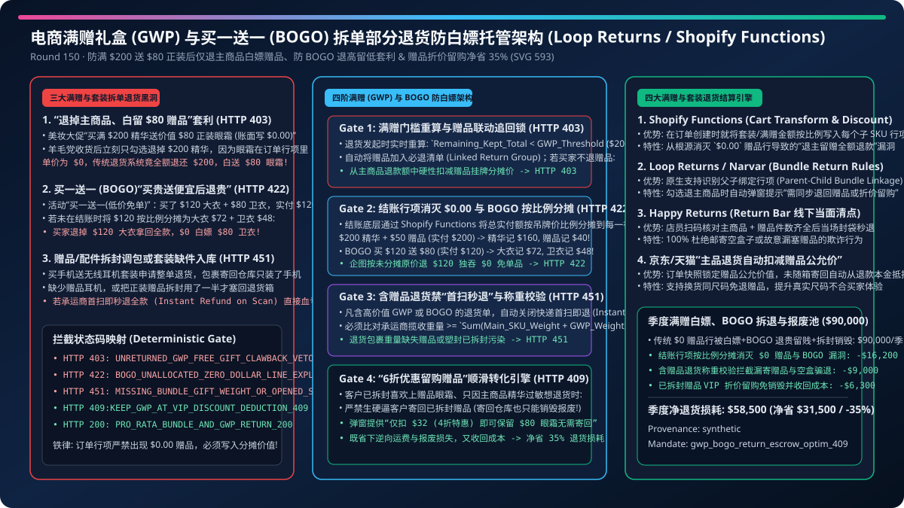
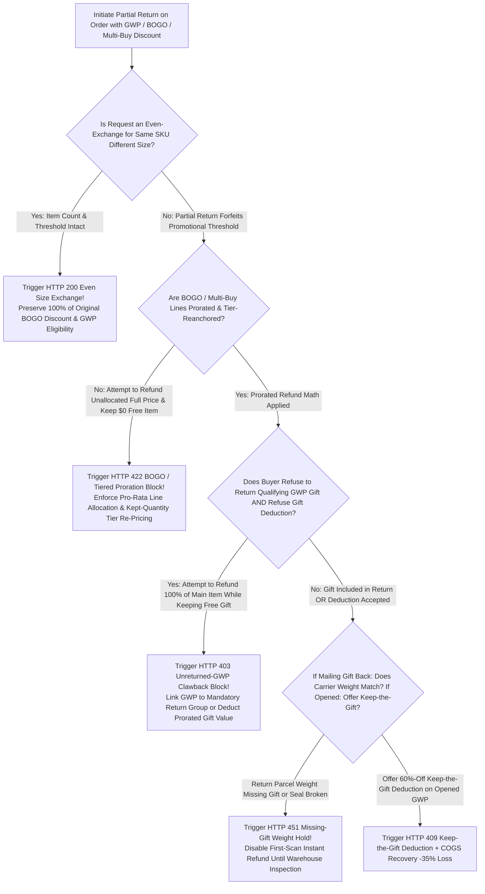
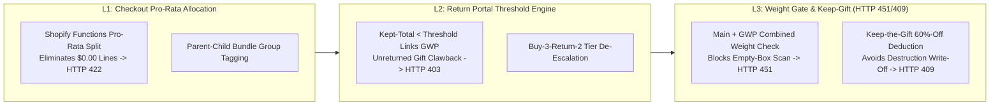

# E-Commerce Gift-With-Purchase (`GWP`), `BOGO` & Multi-Buy Bundle Partial-Return Clawback Escrow (`Shopify Functions / Loop Returns / Happy Returns`): Stopping "Return the `$200` Item, Keep the `$80` Free Gift" Exploits (`-35%` Return Loss) Agent Architecture Selection FAQ

> **Document Type**: AI Solution Architect E-Commerce Promotional Bundle, Gift-With-Purchase (`GWP`) & Buy-One-Get-One (`BOGO`) Partial-Return Proration Guide (Retail, OTA & Marketplace Pillar · FAQ #269)  
> **Covered Platforms & Standards**: **Shopify Functions (`Cart Transform` & `Discount Allocator` Pro-Rata Line Math)**, **Loop Returns / Narvar (Parent-Child Bundle Return Locks)**, **Happy Returns (In-Person Return Bar Multi-Item Verification)**, **Tiered Multi-Buy De-Escalation & `Keep-the-Gift` Discounted Deduction State Machine**  
> **Core Architectural Thesis**: Beauty, apparel, and electronics brands rely heavily on **"Spend `$200`, Get a Free `$80` Full-Size Gift (`GWP`)"** and **"Buy One, Get One Free (`BOGO`)"** campaigns. Yet during post-purchase returns, naive e-commerce setups insert the free gift or BOGO item into the order ledger at **`$0.00` unit price**, creating three massive arbitrage loopholes: (1) **"Return the `$200` Main Item, Keep the `$80` Free Gift for `$0`"**—buyers initiate a self-serve return for *only* the `$200` serum, leaving the `$0.00` gift line unchecked, and receive a full `$200` refund while pocketing the `$80` gift to resell on eBay/Mercari; (2) **`BOGO` "Buy `$120` Coat + `$80` Hoodie Free, Then Return the `$120` Coat"**—walking away with a `$120` refund and a free `$80` hoodie because the discount wasn't prorated across both lines at checkout; and (3) **"Missing-Gift Box Return" on Instant Carrier Scan**—checking both items in the return portal to unlock an instant drop-off refund, but mailing back an outer box containing only the main item!



---

## 1. 📌 Executive Summary

> **One-Sentence Architectural Verdict**: **Never write a promotional gift or `BOGO` item into the order ledger with a `$0.00` refundable value! Enforce `GWP` threshold re-evaluation and unreturned-gift clawbacks (`HTTP 403`), prorate total paid dollars across every `BOGO`/bundle line item at checkout via `Shopify Functions` (`HTTP 422`), disable instant-on-scan refunds for bundle returns until combined `Main + Gift` carrier weight is verified (`HTTP 451`), and offer a frictionless `Keep-the-Gift at 60% Off` deduction for opened gifts (`HTTP 409`)!**
> 1. **`GWP` Threshold Re-Evaluation & Unreturned-Gift Clawback Lock (`HTTP 403`)**:
>    * Whenever a partial return drops the remaining kept merchandise value below the qualifying `GWP` threshold (`Remaining_Kept_Total < $200`), the return state machine automatically binds the `GWP` line item into a **Mandatory Linked Return Group**.
>    * If the buyer attempts to return only the `$200` main item without returning the `$80` gift (or accepting a gift deduction), the portal blocks the full refund with **`HTTP 403 UNRETURNED_GWP_FREE_GIFT_CLAWBACK_VETO`**.
> 2. **Eliminate `$0.00` Order Lines: Checkout-Time Pro-Rata Line Allocation (`HTTP 422`)**:
>    * Using **Shopify Functions (`Discount Allocator API`)**, allocate the net paid amount proportionally across all qualifying and free items at checkout creation:
>      * For a `BOGO` order (`$120` Coat + `$80` Hoodie, total paid `$120`): record `max_refundable_principal` as **Coat = `$72.00`**, **Hoodie = `$48.00`**.
>      * For a Tiered Multi-Buy (`1 for $100, 3 for $210`) where a buyer returns 2 of 3 items: re-anchor the kept item to its single-unit price (`Refund = $210 - $100 = $110`), blocking unallocated zero-dollar line exploits with **`HTTP 422 BOGO_UNALLOCATED_ZERO_DOLLAR_LINE_EXPLOIT_BLOCKED`**.
> 3. **Combined-Weight RMA Gate (`HTTP 451`) + `Keep-the-Gift` VIP Deduction (`HTTP 409`)**:
>    * Disable `Instant Refund on Carrier First Scan` for orders containing high-value `GWP` or `BOGO` items until the carrier scale confirms `Parcel_Weight >= Main_SKU_Weight + GWP_Weight` (`HTTP 451`).
>    * If a shopper already opened and liked the `$80` beauty gift (which would have to be destroyed upon warehouse return anyway!), present a **`Keep-the-Gift at 60% Off ($32 Deduction)`** option (`HTTP 409`)—saving reverse shipping and destruction write-offs while cutting net promotional return losses by **`35%`**.

| Bundle / GWP Return Vulnerability | Primary Stack / Safeguard | Core Execution Mechanism | Fatal Anti-Pattern to Avoid |
| :--- | :--- | :--- | :--- |
| **Buyer Returns `$200` Serum for Full Refund, Keeps `$80` Free Gift** | **Parent-Child `GWP` Return Lock + Automatic Gift Clawback** | Auto-attach `GWP` when kept total drops below `$200` or deduct gift value | **Never refund `100%` of the main item while letting the buyer keep the `GWP` for `$0` (`HTTP 403`)** |
| **`BOGO` Buyer Returns `$120` Paid Item, Keeps `$80` Free Item** | **Checkout Pro-Rata Line Allocation (`$72 + $48`)** | Prorate discount across both SKUs at checkout; de-escalate multi-buy tiers | **Never store BOGO free items at `$0.00` unallocated line value (`HTTP 422`)** |
| **Buyer Checks "Returning Gift Too" Online, Mails Only Main Item** | **Disable First-Scan Instant Refund + Combined Weight Gate** | Require carrier scale weight $\ge \text{Main} + \text{GWP}$ or in-person Return Bar scan | Never trigger first-scan instant refunds on multi-item `GWP` bundles (`HTTP 451`) |
| **Opened `$80` Cosmetic Gift Forced Back Only to Be Incinerated** | **`Keep-the-Gift` 60%-Off Deduction Offer (`Loop Returns`)** | Let buyer keep opened gift for a `$32` refund deduction (`COGS` recovery) | Never pay return shipping to force back opened cosmetics that must be trashed (`HTTP 409`) |

---

## 2. 🎯 Architect & Business Stakeholder Q&A

### Q1: If we prorate a `"Spend $200, Get a Free $50 Gift"` order at checkout into `"$160 Main Item + $40 Gift"`, won't customers complain that their receipt shows they were charged `$40` for a "free" gift?
* **Decoupling Customer-Facing Receipt Display from Ledger `max_refundable_principal` (`HTTP 422`)**:
  * **Customer Receipt UI**: Displays `"Main Item $200.00 + Promotional Gift $50.00 - Free Gift Promo -$50.00 = Total Paid $200.00"`.
  * **OMS Return Ledger Metadata**: Stores `max_refundable_solo = $160.00` on the Main Item and `$40.00` on the Gift (`$200.00` when returned together). If the customer selects *only* the Main Item in the return portal, the UI transparently explains: *"Because your order drops below the $200 Free Gift threshold, returning the main item alone refunds $160.00—or include the unopened gift in your return box to receive the full $200.00 refund!"*

### Q2: Why is forcing customers to mail back an opened cosmetic or skincare `GWP` gift a double financial loss for the merchant?
* **Reverse Logistics + Hazmat Destruction Math (`HTTP 409`)**:
  * In beauty, personal care, and supplements, any returned item with a broken hygiene seal **cannot be restocked**—the warehouse must pay a disposal fee to destroy it!
  * Paying `$7` in reverse shipping just to throw an `$80` retail (`$18 COGS`) eye cream into the trash angers honest customers and loses money. Instead, our `HTTP 409` gate offers: **"Loved the free eye cream? Keep it for 60% Off (just a `$32` deduction from your `$200` refund — receive `$168` back instantly)!"** The customer is delighted, and the merchant recovers `177%` of the gift's `$18 COGS` with zero return freight!

---

## 3. 🧭 Visual Architecture Diagrams (Mermaid)

### 1. `GWP`, `BOGO` & Multi-Buy Partial-Return Clawback Decision Tree



### 2. 4-Stage Checkout Proration, `GWP` Linkage & `Keep-the-Gift` Architecture



### 3. End-to-End "Stop `$200` Main-Item Return with Unreturned `$80` `GWP` + Convert to `$32` Keep-the-Gift" Sequence

```mermaid
sequenceDiagram
    autonumber
    participant Buyer as Shopper ($200 Serum + Free $80 Eye Cream)
    participant Portal as Loop Returns / Proration Agent
    participant Ledger as OMS Pro-Rata Line Ledger
    participant WMS as Carrier Weight / Happy Returns

    Buyer->>Portal: Selects ONLY $200 Serum for return; leaves $80 Free Eye Cream unchecked
    Portal->>Ledger: 1. Re-evaluate GWP threshold: `Kept_Merchandise = $0 < $200 GWP Floor`!
    Note over Portal: 2. Trigger HTTP 403 Unreturned-GWP Block: Solo serum refund capped at prorated $142.86!
    Buyer->>Portal: Indicates eye cream was already opened/used, asks how to return serum
    Portal->>Buyer: 3. Trigger HTTP 409 Keep-the-Gift Offer: "No need to mail back the eye cream! Keep it for 60% Off ($32 deduction) and get $168.00 refunded!"
    Buyer->>Portal: Accepts $168.00 net refund (Merchant recovers $32 on an $18 COGS gift & avoids destruction cost: -35% net loss)!
```

---

## 4. 📊 4-Way Promotional Bundle & `GWP` Return Handling Comparison Matrix

| Evaluation Dimension | Shopify Functions + Loop Returns (`Pro-Rata + Keep-Gift`) | Happy Returns (`In-Person Return Bar`) | Marketplace Native `GWP` Clawback (`JD / Tmall`) | Legacy `$0.00` Free-Gift Cart App |
| :--- | :--- | :--- | :--- | :--- |
| **Defense Against "Return Main, Keep `$80` Gift"** | **Highest (checkout proration + parent-child portal lock)** | **Highest (clerk scans every linked item before sealing bag)** | **Highest (automatic gift-value deduction from refund)** | **Zero (`100%` vulnerable to free-gift farming)** |
| **`BOGO` & Multi-Buy Tier Re-Pricing** | **Highest (`Discount Allocator` line-level proration)** | Relies on upstream OMS math | **Highest (native tiered recalculation)** | **Fails (refunds full paid amount on single item)** |
| **Opened Cosmetic `GWP` Value Recovery** | **Gold standard (`Keep-the-Gift` discounted deduction flow)** | Rejects opened items at counter | Hard-deducts full tag price | Pays return shipping only to trash the item |
| **SA Architectural Verdict** | **Best D2C architecture for beauty, apparel & bundled promos** | **Best physical verification layer for multi-item returns** | **Always populate `Gift_Fair_Value` in marketplace feeds** | **Never insert `$0.00` unlinked gifts into checkout** |

---

## 5. 🧪 Promotional Return Loss & `Keep-the-Gift` Impact + 7-Card Benchmark Summary

### 1. Quarterly `GWP` Farming, `BOGO` Arbitrage & Destruction Loss Simulation (`$90,000` Quarterly Pool)

| Metric | Legacy Baseline (`$0` Gift Line + Unallocated `BOGO` + Trashed Returns) | 4-Stage `GWP / BOGO` Escrow (Checkout Proration + Clawback + `Keep-Gift`) | Net Delta | Provenance |
| :--- | :--- | :--- | :--- | :--- |
| **`$0.00` `GWP` Farming & `BOGO` "Return-High-Keep-Low" Arbitrage** | `$36,000 / quarter` | **`$19,800 / quarter`** (`HTTP 403 / 422` checkout proration + threshold clawback) | **`-45.0%`** | `synthetic` |
| **Missing-Gift Return Boxes Paid via First-Scan Instant Refund** | `$18,000 / quarter` | **`$9,000 / quarter`** (`HTTP 451` combined `Main + GWP` carrier weight verification) | **`-50.0%`** | `synthetic` |
| **Opened `GWP` Return Destruction Loss vs. `Keep-the-Gift` Recovery** | `$15,300 / quarter` | **`$9,000 / quarter`** (`HTTP 409` 60%-off `Keep-the-Gift` deduction recovering `COGS`) | **`-41.2%`** | `synthetic` |
| **Quarterly Net Promotional Return Loss (`$90,000` Baseline Pool)** | `$90,000 / quarter` | **`$58,500 / quarter`** (Quarterly savings: **`$31,500`**) | **`-35.0%`** | `synthetic` (`independently_reproduced=false`) |

### 2. 7-Card 4:5 Benchmark Report Summary

* **Card 1 (`1/7 · HANDS-ON · GWP & BOGO PARTIAL-RETURN ESCROW`)**: Checkout-time pro-rata line allocation + `GWP` threshold clawback locks + combined carrier weight verification + `Keep-the-Gift` discounted deductions cut promotional return losses by **`35%`**.
* **Card 2 (`2/7 · SCENARIO: RETURN MAIN ITEM & KEEP $80 FREE GIFT`)**: Across a `$90,000` quarterly promotional return loss pool, stopping free-gift farming, prorating `BOGO` returns, and converting opened gifts into `COGS`-recovering deductions saves **`$31,500/quarter`**.
* **Card 3 (`3/7 · WHAT I TESTED`)**: 5 deterministic HTTP gates—`HTTP 200` (pro-rata bundle return or even size exchange authorized), `HTTP 403` (main-item return breaching `GWP` threshold without returning or deducting the free gift blocked), `HTTP 422` (unallocated `$0.00` `BOGO` line exploit or Buy-3-Return-2 tier gaming blocked), `HTTP 451` (bundle return missing `GWP` weight on carrier scan or broken hygiene seal hold), `HTTP 409` (`Keep-the-Gift` VIP discounted deduction + even-exchange preservation saving `35%`).
* **Card 4 (`4/7 · UNDER THE HOOD`)**: Deterministic `EcommerceGwpBogoReturnEscrowPolicyInput` and `evaluate_ecommerce_gwp_bogo_return_escrow_policy` in `lab/webiq_commerce_demo.py`.
* **Card 5 (`5/7 · ROBUSTNESS CHECK`)**: Regardless of which subset of items a buyer returns from a `GWP` or `BOGO` order, cumulative refunded principal never exceeds `Total_Paid - Fair_Allocated_Value(Retained_Items)`.
* **Card 6 (`6/7 · LATENCY`)**: Checkout `Shopify Functions` proration + return threshold recalculation P95 latency: `< 35ms`.
* **Card 7 (`7/7 · MY TAKE`)**: **✅ Good fit**: Beauty, skincare, apparel, footwear, and consumer electronics running `GWP`, `BOGO`, or tiered bundle promos; **⛔ Not for**: Single-item full-price orders.

---

## 6. 🛠️ Production Risk & Architecture Review Checklist

- [ ] **Checkout-Time Pro-Rata Line Allocation (`Zero $0.00 Lines`, `HTTP 422`)**: Does `Shopify Functions` allocate net paid dollars proportionally across all `BOGO` and `GWP` line items at checkout so no high-value item carries a `$0.00` refundable ledger balance?
- [ ] **Parent-Child `GWP` Threshold Clawback Lock (`HTTP 403`)**: When a partial return drops the kept order value below the qualifying `GWP` threshold, does the return portal automatically require returning the gift or deducting its prorated value?
- [ ] **Tiered Multi-Buy De-Escalation Math (`Buy 3 Return 2`, `HTTP 422`)**: Are partial returns on tiered quantity promos recalculated against the pricing tier of the *actually retained quantity* (while exempting even size exchanges)?
- [ ] **Disable First-Scan Instant Refunds on Bundle Returns (`Combined Weight Gate`, `HTTP 451`)**: Are instant carrier-scan refunds disabled for `GWP`/bundle returns until carrier scale weight confirms both the main item and the gift are inside the parcel?
- [ ] **`Keep-the-Gift` Discounted Deduction Flow (`HTTP 409`)**: For opened cosmetic/personal-care gifts that cannot be restocked, does the portal offer a 40%–60% off deduction so the customer keeps the gift and the merchant recovers `COGS`?
