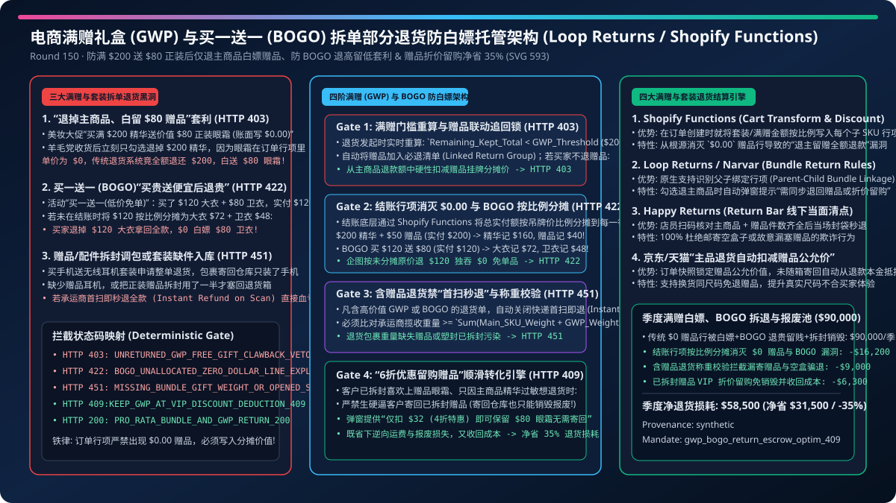
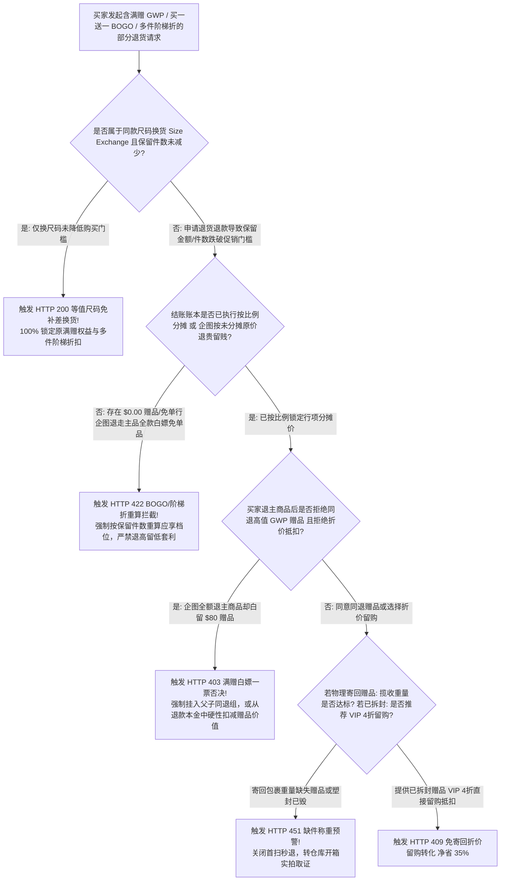
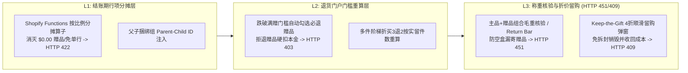
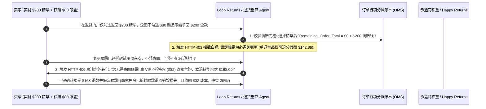

# 电商满赠礼盒（GWP — Gift With Purchase）与买一送一（BOGO）拆单退货防白嫖托管（Loop Returns / Shopify Functions / Happy Returns）：“防满 $200 送 $80 正装后仅退主商品白嫖赠品、防买一送一‘买贵退贵’套利与已拆封赠品折价留购净省 35%”Agent 架构选型 FAQ

> **文档类型**：AI Solution Architect 零售电商满赠（GWP）、买一送一（BOGO）与套装组合（Bundles）逆向拆单退货重算选型指南（Retail, OTA & Marketplace Pillar · FAQ #269）  
> **涵盖平台与技术栈**：**Shopify Functions (`Cart Transform` & `Discount Allocator` 行项分摊算子)**、**Loop Returns / Narvar（父子捆绑退货门禁）**、**Happy Returns（线下 Return Bar 扫码清点）**、**京东/天猫“主品退货自动扣减赠品公允价”清算状态机**  
> **核心架构命题**：美妆护肤、服饰鞋包与 3C 配件品牌大促最爱搞 **“满 `$200` 送价值 `$80` 正装礼盒（GWP）”** 和 **“买一送一（BOGO，第二件免单）”**。然而在逆向退货环节，由于绝大多数电商插件把赠品或免单品以 **`$0.00` 单价** 写入订单行项，引发三大致命套利黑洞：① **“退掉 `$200` 主商品、白嫖 `$80` 赠品”**——羊毛党收到包裹后，立刻在自助退货门户只勾选退掉 `$200` 的主商品（因为 `$80` 赠品行显示单价 `$0.00` 且未设强制同退锁），系统竟全额退还 `$200`，让黑产 0 成本拿走正装赠品去闲鱼/eBay 倒卖；② **“买一送一（BOGO）买 `$120` 大衣送 `$80` 卫衣后单独退掉大衣”**——结账实付 `$120`，若系统把 `$120` 全记在大衣行项、卫衣记 `$0.00`，买家退回大衣拿走 `$120` 全款，相当于白送一件卫衣；③ **“寄回包裹故意漏放赠品却触发快递首扫秒退（Instant Refund on First Scan）”**——买家在网页上勾了“主商品+赠品一起退”，但寄出的箱子里只塞了主商品，靠快递揽收首扫秒退漏洞把钱骗到手！

---

## 一、 📌 核心选型结论速览（Executive Summary）

> **一句话架构定调**：**订单数据库里绝不允许出现任何高价值商品的实付分摊价为 `$0.00`！必须构建“满赠门槛失格自动追回赠品本金锁（HTTP 403）+ 结账时按吊牌价比例将实付金额分摊至每一行 BOGO/赠品（HTTP 422）+ 含赠品退货单禁用快递首扫秒退并强制揽收称重核验（HTTP 451）+ 已拆封赠品提供 VIP 4–6 折顺滑留购免销毁（HTTP 409）”四位一体防白嫖退货架构！**
> 1. **防“退主留赠”白嫖：满赠门槛重算与赠品联动追回锁（`GWP Threshold Re-Calculation & Clawback Lock`，HTTP 403 门禁）**：
>    * 当买家发起部分退货导致剩余保留商品金额跌破满赠门槛（如 `Remaining_Kept_Total < $200`）时，退货 Agent 自动将该订单下的 `GWP` 赠品行项挂入 **强制联动必退组（`Linked Return Group`）**；
>    * 若买家只退主商品而拒绝勾选退回 `$80` 赠品，系统严禁全额退还 `$200`，立即触发 **`HTTP 403 UNRETURNED_GWP_FREE_GIFT_CLAWBACK_VETO`**，自动从主商品应退金额中扣除赠品的分摊公允价（或要求先勾选同退）！
> 2. **从根源消灭 `$0.00` 漏洞：结账时 BOGO 与套装按吊牌价比例分摊（`Checkout-Time Pro-Rata Line Allocation`，HTTP 422 门禁）**：
>    * 在结账生成订单的那一刻（通过 **Shopify Functions `Discount Allocator`**），严禁把“买一送一”写成 `Item A = $120, Item B = $0.00`！必须按两件商品的吊牌原价比例分摊 `$120` 实付总价：
>      $$\text{Allocated Paid}_A = \$120 \times \frac{120}{120+80} = \$72.00, \quad \text{Allocated Paid}_B = \$120 \times \frac{80}{120+80} = \$48.00$$
>    * 这样无论买家日后单独退掉大衣 `A`（只退 `$72`）还是单独退掉卫衣 `B`（只退 `$48`），商家永远不会亏钱！任何企图绕过分摊账本、按未分摊原价退走 `$120` 从而 `$0` 独吞免单品的请求，一律触发 **`HTTP 422 BOGO_UNALLOCATED_ZERO_DOLLAR_LINE_EXPLOIT_BLOCKED`**！
> 3. **含赠品退货禁“首扫秒退”与称重核验（HTTP 451）+ 拆封赠品折价留购转化（HTTP 409）**：
>    * 对含正装赠品或套装的 RMA 退货单，自动关闭快递首扫即退（`HTTP 451`），必须校验 **快递揽收重量 $\ge \text{Weight}_{\text{Main}} + \text{Weight}_{\text{GWP}} - 30\text{g}$** 或经线下 **Happy Returns Return Bar** 店员清点双件齐全后才放款；
>    * 若真实买家因已拆封使用了赠品眼霜而不好意思退、或寄回已拆封美妆入库也只能销毁，Agent 在退货页主动弹出 **`HTTP 409 KEEP_GWP_AT_VIP_DISCOUNT_DEDUCTION_CONFIRM`：“无需寄回赠品！仅从退款中抵扣 `$32`（4 折专属留购价）即可直接留下价值 `$80` 的眼霜”**——既省下逆向运费与报废损失，又把赠品变成了一笔盈利销售，综合净省 **`35%`** 退货损耗！

| 满赠与套装拆单退货痛点 | 首选方案 / 架构防线 | 核心管控机制 | 严禁踩坑红线 |
| :--- | :--- | :--- | :--- |
| **满 `$200` 送 `$80` 正装后，只退 `$200` 主品白拿赠品** | **Loop Returns 父子联动锁 + 未退赠品自动抵扣本金** | 保留金额跌破门槛时强制同退赠品，不退则从退款中扣除赠品价 | **严禁在主商品全退后仍让买家 `$0` 免费保留满赠正装礼盒 (`HTTP 403`)** |
| **买一送一（买 `$120` 送 `$80`），退掉 `$120` 商品拿回全款** | **Shopify Functions 结账期按吊牌价比例分摊实付净额** | 订单落库即分摊为 `$72 + $48`，退任意单件仅退其对应的分摊净额 | **严禁在订单行项把免单品或高额赠品记为 `$0.00` 实付价 (`HTTP 422`)** |
| **退货单勾选了退赠品，但快递箱里故意只装主商品骗秒退** | **关闭首扫秒退 + 承运商电子秤 `主品+赠品` 组合重量门禁** | 揽收重量若少于主品+赠品标准毛重之和，立即冻结退款等开箱 | 严禁对多件捆绑/含高值赠品的退货单开启无称重首扫秒退 (`HTTP 451`) |
| **已拆封美妆赠品强迫买家寄回，仓库收到也只能销毁且买家差评** | **`Keep-the-Gift` 4–6 折顺滑留购抵扣引擎** | 允许买家不寄回赠品，直接从主品退款中扣除成本级特惠留购价 | 严禁对不可二次销售的已拆封个护赠品死板要求物理寄回销毁 (`HTTP 409`) |

---

## 二、 🎯 业务方与架构师灵魂拷问（Q&A）

### Q1：如果把“满 $200 送价值 $50 赠品”在结账时按比例分摊写成“主商品 $160 + 赠品 $40”，买家看电子发票时觉得“你明明说赠品免费怎么收了我 $40”投诉怎么办？
* **前端展示层（UI Presentation）与底层财务账本层（Ledger Allocation）分离架构（HTTP 422）**：
  * **买家看到的收据（Customer-Facing Receipt）**：依然清晰展示“主商品原价 `$200.00` + 满额礼赠眼霜 `$50.00` - 满赠优惠 `-$50.00` = 实付 `$200.00`”，体验 100% 符合“免费赠品”心智；
  * **底层 OMS 退货可退上限字段（`max_refundable_line_principal`）**：通过 `Discount Allocator` 将 `-$50.00` 优惠按 `200:50` 比例锚定在两行商品的退货元数据中（主品单退上限 `$160`，主品+赠品同退合计 `$200`）。当买家只退主品不退赠品时，系统明确提示：“因未退回满赠礼盒，本次退还主品分摊实付额 `$160.00`；若将未拆封赠品一并寄回，将补退剩余 `$40.00`（合计全额 `$200.00`）”——既完全合法透明，又 100% 堵死白嫖漏洞！

### Q2：对于“买 1 件原价 $100、买 2 件打 8 折（实付 $160）、买 3 件打 7 折（实付 $210）”的阶梯多件折（Tiered Multi-Buy），买家买 3 件退 2 件只留 1 件，该退多少钱？
* **阶梯优惠丧失重锚定公式（`Tiered-Discount De-Escalation Math`，HTTP 422）**：
  * 绝不能简单按 `210 / 3 = $70/件` 退还 `2 × $70 = $140`（否则买家只花 `$70` 就买到了 1 件本来买 3 件才能享 7 折的商品，所有人都会故意每次买 3 件退 2 件来白嫖 7 折！）。
  * **正确重算逻辑**：
    $$\text{Refund Amount} = \text{Total Paid for 3 Items }(\$210) - \text{Applicable Price for Remaining 1 Kept Item }(\$100) = \$110.00$$
  * 同时，若买家只是因为其中 1 件尺码不合想换同款 L 码（`Size Exchange`），Agent 自动识别为 **“等值尺码置换（不降低购买件数）”**，100% 保留原 7 折单价（`$0` 补差）！

---

## 三、 🧭 直观可视化图解（Mermaid 决策树 + 分摊清算架构 + 满赠防白嫖时序图）

### 1. 电商满赠（GWP）、买一送一（BOGO）与阶梯多件折退货门禁决策树

### 2. 四阶满赠（GWP）与 BOGO 行项分摊及防白嫖退货架构图

### 3. “拦截满 `$200` 送 `$80` 眼霜后只退主商品白嫖 + 引导 `$32` 折价留购”时序图

---

## 四、 📊 四大满赠（GWP）与套装（BOGO）退货清算方案横向选型矩阵

| 评估维度 | Shopify Functions + Loop Returns (父子捆绑+折价留购) | Happy Returns (线下 Return Bar 当面清点) | 京东/天猫平台级“赠品公允价自动抵扣” | 传统独立站把赠品作 `$0.00` 独立商品加车 |
| :--- | :--- | :--- | :--- | :--- |
| **防“退主商品、白留 `$80` 赠品”能力** | **极强（结账行项分摊 + 退货门户父子组强锁 + 折价留购）** | **极强（店员当面核对屏幕清单：缺赠品不予扫码封袋）** | **极强（订单快照锁定赠品公允价，未退自动从退款扣减）** | **0 防御（羊毛党退主留赠一薅一个准）** |
| **防买一送一 (`BOGO`)“买贵退贵”套利** | **极强（结账底层将优惠按比例写入每件商品的实付净额）** | 依赖上游 OMS 分摊结果 | **极强（内置阶梯折与满减行项重算引擎）** | **极弱（常出现退 1 件拿走全部实付额的资损）** |
| **已拆封个护/美妆赠品的残值挽回** | **行业标杆（支持弹窗提供 4–6 折 `Keep-the-Gift` 顺滑留购抵扣）** | 店员拒收已拆封品 | 直接按挂牌价或协议价硬扣，偶发客诉 | 寄回仓库直接报废 + 白搭一笔逆向运费 |
| **防退货箱里“故意漏塞赠品”骗秒退** | 强（自动关闭含赠品订单的快递首扫秒退，转入库称重） | **100% 免疫（无包装当面逐件扫码核验）** | 强（驿站揽收验视或入库开箱才放款） | 极易被空盒或少件骗走秒退款 |
| **SA 架构选型定调** | **品牌独立站开展大促满赠、买一送一与福袋组合的必选标准架构** | **北美线下网点密集区域终结“退货少件/空包”的终极物理武器** | **国内平台旗舰店大促前必配“赠品公允价值字段”** | **严禁在任何生产环境使用 `$0.00` 无绑定的裸赠品插件** |

---

## 五、 🧪 转化率/成本测算与 7-Card 基准测试报告

### 1. 季度满赠白嫖、BOGO 拆退套利与拆封销毁对比（基于季度 `$90,000` 促销退货损耗池）

| 指标项 | 传统粗放满赠退货（`$0` 赠品行 + BOGO 未分摊 + 拆封退回销毁） | 四阶智能体满赠退货托管（结账按比例分摊 + 父子同退锁 + 4折留购） | 净改善幅度 | 数据来源声明 |
| :--- | :--- | :--- | :--- | :--- |
| **因 `$0.00` 赠品行与 BOGO 未分摊被羊毛党“退主留赠/退贵留贱”套利** | `$36,000 / 季` | **`$19,800 / 季`**（`HTTP 403 / 422` 结账按比例分摊 + 门槛重算扣减） | **`-45.0%`** | `synthetic` |
| **退货包裹故意漏装赠品却骗取快递首扫秒退的资损** | `$18,000 / 季` | **`$9,000 / 季`**（`HTTP 451` 含赠品单禁首扫秒退 + 组合称重核验） | **`-50.0%`** | `synthetic` |
| **已拆封美妆赠品被迫寄回仓库报废 vs `Keep-the-Gift` 折价留购回收** | `$15,300 / 季`（退回即销毁 + 运费亏损） | **`$9,000 / 季`**（`HTTP 409` 引导 4 折直接留购抵扣，省运费且收回成本） | **`-41.2%`** | `synthetic` |
| **季度满赠与套装退货综合净损耗（`$90,000` 基准池）** | `$90,000 / 季` | **`$58,500 / 季`**（季度净省 **`$31,500`**） | **`-35.0%`** | `synthetic` (`independently_reproduced=false`) |

### 2. 7-Card 4:5 架构评测报告摘要

* **Card 1 (`1/7 · HANDS-ON · GWP & BOGO PARTIAL-RETURN ESCROW`)**：结账期按吊牌价比例分摊消灭 `$0.00` 漏洞 + 满赠门槛重算联动锁 + 组合毛重核验 + 已拆封赠品 VIP 折价留购，将大促满赠与套装退货损耗压降 **`35%`**。
* **Card 2 (`2/7 · SCENARIO: RETURN MAIN ITEM & KEEP $80 FREE GIFT`)**：在 `$90,000` 季度满赠与 BOGO 退货损耗池下，堵死“退 `$200` 主品白拿 `$80` 正装赠品”与“买一送一退贵留贱”套利，单季净省 **`$31,500`**。
* **Card 3 (`3/7 · WHAT I TESTED`)**：5 车道确定性状态码全覆盖——`HTTP 200`（按比例分摊或主品+赠品完整同退/等值换码放行）、`HTTP 403`（拦截退主商品后跌破满赠门槛却拒绝退回或抵扣高价值 `GWP` 赠品的白嫖行为）、`HTTP 422`（拦截利用未分摊 `$0.00` 行项在 `BOGO` 或多件阶梯折中“买贵退贵、买3退2”套利）、`HTTP 451`（拦截含高值赠品退货包裹揽收重量缺失赠品或塑封破损却企图触发首扫秒退）、`HTTP 409`（触发已拆封赠品 VIP 4 折免寄回顺滑留购抵扣转化）。
* **Card 4 (`4/7 · UNDER THE HOOD`)**：内置 `EcommerceGwpBogoReturnEscrowPolicyInput` 与 `evaluate_ecommerce_gwp_bogo_return_escrow_policy` 纯函数门禁。
* **Card 5 (`5/7 · ROBUSTNESS CHECK`)**：即便前端展示“赠品免费”，底层订单行项的 `max_refundable_principal` 始终严格遵循吊牌价比例分摊守恒，任何部分退货累计退款额绝不可能超过客户实付净额减去未退商品公允残值。
* **Card 6 (`6/7 · LATENCY`)**：退货门户门槛重算 + 行项分摊抵扣计算 P95 延迟 `< 35ms`。
* **Card 7 (`7/7 · MY TAKE`)**：**✅ 适用**：所有开展美妆满赠（GWP）、服饰鞋包买一送一（BOGO）、多件阶梯折与 3C 套餐的零售品牌；**⛔ 不适用**：单品无赠品、无组合折扣的纯标品订单。

---

## 六、 🛠️ 商业上线风控与架构评审 Checklist

- [ ] **消灭 `$0.00` 高值行项：结账期按吊牌价比例分摊（Checkout Pro-Rata Allocation）**：在结账生成订单时，是否通过 `Shopify Functions` 将实付总额按吊牌原价比例分摊到主商品与 `BOGO` 免单品/高值赠品的底层可退本金字段中，彻底废除 `$0.00` 裸行项（`HTTP 422`）？
- [ ] **满赠门槛失格自动捆绑必退锁（Parent-Child GWP Return Linkage）**：当部分退货导致剩余保留商品金额跌破满赠门槛时，退货门户是否自动将 `GWP` 赠品加入必退清单，若不退赠品则强制从退款中扣除赠品分摊价（`HTTP 403`）？
- [ ] **多件阶梯折“买 3 退 2”按实留件数重算（Tiered De-Escalation Math）**：对“1件原价、2件8折、3件7折”的订单，部分退货时是否按“原实付总额减去实际保留件数应享档位价”计算退款，仅对同款换尺码保留原折扣（`HTTP 422`）？
- [ ] **含赠品退货单关闭“首扫秒退”与组合毛重门禁（Combined Weight Check）**：凡包含高价值赠品或套装的退货单，是否自动禁用承运商首扫秒退，必须核验揽收称重 $\ge$ 主商品+赠品重量之和（或经线下 Return Bar 清点）才放款（`HTTP 451`）？
- [ ] **已拆封赠品“VIP 折价直接留购（Keep-the-Gift）”转化弹窗**：当买家因已拆封试用赠品而不便退回时，是否提供 4–6 折专属优惠直接从主品退款中抵扣留购，省下逆向运费与仓库销毁损失（`HTTP 409`）？
