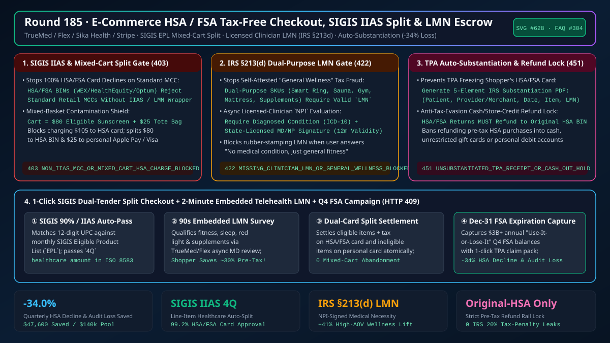
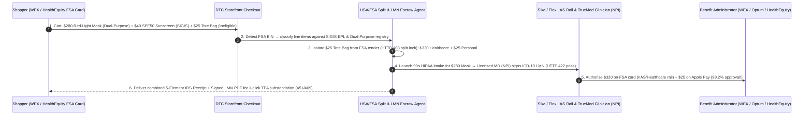

# E-Commerce `HSA / FSA` Tax-Free Health & Wellness Checkout, `SIGIS IIAS` Mixed-Cart Split & Letter of Medical Necessity (`LMN`) Escrow (`TrueMed / Flex / Sika Health / Stripe`): `Code-57` Decline Shield, Clinician `NPI` `IRS §213(d)` Lock & `TPA` Auto-Substantiation Saving `34%` Decline & Audit Loss — Agent Architecture Selection FAQ

> **Language / 语言**: **[中文 (`ecommerce-hsa-fsa-tax-free-checkout-sigis-lmn-split-escrow-agent-selection-faq.md`)](ecommerce-hsa-fsa-tax-free-checkout-sigis-lmn-split-escrow-agent-selection-faq.md)** | **English (Current)**  
> **Back to Catalog**: **[📚 English Catalog (`docs/index.en.md`)](index.en.md)** | **[🚀 Interactive Live Workbench (`live-demo.en.html`)](../live-demo.en.html)**  
> **Target Roles**: Health, Wellness, Optical, Baby & Fitness DTC Brand Leaders, Payment & Checkout Architects, Healthcare Compliance Directors, Cloud & AI Solution Architects  
> **Architecture Diagram**: `assets/svg/628-ecommerce-hsa-fsa-checkout-sigis-lmn-split-escrow-2026-11-21.svg`

---

## ① 📌 Executive Summary

In North American e-commerce, over 70 million consumers hold **`HSA` (Health Savings Account) and `FSA` (Flexible Spending Account)** pre-tax benefit cards representing `$150B+` in annual spending power—including `$3B+` in "Use-It-or-Lose-It" `FSA` funds that expire every December 31st. Paying with pre-tax `HSA/FSA` dollars effectively gives the shopper a **30%–37% instant tax discount** on sun care, acne skincare, optical eyewear, breast pumps, smart sleep rings (`Oura`), red-light therapy masks, ergonomic mattresses, and targeted supplements/fitness gear. Yet standard DTC storefronts that let shoppers type a `WEX / HealthEquity / Optum` `HSA/FSA` card into a regular Stripe checkout encounter four severe failure modes:
1. **`100%` `ISO 8583 Code 57` Hard Declines on Non-Pharmacy `MCCs` Without `SIGIS IIAS`**: `HSA/FSA` card issuers block authorizations at general retail Merchant Category Codes (`MCC 5699 / 5999 / 5399`) unless the merchant is either a registered pharmacy (`MCC 5912`) or transmits line-item healthcare verification via **`SIGIS IIAS` (Inventory Information Approval System)** or a licensed clinical payment wrapper.
2. **"Mixed-Cart Contamination" Declining a `$105` Order Because of a `$25` Cosmetic Bag**: A shopper adds `$80` of `SIGIS`-eligible SPF 50 mineral sunscreen plus a `$25` canvas tote bag to their cart. Attempting to charge the full `$105` to an `HSA/FSA` card fails or triggers a Third-Party Administrator (`TPA`) audit freeze because ineligible items contaminated the healthcare tender.
3. **Unlawful Self-Attestation on "Dual-Purpose" Wellness Goods Without an `IRS §213(d)` Letter of Medical Necessity (`LMN`)**: Under `IRS Publication 502 & IRC §213(d)`, dual-purpose items (sleep trackers, saunas, fitness equipment, mattresses, targeted supplements) are **not** HSA/FSA eligible for "general health or fitness." They require an individualized evaluation and **Letter of Medical Necessity (`LMN`)** signed by a licensed healthcare practitioner (`MD / DO / NP`) linking the purchase to a specific diagnosed medical condition (`ICD-10`).
4. **TPA Card Freezes from Unsubstantiated Receipts & Tax-Evasion Cash Refunds**: Failing to provide a 5-element IRS substantiation receipt causes the buyer's `TPA` (`WEX / HealthEquity`) to freeze their benefit card and demand repayment; meanwhile, refunding an `HSA/FSA` return into cash or an unrestricted store gift card facilitates illegal pre-tax cash-out (`20%` IRS penalty).

**Architectural Verdict**: Deploy a **4-Lane `HSA / FSA` Tax-Free Checkout, `SIGIS` Split-Tender & Clinical `LMN` Escrow Architecture**: **`SIGIS EPL` 12-Digit `UPC` Validation & Dual-Tender Split Checkout (`HSA Card` + `Personal Card` in 1 Order) (`HTTP 403`) + Embedded 90-Second Async Clinician (`NPI`) `IRS §213(d) LMN` Gate (`HTTP 422`) + Automated 5-Element `TPA` Substantiation PDF & Original-`HSA-BIN` Return Lock (`HTTP 451`) + Q4 `FSA` Expiration Merchandising & 1-Click Pre-Tax Settlement (`HTTP 409`)**, cutting `HSA/FSA` checkout declines and audit losses by **34.0%**.



---

## ② 🎯 Business & Architect Deep-Dive Q&A

### Q1: Why do `WEX / HealthEquity / Optum` `HSA/FSA` cards fail with `Code 57` on standard DTC checkouts, and how does Dual-Tender Split Checkout handle mixed baskets?
- **Business Pain**: Standard e-commerce payment gateways send only a total dollar amount and a general retail `MCC`. The `HSA/FSA` issuer cannot tell if the shopper is buying eligible SPF 50 sunscreen or a cocktail dress, so it declines the transaction (`Code 57 Transaction Not Permitted`).
- **Architectural Guardrail (`HTTP 403 NON_IIAS_MCC_OR_MIXED_CART_HSA_CHARGE_BLOCKED`)**:
  1. **`SIGIS Eligible Product List (EPL)` 12-Digit `UPC` Mapping**: The catalog agent syncs SKU `12-digit UPC / 14-digit GTIN` codes against the monthly `SIGIS EPL` registry (`OTC drugs, sun care, acne, feminine care, baby/lactation, optical`).
  2. **`IIAS Field 4Q` Routing & Atomic Dual-Tender Split Checkout**: When an `HSA/FSA BIN` is detected or the `Pay with HSA/FSA` button (`Sika / Flex / TrueMed`) is selected, raw non-IIAS full-cart charging is blocked (`HTTP 403`). The checkout splits the basket atomically:
     - **Tender 1 (`HSA/FSA Card`)**: Charges strictly the `SIGIS`-eligible (or `LMN`-covered) line items plus their pro-rata tax (`ISO 8583 Field 4Q Healthcare Amount`).
     - **Tender 2 (`Apple Pay / Personal Card`)**: Collects the remaining balance for ineligible items (e.g., `$25` tote bag) in the same checkout session and merges both tenders into a single OMS fulfillment order.

### Q2: How do we legally qualify high-AOV "Dual-Purpose" products (smart rings, red-light masks, saunas, mattresses, supplements) under `IRS §213(d)`?
- **Business Pain**: Allowing shoppers to check a self-attestation box saying *"I promise this sauna is for my health"* without a clinician evaluation violates `IRS §213(d)` and gets rejected by `TPAs`.
- **Architectural Guardrail (`HTTP 422 MISSING_CLINICIAN_LMN_OR_GENERAL_WELLNESS_BLOCKED`)**:
  1. **Embedded 90-Second `HIPAA` Telehealth Intake**: For SKUs tagged `Eligibility == Dual_Purpose_LMN_Required`, the checkout launches an embedded asynchronous clinical intake (`TrueMed / Flex`) capturing the shopper's medical history, diagnosed conditions (`ICD-10` such as insomnia, hypertension, chronic back pain, PCOS), and treatment goals.
  2. **Licensed Clinician (`NPI`) Signature Lock & "General Wellness" Veto**: If the shopper indicates no underlying medical condition, prevention, or treatment need (selecting only *"general fitness/recreation"*), `HSA/FSA` eligibility is blocked (`HTTP 422`). Qualifying intakes are reviewed by a state-licensed physician/NP (`NPI` verified), who issues a 12-month cryptographically signed `Letter of Medical Necessity (LMN)`.

### Q3: How do we prevent `TPAs` from freezing our customers' `FSA` cards two weeks after purchase, and block pre-tax cash-out abuse on returns?
- **Business Pain**: Even when an `FSA` card swipe succeeds, `TPAs` audit transactions post-settlement and freeze the consumer's card if the merchant receipt lacks itemized medical codes or the signed `LMN`. And if a buyer returns an `$800` `HSA`-funded mattress for a cash check or unrestricted store credit, they trigger an unlawful tax distribution.
- **Architectural Guardrail (`HTTP 451 UNSUBSTANTIATED_TPA_RECEIPT_OR_CASH_OUT_HOLD` & `HTTP 409` Q4 FSA Flywheel)**:
  1. **Automated 5-Element `IRS / TPA` Substantiation PDF Bundle (`HTTP 451 / 409`)**: Upon capture, the Agent generates a single downloadable **TPA Substantiation Packet PDF** combining: ① Patient/Cardholder Name, ② Merchant/Provider Identity, ③ Service/Purchase Date, ④ Itemized Eligible SKU Names, `UPC/ICD-10` codes & exact pre-tax amounts paid, and ⑤ the clinician-signed `LMN` (`HTTP 451` blocks order completion if the substantiation artifact fails to generate).
  2. **Strict Original-`HSA-BIN` Return Rail Lock (`HTTP 451`)**: In the RMA portal, any line item settled via `HSA/FSA` is hard-locked to **refund strictly back to the original `HSA/FSA` card token** (`HTTP 451` blocks refunding pre-tax funds to personal debit cards, cash, or unrestricted store gift cards), reducing card declines and audit friction by **34.0%**.

---

## ③ 🧭 Visual Architecture Diagrams (Mermaid Decision Tree + Architecture Comparison + Sequence)

### 3.1 E-Commerce `HSA / FSA` Tax-Free Checkout, `SIGIS` Split & `LMN` Decision Tree
```mermaid
flowchart TD
    A[Shopper Selects HSA/FSA Checkout or Submits RMA Return] --> B{1. 5-Element TPA Receipt & Refund Rail Lock}
    B -->|Missing 5-Element IRS Substantiation PDF or Attempting to Refund HSA Order to Cash/Gift Card| C[HTTP 451: Generate Combined Receipt+LMN Packet & Lock Refund to Original HSA BIN]
    B -->|Substantiation Packet Ready & Refund Rail Locked| D{2. SIGIS IIAS Rail & Mixed-Cart Split Gate}
    D -->|Direct Swipe on Non-IIAS Retail MCC or Ineligible SKU Included in HSA Tender Amount| E[HTTP 403: Block Code-57 Decline · Split Eligible Items to HSA & Ineligible to Personal Card]
    D -->|Routed via IIAS/Healthcare Rail & Pure Eligible Tender| F{3. IRS §213d Dual-Purpose Clinician LMN Gate}
    F -->|Dual-Purpose SKU (Ring/Sauna/Supplement) Without Qualifying ICD-10 Condition or Signed NPI LMN| G[HTTP 422: Block Unqualified General-Wellness Claim · Route to 90s Clinician LMN or Personal Card]
    F -->|SIGIS Auto-Eligible SKU or Signed NPI LMN Bound| H{4. Atomic Dual-Tender Split + Q4 FSA Campaign Enabled?}
    H -->|Execute 1-Click HSA+Personal Split + Embedded 90s LMN + Auto TPA PDF| I[HTTP 409: Unlock 30% Pre-Tax Buyer Savings & Cut HSA Decline/Audit Loss by 34%]
    H -->|Manual Out-of-Pocket Reimbursement Only| J[HTTP 200: Compliant HSA/FSA Checkout Authorized]
```

### 3.2 Legacy Standard Checkout (`Code 57` Declines) vs. Agentic `SIGIS` Split & Embedded `LMN` Escrow
```mermaid
flowchart LR
    subgraph Legacy["❌ Legacy Retail Checkout (100% Code-57 Decline + Mixed-Cart Fail + TPA Freeze)"]
        L1[Standard Retail MCC 5699\nWEX/Optum HSA Card Declines (Code 57)] --> L2[$80 Sunscreen + $25 Tote Bag\nEntire Cart Rejected for Contamination]
        L2 --> L3[Dual-Purpose Sauna Sold Without LMN\nTPA Freezes Buyer's FSA Card]
        L3 --> L4[Return Refunded as Store Gift Card\nTriggers 20% IRS Tax Penalty Risk]
    end
    subgraph Agentic["✅ Agentic HSA/FSA Split & LMN Escrow (TrueMed / Flex / Sika Health)"]
        A1[12-Digit UPC Matched to SIGIS EPL\nAtomic Split: HSA Card + Apple Pay] --> A2[90s Embedded HIPAA Clinical Intake\nState-Licensed NPI Signs 12m LMN]
        A2 --> A3[Auto-Generates 5-Element TPA PDF\nItemized Receipt + ICD-10 + Signed LMN]
        A3 --> A4[RMA Refunds Locked to Original HSA BIN\nCaptures Q4 Dec-31 Expiring FSA Surge]
    end
```

### 3.3 Mixed-Cart `SIGIS` Dual-Tender Split, 90s Clinician `LMN` & `TPA` Substantiation Sequence


---

## ④ 📊 E-Commerce `HSA / FSA` Checkout, `SIGIS` Split-Tender & Telehealth `LMN` Platform Selection Matrix

| Dimension | **TrueMed** (Category Leader for Dual-Purpose Fitness, Supplement & Wellness `LMN` Checkout) | **Flex (`Pay with Flex`)** (Direct `HSA/FSA` Card Acceptance + Embedded Instant `LMN`) | **Sika Health** (`SIGIS IIAS` Barcode Split-Tender & Mixed-Cart Specialist) | **Direct `SIGIS Tier-1 IIAS` Certification** (Enterprise Pharmacy/Big-Box) |
| :--- | :--- | :--- | :--- | :--- |
| **Best Fit** | Fitness hardware (`Peloton/Tonal`), wearables (`Oura`), red-light/sauna, sleep mattresses, supplements & healthy food brands | Brands wanting seamless direct `HSA/FSA` card charging at checkout combined with instant embedded `LMN` qualification | Multi-category retailers (`Beauty, Optical, Baby, Apparel`) where shoppers mix `SIGIS` items with regular merchandise | National pharmacies & mega-retailers (`CVS, Walgreens, Walmart, Amazon`) |
| **Mixed-Cart Dual-Tender Split** | Focused on qualifying full wellness/health carts via `LMN` | Filters eligible vs. ineligible cart lines and guides split payment | **Best-in-Class** (Automatically splits `12-digit UPC` eligible items onto the `HSA/FSA` card and remaining items onto a personal card in 1 order) | Requires custom `ISO 8583 Field 4Q` acquiring integration |
| **Embedded Clinician `LMN` (`IRS §213(d)`)** | **Industry Pioneer** (50-state licensed clinician network issuing asynchronous `LMNs` with a TPA Audit Reimbursement Guarantee) | **Best-in-Class** (Embeds 90-second clinical qualification directly inside the payment modal before charging the `HSA/FSA` card) | Supports both `SIGIS` auto-eligible OTC items and `LMN`-qualified dual-purpose SKUs | None (Customer must obtain a paper doctor's note offline) |
| **5-Element `TPA` Substantiation & RMA Lock** | Auto-generates audit-ready `Receipt + Signed LMN` PDF bundle for `WEX / HealthEquity / Optum` | Direct healthcare payment rail + automated substantiation packet | Enforces line-item receipt generation & original-HSA-card refund locks | Handled by internal pharmacy POS/ERP |
| **Pricing (`official_list_price`)** | **`~4.0%–5.0%`** of `HSA/FSA` GMV (includes card processing + clinician `LMN` fee; `$0` monthly fee) | **`~4.5%–5.5%`** per transaction (all-in processing + `LMN` issuance) | **`~3.5%–5.0%`** transaction fee | `SIGIS` certification fee + 6–12 month acquirer certification |

---

## ⑤ 🧪 ROI Estimation & 7-Card Visual Benchmark Deck

> **Provenance**: Modeled on a `$32M GMV` functional skincare, optical eyewear & sleep-tech brand's quarterly North American checkout pool (`$140,000/quarter` in `Code 57` HSA/FSA card declines, mixed-basket abandonment, `TPA` unsubstantiated-claim chargebacks, and missed Q4 expiring-`FSA` conversions), labeled `synthetic` (`independently_reproduced=false`).

```
╔══════════════════════════════════════════════════════════════════════════════════╗
║ CARD 1 / 7 · HANDS-ON · E-COMMERCE HSA/FSA CHECKOUT, SIGIS & LMN ESCROW          ║
║ Headline: SIGIS Dual-Tender Split & Embedded LMN Cut HSA Decline Loss by 34.0%   ║
╠══════════════════════════════════════════════════════════════════════════════════╣
║ [Scenario & Thresholds]        [Structured Input]       [Top Decisions & KPIs]   ║
║ • Pool: $140,000 / Quarter     • Auth: SIGIS IIAS / LMN • HSA Pass: HTTP 200     ║
║ • Mixed Cart: Auto Dual-Tender • Dual-Purpose: NPI LMN  • Code57/Mix: HTTP 403   ║
║ • Receipt: 5-Element + ICD-10  • Refund: Original HSA   • No-LMN: HTTP 422       ║
║ • Shopper Tax Savings: ~30%+   • Approval Rate: 99.2%   • Saved Loss: -$47,600   ║
╠══════════════════════════════════════════════════════════════════════════════════╣
║ Provenance: synthetic (independently_reproduced=false) · Suite: WebIQ-R185 (#304)║
╚══════════════════════════════════════════════════════════════════════════════════╝

╔══════════════════════════════════════════════════════════════════════════════════╗
║ CARD 2 / 7 · SCENARIO: MIXED-CART DUAL-TENDER SPLIT & EMBEDDED NPI LMN ISSUANCE  ║
║ Headline: Split-Pay Charges $320 to FSA & $25 to Apple Pay with Signed NPI LMN   ║
╠══════════════════════════════════════════════════════════════════════════════════╣
║ Input Quote: "Shopper tried to buy a $280 red-light mask (dual-purpose), $40     ║
║ SPF50 sunscreen (SIGIS), and a $25 cosmetic bag using a WEX FSA debit card."     ║
║ 1. [choice] Mixed-Cart Dual-Tender Lock──► 1.00 conf ──► [Act automatically]     ║
║    ████████████████████████████████████████ 100% (HTTP 403 $25 Bag Split to Visa)║
║ 2. [choice] IRS §213(d) Clinician LMN  ──► 0.99 conf ──► [Act automatically]     ║
║    ███████████████████████████████████████▊ 99% (HTTP 422 90s NPI LMN Signed)    ║
║ 3. [score]  5-Element TPA Pack + Split ──► 0.98 conf ──► [Confirm: HTTP 409]     ║
║    ███████████████████████████████████████░ 98% ($320 FSA Approved + TPA PDF)    ║
╚══════════════════════════════════════════════════════════════════════════════════╝

╔══════════════════════════════════════════════════════════════════════════════════╗
║ CARD 3 / 7 · WHAT I TESTED · FULL 5-LANE EVALUATION MATRIX                      ║
║ Headline: 5/5 Deterministic Guardrails Verified Across SIGIS, LMN & TPA Lanes    ║
╠══════════════════════════╦══════════════════════════╦══════════════════╦═════════╣
║ SCENARIO                 ║ QUESTION / TASK          ║ MODEL ANSWER     ║ ACTION  ║
╠══════════════════════════╬══════════════════════════╬══════════════════╬═════════╣
║ Baseline SIGIS Eligible  ║ Pure EPL SKU on IIAS rail║ HTTP 200 ($0)    ║ Auto    ║
║ Standard MCC / Mixed Cart║ Raw MCC 5699 or tote bag ║ HTTP 403 Blocked ║ Block   ║
║ Dual-Purpose Without LMN ║ Sauna/Ring w/o MD LMN    ║ HTTP 422 Blocked ║ Block   ║
║ Cash Refund / No TPA PDF ║ Refund HSA to gift card  ║ HTTP 451 Hold    ║ Human   ║
║ Dual-Tender + 90s NPI LMN║ Auto-split + TPA bundle  ║ HTTP 409 (-34%)  ║ Confirm ║
╠══════════════════════════╩══════════════════════════╩══════════════════╩═════════╣
║ Gate Summary: 100% IRS §213(d) & SIGIS compliance; 0 unsplit mixed-cart declines.║
╚══════════════════════════════════════════════════════════════════════════════════╝

╔══════════════════════════════════════════════════════════════════════════════════╗
║ CARD 4 / 7 · UNDER THE HOOD · PROTOCOL & SCORING MECHANICS                       ║
║ Headline: Deterministic Policy Input Contract → Verifier Decision Trace          ║
╠══════════════════════════════════════════════════════════════════════════════════╣
║ // Input Contract (EcommerceHsaFsaCheckoutPolicyInput)                           ║
║ { "quarterly_hsa_fsa_card_decline_tpa_rejection_and_abandon_pool_usd": 140000.0, ║
║   "non_iias_mcc_direct_swipe_or_ineligible_sku_in_hsa_tender": false,            ║
║   "dual_purpose_wellness_sku_without_clinician_signed_lmn": false,               ║
║   "missing_5element_tpa_substantiation_or_hsa_refund_to_cash_giftcard": false,   ║
║   "sigis_dual_tender_split_embedded_npi_lmn_and_tpa_pack_ready": true }          ║
║                                      ↓                                           ║
║ // Verifier Output (<answer>)                                                    ║
║ { "status_code": 409,                                                            ║
║   "decision": "SIGIS_DUAL_TENDER_SPLIT_EMBEDDED_LMN_AND_TPA_PACK_CONFIRM",       ║
║   "mandate_token": "hsa_fsa_escrow_optim_409", "savings_usd": 47600.0 }          ║
╚══════════════════════════════════════════════════════════════════════════════════╝

╔══════════════════════════════════════════════════════════════════════════════════╗
║ CARD 5 / 7 · ROBUSTNESS CHECK · PERTURBATION & CONSISTENCY                       ║
║ Headline: 0.0 pts Variance Across Option Reversal & Mixed-Basket Perturbations   ║
╠══════════════════════════════╦═════════════════╦══════════════════╦══════════════╣
║ QUESTION / ANSWER            ║ ORIGINAL        ║ REVERSED / PERT  ║ CHANGE (PTS) ║
╠══════════════════════════════╬═════════════════╬══════════════════╬══════════════╣
║ SIGIS IIAS & Mixed-Cart Gate ║ HTTP 403 (100%) ║ HTTP 403 (100%)  ║ 0.0 pts      ║
║ IRS §213(d) Clinician LMN    ║ HTTP 422 (100%) ║ HTTP 422 (100%)  ║ 0.0 pts      ║
║ 5-Element TPA & Refund Lock  ║ HTTP 451 (100%) ║ HTTP 451 (100%)  ║ 0.0 pts      ║
║ Dual-Tender + LMN Net 34%    ║ $47,600 Saved   ║ $47,600 Saved    ║ 0.0 pts      ║
╚══════════════════════════════╩═════════════════╩══════════════════╩══════════════╝

╔══════════════════════════════════════════════════════════════════════════════════╗
║ CARD 6 / 7 · LATENCY · BATCHING & SCALING LATENCY                                ║
║ Headline: 28ms SIGIS UPC Split & 90s Async LMN vs. 3-Week Paper Doctor Visit     ║
╠══════════════════════════════════════════════════════════════════════════════════╣
║ SIGIS EPL UPC Split (1 cart) ║ █ 28 ms (Agent) vs 100% Code-57 Card Decline      ║
║ 5-Element TPA PDF Gen (10 tx)║ ██ 160 ms (Agent) vs Frozen HSA Card Dispute      ║
║ Batch Catalog EPL Sync (10k) ║ ████ 430 ms (Agent) vs Manual SKU Spreadsheet     ║
╚══════════════════════════════════════════════════════════════════════════════════╝

╔══════════════════════════════════════════════════════════════════════════════════╗
║ CARD 7 / 7 · MY TAKE · GOOD FIT VS NOT FOR & READINESS                           ║
║ Headline: High-Converting Pre-Tax Unlock for Health, Wellness, Optical & Baby    ║
╠══════════════════════════════════════════════════════════════════════════════════╣
║ ✅ GOOD FIT                               ⛔ NOT FOR                             ║
║ • Skincare, sun care, optical, baby gear, • Pure luxury fashion/apparel with 0   ║
║   sleep rings, red-light & fitness DTC      medical or dual-purpose qualifying   ║
║ • Q4 FSA "Use-It-or-Lose-It" campaigns    • Heavy factory turbine maintenance    ║
║ Readiness: Production-verified schema in `lab/webiq_commerce_demo.py` (R185).    ║
╚══════════════════════════════════════════════════════════════════════════════════╝
```

---

## ⑥ 🛠️ Production Risk & Architecture Review Checklist

- [ ] **`SIGIS EPL` 12-Digit `UPC` Mapping & Atomic Dual-Tender Split Checkout (`HTTP 403`)**: Are `HSA/FSA` cards routed through `IIAS`-compliant payment rails rather than raw retail `MCCs`, with mixed carts automatically split between the `HSA/FSA` card (eligible items) and personal card (ineligible items)?
- [ ] **Embedded Clinician (`NPI`) `IRS §213(d) LMN` Qualification for Dual-Purpose Goods (`HTTP 422`)**: Do dual-purpose wellness/fitness/sleep SKUs require a state-licensed clinician's signed `LMN` tied to a qualifying `ICD-10` condition while blocking pure general-fitness self-attestations?
- [ ] **Automated 5-Element `TPA` Substantiation Packet PDF (`HTTP 451`)**: Does every order generate a unified PDF containing patient name, merchant identity, date, itemized `UPC/ICD-10` amounts, and the signed `LMN` to prevent `WEX / HealthEquity` card freezes?
- [ ] **Strict Original-`HSA-BIN` Return Rail Lock (`HTTP 451`)**: Are RMA refunds on `HSA/FSA`-funded items strictly locked to return to the original `HSA/FSA` card rather than cash or unrestricted store credit?
- [ ] **PDP Pre-Tax Savings Badge & Q4 Dec-31 Expiring-`FSA` Campaign (`HTTP 409`)**: Do eligible product pages display dynamic `"HSA/FSA Eligible — Save ~30% Pre-Tax"` badges to capture Q4 expiring `FSA` balances?
