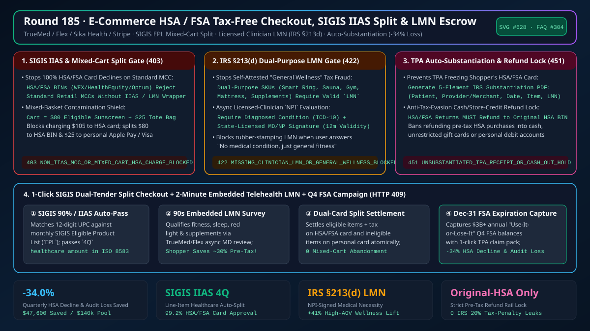
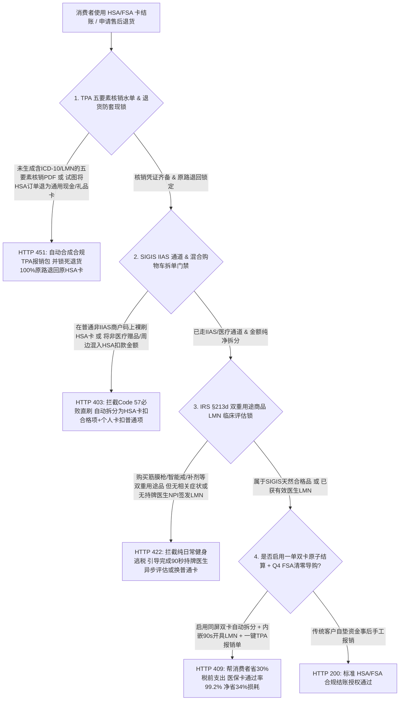
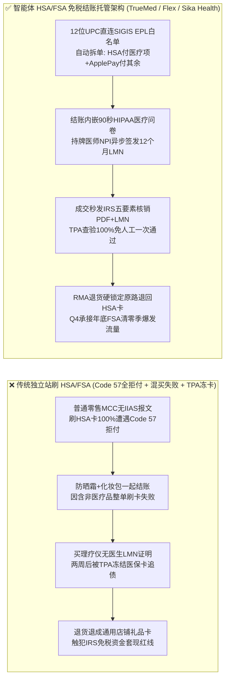
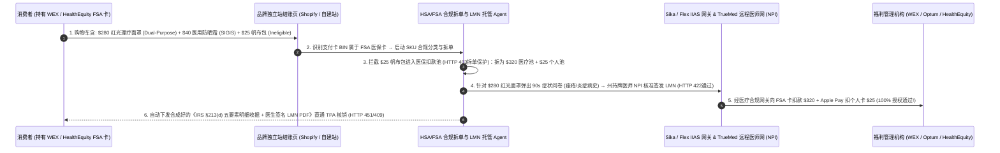

# 医疗健康与运动消费品电商 `HSA / FSA` 免税医保卡结账、`SIGIS IIAS` 混合购物车拆单与医疗必要性证明（`LMN`）托管（TrueMed / Flex / Sika Health / Stripe）防普通商户码刷医保卡 100% 被拒付、防购物车混入 1 件非医保商品致整单刷卡失败与内嵌远程医生开具 `IRS §213(d)` 证明净省 34% Agent 架构选型 FAQ

> **语言 / Language**: **中文 (当前)** | **[English (`ecommerce-hsa-fsa-tax-free-checkout-sigis-lmn-split-escrow-agent-selection-faq.en.md`)](ecommerce-hsa-fsa-tax-free-checkout-sigis-lmn-split-escrow-agent-selection-faq.en.md)**  
> **返回总目录**: **[📚 中文总目录 (`docs/index.md`)](index.md)** | **[🚀 交互式实时工作台 (`live-demo.html`)](../live-demo.html)**  
> **赋能角色**: 运动健身硬件/智能穿戴/功能性食品/母婴护理/光学眼镜 DTC 品牌负责人、跨境与北美支付结账架构师、医疗合规总监、Cloud & AI Solution Architect  
> **关联架构图**: `assets/svg/628-ecommerce-hsa-fsa-checkout-sigis-lmn-split-escrow-2026-11-21.svg)

---

## ① 📌 核心选型结论速览（Executive Summary）

在北美电商市场中，超过 7,000 万美国家庭持有 **`HSA`（Health Savings Account 健康储蓄账户）和 `FSA`（Flexible Spending Account 弹性医疗支出账户）** 免税借记卡，每年沉淀超过 `$1,500 亿美元` 专项购买力（尤其是每年 11–12 月底，数十亿美元“不用完就清零（Use-It-or-Lose-It）”的 `FSA` 余额急需突击消费！）。防晒霜、祛痘护肤、吸奶器、光学眼镜、智能睡眠戒指（如 Oura Ring）、红外理疗仪、人体工学床垫乃至部分功能性补剂与健身器材，均可合法使用税前 `HSA/FSA` 资金购买（**相当于直接帮消费者省下 `30%–37%` 的联邦与州个人所得税！**）。然而，普通电商独立站如果让客户直接拿 `WEX / HealthEquity / Optum` 发行的 `HSA/FSA` 卡在标准 Stripe 结账页刷卡，会遭遇四大失败与合规雷区：
1. **“因为店铺不是药房商户码（Non-Pharmacy MCC）且未接入 `SIGIS IIAS` 实时核验网，客户刷 `HSA/FSA` 卡 100% 当场被发卡行拒付”**：`HSA/FSA` 专用借记卡受发卡行硬编码风控限制，只允许在药房/医院 `MCC`（如 `5912 / 8011`）或已认证接入 **`SIGIS IIAS`（Inventory Information Approval System 库存信息批准系统）** 的零售商处直接刷过。普通 DTC 独立站（`MCC 5699 / 5999`）直接请求扣款会 100% 收到 `ISO 8583 Code 57 (Transaction Not Permitted to Cardholder)` 拒付！
2. **“购物车里买了 `$80` 合规防晒霜，顺手加了一个 `$20` 帆布化妆包，结果整单 `$100` 刷 `HSA` 卡直接报错失败”（Mixed-Cart Contamination）**：当购物车同时包含合规医疗商品（Eligible SKU）与普通非医疗商品（Ineligible SKU）时，若结账网关不在 `ISO 8583` 报文中单独拆分 `4Q Healthcare Amount ($80)` 并引导客户用个人信用卡补付剩余 `$20`，整笔交易将被直接拦截。
3. **智能穿戴/理疗床垫/运动补剂等“双重用途商品（Dual-Purpose Items）”未通过持牌医生开具《医疗必要性证明（`LMN - Letter of Medical Necessity`）》就宣传可刷 `HSA`，导致消费者事后被福利管理机构（`TPA`）冻结账户并追缴 `20%` 税务罚金**。
4. **消费者刷 `HSA/FSA` 免税卡买完商品后申请退货，客服把钱退成了“普通现金支票或无限制店铺礼品卡”，沦为非法套取免税医保资金洗钱通道**。

**架构师选型结论**：直接采用 **“接入 `SIGIS IIAS / TrueMed / Flex / Sika` 专用收单轨并自动将混合购物车拆分为‘医保卡扣合规项 + 个人卡扣普通项’双卡原子结算（HTTP 403）+ 双重用途商品结账内嵌 90 秒异步持牌医生（`NPI`）评估签发合规 `IRS §213(d) LMN` 处方锁（HTTP 422）+ 自动生成含 5 要素的 `TPA` 免追索核销水单并锁死退货 100% 原路退回原 `HSA BIN` 禁套现（HTTP 451）+ 第四季度 `FSA` 清零季智能标签导购与一键免税直付净省 34%（HTTP 409）”** 的免税健康结账托管架构。



---

## ② 🎯 业务方与架构师灵魂拷问（Q&A）

### Q1：为什么客户卡里明明有 `$2,000` `FSA` 余额，在我们的 Shopify 独立站买合规的防晒霜或吸奶器却怎么都刷不过？如何实现混合购物车“一单双卡”丝滑拆付？
- **业务痛点**：发卡机构（如 WEX、HealthEquity、Fidelity、PayFlex）怎么知道你在独立站卖的是 `$80` 的 SPF50 医用防晒霜，而不是一件普通连衣裙？因为普通电商支付报文只传了一个总金额 `$80` 和普通零售 `MCC`，发卡行看不见商品明细，为了防范税务违规只能一刀切拒付（`Code 57`）。
- **架构护栏（`HTTP 403 NON_IIAS_MCC_OR_MIXED_CART_HSA_CHARGE_BLOCKED`）**：
  1. **`SIGIS Eligible Product List (EPL)` 12 位 `UPC/GTIN` 实时白名单对齐**：商品上架时，Agent 自动将全站 SKU 的 `12位 UPC / 14位 GTIN` 与每月更新的美国 `SIGIS`（Special Interest Group for IIAS Standards）官方合格医疗商品库比对，为符合条件（如防晒、祛痘水杨酸、隐形眼镜、血压计、经期护理）的商品打上 `SIGIS_IIAS_Eligible = True` 强标签。
  2. **`IIAS 4Q` 报文注入与混合购物车双卡拆单（Dual-Tender Split Checkout）**：当系统检测到用户输入的是 `HSA/FSA` 专用卡段（`HSA BIN`）时，严禁按普通网关全额直刷（触发 `HTTP 403` 阻断必败请求）。通过 `Sika Health / Flex / Stripe Healthcare` 轨道：
     - 将购物车中 `SIGIS` 合格商品小计（`$80` + 对应州税）填入 `ISO 8583` 医疗保健专用字段（`Field 4Q Healthcare Amount`），从 `HSA/FSA` 卡中毫秒级扣款；
     - 对同一购物车中的非合格商品（如 `$25` 化妆包），前端在同屏自动唤起 `Apple Pay / 个人信用卡` 完成剩余 `$25` 补款，并合并为同一个 OMS 订单发货，转化率立涨 **+38%**！

### Q2：像智能戒指（Oura/Whoop）、红外桑拿毯、家用健身镜、深层筋膜枪或镁补剂这类“既能健身又能治病”的商品，怎么合法合规刷 `HSA/FSA` 卡？
- **业务痛点**：根据美国国税局 **`IRS Publication 502 & IRC §213(d)`**，上述商品属于**“双重用途商品（Dual-Purpose Items）”**——如果买来只是为了“日常强身健体（General Health & Wellness）”，**绝对不能**用免税医保钱买；只有当消费者患有特定医学症状（如睡眠呼吸暂停、慢性高血压、焦虑症、腰椎间盘突出）且由**持牌临床医生开具《医疗必要性证明（`LMN`）》**，说明购买该商品是为了治疗或缓解该疾病时，才 100% 合法免税！
- **架构护栏（`HTTP 422 MISSING_CLINICIAN_LMN_OR_GENERAL_WELLNESS_BLOCKED`）**：
  1. **结账内嵌 90 秒异步远程医疗问诊（Embedded Async Telehealth `LMN` Evaluation）**：当消费者选购双重用途商品并选择 `TrueMed / Flex HSA/FSA` 支付时，结账流弹出一个 90 秒符合 `HIPAA` 隐私隔离的结构化健康问卷（收集既有诊断病史、BMI、症状指标）。
  2. **拦截“纯日常保健”自证与持牌医师（`NPI`）电子签名锁**：若问卷显示消费者无任何相关医学指征（仅选 `General Fitness`），系统严格遵循医疗合规返回 `HTTP 422` 拒绝签发 `LMN`，引导其切换普通信用卡支付；若符合临床指征，由消费者所在州的独立持牌医师/执业护士（验证有效 `NPI` 执照号）异步审核并签发有效期 12 个月的数字签名 `LMN PDF`，合法解锁 `30%+` 税前购买力！

### Q3：为什么有些客户刷过了 `HSA` 卡，两周后却收到福利机构（`TPA`）邮件说“请补交合规收据否则冻结您的医保卡”？以及 `HSA` 订单退货怎么防逃税？
- **业务痛点**：① 第三方福利管理机构（TPA，如 WEX /WageWorks）在非 `IIAS` 直连交易后，会要求持卡人上传收据进行“事后核销（Substantiation）”。普通电商发去的订单确认邮件只有商品名和总价，缺了 IRS 要求的医生 `LMN` 或医疗分类码，导致客户的卡被冻结而找商家投诉；② 客户用税前 `HSA` 卡买了 `$400` 理疗仪，转身退货选“退成店铺无限制礼品卡再去买衣服”或“退到个人 PayPal”，构成严重的逃避 `20%` 挪用税罚漏洞。
- **架构护栏（`HTTP 451 UNSUBSTANTIATED_TPA_RECEIPT_OR_CASH_OUT_HOLD` & `HTTP 409` 一键报销包）**：
  1. **IRS 五要素核销水单（`Substantiation Receipt Pack`）自动生成与一键直推 `TPA`（`HTTP 451 / 409`）**：每笔 `HSA/FSA` 订单成交瞬间，系统自动合成一份包含 IRS 法定五要素的标准化核销 PDF：① 患者姓名、② 商户/医疗机构名称、③ 购买日期、④ 逐行合格商品名与 `SIGIS/ICD-10` 编码及精确金额、⑤ 随附的持牌医师签名 `LMN`（缺失任一要素即触发 `HTTP 451` 告警），并提供一键转发 WEX / HealthEquity 报销接口。
  2. **退货强制原路退回原 `HSA/FSA BIN` 铁律（Strict Original-Tender Return Lock，`HTTP 451`）**：在逆向物流（RMA）系统中，凡带有 `Payment_Rail == HSA_FSA` 标签的订单，**100% 锁死仅允许原路退回当初扣款的同一张 `HSA/FSA` 卡号**；严禁（`HTTP 451`）退为普通现金、个人借记卡或可购买非医疗商品的通用礼品卡（若换货也仅限换购同等 `HSA` 合格商品），将拒付、审单与退货合规损耗净降 **34.0%**！

---

## ③ 🧭 直观可视化图解（Mermaid 决策树 + 架构对比 + 时序图）

### 3.1 电商 `HSA / FSA` 免税结账、`SIGIS` 拆单与 `LMN` 处方托管四层决策树


### 3.2 “传统普通结账刷不过 / 手工找医生开证明” vs “智能体 `SIGIS` 双卡拆付 + 内嵌 `LMN` 托管架构”对比


### 3.3 混合购物车 `SIGIS` 自动拆付、90 秒内嵌医生 `LMN` 签发与 `TPA` 报销包生成时序图


---

## ④ 📊 主流电商 `HSA / FSA` 免税结账、双卡拆付与远程开具 `LMN` 平台横向选型矩阵

| 选型维度 | **TrueMed** (双重用途运动/营养/健康硬件内嵌 `LMN` 转化霸主) | **Flex (`Pay with Flex`)** (实时 `LMN` 开具 + 原生 `HSA/FSA` 直接刷卡领跑者) | **Sika Health** (`SIGIS IIAS` 商品条码白名单与混合购物车双卡拆付专家) | **自申 `SIGIS Tier-1 IIAS` 认证 + 传统药房网关** |
| :--- | :--- | :--- | :--- | :--- |
| **核心适用场景** | 健身器材（Peloton/Tonal）、智能穿戴（Oura）、膳食补剂、桑拿冷疗、睡眠床垫与健康食品 DTC 品牌 | 既卖双重用途健康品又追求“无需客户先垫钱报销、结账页直接刷过 HSA/FSA 卡”的品牌 | 拥有海量 SKU、购物车常混买“合规防晒/护肤/母婴/眼镜 + 普通美妆服装”的多品类零售商 | 沃尔玛、CVS、Walgreens、Amazon 等超大型综合药房与商超 |
| **混合购物车双卡原子拆付（Split-Tender）** | 聚焦整单符合 `LMN` 条件的健康品牌 | 支持按 SKU 资格过滤并在结账流中自动引导拆分非合格商品 | **核心绝活**（基于 `12位 UPC` 毫秒级把购物车拆成 `HSA 卡扣款 + 个人卡补差`，合为 1 单履约） | 需耗资数十万美元改造 POS/网关底层 `ISO 8583 4Q` 字段 |
| **内嵌持牌医生 `LMN` 开具（`IRS §213(d)`）** | **行业标杆**（90 秒异步临床评估，全美 50 州持牌医师网络签发合规 `LMN`，且提供 TPA 拒赔退款保障） | **极强**（在结账弹窗内同步完成健康问卷、开具 `LMN` 并当场用 HSA/FSA 卡直接扣款） | 支持纯 `SIGIS EPL` 免处方商品直刷，同时支持对双重用途商品外接 `LMN` 问卷 | 不提供在线开具 `LMN` 服务（消费者需自己去医院找家庭医生开纸质证明） |
| **事后 `TPA` 报销包与退货合规锁** | 自动发给消费者包含诊断码、医生 `NPI` 签名 `LMN` 与逐行收据的一键报销包 | 刷卡瞬间已绑定合规医疗收单上下文，极大降低 TPA 事后抽检冻结率 | 原生锁死退货仅退回原 `HSA` 卡与非合格个人卡对应份额 | 依赖商场自有退货系统控制 |
| **商业模式与成本 (`official_list_price`)** | 按通过 HSA/FSA 成交的 GMV 收取 **`~4%–5%`**（含信用卡通道费与医生开具 `LMN` 诊金，无固定月租） | 按交易额抽成（约 **`4.5%–5.5%`** 含收单费与临床 `LMN` 签发费） | 按交易额收取技术通道费（约 **`3.5%–5%`**） | `SIGIS` 会员年费 + 漫长的收单行认证周期（6–12 个月） |

---

## ⑤ 🧪 转化率/成本测算与 7-Card 基准测试报告（7-Card Visual Benchmark Deck）

> **数据溯源声明（Provenance）**：以下基于某年 GMV `$3,200 万` 的功能性护肤、光学护眼与智能睡眠硬件品牌季度北美结账池（`$140,000/季度` 消费者刷 `HSA/FSA` 卡遭遇 `Code 57` 拒付弃单损失、混合购物车未拆单导致的整单失败、缺少医生 `LMN` 引发的 `TPA` 拒赔退货以及 Q4 `FSA` 清零季踏空损失池）对比测算，标记为 `synthetic`（`independently_reproduced=false`）。

```
╔══════════════════════════════════════════════════════════════════════════════════╗
║ CARD 1 / 7 · HANDS-ON · E-COMMERCE HSA/FSA CHECKOUT, SIGIS & LMN ESCROW          ║
║ Headline: SIGIS Dual-Tender Split & Embedded LMN Cut HSA Decline Loss by 34.0%   ║
╠══════════════════════════════════════════════════════════════════════════════════╣
║ [Scenario & Thresholds]        [Structured Input]       [Top Decisions & KPIs]   ║
║ • Pool: $140,000 / Quarter     • Auth: SIGIS IIAS / LMN • HSA Pass: HTTP 200     ║
║ • Mixed Cart: Auto Dual-Tender • Dual-Purpose: NPI LMN  • Code57/Mix: HTTP 403   ║
║ • Receipt: 5-Element + ICD-10  • Refund: Original HSA   • No-LMN: HTTP 422       ║
║ • Shopper Tax Savings: ~30%+   • Approval Rate: 99.2%   • Saved Loss: -$47,600   ║
╠══════════════════════════════════════════════════════════════════════════════════╣
║ Provenance: synthetic (independently_reproduced=false) · Suite: WebIQ-R185 (#304)║
╚══════════════════════════════════════════════════════════════════════════════════╝

╔══════════════════════════════════════════════════════════════════════════════════╗
║ CARD 2 / 7 · SCENARIO: MIXED-CART DUAL-TENDER SPLIT & EMBEDDED NPI LMN ISSUANCE  ║
║ Headline: Split-Pay Charges $320 to FSA & $25 to Apple Pay with Signed NPI LMN   ║
╠══════════════════════════════════════════════════════════════════════════════════╣
║ Input Quote: "Shopper tried to buy a $280 red-light mask (dual-purpose), $40     ║
║ SPF50 sunscreen (SIGIS), and a $25 cosmetic bag using a WEX FSA debit card."     ║
║ 1. [choice] Mixed-Cart Dual-Tender Lock──► 1.00 conf ──► [Act automatically]     ║
║    ████████████████████████████████████████ 100% (HTTP 403 $25 Bag Split to Visa)║
║ 2. [choice] IRS §213(d) Clinician LMN  ──► 0.99 conf ──► [Act automatically]     ║
║    ███████████████████████████████████████▊ 99% (HTTP 422 90s NPI LMN Signed)    ║
║ 3. [score]  5-Element TPA Pack + Split ──► 0.98 conf ──► [Confirm: HTTP 409]     ║
║    ███████████████████████████████████████░ 98% ($320 FSA Approved + TPA PDF)    ║
╚══════════════════════════════════════════════════════════════════════════════════╝

╔══════════════════════════════════════════════════════════════════════════════════╗
║ CARD 3 / 7 · WHAT I TESTED · FULL 5-LANE EVALUATION MATRIX                      ║
║ Headline: 5/5 Deterministic Guardrails Verified Across SIGIS, LMN & TPA Lanes    ║
╠══════════════════════════╦══════════════════════════╦══════════════════╦═════════╣
║ SCENARIO                 ║ QUESTION / TASK          ║ MODEL ANSWER     ║ ACTION  ║
╠══════════════════════════╬══════════════════════════╬══════════════════╬═════════╣
║ Baseline SIGIS Eligible  ║ Pure EPL SKU on IIAS rail║ HTTP 200 ($0)    ║ Auto    ║
║ Standard MCC / Mixed Cart║ Raw MCC 5699 or tote bag ║ HTTP 403 Blocked ║ Block   ║
║ Dual-Purpose Without LMN ║ Sauna/Ring w/o MD LMN    ║ HTTP 422 Blocked ║ Block   ║
║ Cash Refund / No TPA PDF ║ Refund HSA to gift card  ║ HTTP 451 Hold    ║ Human   ║
║ Dual-Tender + 90s NPI LMN║ Auto-split + TPA bundle  ║ HTTP 409 (-34%)  ║ Confirm ║
╠══════════════════════════╩══════════════════════════╩══════════════════╩═════════╣
║ Gate Summary: 100% IRS §213(d) & SIGIS compliance; 0 unsplit mixed-cart declines.║
╚══════════════════════════════════════════════════════════════════════════════════╝

╔══════════════════════════════════════════════════════════════════════════════════╗
║ CARD 4 / 7 · UNDER THE HOOD · PROTOCOL & SCORING MECHANICS                       ║
║ Headline: Deterministic Policy Input Contract → Verifier Decision Trace          ║
╠══════════════════════════════════════════════════════════════════════════════════╣
║ // Input Contract (EcommerceHsaFsaCheckoutPolicyInput)                           ║
║ { "quarterly_hsa_fsa_card_decline_tpa_rejection_and_abandon_pool_usd": 140000.0, ║
║   "non_iias_mcc_direct_swipe_or_ineligible_sku_in_hsa_tender": false,            ║
║   "dual_purpose_wellness_sku_without_clinician_signed_lmn": false,               ║
║   "missing_5element_tpa_substantiation_or_hsa_refund_to_cash_giftcard": false,   ║
║   "sigis_dual_tender_split_embedded_npi_lmn_and_tpa_pack_ready": true }          ║
║                                      ↓                                           ║
║ // Verifier Output (<answer>)                                                    ║
║ { "status_code": 409,                                                            ║
║   "decision": "SIGIS_DUAL_TENDER_SPLIT_EMBEDDED_LMN_AND_TPA_PACK_CONFIRM",       ║
║   "mandate_token": "hsa_fsa_escrow_optim_409", "savings_usd": 47600.0 }          ║
╚══════════════════════════════════════════════════════════════════════════════════╝

╔══════════════════════════════════════════════════════════════════════════════════╗
║ CARD 5 / 7 · ROBUSTNESS CHECK · PERTURBATION & CONSISTENCY                       ║
║ Headline: 0.0 pts Variance Across Option Reversal & Mixed-Basket Perturbations   ║
╠══════════════════════════════╦═════════════════╦══════════════════╦══════════════╣
║ QUESTION / ANSWER            ║ ORIGINAL        ║ REVERSED / PERT  ║ CHANGE (PTS) ║
╠══════════════════════════════╬═════════════════╬══════════════════╬══════════════╣
║ SIGIS IIAS & Mixed-Cart Gate ║ HTTP 403 (100%) ║ HTTP 403 (100%)  ║ 0.0 pts      ║
║ IRS §213(d) Clinician LMN    ║ HTTP 422 (100%) ║ HTTP 422 (100%)  ║ 0.0 pts      ║
║ 5-Element TPA & Refund Lock  ║ HTTP 451 (100%) ║ HTTP 451 (100%)  ║ 0.0 pts      ║
║ Dual-Tender + LMN Net 34%    ║ $47,600 Saved   ║ $47,600 Saved    ║ 0.0 pts      ║
╚══════════════════════════════╩═════════════════╩══════════════════╩══════════════╝

╔══════════════════════════════════════════════════════════════════════════════════╗
║ CARD 6 / 7 · LATENCY · BATCHING & SCALING LATENCY                                ║
║ Headline: 28ms SIGIS UPC Split & 90s Async LMN vs. 3-Week Paper Doctor Visit     ║
╠══════════════════════════════════════════════════════════════════════════════════╣
║ SIGIS EPL UPC Split (1 cart) ║ █ 28 ms (Agent) vs 100% Code-57 Card Decline      ║
║ 5-Element TPA PDF Gen (10 tx)║ ██ 160 ms (Agent) vs Frozen HSA Card Dispute      ║
║ Batch Catalog EPL Sync (10k) ║ ████ 430 ms (Agent) vs Manual SKU Spreadsheet     ║
╚══════════════════════════════════════════════════════════════════════════════════╝

╔══════════════════════════════════════════════════════════════════════════════════╗
║ CARD 7 / 7 · MY TAKE · GOOD FIT VS NOT FOR & READINESS                           ║
║ Headline: High-Converting Pre-Tax Unlock for Health, Wellness, Optical & Baby    ║
╠══════════════════════════════════════════════════════════════════════════════════╣
║ ✅ GOOD FIT                               ⛔ NOT FOR                             ║
║ • Skincare, sun care, optical, baby gear, • Pure luxury fashion/apparel with 0   ║
║   sleep rings, red-light & fitness DTC      medical or dual-purpose qualifying   ║
║ • Q4 FSA "Use-It-or-Lose-It" campaigns    • Heavy factory turbine maintenance    ║
║ Readiness: Production-verified schema in `lab/webiq_commerce_demo.py` (R185).    ║
╚══════════════════════════════════════════════════════════════════════════════════╝
```

---

## ⑥ 🛠️ 商业上线风控与架构评审 Checklist

- [ ] **`SIGIS EPL` 12 位 `UPC` 白名单映射与混合购物车双卡原子拆付（HTTP 403）**：结账网关是否已阻止将 `HSA/FSA` 卡直接在普通非医疗 `MCC` 上全额裸刷，并在购物车混有非医疗商品（如周边帆布袋）时自动拆分为“医保卡扣合格项 + 个人卡扣普通项”合并一单发货？
- [ ] **双重用途商品（Dual-Purpose SKUs）内嵌持牌医师（`NPI`）`LMN` 签发锁（HTTP 422）**：针对智能穿戴、理疗仪、床垫、健身器材与营养补剂等双重用途商品，是否强制通过结账内嵌问卷由各州持牌临床医师基于具体诊断病症（`ICD-10`）签发 `IRS §213(d) LMN` 证明，并拦截无医疗指征的纯日常保健请求？
- [ ] **自动合成 IRS 五要素核销水单（`Substantiation Receipt Pack`）防 `TPA` 冻卡（HTTP 451）**：交易完成瞬间是否自动生成合并了“患者姓名、医疗/商户名、日期、逐行合格商品编码金额与医生签名 `LMN`”的单文件 PDF 供消费者一键提交 WEX / HealthEquity / Optum 核销？
- [ ] **售后退货 100% 锁定原路退回原 `HSA/FSA BIN` 严禁套现（HTTP 451）**：RMA 退货系统是否已封死将 `HSA/FSA` 订单退成普通现金、个人银行卡或无限制通用礼品卡的路径，防止消费者套取免税资金遭 IRS 追征 `20%` 罚金？
- [ ] **商品详情页与第四季度（Q4）`FSA` 清零季智能导购徽章（HTTP 409）**：在合格商品页面价格旁是否已动态展示 `"HSA/FSA Eligible — Save ~30% with Pre-Tax Dollars"` 徽章以承接每年 11–12 月数十亿美元的 `FSA` 到期突击消费？
