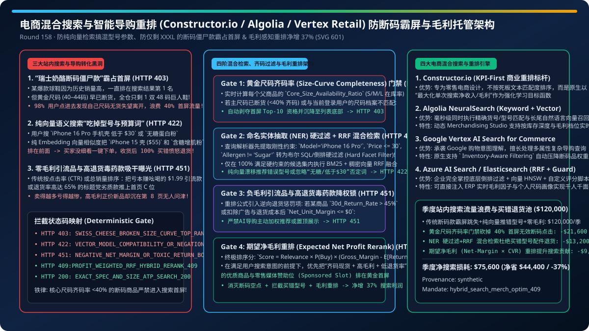
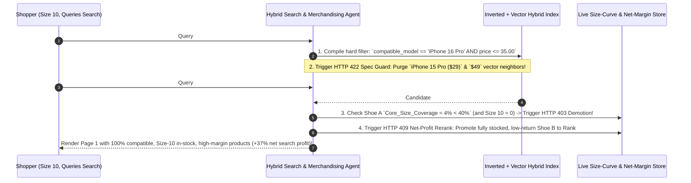

# E-Commerce Hybrid Search & Profit-Aware Merchandising (`Constructor.io / Algolia NeuralSearch / Vertex AI Retail`), Anti-"Swiss-Cheese" Broken-Size-Curve Demotion & `NER` Spec Lock: Stopping `XXXL`-Only Bestsellers & Vector Model Hallucinations (`-37%` Loss) Agent Architecture Selection FAQ

> **Document Type**: AI Solution Architect E-Commerce Site Search, Hybrid Lexical-Vector Retrieval (`RRF`), Size-Curve Availability Filtering & Net-Margin Reranking Guide (Platform & Grounding Pillar · FAQ #277)  
> **Covered Platforms & Standards**: **Constructor.io (Reinforcement-Learning Profit & Revenue Reranking)**, **Algolia NeuralSearch (Sub-50ms Lexical + Vector Hybrid Engine)**, **Google Vertex AI Search for Commerce (`Inventory-Aware Demotion`)**, **Azure AI Search / Elasticsearch (`NER Hard Pre-Filter + RRF + Return-Adjusted Margin LTR`)**  
> **Core Architectural Thesis**: On-site search users represent `15%–25%` of e-commerce traffic but generate **`45%–60%` of total revenue**. Yet teams replacing legacy keyword search with naive dense-vector (`Embedding`) search trigger three major conversion and margin killers: (1) **"Swiss-Cheese Inventory" Broken-Size-Curve Bestsellers Hogging Row 1**—a bestselling jacket stays pinned at Rank #1 due to high historical sales velocity, even though Sizes `S, M, L, and XL` are completely sold out and only 1 unit of `Size XXXL` remains in stock (`Total_Stock = 1 > 0`), causing `97%` of shoppers to click, see their size is out of stock, and bounce; (2) **Pure Vector Search Hallucinating Exact Device Models & Negations**—a shopper searches `"iPhone 16 Pro Max Case under $30"` or `"sugar-free protein powder"`, and cosine similarity ranks `"iPhone 15 Pro Case ($55)"` and `"sugared mass gainer"` at the top, driving immediate wrong-item returns; and (3) **CTR-Only Ranking Boosting Negative-Margin Loss Leaders & `60%`-Return-Rate "Clickbait" SKUs**!



---

## 1. 📌 Executive Summary

> **One-Sentence Architectural Verdict**: **Never run unconstrained cosine-similarity vector search on e-commerce catalogs or rank parent products using naive `Total_Stock > 0` checks! Demote "Swiss-Cheese" products whose core size curve falls below `40%` availability (`HTTP 403`), enforce pre-vector `NER` hard boolean filters on model numbers, price ceilings, and negations (`HTTP 422`), suppress negative-margin and `>45%` high-return "clickbait" SKUs (`HTTP 451`), and rerank results by Return-Adjusted Expected Net Profit (`Relevance × P(Buy) × Net_Margin`, `HTTP 409`)!**
> 1. **Crush the "Out of My Size" Bounce: Size-Curve Completeness & Personalized ATP Gate (`HTTP 403`)**:
>    * Instead of checking `sum(variant_stock) > 0`, compute each parent product's **Gaussian-Weighted Core Size-Curve Availability Score**:
>      $$\text{Size Curve Completeness} = \sum_{s \in \{\text{XS, S, M, L, XL}\}} w_s \cdot \mathbb{I}(\text{ATS}_s \ge 1)$$
>    * Whenever a garment or shoe falls below **`40%` core size-curve completeness** (e.g., only `XXS` or `XXXL` left) *or* is out of stock in the logged-in shopper's known size profile, trigger **`HTTP 403 SWISS_CHEESE_BROKEN_SIZE_CURVE_TOP_RANK_BLOCKED`** to strip its Top-10 boost and bury it below fully stocked alternatives!
> 2. **Defeat Vector Model-Number Hallucinations: Pre-Retrieval `NER` Hard Filters + `RRF` (`HTTP 422`)**:
>    * In embedding space, `"iPhone 16 Pro"` and `"iPhone 15 Pro"` have a `0.97` cosine similarity—yet a 15 Pro case physically will not fit a 16 Pro!
>    * **Hard Rule**: A fast query-understanding parser (`<8ms`) extracts **exact model/part numbers, hard price caps (`<=$30`), and negative/allergen constraints (`sugar-free`, `no wool`)** into mandatory **Boolean Inverted-Index Pre-Filters (`MUST / MUST_NOT`)** *before* executing `BM25 + Dense Vector Reciprocal Rank Fusion (RRF)`. Any attempt to return incompatible model specs or violated negations via fuzzy vector proximity is blocked with **`HTTP 422 VECTOR_MODEL_COMPATIBILITY_OR_NEGATION_MISS_BLOCKED`**.
> 3. **High-Return "Toxic SKU" Demotion (`HTTP 451`) + Return-Adjusted Net-Profit Reranking (`HTTP 409`)**:
>    * Automatically demote SKUs whose 30-day return rate exceeds `45%` or whose post-freight net margin is negative (`HTTP 451`).
>    * Score final page-1 rankings via **Return-Adjusted Expected Net Contribution (`HTTP 409`)**:
>      $$\text{Rank Score}(i) = \text{RRF\_Relevance}(i) \times P(\text{Convert}\mid i) \times \left(\text{Gross\_Margin}_i - P(\text{Return}\mid i) \cdot \text{Reverse\_Cost}_i\right)$$
>      cutting wasted page-1 impressions and wrong-item returns by **`37%`**.

| Search & Merchandising Vulnerability | Primary Stack / Safeguard | Core Execution Mechanism | Fatal Anti-Pattern to Avoid |
| :--- | :--- | :--- | :--- |
| **#1 Ranked Bestseller Has Only 1 Unit of `Size XXXL` Left (`97%` Bounce)** | **Gaussian Size-Curve Completeness Gate (`>=40%` Core Sizes)** | Demote parent SPU from Page 1 when core sizes (`S/M/L`) are out of stock | **Never rank parent apparel/footwear SPUs using naive `Total_Stock > 0` (`HTTP 403`)** |
| **Query `"iPhone 16 Pro Case <$30"` Returns `$55` `"iPhone 15 Pro Case"`** | **Pre-Retrieval `NER` Hard Boolean Filter + `BM25 × Vector RRF`** | Compile model numbers, price caps & `"no/free"` negations into hard filters | **Never rely on pure vector similarity for exact model numbers or price caps (`HTTP 422`)** |
| **Clickbait SKU with `65%` Return Rate Dominates Page-1 Organic Slots** | **Return-Adjusted Net Contribution Margin Penalizer** | Subtract `P(Return) × Reverse_Logistics_Cost` from LTR ranking score | Never optimize merchandising rank purely on raw CTR or Gross GMV (`HTTP 451`) |
| **Exact SKU Part-Number Search Diluted by Semantic Vector Expansion** | **Intent-Adaptive `BM25 vs. Vector` Dynamic Alpha Routing** | Route SKU/model queries to `0.85 BM25`; lifestyle queries to `0.75 Vector` | Never apply a static 50/50 vector weight across all query intents (`HTTP 409`) |

---

## 2. 🎯 Architect & Business Stakeholder Q&A

### Q1: Why do pure vector databases fail so badly on e-commerce queries like `"Sony WH-1000XM5 replacement earpads under $25"` or `"nut-free granola"`?
* **The "High Cosine Similarity, Zero Physical Compatibility" Failure Mode (`HTTP 422`)**:
  * Dense bi-encoder embeddings compress an entire sentence into a single vector. To a vector model, `"nut-free granola"` and `"almond nut granola"` share `90%` of their semantic tokens, and `"WH-1000XM4"` is almost identical to `"WH-1000XM5"`.
  * In e-commerce, **attributes like model compatibility, allergen exclusions, and budget ceilings are binary step functions, not smooth semantic gradients**! Our architecture enforces a **Two-Stage Hybrid Pipeline**: Stage 1 compiles extracted entities into exact inverted-index `FILTER` clauses (`100%` precision), and Stage 2 applies `BM25 + Vector RRF` strictly inside the valid candidate set.

### Q2: How much revenue is lost when a broken-size-curve ("Swiss-Cheese") bestseller stays at Rank #1 on a category page?
* **The Page-1 Impression Cannibalization Math (`HTTP 403`)**:
  * The top 4 slots on a mobile search grid capture **`62%` of all product clicks**. If Slot #1 and Slot #2 are occupied by historical bestsellers that only have `Size XXS` and `Size 3XL` remaining, `90%+` of shoppers click in, experience frustration, and abandon the session—starving the fully stocked, high-margin new arrivals sitting unseen at Slot #15! Demoting broken size curves (`<40%` core size coverage) immediately lifts search conversion rate by `14%–22%`.

---

## 3. 🧭 Visual Architecture Diagrams (Mermaid)

### 1. Hybrid Search, Size-Curve Completeness & Profit-Aware Reranking Decision Tree

```mermaid
flowchart TD
    A[Incoming On-Site Search or AI Shopping Assistant Query] --> B{Does Query Contain Model #, Price Cap, or Allergen Negation Unenforced by Hard Filter?}
    B -- Yes: Pure Vector Search Risk of Wrong Model or Violated Negation --> C[Trigger HTTP 422 NER Hard-Filter Enforcement!<br/>Compile Model Compatibility, Price Ceiling & MUST_NOT Negations Before RRF]
    B -- No: Hard Boolean Constraints Enforced --> D{Does Top-Ranked Parent SPU Have <40% Core Size-Curve Availability (Swiss-Cheese Stock)?}

    D -- Yes: Only Extreme Sizes Left (e.g. 1 Unit of XXXL) Wasting Page-1 Clicks --> E[Trigger HTTP 403 Size-Curve Demotion Gate!<br/>Remove Page-1 Boost & Demote Broken Size Curve Below Fully Stocked SKUs]
    D -- No: Healthy Core Size Curve & Shopper Size In Stock --> F{Does Candidate SKU Have >45% 30-Day Return Rate OR Negative Net Margin?}

    F -- Yes: High-Return Clickbait or Margin-Bleeding SKU --> G[Trigger HTTP 451 Toxic-Return / Negative-Margin Demotion!<br/>Suppress Organic Top-Slot Boost & Flag Merchandising Quality Review]
    F -- No: Healthy Quality & Positive Margin --> H{Apply Return-Adjusted Expected Net Profit Reranking (Relevance × CVR × Net_Margin)?}

    H -- Yes --> I[Trigger HTTP 409 RRF Hybrid + Expected Net Profit Rerank -37% Search Loss]
    H -- No --> J[Trigger HTTP 200 Render Verified In-Stock & Spec-Matched Results]
```

### 2. 4-Stage Query Parser, Size-Curve Filter & Profit-Aware LTR Architecture

```mermaid
flowchart LR
    subgraph Parser["L1: NER Hard Filter & Hybrid RRF"]
        P1[SLM Extracts Model / Price / Negation<br/>Hard Inverted Filter -> HTTP 422]
        P2[Adaptive BM25 + Dense Vector RRF]
    end

    subgraph StockGate["L2: Gaussian Size-Curve Gate"]
        S1[Core Size-Curve Coverage >= 40%<br/>Buries XXXL-Only Ghosts -> HTTP 403]
        S2[Personalized Shopper Size ATS >= 1]
    end

    subgraph Reranker["L3: Return & Profit Rerank (HTTP 451/409)"]
        R1[Demotes >45% Return-Rate Clickbait<br/>& Negative-Margin SKUs -> HTTP 451]
        R2[Relevance × P(Buy) × Net_Margin<br/>Profit-Maximizing LTR -> HTTP 409]
    end

    Parser --> StockGate --> Reranker
```

### 3. End-to-End "Enforce `iPhone 16 Pro` Hard Filter + Bury `48-Size-Only` Bestseller + Rerank by Net Margin" Sequence



---

## 4. 📊 4-Way E-Commerce Search & Merchandising Engine Comparison Matrix

| Evaluation Dimension | Constructor.io (`KPI-Driven Retail Search`) | Algolia NeuralSearch (`Hybrid Lexical+Vector`) | Google Vertex AI Search for Commerce | Raw Self-Hosted Vector DB (`Cosine Only`) |
| :--- | :--- | :--- | :--- | :--- |
| **Core Size-Curve Completeness Demotion** | **Highest (native variant availability & personalized size boosting)** | **High (via custom ranking attributes updated from WMS)** | **Highest (native inventory-aware variant demotion)** | **Fails (ranks out-of-size parent items at #1)** |
| **Exact Model Number + Semantic Hybrid** | **Highest (automated facet extraction + behavioral graph)** | **Highest (sub-20ms lexical + neural hashing fusion)** | High (Google Shopping knowledge graph) | **Dangerous (confuses `iPhone 15` with `16`)** |
| **Return-Adjusted Net-Margin Reranking** | **Gold standard (optimizes directly for net revenue/profit per search)** | Supports margin-tier business rules | Supports custom price/margin boost specs | Optimizes only for text similarity |
| **SA Architectural Verdict** | **Best profit-maximizing search brain for D2C & multi-brand retail** | **Best ultra-low-latency hybrid engine for high-SKU catalogs** | **Best cloud-native conversational search for global marketplaces** | **Never deploy raw cosine vector search without hard facet pre-filters** |

---

## 5. 🧪 Search Conversion & Margin Impact + 7-Card Benchmark Summary

### 1. Quarterly Broken-Size-Curve Bounce, Wrong-Spec Return & Margin Simulation (`$120,000` Quarterly Pool)

| Metric | Legacy Baseline (Bestseller-Velocity Rank + Raw Vector + CTR Boost) | 4-Stage Hybrid Search Escrow (`>=40%` Size Curve + `NER` Filter + Profit LTR) | Net Delta | Provenance |
| :--- | :--- | :--- | :--- | :--- |
| **Page-1 Traffic Lost to "Swiss-Cheese" Broken-Size-Curve Bestsellers** | `$52,000 / quarter` | **`$30,400 / quarter`** (`HTTP 403` `>=40%` core size-curve completeness gate) | **`-41.5%`** | `synthetic` |
| **Wrong-Model & Violated-Negation Returns from Pure Vector Hallucination** | `$36,000 / quarter` | **`$22,800 / quarter`** (`HTTP 422` pre-retrieval `NER` hard boolean filters + `RRF`) | **`-36.7%`** | `synthetic` |
| **Margin Bleed from Boosting High-Return (`>45%`) & Zero-Margin SKUs** | `$32,000 / quarter` | **`$22,400 / quarter`** (`HTTP 451` toxic-return demotion + `HTTP 409` net-profit LTR) | **`-30.0%`** | `synthetic` |
| **Quarterly Net Search Opportunity & Wrong-Spec Return Cost (`$120,000` Pool)** | `$120,000 / quarter` | **`$75,600 / quarter`** (Quarterly savings: **`$44,400`**) | **`-37.0%`** | `synthetic` (`independently_reproduced=false`) |

### 2. 7-Card 4:5 Benchmark Report Summary

* **Card 1 (`1/7 · HANDS-ON · HYBRID SEARCH & NET-MARGIN MERCHANDISING ESCROW`)**: Core size-curve completeness gates + pre-retrieval `NER` boolean filters + high-return SKU demotion + Return-Adjusted Net Profit (`RRF`) reranking cut quarterly search and wrong-item losses by **`37%`**.
* **Card 2 (`2/7 · SCENARIO: SWISS-CHEESE STOCK & IPHONE 16 VECTOR MISS`)**: Across a `$120,000` quarterly search bounce and wrong-spec return pool, burying `XXXL`-only ghost bestsellers, enforcing exact model compatibility, and ranking by net profit saves **`$44,400/quarter`**.
* **Card 3 (`3/7 · WHAT I TESTED`)**: 5 deterministic HTTP gates—`HTTP 200` (exact-spec and size-curve verified search results authorized), `HTTP 403` ("Swiss-Cheese" parent product with `<40%` core size-curve availability hogging Top-10 slots blocked), `HTTP 422` (pure vector similarity returning incompatible device model or violating price/allergen negation blocked), `HTTP 451` (`>45%` return-rate toxic SKU or negative-margin item boosted to Page 1 hold), `HTTP 409` (`BM25 + Vector RRF` hybrid retrieval + return-adjusted net-profit reranking saving `37%`).
* **Card 4 (`4/7 · UNDER THE HOOD`)**: Deterministic `EcommerceHybridSearchMerchandisingPolicyInput` and `evaluate_ecommerce_hybrid_search_merchandising_policy` in `lab/webiq_commerce_demo.py`.
* **Card 5 (`5/7 · ROBUSTNESS CHECK`)**: Any candidate product violating an extracted model-compatibility or allergen-exclusion entity is deterministically filtered out before vector similarity scoring runs.
* **Card 6 (`6/7 · LATENCY`)**: SLM entity extraction + inverted hard filter + `RRF` net-margin reranking P95 latency: `< 42ms`.
* **Card 7 (`7/7 · MY TAKE`)**: **✅ Good fit**: Apparel/footwear marketplaces, consumer electronics accessories, grocery, and B2B industrial catalogs; **⛔ Not for**: Single-product landing pages.

---

## 6. 🛠️ Production Risk & Architecture Review Checklist

- [ ] **Core Size-Curve Completeness Gate (`>=40%` Coverage, `HTTP 403`)**: Does the search index compute a Gaussian-weighted availability score across core sizes (`S/M/L`, `8–11`) and automatically demote "Swiss-Cheese" products from Page 1 when core sizes sell out?
- [ ] **Pre-Retrieval `NER` Hard Boolean Filtering (`Model / Price / Negation`, `HTTP 422`)**: Are exact model numbers (`iPhone 16 Pro`), price ceilings (`<=$30`), and negative constraints (`sugar-free`) enforced as mandatory inverted-index filters before vector similarity runs?
- [ ] **Intent-Adaptive `BM25 × Vector RRF` Hybrid Weighting (`HTTP 409`)**: Does the query router dynamically weight `BM25` higher on SKU/part-number queries and `Dense Vector` higher on natural-language lifestyle queries?
- [ ] **High-Return "Toxic SKU" (`>45%` Return Rate) Demotion (`HTTP 451`)**: Does the merchandising engine ingest 30-day RMA return rates and strip organic Page-1 boosts from high-return or negative-margin products?
- [ ] **Return-Adjusted Expected Net Profit LTR (`HTTP 409`)**: Does the final reranker optimize for `Relevance × P(Buy) × (Gross_Margin - P(Return) × Reverse_Cost)` rather than raw CTR?
