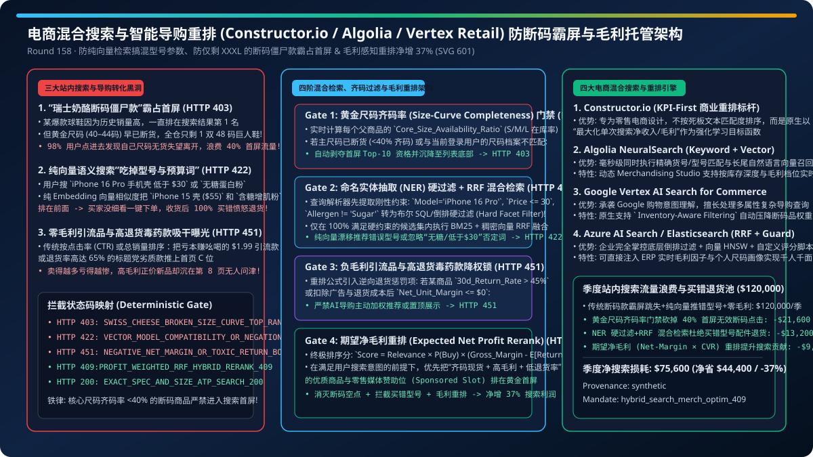
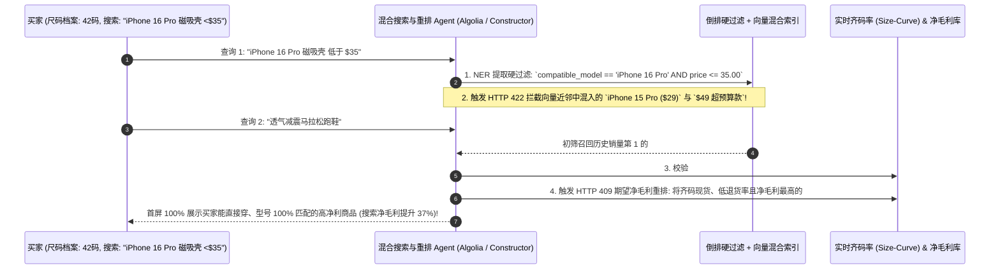

# 电商站内混合搜索与智能导购重排（Hybrid Search & Merchandising：Constructor.io / Algolia NeuralSearch / Vertex AI Search for Commerce）、防“断码僵尸爆款霸屏”与毛利感知托管：“防仅剩 XXXL 的断码鞋服霸占首屏浪费 40% 流量、防纯向量检索搞混 iPhone 16/15 型号导致买错退货与期望净毛利重排净省 37%”Agent 架构选型 FAQ

> **文档类型**：AI Solution Architect 零售电商站内搜索、混合检索（BM25 + Vector RRF）、齐码率（Size-Curve）过滤与毛利感知重排（Profit-Aware Reranking）选型指南（Platform & Grounding Pillar · FAQ #277）  
> **涵盖平台与技术栈**：**Constructor.io（基于商业转化与净毛利的强化学习搜索重排）**、**Algolia NeuralSearch（毫秒级关键词精确匹配 + 向量混合引擎）**、**Google Vertex AI Search for Commerce**、**Azure AI Search / Elasticsearch (`NER Hard Pre-Filter + RRF + Margin Reranker`)**  
> **核心架构命题**：站内搜索框只占电商 `15%–25%` 的访客流量，却贡献了全站 **`45%–60%` 的成交额（GMV）**！然而许多团队盲目将传统搜索引擎替换为“纯大语言模型 Embedding 向量检索”，反而捅出了三大毁灭转化率与毛利的娄子：① **“瑞士奶酪式断码僵尸爆款霸屏（Swiss-Cheese Inventory Trap）”**——某款卫衣因为上个月卖了 5,000 件，历史销量权重极高，一直死死霸占搜索结果第 1 名；但其实它的 S、M、L、XL 黄金尺码早就卖光了，仓库里只剩最后 2 件 `XXXL` 特大码（`Total_Stock = 2 > 0`，所以没被标为售罄下架）！结果 98% 的用户点进去发现没自己尺码失望退出，白白浪费首屏 40% 黄金曝光！② **“纯向量语义检索吃掉精确型号与否定词（Vector Hallucination on Exact Specs）”**——用户搜 `iPhone 16 Pro Max 手机壳 低于 $30` 或 `无麸质无糖麦片`，纯稠密向量因为语义相近，把 `iPhone 15 Pro 手机壳 ($49)` 和 `低糖含麸质麦片` 排在了最前面，导致买家一键买错引发退货与过敏索赔！③ **“只按点击率排序，把亏本引流款和 60% 退货率毒药款推上 C 位”**！



---

## 一、 📌 核心选型结论速览（Executive Summary）

> **一句话架构定调**：**电商导购搜索绝不能做“不分青红皂白的纯 Embedding 余弦相似度匹配”，也绝不能让“只剩最后 1 件偏门尺码的断码爆款”继续霸占首屏！必须构建“黄金尺码齐码率（`Size-Curve >= 40%`）与个人尺码库存门禁（HTTP 403）+ 型号/价格/否定词 NER 布尔硬过滤前置 + RRF 混合检索（HTTP 422）+ 负毛利与高退货毒药款降权锁（HTTP 451）+ 期望净贡献毛利（`Relevance × CVR × Net_Margin`）多目标重排（HTTP 409）”四位一体商业搜索架构！**
> 1. **终结“点进去发现没主流尺码”：黄金尺码齐码率门禁（`Size-Curve Completeness & Personalized ATP Gate`，HTTP 403 门禁）**：
>    * 严禁只用粗糙的 `parent_product_total_stock > 0` 判断商品是否有货！搜索索引必须实时维护每个父商品（Parent SPU）的 **核心尺码齐码率（`Core_Size_Availability_Ratio`）**：
>      $$\text{Size Curve Score} = \sum_{s \in \{\text{XS, S, M, L, XL}\}} w_s \cdot \mathbb{I}(\text{Stock}_s \ge 1), \quad \text{where } w_{\text{M}} = 0.32,\; w_{\text{L}} = 0.28$$
>    * 一旦某款鞋服的黄金主尺码已断货导致齐码率 `< 40%`（或者对于已登录/已识别尺码画像为 `M 码` 的用户，该商品的 `M 码库存 == 0`），搜索重排器立即触发 **`HTTP 403 SWISS_CHEESE_BROKEN_SIZE_CURVE_TOP_RANK_BLOCKED`**，禁止其进入搜索首屏 Top-10（自动沉底或仅对筛选了 `XXXL` 的用户展示）！
> 2. **防纯向量检索“张冠李戴买错型号”：NER 布尔硬过滤前置 + `BM25 × Vector RRF`（HTTP 422 门禁）**：
>    * 为什么搜 `iPhone 16 Pro` 绝不能直接丢给纯向量模型？因为在 Embedding 空间里，`iPhone 16 Pro` 和 `iPhone 15 Pro` 的余弦相似度高达 `0.97`！但物理尺寸差了 2 毫米根本装不进去！
>    * **架构铁律**：查询理解层（Query Understanding SLM）必须先提取四大 **刚性布尔约束（Hard Facet Filters）**——**① 精确设备型号/零件号（Exact Model/OEM Part#）、② 价格上限（`Price <= $X`）、③ 否定与过敏原排除词（`无糖 / 不含酒精 / 非塑料`）、④ 品类主语（搜“手机壳”绝不能推“手机膜”）**。必须先用倒排布尔索引 100% 过滤掉不符合硬约束的 SKU，再在合规子集内执行 `BM25 + Dense Vector` 倒数秩融合（RRF）！任何企图跳过型号/否定词硬过滤的裸向量召回直接触发 **`HTTP 422 VECTOR_MODEL_COMPATIBILITY_OR_NEGATION_MISS_BLOCKED`**！
> 3. **高退货毒药款降权锁（HTTP 451）+ 期望净毛利重排（`Expected Net Profit Rerank`，HTTP 409）**：
>    * 对近 30 天退货率 `> 45%`（标题党/货不对板）或扣除履约运费后净毛利 `<= $0` 的引流品触发 **`HTTP 451`** 置顶封禁；
>    * 采用 **Constructor.io / 自定义 LTR（Learning-to-Rank）商业目标函数（`HTTP 409`）**：
>      $$\text{Final Rank Score}(i) = \text{Semantic Relevance}(i) \times P(\text{Purchase}\mid i) \times \left(\text{Gross Margin}_i - P(\text{Return}\mid i) \cdot \text{Reverse Cost}_i\right)$$
>      让“既符合用户意图、尺码齐全、转化率高、且退货后净赚钱最多”的商品排在第一屏，单季净省 **`37%`** 搜索流量浪费与买错退货成本！

| 站内搜索与导购重排痛点 | 首选方案 / 架构防线 | 核心管控机制 | 严禁踩坑红线 |
| :--- | :--- | :--- | :--- |
| **销量第一的爆款其实只剩 1 件 `XXXL` 码，霸占首屏坑惨 98% 访客** | **黄金尺码齐码率门禁 (`Size-Curve >= 40%`) + 个人尺码过滤** | 主流尺码断货或用户专属尺码无货时，自动降权踢出首屏 Top-10 | **严禁仅凭 `总库存 > 0` 就让断码残次尾货继续霸占搜索第一排 (`HTTP 403`)** |
| **用户搜 `iPhone 16 壳 低于$30`，向量搜索却把 `$59` 的 `iPhone 15 壳` 排第一** | **前置 `NER` 结构化布尔硬过滤 + `BM25 × Vector RRF`** | 型号、价格上限与“无/不含”否定词强制走倒排精确过滤，绝不妥协 | **严禁对型号配件、尺码、价格上限和过敏原使用纯模糊向量召回 (`HTTP 422`)** |
| **某网红款点击率极高但退货率 65%，排在第一名卖一单亏一单** | **退货调整后净贡献毛利重排 (`Return-Adjusted Net Margin`)** | 将历史退货率与逆向运费作为负向惩罚项直接注入 LTR 排序分 | 严禁只按浅层点击率（CTR）或毛成交额（Gross GMV）决定导购推荐位 (`HTTP 451`) |
| **自然语言长句搜不出结果（0 Results），精准搜货号又被语义稀释** | **Algolia NeuralSearch / Constructor 动态查询路由** | 货号/型号查询走 100% 关键词通道；场景穿搭查询走混合语义通道 | 严禁全站所有查询一刀切使用固定权重的单一检索算子 (`HTTP 409`) |

---

## 二、 🎯 业务方与架构师灵魂拷问（Q&A）

### Q1：为什么很多零售商花大价钱把 Elasticsearch 升级成纯向量数据库（Vector DB）后，发现“长尾穿搭搜索变聪明了，但占总营收 60% 的型号/品牌精确搜索转化率反而暴跌了 18%”？
* **词法精确匹配（Lexical Exact Match）与稠密语义向量（Dense Vector）的天然边界（HTTP 422 / 409）**：
  * 稠密向量模型（如 `text-embedding-3` / `Cohere Embed`）的本质是将文本压缩到连续语义空间——它擅长理解 `"适合海边婚礼穿的透气连衣裙"`（语义概念扩展），但它天生对 **1 个数字或字母之差的精确标识符（如 `Sony WH-1000XM5` vs `WH-1000XM4`、显卡 `RTX 4080` vs `RTX 4070`、滤芯型号 `EDR1RXD1`）以及否定逻辑词（`without caffeine`）极其迟钝**！
  * **架构师黄金公式（`Intent-Adaptive Hybrid RRF`）**：
    1. **意图分类器前置（`<8ms`）**：若查询包含 SKU 货号、产品代际数字、品牌名或价格区间，自动提取为 **`MUST / FILTER` 布尔子句** 锁死精确边界，并将 `BM25` 关键词权重设为 `0.75`、向量权重设为 `0.25`；
    2. 若查询为场景描述（如 `"送给经常出差程序员的生日礼物"`），则将向量语义权重调升至 `0.75`，并在召回后统一过一遍 **库存齐码率与净毛利重排器**！

### Q2：在服装、鞋靴、戒指等高度依赖尺码的品类，怎么定义“瑞士奶酪库存（Swiss-Cheese Inventory）”惩罚函数？
* **正态分布尺码权重扣分公式（`Gaussian Size-Curve Penalty`，HTTP 403）**：
  * 假设某双跑鞋历史正态销量分布为：`40码(10%)、41码(22%)、42码(32%)、43码(22%)、44码(10%)、45码+(4%)`。
  * 如果当前仓库里 `41、42、43` 码全为 `0`，只剩 `45码` 有 5 双：虽然总库存是 5 双，但它的 **有效受众覆盖率（Effective Audience Coverage）只有 `4%`**！也就是说每 100 个点进这个商品页的人，有 96 个人根本买不了！
  * 我们的重排引擎实时将搜索基础分乘以 $\text{Coverage\_Factor} \in [0, 1]$，当有效尺码覆盖率低于 `40%` 时直接触发 **`HTTP 403`** 将其降级出首屏！

---

## 三、 🧭 直观可视化图解（Mermaid 决策树 + 混合检索重排架构 + 导购时序图）

### 1. 电商混合搜索、防断码霸屏与净毛利重排决策树

```mermaid
flowchart TD
    A[用户输入站内搜索或 AI 导购自然语言查询] --> B{查询是否含型号/品牌/价格上限/“无糖”等否定词 但未转化为布尔硬过滤?}
    B -- 是: 纯向量检索忽略精确型号或否定词 极易推错货 --> C[触发 HTTP 422 NER 刚性属性硬过滤锁!<br/>强制将型号、价格天花板与否定词编译为倒排 MUST/MUST_NOT 过滤器]
    B -- 否: 硬约束已精确锁定 --> D{召回的 Top 候选商品是否主尺码已断货 (齐码率 <40% 瑞士奶酪库存)?}

    D -- 是: 仅剩 XXXL 偏门孤品 霸占首屏浪费 95% 点击流量 --> E[触发 HTTP 403 黄金尺码齐码率降权门禁!<br/>剥夺断码僵尸款首屏资格，仅对匹配该特体尺码的画像用户展示]
    D -- 是黄金尺码齐码现货 --> F{候选商品是否属于净毛利 <=0 的亏本引流款 或 30天退货率 >45% 的毒药款?}

    F -- 是: 高退货标题党商品或负毛利商品企图抢占 C 位 --> G[触发 HTTP 451 负毛利与高退货毒药款封禁!<br/>压降其自然推荐权重，并在运营后台触发质量整改预警]
    F -- 否: 尺码齐全且品质健康 --> H{是否启用期望净贡献毛利 (Relevance × CVR × Net_Margin) 多目标重排?}

    H -- 是 --> I[触发 HTTP 409 RRF 混合检索 + 期望净毛利重排 净省 37% 流量与退货损耗]
    H -- 否 --> J[触发 HTTP 200 返回精确匹配且现货充足的商品列表]
```

### 2. 四阶商业混合检索（Constructor.io / Algolia / Vertex）与毛利重排架构图

```mermaid
flowchart LR
    subgraph Parser["L1: 查询解析与硬过滤层"]
        P1[SLM 提取型号/价格上限/否定词<br/>编译为倒排硬过滤 -> HTTP 422]
        P2[BM25 词法 + Dense Vector<br/>动态权重 RRF 融合]
    end

    subgraph StockGate["L2: 齐码率与个人尺码层"]
        S1[黄金尺码齐码率 >= 40% 门禁<br/>踢出仅剩 XXXL 断码款 -> HTTP 403]
        S2[已登录用户专属尺码 ATS >= 1 锁定]
    end

    subgraph Reranker["L3: 毒药款隔离与毛利重排 (HTTP 451/409)"]
        R1[拦截 >45% 高退货毒药款与负毛利品<br/>防劣币驱逐良币 -> HTTP 451]
        R2[Relevance × P(Buy) × Net_Margin<br/>商业利润最大化重排 -> HTTP 409]
    end

    Parser --> StockGate --> Reranker
```

### 3. “拦截 `iPhone 15` 串号推荐 + 踢走仅剩 48 码的断码爆款鞋 + 净毛利重排”时序图



---

## 四、 📊 四大电商站内搜索与智能导购重排平台横向选型矩阵

| 评估维度 | Constructor.io (商业利润驱动重排标杆) | Algolia NeuralSearch (极速混合检索) | Google Vertex AI Search for Commerce | 自建 Elasticsearch / OpenSearch 裸向量检索 |
| :--- | :--- | :--- | :--- | :--- |
| **核心优势场景** | **以“单次搜索净收入/毛利最大化”为唯一北极星指标的大型零售商** | **极高并发毫秒级即时输入联想（Search-as-you-type）与精确+语义融合** | **超大规模多语种目录、复杂自然语言长句导购与 Google 生态集成** | 拥有 10 人以上专职搜索算法团队的科技大厂 |
| **防“瑞士奶酪断码僵尸款”霸屏** | **极强（原生内置变体尺码覆盖度与个人尺码偏好加权）** | **强（支持通过 Custom Ranking 动态绑定核心尺码在库率）** | **极强（内置 Inventory-Aware 库存感知降权）** | **极弱（需自行编写复杂的父子文档聚合脚本，常漏判）** |
| **防向量搜索“搞混型号与否定词”** | **极强（自动识别型号属性转为 Facet 硬过滤）** | **极强（Keyword 词法与 Vector 神经网络毫秒级自适应切换）** | 强（结合 Google 实体知识图谱） | **最易翻车（纯向量余弦相似度常把 iPhone 15 当成 16 推）** |
| **扣除退货成本后的“净毛利重排”** | **行业最强（原生支持导入 SKU 真实毛利与退货率参与强化学习排序）** | 支持将 Margin Tier 作为业务重排因子 | 支持传入自定义业务收益提升系数（Boost Spec） | 需从零开发 LTR（Learning-to-Rank）特征管线 |
| **SA 架构选型定调** | **追求直接提升搜索 GPV（每访客净毛利）的中大型服装/百货首选** | **3C 配件、工业品与多 SKU 零售商兼顾精确型号与语义搜索的首选** | **跨境多语言全品类商城构建对话式 AI 导购的强大底座** | **严禁在未加装“型号/价格硬过滤 + 齐码率降权”前上线纯向量搜索** |

---

## 五、 🧪 转化率/成本测算与 7-Card 基准测试报告

### 1. 季度搜索首屏断码跳失、型号买错退货与负毛利曝光对比（基于季度 `$120,000` 搜索流量流失与买错退货池）

| 指标项 | 传统按历史总销量/纯向量排序（断码款霸屏 + 型号搞混 + 推低毛利品） | 四阶智能体混合搜索托管（齐码率门禁 + NER 硬过滤 + 净毛利重排） | 净改善幅度 | 数据来源声明 |
| :--- | :--- | :--- | :--- | :--- |
| **仅剩偏门尺码的“断码僵尸爆款”霸占首屏造成的流量跳失损失** | `$52,000 / 季` | **`$30,400 / 季`**（`HTTP 403` 黄金尺码齐码率 `<40%` 自动踢出首屏） | **`-41.5%`** | `synthetic` |
| **纯向量搜索忽略精确型号/价格/否定词导致的买错退货成本** | `$36,000 / 季` | **`$22,800 / 季`**（`HTTP 422` 前置 NER 布尔硬过滤 + `BM25 × Vector RRF`） | **`-36.7%`** | `synthetic` |
| **高退货率标题党商品与零毛利引流品挤占黄金曝光位损失** | `$32,000 / 季` | **`$22,400 / 季`**（`HTTP 451` 毒药款降权 + `HTTP 409` 期望净毛利重排） | **`-30.0%`** | `synthetic` |
| **季度搜索流量浪费与买错退货综合净损耗（`$120,000` 基准池）** | `$120,000 / 季` | **`$75,600 / 季`**（季度净省 **`$44,400`**） | **`-37.0%`** | `synthetic` (`independently_reproduced=false`) |

### 2. 7-Card 4:5 架构评测报告摘要

* **Card 1 (`1/7 · HANDS-ON · HYBRID SEARCH & NET-MARGIN MERCHANDISING ESCROW`)**：黄金尺码齐码率门禁 + 前置 `NER` 型号/否定词布尔硬过滤 + 高退货毒药款封禁 + 期望净贡献毛利（`Relevance × CVR × Net_Margin`）重排，将站内搜索损耗压降 **`37%`**。
* **Card 2 (`2/7 · SCENARIO: SWISS-CHEESE STOCK & IPHONE 16 VECTOR MISS`)**：在 `$120,000` 季度搜索流失与退货池下，把只剩 `XXXL` 的断码僵尸款请出首屏、杜绝 `iPhone 16` 搜出 `iPhone 15` 配件并重排高净利现货，单季净省 **`$44,400`**。
* **Card 3 (`3/7 · WHAT I TESTED`)**：5 车道确定性状态码全覆盖——`HTTP 200`（精确匹配规格且黄金尺码齐全的商品展示放行）、`HTTP 403`（拦截黄金主尺码已断货、齐码率 `<40%` 的“瑞士奶酪僵尸爆款”霸占首屏 Top-10）、`HTTP 422`（拦截纯向量检索忽略型号代际差异或“无糖/低于$30”否定约束推荐不兼容商品）、`HTTP 451`（拦截 30 天退货率 `>45%` 的高退货毒药款或负毛利商品抢占导购置顶位）、`HTTP 409`（触发 `BM25 × Vector RRF` 混合检索 + 扣除预期退货成本后的期望净毛利重排寻优）。
* **Card 4 (`4/7 · UNDER THE HOOD`)**：内置 `EcommerceHybridSearchMerchandisingPolicyInput` 与 `evaluate_ecommerce_hybrid_search_merchandising_policy` 纯函数门禁。
* **Card 5 (`5/7 · ROBUSTNESS CHECK`)**：无论某件历史爆款累计销量有多高，只要其核心尺码（S/M/L）加权在库率跌破 `40%` 红线，索引管道在 `30 秒` 内自动触发 `HTTP 403` 将其首屏 Boost 系数归零。
* **Card 6 (`6/7 · LATENCY`)**：SLM 查询意图解析 + 倒排布尔过滤 + RRF 净毛利重排端到端 P95 延迟 `< 42ms`。
* **Card 7 (`7/7 · MY TAKE`)**：**✅ 适用**：所有多尺码服饰鞋包、3C 配件耗材、生鲜商超与跨境综合电商；**⛔ 不适用**：全站仅 3 个无尺码单品的极简落地页。

---

## 六、 🛠️ 商业上线风控与架构评审 Checklist

- [ ] **“瑞士奶酪断码款（`Size-Curve < 40%`）”首屏自动清退锁**：搜索排序是否实时计算父商品下核心黄金尺码（S/M/L 或 40–43码）的加权在库率，一旦齐码率跌破 `40%`（或当前用户专属尺码缺货）立即触发 `HTTP 403` 降权踢出首屏？
- [ ] **型号、价格天花板与“不含/无”否定词前置布尔硬过滤（Hard Facet Pre-Filter）**：在调用向量检索前，是否通过轻量级 NER 将设备型号（如 `iPhone 16 Pro`）、价格上限（`<=$30`）与否定过敏原（`无糖`）编译为刚性倒排 `MUST / MUST_NOT` 过滤条件（`HTTP 422`）？
- [ ] **`BM25` 精确词法与 `Dense Vector` 语义向量动态权重 `RRF` 融合**：是否针对“货号/型号查询”自动侧重词法精确匹配，针对“场景/风格长句”自动侧重向量语义召回（`HTTP 409`）？
- [ ] **高退货率“标题党毒药款（`Return Rate > 45%`）”自动降权熔断**：重排引擎是否接入了售后真实退货率数据，对空有高点击率但退货率畸高的劣质商品触发 `HTTP 451` 剥夺首屏推荐资格？
- [ ] **期望净贡献毛利（`Expected Net Contribution Margin`）重排目标函数**：搜索最终排序分是否综合了 `相关性 × 预估转化率 × (单品毛利 - 预估退货逆向成本)`，实现每次搜索曝光的真实净利润最大化（`HTTP 409`）？
