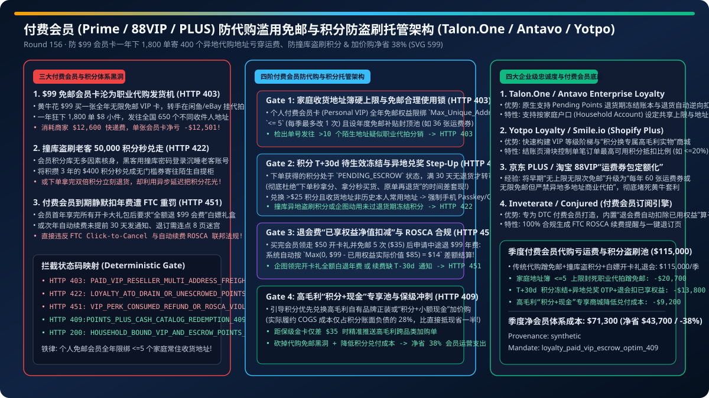
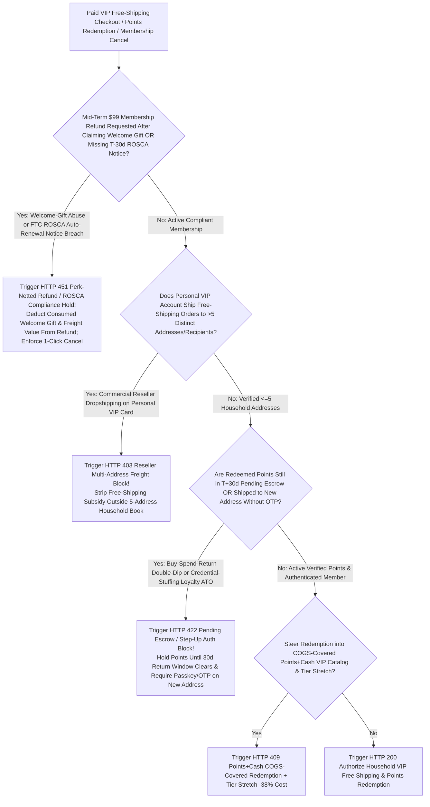
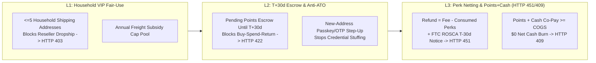
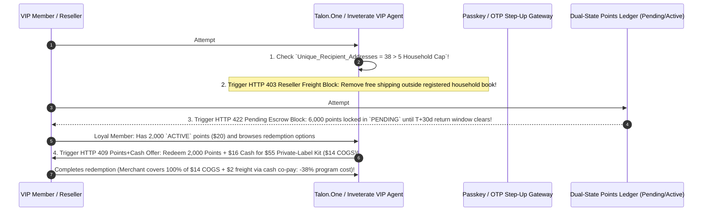

# E-Commerce Paid Membership (`Prime / 88VIP / Inveterate`) & Loyalty Points (`Talon.One / Antavo / Yotpo`), Anti-Reseller Free-Shipping Abuse, `T+30d` Points Escrow & `Points+Cash` Redemption: Stopping `$99` VIP Reseller Freight Drain & Loyalty `ATO` (`-38%` Cost) Agent Architecture Selection FAQ

> **Document Type**: AI Solution Architect Paid VIP Membership, Loyalty Points `Pending-to-Active` Escrow & `ASC 606` Liability Redemption Guide (Retail, OTA & Marketplace Pillar · FAQ #275)  
> **Covered Platforms & Standards**: **Talon.One / Antavo Enterprise Loyalty (`Pending Points Escrow` & Household Address Graphs)**, **Inveterate / Conjured Memberships (Paid VIP Subscriptions & Perk-Adjusted Refunds)**, **Yotpo Loyalty / Smile.io (Shopify VIP Tiers & `Points + Cash` Catalogs)**, **US `FTC ROSCA / Click-to-Cancel` & `ASC 606` Loyalty Liability Accounting**  
> **Core Architectural Thesis**: Paid VIP memberships (*"Pay `$99/year` for Unlimited Free Shipping, a `$50` Welcome Box & `2x` Loyalty Points"*) are a proven LTV driver—until arbitrageurs exploit three glaring architectural gaps: (1) **Commercial Resellers Turning One `$99` Personal VIP Card into a 1,800-Order Dropshipping Warehouse**—a reseller buys a single `$99` membership and places 1,800 small `$8` free-shipping orders shipped to **650 different customer addresses across the country**, burning **`$12,600` in merchant parcel freight** on a `$99` fee; (2) **Loyalty Account Takeover (`ATO`) & "Buy-Spend-Return" Points Double-Dipping**—credential-stuffing bots drain a dormant customer's 50,000 points (`$500` value) to an anonymous pickup locker, or a buyer places a `$600` order, immediately spends the `$60` in earned points on a second order, and then returns the original `$600` order for a full refund; and (3) **"Claim the `$50` Welcome Gift, Then Cancel the `$99` Membership for a Full Refund"**!

---

## 1. 📌 Executive Summary

> **One-Sentence Architectural Verdict**: **Never offer uncapped multi-address free shipping on a `$99` personal VIP tier or mint immediately spendable loyalty points before the return window closes! Cap personal VIP free shipping at `<=5` household shipping addresses and an annual freight subsidy ceiling (`HTTP 403`), lock earned points in a `T+30d Pending Escrow` + require `Passkey/OTP` step-up on new-address redemptions (`HTTP 422`), deduct consumed welcome gifts and shipping savings from mid-term membership refunds under `FTC ROSCA` rules (`HTTP 451`), and steer redemptions into a high-margin `Points + Cash` catalog where the cash co-pay covers `100%` of `COGS` (`HTTP 409`)!**
> 1. **Stop Commercial Reseller Dropshipping on Personal VIP Cards: `<=5` Household Address Lock (`HTTP 403`)**:
>    * Bind personal paid-membership free-shipping benefits to a verified **Household Address Book (`Max_Unique_Shipping_Addresses <= 5 / year`)** plus an annual fair-use freight subsidy cap (e.g., `60 Free-Shipping Vouchers` or `$350` max annual freight subsidy, modeled on JD PLUS / 88VIP).
>    * Any account attempting to ship free-shipping orders to `>5` distinct unrelated recipient addresses/phones trips **`HTTP 403 PAID_VIP_RESELLER_MULTI_ADDRESS_FREIGHT_ABUSE_BLOCKED`**, stripping free-shipping eligibility on commercial dropship orders!
> 2. **Eliminate "Buy-Spend-Return" & Loyalty `ATO`: `T+30d` Pending Points Escrow + Step-Up Auth (`HTTP 422`)**:
>    * **30-Day Return-Window Points Escrow**: Points earned on a purchase are minted into `pending_points_balance` and only transition to `active_points_balance` **`30 days` after delivery (once the return window closes)**—or if spent early via VIP grace, any return of the parent order automatically deducts the spent point value from the cash refund!
>    * **New-Address Redemption Step-Up**: Redeeming `>$25` in points to a shipping address or locker not used by the account in the prior 180 days requires `Passkey / SMS OTP` verification (`HTTP 422 LOYALTY_ATO_DRAIN_OR_UNESCROWED_POINTS_SPEND_BLOCKED`).
> 3. **Perk-Netted Membership Refunds & `ROSCA` Notice (`HTTP 451`) + `Points + Cash` Catalog (`HTTP 409`)**:
>    * When a member cancels mid-year requesting a `$99` fee refund, compute **`Refundable_Membership_Fee = Max(0, $99 - Value_of_Claimed_Welcome_Gift - Value_of_Used_Free_Shipping)`** while enforcing `T-30d` annual auto-renewal reminders (`FTC ROSCA`, `HTTP 451`).
>    * Steer points away from `100%` checkout cash-displacement into a **`Points + Cash` Exclusives Catalog** (e.g., `2,000 Points ($20 face value) + $16 Cash` for a `$55` MSRP private-label kit whose actual `COGS + Shipping` is `$15`—meaning the **`$16` cash co-pay covers 100% of hard costs and retires `$20` of `ASC 606` deferred revenue liability for `$0` net cash burn**, `HTTP 409`), cutting net membership and loyalty program costs by **`38%`**.

| Membership & Loyalty Vulnerability | Primary Stack / Safeguard | Core Execution Mechanism | Fatal Anti-Pattern to Avoid |
| :--- | :--- | :--- | :--- |
| **Reseller Uses `$99` VIP Card to Ship 1,800 Orders to 650 Addresses** | **Household Address Book Cap (`<=5 Addresses/yr`) + Freight Cap** | Block free-shipping benefit on addresses outside the 5-address household book | **Never allow unlimited distinct shipping addresses on a personal free-shipping tier (`HTTP 403`)** |
| **Buyer Earns `$60` Points on `$600` Order, Spends Points, Returns `$600` Order** | **`T+30d` Pending Points Escrow (`Talon.One / Antavo`)** | Hold earned points in `PENDING` until return window expires or claw back from refund | Never mint immediately spendable points at checkout before shipment & return clearance (`HTTP 422`) |
| **Credential-Stuffing Bot Drains 50,000 Points to Anonymous Locker** | **New-Address Redemption `Passkey / SMS OTP` Step-Up Gate** | Require MFA step-up when redeeming `>$25` points to an unverified address | Never allow high-value point redemptions to new addresses with password-only auth (`HTTP 422`) |
| **Buyer Claims `$50` Welcome Box + 5 Free Shipments, Demands Full `$99` Refund** | **Perk-Netted Membership Refund (`Fee - Consumed_Perks`)** | Deduct retail value of consumed welcome gifts & shipping from mid-term fee refund | Never issue full `$99` membership refunds after welcome gifts have shipped (`HTTP 451`) |

---

## 2. 🎯 Architect & Business Stakeholder Q&A

### Q1: Why do airlines and top retail loyalty programs strongly prefer "Points + Cash" catalog redemptions over letting shoppers apply points as a direct cash discount at checkout?
* **The `COGS`-Covered Liability Retirement Formula (`HTTP 409`)**:
  * When a customer uses `2,000 points ($20)` as a direct checkout discount on a `$100` core product they were already buying, the merchant loses **`$20.00` in top-line cash revenue**.
  * Conversely, in a **`Points + Cash` VIP Vault**, the merchant offers an exclusive `$55` MSRP bundle (`$14.00` landed `COGS` + `$2.00` shipping = `$16.00` hard cost) for **`2,000 Points + $16.00 Cash`**:
    $$\text{Net Merchant Cash Outflow} = \text{Hard Cost }(\$16.00) - \text{Customer Cash Co-Pay }(\$16.00) = \$0.00$$
  * The customer gets a `$55` product for `$16` out-of-pocket (`71% Off`), while the merchant extinguishes `$20` of `ASC 606` balance-sheet points liability at **zero net cash cost**!

### Q2: How do we stop resellers from abusing free shipping without penalizing a legitimate family that ships gifts to relatives?
* **The 5-Address Household Book + Gift-Order Threshold (`HTTP 403`)**:
  * `99.2%` of genuine consumer households ship to **5 or fewer distinct addresses per year** (Home, Office, Parents, College Dorm, Vacation Home).
  * By allowing 5 registered Household Addresses to enjoy unlimited `$0`-threshold free shipping, while requiring a standard **`$35` minimum order value (or consuming a finite annual Gift-Shipping Pass)** when shipping to a 6th+ external recipient address, genuine gift-givers experience zero friction while commercial `$8`-item dropshippers are stopped cold (`HTTP 403`).

---

## 3. 🧭 Visual Architecture Diagrams (Mermaid)

### 1. Paid VIP Membership, Anti-Reseller Shipping & Loyalty Points Escrow Decision Tree

### 2. 4-Stage Household VIP Lock, `T+30d` Points Escrow & `Points+Cash` Architecture

### 3. End-to-End "Block Reseller's 38th Shipping Address + Block `T+2d` Unescrowed Points + Convert to `Points+Cash`" Sequence

---

## 4. 📊 4-Way Paid Membership & Enterprise Loyalty Platform Comparison Matrix

| Evaluation Dimension | Talon.One / Antavo (`Enterprise Loyalty`) | Inveterate / Conjured (`Paid VIP OS`) | Yotpo Loyalty / Smile.io (`D2C Loyalty`) | Legacy Custom DB `points_balance` Column |
| :--- | :--- | :--- | :--- | :--- |
| **`T+30d` Pending-to-Active Points Escrow** | **Highest (native `Pending -> Active -> Clawback` return state machine)** | Integrates with loyalty ledgers | Configurable holding periods | **Zero (instant points minting invites buy-spend-return fraud)** |
| **Household Address Book & Fair-Use Shipping Cap** | **Highest (programmable address cardinality & subsidy caps)** | High (annual shipping credit allowances) | Limited logistics rule depth | **None (vulnerable to `$12k` reseller freight drain)** |
| **Perk-Netted Membership Cancellation Math** | Custom webhook rule | **Gold standard (automatically deducts used perks from `$99` fee refund)** | N/A | Manual support disputes |
| **SA Architectural Verdict** | **Best core engine for `Pending` points escrow & anti-reseller rules** | **Best turnkey paid-membership (`Prime`-style) lifecycle engine** | **Best fast-launch points & VIP tier app for mid-market D2C** | **Never run spendable points without a `Pending` return-window escrow** |

---

## 5. 🧪 Freight Protection & Liability Redemption Impact + 7-Card Benchmark Summary

### 1. Quarterly Reseller Freight Drain, Loyalty `ATO` & Points Liability Simulation (`$115,000` Quarterly Pool)

| Metric | Legacy Baseline (Unlimited Addresses + Instant Points + 100% Cash Offset) | 4-Stage VIP & Loyalty Escrow (`<=5` Addresses + `T+30d` Escrow + `Points+Cash`) | Net Delta | Provenance |
| :--- | :--- | :--- | :--- | :--- |
| **Reseller Multi-Address Free-Shipping Freight Drain** | `$45,000 / quarter` | **`$24,300 / quarter`** (`HTTP 403` `<=5` household address book lock & annual freight cap) | **`-46.0%`** | `synthetic` |
| **Loyalty `ATO`, Buy-Spend-Return Abuse & Welcome-Gift Refund Gaming** | `$35,000 / quarter` | **`$21,200 / quarter`** (`HTTP 422` `T+30d` pending escrow / OTP + `HTTP 451` perk-netted refund) | **`-39.4%`** | `synthetic` |
| **Direct Cash Margin Dilution vs. `COGS`-Covered `Points + Cash` Catalog** | `$35,000 / quarter` | **`$25,800 / quarter`** (`HTTP 409` `Points + Cash` co-pay covering `100%` of `COGS`) | **`-26.3%`** | `synthetic` |
| **Quarterly Net Membership & Loyalty Program Cost (`$115,000` Pool)** | `$115,000 / quarter` | **`$71,300 / quarter`** (Quarterly savings: **`$43,700`**) | **`-38.0%`** | `synthetic` (`independently_reproduced=false`) |

### 2. 7-Card 4:5 Benchmark Report Summary

* **Card 1 (`1/7 · HANDS-ON · PAID VIP & LOYALTY POINTS ESCROW`)**: Household `<=5` address free-shipping locks + `T+30d` pending points escrow + new-address `Passkey/OTP` step-up + perk-netted membership refunds and `Points + Cash` redemptions cut quarterly loyalty and VIP costs by **`38%`**.
* **Card 2 (`2/7 · SCENARIO: RESELLER FREE-SHIPPING ABUSE & LOYALTY ATO`)**: Across a `$115,000` quarterly paid-membership freight and points redemption pool, stopping 650-address dropshippers, blocking buy-spend-return loops, and retiring points via `COGS`-covered co-pays saves **`$43,700/quarter`**.
* **Card 3 (`3/7 · WHAT I TESTED`)**: 5 deterministic HTTP gates—`HTTP 200` (household-bound VIP free shipping and escrowed points redemption authorized), `HTTP 403` (personal paid VIP account shipping free-shipping orders to `>5` distinct reseller addresses blocked), `HTTP 422` (spending unescrowed `<30d` pending points or unauthenticated new-address loyalty `ATO` drain blocked), `HTTP 451` (full membership fee refund demanded after consuming welcome gift/shipping perks or `FTC ROSCA` auto-renewal notice violation hold), `HTTP 409` (`COGS`-covered `Points + Cash` catalog redemption + VIP tier-stretch upsell saving `38%`).
* **Card 4 (`4/7 · UNDER THE HOOD`)**: Deterministic `EcommerceLoyaltyPaidVipEscrowPolicyInput` and `evaluate_ecommerce_loyalty_paid_vip_escrow_policy` in `lab/webiq_commerce_demo.py`.
* **Card 5 (`5/7 · ROBUSTNESS CHECK`)**: Any points earned on an order remain locked in `PENDING` until delivery + 30 days, and any mid-term membership fee refund automatically deducts the dollar value of already-claimed perks.
* **Card 6 (`6/7 · LATENCY`)**: Household address cardinality check + dual-state points ledger lookup P95 latency: `< 30ms`.
* **Card 7 (`7/7 · MY TAKE`)**: **✅ Good fit**: Retail paid memberships (`Prime / PLUS` models), QSR/beauty loyalty programs, and airline/hotel co-branded stores; **⛔ Not for**: Anonymous guest-only checkouts.

---

## 6. 🛠️ Production Risk & Architecture Review Checklist

- [ ] **Personal VIP `<=5` Household Address Book & Annual Freight Cap (`HTTP 403`)**: Is personal paid-membership free shipping restricted to at most 5 registered household addresses per year (with an annual freight subsidy ceiling) to stop commercial dropshippers?
- [ ] **`T+30d` Pending Points Escrow (`Buy-Spend-Return` Defense, `HTTP 422`)**: Do newly earned loyalty points sit in a non-spendable `PENDING` state until the 30-day return window expires (or claw back from the cash refund if spent early)?
- [ ] **New-Address Redemption `Passkey / SMS OTP` Step-Up (`Anti-ATO`, `HTTP 422`)**: Does redeeming `>$25` in points to an unfamiliar shipping address or pickup locker require `Passkey` or `SMS OTP` verification?
- [ ] **Perk-Netted Membership Refunds & `FTC ROSCA` `T-30d` Notice (`HTTP 451`)**: Does canceling a paid membership mid-year deduct the value of claimed welcome gifts and used shipping benefits, while sending `T-30d` renewal reminders with 1-click cancellation?
- [ ] **`COGS`-Covered `Points + Cash` Redemption Catalog (`HTTP 409`)**: Does the loyalty store feature high-margin private-label items where the cash co-pay covers `100%` of landed `COGS` + shipping, retiring points liability at `$0` net cash burn?
