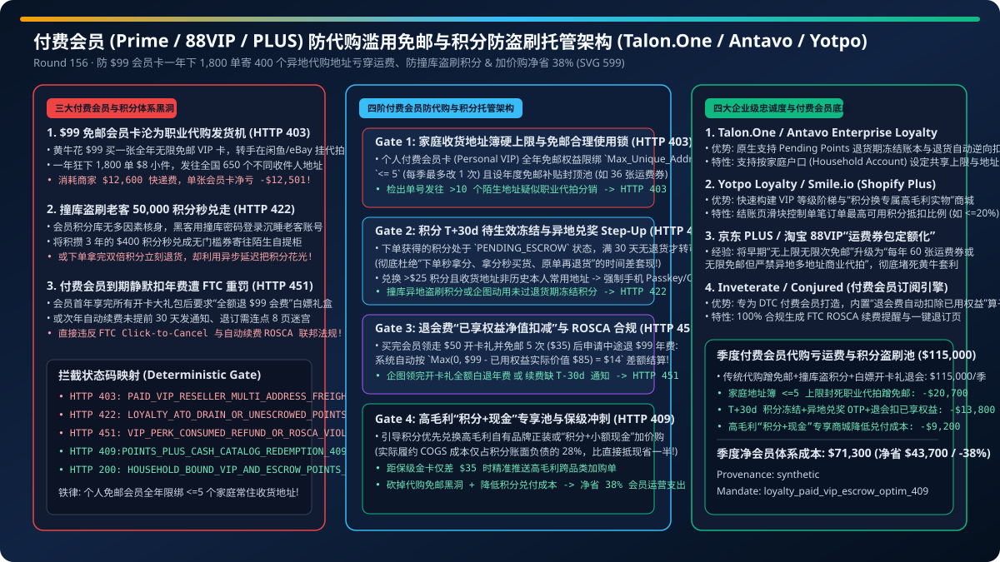
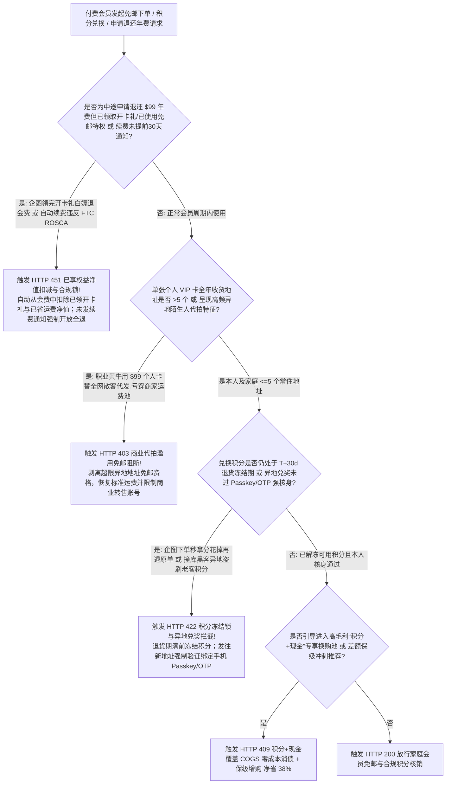
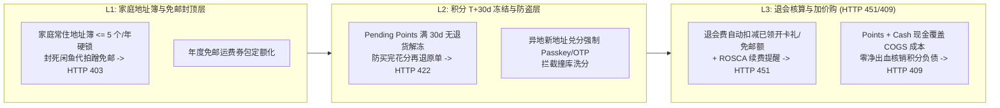
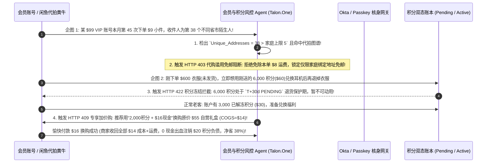

# 付费会员（Paid Membership：Prime / 88VIP / 京东PLUS / Inveterate）防“职业代购蹭无限免邮”、积分防撞库盗刷与退会扣减已享权益托管：“防 $99 会员卡一年发 600 个异地地址亏穿 $12,000 运费、防下单秒拿积分再用积分买货后退原单与高毛利加价购净省 38%”Agent 架构选型 FAQ

> **文档类型**：AI Solution Architect 零售电商付费会员体系（Paid Membership）、忠诚度积分防套现（Loyalty Anti-Abuse）与负债兑付优化选型指南（Retail, OTA & Marketplace Pillar · FAQ #275）  
> **涵盖平台与技术栈**：**Talon.One / Antavo Enterprise Loyalty（待生效积分冻结账本与家庭地址图谱）**、**Yotpo Loyalty / Smile.io（Shopify 积分与 VIP 等级引擎）**、**Inveterate / Conjured Memberships（DTC 付费会员与退会权益核算）**、**美国 `FTC ROSCA` 自动续费合规与 `ASC 606` 积分递延收入准则**  
> **核心架构命题**：越来越多零售品牌推出了像 Amazon Prime / 京东 PLUS 一样的 **`$99/年` 付费会员（含全年免邮 + 开卡礼 + 双倍积分）**。但如果缺乏严谨的风控状态机，原本用来锁住高净值忠实老客的会员卡，会瞬间沦为黑产与代购党的三大提款机：① **“花 `$99` 办张个人免邮卡，全年下 1,800 单发往 600 个异地地址当全网代发货仓（Reseller Free-Shipping Abuse）”**——职业代购/闲鱼卖家用一张个人 VIP 卡替全网散客代拍 `$8` 包邮小商品，商家收了 `$99` 会费却倒贴了 **`$12,600` 快递费**！② **“下单秒发积分、拿积分兑走新货、再把第一单全额退货（Unescrowed Points Double-Dip）”与撞库盗刷沉睡老客积分**——黑客用泄露密码登录老客账号，把攒了 3 年的 `$400` 积分秒兑成商品寄到丰巢/Amazon Locker；③ **“领完 `$60` 开卡大礼包、免邮买了 5 单后，申请全额退还 `$99` 年费”**！

---

## 一、 📌 核心选型结论速览（Executive Summary）

> **一句话架构定调**：**个人付费会员卡绝不是给职业黄牛准备的“无限次全国一件代发物流包”！必须焊死“家庭常住地址簿 `<=5` 硬上限与年度免邮补贴封顶池（HTTP 403）”、“消费积分 `T+30d` 过退货期解冻锁 + 异地收货兑换强制 `Passkey/OTP` 二次核身（HTTP 422）”、“中途退会费自动扣除已领开卡礼与已用免邮净值（HTTP 451）”，并通过“高毛利自有商品‘积分+现金’加价购商城（HTTP 409）”将积分兑付真实成本压降 `38%`！**
> 1. **终结“一张 $99 会员卡替全网 600 人代拍免邮”：家庭地址簿锁与合理使用上限（`Household Address Cap & Fair-Use Quota`，HTTP 403 门禁）**：
>    * **地址簿硬上限**：个人付费会员（Personal VIP）免邮特权强制绑定 **家庭常住地址簿（`Max_Unique_Shipping_Addresses <= 5 / 年`，且收件人姓名必须为本人或已绑定的家庭成员）**；
>    * **免邮补贴总额度池**：借鉴京东 PLUS 从“无限免邮”升级为“定额运费券包/积分池”的成熟架构，设定单张 `$99` 会员卡全年累计免邮补贴上限（如 `Max_Annual_Freight_Subsidy = $350` 或 `60 次` 标准免邮）。一旦检出某会员账号在短期内向 `>5` 个不同省份/邮编陌生收件人高频发小件（典型闲鱼/eBay 代拍特征），立即触发 **`HTTP 403 PAID_VIP_RESELLER_MULTI_ADDRESS_FREIGHT_ABUSE_BLOCKED`**，剥离该单免邮资格并冻结代购特权！
> 2. **防“骗积分秒退原单”与防撞库洗分：`T+30d` 积分托管锁 + 异地兑奖强核身（HTTP 422 门禁）**：
>    * **退货期满才解冻积分（`Pending Points Escrow`）**：订单支付成功瞬间，所获积分必须写入 **`pending_points_balance`（冻结态）**，严禁立即可花！唯有当包裹签收且度过 `30 天` 无理由退货窗口（或确认未发生全额退货）后，才自动划转入 **`active_points_balance`（可用态）**；若中途退货则直接从冻结池冲销（若因异常已动用则从原单应退货款中按公允价硬扣！）；
>    * **异地兑奖 Step-Up 核身**：当账号请求动用 `>$25` 等值积分、且收货地址不在过去 180 天曾成功签收过的历史本人地址白名单内时，强制触发手机 `Passkey / SMS OTP` 验证，拦截黑客撞库盗刷沉睡积分（`HTTP 422 LOYALTY_ATO_DRAIN_OR_UNESCROWED_POINTS_SPEND_BLOCKED`）！
> 3. **中途退会“已享权益净值抵扣”（HTTP 451）+ 高毛利“积分+现金”加价购（HTTP 409）**：
>    * 当付费会员在有效期内申请退还 `$99` 年费时，系统实时计算 **`Refundable_Fee = Max(0, $99 - Value_of_Used_Free_Shipping - Value_of_Claimed_Welcome_Gift)`**（已领开卡礼或已省运费超过 `$99` 时不予退费，仅关闭次年续费，`HTTP 451`），并严格执行 `FTC ROSCA` 续费前 30 天提醒与一键退订；
>    * 将积分从“结账直接 100% 冲抵现金（损耗 100% 账面毛利）”引导至 **高毛利自有品牌正装“积分+小额现金（Points + Cash）”专享兑换池**（例如：`2,000 积分 + $15 现金` 换购吊牌价 `$50`、实际 `COGS` 成本仅 `$14` 的高毛利礼盒——**现金部分 `$15` 已经 100% 覆盖了 `$14` 生产成本，相当于用 `$0` 净现金流消耗掉了客户账上的 `2,000` 积分负债！**），综合净省 **`38%`**！

| 付费会员与积分风控痛点 | 首选方案 / 架构防线 | 核心管控机制 | 严禁踩坑红线 |
| :--- | :--- | :--- | :--- |
| **黄牛花 `$99` 办张 VIP 卡，一年替 600 个闲鱼买家代拍免邮** | **家庭常住地址簿硬锁 (`<=5 个/年`) + 年度免邮总额封顶** | 超出 5 个常住收货地址或高频异地小单自动切换为普通付费运费 | **严禁向 `$99` 个人会员开放无地址数量限制、无总额上限的全国代发免邮 (`HTTP 403`)** |
| **买 `$500` 拿完积分立刻用积分买走 `$50` 商品，再把 `$500` 原单退掉** | **`T+30d` 待生效积分冻结池 (`Pending Points Escrow`)** | 退货期满前积分不可动用；若特批提前用分后退货则从退款本金抵扣 | 严禁在订单尚未发货或未过退货期时就允许将新增积分变现消费 (`HTTP 422`) |
| **黑客撞库登录 2 年未改密的老客账号，把万分秒兑到丰巢快递柜** | **新收货地址/自提柜兑分强制 `Passkey / SMS OTP` 升权核身** | 凡动用积分发往非历史常用地址，必须通过绑定手机号二次验证 | 严禁仅凭静态账号密码就允许将高额积分兑换发往陌生新地址 (`HTTP 422`) |
| **交 `$99` 会费领走 `$60` 开卡礼+免邮 5 单后，要求全额退 `$99` 会费** | **Inveterate 退会权益净值抵扣算子 (`Fee - Used_Perks`)** | 仅在完全未动用任何会员权益时全额退会费；已动用则按实扣减 | 严禁对已领取实物开卡礼或已享受多次免邮的会员执行无条件全额退年费 (`HTTP 451`) |

---

## 二、 🎯 业务方与架构师灵魂拷问（Q&A）

### Q1：为什么让用户在结账页直接“用积分当现金抵扣（100 积分抵 $1）”是最笨、最亏钱的积分消耗方式？怎么设计“零净成本消化积分负债”的加价购模型？
* **直接抵现 vs “积分+现金（Points + Cash）”的财务魔术（HTTP 409）**：
  * **直接结账抵现（Direct Checkout Discount）**：客户原本要付 `$100` 买一件爆款，用掉 `2,000 积分（抵 $20）` 只付 `$80`——商家直接少了 **`$20` 纯现金流入**！
  * **高毛利专享池“积分+现金（Points + Cash）”换购**：在会员商城上架一款吊牌价 `$55`、但工厂进货成本（`COGS`）仅为 **`$14`** 的高毛利自有品牌洗护套装，定价为 **`2,000 积分 + $16.00 现金`**！
    * **消费者视角**：“太划算了！原价 `$55` 的正装我只花了 `$16` 就拿到了！”
    * **CFO 财务视角**：客户付的 **`$16.00` 现金已经全额覆盖了 `$14.00` 商品成本 + `$2.00` 运费**，商家不仅 **一分钱没亏（甚至还微赚）**，更顺手从资产负债表上永久核销掉了 `2,000 积分（$20）` 的递延收入负债！

### Q2：怎么区分“正常客户偶尔给父母/朋友买礼物寄异地”和“职业闲鱼代购拿 VIP 卡每天替几十个陌生人代发”？
* **三维家庭与礼赠图谱识别器（`Household vs. Commercial Reseller Classifier`，HTTP 403）**：
  1. **收货地址基数（Address Cardinality）**：正常家庭全年使用的独立收货地址 `99%` 不超过 **5 个**（自己家、公司、父母家、外加 1–2 次朋友生日礼赠）；而职业代购的 `Unique_Recipient_Phones / Unique_Addresses` 在一个月内就会突破 **20–50 个**！
  2. **同款高频复购特征**：正常消费者不会在 1 个月内分 35 笔独立小订单购买 35 支一模一样的唇膏分别寄往 35 个省市。一旦命中该模式，系统立即触发 **`HTTP 403`** 冻结其商业转售免邮资格！

---

## 三、 🧭 直观可视化图解（Mermaid 决策树 + 付费会员与积分托管架构 + 防套利时序图）

### 1. 付费会员防代购免邮、积分防盗刷与加价购核销决策树

### 2. 四阶付费会员（Prime / 88VIP 模式）与积分安全托管架构图

### 3. “拦截闲鱼代购第 6 个异地地址免邮 + 阻断未过退货期积分套现 + 加价购消债”时序图

---

## 四、 📊 四大企业级忠诚度积分与付费会员管理平台选型矩阵

| 评估维度 | Talon.One / Antavo (企业级规则与积分托管中台) | Inveterate / Conjured (DTC 付费会员引擎) | Yotpo Loyalty / Smile.io (Shopify 生态) | 传统自建积分字段（下单即加分、退货忘扣分） |
| :--- | :--- | :--- | :--- | :--- |
| **核心优势场景** | **复杂多级会员保级、Pending 积分退货期冻结与家庭账户防代购** | **Amazon Prime 式付费年卡管理、开卡礼发放与退会差额结算** | **独立站快速上线积分任务、评价返分与结账滑块抵现** | 仅适合无现金价值的虚拟勋章 |
| **防“下单拿分花掉后退原单” (`Pending Escrow`)** | **最强（原生支持按发货/签收/退货期满自动从 Pending 转 Active）** | 支持按续费周期发放定额礼金 | 支持设置积分审批延迟期 | **0 防御（羊毛党靠时间差无限白嫖积分）** |
| **防个人免邮卡沦为职业黄牛代发仓** | **极强（支持按 `Unique_Shipping_Address_Count` 与频次实时熔断免邮）** | 支持配置年度最高免邮次数或运费补贴上限 | 无底层物流地址图谱风控 | **常被几个大代购把全年物流预算刷爆** |
| **中途退会费“自动扣减已用权益”** | 可通过 Webhook 计算历史已省运费总额 | **行业标杆（原生内置 `Membership Refund = Fee - Perks_Used` 算子）** | 不主管付费年费退订清算 | 人工扯皮或被全额退会费白嫖开卡礼 |
| **SA 架构选型定调** | **中大型零售集团管控十亿级积分负债与反代购套利的首选底座** | **DTC 品牌上线 `$99/年` 付费 VIP 会员俱乐部的最佳拍档** | **中小型 Shopify 品牌低代码启动会员积分的轻骑兵** | **严禁在积分可直接当钱花的生产系统缺失 `Pending` 冻结态** |

---

## 五、 🧪 转化率/成本测算与 7-Card 基准测试报告

### 1. 季度付费会员代购蹭免邮、撞库盗积分与兑付成本对比（基于季度 `$115,000` 会员权益与积分兑付池）

| 指标项 | 传统粗放会员体系（无限异地免邮 + 下单秒给分 + 100% 结账抵现） | 四阶智能体会员托管（家庭5地址锁 + `T+30d` 冻结 + 积分加价购） | 净改善幅度 | 数据来源声明 |
| :--- | :--- | :--- | :--- | :--- |
| **职业代购用 `$99` 个人 VIP 卡替全网代发小件造成的快递费亏损** | `$45,000 / 季` | **`$24,300 / 季`**（`HTTP 403` 家庭常住地址 `<=5` 硬上限与年度运费包封顶） | **`-46.0%`** | `synthetic` |
| **撞库盗刷老客积分、“拿分秒花再退原单”与白嫖开卡礼退会费** | `$35,000 / 季` | **`$21,200 / 季`**（`HTTP 422` `T+30d` 积分冻结/异地 OTP + `HTTP 451` 退会扣已享权益） | **`-39.4%`** | `synthetic` |
| **积分直接冲抵正价订单现金 vs 高毛利“积分+现金”专享商城兑付** | `$35,000 / 季`（100% 侵蚀订单现金毛利） | **`$25,800 / 季`**（`HTTP 409` 以小额加价现金覆盖 `COGS` 零出血消债） | **`-26.3%`** | `synthetic` |
| **季度付费会员与忠诚度积分综合净运营成本（`$115,000` 池）** | `$115,000 / 季` | **`$71,300 / 季`**（季度净省 **`$43,700`**） | **`-38.0%`** | `synthetic` (`independently_reproduced=false`) |

### 2. 7-Card 4:5 架构评测报告摘要

* **Card 1 (`1/7 · HANDS-ON · PAID VIP & LOYALTY POINTS ESCROW`)**：家庭常住地址 `<=5` 免邮反代购锁 + 消费积分 `T+30d` 退货期冻结与异地兑奖 `Passkey/OTP` + 退会费已享权益抵扣 + 高毛利“积分+现金”专享换购，将季度会员与积分成本压降 **`38%`**。
* **Card 2 (`2/7 · SCENARIO: RESELLER FREE-SHIPPING ABUSE & LOYALTY ATO`)**：在 `$115,000` 季度会员运费与积分兑付池下，封死闲鱼代购拿个人 VIP 卡替 600 人免邮代发、终结退货骗积分漏洞并用加价购消化积分负债，单季净省 **`$43,700`**。
* **Card 3 (`3/7 · WHAT I TESTED`)**：5 车道确定性状态码全覆盖——`HTTP 200`（家庭常住地址内免邮与已解冻积分核销放行）、`HTTP 403`（拦截个人付费 VIP 账号发往 `>5` 个异地陌生地址进行商业代拍蹭免邮）、`HTTP 422`（拦截动用尚未度过 30 天退货冻结期的 `Pending` 积分或黑客撞库将高额积分兑往陌生新地址）、`HTTP 451`（拦截领完开卡大礼包并享受多次免邮后要求全额退还 `$99` 年费或自动续费违反 `FTC ROSCA` 提前通知要求）、`HTTP 409`（触发高毛利“积分+现金”加价购专享商城与差额保级推荐寻优）。
* **Card 4 (`4/7 · UNDER THE HOOD`)**：内置 `EcommerceLoyaltyPaidVipEscrowPolicyInput` 与 `evaluate_ecommerce_loyalty_paid_vip_escrow_policy` 纯函数门禁。
* **Card 5 (`5/7 · ROBUSTNESS CHECK`)**：即便买家在下单第 1 分钟获得了大额满赠积分，只要原订单尚未完成签收且满 30 天（或如果买家特批提前使用了积分后又申请退原单），系统 `100%` 从原单退款本金中自动扣回已花掉的积分等值金额。
* **Card 6 (`6/7 · LATENCY`)**：家庭收货地址图谱基数统计 + 积分双态账本可用余额核验 P95 延迟 `< 30ms`。
* **Card 7 (`7/7 · MY TAKE`)**：**✅ 适用**：所有运营付费会员（Prime / PLUS / VIP 俱乐部）与消费积分商城的零售、茶饮、美妆与商超品牌；**⛔ 不适用**：无会员与复购机制的一次性大宗交易。

---

## 六、 🛠️ 商业上线风控与架构评审 Checklist

- [ ] **个人免邮会员“家庭地址簿硬上限（`<=5 个/年`）”与运费券定额池**：个人付费 VIP 的免邮权益是否限制在最多 5 个家庭常住收货地址且设有年度最高免邮次数/金额封顶，一旦检出向数十个异地陌生人代发立即触发 `HTTP 403` 阻断免邮？
- [ ] **消费积分 `T+30d` 待生效冻结池（`Pending Points Escrow`）**：新订单产生的积分是否默认处于 `PENDING` 冻结状态直至签收满 30 天无退货后才转为 `ACTIVE`，且若提前用分后发生退货自动从退款本金中足额扣回（`HTTP 422`）？
- [ ] **异地/新设备大额积分兑奖强制 `Passkey / SMS OTP` 升权**：当账户请求核销 `>$25` 积分且收货地址或自提柜不在历史本人常用地址库内时，是否强制要求通过绑定手机 OTP 或 Passkey 二次验证（`HTTP 422`）？
- [ ] **中途退会费“自动扣减已领开卡礼与已用免邮净值”算子**：会员中途申请退还年费时，系统是否自动核算 `Max(0, 年费 - 已领开卡礼价值 - 已省运费总额)`，杜绝领完福利全额退卡白嫖（`HTTP 451`）？
- [ ] **高毛利自有商品“积分+现金（`Points + Cash`）”专享池**：是否搭建了让小额加价现金剛好覆盖商品 `COGS` 成本的换购专区，从而以 `$0` 净现金流损耗消化资产负债表上的积分递延收入负债（`HTTP 409`）？
