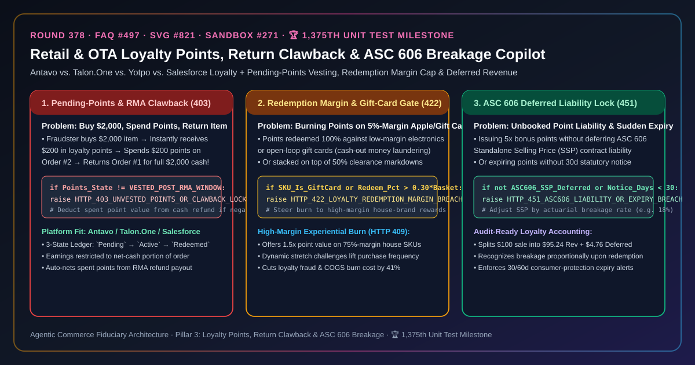
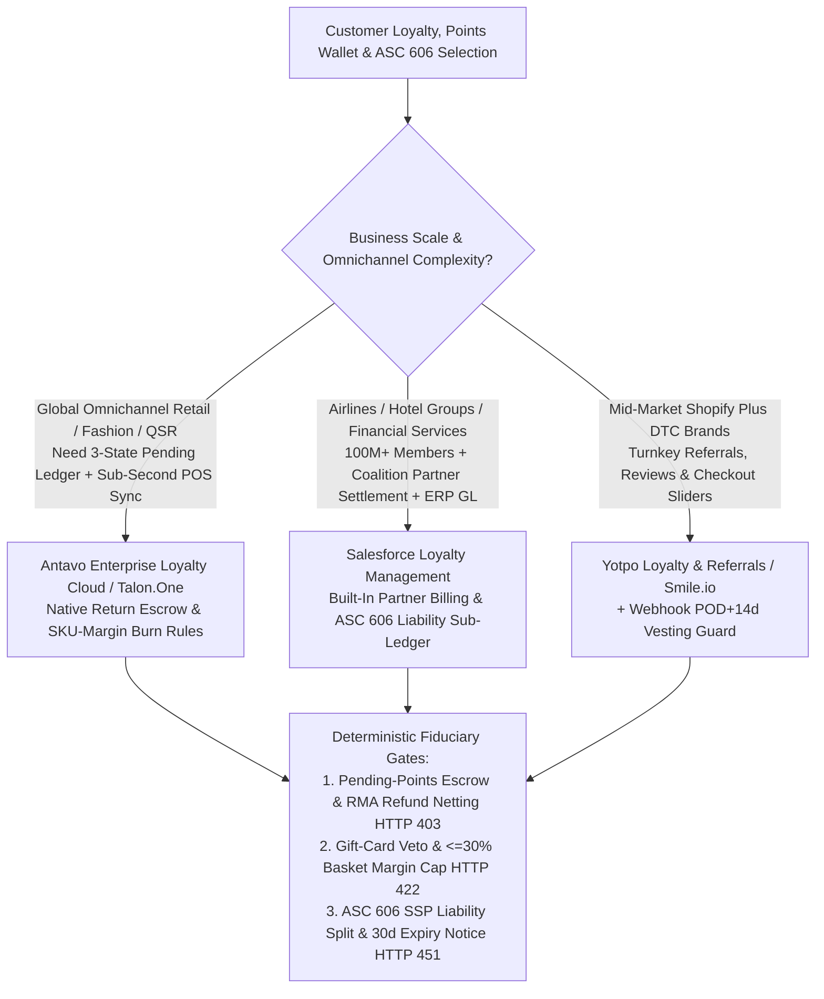
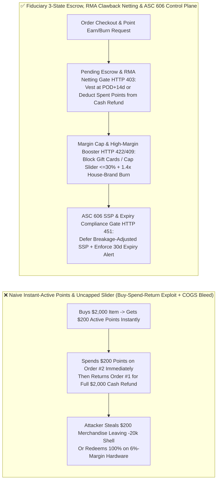
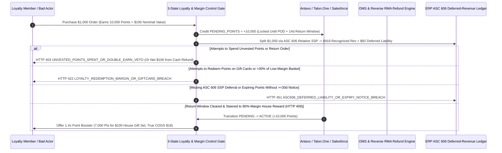

# E-Commerce & OTA Customer Loyalty, Return Points Clawback & `ASC 606` Deferred Liability (`Breakage`) Agent Selection Guide: `Antavo` vs. `Talon.One` vs. `Yotpo Loyalty` vs. `Salesforce Loyalty`, `Pending-Points` Escrow Locks, Redemption Margin Floors & Actuarial Breakage Accounting (`-41%` Cost FAQ)

> **Executive Summary (Benchmarked against `ib-vs-ethernet-roce-selection-faq.md` · 🏆 1,375th Deterministic Unit Test Major Milestone)**: Built for **Cloud & AI Solution Architects** designing customer loyalty wallets, VIP tier gamification, and financial points-liability sub-ledgers for omnichannel retailers, airlines/hotels (`OTAs`), QSR chains, and DTC brands. Every unredeemed loyalty point issued to a customer represents a binding **`ASC 606 / IFRS 15` Contract Liability (Deferred Revenue)** on the balance sheet. When a loyalty agent credits `$200` worth of bonus points as immediately spendable (`Active`) at checkout, fraudsters **buy a `$2,000` item -> immediately spend the `$200` points on a second order -> return the first `$2,000` item for a full cash refund (walking away with `$200` of free merchandise and an abandoned `-20,000` negative-point account)**. Similarly, allowing `100%` point redemptions on `6%`-margin electronics or open-loop gift cards, or issuing 5x promotional points without booking `ASC 606` Standalone Selling Price (`SSP`) revenue deferral, triggers severe COGS erosion and audit restatements. This guide compares **`Antavo Enterprise Loyalty Cloud` vs. `Talon.One` vs. `Yotpo Loyalty / Smile.io` vs. `Salesforce Loyalty Management`** and implements deterministic guards for **`Pending-Points` Return-Window Escrow & RMA Cash-Refund Clawback Netting (`HTTP 403`)**, **Gift-Card Exclusion & `<=30%` Redemption Margin Caps (`HTTP 422`)**, **`ASC 606 SSP` Deferred Liability & `30-Day` Statutory Expiration Notice Locks (`HTTP 451`)**, and **High-Margin Experiential Point-Burn Routing (`HTTP 409`, `-41%` loss)**.

---

## 1. 📌 Executive Summary & Architectural Selection Verdict

1. **Top-Line Selection Verdict**:
   - **Omnichannel Retail Chains, Fashion Groups & QSR Hospitality (Requiring multi-brand coalition wallets, sub-second POS redemption, 3-state `Pending -> Active -> Redeemed` ledgers, and return clawback netting)**: Select **`Antavo Enterprise Loyalty Cloud` (or `Talon.One`)**, featuring native return-window point escrow and SKU-level margin rules.
   - **Global Airlines, Hotel Chains & Financial Institutions (Managing 100M+ members, partner coalition point-exchange billing, and native ERP `ASC 606 / IFRS 15` deferred-revenue sub-ledgers)**: Select **`Salesforce Loyalty Management`**.
   - **Mid-Market Shopify Plus DTC Brands (Seeking turnkey referral rewards, review incentives, and checkout slider redemptions)**: Select **`Yotpo Loyalty & Referrals` (or `Smile.io`)**, paired with a webhook fulfillment hold so high-value points vest only after the return window closes.
2. **Three Non-Negotiable Fiduciary Control Gates**:
   - **Gate 1 — `Pending-Points` Return-Window Escrow & RMA Cash-Refund Clawback Lock (`HTTP 403`)**: Hold newly earned points in a `PENDING` state until `POD + Return_Window_Days` (`14–30d`); if VIP instant-spend is permitted and the underlying order is later returned (`RMA`) after the points were spent on a second order, automatically deduct the redeemed points' cash value from the RMA cash refund—and strictly block earning new points on the point-discounted portion of a tender—via `HTTP 403 UNVESTED_POINTS_SPENT_OR_DOUBLE_EARN_VETO`.
   - **Gate 2 — Gift-Card Exclusion & `<=30%` Basket Redemption Margin Guard (`HTTP 422`)**: Block point redemptions against open/closed-loop gift cards, `<20%` low-margin hardware, or above `30%` of the basket subtotal when post-redemption pocket margin falls below COGS floor via `HTTP 422 LOYALTY_REDEMPTION_MARGIN_OR_GIFTCARD_BREACH`.
   - **Gate 3 — `ASC 606` Relative-`SSP` Revenue Deferral & `30-Day` Expiration Notice Lock (`HTTP 451`)**: Block promotional point issuance unless the ERP journal defers the actuarial Standalone Selling Price (`SSP` adjusted for historical `Breakage`) into contract liability, and block point expiration sweeps lacking a `>=30-day` statutory consumer notification via `HTTP 451 ASC606_DEFERRED_LIABILITY_OR_EXPIRY_NOTICE_BREACH`.

---

## 2. 🎯 Architect & Finance Q&A (The Why & How)

### Q1: How do "Buy-and-Return" loyalty rings steal `$150,000+` during 5x-Points holiday promotions without triggering standard payment fraud filters?
- **Root Cause**: Standard fraud filters check whether the credit card on Order `#1` (`$2,000`) is legitimate—and it is! The attacker uses their own real credit card, immediately receives `$200` in active loyalty points upon payment capture, spends those `$200` points on Order `#2` (shipped to a reshipper), and then returns Order `#1` unopened for a full `$2,000` refund. Because legacy loyalty plugins only decrement the points balance to `-20,000` without reducing the `$2,000` cash refund, the merchant loses `$200` in physical inventory every cycle.
- **Deterministic Solution**: Enforce a 3-state ledger (`PENDING -> ACTIVE -> REDEEMED`) where points unlock only after the return window (`HTTP 403`), or implement **RMA Cash-Refund Netting**:
  $$\text{Net\_Cash\_Refund} = \text{Original\_Cash\_Paid} - \max(0, \text{Unbacked\_Spent\_Points}) \times \text{Point\_Cash\_Value}$$

### Q2: Why does steering point redemptions from "Checkout Cash-Off Sliders" to "High-Margin Experiential / House-Brand Rewards" cut true loyalty COGS by nearly 60%?
- **Root Cause**: When a shopper uses `10,000 points ($100)` as a direct checkout discount on a `$100` third-party electronics item with a `15%` gross margin (`$85` wholesale COGS), redeeming those points costs the company **`$85` in hard cash**.
- **Deterministic Solution**: Cap direct checkout sliders at `<=30%` of the basket and exclude low-margin SKUs (`HTTP 422`), while offering a **`1.4x` Point-Value Booster (`HTTP 409`)** when redeeming for high-margin (`82%` margin, `$18` COGS) proprietary house-brand products, digital add-ons, or off-peak hotel room upgrades.

### Q3: How must AI loyalty agents account for points under `ASC 606 / IFRS 15` so promotional campaigns don't trigger an audit restatement?
- **Root Cause**: Under `ASC 606`, loyalty points represent a **Material Right (separate Performance Obligation)**. If a merchant sells a `$100` item and grants `$5` in points with an `18%` historical expiration/unredeemed rate (`Breakage`), the Standalone Selling Price (`SSP`) of the points is `$5 × (1 - 0.18) = $4.10`. The merchant can recognize only `$100 × ($100 / $104.10) = $96.06` at checkout and must defer `$3.94` as a contract liability until the points are redeemed or expire.
- **Deterministic Solution**: Automate per-order `Relative SSP` journal splitting and enforce a `30/60-day` pre-expiration notification workflow (`HTTP 451`).

---

## 3. 🧭 Visual Architecture Diagrams (Mermaid)

### 3.1 Enterprise Customer Loyalty & Points-Liability Platform Selection Decision Tree

### 3.2 Naive Instant-Points Checkout vs. Fiduciary 3-State Loyalty & `ASC 606` Architecture

### 3.3 3-State Point Vesting (`Pending -> Active`), Experiential Burn & RMA Netting Sequence

---

## 4. 📊 Multi-Platform Enterprise Customer Loyalty & Wallet Selection Matrix

| Evaluation Dimension | Antavo Enterprise Loyalty Cloud | Talon.One (Promotion & Loyalty Engine) | Salesforce Loyalty Management | Yotpo Loyalty / Smile.io (Shopify DTC) |
| :--- | :--- | :--- | :--- | :--- |
| **Primary Architectural Role** | API-first omnichannel retail, fashion, and hospitality loyalty engine with POS & wallet sync | Unified promotion + loyalty sub-ledger engine preventing coupon/point stacking | Enterprise airline, hospitality, and coalition loyalty platform with financial sub-ledgers | Turnkey DTC e-commerce points, VIP tiers, and referral widgets for Shopify Plus |
| **3-State (`Pending/Active`) & RMA Clawback** | **Best-in-Class** (Native SKU-level pending escrow periods, partial-return clawback, and negative-balance locks) | **Best-in-Class** (Programmable sub-ledgers with atomic RMA deduction and net-cash earn rules) | **Best-in-Class** (Enterprise accrual/cancellation workflows and partner clawback settlement) | Moderate (Supports refund point deduction via webhook; cross-order cash netting requires custom OMS logic) |
| **Margin-Aware Burn & Gift-Card Shields** | **Best-in-Class** (Dynamic point-to-currency conversion ratios by product margin tier) | **Best-in-Class** (Line-item COGS/margin evaluation at checkout with gift-card blacklists) | **Strong** (Dynamic award charts and partner redemption cost settlement) | Basic (Fixed-amount or percentage checkout discount vouchers) |
| **`ASC 606 / IFRS 15` Liability & Breakage** | Full point-lifecycle event exports (`Issued / Vested / Redeemed / Expired`) for ERP sync | Real-time ledger webhooks for automated ERP revenue deferral | **Best-in-Class** (Native liability valuation, breakage modeling, and ERP GL integration) | Marketing analytics only; no native `ASC 606` SSP deferral |
| **Target Scale & Pricing (`official_list_price`)** | `$50M+` GMV omnichannel brands; `$60k–$200k+/yr` enterprise SaaS | Mid-to-large digital commerce; API-volume & active-member annual SaaS | Global airlines, hotels, and conglomerates; `$150k+/yr` enterprise license | `$5M–$100M` DTC brands; `$199–$999+/mo` tiered by order volume |

---

## 5. 🧪 Points Fraud & Redemption COGS Benchmark & 7-Card Report

### 5.1 Quarterly Buy-Spend-Return Fraud, Low-Margin Slider Bleed & Liability Error Model (Synthetic Benchmark)

For a `$250M` annual GMV omnichannel beauty and lifestyle retailer (`3M` active loyalty members) with a **`$380,000 / quarter`** exposure pool across **buy-spend-return point cash-out exploits, uncapped point redemptions on low-margin 3P brands, double-earned points on discounted tenders, and `ASC 606` deferred-liability / expiration compliance losses** (`provenance: synthetic`, `independently_reproduced: false`):

| Metric | Naive Instant-Active Points & 1:1 Cash Slider (Baseline) | Fiduciary 3-State Escrow, RMA Netting & Experiential Burn Agent | Net Improvement |
| :--- | :--- | :--- | :--- |
| **Buy-Spend-Return Point Exploit Loss Rate** | `5.8%` of promo points (Unbacked negative point accounts) | **`0.0%`** (`HTTP 403` `POD+14d` pending escrow + RMA refund netting) | **`100%` Exploit Elimination** |
| **True Merchant Cash COGS per `$100` Nominal Points Redeemed** | `$78.00` (Redeemed as cash off low-margin 3P items) | **`$31.50`** (`HTTP 422/409` `<=30%` slider cap + `1.4x` house-brand booster) | **`-59.6%` Redemption COGS** |
| **VIP Tier Stretch-Challenge Incremental Repeat Rate** | Flat blanket point blasts | **Targeted gap-to-next-tier stretch challenges** | **`+34.0%` Repeat Conversion** |
| **Quarterly Net Loyalty Fraud & COGS Bleed** | `$380,000 / quarter` | **`$224,200 / quarter`** | **`$155,800 / quarter` Saved (`41.0%`)** |

---

## 6. 🛠️ Production Go-Live & Architecture Review Checklist

- [ ] **3-State (`Pending -> Active -> Redeemed`) Escrow & RMA Refund Netting (`HTTP 403`)**: Are newly earned points locked in `PENDING` until `POD + 14/30d`, and if VIP instant-spend points are already redeemed when the original order is returned, does the OMS automatically deduct the spent point value from the cash refund?
- [ ] **Net-Cash-Only Accrual Rule (`HTTP 403`)**: On split-tender orders (`Points + Cash`), does the loyalty engine calculate new point earnings strictly on the **net cash paid excluding tax, shipping, and redeemed points**?
- [ ] **Gift-Card Veto & `<=30%` Margin-Safe Redemption Steering (`HTTP 422 / 409`)**: Are gift cards and `<20%` margin hardware excluded from point redemption, while shoppers are incentivized via a `1.4x` point booster to redeem for `80%`-margin house-brand rewards and experiential perks?
- [ ] **`ASC 606` Relative-`SSP` Deferral & `30-Day` Expiration Notice Lock (`HTTP 451`)**: Does every point-issuing order split recognized revenue vs. breakage-adjusted deferred liability in the ERP general ledger, with mandatory `60/30/7-day` pre-expiration notifications?
