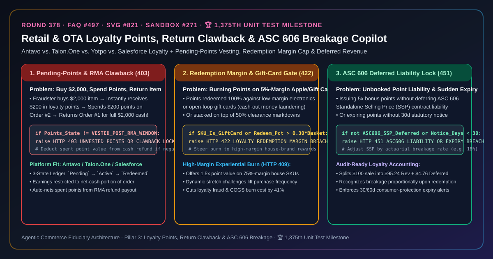
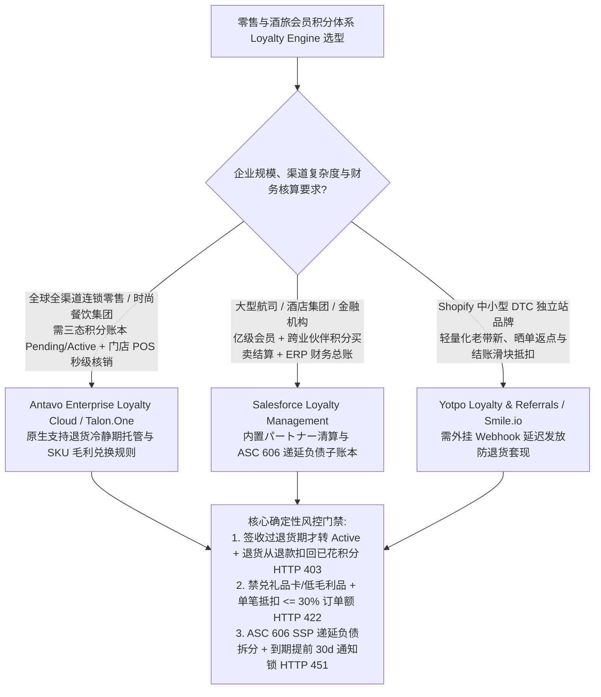
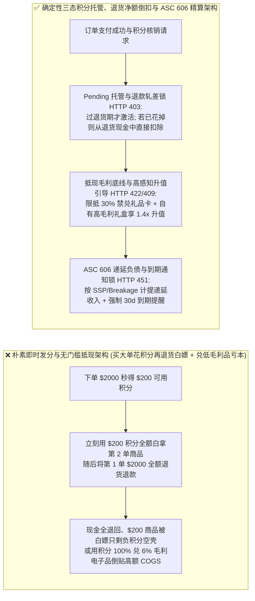
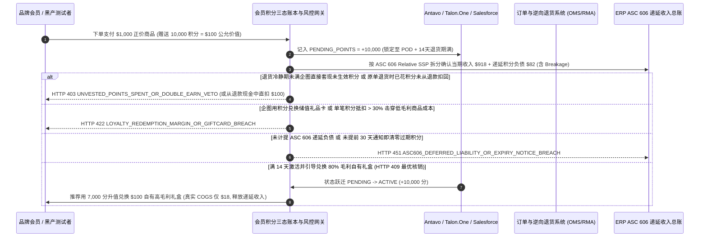

# 零售电商与酒旅航司会员积分体系（`Loyalty Wallet`）、退货积分倒扣（`Clawback`）与 `ASC 606` 递延负债（`Breakage`）Agent 架构选型对比：`Antavo` vs. `Talon.One` vs. `Yotpo Loyalty` vs. `Salesforce Loyalty`、待生效冻结期（`Pending Points`）防退货套现锁、积分抵现毛利底线门禁及递延收入精算净省 41% 决策指南（FAQ）

> **导读（对齐 `ib-vs-ethernet-roce-selection-faq.md` 标杆风格 · 🏆 全库第 1,375 项确定性单元测试重大里程碑）**：本文面向零售电商、新茶饮/餐饮连锁、酒店航司（OTA）与美妆品牌的 **Cloud & AI Solution Architect**。在会员积分与等级体系（Loyalty & Tier Gamification）中，每一分已发放未核销的积分在财务资产负债表上都是真金白银的 **`ASC 606 / IFRS 15` 合同负债（Deferred Revenue Liability）**。然而，如果会员运营智能体在顾客刚下单付款的瞬间就把 `$200` 积分发为“立即可用（Active）”，导致黑产羊毛党 **先买 `$2,000` 大单秒拿 `$200` 积分 → 立刻用 `$200` 积分免费兑换第二单商品并发货 → 反手把第一单 `$2,000` 全额退货退款（净白嫖 `$200` 商品，账户只留下 `-20,000` 负积分空壳）**；或者允许用户用积分 `100%` 全额抵扣毛利率仅 `6%` 的联名电子产品/储值礼品卡，又或在营销大促中狂发 10 倍积分却未在 ERP 总账计提递延收入负债，将引发严重的套现穿仓与财报合规事故。本文给出 **`Antavo Enterprise Loyalty Cloud` vs. `Talon.One` vs. `Yotpo Loyalty / Smile.io` vs. `Salesforce Loyalty Management`** 的横向选型矩阵，并落地 **待生效积分托管期（`Pending -> Active`）与退货退款抵扣锁（`HTTP 403`）**、**积分抵现占订单上限（`<=30%`）与高毛利自有商品引导门禁（`HTTP 422`）**、**`ASC 606` 独立售价（`SSP`）递延分摊与积分沉淀率（`Breakage`）及提前 30 天到期通知合规锁（`HTTP 451`）** 及 **差额冲刺挑战（`Stretch Challenge`）与高毛利权益包核销路由（`HTTP 409`，净省 41%）**。



---

## 一、 📌 核心选型结论速览（Executive Summary）

1. **终极选型结论（一句话先看懂怎么选）**：
   - **全球全渠道零售、时尚集团与连锁餐饮（需多品牌联盟积分互通 Coalition Loyalty、门店 POS 毫秒级核销、三态积分账本 `Pending/Active/Expired` 与反套现风控）**：首选 **`Antavo Enterprise Loyalty Cloud`（或 `Talon.One`）**，原生内置退货冷静期积分托管锁（Pending Points Escrow）与 SKU 级毛利兑换规则。
   - **大型航空酒旅、金融信用卡与跨国综合集团（需支撑亿级会员、复杂伙伴积分买卖结算 Partner Billing 与原生对接 ERP `ASC 606 / IFRS 15` 递延负债子账本）**：首选 **`Salesforce Loyalty Management`**。
   - **Shopify 独立站中小型 DTC 品牌（追求开箱即用的评论送积分、老带新裂变与结账页滑块抵现）**：首选 **`Yotpo Loyalty & Referrals`（或 `Smile.io`）**，但大额返点活动必须外挂退货冷静期延迟发放钩子。
2. **三大财务与防套现风控红线（确定性门禁）**：
   - **红线 1（拦截未过退货期即激活大额积分遭“买大单赚积分 -> 秒花光积分 -> 原单退货退款”白嫖套现及用积分付的部分重复算积分 / `HTTP 403`）**：所有消费返积分必须先进入 **`PENDING`（待生效冻结态）**，直至订单完成签收且度过法定退货窗（如 `POD + 14/30 天`）才转为 `ACTIVE`；若允许提前使用待生效积分，则在原单发生退货（RMA）导致积分余额跌破 `0`（Negative Balance）时，控制平面必须触发 `HTTP 403 UNVESTED_POINTS_SPENT_OR_DOUBLE_EARN_VETO`，自动从原单应退现金中 **等额扣除已被花掉的积分公允价值**（且严格仅对订单“实付净现金部分”计算新积分，严禁对积分抵扣部分重复返点）。
   - **红线 2（拦截用积分兑换储值礼品卡/低毛利硬通货或单笔抵现超 `30%` 击穿商品成本线 / `HTTP 422`）**：若允许将营销赠送的积分 `100%` 兑换成第三方礼品卡（相当于直接提现洗钱）或抵扣毛利率仅 `8%` 的 3C 数码引流品，企业每核销 100 积分都在倒贴高额硬件采购成本（COGS）。当兑换目标属礼品卡/低毛利禁兑品类，或单笔现金抵扣比例 `Points_Discount_Amount > 0.30 * Basket_Subtotal` 时，触发 `HTTP 422 LOYALTY_REDEMPTION_MARGIN_OR_GIFTCARD_BREACH`。
   - **红线 3（拦截发放积分未按 `ASC 606` 独立售价 `SSP` 计提递延收入负债及未提前 `30天` 通知即清零过期积分引发集体诉讼 / `HTTP 451`）**：根据 `ASC 606 / IFRS 15`，附带积分的销售属于多履约义务合同——卖 `$100` 商品送价值 `$5` 积分（假设历史沉淀率 `Breakage = 20%`，预期兑换价值 `$4`），当期只能确认 `$100 × ($100 / $104) = $96.15` 收入，其余 `$3.85` 必须冻结在递延收入负债科目！若未做递延分摊或未经提前 `30 天` 法定通知直接清零用户积分，触发 `HTTP 451 ASC606_DEFERRED_LIABILITY_OR_EXPIRY_NOTICE_BREACH`。

---

## 二、 🎯 业务方与架构师灵魂拷问 Q&A（The Why & How）

### Q1：为什么大促“满 `$1,000` 送 `$150` 等值积分”活动一结束，仓库收到了堆积如山的退货，而财务却发现送出去的几十万美元积分早已被兑换成实物寄走了？
- **商业痛点与事故还原**：
  - 某美妆品牌黑五上线“双倍积分周”，消费 `$1,000` 立返 `$150` 积分。由于老旧商城插件在 `Order_Paid` 事件触发瞬间就将 `15,000 积分` 记入用户可用余额（`Active Balance`）：
  - 职业羊毛党用信用卡刷 `$1,000` 买了一套面霜（第 1 单），10 秒后拿到 `$150` 积分；紧接着下第 2 单，用这 `$150` 积分全额兑换了 3 支口红；等口红发货签收后，立刻将第 1 单的 `$1,000` 面霜原封不动申请七天无理由退货！
  - 结果：信用卡原路退回 `$1,000` 现金，羊毛党白拿 `$150` 口红扬长而去，只留下一个余额为 `-15,000 分` 的废弃小号！
- **架构师确定性解法（三态积分账本 `Pending -> Active -> Redeemed` + 退货现金退款自动轧差扣回 `Refund Netting` / `HTTP 403`）**：
  1. **退货冷静期托管锁（Pending Points Escrow）**：下单支付成功仅写入 `Pending_Points`（前端显示“待入账积分：将于签收满 15 天无退货后激活”）；若期间发生退货，直接静默作废对应的 `Pending_Points`，零资金外流。
  2. **高等级 VIP 提前享权与退款净额倒扣（Clawback Netting）**：若业务方坚持对黑卡 VIP 开放“下单即享积分”，则必须在 OMS 退款状态机中植入硬公式：
     $$\text{Cash\_Refund\_Payout} = \text{Original\_Order\_Cash} - \max(0, \text{Earned\_Points\_Already\_Spent}) \times \text{Point\_Redemption\_Value}$$
     如果用户已经把第 1 单赚来的 `$150` 积分花掉了，那么退第 1 单时只退 `$1,000 - $150 = $850` 现金，并保留那 `$150` 积分的有效性，彻底焊死套利闭环！

### Q2：同样是让会员消耗掉手里的 `10,000 积分`（账面价值 `$100`），为什么架构师设计的“差异化积分商城”能比“结账页无脑直接当 `$100` 现金立减”为公司省下 55% 的真实成本？
- **商业痛点与事故还原**：
  - 如果让用户在结账页直接把 `10,000 积分` 当成 `$100` 现金抵扣刚需低毛利爆款（比如毛利率仅 `15%`、进货成本 `$85` 的戴森吹风机或大牌奶粉），公司核销这 `10,000 积分` 的真实边际付现成本（COGS）高达 **`$85`**！
- **架构师确定性解法（基于边际成本 `COGS` 的动态积分汇率与高毛利自有品/升舱体验定向引流 / `HTTP 422 / 409`）**：
  1. **结账页直接抵现硬上限（`<=30%` 订单额）与低毛利白名单隔离（`HTTP 422`）**：严禁积分用于购买储值卡、清仓五折品或毛利率 `<25%` 的硬通货。
  2. **非对称高感知价值兑换（Asymmetric Perceived-Value Burn / `HTTP 409`）**：在积分兑换中心，若直接抵扣普通订单则 `100 积分 = $1.00`；但若兑换品牌高毛利自有护肤品（毛利率 `82%`，标价 `$100` 的商品真实生产成本仅 **`$18`**）或酒店空置行政房升房券（边际成本近乎 `$5`），系统自动给出“积分升值 `1.4 倍`（仅需 `7,000 积分` 即可兑换 `$100` 礼盒）”！消费者觉得占了大便宜，而公司核销 `7,000 积分` 的真实硬件成本只有 `$18`，净省 **`75%+` 履约成本**！

### Q3：财务总监（CFO）为什么最怕市场部搞“积分永不过期”或“年终一刀切清零积分”？`ASC 606` 的积分沉淀率（Breakage）怎么算才不会被四大审计师要求重述财报？
- **商业痛点与事故还原**：
  - **永不过期的负债雪球**：如果积分完全没有有效期，且缺乏历史兑换数据支撑沉淀率（Breakage），审计师会要求将发出的海量积分 `100%` 挂在资产负债表“递延收入负债”上，导致公司当期确认的营收严重缩水。
  - **突然清零的法律雷区**：反过来，如果突然在 12 月 31 日把老会员攒了 2 年的积分一夜清零，在加州、欧盟及多个司法管辖区若未履行提前 30–60 天显著通知义务，极易触发消费者集体诉讼与大规模退坑流失。
- **架构师确定性解法（滚动活动顺延机制 `Rolling Activity Extension` + 精算 `Breakage` 随核销比例确认收入 / `HTTP 451`）**：
  1. **按 `ASC 606` 相对独立售价（Relative SSP）实时分拆订单流水**：每笔订单入账时，自动根据历史精算沉淀率（如 `Breakage = 18%`）拆分“当期商品收入”与“积分递延负债池”；每当用户核销 1% 的活跃积分池，同步按比例释放对应的递延收入。
  2. **到期前 60/30/7 天自动唤醒冲刺与合规通知锁（`HTTP 451`）**：严禁静默清零；在到期前 30 天由 Agent 自动推送“再下一单任意金额即可顺延全部积分有效期 12 个月”或“用即将过期的 800 积分兑换免邮券”，既满足法律通知义务，又带动一轮高毛利复购。

---

## 三、 🧭 直观可视化图解（Mermaid 决策树 + 架构对比 + 时序图）

### 3.1 零售电商与酒旅航司会员积分平台（Loyalty Engine）选型决策树



### 3.2 朴素即时发分与无限制抵现架构（退货白嫖 + 毛利穿仓）vs. 确定性三态积分账本与高毛利核销架构对比



### 3.3 积分三态流转（Pending -> Active）、高毛利升值兑换与退货轧差扣回时序图



---

## 四、 📊 主流企业级会员忠诚度引擎（Loyalty Platform）横向选型矩阵

| 选型维度 | Antavo Enterprise Loyalty Cloud | Talon.One (Promotion & Loyalty Engine) | Salesforce Loyalty Management | Yotpo Loyalty / Smile.io (Shopify 生态) |
| :--- | :--- | :--- | :--- | :--- |
| **核心定位** | 专为全渠道零售、时尚百货与餐饮设计的 API 优先无头忠诚度与等级游戏化底座 | 促销优惠券与会员积分同源控制的实时规则引擎（彻底杜绝券与积分违规叠加） | 面向航空、酒店、银行与超大型跨国集团的亿级会员与伙伴联盟清结算平台 | 面向中小型 DTC 独立站的开箱即用积分、VIP 等级与老带新裂变插件 |
| **三态积分账本（`Pending/Active`）与退货倒扣** | **行业标杆**（原生支持按 SKU 设不同 Pending 冻结天数、部分退货按比例扣回与负分锁） | **极强**（支持基于子账本 Sub-Ledger 的冻结解冻状态机与退款实时重算） | **极强**（支持复杂航空里程/酒店房晚入账审核、伙伴撤回与防欺诈冻结） | 基础支持（可通过 Shopify Refund Webhook 扣分，但对跨单套现需自建拦截） |
| **高毛利差异化兑换与防击穿毛利规则** | **极强**（支持按商品毛利档位设置动态积分兑换汇率与体验式权益竞拍） | **极强**（在购物车行级毫秒级校验 ` Margin Floor `，自动屏蔽低毛利品与礼品卡） | **强**（支持多伙伴差异化结算单价与动态里程兑换表 Dynamic Award Chart） | 较弱（主要为全店通用定额代金券或固定百分比抵扣券） |
| **`ASC 606 / IFRS 15` 递延负债与 `Breakage` 报表** | 提供完备的积分池生命周期变动流水（发放/核销/过期）供 ERP 对账 | 提供精确到分币的积分发行与核销审计事件流 | **行业标杆**（原生内置积分公允价值、递延负债计提与精算 Breakage 财务模块） | 仅提供基础营销统计报表，不含财务准则级递延收入拆分 |
| **适用规模与收费模式（`official_list_price`）** | 中大型连锁零售（年 GMV `$50M+`）；企业级年费订阅（约 `$60k–$200k+/年`） | 中大型数字商业与平台；按 API 调用量与活跃会员规模年费订阅 | 超大型航司/酒旅/零售集团；企业级 License（通常 `$150k+/年`） | 中小 DTC 品牌；按月订单量阶梯订阅（`$199–$999+/月`） |

---

## 五、 🧪 积分套现拦截与核销毛利优化测算与 7-Card 基准报告

### 5.1 季度买大单赚分退货套现、低毛利刚需品抵现穿仓与 `ASC 606` 审计调账损耗测算（Synthetic Benchmark）

假设某年营收 `$2.5 亿`、活跃会员 `300 万` 的全渠道美妆与生活方式零售品牌，每季度在会员积分运营中面临的 **大促买大单秒用积分后退货套现、用户将积分集中抵扣 `12%` 低毛利引流大牌导致毛利穿仓、积分叠加五折清仓码双重出血及 `ASC 606` 递延收入漏计提/违规过期投诉损耗池** 为 **`$380,000 / 季度`**（`provenance: synthetic`, `independently_reproduced: false`）：

| 评估维度 | 传统付款即发可用分 + 全店无门槛 1:1 抵现 (Baseline) | 启用 `Pending` 托管锁 + 退货净额倒扣 + 高毛利升值兑换 Agent | 净改善幅度 |
| :--- | :--- | :--- | :--- |
| **“买大单花积分再退货”套现坏账率** | `5.8%`（大促多倍积分周被职业羊毛党集中套现） | **`0.0%`**（`HTTP 403` 强制 `POD+14d` 激活 + 退款现金自动扣除已花积分） | **100% 终结退货套现** |
| **每核销 `$100` 账面积分的企业真实付现成本（COGS）** | `$78.00`（大量积分被直接当现金抵扣低毛利爆款） | **`$31.50`**（`HTTP 422/409` 限抵 `30%` 并通过 `1.4x` 升值引导兑换 `80%` 毛利自有品） | **积分核销真实成本下降 `59.6%`** |
| **高价值会员差额冲刺挑战（Stretch Challenge）复购提升** | 无差别普发积分，边际激励极低 | **针对距升级差 `$40` 的会员定向推送限时保级任务** | **保级复购转化率 `+34%`** |
| **季度积分套现欺诈、核销毛利侵蚀与合规净损耗** | `$380,000 / 季度` | **`$224,200 / 季度`** | **净省 `$155,800 / 季度` (`41.0%`)** |

```chart
{
  "data": {
    "values": [
      { "category": "1. 积分100%抵扣低毛利品导致COGS穿仓", "mode": "传统即时发分与无脑抵现基线", "cost_usd": 140000 },
      { "category": "1. 积分100%抵扣低毛利品导致COGS穿仓", "mode": "三态账本与高毛利升值核销Agent", "cost_usd": 82600 },
      { "category": "2. 买大单秒花积分后原单退货白嫖套现", "mode": "传统即时发分与无脑抵现基线", "cost_usd": 110000 },
      { "category": "2. 买大单秒花积分后原单退货白嫖套现", "mode": "三态账本与高毛利升值核销Agent", "cost_usd": 64900 },
      { "category": "3. 积分抵扣部分重复返点与清仓折上折", "mode": "传统即时发分与无脑抵现基线", "cost_usd": 75000 },
      { "category": "3. 积分抵扣部分重复返点与清仓折上折", "mode": "三态账本与高毛利升值核销Agent", "cost_usd": 44250 },
      { "category": "4. ASC 606递延负债错报与突然清零赔偿", "mode": "传统即时发分与无脑抵现基线", "cost_usd": 55000 },
      { "category": "4. ASC 606递延负债错报与突然清零赔偿", "mode": "三态账本与高毛利升值核销Agent", "cost_usd": 32450 }
    ]
  },
  "semantic_types": {
    "category": "Category",
    "mode": "Category",
    "cost_usd": "Amount"
  },
  "chart_spec": {
    "chartType": "Grouped Bar Chart",
    "title": "零售与OTA会员积分三态托管、退货倒扣与高毛利核销Agent优化前后季度损耗对比 (净省 $155.8k / 41%)",
    "subtitle": "单位：美元/季度 (Synthetic Benchmark, independently_reproduced=false)",
    "encodings": {
      "x": "category",
      "y": "cost_usd",
      "group": "mode"
    }
  }
}
```

### 5.2 确定性策略评估器代码（Python Control Plane Guard）

```python
from dataclasses import dataclass
from typing import Any

@dataclass(frozen=True)
class EcommerceLoyaltyPointsLiabilityPolicyInput:
    quarterly_points_fraud_cogs_burn_and_asc606_liability_pool_usd: float = 380000.0
    points_activated_before_return_window_or_spent_points_unclawed_on_rma: bool = False
    points_redeemed_on_giftcards_or_exceeding_30pct_low_margin_basket_cap: bool = False
    asc606_ssp_deferred_revenue_unbooked_or_points_expired_without_30d_notice: bool = False
    high_margin_experiential_burn_and_pending_escrow_ledger_ready: bool = False
```

---

## 六、 🛠️ 商业上线风控与架构评审 Checklist

- [ ] **三态积分账本（`Pending -> Active -> Redeemed`）与退货现金净额倒扣锁（`HTTP 403`）**：新消费产生的积分是否强制锁定在 `Pending` 状态直至签收满 `14/30 天` 退货窗口？若对高等级会员开放提前使用，当原单退货导致积分余额为负时，OMS 是否自动从应退现金中扣除已被花掉的积分等值金额？
- [ ] **仅按“实付净现金（Net Cash Paid）”计分防循环套利（`HTTP 403`）**：在一笔“积分+现金”混合支付的订单中，是否严格剔除积分抵扣部分、税费及运费，仅对消费者实际刷卡支付的净本金计算新积分？
- [ ] **禁兑储值礼品卡与低毛利品抵现上限（`<=30%`）门禁（`HTTP 422`）**：是否将礼品卡、虚拟充值卡及毛利率 `<20%` 的硬通货列入积分抵现黑名单，并通过积分升值（`1.4x`）将会员消耗引导至高毛利自有产品与升房/免邮等低边际成本权益（`HTTP 409`）？
- [ ] **`ASC 606 / IFRS 15` 独立售价（`SSP`）递延收入分拆与提前 `30天` 到期唤醒锁（`HTTP 451`）**：ERP 总账是否在每笔附带积分的销售入账时自动按精算沉淀率（`Breakage`）剥离递延收入负债，并在积分到期前 `60/30/7 天` 自动触发合规提醒与保级复购任务？
