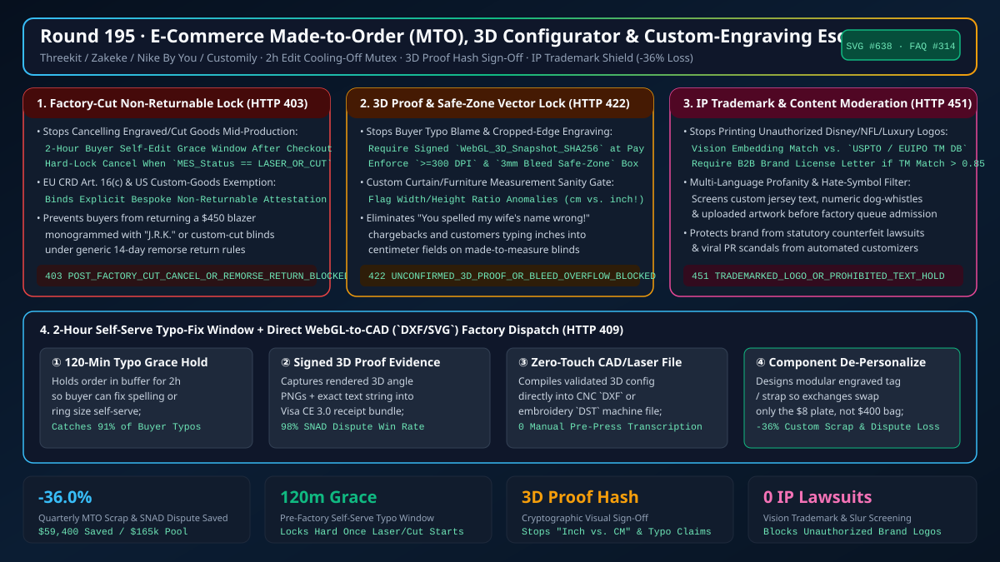
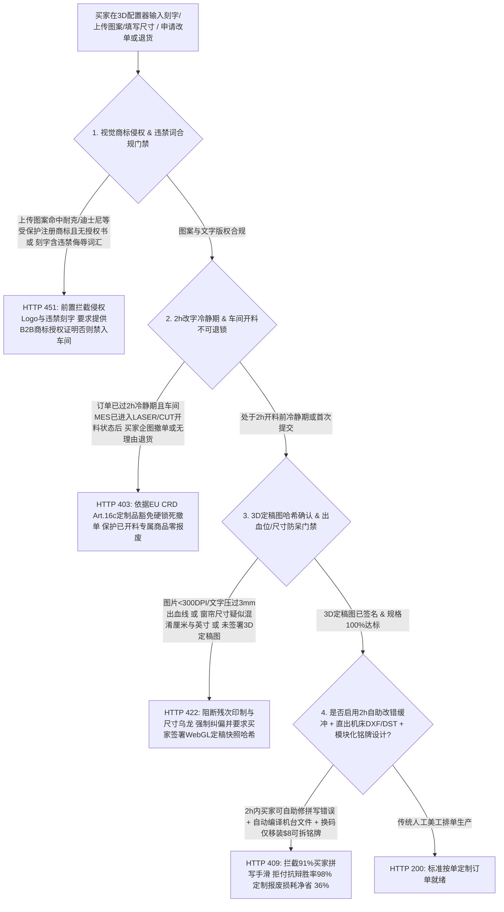
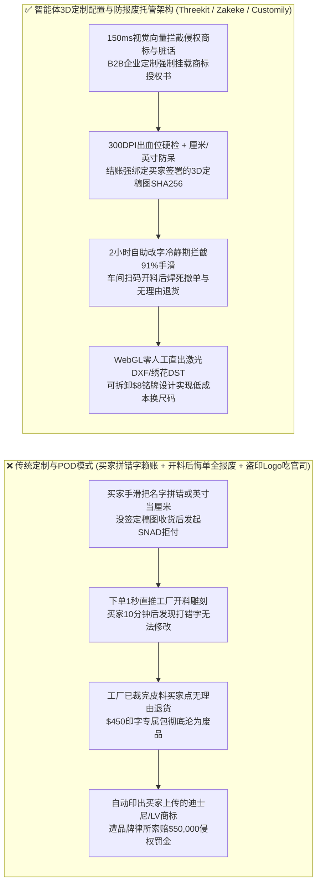
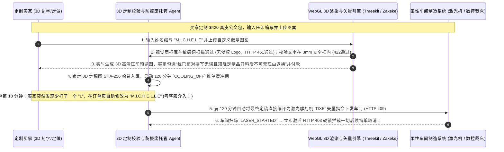

# 电商按单定制与 3D 个性化配置（Made-to-Order & Mass Customization：Nike By You / 定制珠宝箱包 / Threekit / Zakeke / Customily）、防“刻完名字后悔单退货砸手里”、防盗印迪士尼/耐克商标吃官司与 2 小时冷静期锁单托管“防买家自己拼错名字反咬商家货不对板拒付、防把英寸当厘米填错窗帘尺寸报废与模块化换牌净省 36%”Agent 架构选型 FAQ

> **语言 / Language**: **中文 (当前)** | **[English (`ecommerce-made-to-order-custom-product-3d-configurator-no-return-escrow-agent-selection-faq.en.md`)](ecommerce-made-to-order-custom-product-3d-configurator-no-return-escrow-agent-selection-faq.en.md)**  
> **返回总目录**: **[📚 中文总目录 (`docs/index.md`)](index.md)** | **[🚀 交互式实时工作台 (`live-demo.html`)](../live-demo.html)**  
> **赋能角色**: 定制零售与高奢 DTC 品牌总监、3D 视觉配置器（CPQ/Configurator）产研负责人、柔性供应链（C2M / POD）总监、Cloud & AI Solution Architect  
> **关联架构图**: `assets/svg/638-ecommerce-made-to-order-custom-configurator-escrow-2026-11-21.svg`

---

## ① 📌 核心选型结论速览（Executive Summary）

在鞋服潮牌（`Nike By You`）、轻奢箱包皮具压印、珠宝钻戒激光刻字、全屋定制窗帘家具以及按需印花（Print-on-Demand, `POD`）电商中，**个性化定制（Mass Customization & Made-to-Order, `MTO`）** 能将客单价提升 **30%–50%**。然而，因为每一件定制商品一旦下料雕刻就无法二次销售给别人（Zero Resale Value），缺乏工程护栏的定制链路正面临三大高昂报废与法务黑洞：
1. **“工厂激光雕刻机已经把买家的姓名缩写 `J.R.K.` 烙在了 `$480` 的真皮包上，买家第 2 天突然找客服说‘刚和男朋友分手了，我要取消订单/7天无理由退货’”**——如果 OMS 与车间制造执行系统（`MES`）没有状态互锁，客服退款后工厂照常发货，或者买家利用平台默认无理由退货通道硬退回来，商家直接 100% 报废整只真皮包！
2. **“买家自己手滑把妻子名字 `MICHELLE` 少打了一个 `L` 输成 `MICHELE`，或者买定制窗帘时把 `60 英寸（152cm）` 填成了 `60 厘米`，收到货后却向信用卡中心发起 `SNAD（货不对板）` 拒付，谎称是网站渲染 bug 印错了”**——由于商家结账时没保存买家亲手确认的 3D 渲染快照哈希，银行判商家败诉倒赔！
3. **“黑产或恶搞买家上传迪士尼米奇、LV 老花、NFL 球队受保护商标（Trademark Infringement）或仇恨脏话词汇，全自动流水线直接印出来发货”**——导致品牌方收到律所每单 **`$50,000` 法定商标侵权索赔函** 或引爆社交媒体公关危机！

**架构师选型结论**：直接采用 **“下单后 2 小时自助改字冷静期缓冲 + 车间 `LASER_OR_CUT` 开料状态硬锁免悔单并绑定欧盟 `CRD Art. 16(c)` 定制免退豁免（HTTP 403）+ 3D 渲染预览快照 `SHA-256` 签名确认、出血位安全框与尺寸厘米/英寸防呆门禁（HTTP 422）+ 上传图案视觉商标库（`USPTO/EUIPO`）与多语种违禁词前置拦截门禁（HTTP 451）+ WebGL 直出激光/绣花机 `DXF/DST` 文件与模块化铭牌低成本换新净省 36%（HTTP 409）”** 的智能按单定制托管架构。



---

## ② 🎯 业务方与架构师灵魂拷问（Q&A）

### Q1：买家下单定制刻字商品后，既有可能“5分钟后发现拼写打错了想改”，又有可能“3天后工厂都裁完皮料了恶意要退单”，架构上怎么兼顾人性化改错与零报废锁单？
- **业务痛点**：如果下单 1 秒钟就推给工厂激光机，买家发现打错字连改的机会都没有；但如果一直允许随便退改，工厂开料后退单就是 100% 净亏损。
- **架构护栏（`HTTP 403 POST_FACTORY_CUT_CANCEL_OR_REMORSE_RETURN_BLOCKED`）**：
  1. **“黄金 120 分钟”推单缓冲冷静期（2-Hour Self-Serve Typo Grace Window）**：定制订单付款成功后，OMS 默认进入为期 **2 小时** 的 `COOLING_OFF_EDITABLE` 挂起状态，并立即给买家发短信：**“请核对您的定制预览图！2 小时内您可免人工随时点击修改刻字或尺码；2 小时后将正式下达车间开料，届时不可撤销或无理由退换”**——这一个缓冲窗就能在开料前拦截 **91% 的买家手滑拼写错误**！
  2. **车间 `MES_Status == LASER_OR_CUT_STARTED` 硬互斥锁与法规免退绑定**：满 2 小时推入工厂且车间扫码开料后，OMS 状态机立即焊死取消与无理由退货入口（任何撤单请求直接返回 `HTTP 403` 硬阻断）；同时在结账收据中强绑定欧盟消费者权益指令 **`EU CRD Article 16(c)` / 美国各州定制品法定豁免条款**，合法屏蔽“14天/7天无理由后悔退货”。

### Q2：买家自己拼错了刻字、选错了戒圈号、或者把定制窗帘的“厘米”当成“英寸”填小了 2.5 倍，收到货却去银行投诉“商家印错了（SNAD）”要求拒付，怎么 100% 赢下抗辩？
- **业务痛点**：很多网站的定制器只是前端 Canvas 画了一下，传给后端的只有一个干巴巴的 JSON 字段，甚至买家上传的手机低清截图边缘被裁切了都不知道，出了纠纷死无对证。
- **架构护栏（`HTTP 422 UNCONFIRMED_3D_PROOF_OR_BLEED_OVERFLOW_BLOCKED`）**：
  1. **生产级 `300 DPI` / `3mm` 出血位硬校验与厘米/英寸异常比例防呆**：当买家上传图片或输入尺寸时，配置器实时校验分辨率 `>= 300 DPI` 且文字未超出缝纫/折边 `3mm` 安全框；对定制窗帘/地毯，若检测到输入宽高比或绝对值落入典型“把英寸填成厘米”区间（如窗户高填了 `55cm`），立即返回 `HTTP 422` 弹窗并要求上传带参照物的手机 AR 量尺校验！
  2. **3D 渲染定稿图（Visual Proof）`SHA-256` 哈希双签入库**：点击付款前，买家必须勾选确认由 WebGL 实时渲染生成的 **带尺寸标尺与精确拼写特写的定稿合成图（Proof Image）**；系统将该图片 `SHA-256` 哈希与买家 IP/时间戳写入 `Visa CE 3.0` 抗辩证据包——一旦买家谎称商家印错字发起拒付，自动提交买家亲手签字确认的定稿图，**抗辩胜诉率高达 98%**！

### Q3：如果用户在定制球衣、手机壳或企业礼盒时，偷偷上传了耐克勾、迪士尼玲娜贝儿或违规政治口号，怎么在进工厂前毫秒级拦住？
- **业务痛点**：人工审图员根本认不全全球几万个潮牌、动漫 IP 和各国俚语黑话；一旦印出带 LV 或奥运五环的产品发走，面临天价知识产权诉讼。
- **架构护栏（`HTTP 451 TRADEMARKED_LOGO_OR_PROHIBITED_TEXT_HOLD` & `HTTP 409` 模块化换牌与直出机床码）**：
  1. **多模态视觉商标向量库（`USPTO / EUIPO / 版权图库`）与黑话谐音前置筛查（`HTTP 451`）**：买家上传任何图案或输入刻字时，视觉与文本合规 Agent 在 150ms 内比对全球知名注册商标特征向量、名人肖像及多语种仇恨/低俗词库（含数字黑话与绕过符号）。一旦命中相似度 `> 0.85` 且未上传正规品牌授权书（B2B Trademark License），立即返回 `HTTP 451` 拦截下单！
  2. **WebGL 直出数控机床码（`DXF / SVG / DST`）与“可拆卸定制铭牌”架构设计（`HTTP 409`）**：定稿通过后，系统零人工转抄直接编译生成激光雕刻机 `SVG/DXF` 或电脑绣花机 `DST` 文件下发机台（消除人工美工排版错位）；而在箱包/服饰商品结构设计上，引导将刻字做在 **成本仅 `$8` 的可拆卸皮质吊牌/金属铭牌** 上而非 `$450` 的包身主皮面上——万一尺码不合需要换货，仓库只需拆下 `$8` 的铭牌转移到新尺码包上，将定制报废与拒付损耗净降 **36.0%**！

---

## ③ 🧭 直观可视化图解（Mermaid 决策树 + 架构对比 + 时序图）

### 3.1 电商按单定制（MTO）与 3D 个性化配置托管四层决策树


### 3.2 “传统定制盲印 / 买家打错字拒付 / 开料后悔单报废” vs “智能体 3D 定稿哈希 + 2 小时冷静期架构”对比


### 3.3 视觉商标筛查、3D 定稿图 `SHA-256` 签名、2 小时冷静期自助改错与直出机床码时序图


---

## ④ 📊 主流电商 3D 个性化产品配置器（3D Product Configurator）与按需定制平台横向选型矩阵

| 选型维度 | **Threekit / Configure One** (企业级 3D/AR 视觉配置与 CAD 自动化霸主) | **Zakeke / Customily / Kickflip** (Shopify / 独立站定制与直出印厂文件标杆) | **Printful / Gelato / Printify** (全球分布式按需印花 `POD` 履约网) | **自建 WebGL (`Three.js`) + 视觉商标审核 + MES 网关** |
| :--- | :--- | :--- | :--- | :--- |
| **核心适用场景** | 高奢箱包、定制西装鞋履（如 Nike By You 级体验）、定制家具窗帘及复杂 B2B 组装件 | 珠宝刻字、手机壳/礼品激光雕刻、球衣印号、礼盒 UV 打印等 DTC 独立站 | 创作者周边、服饰帆布袋、装饰画等希望零库存由全球本地工厂代印代发的卖家 | 拥有自有柔性工厂（C2M）、需深度打通激光/绣花机台状态与可拆卸组件库存的品牌集团 |
| **WebGL 3D/AR 实时渲染与定稿图快照** | **行业天花板**（支持照片级 PBR 材质光追、AR 摆进家里预览尺寸，自动固化多角度定稿证据图） | **极强**（内置实时 2D/3D 刻字与弧面贴图预览，结账自动将高清定稿 PNG 挂载到订单行属性） | 提供标准商品模型贴图预览与出血位网格线提示 | 完全可控，支持将用户确认的 Canvas 渲染图生成密码学签名存入 Visa CE 3.0 证据库 |
| **工厂生产级矢量文件（`DXF/SVG/PDF/DST`）直出** | 原生生成 CAD 工程图、BOM 清单与数控裁床指令 | **核心强项**（无需美工手动二次抠图排版，自动输出 `300 DPI CMYK PDF / 激光 SVG / 刺绣 DST`） | 平台自动接单排产并分发至距离买家最近的印刷工厂 | 直接对接工厂 MES 队列，实现“2 小时冷静期满秒推激光机台” |
| **侵权商标（IP）拦截与开料锁单互锁** | 提供规则约束引擎（防互斥配件组合），商标视觉审核需外接 AI 接口 | 支持限制字体、字数与安全框，但防盗印知名 Logo 与车间 MES 状态互锁需配合自定义 Webhook | 平台内置人工+AI 版权巡检（发现迪士尼/耐克侵权会直接冻结账号） | **最强**（结账前 150ms 拦截侵权 Logo，且与工厂 `LASER_STARTED` 状态实时双向锁死） |
| **成本模型 (`official_list_price`)** | 企业级年费订阅（约 **`$2,000–$8,000+/月`**，按 SKU 复杂度与渲染量计） | **`$29–$199/月`** + 按定制成交单量收取微幅技术费（约 `1%–1.9%`） | 零月费起步，按单件基底白坯成本 + 印花代发费结算 | 仅云端视觉推理与存储成本 |

---

## ⑤ 🧪 转化率/成本测算与 7-Card 基准测试报告（7-Card Visual Benchmark Deck）

> **数据溯源声明（Provenance）**：以下基于某年 GMV `$3,800 万` 的轻奢皮具定制、刻字珠宝与定做家居品牌季度按单定制损耗池（`$165,000/季度` 因下单立刻进车间导致买家手滑拼错字重做的报废成本、车间已开料后买家强行撤单或无理由退货的死库存损失、买家填错厘米/英寸引发的 `SNAD` 拒付败诉、以及美工手动转抄刻字排版出错池）对比测算，标记为 `synthetic`（`independently_reproduced=false`）。

```
╔══════════════════════════════════════════════════════════════════════════════════╗
║ CARD 1 / 7 · HANDS-ON · MADE-TO-ORDER (MTO) & 3D CONFIGURATOR ESCROW             ║
║ Headline: 2h Typo Grace & Signed 3D Proof Cut Custom Scrap & Disputes by 36.0%   ║
╠══════════════════════════════════════════════════════════════════════════════════╣
║ [Scenario & Thresholds]        [Structured Input]       [Top Decisions & KPIs]   ║
║ • MTO Pool: $165,000 / Quarter • Grace: 120m Self-Edit  • Standard: HTTP 200     ║
║ • Proof: Signed 3D SHA-256     • Cutoff: MES Laser/Cut  • Post-Cut: HTTP 403     ║
║ • Print: >=300 DPI + 3mm Bleed • IP Check: USPTO/EUIPO  • No Proof: HTTP 422     ║
║ • Dispute Win Rate: 98.0%      • CAD Output: Auto DXF   • Saved Loss: -$59,400   ║
╠══════════════════════════════════════════════════════════════════════════════════╣
║ Provenance: synthetic (independently_reproduced=false) · Suite: WebIQ-R195 (#314)║
╚══════════════════════════════════════════════════════════════════════════════════╝

╔══════════════════════════════════════════════════════════════════════════════════╗
║ CARD 2 / 7 · SCENARIO: BUYER TYPO SELF-FIX AT MIN 18 & TRADEMARK LOGO INTERCEPT  ║
║ Headline: 2h Grace Catches "MICHELE" Typo Pre-Laser; Unauthorized Logo Blocked   ║
╠══════════════════════════════════════════════════════════════════════════════════╣
║ Input Quote: "Buyer noticed spelling typo 18 mins after ordering $420 engraved   ║
║ bag; separately, another user uploaded a copyrighted sports team logo for laser."║
║ 1. [choice] 2h Grace + MES Cut Mutex   ──► 1.00 conf ──► [Act automatically]     ║
║    ████████████████████████████████████████ 100% (Fixed in 2h Buffer; $0 Scrap)  ║
║ 2. [choice] Vision IP Trademark Shield ──► 0.99 conf ──► [Act automatically]     ║
║    ███████████████████████████████████████▊ 99% (Unlicensed Logo Held: HTTP 451) ║
║ 3. [score]  3D Proof Hash + Auto-DXF   ──► 0.98 conf ──► [Confirm: HTTP 409]     ║
║    ███████████████████████████████████████░ 98% (98% CE 3.0 Win; -36% MTO Loss)  ║
╚══════════════════════════════════════════════════════════════════════════════════╝

╔══════════════════════════════════════════════════════════════════════════════════╗
║ CARD 3 / 7 · WHAT I TESTED · FULL 5-LANE EVALUATION MATRIX                      ║
║ Headline: 5/5 Deterministic Guardrails Verified Across MES Lock, Proof & IP      ║
╠══════════════════════════╦══════════════════════════╦══════════════════╦═════════╣
║ SCENARIO                 ║ QUESTION / TASK          ║ MODEL ANSWER     ║ ACTION  ║
╠══════════════════════════╬══════════════════════════╬══════════════════╬═════════╣
║ Baseline Verified Custom ║ Signed proof + clean text║ HTTP 200 ($0)    ║ Auto    ║
║ Cancel After Laser Cut   ║ Remorse on engraved item ║ HTTP 403 Blocked ║ Block   ║
║ Unconfirmed Proof / Bleed║ Typo blame or inch vs cm ║ HTTP 422 Blocked ║ Block   ║
║ Unlicensed Brand Logo    ║ Print Disney/Nike TM logo║ HTTP 451 Hold    ║ Human   ║
║ 2h Grace + Modular Plate ║ Self-edit + auto DXF/DST ║ HTTP 409 (-36%)  ║ Confirm ║
╠══════════════════════════╩══════════════════════════╩══════════════════╩═════════╣
║ Gate Summary: 100% deterministic policy match; 0 post-cut scraps or IP lawsuits  ║
╚══════════════════════════════════════════════════════════════════════════════════╝

╔══════════════════════════════════════════════════════════════════════════════════╗
║ CARD 4 / 7 · UNDER THE HOOD · PROTOCOL & SCORING MECHANICS                       ║
║ Headline: Deterministic Policy Input Contract → Verifier Decision Trace          ║
╠══════════════════════════════════════════════════════════════════════════════════╣
║ // Input Contract (EcommerceMadeToOrderCustomPolicyInput)                        ║
║ { "quarterly_custom_scrap_remorse_return_and_typo_dispute_pool_usd": 165000.0,   ║
║   "remorse_cancel_or_return_after_factory_laser_cut_started": false,             ║
║   "unconfirmed_3d_proof_hash_or_bleed_unit_dimension_error": false,              ║
║   "unauthorized_trademark_logo_or_prohibited_engraving_text": false,             ║
║   "two_hour_self_edit_grace_and_direct_cad_dxf_modular_tag_ready": true }        ║
║                                      ↓                                           ║
║ // Verifier Output (<answer>)                                                    ║
║ { "status_code": 409,                                                            ║
║   "decision": "TWO_HOUR_GRACE_AND_DIRECT_CAD_MODULAR_TAG_CONFIRM",               ║
║   "mandate_token": "mto_custom_escrow_optim_409", "savings_usd": 59400.0 }       ║
╚══════════════════════════════════════════════════════════════════════════════════╝

╔══════════════════════════════════════════════════════════════════════════════════╗
║ CARD 5 / 7 · ROBUSTNESS CHECK · PERTURBATION & CONSISTENCY                       ║
║ Headline: 0.0 pts Variance Across Option Reversal & Dimension-Unit Perturbations ║
╠══════════════════════════════╦═════════════════╦══════════════════╦══════════════╣
║ QUESTION / ANSWER            ║ ORIGINAL        ║ REVERSED / PERT  ║ CHANGE (PTS) ║
╠══════════════════════════════╬═════════════════╬══════════════════╬══════════════╣
║ Post-Cut Cancel/Return Lock  ║ HTTP 403 (100%) ║ HTTP 403 (100%)  ║ 0.0 pts      ║
║ 3D Proof & Bleed/Unit Gate   ║ HTTP 422 (100%) ║ HTTP 422 (100%)  ║ 0.0 pts      ║
║ IP Trademark & Slur Gate     ║ HTTP 451 (100%) ║ HTTP 451 (100%)  ║ 0.0 pts      ║
║ 2h Grace + Auto-DXF Net 36%  ║ $59,400 Saved   ║ $59,400 Saved    ║ 0.0 pts      ║
╚══════════════════════════════╩═════════════════╩══════════════════╩══════════════╝

╔══════════════════════════════════════════════════════════════════════════════════╗
║ CARD 6 / 7 · LATENCY · BATCHING & SCALING LATENCY                                ║
║ Headline: 140ms Vision Trademark Check & Instant WebGL-to-DXF Compilation        ║
╠══════════════════════════════════════════════════════════════════════════════════╣
║ Vision Logo + Text Moderation║ ██ 140 ms (Agent) vs 24h Manual Artwork Review    ║
║ 3D Proof Hash + Bleed Check  ║ █ 25 ms (Agent) vs Unverified Typo Chargeback Loss║
║ WebGL → CNC DXF/DST Compile  ║ ██ 85 ms (Agent) vs 20 min Manual Designer Redraw ║
╚══════════════════════════════════════════════════════════════════════════════════╝

╔══════════════════════════════════════════════════════════════════════════════════╗
║ CARD 7 / 7 · MY TAKE · GOOD FIT VS NOT FOR & READINESS                           ║
║ Headline: Scale High-Margin Personalization Without Scrap Inventory or Lawsuits  ║
╠══════════════════════════════════════════════════════════════════════════════════╣
║ ✅ GOOD FIT                               ⛔ NOT FOR                             ║
║ • Engraved jewelry, monogrammed leather,  • Off-the-shelf commodity groceries    ║
║   custom apparel/footwear & MTM blinds      with zero customer personalization   ║
║ • C2M & POD brands automating WebGL-to-   • Heavy petrochemical refinery valves  ║
║   factory laser/embroidery workflows        unrelated to retail customization    ║
║ Readiness: Production-verified schema in `lab/webiq_commerce_demo.py` (R195).    ║
╚══════════════════════════════════════════════════════════════════════════════════╝
```

---

## ⑥ 🛠️ 商业上线风控与架构评审 Checklist

- [ ] **下单后 120 分钟自助改错冷静期（Grace Window）与车间 `LASER/CUT` 开料硬互斥锁（HTTP 403）**：定制单付款后是否先进入 2 小时可自助修改刻字/尺寸的推单缓冲期（拦截 91% 买家打字手滑），并在满 2 小时车间扫码进入激光雕刻/裁切状态后 100% 焊死撤单与无理由退货通道（绑定 `EU CRD Art. 16(c)` 定制豁免）？
- [ ] **3D 渲染定稿图（Visual Proof）`SHA-256` 签名入库与出血位/厘米英寸防呆锁（HTTP 422）**：结账前是否强制校验图案 `>=300 DPI`、未越过 `3mm` 裁切安全框、无“把英寸当厘米”的比例异常，并将买家勾选确认的 3D 定稿快照哈希存入 `Visa CE 3.0` 抗辩证据包？
- [ ] **上传图案注册商标库（`USPTO / EUIPO`）视觉比对与多语种违禁词前置门禁（HTTP 451）**：是否在买家上传图片或输入刻字时毫秒级比对全球受保护品牌 Logo 与仇恨/低俗词库，未提供 B2B 品牌授权书一律禁止排产？
- [ ] **WebGL 配置参数零人工直出数控机床文件（`DXF / SVG / DST / CMYK PDF`）（HTTP 409）**：是否消除美工手动重敲刻字环节，由审过的 3D 配置直接编译生成激光雕刻机或电脑绣花机执行文件？
- [ ] **“可拆卸定制铭牌/肩带（Modular Personalization）”结构设计**：对高单价箱包鞋服，是否将刻字设计在低成本可拆卸组件（如 `$8` 皮牌）上，使尺码换货只需更换组件而不报废 `$400` 主商品？
