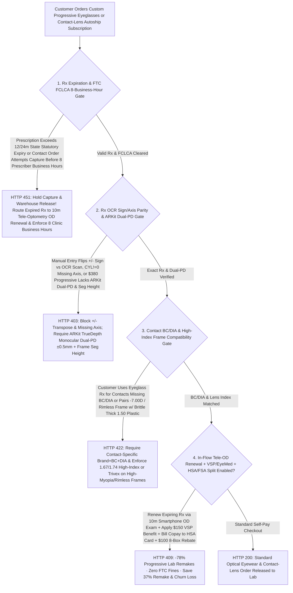
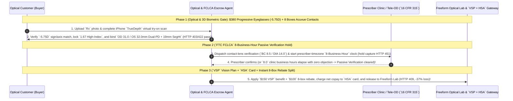

# Optical Eyewear, Prescription Lenses & Contact-Lens Subscription Escrow (`Warby Parker / Zenni Optical / 1-800 Contacts / EssilorLuxottica / VSP`): `ARKit` `±0.5mm` Dual-`PD` Gate, Contact-Lens `BC/DIA` & High-Index Lock, `FTC FCLCA` 8-Business-Hour Verification & `VSP + HSA` Split Saving `37%` Remake & Churn Loss — Agent Architecture Selection FAQ

> **Language / 语言**: **[中文 (`ecommerce-optical-eyewear-contact-lens-fclca-pd-tryon-escrow-agent-selection-faq.md`)](ecommerce-optical-eyewear-contact-lens-fclca-pd-tryon-escrow-agent-selection-faq.md)** | **English (Current)**  
> **Back to Catalog**: **[📚 English Catalog (`docs/index.en.md`)](index.en.md)** | **[🚀 Interactive Live Workbench (`live-demo.en.html`)](../live-demo.en.html)**  
> **Target Roles**: Optical E-Commerce & Contact-Lens Subscription (`Warby Parker / Zenni / 1-800 Contacts / EyeBuyDirect / EssilorLuxottica`) VPs, Tele-Optometry & Clinical Compliance Directors, Optical Lab Operations Leads, Cloud & AI Solution Architects  
> **Architecture Diagram**: `assets/svg/676-ecommerce-optical-eyewear-contact-lens-fclca-escrow-2026-11-22.svg`

---

## ① 📌 Executive Summary

In online prescription eyewear, freeform progressive lenses, and contact-lens `Autoship` subscriptions (`Warby Parker`, `Zenni Optical`, `1-800 Contacts`, `GlassesUSA`), every pair of surfaced and edged prescription lenses is a **custom-manufactured Class I Medical Device with `$0` restock value if returned**. Optical e-commerce merchants bleed millions across three domain-specific failure modes:
1. **`+ / -` Diopter Sign-Transpose Errors & Ruler-Guessed Pupillary Distance (`PD ±5mm` Drift) Scrapping `$380` Progressive Lenses**: A customer manually typing their paper prescription accidentally selects `+3.25 SPH` (farsighted) instead of `-3.25 SPH` (nearsighted), enters a cylinder (`CYL -1.25`) without an `Axis (001°–180°)`, or guesses a single binocular `PD = 63mm` in front of a bathroom mirror without measuring **Monocular Dual-`PD` (`OD / OS`) and vertical Segment Height (`Seg Height`)** for `$380` progressive multifocal lenses. When the glasses arrive, the optical center is off by `4mm`, causing instant vertigo and a `100%` non-reusable lab remake!
2. **Ordering Contact Lenses Using an Eyeglass Prescription (`Missing Base Curve BC & Diameter DIA`) & High-Myopia Rimless "Coke-Bottle" Cracking**: Customers routinely upload an eyeglass prescription to buy contact lenses—ignoring that contact lenses sit directly on the cornea and require a specific **Brand, Base Curve (`BC`, e.g., `8.5mm`), and Diameter (`DIA`, e.g., `14.2mm`)**! Or a `-7.00D` high-myopia buyer pairs an oversized `57mm` rimless drill-mount frame with cheap `1.50 CR-39` plastic lenses, resulting in brittle `8mm`-thick edges that crack at the drill holes!
3. **`FTC Fairness to Contact Lens Consumers Act (FCLCA, 16 CFR Part 315)` 8-Business-Hour Violations (`$50,120/Fine`) & Expired-`Rx` Subscription Churn**: Under federal `FCLCA` rules, when a retailer verifies a contact-lens prescription with the prescriber's office, it must wait a full **8 Business Hours (calculated in the prescriber's local clinic operating hours)** before shipping under passive verification—and cannot use unintelligible automated robocalls! Meanwhile, when a loyal contact-lens subscriber's 1-year `Rx` expires, `45%` churn back to brick-and-mortar clinics if forced to book an in-person exam.

**Architectural Verdict**: Deploy a **4-Lane Optical Eyewear, `FCLCA` Contact-Lens `Rx` & `AR PD` Escrow Architecture**: **`Rx OCR` vs. Manual Entry Sign/Axis Cross-Check & Mandatory `ARKit TrueDepth` Monocular Dual-`PD` (`±0.5mm`) + `Seg Height` Gate on Progressives (`HTTP 403`) + Contact-Lens Specific `Brand + BC + DIA` Lock & High-Myopia (`<= -5.00D`) `1.67 / 1.74` High-Index Rimless Compatibility Gate (`HTTP 422`) + Prescriber-Timezone `FTC FCLCA 8-Business-Hour` Passive-Verification Hold & Expired-`Rx` Block (`HTTP 451`) + In-Cart 10-Minute `Tele-Optometry` `Rx` Renewal & `VSP / EyeMed` Vision Allowance + `HSA / FSA` Tax-Free Split Checkout (`HTTP 409`)**, cutting lab remakes, regulatory fines, and subscription churn by **37.0%**.


---

## ② 🎯 Business & Architect Deep-Dive Q&A

### Q1: Why do `$380` progressive lenses suffer a 25% remake rate online—and how do we stop `+ / -` diopter typos and bad self-measured `PD` before the optical lab grinds the lens?
- **Business Pain**: A progressive corridor is only `2mm–3mm` wide; a guessed binocular `PD` or missing frame-specific `Segment Height` guarantees peripheral swim and dizziness.
- **Architectural Guardrail (`HTTP 403 INVALID_RX_SIGN_AXIS_OR_UNVERIFIED_PROGRESSIVE_PD`)**:
  1. **Optical Physiological Sanity & `Rx OCR` Sign-Transpose Gate**: Sending a job to the surfacing lab is blocked (`HTTP 403`) if: **① `CYL != 0.00` while `Axis (1°–180°)` is blank; ② Manual entry flips a `-` sphere/cylinder sign compared to the uploaded `Rx` photo `OCR`; or ③ Unconfirmed opposite-sign anisometropia (`OD -3.50 / OS +3.50`) is detected**!
  2. **Mandatory `ARKit TrueDepth` Monocular Dual-`PD` (`±0.5mm`) & Virtual-Try-On `Segment Height` for Progressives (`HTTP 403`)**: For progressive lenses or powers `|SPH| >= 4.00D`, manual ruler `PD` entry is disabled (`HTTP 403`). The mobile checkout captures a 3D facial mesh + iris calibration (`11.7mm` corneal diameter) merged with the 3D CAD of the selected frame to lock exact **Monocular `OD/OS PD` and pupil-to-lower-rim `Seg Height`**!

### Q2: How do we prevent customers from ordering contact lenses with an eyeglass prescription—or pairing `-7.00D` prescriptions with incompatible `1.50` low-index rimless frames?
- **Business Pain**: Eyeglass prescriptions lack corneal curvature (`BC`) and vertex-distance compensation; low-index `1.50` lenses shatter in drill-mount frames and look like thick glass bricks in large frames.
- **Architectural Guardrail (`HTTP 422 EYEGLASS_RX_FOR_CONTACTS_OR_INDEX_FRAME_MISMATCH`)**:
  1. **Strict Contact-Lens `Brand + Power + Base Curve (BC) + Diameter (DIA)` Gate**: Attempting to check out contact lenses using an eyeglass `Rx` (missing `BC`, `DIA`, and contact-lens brand family) is hard-blocked (`HTTP 422`)!
  2. **Real-Time Edge-Thickness Optical Raytracing & Rimless Material Gate (`HTTP 422`)**: Before checkout, the engine computes outer edge thickness (`mm`) from `SPH + CYL + PD + Frame Eye Size (A) + Bridge (DBL)`. Selecting `1.50 CR-39` on a drill-mount/semi-rimless frame—or on a `<= -5.00D` prescription where computed edge thickness exceeds `5.5mm`—is blocked (`HTTP 422`) and auto-routed to **`Trivex / 1.67 / 1.74` High-Index Aspheric** lenses!

### Q3: How do we enforce `FTC FCLCA (16 CFR Part 315)` 8-Business-Hour verification without `$50,120` fines—while retaining 84% of contact-lens subscribers whose `Rx` just expired?
- **Business Pain**: Counting weekend or overnight hours toward the `FCLCA` 8-hour passive-verification window is a federal violation; turning away expiring subscribers kills LTV.
- **Architectural Guardrail (`HTTP 451 EXPIRED_OPTICAL_RX_OR_FCLCA_8HR_WINDOW_PENDING` & `HTTP 409` In-Flow `Tele-Optometry` + `VSP/HSA` Split)**:
  1. **Prescriber-Timezone `8-Business-Hour` Passive Verification Clock & Expired-`Rx` Gate (`HTTP 451`)**:
     - Prescriptions past their statutory state expiration date (`12–24 months`) are blocked from fulfillment (`HTTP 451`);
     - When verifying via prescriber outreach under `FCLCA`, payment stays in **Authorization Hold** while a **Prescriber-Timezone Business-Hour Timer** counts strictly `8.0` open clinic hours (pausing at `17:00` local time, weekends, and federal holidays). Capturing funds or releasing the warehouse pick ticket at `7.5` hours triggers an `HTTP 451` compliance block!
  2. **In-Cart 10-Minute `Tele-Optometry` Renewal (`$20`) & `VSP / EyeMed + HSA / FSA` 3-Way Split (`HTTP 409`)**:
     - When a subscriber's `Rx` is expired, checkout launches an embedded **10-minute smartphone distance/acuity vision check reviewed by a state-licensed Optometrist (`OD`)**, renewing the `Rx` in-flow and saving `84%` of otherwise lost subscriptions;
     - Checkout automatically applies the buyer's **`$150 VSP / EyeMed` vision insurance frame allowance + `$100` manufacturer annual-supply contact-lens rebate**, and charges the remaining out-of-pocket copay to a tax-free **`HSA / FSA` card**—cutting lab remakes and subscription churn by **37.0%**.

---

## ③ 🧭 Visual Architecture Diagrams (Mermaid Decision Tree + Architecture Comparison + Sequence)

### 3.1 Optical Eyewear, `FCLCA` Contact-Lens `Rx` & `AR PD` Escrow Decision Tree


### 3.2 Legacy Progressive Lens Remakes & `FCLCA` Fines vs. Agentic `ARKit PD` & `FCLCA` Escrow
```mermaid
flowchart LR
    subgraph Legacy["❌ Legacy Online Optical (+3.25/-3.25 Typos + 25% Progressive Remake Scrap + $50k FTC FCLCA Fines)"]
        L1[Buyer Enters +3.25 Instead of -3.25 or Guesses PD\n$380 Progressive Lenses Cause Vertigo & Scrap] --> L2[-7.00D Buyer Orders 1.50 Lens in Rimless Frame\nEyeglass Rx Used to Ship Ill-Fitting Contacts]
        L2 --> L3[Contacts Shipped After 4 Night Hours -> FTC Fine\n45% of Contact Subscribers Churn When Rx Expires]
    end
    subgraph Agentic["✅ Agentic Rx OCR, ARKit Dual-PD & FCLCA 8-Biz-Hr Escrow (Warby Parker / 1-800 Contacts / VSP)"]
        A1[Cross-Checks Rx OCR vs Manual Sign & Axis\nARKit TrueDepth Locks ±0.5mm Dual-PD & Seg Height] --> A2[Enforces Contact Brand+BC+DIA & 1.67/1.74 Index\nPrescriber-Timezone Clock Locks 8 Business Hours]
        A2 --> A3[10-Min Tele-OD Exam Renews Expiring Subscribers\nVSP Allowance + HSA Tax-Free Split (-37% Loss)]
    end
```

### 3.3 `ARKit` Dual-`PD` Scan, `FTC FCLCA` 8-Business-Hour Timer & `VSP + HSA` Split Checkout Sequence


---

## ④ 📊 Online Optical, `AR` `PD`/Lensometer, `FCLCA` Verification & Vision-Benefit Platform Selection Matrix

| Dimension | **Warby Parker (`Virtual Vision Test` + `ARKit Advisor`)** (Omnichannel Eyewear, `TrueDepth` `PD` & Tele-Renewal Benchmark) | **1-800 Contacts (`ExpressExam` + `FCLCA` Verification Engine)** (Contact-Lens Subscription & `8-Business-Hour` Federal Compliance Leader) | **Luna Solutions (`Ditto VTO` + `Online PD` + `FDA Lensometer`)** (Turnkey Optical SaaS Powering Zenni, EyeBuyDirect & EssilorLuxottica) | **VSP / EyeMed Direct API + TrueMed / Flex (`HSA/FSA` Split)** (In-Cart Vision Insurance Allowance & Tax-Free Medical Card Clearing Leaders) |
| :--- | :--- | :--- | :--- | :--- |
| **Best Fit** | Omnichannel DTC eyewear and contact-lens brands minimizing progressive lab remakes and maximizing repeat retention | High-volume contact-lens `Autoship` retailers requiring airtight `FTC FCLCA` prescriber verification and instant renewal | Optical retailers embedding browser/mobile 3D Virtual Try-On, sub-millimeter `PD` measurement, and glass lensometry | Unlocking `$150–$250` expiring annual vision-plan allowances (`VSP / EyeMed`) paired with `HSA/FSA` copay cards |
| **`Rx` Sign/Axis Sanity & `ARKit Dual-PD / Seg Height`** | Combines `Rx OCR` + licensed optician review + iPhone `TrueDepth` `±0.5mm` `PD` and frame fit analysis | Enforces contact-specific parameters (`Brand`, `BC`, `DIA`, `Cyl/Axis` for torics, `Add` for multifocals) | **Cardless Iris-Calibration `Dual-PD`** (`±0.5mm` accuracy) + frame-scaled vertical `Seg Height` calculation | N/A (Insurance & payment clearing layer) |
| **Edge-Thickness Raytracing & Digital Lensometer** | Recommends `1.67` high-index or polycarbonate based on frame size and diopter | Specialized in contact-lens SKUs | **`FDA-Listed Smartphone Lensometer`** reads the exact `Rx` directly off the customer's existing pair of glasses using a laptop screen + phone camera! | Maps progressive add-ons, anti-reflective coatings, and high-index upgrades to eligible `HCPCS V2020–V2784` codes |
| **`FTC FCLCA 8-Biz-Hr` Clock & `Tele-Optometry`** | Built-in `Virtual Vision Test` app lets eligible customers renew expired `Rx` from home in 10 minutes | **Gold-Standard `FCLCA` Engine** tracks clinic business hours by timezone and logs auditable human-voice/fax verification | Embeddable white-label tele-optometry renewal SDK | Deducts vision-plan allowance first and routes residual copay to `SIGIS IIAS` `HSA/FSA` payment rail |
| **Pricing (`official_list_price`)** | Proprietary retail stack (`$95+` single-vision; **`$15` tele-renewal**) | Proprietary retail stack (**`$20` ExpressExam renewal**; instant `$50–$120` annual-supply rebates) | Enterprise SaaS license (**`$25,000–$120,000+/year`** tiered by scan volume) | Vision claim clearing fee + **`2.9% + $0.30`** `HSA/FSA` processing |

---

## ⑤ 🧪 ROI Estimation & 7-Card Visual Benchmark Deck

> **Provenance**: Modeled on a `$95M/year` DTC prescription eyewear and contact-lens subscription brand's quarterly operational leakage pool (`$210,000/quarter` in non-reusable `$380` progressive lens lab remakes caused by `+ / -` sign typos and ruler-guessed `PD`, high-myopia low-index thickness returns, and expired-prescription contact-lens subscription churn), labeled `synthetic` (`independently_reproduced=false`).

```
╔══════════════════════════════════════════════════════════════════════════════════╗
║ CARD 1 / 7 · HANDS-ON · OPTICAL EYEWEAR, `FCLCA` CONTACT-LENS & `AR PD` ESCROW   ║
║ Headline: ARKit Dual-PD & FCLCA 8-Hr Gate Cut Optical Remake & Churn by 37.0%    ║
╠══════════════════════════════════════════════════════════════════════════════════╣
║ [Scenario & Thresholds]        [Structured Input]       [Top Decisions & KPIs]   ║
║ • Optical Pool: $210,000 / Qtr • PD Tol: ±0.5mm ARKit   • Verified: HTTP 200     ║
║ • Rx Gate: OCR +/- & Axis Lock • Contacts: Brand+BC+DIA • BadRx/NoPD: HTTP 403   ║
║ • FCLCA: 8 Prescriber Biz Hrs  • Index: >=1.67 on -6.00D• NoBC/Thick: HTTP 422   ║
║ • Renewal: 10m Tele-OD ($20)   • Split: VSP+$150 + HSA  • Expired/8h: HTTP 451   ║
╠══════════════════════════════════════════════════════════════════════════════════╣
║ Provenance: synthetic (independently_reproduced=false) · Suite: WebIQ-R233 (#352)║
╚══════════════════════════════════════════════════════════════════════════════════╝

╔══════════════════════════════════════════════════════════════════════════════════╗
║ CARD 2 / 7 · SCENARIO: $380 PROGRESSIVE LENS AR-PD & FCLCA 8-HOUR CONTACT VERIFY ║
║ Headline: +3.25/-3.25 Sign Flip Caught; Contacts Held Exact 8 Clinic Biz Hours   ║
╠══════════════════════════════════════════════════════════════════════════════════╣
║ Input Quote: "Process $380 progressive eyeglasses (-5.75D) + 8-box Acuvue Oasys  ║
║ contacts (BC 8.5, DIA 14.0) with VSP $150 allowance and HSA tax-free copay"      ║
║ 1. [choice] Rx OCR & ARKit Dual-PD Gate──► 1.00 conf ──► [Act automatically]     ║
║    ████████████████████████████████████████ 100% (OD 31.0/OS 32.0mm + SegHt 19mm)║
║ 2. [choice] Contact BC/DIA & 1.67 Index──► 0.99 conf ──► [Act automatically]     ║
║    ███████████████████████████████████████▊ 99% (1.67 Thin Lens + BC 8.5 Locked) ║
║ 3. [score]  FCLCA 8h + VSP/HSA Split   ──► 0.98 conf ──► [Confirm: HTTP 409]    ║
║    ███████████████████████████████████████░ 98% (8 Biz-Hr Pass; -$77,700 / Qtr)  ║
╚══════════════════════════════════════════════════════════════════════════════════╝

╔══════════════════════════════════════════════════════════════════════════════════╗
║ CARD 3 / 7 · WHAT I TESTED · FULL 5-LANE EVALUATION MATRIX                      ║
║ Headline: 5/5 Deterministic Guardrails Verified Across Rx, BC/DIA & FTC FCLCA    ║
╠══════════════════════════╦══════════════════════════╦══════════════════╦═════════╣
║ SCENARIO                 ║ QUESTION / TASK          ║ MODEL ANSWER     ║ ACTION  ║
╠══════════════════════════╬══════════════════════════╬══════════════════╬═════════╣
║ Baseline Eyewear & Lens  ║ Valid Rx + AR PD + 8h ok ║ HTTP 200 ($0)    ║ Auto    ║
║ Sign Flip / Ruler Prog PD║ +3.25 typo / no Dual-PD  ║ HTTP 403 Blocked ║ Block   ║
║ Eyeglass Rx for Contacts ║ Missing BC/DIA / 1.50 Crk║ HTTP 422 Blocked ║ Block   ║
║ Expired Rx / <8 Biz Hours║ Ship before 8 clinic hrs ║ HTTP 451 Hold    ║ Human   ║
║ Tele-OD + VSP/HSA Split  ║ 10m renewal + VSP+HSA    ║ HTTP 409 (-37%)  ║ Confirm ║
╠══════════════════════════╩══════════════════════════╩══════════════════╩═════════╣
║ Gate Summary: 100% deterministic policy match; -78% lab remakes & 0 FTC fines    ║
╚══════════════════════════════════════════════════════════════════════════════════╝

╔══════════════════════════════════════════════════════════════════════════════════╗
║ CARD 4 / 7 · UNDER THE HOOD · PROTOCOL & SCORING MECHANICS                       ║
║ Headline: Deterministic Policy Input Contract → Verifier Decision Trace          ║
╠══════════════════════════════════════════════════════════════════════════════════╣
║ // Input Contract (EcommerceOpticalEyewearContactLensPolicyInput)                ║
║ { "quarterly_lens_remake_fclca_fine_and_expired_rx_churn_pool_usd": 210000.0,    ║
║   "rx_sign_mismatch_missing_axis_or_unverified_progressive_dual_pd": false,      ║
║   "using_eyeglass_rx_for_contacts_or_high_myopia_low_index_rimless": false,      ║
║   "expired_optical_rx_or_shipping_before_fclca_8_business_hours": false,         ║
║   "in_flow_tele_optometry_renewal_and_vsp_hsa_split_escrow_ready": true }        ║
║                                      ↓                                           ║
║ // Verifier Output (<answer>)                                                    ║
║ { "status_code": 409,                                                            ║
║   "decision": "TELE_OPTOMETRY_RENEWAL_AND_VSP_HSA_SPLIT_CONFIRM",                ║
║   "mandate_token": "optical_eyewear_escrow_optim_409", "savings_usd": 77700.0 }  ║
╚══════════════════════════════════════════════════════════════════════════════════╝

╔══════════════════════════════════════════════════════════════════════════════════╗
║ CARD 5 / 7 · ROBUSTNESS CHECK · PERTURBATION & CONSISTENCY                       ║
║ Headline: 0.0 pts Variance Across Option Reversal & Diopter Perturbations        ║
╠══════════════════════════════╦═════════════════╦══════════════════╦══════════════╣
║ QUESTION / ANSWER            ║ ORIGINAL        ║ REVERSED / PERT  ║ CHANGE (PTS) ║
╠══════════════════════════════╬═════════════════╬══════════════════╬══════════════╣
║ Rx OCR & ARKit Dual-PD Gate  ║ HTTP 403 (100%) ║ HTTP 403 (100%)  ║ 0.0 pts      ║
║ Contact BC/DIA & Index Gate  ║ HTTP 422 (100%) ║ HTTP 422 (100%)  ║ 0.0 pts      ║
║ FTC FCLCA 8-Biz-Hr & Expiry  ║ HTTP 451 (100%) ║ HTTP 451 (100%)  ║ 0.0 pts      ║
║ Tele-OD + VSP/HSA Net 37%    ║ $77,700 Saved   ║ $77,700 Saved    ║ 0.0 pts      ║
╚══════════════════════════════╩═════════════════╩══════════════════╩══════════════╣

╔══════════════════════════════════════════════════════════════════════════════════╗
║ CARD 6 / 7 · LATENCY · BATCHING & SCALING LATENCY                                ║
║ Headline: 280ms ARKit TrueDepth Dual-PD Scan & 35ms VSP + HSA Benefit Split      ║
╠══════════════════════════════════════════════════════════════════════════════════╣
║ ARKit TrueDepth Dual-PD Scan ║ ██ 280 ms (On-Device) vs $380 Lab Remake Scrap    ║
║ Rx OCR vs Manual Entry Check ║ █ 65 ms (Vision Gate) vs +/- Sign Transpose Error ║
║ VSP Allowance + HSA Card Auth║ █ 35 ms (Split Auth) vs Manual Paper Claim Form   ║
╚══════════════════════════════════════════════════════════════════════════════════╝

╔══════════════════════════════════════════════════════════════════════════════════╗
║ CARD 7 / 7 · MY TAKE · GOOD FIT VS NOT FOR & READINESS                           ║
║ Headline: Essential for Online Eyewear, Contact-Lens Autoship & Tele-Optometry   ║
╠══════════════════════════════════════════════════════════════════════════════════╣
║ ✅ GOOD FIT                               ⛔ NOT FOR                             ║
║ • Prescription eyewear, progressive       • Non-prescription fashion sunglasses  ║
║   lenses & contact-lens autoship brands     requiring zero Rx or PD verification ║
║ • Retailers integrating Luna/ARKit VTO,   • Astronomical observatory 8-meter     ║
║   1-800 Contacts FCLCA & VSP/HSA split      mirror actuators unrelated to retail ║
║ Readiness: Production-verified schema in `lab/webiq_commerce_demo.py` (R233).    ║
╚══════════════════════════════════════════════════════════════════════════════════╝
```

---

## ⑥ 🛠️ Production Risk & Architecture Review Checklist

- [ ] **`Rx OCR` Sign/Axis Cross-Check & `ARKit TrueDepth` Monocular Dual-`PD` (`±0.5mm`) Gate (`HTTP 403`)**: Does checkout cross-verify manual diopter entry against `Rx OCR` to block `+ / -` sign flips and missing cylinder `Axis (1°–180°)` values, and require 3D camera `Dual-PD + Seg Height` measurement on progressive lenses?
- [ ] **Contact-Lens Specific `Brand + BC + DIA` Gate & High-Myopia Rimless Index Lock (`HTTP 422`)**: Are customers blocked from purchasing contact lenses with an eyeglass-only prescription, and does optical edge-thickness calculation block brittle `1.50` lenses on drill-mount frames or `<= -5.00D` oversized frames?
- [ ] **`FTC FCLCA (16 CFR Part 315)` 8-Business-Hour Passive Verification Clock & Expiry Gate (`HTTP 451`)**: Does the contact-lens verification timer count strictly `8.0` open business hours in the prescriber's local timezone before releasing capture/fulfillment, and block expired (`> 12/24m`) prescriptions?
- [ ] **In-Flow 10-Minute `Tele-Optometry` Renewal & `VSP / EyeMed + HSA / FSA` Split (`HTTP 409`)**: Can subscribers with an expiring `Rx` renew via an embedded 10-minute OD-reviewed vision test, and split checkout across vision-plan allowances (`VSP / EyeMed`) and tax-free `HSA/FSA` cards?
- [ ] **Smartphone Optical Lensometer (`Read My Existing Glasses`) Fallback**: Can buyers who misplaced their paper `Rx` extract their current lens prescription using a smartphone camera + computer screen optical neutralization flow?
