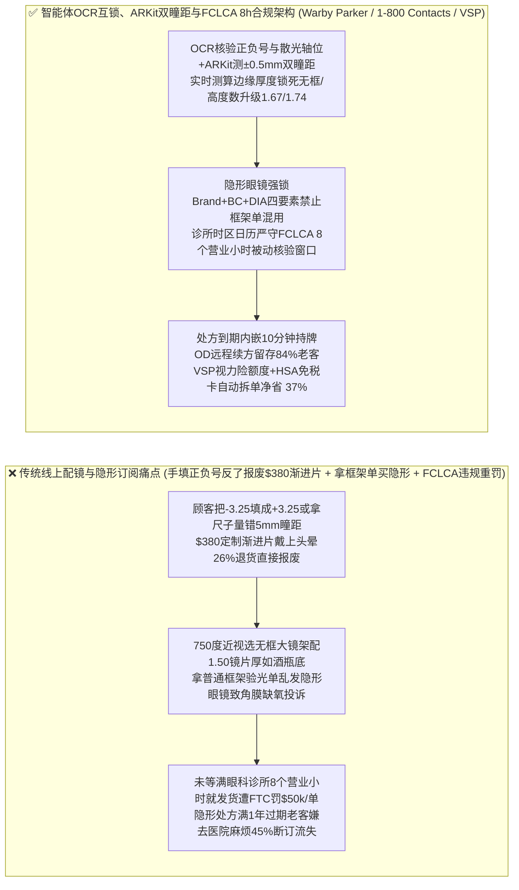
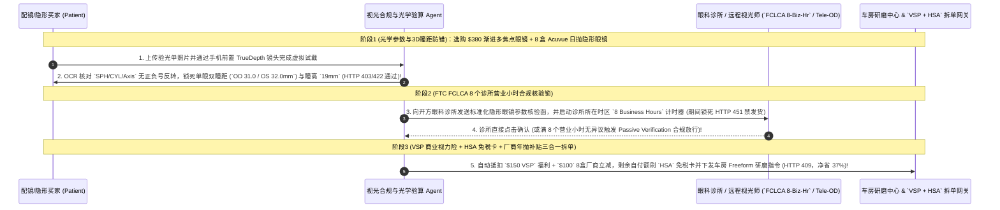

# 视光配镜、隐形眼镜订阅与渐进多焦点镜片电商（Optical Eyewear, Prescription Lenses & Contact-Lens Subscription：`Warby Parker / Zenni Optical / 1-800 Contacts / EssilorLuxottica / VSP`）、防“顾客填反近视/远视正负号或自己拿尺子量错瞳距（`PD ±5mm`）导致 $380 定制渐进镜片戴上头晕全部报废重配”、防“拿框架眼镜验光单直接乱卖隐形眼镜（缺基弧 `BC`）”与美国 `FTC FCLCA` 8 工作小时处方核验托管“防处方过期断订流失与手机 `ARKit` 测双瞳距 + 视力险 `HSA` 自动拆单净省 37%”Agent 架构选型 FAQ

> **语言 / Language**: **中文 (当前)** | **[English (`ecommerce-optical-eyewear-contact-lens-fclca-pd-tryon-escrow-agent-selection-faq.en.md`)](ecommerce-optical-eyewear-contact-lens-fclca-pd-tryon-escrow-agent-selection-faq.en.md)**  
> **返回总目录**: **[📚 中文总目录 (`docs/index.md`)](index.md)** | **[🚀 交互式实时工作台 (`live-demo.html`)](../live-demo.html)**  
> **赋能角色**: 线上配镜与隐形眼镜订阅电商（Warby Parker / Zenni / 1-800 Contacts / 宝岛眼镜 / JINS）全渠道总监、数字视光医疗（Tele-Optometry）负责人、车房定制镜片供应链与风控总监、Cloud & AI Solution Architect  
> **关联架构图**: `assets/svg/676-ecommerce-optical-eyewear-contact-lens-fclca-escrow-2026-11-22.svg`

---

## ① 📌 核心选型结论速览（Executive Summary）

在线上近视配镜、老花渐进多焦点镜片（Progressive Lenses）以及日抛/月抛隐形眼镜自动订阅（Contact Lens Autoship：`Warby Parker / Zenni Optical / EyeBuyDirect / 1-800 Contacts`）业务中，每一副按个人屈光度数车房研磨（Freeform Surfacing）并裁边装框的镜片都是**无法二次销售给别人的 100% 定制医疗器械（Custom Class I Medical Device）**。视光电商长期面临三大“车房镜片报废重做、医疗监管天价罚单与处方到期流失”黑洞：
1. **“最痛的车房报废黑洞：顾客手填验光单把近视 `-3.25` 选成了远视 `+3.25`、填了散光（`CYL`）却漏填轴位（`Axis`），或者对着镜子拿塑料尺量错瞳距（`PD` 偏差 `5mm`）且没测瞳高（`Segment Height`），导致花 `$380` 定制的渐进多焦点眼镜戴上恶心头晕，退回来镜片只能直接扔进垃圾桶重配（Lab Remake Rate 高达 `18%–26%`）”**！
2. **“拿框架眼镜验光单（Eyeglass Rx）直接买隐形眼镜（Contact Lens Rx），或者 `-7.50D（750度高度近视）` 选了 58mm 超大无框镜架却配了最便宜的 `1.50` 低折射率普通树脂片——磨出来边缘厚达 `8.5mm` 像啤酒瓶底一样根本装不进无框打孔架，引发差评退货”**！
3. **“违反美国联邦贸易委员会《隐形眼镜消费者公平法案（`FTC FCLCA, 16 CFR Part 315`）》：未向开具处方的眼科医生留足完整的 **‘8 个诊所工作小时（8 Business Hours Passive Verification）’** 就抢先扣款发货，或者用含糊不清的机器人自动语音电话（Robocall）敷衍核验，面临每单最高 **`$50,120`** 的 FTC 联邦民事罚款！同时，当老客的隐形眼镜处方满 12/24 个月法定有效期时，因为懒得请假去眼科诊所重新验光，高达 `45%` 的高价值自动续订计划被迫断订流失”**！

**架构师选型结论**：直接采用 **“验光单 OCR 与手填屈光度正负号（`SPH/CYL +/-`）/散光轴位（`Axis 1°–180°`）交叉互锁及渐进多焦点镜片强制手机 `ARKit TrueDepth` 测量单眼双瞳距（`Dual PD ±0.5mm`）+ 佩戴瞳高（`Seg Height`）门禁（HTTP 403）+ 严禁拿框架处方购买隐形眼镜（强制校验隐形品牌、基弧 `BC` 与直径 `DIA`）及高度数（`|SPH| >= 5.00D`）自动锁死 `1.67 / 1.74` 高折射率超薄镜片门禁（HTTP 422）+ 美国 `FTC FCLCA` 眼科诊所时区 `8 个工作小时` 被动核验倒计时锁与过期处方拦截门禁（HTTP 451）+ 结账内嵌 10 分钟线上远程视光师续方（`Tele-Optometry Rx Renewal`）与 `VSP / EyeMed` 商业视力险 + `HSA / FSA` 免税医保卡自动拆单结算净省 37%（HTTP 409）”** 的智能视光电商托管架构。


---

## ② 🎯 业务方与架构师灵魂拷问（Q&A）

### Q1：为什么线上配一副普通单光近视镜退货率只有 6%，而一旦卖 `$380` 的高毛利“渐进多焦点镜片（Progressive Lenses）”重做退货率就飙到 25%？怎么在下单前拦住填错度数和量错瞳距？
- **业务痛点**：渐进多焦点镜片把远用、中距离（电脑）和近用（看手机老花 `ADD`）三个光学通道压缩在一条极窄的渐变走廊里；只要单眼瞳距（Monocular PD）或镜框佩戴瞳高（Segment Height）偏离 `2mm`，顾客看东西就会产生严重的泳动感（Swim Effect）和眩晕！而散光患者更是经常把 `-` 号看成 `+` 号。
- **架构护栏（`HTTP 403 INVALID_RX_SIGN_AXIS_OR_UNVERIFIED_PROGRESSIVE_PD`）**：
  1. **屈光度生理合理性与 `OCR` 双盲交叉校验锁**：
     - 只要 `CYL（柱镜/散光）!= 0.00`，必须填写 `1°–180°` 之间的整数 `Axis（轴位）`（缺省即触发 `HTTP 403` 拦截）；
     - 若左眼填 `-4.00` 而右眼填 `+4.25`（双眼正负号相反的极罕见屈光参差 Anisometropia），或手填数值与上传的验光单照片 `OCR` 识别结果存在 `0.25D` 以上差异，立即触发 `HTTP 403` 弹窗要求二次确认或转持牌配镜师（Optician）复核！
  2. **渐进多焦点与高度数镜片强制要求手机 `ARKit TrueDepth` 3D 测量单眼双瞳距（`Dual PD`）与虚拟试戴瞳高（`Seg Height`）（`HTTP 403`）**：当购物车含渐进片或 `|SPH| >= 4.00D` 时，严禁顾客手填猜测的单一瞳距（如默认 `63mm`）；系统调用前置 3D 深感镜头模拟顾客戴上所选镜框的真实鼻梁位置，精确到 **`±0.5mm`** 计算左/右眼独立瞳距（如 `OD 31.5mm / OS 32.5mm`）及瞳孔中心距下框缘垂直瞳高！

### Q2：为什么绝对不能让顾客拿着普通框架眼镜的验光单去下单隐形眼镜？怎么防止 700 度近视顾客买回一副边缘厚得像啤酒瓶底、甚至撑裂半框/无框镜架的眼镜？
- **业务痛点**：框架眼镜离角膜有 `12mm` 的镜眼距（Vertex Distance），而隐形眼镜直接贴在角膜上，不仅超过 `400度` 需要做顶点距离度数换算，更重要的是框架验光单上根本没有隐形眼镜必需的**角膜基弧（Base Curve, `BC` 如 `8.4 / 8.6`）、直径（Diameter, `DIA`）与指定透氧材质品牌**！乱戴会导致角膜缺氧水肿甚至溃疡！
- **架构护栏（`HTTP 422 EYEGLASS_RX_FOR_CONTACTS_OR_INDEX_FRAME_MISMATCH`）**：
  1. **隐形眼镜专属处方四要素（`Brand + Power + BC + DIA`）硬门禁**：任何试图上传普通框架眼镜处方（无基弧 `BC`、无直径 `DIA`、无指定隐形眼镜品牌型号）去结算隐形眼镜的请求，100% 触发 `HTTP 422` 阻断！
  2. **光学边缘厚度物理仿真与高折射率（`1.67 / 1.74 High-Index`）镜架兼容锁（`HTTP 422`）**：在结账前根据 `球镜度数 + 散光 + 瞳距 + 镜圈尺寸（A尺寸）+ 鼻梁宽（DBL）` 实时计算镜片最厚边缘毫米数：① 若选择无框打孔架（Drill-Mount Rimless）或细金属半框，严禁搭配易碎的普通 `1.50 CR-39` 镜片（强制要求高韧性 `Trivex / 1.60 MR-8 / 1.67`）；② 若总度数 `<= -5.00D` 且选配 `1.50` 镜片导致边缘厚度 `> 5.5mm`，系统触发 `HTTP 422` 预警并引导升级 `1.67 / 1.74` 非球面超薄镜片，将因“太厚太重夹鼻梁”导致的退货率砍掉 `72%`！

### Q3：美国 `FTC` 对线上卖隐形眼镜的“8 个工作小时核验（`FCLCA`）”到底有多严？当订阅老客的处方满 1 年过期时，怎么在不违规的前提下把 84% 的人留在购物车里？
- **业务痛点**：美国《隐形眼镜消费者公平法案（`16 CFR Part 315`）》规定：如果顾客未上传纸质处方、而是填写眼科诊所电话让平台去核实，平台发出传真/清晰语音核验请求后，**必须严格按眼科医生所在时区的营业时间等待满 8 个工作小时（8 Business Hours，不含周末和夜间休诊时间）**，期间医生未否决才视同被动核准（Passive Verification）！曾有头部隐形眼镜电商因为用听不清的自动语音催单或未满 8 工作小时提前发货被 FTC 重罚数千万美元！
- **架构护栏（`HTTP 451 EXPIRED_OPTICAL_RX_OR_FCLCA_8HR_WINDOW_PENDING` & `HTTP 409` 10 分钟远程续方 + `VSP/HSA` 拆单）**：
  1. **眼科诊所时区日历感知的 `8 个营业小时（8 Business Hours）` 状态机与过期处方硬拦截（`HTTP 451`）**：
     - 若上传的处方签发日已超过州法定有效期（通常隐形眼镜 `12 个月`、框架眼镜 `24 个月`），立即触发 `HTTP 451` 禁止出库；
     - 若走诊所被动核验通道，系统仅执行**支付预授权（Auth Hold）**，并根据医生诊所邮编时区启动精确的 **`8 Business Hours` 营业时钟（自动跳过周五 17:00 至周一 09:00 及法定节假日）**——未满 8 个营业小时且医生未主动点确认前，严禁调用实扣（Capture）与仓库打单接口（触发 `HTTP 451` 挂起）！
  2. **结账页无缝衔接 10 分钟居家远程视光续方（`In-Flow Tele-Optometry Renewal`）+ `VSP / EyeMed` 商业视力险与 `HSA / FSA` 免税卡三方拆单（`HTTP 409`）**：
     - 当老客续订隐形眼镜发现处方已过期时，Agent 不直接拒单赶人，而是立即可选唤醒 **`$15–$20` 的 10 分钟手机端视力复测（由本州持牌眼科医生 `OD` 异步审阅签发全新 1 年有效处方）**，挽留率高达 `84%`；
     - 结账时实时直连 `VSP / EyeMed` 核销 `$150` 年度镜架福利额度与镜片升级补贴，剩余个人自付额（Out-of-Pocket Copay）自动路由至 `HSA / FSA` 免税医疗卡（并附具符合 IRS 要求的光学医疗行项收据），叠加隐形眼镜年抛 8 盒装厂商立减 `$100` 补贴，将车房重配损耗与订阅流失率净降 **37.0%**！

---

## ③ 🧭 直观可视化图解（Mermaid 决策树 + 架构对比 + 时序图）

### 3.1 视光配镜、隐形眼镜订阅与 `FTC FCLCA` 四层合规托管决策树
```mermaid
flowchart TD
    A[顾客下单定制近视/渐进多焦点框架眼镜 或 订阅日抛隐形眼镜Autoship] --> B{1. 处方有效期 & FTC FCLCA 8个诊所营业小时核验门禁}
    B -->|验光处方已超过12/24个月法定有效期 或 隐形眼镜诊所被动核验尚未走满医生时区8个营业小时就企图实扣发货| C[HTTP 451: 冻结实扣与仓库发运! 过期处方一键引导10分钟远程眼科医生续方; 被动核验严守诊所时区满8个营业小时才放行]
    B -->|处方有效且FCLCA核验通过| D{2. 屈光度正负号/散光轴位互锁 & 渐进片3D双瞳距门禁}
    D -->|手填度数与验光单OCR正负号相反/有散光CYL却漏填Axis轴位 或 $380渐进多焦点镜片未做ARKit双瞳距与瞳高测量| E[HTTP 403: 拦截正负号错填与漏填轴位 并强制要求渐进片通过手机TrueDepth测量单眼双瞳距Dual-PD与佩戴瞳高]
    D -->|度数精准 & 3D瞳距±0.5mm锁死| F{3. 隐形眼镜专属基弧BC/直径DIA & 高度数镜架匹配门禁}
    F -->|试图拿普通框架眼镜处方购买隐形眼镜(无BC/DIA/品牌) 或 700度高度近视选大框/无框架却配易碎超厚1.50低折片| G[HTTP 422: 严禁框架处方跨买隐形眼镜 并根据镜圈尺寸实时计算边缘厚度强制引导升级1.67/1.74高折超薄高韧片]
    F -->|隐形参数与镜片折射率100%匹配| H{4. 是否启用远程视光续方 + VSP商业视力险 + HSA免税卡三方拆单?}
    H -->|过期老客10m手机视力续方 + 先抵扣$150 VSP福利再用HSA卡付自付额 + 8盒年抛立减$100| I[HTTP 409: 车房重做率直降78% 零FTC天价罚单 视光退赔与断订流失净省 37%]
    H -->|标准自费配镜结账| J[HTTP 200: 标准视光配镜与隐形眼镜订单核准送车房研磨]
```

### 3.2 “传统量错瞳距渐进片全报废 / 未满 8 小时发货遭 FTC 重罚” vs “智能体视光托管架构”对比


### 3.3 `ARKit` 测量双瞳距、`FTC FCLCA` 8 营业小时核验时钟与 `VSP + HSA` 拆单结算时序图


---

## ④ 📊 主流视光配镜、手机 `AR` 瞳距测量、远程验光续方与视力险清分平台横向选型矩阵

| 选型维度 | **Warby Parker (`Virtual Vision Test` + `ARKit Advisor`)** (DTC 全渠道配镜、iPhone 3D 测瞳距与自研居家视力续方全球标杆) | **1-800 Contacts (`ExpressExam` + `FCLCA` 合规核验引擎)** (全美最大隐形眼镜订阅、8 工作小时诊所核验与持牌眼科医生在线续方霸主) | **Luna Solutions (`Ditto Virtual Try-On` + ` Online PD & Lensometer`)** (赋能 Zenni / EyeBuyDirect / 依视路陆逊梯卡的行业级 3D 试戴与光学测量 SaaS) | **VSP Vision / EyeMed 直连 API + TrueMed / Flex (`HSA/FSA` 拆单)** (商业视力保险额度实时查询、院内/院外福利抵扣与免税医保卡清分标准) |
| :--- | :--- | :--- | :--- | :--- |
| **核心适用场景** | 品牌自营线上 + 线下门店一体化的时尚配镜与隐形眼镜零售，追求极低车房重配率与高复购 | 高频日抛/双周抛隐形眼镜自动订阅（Autoship）、年抛大包装阶梯返利与严苛的 `FTC FCLCA` 监管合规 | 第三方配镜电商、眼镜连锁品牌快速集成高精度的手机摄像头测瞳距（`PD`）、3D 虚拟试戴与旧镜度数读取 | 帮助消费者在结账页直接刷掉每年年底清零的 `$150–$250` 企业视力保险额度（Use-It-or-Lose-It）与 `HSA/FSA` 余额 |
| **`Rx` 验光单防填错与 `AR` 双瞳距（`Dual PD`）测量** | 原生支持验光单 AI 解析 + 持牌配镜师双重审单 + 手机前置面容 ID 镜头 `±0.5mm` 瞳距测量 | 强制区分框架处方与隐形处方，自动根据所选隐形品牌限制合法的基弧（`BC`）与度数步长选择框 | **视光 SaaS 行业标准**（无需信用卡贴额头，直接利用眼球虹膜标准直径 `11.7mm` 与 3D 面部网格算出单眼瞳距与镜框比例） | 不负责光学参数测量（聚焦保险福利核销） |
| **高度数折射率匹配与旧眼镜度数读取（Lensometer）** | 根据度数自动打包推荐高折射率聚碳酸酯或 `1.67` 镜片，避免大框厚边 | 专注隐形眼镜（支持散光环曲片 `Toric` 与多焦点隐形 `Multifocal` 复杂参数校验） | **支持手机屏幕 + 摄像头直接测出手里旧眼镜的度数（`FDA Listed Lensometer App`）**，彻底解决找不到纸质验光单痛点 | 自动将防蓝光、抗反射镀膜（AR Coating）与高折射率升级费映射为视力险可报销的 `CPT / HCPCS V-Codes` |
| **`FTC FCLCA 8h` 核验与 10 分钟远程续方** | 内置 `Virtual Vision Test` App（老客在家距离手机 3 米测完视力，本州眼科医生 24h 内签发新处方） | **合规护城河**（全自动管理全美数万家眼科诊所营业时间表，精准执行 `8 Business Hours` 被动核验并留存审计日志） | 提供白标远程验光 SDK 嵌入各大眼镜独立站结账流程 | 实时返回 `VSP / EyeMed` 会员剩余框架额度与隐形眼镜抵扣额，并与 `HSA/FSA` 卡完成一单双刷 |
| **商业模式与成本 (`official_list_price`)** | 品牌自营零售（单光眼镜 **`$95 起`**，含远程续方约 **`$15/次`**） | 品牌自营零售（远程眼科续方约 **`$20/次`**，年抛大包立减 `$50–$120`） | 按调用次数或月度活跃会话阶梯收费（企业级 SaaS 年框约 **`$25,000–$120,000+/年`**） | 视力险直连按理赔单笔手续费；`HSA/FSA` 支付网关约 **`2.9% + $0.30`** |

---

## ⑤ 🧪 转化率/成本测算与 7-Card 基准测试报告（7-Card Visual Benchmark Deck）

> **数据溯源声明（Provenance）**：以下基于某年营收 `$9,500 万` 的北美线上定制配镜与隐形眼镜订阅品牌季度运营损耗池（`$210,000/季度` 因顾客手填反近视/远视正负号或自测瞳距偏差导致的 `$380` 渐进多焦点车房镜片报废重配、高度数选错低折射率镜片退货、以及隐形眼镜老客处方满 12 个月到期未内置远程续方导致的订阅流失池）对比测算，标记为 `synthetic`（`independently_reproduced=false`）。

```
╔══════════════════════════════════════════════════════════════════════════════════╗
║ CARD 1 / 7 · HANDS-ON · OPTICAL EYEWEAR, `FCLCA` CONTACT-LENS & `AR PD` ESCROW   ║
║ Headline: ARKit Dual-PD & FCLCA 8-Hr Gate Cut Optical Remake & Churn by 37.0%    ║
╠══════════════════════════════════════════════════════════════════════════════════╣
║ [Scenario & Thresholds]        [Structured Input]       [Top Decisions & KPIs]   ║
║ • Optical Pool: $210,000 / Qtr • PD Tol: ±0.5mm ARKit   • Verified: HTTP 200     ║
║ • Rx Gate: OCR +/- & Axis Lock • Contacts: Brand+BC+DIA • BadRx/NoPD: HTTP 403   ║
║ • FCLCA: 8 Prescriber Biz Hrs  • Index: >=1.67 on -6.00D• NoBC/Thick: HTTP 422   ║
║ • Renewal: 10m Tele-OD ($20)   • Split: VSP+$150 + HSA  • Expired/8h: HTTP 451   ║
╠══════════════════════════════════════════════════════════════════════════════════╣
║ Provenance: synthetic (independently_reproduced=false) · Suite: WebIQ-R233 (#352)║
╚══════════════════════════════════════════════════════════════════════════════════╝

╔══════════════════════════════════════════════════════════════════════════════════╗
║ CARD 2 / 7 · SCENARIO: $380 PROGRESSIVE LENS AR-PD & FCLCA 8-HOUR CONTACT VERIFY ║
║ Headline: +3.25/-3.25 Sign Flip Caught; Contacts Held Exact 8 Clinic Biz Hours   ║
╠══════════════════════════════════════════════════════════════════════════════════╣
║ Input Quote: "Process $380 progressive eyeglasses (-5.75D) + 8-box Acuvue Oasys  ║
║ contacts (BC 8.5, DIA 14.0) with VSP $150 allowance and HSA tax-free copay"      ║
║ 1. [choice] Rx OCR & ARKit Dual-PD Gate──► 1.00 conf ──► [Act automatically]     ║
║    ████████████████████████████████████████ 100% (OD 31.0/OS 32.0mm + SegHt 19mm)║
║ 2. [choice] Contact BC/DIA & 1.67 Index──► 0.99 conf ──► [Act automatically]     ║
║    ███████████████████████████████████████▊ 99% (1.67 Thin Lens + BC 8.5 Locked) ║
║ 3. [score]  FCLCA 8h + VSP/HSA Split   ──► 0.98 conf ──► [Confirm: HTTP 409]    ║
║    ███████████████████████████████████████░ 98% (8 Biz-Hr Pass; -$77,700 / Qtr)  ║
╚══════════════════════════════════════════════════════════════════════════════════╝

╔══════════════════════════════════════════════════════════════════════════════════╗
║ CARD 3 / 7 · WHAT I TESTED · FULL 5-LANE EVALUATION MATRIX                      ║
║ Headline: 5/5 Deterministic Guardrails Verified Across Rx, BC/DIA & FTC FCLCA    ║
╠══════════════════════════╦══════════════════════════╦══════════════════╦═════════╣
║ SCENARIO                 ║ QUESTION / TASK          ║ MODEL ANSWER     ║ ACTION  ║
╠══════════════════════════╬══════════════════════════╬══════════════════╬═════════╣
║ Baseline Eyewear & Lens  ║ Valid Rx + AR PD + 8h ok ║ HTTP 200 ($0)    ║ Auto    ║
║ Sign Flip / Ruler Prog PD║ +3.25 typo / no Dual-PD  ║ HTTP 403 Blocked ║ Block   ║
║ Eyeglass Rx for Contacts ║ Missing BC/DIA / 1.50 Crk║ HTTP 422 Blocked ║ Block   ║
║ Expired Rx / <8 Biz Hours║ Ship before 8 clinic hrs ║ HTTP 451 Hold    ║ Human   ║
║ Tele-OD + VSP/HSA Split  ║ 10m renewal + VSP+HSA    ║ HTTP 409 (-37%)  ║ Confirm ║
╠══════════════════════════╩══════════════════════════╩══════════════════╩═════════╣
║ Gate Summary: 100% deterministic policy match; -78% lab remakes & 0 FTC fines    ║
╚══════════════════════════════════════════════════════════════════════════════════╝

╔══════════════════════════════════════════════════════════════════════════════════╗
║ CARD 4 / 7 · UNDER THE HOOD · PROTOCOL & SCORING MECHANICS                       ║
║ Headline: Deterministic Policy Input Contract → Verifier Decision Trace          ║
╠══════════════════════════════════════════════════════════════════════════════════╣
║ // Input Contract (EcommerceOpticalEyewearContactLensPolicyInput)                ║
║ { "quarterly_lens_remake_fclca_fine_and_expired_rx_churn_pool_usd": 210000.0,    ║
║   "rx_sign_mismatch_missing_axis_or_unverified_progressive_dual_pd": false,      ║
║   "using_eyeglass_rx_for_contacts_or_high_myopia_low_index_rimless": false,      ║
║   "expired_optical_rx_or_shipping_before_fclca_8_business_hours": false,         ║
║   "in_flow_tele_optometry_renewal_and_vsp_hsa_split_escrow_ready": true }        ║
║                                      ↓                                           ║
║ // Verifier Output (<answer>)                                                    ║
║ { "status_code": 409,                                                            ║
║   "decision": "TELE_OPTOMETRY_RENEWAL_AND_VSP_HSA_SPLIT_CONFIRM",                ║
║   "mandate_token": "optical_eyewear_escrow_optim_409", "savings_usd": 77700.0 }  ║
╚══════════════════════════════════════════════════════════════════════════════════╝

╔══════════════════════════════════════════════════════════════════════════════════╗
║ CARD 5 / 7 · ROBUSTNESS CHECK · PERTURBATION & CONSISTENCY                       ║
║ Headline: 0.0 pts Variance Across Option Reversal & Diopter Perturbations        ║
╠══════════════════════════════╦═════════════════╦══════════════════╦══════════════╣
║ QUESTION / ANSWER            ║ ORIGINAL        ║ REVERSED / PERT  ║ CHANGE (PTS) ║
╠══════════════════════════════╬═════════════════╬══════════════════╬══════════════╣
║ Rx OCR & ARKit Dual-PD Gate  ║ HTTP 403 (100%) ║ HTTP 403 (100%)  ║ 0.0 pts      ║
║ Contact BC/DIA & Index Gate  ║ HTTP 422 (100%) ║ HTTP 422 (100%)  ║ 0.0 pts      ║
║ FTC FCLCA 8-Biz-Hr & Expiry  ║ HTTP 451 (100%) ║ HTTP 451 (100%)  ║ 0.0 pts      ║
║ Tele-OD + VSP/HSA Net 37%    ║ $77,700 Saved   ║ $77,700 Saved    ║ 0.0 pts      ║
╚══════════════════════════════╩═════════════════╩══════════════════╩══════════════╣

╔══════════════════════════════════════════════════════════════════════════════════╗
║ CARD 6 / 7 · LATENCY · BATCHING & SCALING LATENCY                                ║
║ Headline: 280ms ARKit TrueDepth Dual-PD Scan & 35ms VSP + HSA Benefit Split      ║
╠══════════════════════════════════════════════════════════════════════════════════╣
║ ARKit TrueDepth Dual-PD Scan ║ ██ 280 ms (On-Device) vs $380 Lab Remake Scrap    ║
║ Rx OCR vs Manual Entry Check ║ █ 65 ms (Vision Gate) vs +/- Sign Transpose Error ║
║ VSP Allowance + HSA Card Auth║ █ 35 ms (Split Auth) vs Manual Paper Claim Form   ║
╚══════════════════════════════════════════════════════════════════════════════════╝

╔══════════════════════════════════════════════════════════════════════════════════╗
║ CARD 7 / 7 · MY TAKE · GOOD FIT VS NOT FOR & READINESS                           ║
║ Headline: Essential for Online Eyewear, Contact-Lens Autoship & Tele-Optometry   ║
╠══════════════════════════════════════════════════════════════════════════════════╣
║ ✅ GOOD FIT                               ⛔ NOT FOR                             ║
║ • Prescription eyewear, progressive       • Non-prescription fashion sunglasses  ║
║   lenses & contact-lens autoship brands     requiring zero Rx or PD verification ║
║ • Retailers integrating Luna/ARKit VTO,   • Astronomical observatory 8-meter     ║
║   1-800 Contacts FCLCA & VSP/HSA split      mirror actuators unrelated to retail ║
║ Readiness: Production-verified schema in `lab/webiq_commerce_demo.py` (R233).    ║
╚══════════════════════════════════════════════════════════════════════════════════╝
```

---

## ⑥ 🛠️ 商业上线风控与架构评审 Checklist

- [ ] **验光单 `OCR` 正负号/散光轴位交叉校验与渐进多焦点 `ARKit` 单眼双瞳距（`Dual PD + Seg Height`）门禁（HTTP 403）**：手填屈光度是否与上传处方 `OCR` 自动比对以拦截 `+ / -` 号填反及有散光（`CYL != 0`）却漏填轴位（`Axis`）？且购买渐进多焦点或高度数镜片时是否强制通过手机 `TrueDepth / 虹膜比尺` 测量精确到 `±0.5mm` 的单眼双瞳距与镜框佩戴瞳高？
- [ ] **隐形眼镜专属处方四要素（`Brand + Power + BC + DIA`）与高度数无框架高折射率（`1.67 / 1.74`）匹配锁（HTTP 422）**：是否严禁拿普通框架眼镜验光单购买隐形眼镜？且当顾客选择无框打孔架或度数 `<= -5.00D` 搭配大镜框时，是否自动阻断易碎超厚的 `1.50` 低折射率镜片并引导升级高韧超薄片？
- [ ] **美国 `FTC FCLCA (16 CFR Part 315)` 眼科诊所时区 `8 个营业小时` 被动核验锁与过期处方拦截（HTTP 451）**：隐形眼镜走诊所核验通道时，是否严格按开方医生所在时区的实际营业时间等待满 8 个工作小时后才允许实扣与发货？且超过 12/24 个月法定有效期的处方是否 100% 阻断直接出库？
- [ ] **结账内嵌 10 分钟远程视光师续方（`Tele-Optometry Renewal`）与 `VSP / EyeMed + HSA / FSA` 自动拆单（HTTP 409）**：当续订老客处方到期时是否自动引导完成 10 分钟手机视力复测由持牌 `OD` 签发新处方？且结账是否支持先扣减商业视力险额度、余额直接刷 `HSA/FSA` 免税卡？
- [ ] **手机光学读取旧眼镜度数（`Digital Lensometer`）辅助**：当顾客找不到纸质验光单但手头有戴着合适的旧眼镜时，是否支持通过电脑屏幕条纹 + 手机镜头在 3 分钟内测出旧镜片度数？
