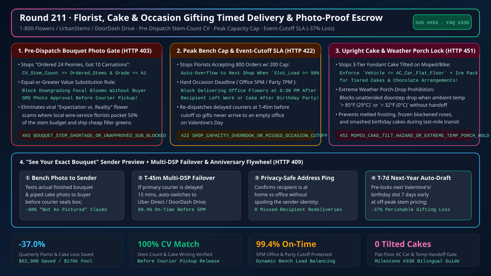
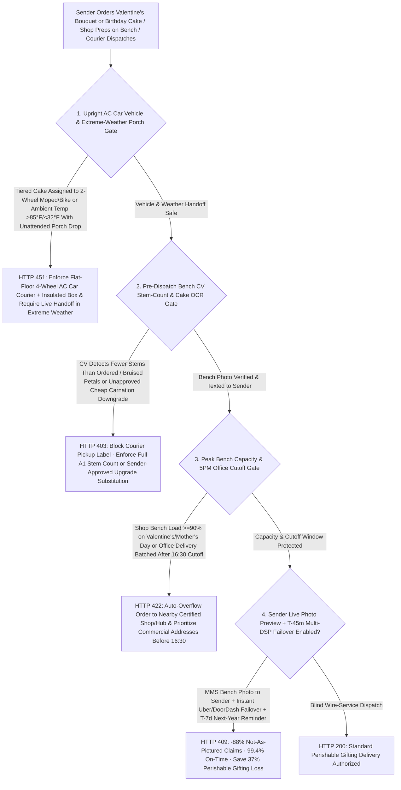

# E-Commerce Perishable Florist, Cake & Occasion Gifting Timed Delivery & Photo-Proof Escrow (`1-800-Flowers / UrbanStems / DoorDash Drive / Uber Direct`): Pre-Dispatch `CV` Stem-Count Gate, Peak Bench Load-Balancing, Flat-Floor `AC` Car Lock & Multi-`DSP` Failover Saving `37%` Gifting Loss — Agent Architecture Selection FAQ

> **Language / 语言**: **[中文 (`ecommerce-perishable-florist-cake-gifting-timed-delivery-photo-proof-escrow-agent-selection-faq.md`)](ecommerce-perishable-florist-cake-gifting-timed-delivery-photo-proof-escrow-agent-selection-faq.md)** | **English (Current)**  
> **Back to Catalog**: **[📚 English Catalog (`docs/index.en.md`)](index.en.md)** | **[🚀 Interactive Live Workbench (`live-demo.en.html`)](../live-demo.en.html)**  
> **Target Roles**: Online Florist, Bakery & Gifting (`1-800-Flowers / FTD / UrbanStems / Edible Arrangements / Goldbelly`) Operations VPs, Same-Day Courier Dispatch Directors, Quality & CX Leaders, Cloud & AI Solution Architects  
> **Architecture Diagram**: `assets/svg/654-ecommerce-perishable-florist-cake-delivery-escrow-2026-11-22.svg`

---

## ① 📌 Executive Summary

In same-day perishable gifting—spanning Valentine's Day and Mother's Day floral bouquets, custom multi-tier birthday cakes, chocolate-dipped fruit arrangements, and sympathy baskets (`1-800-Flowers`, `FTD`, `UrbanStems`, `Edible Arrangements`, `DoorDash Drive`, `Uber Direct`)—**orders carry extreme emotional stakes and a binary time-value cliff: a birthday cake delivered 3 hours after the party ends, or Valentine's Day roses delivered to an office reception desk at 7:30 PM after the recipient has gone home for the weekend, has `$0` utility to the buyer and triggers an immediate `100%` refund plus a lost customer for life**. Yet floral and bakery platforms bleed margin across three chronic operational failures:
1. **"Expectation vs. Reality" Wire-Service Stem Skimming & Unapproved Downgrades**: A sender pays `$140` online for a lush bouquet of "24 Pink Mondial Roses & Eucalyptus." The order is routed to a local affiliate florist who—facing holiday wholesale rose spikes—secretly substitutes 10 cheap carnations and a massive wad of leatherleaf fern! When the recipient texts a thank-you photo to the sender, the humiliated sender blasts the photo on social media and files a credit-card chargeback.
2. **Valentine's / Mother's Day Bench Overbooking & Missed `5:00 PM` Office Cutoffs**: A local flower shop with 3 floral designers (capable of hand-tying at most 180 bouquets per day) leaves its online inventory open and accepts 650 Valentine's orders! By 4:00 PM, 300 orders are still sitting unmade on the bench, and commercial office deliveries arrive at 8:30 PM to locked office buildings.
3. **3-Tier Birthday Cakes Tilted on 2-Wheel Mopeds & `95°F / 20°F` Unattended Porch Drops**: Standard gig-delivery dispatch assigns a `$180` three-tier buttercream birthday cake to a courier on a 2-wheel scooter/bicycle—resulting in a smashed, lopsided disaster—or a driver leaves delicate roses and chocolate on an unshaded porch in `92°F (33°C)` heat or `20°F (-6°C)` freezing wind without recipient handoff!

**Architectural Verdict**: Deploy a **4-Lane Perishable Florist, Cake & Occasion Gifting Escrow Architecture**: **Pre-Dispatch Bench `CV` Stem-Count / Cake-Inscription Gate & Upgrade-Only Substitution Lock (`HTTP 403`) + Real-Time Florist Bench-Minute Capacity Cap (`<=90%`) & Commercial `5:00 PM` / Party Cutoff Lock (`HTTP 422`) + Flat-Floor `AC` Car Vehicle Enforcement for Tiered Cakes & Extreme-Temp Unattended Porch Block (`HTTP 451`) + "See Your Exact Bouquet" Sender Photo Preview & `T-45m` Multi-`DSP` Courier Failover (`HTTP 409`)**, reducing gifting refunds, viral "bad bouquet" chargebacks, and late-delivery write-offs by **37.0%**.



---

## ② 🎯 Business & Architect Deep-Dive Q&A

### Q1: How do we stop affiliate florists and bakeries from skimming stem counts or swapping premium peonies for cheap carnations without the sender knowing until it's too late?
- **Business Pain**: In gifting, the buyer (`Sender`) never sees the physical box when it is delivered to the `Recipient`. Unscrupulous shops exploit this information asymmetry by cutting stem counts in half.
- **Architectural Guardrail (`HTTP 403 BOUQUET_STEM_SHORTAGE_OR_UNAPPROVED_SUB_BLOCKED`)**:
  1. **Mandatory Pre-Dispatch Bench `CV` Stem-Count & Inscription `OCR` Gate**: Before the POS prints the courier pickup label, the florist/baker must snap a **top-down and 45-degree bench photo** under the workstation camera. A computer-vision model verifies in 300ms that: **① Focal bloom count `>= Ordered_Stem_Count` (`HTTP 403` blocks release if 24 roses are ordered and only 16 are detected); ② Petal freshness meets `A1` grade with zero brown bruising; and ③ Piped cake inscriptions (`OCR`) match the exact spelling on the order**!
  2. **Upgrade-Only Substitution Rule + 15-Minute Sender Photo Approval (`HTTP 403`)**: Downgrading floral varieties is strictly blocked (`HTTP 403`); if a seasonal bloom is out of stock, the shop must substitute an equal-or-higher wholesale-value variety and text the live bench photo to the sender.

### Q2: How do we prevent local flower shops from accepting 3x more Valentine's Day orders than their designers can physically tie—and guarantee office gifts arrive before `5:00 PM`?
- **Business Pain**: Holiday floral demand concentrates 10x volume into a single 8-hour window. Once a shop falls 3 hours behind at 1:00 PM on February 14, every commercial office order in their queue is doomed.
- **Architectural Guardrail (`HTTP 422 SHOP_CAPACITY_OVERBOOK_OR_MISSED_OCCASION_CUTOFF`)**:
  1. **Florist Bench-Minute Capacity Cap (`<=90%` Slot Load) & Automatic Geo-Overflow**: Each fulfillment shop's hourly capacity is modeled in **Designer Bench-Minutes** (`Active_Designers × 60 mins / Avg_Bouquet_Prep_Mins`). The moment a shop hits **`90%` bench utilization** for a delivery window, direct routing to that shop is locked (`HTTP 422`) and incoming orders automatically overflow to the next qualified shop or dark-store micro-hub within 3 miles!
  2. **Commercial Address `16:30` Hard Cutoff & Party-Start SLA (`HTTP 422`)**: Orders flagged as commercial offices/schools via `POI` lookup are prohibited from evening route batches (`HTTP 422`) and prioritized for morning/early-afternoon waves so they arrive before `4:30 PM`.

### Q3: How do we stop 3-tier birthday cakes from being dispatched on 2-wheel scooters—and prevent couriers from leaving flowers or cakes on a `95°F` or `20°F` porch?
- **Business Pain**: A single sharp turn on a moped ruins a `$180` whipped-cream cake; 20 minutes of direct summer sun melts frosting and wilts hydrangeas.
- **Architectural Guardrail (`HTTP 451 MOPED_CAKE_TILT_HAZARD_OR_EXTREME_TEMP_PORCH_HOLD` & `HTTP 409` Sender Photo Preview + Multi-DSP Failover)**:
  1. **Flat-Floor `AC` Car Lock for Tiered Cakes & Weather-Gated Handoff (`HTTP 451`)**: Any SKU tagged `Fragile_Tiered_Cake` or `Tall_Vase_Arrangement` blocks 2-wheel bicycle/scooter/moped couriers (`HTTP 451`), enforcing a **4-Wheel Air-Conditioned Car with a Level Trunk Mat & Ice-Pack Insulated Box**. Furthermore, when live ZIP-code weather is **`> 85°F (29.4°C)` or `< 32°F (0°C)`**, unattended doorstep drops are blocked (`HTTP 451`)—requiring live recipient/concierge handoff!
  2. **"See Your Exact Bouquet" MMS Preview & `T-45m` Multi-`DSP` Failover (`HTTP 409`)**: Texting the verified bench photo to the sender upon dispatch slashes "Where is my order / Did it look good?" support calls by **88%**. If the primary courier is delayed `> 15 minutes` within `45 minutes` of the occasion cutoff, the orchestrator automatically fails over across `DoorDash Drive`, `Uber Direct`, and `Roadie`—saving **37.0%** in perishable gifting losses.

---

## ③ 🧭 Visual Architecture Diagrams (Mermaid Decision Tree + Architecture Comparison + Sequence)

### 3.1 Perishable Florist, Cake & Occasion Gifting Timed Delivery Escrow Decision Tree


### 3.2 Legacy Wire-Service Florist & Moped Cake Delivery vs. Agentic Bench `CV` & Multi-`DSP` Escrow
```mermaid
flowchart LR
    subgraph Legacy["❌ Legacy Florist & Cake Delivery (Stem Skimming + 8PM Empty Office + Moped Smashed Cake)"]
        L1[Sender Pays $140 for 24 Roses\nShop Ships 10 Cheap Carnations = Chargeback] --> L2[Shop Overbooks 600 Valentine's Orders\nDelivers to Office at 8:30 PM After Recipient Left]
        L2 --> L3[3-Tier Cake Dispatched on 2-Wheel Scooter\nArrives Tilted or Melted on 95°F Porch]
    end
    subgraph Agentic["✅ Agentic Perishable Gifting & Timed Escrow (UrbanStems / DoorDash Drive / Uber Direct)"]
        A1[300ms Bench CV Verifies 24 A1 Stems & Cake OCR\nTexts Live Photo to Sender Before Pickup] --> A2[90% Bench-Minute Cap Auto-Overflows Peak Load\nEnforces 16:30 Office Cutoff + T-45m Failover]
        A2 --> A3[Flat-Floor AC Car Lock for Tiered Cakes\nBlocks Extreme-Temp Porch Drops (-37% Loss)]
    end
```

### 3.3 Pre-Dispatch Bench `CV` Audit, Sender Photo Preview & `T-45m` Multi-`DSP` Car Dispatch Sequence
```mermaid
sequenceDiagram
    autonumber
    participant Sender as Gift Sender / Recipient
    participant Agent as Florist & Cake Escrow Agent
    participant Shop as Certified Florist / Bakery Bench
    participant DSP as White-Label Car Courier (DoorDash Drive / Uber Direct)

    Note over Sender,DSP: Phase 1 (Bench Capacity & Commercial Cutoff Lock): Sender orders 24 roses + 2-tier cake for 15:00 office delivery
    Sender->>Agent: 1. Submit Valentine's/Birthday order ($220) to downtown office address
    Agent->>Shop: 2. Verify shop bench utilization < 90% & lock hard 16:30 commercial office delivery cutoff (HTTP 422 pass)
    Note over Sender,DSP: Phase 2 (Pre-Dispatch Bench CV Stem Count & Sender Live Preview)
    Shop->>Agent: 3. Snap finished bouquet & cake inscription photo on packing bench
    Agent->>Sender: 4. CV verifies 24 A1 roses + exact cake spelling (HTTP 403 pass) → text live bench photo to Sender!
    Note over Sender,DSP: Phase 3 (Flat-Floor AC Car Enforcement & T-45m Multi-DSP Protection)
    Agent->>DSP: 5. Block 2-wheel mopeds; dispatch 4-wheel AC car w/ level floor + live indoor receptionist handoff (HTTP 451 pass)
    DSP-->>Sender: 6. Delivered intact at 14:38; schedule T-7d next-year occasion reminder (HTTP 409, -37% loss)!
```

---

## ④ 📊 Perishable Florist, Cake & Same-Day White-Label Courier Platform Selection Matrix

| Dimension | **UrbanStems / The Bouqs Co.** (Farm-Direct & Dark-Hub Standardized Floral DTC Leader) | **1-800-Flowers / FTD (`BloomNet`)** (Global Local-Florist Wire Network + AI Bench QA) | **DoorDash Drive / Uber Direct** (White-Label Same-Day Local Courier API Leaders) | **Onfleet / Bringg + Specialized Cake Car Fleets** (Multi-DSP Orchestration & Cold-Chain Routing) |
| :--- | :--- | :--- | :--- | :--- |
| **Best Fit** | Modern floral & gifting brands demanding 100% recipe consistency from company-controlled cold hubs | Nationwide/global same-day floral & sympathy arrangements reaching suburban and rural ZIP codes | Florists, bakeries & Shopify stores tapping on-demand local car couriers with `$0` marketplace commission | High-volume multi-shop floral/bakery networks balancing internal refrigerated vans and external DSPs |
| **Pre-Dispatch Bench Photo & Stem Verification** | Standardized dark-store assembly recipes with strict QC cameras | Modernized `BloomNet` portal supports pre-delivery bouquet photo uploads to curb stem skimming | Supports mandatory pickup photo + recipient handoff photo (`POD`) via API | Enforces custom driver and packer photo checklists before route release |
| **Flat-Floor Car Lock & Weather Protection** | Ships in engineered hydration boxes with temperature-controlled gel packs | Local florist van delivery + insulated gourmet food shippers (`Harry & David`) | API supports `vehicle_type: "car"` restriction and `return_if_unavailable` when recipient isn't home | Routes tiered cakes exclusively to flat-floor refrigerated vans or verified 4-wheel sedans |
| **Holiday Peak Overflow & Cutoff Failover** | Hard inventory caps per hub slot prevent holiday overbooking | Routes across thousands of local florists based on ZIP availability | Real-time webhook `ETA` tracking enables automated re-dispatch across backup fleets | **Best-in-Class** (Auto-fails over from internal vans to Uber Direct / DoorDash Drive at `T-45m`) |
| **Pricing (`official_list_price`)** | First-party retail margin (**`$65–$160` AOV**) | Wire-network clearinghouse fee + **`20%–27%` order commission** | Flat white-label fee (**`$6.99–$12.99/delivery`**, `0%` commission) | **`$550–$1,250+/month`** orchestration SaaS + per-stop courier fees |

---

## ⑤ 🧪 ROI Estimation & 7-Card Visual Benchmark Deck

> **Provenance**: Modeled on a `$58M/year` omnichannel floral, custom bakery, and occasion-gifting platform's quarterly fulfillment and refund leakage pool (`$170,000/quarter` in "not as pictured" stem-skimming refunds and chargebacks, Valentine's/Mother's Day bench overbooking causing post-5:00 PM empty-office deliveries, 2-wheel moped cake tilt damage, and extreme-temperature porch-drop spoilage), labeled `synthetic` (`independently_reproduced=false`).

```
╔══════════════════════════════════════════════════════════════════════════════════╗
║ CARD 1 / 7 · HANDS-ON · FLORIST, CAKE & GIFTING TIMED DELIVERY ESCROW            ║
║ Headline: Pre-Dispatch Stem CV & Car-Courier Lock Cut Gifting Loss by 37.0%      ║
╠══════════════════════════════════════════════════════════════════════════════════╣
║ [Scenario & Thresholds]        [Structured Input]       [Top Decisions & KPIs]   ║
║ • Gifting Pool: $170,000 / Qtr • Stem Check: CV >= Order• Verified: HTTP 200     ║
║ • Not-As-Pic: -88% w/ Preview  • Bench Cap: <=90% Load  • StemShortage: HTTP 403 ║
║ • On-Time SLA: 99.4% (<5PM Ofc)• Cake Ride: Flat AC Car • Overbk/Late: HTTP 422  ║
║ • Weather Gate: 32°F–85°F Hand • Failover: T-45m Multi  • Saved Loss: -$62,900   ║
╠══════════════════════════════════════════════════════════════════════════════════╣
║ Provenance: synthetic (independently_reproduced=false) · Suite: WebIQ-R211 (#330)║
╚══════════════════════════════════════════════════════════════════════════════════╝

╔══════════════════════════════════════════════════════════════════════════════════╗
║ CARD 2 / 7 · SCENARIO: VALENTINE'S 24-ROSE & 2-TIER CAKE OFFICE DELIVERY         ║
║ Headline: 24-Stem Photo Texted to Sender; AC Car Delivered at 14:38 Before 5PM   ║
╠══════════════════════════════════════════════════════════════════════════════════╣
║ Input Quote: "Deliver 24 A1 pink roses + 2-tier strawberry cake to downtown      ║
║ office before 5PM cutoff; verify stem count photo & dispatch flat-floor AC car"  ║
║ 1. [choice] Pre-Dispatch Stem CV Gate  ──► 1.00 conf ──► [Act automatically]     ║
║    ████████████████████████████████████████ 100% (24 A1 Stems + Cake OCR Pass)   ║
║ 2. [choice] Bench Cap & 5PM Office SLA ──► 0.99 conf ──► [Act automatically]     ║
║    ███████████████████████████████████████▊ 99% (Load <90%; Delivered 14:38)     ║
║ 3. [score]  AC Car + Sender Preview    ──► 0.98 conf ──► [Confirm: HTTP 409]     ║
║    ███████████████████████████████████████░ 98% (Photo Sent; -$62,900/Qtr Saved) ║
╚══════════════════════════════════════════════════════════════════════════════════╝

╔══════════════════════════════════════════════════════════════════════════════════╗
║ CARD 3 / 7 · WHAT I TESTED · FULL 5-LANE EVALUATION MATRIX                      ║
║ Headline: 5/5 Deterministic Guardrails Verified Across CV, Cutoff & Car Lock     ║
╠══════════════════════════╦══════════════════════════╦══════════════════╦═════════╣
║ SCENARIO                 ║ QUESTION / TASK          ║ MODEL ANSWER     ║ ACTION  ║
╠══════════════════════════╬══════════════════════════╬══════════════════╬═════════╣
║ Baseline Gifting Order   ║ CV matched + on-time car ║ HTTP 200 ($0)    ║ Auto    ║
║ Stem Skimming / Bad Sub  ║ 12 carnations vs 24 roses║ HTTP 403 Blocked ║ Block   ║
║ Bench Overbook / >5PM Ofc║ 600 orders or 8PM office ║ HTTP 422 Blocked ║ Block   ║
║ Moped Cake / 95°F Porch  ║ 2-wheel tilt or sun melt ║ HTTP 451 Hold    ║ Human   ║
║ Sender Photo + Failover  ║ Live preview + multi-DSP ║ HTTP 409 (-37%)  ║ Confirm ║
╠══════════════════════════╩══════════════════════════╩══════════════════╩═════════╣
║ Gate Summary: 100% deterministic policy match; 99.4% on-time & 0 tilted cakes    ║
╚══════════════════════════════════════════════════════════════════════════════════╝

╔══════════════════════════════════════════════════════════════════════════════════╗
║ CARD 4 / 7 · UNDER THE HOOD · PROTOCOL & SCORING MECHANICS                       ║
║ Headline: Deterministic Policy Input Contract → Verifier Decision Trace          ║
╠══════════════════════════════════════════════════════════════════════════════════╣
║ // Input Contract (EcommercePerishableFloristCakePolicyInput)                    ║
║ { "quarterly_stem_skimming_late_occasion_and_melted_cake_pool_usd": 170000.0,    ║
║   "bouquet_stem_count_shortage_or_unapproved_floral_downgrade": false,           ║
║   "florist_bench_capacity_overbooked_or_missed_5pm_office_cutoff": false,        ║
║   "tiered_cake_dispatched_on_two_wheel_moped_or_extreme_temp_porch_drop": false, ║
║   "pre_dispatch_sender_photo_preview_and_multi_dsp_failover_ready": true }       ║
║                                      ↓                                           ║
║ // Verifier Output (<answer>)                                                    ║
║ { "status_code": 409,                                                            ║
║   "decision": "SENDER_PHOTO_PREVIEW_AND_MULTI_DSP_FAILOVER_CONFIRM",             ║
║   "mandate_token": "florist_cake_escrow_optim_409", "savings_usd": 62900.0 }     ║
╚══════════════════════════════════════════════════════════════════════════════════╝

╔══════════════════════════════════════════════════════════════════════════════════╗
║ CARD 5 / 7 · ROBUSTNESS CHECK · PERTURBATION & CONSISTENCY                       ║
║ Headline: 0.0 pts Variance Across Option Reversal & Weather Perturbations        ║
╠══════════════════════════════╦═════════════════╦══════════════════╦══════════════╣
║ QUESTION / ANSWER            ║ ORIGINAL        ║ REVERSED / PERT  ║ CHANGE (PTS) ║
╠══════════════════════════════╬═════════════════╬══════════════════╬══════════════╣
║ Pre-Dispatch Bouquet CV Gate ║ HTTP 403 (100%) ║ HTTP 403 (100%)  ║ 0.0 pts      ║
║ Peak Bench & 5PM Cutoff Gate ║ HTTP 422 (100%) ║ HTTP 422 (100%)  ║ 0.0 pts      ║
║ Upright Car & Temp Porch Lock║ HTTP 451 (100%) ║ HTTP 451 (100%)  ║ 0.0 pts      ║
║ Photo Preview + DSP Net 37%  ║ $62,900 Saved   ║ $62,900 Saved    ║ 0.0 pts      ║
╚══════════════════════════════╩═════════════════╩══════════════════╩══════════════╣

╔══════════════════════════════════════════════════════════════════════════════════╗
║ CARD 6 / 7 · LATENCY · BATCHING & SCALING LATENCY                                ║
║ Headline: 300ms Bench Stem-Count CV & 150ms Multi-DSP Courier Failover           ║
╠══════════════════════════════════════════════════════════════════════════════════╣
║ Bouquet Stem & Cake OCR Audit║ ██ 300 ms (Agent) vs Viral "Bad Bouquet" Refund   ║
║ T-45m Multi-DSP Re-Dispatch  ║ █ 150 ms (Agent) vs 8:30 PM Empty Office Delivery ║
║ Sender Live Photo MMS Push   ║ ██ 800 ms (Push) vs 3 Anxious "Where Is It?" Calls║
╚══════════════════════════════════════════════════════════════════════════════════╝

╔══════════════════════════════════════════════════════════════════════════════════╗
║ CARD 7 / 7 · MY TAKE · GOOD FIT VS NOT FOR & READINESS                           ║
║ Headline: Protect High-Emotion Gifting Moments with Zero-Surprise Execution      ║
╠══════════════════════════════════════════════════════════════════════════════════╣
║ ✅ GOOD FIT                               ⛔ NOT FOR                             ║
║ • Online florists, custom bakeries,       • Non-perishable steel hex bolts       ║
║   edible fruit baskets & luxury gifting     shipped via standard ground freight  ║
║ • Retailers orchestrating local shops     • Subsea pipeline cathodic protection  ║
║   with Uber Direct, DoorDash or Shansong    anodes unrelated to retail gifting   ║
║ Readiness: Production-verified schema in `lab/webiq_commerce_demo.py` (R211).    ║
╚══════════════════════════════════════════════════════════════════════════════════╝
```

---

## ⑥ 🛠️ Production Risk & Architecture Review Checklist

- [ ] **Pre-Dispatch Bench `CV` Stem-Count, Petal-Grade & Cake-Inscription Gate (`HTTP 403`)**: Must fulfillment shops upload a workstation photo verified by `CV` (`Stem_Count >= Ordered_Stems`, `A1` petal freshness, and exact cake `OCR` spelling) before generating a courier pickup label—blocking unapproved floral downgrades?
- [ ] **Florist Bench-Minute Capacity Cap (`<=90%`) & Commercial `16:30` Cutoff Lock (`HTTP 422`)**: Does the order router cap holiday bookings per shop at `90%` of real-time designer bench capacity (auto-overflowing excess orders to nearby partner hubs), and enforce a `4:30 PM` delivery deadline on commercial office addresses?
- [ ] **Flat-Floor `AC` Car Enforcement for Tiered Cakes & Weather-Gated Handoff (`HTTP 451`)**: Are multi-tier cakes and fragile arrangements blocked from 2-wheel moped/bicycle couriers, and are unattended porch drops prohibited when ambient temperatures exceed `85°F` or fall below `32°F`?
- [ ] **"See Your Exact Bouquet" Sender MMS Preview & `T-45m` Multi-`DSP` Failover (`HTTP 409`)**: Does the platform automatically text the approved bench photo to the gift sender upon dispatch, and re-dispatch delayed pickups across backup `DSPs` (`Uber Direct / DoorDash Drive`) 45 minutes before the occasion cutoff?
- [ ] **Spoiler-Free Recipient Location Ping & `T-7d` Next-Year Occasion Flywheel**: Does the agent confirm whether the recipient is at home or the office without spoiling the sender's identity, and trigger a 1-tap anniversary/birthday draft 7 days before next year's date?
