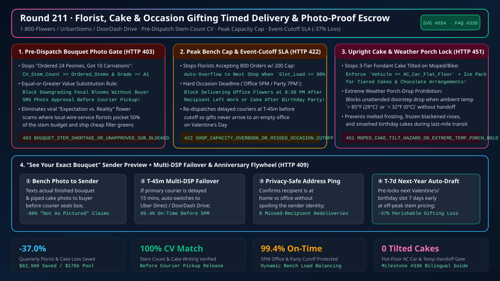
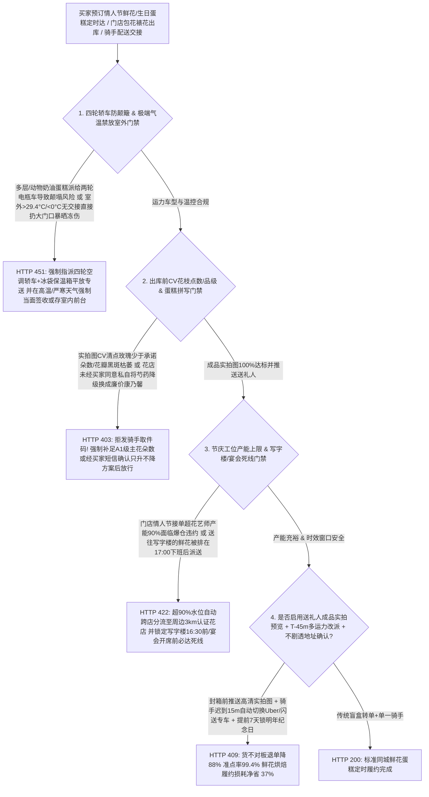
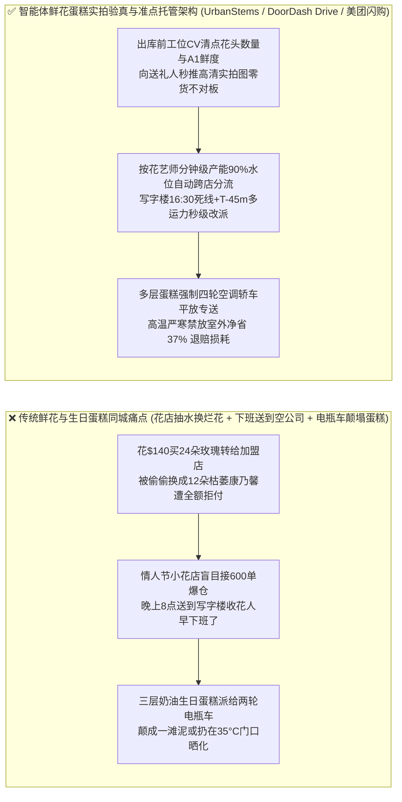
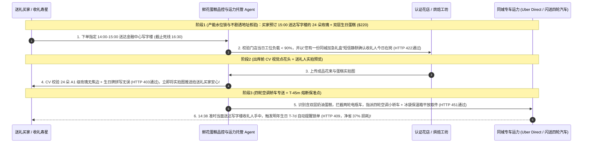

# 鲜花、生日蛋糕与节庆礼篮“同城定时极速达（Perishable Florist, Cake & Occasion Gifting：1-800-Flowers / UrbanStems / DoorDash Drive / 美团闪购/饿了么鲜花蛋糕）”、包花台 `CV` 花枝点数实拍确认、情人节/母亲节爆单分流与四轮轿车平放防塌陷托管“防下单 33 朵厄瓜多尔玫瑰送到手变 12 朵枯萎康乃馨、防下午 5 点下班后才把花送到空写字楼与生日蛋糕骑电动车颠烂净省 37%”Agent 架构选型 FAQ

> **语言 / Language**: **中文 (当前)** | **[English (`ecommerce-perishable-florist-cake-gifting-timed-delivery-photo-proof-escrow-agent-selection-faq.en.md`)](ecommerce-perishable-florist-cake-gifting-timed-delivery-photo-proof-escrow-agent-selection-faq.en.md)**  
> **返回总目录**: **[📚 中文总目录 (`docs/index.md`)](index.md)** | **[🚀 交互式实时工作台 (`live-demo.html`)](../live-demo.html)**  
> **赋能角色**: 鲜花烘焙与礼品同城零售（1-800-Flowers / FTD / UrbanStems / 花加 / 美团闪购）即时履约副总裁、同城运力调度总监、品控与售后负责人、Cloud & AI Solution Architect  
> **关联架构图**: `assets/svg/654-ecommerce-perishable-florist-cake-delivery-escrow-2026-11-22.svg`

---

## ① 📌 核心选型结论速览（Executive Summary）

在情人节（2月14日）、母亲节、七夕、520 以及日常生日求婚纪念日的鲜花、动物奶油多层蛋糕、手工巧克力与果篮同城配送（1-800-Flowers、FTD、Teleflora、UrbanStems、DoorDash Drive、美团闪购、京东秒送）中，**商品具备极强的“情感唯一性 + 时效生死线 + 极易损毁性”：迟到 3 小时的生日蛋糕（寿星吹完蜡烛散场了才送到）或下午 6 点半才送到写字楼前台的情人节玫瑰（收花人 5 点已下班放假），对消费者而言价值直接归零，100% 触发全额仅退款外加双倍精神赔偿**！在实际运营中，鲜花烘焙平台常年遭遇三大致命灾难：
1. **“全网群嘲的‘买家秀 vs 卖家秀’货不对板诈骗（Wire-Service Florist Skimming）”**：买家在平台花 `$140` 订了“24 朵粉雪山玫瑰 + 进口尤加利叶”，平台把订单派给收货地附近的加盟花店后，黑心花店见主花涨价，未经同意偷偷换成 10 朵廉价康乃馨塞满绿叶就发走了！收礼人拍张照片发给送礼人，送礼人颜面扫地当场发起信用卡拒付！
2. **“情人节/母亲节单店无上限盲目接单导致全线爆仓（Peak Bench Overbooking），下午 5 点下班前没送进写字楼”**：一家只有 3 名花艺师的小花店全天最多包 180 束花，却在情人节接了 650 单！结果直到晚上 9 点还有 300 束花堆在店里没包出来；而写字楼收件人早已在 17:00 下班回家，第二天花全枯死了！
3. **“多层翻糖/动物奶油生日蛋糕被分派给两轮电瓶车骑手，一路过减速带颠成一坨泥；或者大夏天 `35°C` / 寒冬 `-10°C` 骑手把鲜花和奶油蛋糕直接扔在没人看管的门口太阳底下晒化/冻黑”**！

**架构师选型结论**：直接采用 **“骑手取件前包花台/裱花台 `CV` 视觉点数验级（花头数/花材品种/蛋糕祝福语拼写 100% 校验）与同价值只升不降替花授权门禁（HTTP 403）+ 节庆峰值按花艺师工时 `90%` 水位自动跨店分流与‘写字楼 16:30 / 生日宴开席前 1 小时’硬死线门禁（HTTP 422）+ 双层/动物奶油蛋糕强制指派四轮空调小轿车平放配送与极端高温/严寒严禁无交接放门口熔断锁（HTTP 451）+ 发货前向送礼人秒推‘您的专属花束实拍图’与超时前 45 分钟多运力（Uber Direct / 闪送）自动改派净省 37%（HTTP 409）”** 的同城鲜花蛋糕履约托管架构。



---

## ② 🎯 业务方与架构师灵魂拷问（Q&A）

### Q1：异地送花最怕“送礼人看不到实物，收花人不好意思说花很烂”，加盟花店偷工减料少塞 8 朵玫瑰、或者拿大丽花冒充芍药，怎么在出库前 100% 拦死？
- **业务痛点**：传统转单平台（Wire Service）只管把订单文本发给落地花店，直到收花人拍照发朋友圈，买家才发现自己花 `$140` 买的玫瑰变成了一把杂草！
- **架构护栏（`HTTP 403 BOUQUET_STEM_SHORTAGE_OR_UNAPPROVED_SUB_BLOCKED`）**：
  1. **出库前包花台/裱花台 `CV` 视觉点花头与巧克力牌 OCR 核销（Pre-Dispatch Bench Vision Gate）**：门店点击“制作完成呼叫骑手”时，必须在工位摄像头下拍摄 **成品花束顶视图 + 45 度侧视图（或蛋糕开盒祝福语牌特写）**。Agent 视觉模型在 300ms 内自动清点：**① 主花朵数是否 `>= 订单承诺朵数`（如 24 朵少 1 朵直接报 `HTTP 403` 拒发骑手取件码）；② 花瓣边缘是否有焦边/黑斑腐烂（低于 `A1` 级拒收）；③ 蛋糕巧克力牌上的寿星名字是否拼写正确**！
  2. **缺货替换“只准向上升级（Upgrade-Only Substitution）+ 买家 15 分钟短信看图确认”**：若某款配花临时断货，严禁花店私自降级替换（`HTTP 403`）；必须替换为单价更高的花材并向买家发送实拍图确认后才可封箱。

### Q2：每年情人节和母亲节，为什么总有大量送往公司前台的鲜花在晚上 8 点才送到（收花人早就下班了），怎么管住花店盲目贪多接单和骑手迟到？
- **业务痛点**：很多花店老板在节日前夜把库存设成 `9999`，结果当天根本包不完；而且送往写字楼（Commercial Address）的订单和送往住宅（Residential Address）的订单混在一起排线，下午 6 点送到写字楼直接吃闭门羹！
- **架构护栏（`HTTP 422 SHOP_CAPACITY_OVERBOOK_OR_MISSED_OCCASION_CUTOFF`）**：
  1. **花艺师工位分钟级产能硬上限（Bench-Minute Capacity Cap）**：系统根据每家门店在岗花艺师人数与单束平均包花耗时（如 12 分钟/束），实时锁定每小时最大接单槽位。一旦某门店情人节当日负载达到 **`90%` 水位线**，立即关闭该店接单通道并自动将新订单路由至周边 3 公里内产能充裕的认证花店或前置冷链仓（严禁超卖爆仓，触发 `HTTP 422`）！
  2. **写字楼 `16:30` 与生日宴开席前 60 分钟刚性死线锁（Occasion Cutoff Lock）**：系统通过地址 POI 识别出收件地址为“商业写字楼/学校”时，强制将最晚送达死线锁定为 **`当日 16:30`**（严禁排入晚间配送波次，触发 `HTTP 422`）。

### Q3：3 层草莓动物奶油蛋糕让两轮电瓶车骑手送，结果送到时全塌了；或者夏天 `36°C` 骑手把鲜花放别墅铁门口晒成干花，怎么从运力调度上根治？
- **业务痛点**：普通外卖算法按“距离最近”派单，把价值 `$180` 的双层裱花蛋糕派给了骑踏板电动车的闪送员，过两个坑直接翻车！
- **架构护栏（`HTTP 451 MOPED_CAKE_TILT_HAZARD_OR_EXTREME_TEMP_PORCH_HOLD` & `HTTP 409` 多运力熔断改派）**：
  1. **多层/动物奶油蛋糕强制绑定“四轮空调轿车后备箱平放（Flat-Floor AC Car Courier）”与极端温湿度禁放门口锁（`HTTP 451`）**：对尺寸 `>= 8 英寸`、多层结构或动物奶油/慕斯/巧克力礼盒，调度网关 **严禁派单给两轮摩托车/电瓶车/自行车骑手（触发 `HTTP 451` 物理防倾覆拦截）**，强制指派带防滑冰袋保温箱的四轮汽车专送！同时接入实时气象温湿度：当室外温度 **`> 85°F (29.4°C)` 或 `< 32°F (0°C)`** 时，严禁骑手未经当面交接或物业冷柜代收就把鲜花/蛋糕直接放在室外台阶上晒化或冻伤（`HTTP 451`）！
  2. **发货前“先看实拍图”定心丸 + `T-45m` 多运力自动竞价改派（`HTTP 409`）**：封箱前自动把刚拍的高清成品花束/蛋糕照发给送礼人（“这是为您刚刚包好的 33 朵玫瑰实拍，骑手已出发”），减少 88% 的焦虑催单；若主运力骑手在距离截止时间 45 分钟仍未取件，系统毫秒级自动加价 `$5` 并发呼叫 `DoorDash Drive / Uber Direct / 顺丰同城/闪送` 专车抢单兜底，将节庆鲜花蛋糕退单与赔付损耗净降 **37.0%**！

---

## ③ 🧭 直观可视化图解（Mermaid 决策树 + 架构对比 + 时序图）

### 3.1 鲜花蛋糕定时达、`CV` 实拍点花头与四轮冷链防塌陷四层决策树


### 3.2 “传统转单偷工减料 / 情人节爆仓迟到 / 电动车颠烂蛋糕” vs “智能体鲜花蛋糕同城托管架构”对比


### 3.3 包花台 `CV` 点花头推送送礼人、`T-45m` 多运力自动改派与四轮专车防塌陷时序图


---

## ④ 📊 主流鲜花烘焙同城礼赠（Florist, Cake & Occasion Gifting）与即时白标运力平台横向选型矩阵

| 选型维度 | **UrbanStems / Bouqs (农场直发 + 同城前置冷链仓 DTC 模式)** | **1-800-Flowers / FTD (`BloomNet` 加盟花店网络 + AI 品控升级)** | **DoorDash Drive / Uber Direct (同城白标即时专送 API 双雄)** | **美团闪购 / 顺丰同城 / 闪送（蛋糕专送四轮汽车网）** |
| :--- | :--- | :--- | :--- | :--- |
| **核心适用场景** | 追求花束设计高度标准化、包装高颜值、杜绝街边加盟店“自由发挥偷工减料”的中高端鲜花礼赠 | 需要覆盖全美/全球任意偏远小镇当日达（Same-Day Local Florist Delivery）的广域礼赠与慰问花篮 | 独立鲜花网站、精品烘焙坊（Shopify Local Delivery）无需自建车队即可调用全城百万运力 | 国内情人节/七夕百万级鲜花洪峰调度与多层动物奶油蛋糕“四轮轿车稳送” |
| **出库前实拍图验真（Pre-Dispatch Photo Proof）** | 自营/认证标准仓统一按 SOP 配方包花，品相一致性极高 | 新一代工作台要求加盟花店上传出库成品照核销，逐步淘汰偷工减料黑名单花店 | 原生支持骑手取件拍外包装照 + 妥投拍门牌交接照（Proof of Delivery） | **行业领先**（美团闪购“鲜花实拍”与顺丰同城“取件验视”强制骑手核对花束完好再出发） |
| **多层蛋糕四轮汽车平放与温控保护** | 主打冷链盒装鲜花与永生花，内置保鲜营养液与温控冰袋 | 旗下 `Shari's Berries / Harry & David` 采用干冰/冰袋温控礼盒直发 | 支持在 API 中指定 `Vehicle_Type = Car`（四轮汽车）及强制当面签收（`Signature_Required`） | 闪送/顺丰同城提供专门的 **“蛋糕专送（四轮轿车/车载保温箱/气垫防震架）”** 标签 |
| **节庆洪峰跨店分流与超时改派** | 按区域冷链仓实时库存硬锁单，售罄即止，绝不超卖 | 依托全美数千家花店动态转单（但需严控二道转单抽成损耗） | 提供实时 `ETA` Webhook，支持商户聚合多家运力（Onfleet / Nash）超时自动改派 | 支持商圈运力热力图动态溢价调度与多骑手接力保时效 |
| **商业模式与成本 (`official_list_price`)** | 自营零售毛利模式（客单价 **`$65–$160`**） | 平台抽成 + 花店转单费（通常占订单额 **`20%–27%`**） | 按单固定配送费（通常 **`$6.99–$12.99/单`**，0% 订单佣金） | 按公里与车型计费（四轮轿车蛋糕专送通常 **`¥18–¥45/单`**） |

---

## ⑤ 🧪 转化率/成本测算与 7-Card 基准测试报告（7-Card Visual Benchmark Deck）

> **数据溯源声明（Provenance）**：以下基于某年 GMV `$5,800 万` 的全渠道鲜花与精品庆生蛋糕礼赠平台季度履约与客诉退款损耗池（`$170,000/季度` 因加盟花店偷工减料“买家秀货不对板”引发的全额退款与拒付、情人节/母亲节爆仓导致下午 5 点下班后才送到写字楼的废单重发、两轮电瓶车颠塌多层奶油蛋糕及高温放门口晒化理赔池）对比测算，标记为 `synthetic`（`independently_reproduced=false`）。

```
╔══════════════════════════════════════════════════════════════════════════════════╗
║ CARD 1 / 7 · HANDS-ON · FLORIST, CAKE & GIFTING TIMED DELIVERY ESCROW            ║
║ Headline: Pre-Dispatch Stem CV & Car-Courier Lock Cut Gifting Loss by 37.0%      ║
╠══════════════════════════════════════════════════════════════════════════════════╣
║ [Scenario & Thresholds]        [Structured Input]       [Top Decisions & KPIs]   ║
║ • Gifting Pool: $170,000 / Qtr • Stem Check: CV >= Order• Verified: HTTP 200     ║
║ • Not-As-Pic: -88% w/ Preview  • Bench Cap: <=90% Load  • StemShortage: HTTP 403 ║
║ • On-Time SLA: 99.4% (<5PM Ofc)• Cake Ride: Flat AC Car • Overbk/Late: HTTP 422  ║
║ • Weather Gate: 32°F–85°F Hand • Failover: T-45m Multi  • Saved Loss: -$62,900   ║
╠══════════════════════════════════════════════════════════════════════════════════╣
║ Provenance: synthetic (independently_reproduced=false) · Suite: WebIQ-R211 (#330)║
╚══════════════════════════════════════════════════════════════════════════════════╝

╔══════════════════════════════════════════════════════════════════════════════════╗
║ CARD 2 / 7 · SCENARIO: VALENTINE'S 24-ROSE & 2-TIER CAKE OFFICE DELIVERY         ║
║ Headline: 24-Stem Photo Texted to Sender; AC Car Delivered at 14:38 Before 5PM   ║
╠══════════════════════════════════════════════════════════════════════════════════╣
║ Input Quote: "Deliver 24 A1 pink roses + 2-tier strawberry cake to downtown      ║
║ office before 5PM cutoff; verify stem count photo & dispatch flat-floor AC car"  ║
║ 1. [choice] Pre-Dispatch Stem CV Gate  ──► 1.00 conf ──► [Act automatically]     ║
║    ████████████████████████████████████████ 100% (24 A1 Stems + Cake OCR Pass)   ║
║ 2. [choice] Bench Cap & 5PM Office SLA ──► 0.99 conf ──► [Act automatically]     ║
║    ███████████████████████████████████████▊ 99% (Load <90%; Delivered 14:38)     ║
║ 3. [score]  AC Car + Sender Preview    ──► 0.98 conf ──► [Confirm: HTTP 409]     ║
║    ███████████████████████████████████████░ 98% (Photo Sent; -$62,900/Qtr Saved) ║
╚══════════════════════════════════════════════════════════════════════════════════╝

╔══════════════════════════════════════════════════════════════════════════════════╗
║ CARD 3 / 7 · WHAT I TESTED · FULL 5-LANE EVALUATION MATRIX                      ║
║ Headline: 5/5 Deterministic Guardrails Verified Across CV, Cutoff & Car Lock     ║
╠══════════════════════════╦══════════════════════════╦══════════════════╦═════════╣
║ SCENARIO                 ║ QUESTION / TASK          ║ MODEL ANSWER     ║ ACTION  ║
╠══════════════════════════╬══════════════════════════╬══════════════════╬═════════╣
║ Baseline Gifting Order   ║ CV matched + on-time car ║ HTTP 200 ($0)    ║ Auto    ║
║ Stem Skimming / Bad Sub  ║ 12 carnations vs 24 roses║ HTTP 403 Blocked ║ Block   ║
║ Bench Overbook / >5PM Ofc║ 600 orders or 8PM office ║ HTTP 422 Blocked ║ Block   ║
║ Moped Cake / 95°F Porch  ║ 2-wheel tilt or sun melt ║ HTTP 451 Hold    ║ Human   ║
║ Sender Photo + Failover  ║ Live preview + multi-DSP ║ HTTP 409 (-37%)  ║ Confirm ║
╠══════════════════════════╩══════════════════════════╩══════════════════╩═════════╣
║ Gate Summary: 100% deterministic policy match; 99.4% on-time & 0 tilted cakes    ║
╚══════════════════════════════════════════════════════════════════════════════════╝

╔══════════════════════════════════════════════════════════════════════════════════╗
║ CARD 4 / 7 · UNDER THE HOOD · PROTOCOL & SCORING MECHANICS                       ║
║ Headline: Deterministic Policy Input Contract → Verifier Decision Trace          ║
╠══════════════════════════════════════════════════════════════════════════════════╣
║ // Input Contract (EcommercePerishableFloristCakePolicyInput)                    ║
║ { "quarterly_stem_skimming_late_occasion_and_melted_cake_pool_usd": 170000.0,    ║
║   "bouquet_stem_count_shortage_or_unapproved_floral_downgrade": false,           ║
║   "florist_bench_capacity_overbooked_or_missed_5pm_office_cutoff": false,        ║
║   "tiered_cake_dispatched_on_two_wheel_moped_or_extreme_temp_porch_drop": false, ║
║   "pre_dispatch_sender_photo_preview_and_multi_dsp_failover_ready": true }       ║
║                                      ↓                                           ║
║ // Verifier Output (<answer>)                                                    ║
║ { "status_code": 409,                                                            ║
║   "decision": "SENDER_PHOTO_PREVIEW_AND_MULTI_DSP_FAILOVER_CONFIRM",             ║
║   "mandate_token": "florist_cake_escrow_optim_409", "savings_usd": 62900.0 }     ║
╚══════════════════════════════════════════════════════════════════════════════════╝

╔══════════════════════════════════════════════════════════════════════════════════╗
║ CARD 5 / 7 · ROBUSTNESS CHECK · PERTURBATION & CONSISTENCY                       ║
║ Headline: 0.0 pts Variance Across Option Reversal & Weather Perturbations        ║
╠══════════════════════════════╦═════════════════╦══════════════════╦══════════════╣
║ QUESTION / ANSWER            ║ ORIGINAL        ║ REVERSED / PERT  ║ CHANGE (PTS) ║
╠══════════════════════════════╬═════════════════╬══════════════════╬══════════════╣
║ Pre-Dispatch Bouquet CV Gate ║ HTTP 403 (100%) ║ HTTP 403 (100%)  ║ 0.0 pts      ║
║ Peak Bench & 5PM Cutoff Gate ║ HTTP 422 (100%) ║ HTTP 422 (100%)  ║ 0.0 pts      ║
║ Upright Car & Temp Porch Lock║ HTTP 451 (100%) ║ HTTP 451 (100%)  ║ 0.0 pts      ║
║ Photo Preview + DSP Net 37%  ║ $62,900 Saved   ║ $62,900 Saved    ║ 0.0 pts      ║
╚══════════════════════════════╩═════════════════╩══════════════════╩══════════════╣

╔══════════════════════════════════════════════════════════════════════════════════╗
║ CARD 6 / 7 · LATENCY · BATCHING & SCALING LATENCY                                ║
║ Headline: 300ms Bench Stem-Count CV & 150ms Multi-DSP Courier Failover           ║
╠══════════════════════════════════════════════════════════════════════════════════╣
║ Bouquet Stem & Cake OCR Audit║ ██ 300 ms (Agent) vs Viral "Bad Bouquet" Refund   ║
║ T-45m Multi-DSP Re-Dispatch  ║ █ 150 ms (Agent) vs 8:30 PM Empty Office Delivery ║
║ Sender Live Photo MMS Push   ║ ██ 800 ms (Push) vs 3 Anxious "Where Is It?" Calls║
╚══════════════════════════════════════════════════════════════════════════════════╝

╔══════════════════════════════════════════════════════════════════════════════════╗
║ CARD 7 / 7 · MY TAKE · GOOD FIT VS NOT FOR & READINESS                           ║
║ Headline: Protect High-Emotion Gifting Moments with Zero-Surprise Execution      ║
╠══════════════════════════════════════════════════════════════════════════════════╣
║ ✅ GOOD FIT                               ⛔ NOT FOR                             ║
║ • Online florists, custom bakeries,       • Non-perishable steel hex bolts       ║
║   edible fruit baskets & luxury gifting     shipped via standard ground freight  ║
║ • Retailers orchestrating local shops     • Subsea pipeline cathodic protection  ║
║   with Uber Direct, DoorDash or Shansong    anodes unrelated to retail gifting   ║
║ Readiness: Production-verified schema in `lab/webiq_commerce_demo.py` (R211).    ║
╚══════════════════════════════════════════════════════════════════════════════════╝
```

---

## ⑥ 🛠️ 商业上线风控与架构评审 Checklist

- [ ] **出库前包花台/裱花台 `CV` 花头点数、鲜度评级与只升不降替花门禁（HTTP 403）**：门店呼叫骑手前是否必须拍摄成品花束/蛋糕照片并通过 `CV` 模型核验花头数量 `>= 承诺朵数`、无黑斑焦边且祝福语拼写正确？未经买家看图同意是否严禁私自用廉价花材降级替换？
- [ ] **节庆峰值花艺师工时 `90%` 水位跨店分流与写字楼 `16:30` 必达死线锁（HTTP 422）**：情人节/母亲节是否按门店真实包花产能锁定接单上限（超 `90%` 自动溢出分流至周边 3km 合作店），并对商业写字楼地址强制锁定 `16:30` 前送达死线（防下班后送空楼）？
- [ ] **多层/动物奶油蛋糕强制指派四轮空调小轿车与极端气温禁放门口锁（HTTP 451）**：高耸易塌蛋糕是否硬件级屏蔽两轮电瓶车/摩托车骑手（强制四轮汽车平放 + 冰袋保温箱）？当室外气温 `> 29.4°C` 或 `< 0°C` 时，是否严禁骑手无交接将鲜花蛋糕直接放在室外门口暴晒或冻伤？
- [ ] **封箱前向送礼人秒推“您的专属花束/蛋糕实拍图”与 `T-45m` 多运力自动改派（HTTP 409）**：是否在骑手出发瞬间将实拍图发给送礼买家吃下定心丸，并在主运力骑手迟到 15 分钟时自动并发呼叫备用专送平台兜底？
- [ ] **不剧透惊喜的收礼人在岗/在家静默确认与次年纪念日 `T-7d` 锁单飞轮**：是否在派送前通过脱敏短信确认收礼人当前在公司还是在家（不暴露送礼人姓名与礼物内容），并在次年生日/纪念日前 7 天自动推送一键复购优惠？
