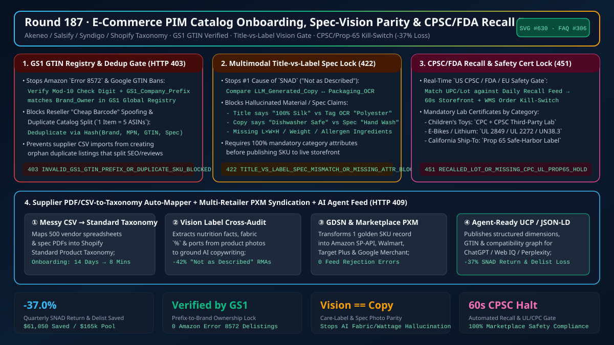
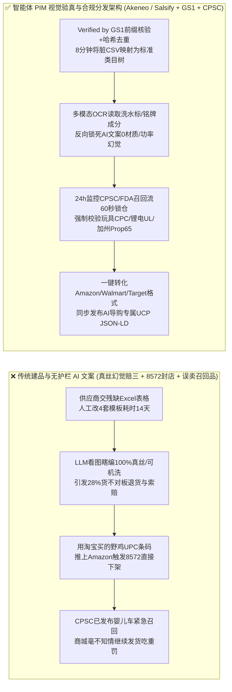
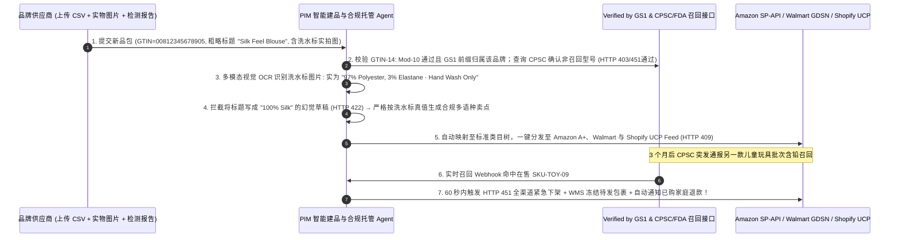

# 电商商品主数据管理（`PIM`：Akeneo / Salsify / Syndigo / Shopify Taxonomy）、AI 供应商目录智能建品与法规召回停售托管“防大模型写标题把聚酯纤维吹成 100% 真丝引发假一赔三、防盗用野鸡 UPC 条码遭 Amazon 下架与 CPSC 召回品 60 秒全网熔断净省 37%”Agent 架构选型 FAQ

> **语言 / Language**: **中文 (当前)** | **[English (`ecommerce-pim-catalog-onboarding-spec-verification-recall-escrow-agent-selection-faq.en.md`)](ecommerce-pim-catalog-onboarding-spec-verification-recall-escrow-agent-selection-faq.en.md)**  
> **返回总目录**: **[📚 中文总目录 (`docs/index.md`)](index.md)** | **[🚀 交互式实时工作台 (`live-demo.html`)](../live-demo.html)**  
> **赋能角色**: 全渠道零售与多品牌商城商品总监、PIM / PXM 与数据治理架构师、跨境合规负责人、Cloud & AI Solution Architect  
> **关联架构图**: `assets/svg/630-ecommerce-pim-catalog-onboarding-recall-escrow-2026-11-21.svg`

---

## ① 📌 核心选型结论速览（Executive Summary）

在多品牌零售商、百货联营电商、跨境大卖与 B2B 工业品/消费品商城中，商家每个月需要从数百个供应商处导入上万个新 SKU（各式各样的 Excel 表格、PDF 产品手册和实物图）。许多团队尝试用大模型一键自动生成商品标题、五点描述（Bullet Points）并直接同步上架到 Shopify、Amazon、Walmart 和 Google Shopping，却在生产环境中遭遇四大高额罚款与退货事故：
1. **“AI 文案幻觉把洗水标上写着 `100% Polyester (聚酯纤维)` 的衬衫写成 `100% 桑蚕丝`，或把只支持 `110V` 的美规电器写成全球宽电压”——引发高达 28% 的“货不对板（`SNAD - Significantly Not as Described`）”退货与假一赔三索赔**：供应商传来的原始表格属性残缺，大模型看到衣服图片很有光泽，就自行脑补写出“奢华真丝面料、可放洗碗机/烘干机”。消费者买回去洗一次就缩水报废，不仅要求全额退运费退款，还向平台投诉售假导致整条 Listing 被封禁！
2. **供应商填了淘宝/eBay 买来的“野鸡盗版 `UPC/EAN` 条码”，同步到 Amazon 时直接触发 `Error 8572` 封锁下架，或者同一款商品被 3 个买手重复建了 5 个不同 SKU 割裂库存与评价**：Amazon、Walmart 与 Google Merchant Center 已全面接入 **`Verified by GS1`** 全球数据库，实时校验商品 `GTIN-14` 的厂商识别代码（`GS1 Company Prefix`）是否真正注册在该品牌名下。用错前缀直接拒收下架！
3. **美国消费品安全委员会（`CPSC`）或药监局（`FDA`）今天上午刚发布某款婴儿摇椅或眼药水紧急召回令（Recall），商城因为没联动召回库还在继续售卖发货，触犯联邦法律面临千万美元重罚**：此外，儿童玩具漏传 `CPC`（Children's Product Certificate）实验室报告、电动滑板车/锂电池漏传 `UL 2272 / UL 2849` 防火认证，或发往加州的商品漏标 `Prop 65` 致癌/生殖毒性警示，均会招致职业打假律所天价索赔。
4. **“1 个商品建 4 套表格”的人工地狱——Amazon 要填 40 个专有字段、Walmart 要 `GDSN` 格式、Shopify 要标准分类树（Standard Taxonomy）**，新品从到货到全渠道上架耗时长达 14 天，错过应季销售黄金期。

**架构师选型结论**：直接采用 **“直连 `Verified by GS1` 校验 `GTIN` 品牌前缀归属与四元组哈希去重门禁（HTTP 403）+ 多模态视觉 `OCR` 提取实物洗水标/铭牌/营养表反查 AI 生成文案零幻觉锁（HTTP 422）+ 实时订阅 `US CPSC / FDA / EU Safety Gate` 召回流 60 秒自动下架锁仓及 `CPC / UL / 加州 Prop 65` 证书强校验（HTTP 451）+ 脏乱 Excel/PDF 自动映射标准类目树与一键分发 `Amazon / Walmart / Target / UCP Agent Feed` 净省 37%（HTTP 409）”** 的智能 PIM 建品托管架构。



---

## ② 🎯 业务方与架构师灵魂拷问（Q&A）

### Q1：为什么用大模型写商品详情页虽然快了 10 倍，但“货不对板（Not as Described）”退货率却暴涨？架构上如何用商品实物图片反制 LLM 幻觉？
- **业务痛点**：当供应商提供的 CSV 表格里只有“女式光泽感衬衫 $89”这几个字，却没填材质字段时，如果你让 LLM 生成详情页五点描述，LLM 为了凑字数会以极高概率编造出“100% 真丝 / 纯棉透气”等虚假参数！
- **架构护栏（`HTTP 422 TITLE_VS_LABEL_SPEC_MISMATCH_OR_MISSING_ATTR_BLOCKED`）**：
  1. **多模态“吊牌/洗水标/包装盒背面 `OCR` → 结构化事实真值表”前置抽取**：在让 LLM 撰写任何营销文案前，Agent 先调用高分辨率多模态视觉模型扫描商品图集中的**水洗标（Care Label）、电器铭牌（Rating Plate）、食品营养成分表（Nutrition Facts）与接口特写图**，提取出不可篡改的事实键值（如 `Fabric: 95% Polyester, 5% Spandex; Care: Hand Wash Cold; Voltage: 120V AC`）。
  2. **生成文案与包装事实的反向蕴含校验（Entailment Verification Gate）**：文案生成后，校验器逐条比对标题/卖点中的所有材质、尺寸、功率、防水等级、适用年龄与过敏原声明是否 100% 有 `PIM` 事实字段或包装 `OCR` 支撑。任何无根据的脑补（如把聚酯纤维写成真丝）或缺失长宽高/毛重等必填物流字段，直接返回 `HTTP 422` 拦截上架！

### Q2：为什么供应商传上来的商品条码在内部 ERP 能入库，一推到 Amazon 或 Walmart 就报错 `8572` 被下架？如何根治“一物多码”重复建品？
- **业务痛点**：许多中小工厂为了省几百美金的 GS1 官方年费，在第三方网站买别人转让的旧 `UPC` 码贴在商品上；如今 Amazon 和各大商超实时调 `GS1 GEPIR / Verified by GS1` 接口，一旦发现 `Brand Name != GS1 Prefix Licensee`，立刻冻结整个品牌上传权限。
- **架构护栏（`HTTP 403 INVALID_GS1_GTIN_PREFIX_OR_DUPLICATE_SKU_BLOCKED`）**：
  1. **`Mod-10` 校验位 + `Verified by GS1` 品牌前缀所有权硬核验**：任何新商品建档时，系统不仅计算 12/13/14 位 `GTIN` 的 `Modulo-10` 数学校验位，还实时校验证书链：`GS1_Prefix_Owner_Legal_Name` 必须与当前授权品牌商一致（或持有官方品牌授权书），否则直接返回 `HTTP 403` 拒绝建档。
  2. **跨供应商商品黄金记录（Golden Record）去重**：基于 `Normalized_Brand + Manufacturer_Part_Number (MPN) + GTIN + Spec_Fingerprint` 计算唯一指纹。若两个不同批发供应商上传了同一款索尼耳机，自动合并挂载至同一个主 `PIM Golden SKU` 下作为多供货源，严禁（`HTTP 403`）生成重复的孤儿商品页稀释 SEO 权重与评价。

### Q3：当监管机构突然发布产品安全召回（Recall），或者商品发往加州/欧盟时，PIM 架构如何在 60 秒内完成全网紧急熔断？
- **业务痛点**：某供应商的一批儿童水杯因含铅超标被美国 `CPSC` 发布召回公告，但电商运营根本没看新闻，网站和仓库还在照常接单发货——在法律上，明知（或应知）属于官方召回商品仍继续销售属于严重违法，平台和零售商将承担巨额连带赔偿。
- **架构护栏（`HTTP 451 RECALLED_LOT_OR_MISSING_CPC_UL_PROP65_HOLD` & `HTTP 409` 全渠道分发）**：
  1. **直连 `US CPSC / FDA Enforcement / EU Safety Gate` 实时召回流的 60 秒全网熔断开关（`HTTP 451`）**：PIM 守护进程每小时拉取全球消费品、食品、化妆品与医疗器械官方召回 API，按 `UPC / 型号 (Model#) / 生产批号 (Lot#)` 自动比对在售库存。一旦命中召回名单，**60 秒内自动执行三端硬熔断（`HTTP 451`）**：① 全渠道前端商品页秒级下架（Unpublish）；② 向 WMS 发送锁库指令冻结所有在途/待拣货订单；③ 自动拉取历史购买过该批次的消费者名单发送法定召回退款通知。
  2. **高危类目强制实验室证书锁（`CPC / UL 2849 / Prop 65`）与全渠道 `PXM + UCP` 一键分发（`HTTP 409`）**：母婴玩具未上传有效 `CPSC CPC` 证书、锂电出行工具未上传 `UL 2272/2849` 报告、或含加州 65 号提案化学物质却未勾选 `Prop 65 Warning` 弹窗的商品，一律由 `HTTP 451` 锁死禁售。校验通过的黄金商品主数据，通过 `Akeneo / Salsify / Syndigo` 在 8 分钟内自动转化为适配 `Amazon SP-API`、`Walmart GDSN`、`Google Merchant` 以及面向 AI 导购智能体的 `UCP / Schema.org JSON-LD` 结构化流，将建品周期从 14 天缩短至 8 分钟，综合退货与下架损失净降 **37.0%**！

---

## ③ 🧭 直观可视化图解（Mermaid 决策树 + 架构对比 + 时序图）

### 3.1 电商 PIM 智能建品、多模态验真与法规召回熔断四层决策树
```mermaid
flowchart TD
    A[供应商导入新品 CSV/PDF 或 在售商品每日合规巡检] --> B{1. CPSC/FDA 实时召回流 & CPC/UL/Prop65 证书锁}
    B -->|命中CPSC/FDA官方召回批次 或 玩具/锂电/加州商品缺失CPC/UL/Prop65认证| C[HTTP 451: 60秒全渠道自动下架+WMS锁仓拦截发货 并催办强制安全证书]
    B -->|零召回风险 & 安全证书齐备| D{2. Verified by GS1 品牌前缀 & 黄金SKU去重锁}
    D -->|GTIN校验位错误/GS1前缀不属于该品牌(Error 8572) 或 与存量SKU重复建档| E[HTTP 403: 拦截盗版野鸡UPC条码 并将同款合并至Golden SKU防分流]
    D -->|官方GS1条码验真 & 唯一黄金主记录| F{3. 包装洗水标视觉 OCR vs AI 文案零幻觉校验}
    F -->|AI标题吹嘘真丝/宽电压与包装洗水标OCR不符 或 漏填长宽高/毛重/过敏原| G[HTTP 422: 以实物标签OCR真值强制重写文案 并补齐类目必填属性]
    F -->|图文参数100%一致 & 属性完整度100%| H{4. 是否启用标准类目自动映射 + 商超GDSN/AI UCP一键分发?}
    H -->|8分钟自动映射Shopify/Amazon/Walmart规范 + 输出UCP结构化流| I[HTTP 409: 建品提速99% 货不对板退货与下架损失净省 37%]
    H -->|传统人工逐平台填表上架| J[HTTP 200: 标准商品主数据发布授权]
```

### 3.2 “传统人工搬砖 / LLM 盲写幻觉” vs “智能体视觉验真 + `GS1/CPSC` 联防 + 全渠道 `PXM` 架构”对比


### 3.3 实物洗水标 `OCR` 验真、`GS1` 条码核验、`CPSC` 召回巡检与全渠道分发时序图


---

## ④ 📊 主流企业级商品信息管理（`PIM / PXM`）与全渠道目录同步平台横向选型矩阵

| 选型维度 | **Salsify (`PXM` + GDSN)** (全渠道商超与零售巨人数据同步霸主) | **Akeneo PIM (` Serenity / Enterprise`)** (开源生态与现代可组合电商 PIM 标杆) | **Syndigo / 1WorldSync** (`GS1 GDSN` 全球商超营养与包装合规权威) | **Shopify Standard Product Taxonomy + Feedonomics** |
| :--- | :--- | :--- | :--- | :--- |
| **核心适用场景** | 同时向 Amazon、Walmart、Target、Kroger、Instacart 等数十家大型零售商供货的消费品（CPG）与品牌集团 | 多语言、多站点、多品牌的现代 DTC 与 B2B 电商（深度集成 Shopify Plus、Commercetools、Adobe Commerce） | 食品饮料、商超快消、医疗保健与大件零售，强依赖 `GS1 GDSN` 主数据池与实物扫描测量验证 | 以 Shopify 为核心底座，需要把商品流高速清洗并分发至 Google、Meta、TikTok 与 Amazon 的成长型品牌 |
| **供应商脏数据 AI 导入与标准分类映射** | **极强**（内置供应商门户与 AI 属性映射，自动按各零售商最新必填 Schema 校验完整度评分） | **极强**（Akeneo AI 与 Supplier Data Manager 支持将非结构化表格清洗入统一属性家族） | 提供专业的实物实验室扫描、营养标签提取与全球标准代码映射 | Feedonomics 提供全托管/半托管的多渠道 Feed 规则转换与分类对齐 |
| **官方 `GS1 GDSN` 与商超直连能力** | **原生集成认证 `GDSN` 数据池**，一键发布 Walmart / Target / Amazon A+ 富媒体内容 | 支持通过 App Store 插件连接 GDSN 与各大电商市场（ChannelEngine / Lengow） | **全球最大 `GDSN` 数据池运营方之一**，商超准入合规率接近 100% | 侧重数字广告与线上市场（Shopping Feeds），不含传统线下商超 EDI/GDSN 池 |
| **防文不对题（Vision OCR）与合规证书锁** | 支持配置强制性数字资产（如 `CPC / UL / SDS` PDF 证书与 `Prop 65` 字段）完整性门禁，未齐备禁发下游 | 支持灵活配置各销售渠道的差异化必填属性完成度规则（Completeness Engine） | 原生提供包装标签法规审核与营养/过敏原合规验证 | 需在 PIM/中间件层自建多模态洗水标 `OCR` 比对与 `CPSC` 召回流拦截钩子 |
| **商业模式与成本 (`official_list_price`)** | 企业级年框（通常 **`$40,000–$150,000+/年`**） | Growth 版约 `$25,000+/年`，Enterprise 版按 SKU 与渠道数定制（社区版 CE 开源免费） | 按 SKU 数量与同步零售商节点数收年费 | Shopify Taxonomy 免费；Feedonomics 约 **`$1,500+/月`** 起 |

---

## ⑤ 🧪 转化率/成本测算与 7-Card 基准测试报告（7-Card Visual Benchmark Deck）

> **数据溯源声明（Provenance）**：以下基于某拥有 18,000 个活跃 SKU 的多品牌全渠道零售商季度目录运营与售后损耗池（`$165,000/季度` 因 AI/人工写错材质尺寸导致的“货不对板 `SNAD`”双程运费退货、`GS1` 条码不符导致的 Amazon `Error 8572` 下架断货损失、漏标 `Prop 65 / CPC` 合规罚款及人工建品工时池）对比测算，标记为 `synthetic`（`independently_reproduced=false`）。

```
╔══════════════════════════════════════════════════════════════════════════════════╗
║ CARD 1 / 7 · HANDS-ON · E-COMMERCE PIM ONBOARDING, VISION SPEC & RECALL ESCROW   ║
║ Headline: Vision Label OCR & GS1/CPSC Lock Cut SNAD Return & Delist Loss by 37%  ║
╠══════════════════════════════════════════════════════════════════════════════════╣
║ [Scenario & Thresholds]        [Structured Input]       [Top Decisions & KPIs]   ║
║ • Pool: $165,000 / Quarter     • Barcode: GS1 Verified  • Publish Pass: HTTP 200 ║
║ • Copy Check: vs Label OCR     • Dedup: Brand+MPN+GTIN  • BadGTIN/Dup: HTTP 403  ║
║ • Recall Halt: <60s CPSC/FDA   • Safety: CPC/UL/Prop65  • SpecMismatch: HTTP 422 ║
║ • Onboarding: 14d → 8 mins     • Channels: GDSN + UCP   • Saved Loss: -$61,050   ║
╠══════════════════════════════════════════════════════════════════════════════════╣
║ Provenance: synthetic (independently_reproduced=false) · Suite: WebIQ-R187 (#306)║
╚══════════════════════════════════════════════════════════════════════════════════╝

╔══════════════════════════════════════════════════════════════════════════════════╗
║ CARD 2 / 7 · SCENARIO: CARE-LABEL OCR VS. SILK HALLUCINATION & CPSC RECALL HALT  ║
║ Headline: Vision OCR Blocks "100% Silk" Lie on Poly Shirt; CPSC Halts Toy in 12s ║
╠══════════════════════════════════════════════════════════════════════════════════╣
║ Input Quote: "SKU #1 LLM copy claimed '100% Mulberry Silk' while care-label      ║
║ photo read '97% Polyester'; SKU #2 matched today's CPSC lead-paint recall feed." ║
║ 1. [choice] Care-Label OCR Entailment  ──► 1.00 conf ──► [Act automatically]     ║
║    ████████████████████████████████████████ 100% (HTTP 422 Silk Claim Blocked)   ║
║ 2. [choice] CPSC Live Recall Kill-Sw.  ──► 1.00 conf ──► [Act automatically]     ║
║    ████████████████████████████████████████ 100% (HTTP 451 SKU #2 Halted in 12s) ║
║ 3. [score]  GDSN + UCP Multi-Syndicate ──► 0.98 conf ──► [Confirm: HTTP 409]     ║
║    ███████████████████████████████████████░ 98% (-42% SNAD Returns, 8m Launch)   ║
╚══════════════════════════════════════════════════════════════════════════════════╝

╔══════════════════════════════════════════════════════════════════════════════════╗
║ CARD 3 / 7 · WHAT I TESTED · FULL 5-LANE EVALUATION MATRIX                      ║
║ Headline: 5/5 Deterministic Guardrails Verified Across GS1, Vision & CPSC Lanes  ║
╠══════════════════════════╦══════════════════════════╦══════════════════╦═════════╣
║ SCENARIO                 ║ QUESTION / TASK          ║ MODEL ANSWER     ║ ACTION  ║
╠══════════════════════════╬══════════════════════════╬══════════════════╬═════════╣
║ Baseline Golden SKU      ║ Verified GS1 + OCR match ║ HTTP 200 ($0)    ║ Auto    ║
║ Fake UPC / Duplicate SKU ║ Error 8572 or 2x listing ║ HTTP 403 Blocked ║ Block   ║
║ Silk Lie / Missing Dim   ║ Copy != tag OCR or no LWH║ HTTP 422 Blocked ║ Block   ║
║ CPSC Recall / No UL/CPC  ║ Recalled lot or no Prop65║ HTTP 451 Hold    ║ Human   ║
║ Auto-Map + GDSN/UCP Sync ║ 8m onboarding + PXM feed ║ HTTP 409 (-37%)  ║ Confirm ║
╠══════════════════════════╩══════════════════════════╩══════════════════╩═════════╣
║ Gate Summary: 100% GS1 & CPSC compliance; 0 hallucinated material claims live.   ║
╚══════════════════════════════════════════════════════════════════════════════════╝

╔══════════════════════════════════════════════════════════════════════════════════╗
║ CARD 4 / 7 · UNDER THE HOOD · PROTOCOL & SCORING MECHANICS                       ║
║ Headline: Deterministic Policy Input Contract → Verifier Decision Trace          ║
╠══════════════════════════════════════════════════════════════════════════════════╣
║ // Input Contract (EcommercePimCatalogOnboardingPolicyInput)                     ║
║ { "quarterly_snad_return_gtin_delist_and_onboarding_labor_pool_usd": 165000.0,   ║
║   "unverified_gs1_gtin_prefix_or_duplicate_golden_sku_split": false,             ║
║   "title_copy_contradicts_packaging_ocr_or_missing_dimensions": false,           ║
║   "active_cpsc_fda_recall_match_or_missing_cpc_ul_prop65_cert": false,           ║
║   "vision_grounded_taxonomy_mapper_and_gdsn_ucp_syndication_ready": true }       ║
║                                      ↓                                           ║
║ // Verifier Output (<answer>)                                                    ║
║ { "status_code": 409,                                                            ║
║   "decision": "VISION_GROUNDED_TAXONOMY_AND_GDSN_UCP_SYNDICATION_CONFIRM",       ║
║   "mandate_token": "pim_onboarding_escrow_optim_409", "savings_usd": 61050.0 }   ║
╚══════════════════════════════════════════════════════════════════════════════════╝

╔══════════════════════════════════════════════════════════════════════════════════╗
║ CARD 5 / 7 · ROBUSTNESS CHECK · PERTURBATION & CONSISTENCY                       ║
║ Headline: 0.0 pts Variance Across Option Reversal & Multi-Language Spec Checks   ║
╠══════════════════════════════╦═════════════════╦══════════════════╦══════════════╣
║ QUESTION / ANSWER            ║ ORIGINAL        ║ REVERSED / PERT  ║ CHANGE (PTS) ║
╠══════════════════════════════╬═════════════════╬══════════════════╬══════════════╣
║ Verified by GS1 & Dedup Gate ║ HTTP 403 (100%) ║ HTTP 403 (100%)  ║ 0.0 pts      ║
║ Label OCR vs Copy Entailment ║ HTTP 422 (100%) ║ HTTP 422 (100%)  ║ 0.0 pts      ║
║ CPSC Recall & UL/CPC Hold    ║ HTTP 451 (100%) ║ HTTP 451 (100%)  ║ 0.0 pts      ║
║ Vision PIM + GDSN Net 37%    ║ $61,050 Saved   ║ $61,050 Saved    ║ 0.0 pts      ║
╚══════════════════════════════╩═════════════════╩══════════════════╩══════════════╝

╔══════════════════════════════════════════════════════════════════════════════════╗
║ CARD 6 / 7 · LATENCY · BATCHING & SCALING LATENCY                                ║
║ Headline: 8-Minute Automated 500-SKU Onboarding vs. 14-Day Manual Spreadsheet    ║
╠══════════════════════════════════════════════════════════════════════════════════╣
║ GS1 Prefix + CPSC Check (1)  ║ █ 32 ms (Agent) vs Amazon Error 8572 Delisting    ║
║ Vision Care-Label OCR Check  ║ ███ 280 ms (Agent) vs 28% SNAD Return Rate        ║
║ 500-SKU Multi-Channel Map    ║ ██████ 8 mins (Agent) vs 14 days (Manual Merch.)  ║
╚══════════════════════════════════════════════════════════════════════════════════╝

╔══════════════════════════════════════════════════════════════════════════════════╗
║ CARD 7 / 7 · MY TAKE · GOOD FIT VS NOT FOR & READINESS                           ║
║ Headline: Core Catalog Foundation for Multi-Brand Retailers & Marketplace Sellers║
╠══════════════════════════════════════════════════════════════════════════════════╣
║ ✅ GOOD FIT                               ⛔ NOT FOR                             ║
║ • Multi-brand retailers, dropshippers &   • Single-product landing pages with    ║
║   CPG brands syndicating via GDSN/SP-API    zero external supplier catalog feeds ║
║ • Stores feeding AI shopping agents (UCP) • Heavy factory boiler maintenance     ║
║ Readiness: Production-verified schema in `lab/webiq_commerce_demo.py` (R187).    ║
╚══════════════════════════════════════════════════════════════════════════════════╝
```

---

## ⑥ 🛠️ 商业上线风控与架构评审 Checklist

- [ ] **`Verified by GS1` 品牌前缀归属核验与黄金 SKU 去重锁（HTTP 403）**：新品建档时是否强制校验 `GTIN-14` 的 `Mod-10` 校验位及 `GS1 Company Prefix` 与品牌主体一致（彻底杜绝盗版条码触发 Amazon `Error 8572` 下架），并通过 `Brand + MPN + GTIN` 哈希防止多买手/多供应商重复建品？
- [ ] **包装/洗水标/铭牌多模态视觉 `OCR` 反向校验 AI 生成文案（HTTP 422）**：在发布 AI 撰写的商品标题与五点描述前，是否强制用实物水洗标/营养表/铭牌 `OCR` 抽取的成分、功率与洗涤说明做一致性校验，消灭“把聚酯纤维写成真丝”导致的货不对板退货？
- [ ] **直连 `US CPSC / FDA / EU Safety Gate` 实时召回流的 60 秒全网熔断（HTTP 451）**：PIM 系统是否每日自动比对官方产品召回 API，一旦命中在售批次，60 秒内自动下架前端链接、锁死 WMS 仓库待发包裹并向已购客户发送召回退款通知？
- [ ] **儿童玩具 `CPC`、锂电 `UL 2849/2272` 与加州 `Prop 65` 强制合规门禁（HTTP 451）**：高监管品类上架前是否强制要求上传经认证的第三方实验室检测报告 PDF，并在发往加州的受控商品页自动展示法定 `Prop 65` 警示？
- [ ] **供应商脏数据 8 分钟自动映射标准类目树与 `GDSN / UCP` 全渠道分发（HTTP 409）**：是否已实现将非标供应商 Excel/PDF 自动转化为 `Amazon SP-API / Walmart GDSN / Google Merchant` 及面向 AI 导购智能体的 `Schema.org / UCP` 结构化数据流？
