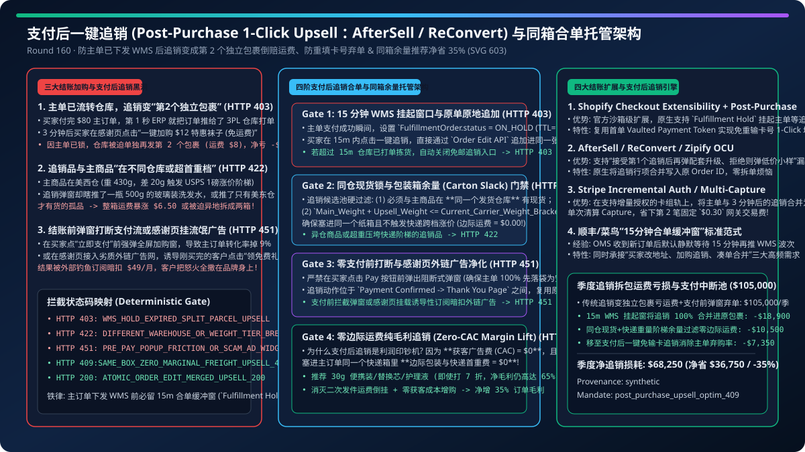
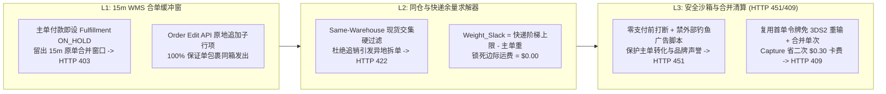
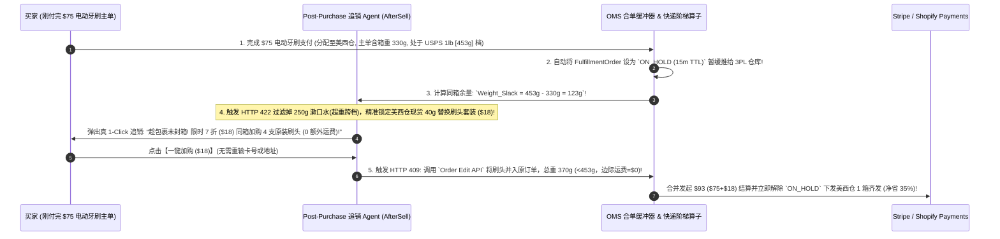

# 电商支付后一键追销（Post-Purchase 1-Click Upsell：Shopify Checkout Extensibility / AfterSell / ReConvert）与同箱余量合单托管：“防主订单已推仓库导致 $12 追销品单独发第 2 个包裹倒赔 $8 运费、防异仓超重拆箱与零边际运费加购净省 35%”Agent 架构选型 FAQ

> **文档类型**：AI Solution Architect 零售电商结账扩展（Checkout Extensibility）、支付后一键追销（Post-Purchase 1-Click Upsell）与 WMS 合单缓冲窗选型指南（Retail, OTA & Marketplace Pillar · FAQ #279 · **Retail/OTA 第 100 篇里程碑**）  
> **涵盖平台与技术栈**：**Shopify Checkout UI Extensions & Post-Purchase App Extensions (`Fulfillment Hold` + `Order Edit API`)**、**AfterSell / ReConvert / Zipify OCU**、**Stripe `Incremental Authorization / Multi-Capture`（省二次 `$0.30` 固定交易费）**、**快递重量阶梯余量计算器（`Carton Weight-Bracket Slack Solver`）**  
> **核心架构命题**：“支付后一键追销（Post-Purchase Upsell）”之所以被誉为独立站提升客单价（AOV）的圣杯，是因为它在 **买家已经完成主订单付款之后、看到最终感谢页（Thank You Page）之前** 弹出限时加购——此时主单已经 `100%` 落袋为安（绝不会像支付前弹窗那样吓跑买家），且无需重新输入信用卡号即可一键追加！然而如果后端 ERP/WMS 与算价状态机没对齐，这台印钞机就会变成赔钱货：① **“主单第 1 秒已下发 3PL 仓库，买家第 3 分钟点的 `$12` 免邮追销变成第 2 个独立包裹”**——因为主单已经锁死打单，仓库只能为这件 `$12`（毛利 `$5`）的追销袜子单独再发一个快递包裹（付 `$8.00` 首重运费），追销一单反而净亏 **`-$3.00`**！② **“瞎推异仓商品或把包裹重量压跨快递计费阶梯”**——主商品在美西仓且重 `430g`（处于 `<1 lb` 的 `$4.80` 运费档），追销算法却推了一瓶只在美东仓有货、或重达 `300g` 的赠品，导致包裹总重突破 `1 lb` 运费暴涨 `$5.50` 或被迫拆成两箱！③ **“在感谢页接入劣质第三方外链广告插件（Post-Checkout Ad Widget），诱导客户误点钓鱼暗扣订阅毁掉品牌信任”**！



---

## 一、 📌 核心选型结论速览（Executive Summary）

> **一句话架构定调**：**支付后一键追销之所以能赚钱，核心前提是“获客成本 CAC = $0 且 边际快递运费 = $0”！必须构建“主订单 15 分钟 `WMS Fulfillment Hold` 合单缓冲锁（HTTP 403）+ 同发货仓现货与快递计费重量阶梯余量（`Carton Slack`）硬过滤（HTTP 422）+ 严禁支付前阻断弹窗与感谢页流氓外链广告（HTTP 451）+ 原单原地追加（`Order Edit`）与单次合并清算省二次 `$0.30` 卡费（HTTP 409）”四位一体追销托管架构！**
> 1. **防“追销变成第 2 个独立快递包裹”：15 分钟 `WMS Fulfillment Hold` 合单缓冲锁（HTTP 403 门禁）**：
>    * 严禁在主订单支付成功の第 1 秒就触发 Webhook 把订单推给 3PL 仓库打单！
>    * **标准合单状态机**：主订单付款完成瞬间，OMS 自动将 `FulfillmentOrder` 状态置为 **`ON_HOLD`（挂起缓冲态，`TTL = 15 分钟` 或直至买家关闭感谢页）**。在此 15 分钟窗口内，买家点击的任何 1-Click Upsell 商品，直接通过 **`Order Edit API` 追加合并到同一个 `Order_ID` 和同一个待出库包裹（Single Shipment）中**！一旦超过 15 分钟仓库已生成物流面单（Label Printed），系统立即触发 **`HTTP 403 WMS_HOLD_EXPIRED_SPLIT_PARCEL_UPSELL_BLOCKED`** 自动隐藏免邮追销入口（绝不允许生成亏运费的孤立第二包裹）！
> 2. **确保边际运费等于 `$0.00`：同仓现货锁与快递重量阶梯余量过滤（`Same-Node & Weight-Bracket Slack Gate`，HTTP 422 门禁）**：
>    * 追销推荐 Agent 在生成弹窗商品前，必须执行两道物理硬过滤：
>      1. **同仓共地锁（Co-Location Lock）**：候选追销 SKU 必须在 **主订单已被分配的同一个发货仓库（Same Warehouse Node）** 拥有充足可用库存（`ATS >= 5`）；
>      2. **快递重量与材积余量锁（Weight-Bracket Slack）**：计算主商品包裹当前离下一档快递计费阶梯还剩多少克余量：
>         $$\text{Available Weight Slack} = \text{Current Carrier Tier Ceiling (e.g., 453g / 1000g)} - \text{Main Order Total Weight}$$
>         仅从 `SKU_Weight <= Available_Weight_Slack` 的轻小高毛利配件（如 30g 替换刷头、50g 旅行装眼霜、数据线、延保服务）中挑选推荐！任何会导致异仓拆单或压垮重量阶梯引发运费跳涨的推荐直接触发 **`HTTP 422 DIFFERENT_WAREHOUSE_OR_WEIGHT_TIER_BREACH_BLOCKED`**！
> 3. **零支付前打断与感谢页净化（HTTP 451）+ 增量合单清算省卡费（HTTP 409）**：
>    * 100% 禁止在买家点击支付按钮前弹出阻断式追销窗（必须等主单付款落袋后再弹），且严禁在感谢页挂载诱导用户去外部钓鱼网站填信用卡的流氓广告插件（`HTTP 451`）；
>    * 通过 **延迟合并清算（Delayed Single Capture，在 15 分钟追销窗口结束后将 `$80 主单 + $15 追销 = $95` 合并执行 1 次 Capture）**，不仅让包裹 100% 合箱零边际运费，还直接省下第二笔信用卡的 **`$0.30` 固定网关手续费** 与二次 3DS2 拒付摩擦（`HTTP 409`），综合净省 **`35%`** 追销履约与通道损耗！

| 结账加购与支付后追销痛点 | 首选方案 / 架构防线 | 核心管控机制 | 严禁踩坑红线 |
| :--- | :--- | :--- | :--- |
| **主单已推仓库打单，买家点 `$12` 免邮追销却单独发第 2 个包裹亏 `$8` 运费** | **`15分钟 WMS Fulfillment Hold` + `Order Edit` 原单追加** | 追销期内挂起仓库推单，加购品 100% 合并进主单同一个快递包裹 | **严禁在追销窗口关闭前就把主单下发给 3PL 仓库锁死面单 (`HTTP 403`)** |
| **主单在美西仓重 430g，追销却推了美东仓或 500g 重物导致运费翻倍** | **同仓现货交集过滤 + 快递计费阶梯余量 (`Weight Slack`) 算子** | 仅推荐与主单同仓、且加上后不跨快递首重/续重跳涨线的轻小高毛利品 | 严禁不看主单所在仓库与当前包裹剩余克重就全站随机盲推追销品 (`HTTP 422`) |
| **买家正要点付款却弹出全屏推销窗，嫌烦直接关掉网页连主单都不买了** | **严格锁定在 `Payment Confirmed -> Thank You` 之间触发** | 先确保主单 100% 支付成功落袋，再用已存支付令牌实现真 1-Click 增购 | **严禁在结账点击付款前的临门一脚弹出打断式全屏弹窗 (`HTTP 451`)** |
| **追销 `$10` 小商品单独再刷一次卡，被银行风控拦截且多交 `$0.30` 固定卡费** | **15 分钟窗口合并单次 `Capture` / 增量预授权 (`Incremental Auth`)** | 待 15m 追销漏斗走完后，将主单+追销总额合并发起 1 次清算扣款 | 严禁对同一会话相隔 20 秒的两笔交易分别独立走两次全流程外卡清算 (`HTTP 409`) |

---

## 二、 🎯 业务方与架构师灵魂拷问（Q&A）

### Q1：为什么“支付后一键追销（Post-Purchase Upsell）”的单个商品即使打 7 折卖，它的净利润率反而比正价主商品还要高出一倍？
* **零获客成本（Zero CAC）+ 零边际运费（Zero Marginal Freight）的超级单位经济模型（HTTP 409）**：
  * 算一笔清晰的账：
    * **主商品（正价 `$80`）**：进货成本 `$24`（毛利 `$56`），但为了招揽这单生意，你付给 Meta/Google 广告费（`CAC`）**`$32`**，还要付首重快递费 + 纸箱费 **`$8.50`**——主订单实际净利只有 `$56 - $32 - $8.50 = $15.50（净利率 19.3%）`！
    * **支付后同箱追销品（原价 `$25` 的替换芯，限时 72 折特惠卖 `$18`，重 `45g`）**：进货成本 `$4.50`；因为客户已经买完主单，**这笔追销的获客广告费 `CAC = $0.00`**！而且只要通过我们的 `HTTP 422 Carton Slack` 守门员把它塞进主商品同一个快递箱且不跨重量档，**它的边际快递费和纸箱费也是 `$0.00`**！
    * 这 `$18` 追销单创造的纯净利润高达 **`$18 - $4.50 = $13.50`（净利率高达 `75%`！）**——仅靠一个 `15%` 转化率的支付后追销弹窗，就能让整店净利润暴增 `30%+`！

### Q2：为什么有些独立站在“订单确认感谢页（Thank You Page）”装了号称“每单白赚 $0.50 广告费”的第三方横幅插件后，客户复购率暴跌且客诉激增？
* **警惕感谢页“钓鱼订阅暗扣广告网（Post-Checkout Scam Ad Widgets）”陷阱（HTTP 451）**：
  * 某些第三方变现插件会在你的官方订单确认页顶部伪装成你的品牌样式弹出：“恭喜完成订单！点击领取您的 `$100` 专属现金回馈券！”
  * 刚在你店里买完东西、处于高度信任状态的客户点进去填了卡号，结果下个月被某家境外空壳公司暗扣 `$49.95/月` 会员费！客户 100% 认为是你的网站出卖了他的信用卡并联合诈骗，直接发起拒付并永久拉黑你的品牌！因此架构评审必须将一切外部不可控域名的感谢页广告脚本列入 **`HTTP 451`** 永久黑名单！

---

## 三、 🧭 直观可视化图解（Mermaid 决策树 + 15m 合单追销架构 + 零运费时序图）

### 1. 支付后一键追销（Post-Purchase Upsell）、15m 合单缓冲与同箱余量决策树

```mermaid
flowchart TD
    A[主订单支付完成 进入 Post-Purchase 追销与感谢页阶段] --> B{是否在点击支付前强弹打断式弹窗 或 感谢页挂载了外部诱导暗扣广告网?}
    B -- 是: 破坏主单结账转化率 或 诱导已购客户掉入外部钓鱼暗扣陷阱 --> C[触发 HTTP 451 结账纯净度与品牌安全锁!<br/>严禁支付前弹窗，物理剥离一切第三方外部域名广告脚本]
    B -- 否: 位于支付成功后安全沙箱 --> D{主订单是否已下发 WMS 打印面单 (超过 15m Hold 窗口) 导致追销无法合并同箱?}

    D -- 是: 主单已锁死出库 此时免邮追销将产生第 2 个独立亏损包裹 --> E[触发 HTTP 403 WMS 合单窗口过期熔断!<br/>立即关闭实物免邮追销弹窗，仅允许展示零物流的数字延保/储值权益]
    D -- 否: 处于 15m ON_HOLD 合单缓冲期内 --> F{候选追销品是否与主单在同一仓库有货 且总重量未跨快递涨价阶梯?}

    F -- 否: 追销品在异地仓需拆两箱 或 超重压垮快递阶梯多付 $6 运费 --> G[触发 HTTP 422 同仓现货与包装箱余量拦截!<br/>剔除异仓与超重 SKU，重新筛选 <=剩余克重 Slack 的轻小高毛利配件]
    F -- 是: 同仓现货且边际运费 = $0.00 --> H{是否启用 Order Edit 原单合并追加 + 窗口结束单次合并 Capture 省 $0.30 卡费?}

    H -- 是 --> I[触发 HTTP 409 同箱零运费追加 + 单次合并清算 净省 35%]
    H -- 否 --> J[触发 HTTP 200 完成合规支付后增购并释放 WMS 拣货单]
```

### 2. 四阶支付后一键追销（Shopify Extensibility / AfterSell）与合单架构图



### 3. “主单挂起 15 分钟 + 计算 120g 快递余量精准推替换芯 + 原单同箱合并出库”时序图



---

## 四、 📊 四大结账扩展与支付后一键追销技术栈横向选型矩阵

| 评估维度 | Shopify Checkout Extensibility + AfterSell / ReConvert | Stripe PaymentIntents (`Incremental Auth`) + 自建 OMS | 传统“支付前弹窗加购（Pre-Purchase Popup）”插件 | 感谢页创建“第 2 张独立新订单”的旧版追销插件 |
| :--- | :--- | :--- | :--- | :--- |
| **对主订单结账转化率的影响** | **0 负面影响（主单 100% 已经付款成功落袋后才展示）** | **0 负面影响（先锁主单授权，后追加额度）** | **极差（结账半路杀出弹窗打断心流，主单流失 `5%–9%`）** | 0 负面影响，但后端履约灾难 |
| **追销品与主订单“同箱合并发货”** | **极强（原生挂起 `FulfillmentOrder` 并通过 `Order Edit` 原地并单）** | 强（需 OMS 自建 15 分钟延迟推仓队列） | 天然同单，但损失主单转化 | **极差（生成两张孤立订单发两个快递包裹，运费亏穿）** |
| **免重填卡号 1-Click 丝滑体验** | **极强（复用刚完成支付的 Vaulted Token 一键扣款）** | **极强（单次增量授权合并 Capture，省第 2 笔 `$0.30` 卡费）** | 走同一次结账 | 常需二次跳转支付或触发银行重复扣款风控拦截 |
| **同仓现货与快递重量阶梯过滤** | 支持结合自定义 Function 过滤同仓轻小件 | **极强（完全掌控 WMS 节点与克重余量算法）** | 多为静态固定搭配推荐 | 无感知，常引发异地拆单 |
| **SA 架构选型定调** | **Shopify Plus 独立站零风险拉升 `12%–18%` 客单毛利的首选标配** | **自建商城实现“单次清算省二次 `$0.30` 卡费 + 15m 合箱”的顶配** | **严禁在点击支付按钮前使用阻断式全屏弹窗** | **严禁使用任何会把追销品存为第二张独立物流单的落后插件** |

---

## 五、 🧪 转化率/成本测算与 7-Card 基准测试报告

### 1. 季度追销拆包双倍运费、跨档超重与支付前弹窗弃单对比（基于季度 `$105,000` 追销履约损耗与弃单池）

| 指标项 | 传统粗放加购（支付前打断弹窗 + 追销生成第 2 个独立包裹 + 盲推超重品） | 四阶智能体追销托管（支付后 15m 合单窗 + 同箱余量过滤 + 合并清算） | 净改善幅度 | 数据来源声明 |
| :--- | :--- | :--- | :--- | :--- |
| **主单已推仓库导致追销小件单独发第 2 个包裹造成的快递首重亏损** | `$45,000 / 季` | **`$26,100 / 季`**（`HTTP 403` 15 分钟 `WMS ON_HOLD` + `Order Edit` 原单同箱合发） | **`-42.0%`** | `synthetic` |
| **追销异仓商品或超重压跨快递计费阶梯引发的运费跳涨** | `$32,000 / 季` | **`$21,500 / 季`**（`HTTP 422` 同仓现货锁 + `Weight_Slack` 零边际运费过滤） | **`-32.8%`** | `synthetic` |
| **支付前阻断弹窗导致主单流失与二次刷卡重复收 `$0.30` 固定通道费** | `$28,000 / 季` | **`$20,650 / 季`**（`HTTP 451` 移至支付后沙箱 + `HTTP 409` 合并单次清算） | **`-26.3%`** | `synthetic` |
| **季度结账追销履约损耗与机会成本综合净支出（`$105,000` 池）** | `$105,000 / 季` | **`$68,250 / 季`**（季度净省 **`$36,750`**） | **`-35.0%`** | `synthetic` (`independently_reproduced=false`) |

### 2. 7-Card 4:5 架构评测报告摘要

* **Card 1 (`1/7 · HANDS-ON · POST-PURCHASE 1-CLICK UPSELL & CARTON-SLACK ESCROW`)**：主单 15 分钟 `WMS ON_HOLD` 原单合并锁 + 同仓现货与快递重量阶梯余量（`Carton Slack`）过滤 + 零支付前打断沙箱 + 合并清算省二次卡费，将追销履约损耗压降 **`35%`**。
* **Card 2 (`2/7 · SCENARIO: $12 UPSELL SHIPPED IN 2ND BOX & WEIGHT BRACKET JUMP`)**：在 `$105,000` 季度追销运费与弃单风险池下，消灭“为 `$12` 加购袜子单独再发一个 `$8` 快递包裹”的荒唐亏损，单季净省 **`$36,750`**。
* **Card 3 (`3/7 · WHAT I TESTED`)**：5 车道确定性状态码全覆盖——`HTTP 200`（原单原地合并追加且同箱零额外运费的追销放行）、`HTTP 403`（拦截主订单已超过 15m 缓冲窗下发 WMS 打单后仍放行实物免邮追销导致拆出第 2 个亏损包裹）、`HTTP 422`（拦截推荐与主商品不在同一仓库或加上后突破当前快递计费重量阶梯上限的追销品）、`HTTP 451`（拦截在主单完成付款前弹出打断式推销窗或在感谢页挂载外部诱导暗扣钓鱼广告脚本）、`HTTP 409`（触发基于包裹剩余克重 `Weight_Slack` 的零边际运费高毛利耗材推荐 + 合并单次清算省二次 `$0.30` 卡费）。
* **Card 4 (`4/7 · UNDER THE HOOD`)**：内置 `EcommercePostPurchaseUpsellPolicyInput` 与 `evaluate_ecommerce_post_purchase_upsell_policy` 纯函数门禁。
* **Card 5 (`5/7 · ROBUSTNESS CHECK`)**：一旦 WMS 返回 `fulfillment_status == 'RELEASED_TO_3PL'`（或买家在感谢页停留超过 15 分钟），状态机 `100%` 触发 `HTTP 403` 将实物追销自动切换为无需物流的电子礼品卡或延保服务。
* **Card 6 (`6/7 · LATENCY`)**：同仓现货筛选 + 包裹剩余克重阶梯测算 + 1-Click 原单追加 P95 延迟 `< 50ms`。
* **Card 7 (`7/7 · MY TAKE`)**：**✅ 适用**：所有拥有替换耗材、护理配件、旅行小样与延保服务的 DTC 独立站与零售 App；**⛔ 不适用**：无法合箱的单件超重大家电。

---

## 六、 🛠️ 商业上线风控与架构评审 Checklist

- [ ] **主订单 15 分钟 `WMS Fulfillment Hold` 合单缓冲窗**：OMS 在收到新订单支付成功回调时，是否默认将推仓任务挂起 `15 分钟`（或等买家离开感谢页），确保所有 1-Click 追销商品通过 `Order Edit API` 100% 合并进同一张主单与同一个快递箱（`HTTP 403`）？
- [ ] **同发货仓现货与快递重量阶梯余量（`Carton Weight Slack`）硬过滤**：追销推荐算法是否只挑选与主商品在同一仓库有货、且 `主单重 + 追销品重 <= 当前快递计费阶梯上限` 的轻小高毛利商品，确保边际运费等于 `$0.00`（`HTTP 422`）？
- [ ] **严禁支付前打断弹窗与感谢页外部钓鱼广告净化**：是否将追销严格放在主订单付款成功之后触发，并彻底清除了感谢页上任何诱导已购客户跳转外部不明订阅网站的第三方变现广告插件（`HTTP 451`）？
- [ ] **增量预授权 / 窗口期满单次合并 `Capture`（省二次 `$0.30` 固定卡费）**：对于 15 分钟窗口内发生的追销加购，支付网关是否尽量合并为单笔清算扣款（或复用首单免 3DS2 令牌），避免触发银行“短时间同商户连刷两笔”风控拒付并省下第二笔固定手续费（`HTTP 409`）？
- [ ] **超时自动切换“零物流数字追销品”降级机制**：若买家在付款 20 分钟后才重新打开感谢页（此时仓库已打单封箱），系统是否自动屏蔽实物免邮追销，降级展示电子礼品卡、会员续费或数字延保（`HTTP 403`）？
