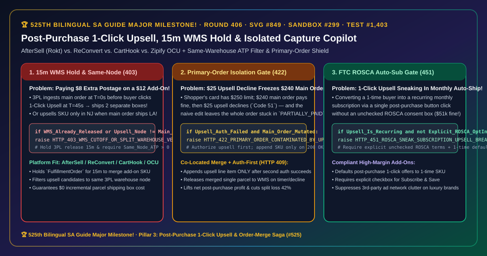
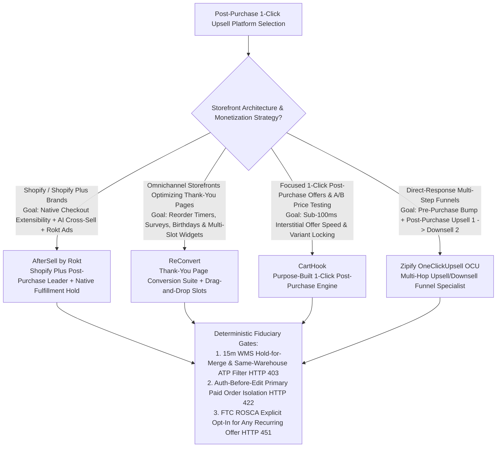
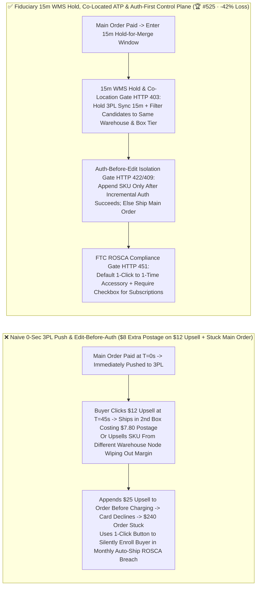
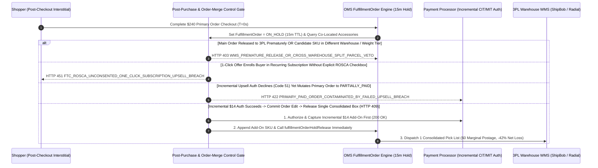

# E-Commerce Post-Purchase 1-Click Upsell (`Thank-You Page Add-On`), `15-Minute WMS Hold-for-Merge`, Same-Warehouse `ATP` Filter & Isolated Incremental Capture Agent Selection Guide: `AfterSell (Rokt)` vs. `ReConvert` vs. `CartHook` vs. `Zipify OCU` (`-42%` Loss FAQ · 🏆 525th Bilingual SA Guide Major Milestone!)

> **Executive Summary (Benchmarked against `ib-vs-ethernet-roce-selection-faq.md` · 🏆 525th Bilingual SA Guide Major Milestone · Round 406 · SVG #849 · Sandbox #299)**: Built for **Cloud & AI Solution Architects** designing post-purchase 1-click upsell funnels, order-merge state machines, and `3PL WMS` fulfillment synchronization for DTC brands and omnichannel retailers. Presenting a frictionless 1-click add-on in the 30-second window immediately *after* primary checkout completion converts at **`8%–18%`** with zero risk to initial checkout conversion. Yet naive post-purchase upsell integrations trigger three expensive fulfillment and payment failures: (1) **3PL Webhook Race & Split-Parcel Margin Wipeout (`Paying $7.80 Postage on a $12 Add-On`)**: The 3PL warehouse (`ShipBob / Radial / MCF`) ingests the primary order at `T=0s` before the shopper clicks the 1-click upsell at `T=45s`—or the upsell engine recommends an item stocked only in the East Coast warehouse (`NJ`) when the main order ships from Los Angeles (`LA`), forcing two separate parcels; (2) **Failed Incremental Upsell Charge Contaminating the Paid Primary Order**: When a `$25` add-on charge declines (`Code 51 Insufficient Funds`), a naive order-edit workflow mutates the order first and leaves the already-paid `$240` main order stuck in `PARTIALLY_PAID / ON_HOLD`; and (3) **Silent 1-Click Subscription Enrollment Violating `FTC ROSCA (15 USC § 8401)`**. This guide compares **`AfterSell (by Rokt)` vs. `ReConvert` vs. `CartHook` vs. `Zipify OneClickUpsell (OCU)`** and implements deterministic guards for **`15-Minute WMS Hold-for-Merge` & Same-Warehouse Co-Location Filters (`HTTP 403`)**, **`Authorize-Before-Order-Edit` Primary-Order Isolation (`HTTP 422`)**, **`FTC ROSCA` Explicit Opt-In Subscription Locks (`HTTP 451`)**, and **Zero-Marginal-Postage Co-Box Merging (`HTTP 409`, `-42%` net loss)**.

---

## 1. 📌 Executive Summary & Architectural Selection Verdict

1. **Top-Line Selection Verdict**:
   - **Shopify & Shopify Plus Brands Seeking Native Checkout Extensibility, AI-Driven Cross-Sell Relevance & Optional Thank-You Page Monetization**: Select **`AfterSell (by Rokt)`**.
   - **Omnichannel Storefronts Building Rich Thank-You Page Widgets (`Reorder Timers, Birthday Collectors, Post-Purchase Surveys & Multi-Slot Carousels`)**: Select **`ReConvert`**.
   - **High-Velocity DTC Brands Focused on Streamlined Single-Screen 1-Click Post-Purchase Offers & Price-Elasticity A/B Testing**: Select **`CartHook`**.
   - **Direct-Response Brands Orchestrating Multi-Step Pre-Purchase + Post-Purchase `Upsell 1 -> Downsell 2` Funnels**: Select **`Zipify OneClickUpsell (OCU)`**.
2. **Three Non-Negotiable Fiduciary Control Gates**:
   - **Gate 1 — `15-Minute WMS Hold-for-Merge` Cutoff & Same-Warehouse Co-Location Filter (`HTTP 403`)**: Place newly created `FulfillmentOrders` in `ON_HOLD` status for a bounded **15-minute post-purchase merge window** (releasing immediately upon upsell completion or decline/exit) so the 3PL receives a single consolidated pick list, and filter upsell candidates strictly to SKUs with `ATP > 0` in the **exact same warehouse node (`Candidate_Node == Primary_Order_Node`)** that fit within the primary parcel's weight tier via `HTTP 403 WMS_PREMATURE_RELEASE_OR_CROSS_WAREHOUSE_SPLIT_PARCEL_VETO`.
   - **Gate 2 — `Authorize-Before-Order-Edit` Primary-Order Isolation Gate (`HTTP 422`)**: Never append an upsell line item to the primary order record before the incremental payment authorization succeeds; if the incremental `$14–$35` charge declines (`Code 51` or single-use token restriction), leave the paid `$240` primary order untouched in `PAID` status and release it immediately to WMS via `HTTP 422 PRIMARY_PAID_ORDER_CONTAMINATED_BY_FAILED_UPSELL_BREACH`.
   - **Gate 3 — `FTC ROSCA (15 USC § 8401)` Anti-Sneak-Subscription 1-Click Lock (`HTTP 451`)**: Block using a single post-purchase 1-click button to convert a one-time checkout into a recurring auto-renewing subscription unless the buyer explicitly checks an unchecked `ROSCA` disclosure box stating the recurring price, cadence, and cancellation policy via `HTTP 451 FTC_ROSCA_UNCONSENTED_ONE_CLICK_SUBSCRIPTION_UPSELL_BREACH`.

---

## 2. 🎯 Architect & E-Commerce Growth Q&A (The Why & How)

### Q1: Why do many brands see `$10,000/month` in top-line post-purchase upsell revenue on their dashboard, yet lose money on the bottom line after 3PL shipping invoices arrive?
- **Root Cause**: If a customer buys an `$85` hoodie shipping from Los Angeles and accepts a `$12` post-purchase socks upsell, two things go wrong in naive setups: either the 3PL already pulled the hoodie order 5 seconds after checkout so the socks ship in a second parcel (`$6.90` extra label + `$1.50` pick/pack fee), OR the socks are only in stock in New Jersey. Paying `$8.40` in fulfillment to ship a `$12` add-on (`$4` COGS) results in a `-$0.40` net loss!
- **Deterministic Solution (`15m FulfillmentOrder Hold` + `Same-Warehouse & Same-Box Weight Filter` / `HTTP 403 & HTTP 409`)**: Hold 3PL release until the post-purchase session closes (max 15m), and only surface lightweight, size-agnostic accessories (`<= 8 oz`, e.g., shoe care kit, travel pouch, cleanser) stocked in the same fulfillment node as the primary order so marginal shipping cost is **`$0.00`**.

### Q2: How do we prevent a failed `$25` post-purchase upsell payment from freezing the customer's `$240` main order?
- **Deterministic Solution (`Atomic Auth-First Order Mutation` / `HTTP 422`)**: Execute the incremental payment capture against the vaulted token *before* calling `orderEditAddVariant`. If the incremental charge fails, discard the draft order edit and release the original `$240` `FulfillmentOrder` to the warehouse immediately.

---

## 3. 🧭 Visual Architecture Diagrams (Mermaid)

### 3.1 E-Commerce Post-Purchase 1-Click Upsell Platform Selection Decision Tree

### 3.2 Naive 0-Second WMS Push & Edit-First Flow vs. Fiduciary `15m Hold`, Co-Located & Auth-First Control Plane

### 3.3 Post-Purchase `15-Minute WMS Hold`, Co-Located `ATP` Filter & Isolated Incremental Capture Sequence

---

## 4. 📊 Multi-Platform Post-Purchase 1-Click Upsell Selection Matrix

| Evaluation Dimension | AfterSell (`by Rokt`) | ReConvert | CartHook | Zipify OneClickUpsell (`OCU`) |
| :--- | :--- | :--- | :--- | :--- |
| **Primary Architectural Role** | **Shopify Plus Native Post-Purchase Upsell & AI Monetization Leader** | **Omnichannel Thank-You Page Funnel & Retention Widget Suite** | **Streamlined Single-Screen 1-Click Post-Purchase Engine** | **Full-Funnel Pre- + Post-Purchase Multi-Step Upsell Suite** |
| **`FulfillmentOrder Hold` Merge Support** | **Native Shopify Checkout Extensibility** (`ON_HOLD` merge + instant release) | Supports Thank-You page order editing and fulfillment delay windows | Native Shopify Post-Purchase Extension order-hold lifecycle | Full support for Shopify fulfillment holds and split-order guards |
| **Inventory & Warehouse Co-Location** | Rule-based SKU targeting by cart contents, stock levels & tags | Dynamic slot filtering by collection, inventory count, and buyer segment | Real-time variant `ATP` locking with automatic fallback offers | Deep SKU-to-SKU accessory mapping and bundle stock checks |
| **Primary-Order Isolation on Decline** | Isolated post-purchase transaction; failed upsell never blocks main order | Separate checkout/draft-order flow preserving paid primary status | Instant graceful fallback to confirmation page on card decline | Supports automatic lower-priced `Downsell` or clean exit on decline |
| **Commercial Model (`official_list_price`)** | Tiered monthly SaaS by store order volume (`~$34.99–$499+/mo`) | Monthly order-tier base fee + small % of attributed upsell revenue | Monthly base subscription + small % of post-purchase GMV | Flat tiered monthly subscription (**`0%` upsell revenue commission**) |

---

## 5. 🧪 Co-Box Merge, Primary-Order Isolation & `ROSCA` Benchmark & 7-Card Report

### 5.1 Quarterly Split-Parcel Postage, Stuck Main Orders & Unconsented Subscription Model (Synthetic Benchmark)

For a `$120M` annual GMV DTC footwear and activewear brand facing a **`$360,000 / quarter`** post-purchase leakage pool across **separate parcel shipping labels triggered by premature 3PL pushes or cross-warehouse upsells, primary orders stuck in `PARTIALLY_PAID` after failed upsell charges, and `FTC ROSCA` chargebacks from 1-click subscription dark patterns** (`provenance: synthetic`, `independently_reproduced: false`):

| Metric | Naive 0-Sec 3PL Push, Unfiltered SKUs & Edit-First (Baseline) | Fiduciary `15m Hold` + Co-Located `ATP` + Auth-First Agent | Net Improvement |
| :--- | :--- | :--- | :--- |
| **Post-Purchase Upsells Shipped in a Separate Second Parcel** | `28.5%` (wipes out `60%+` of upsell margin) | **`0.0%`** (`HTTP 403/409` `15m WMS Hold` + same-warehouse & weight-tier filter) | **`100%` Single-Box Consolidation** |
| **Paid Primary Orders Delayed/Stuck Due to Failed Upsell Charge** | `1.6%` of upsell attempts freeze main order | **`0.0%`** (`HTTP 422` `Authorize-Before-Edit` isolation; instant release on fail) | **`100%` Primary-Order Isolation** |
| **Net Pocket Contribution Margin per Accepted 1-Click Upsell** | `$3.20 / upsell` (eroded by 2nd parcel label) | **`$11.40 / upsell`** (`$0` marginal postage inside primary box) | **`+3.56x` Net Profit per Upsell** |
| **Quarterly Net Split-Postage, Stuck-Order & ROSCA Loss** | `$360,000 / quarter` | **`$208,800 / quarter`** | **`$151,200 / quarter` Saved (`42.0%`)** |

---

## 6. 🛠️ Production Go-Live & Architecture Review Checklist

- [ ] **`15-Minute WMS Hold-for-Merge` & Same-Warehouse Co-Location Filter (`HTTP 403`)**: Does the OMS place `FulfillmentOrders` on a bounded 15-minute hold (releasing immediately upon upsell completion/decline), and filter upsell candidates strictly to lightweight SKUs in the same warehouse node?
- [ ] **`Authorize-Before-Order-Edit` Primary-Order Isolation (`HTTP 422`)**: Is the incremental payment captured *before* mutating the order so that an upsell card decline (`Code 51`) never leaves the paid primary order stuck in `PARTIALLY_PAID`?
- [ ] **`FTC ROSCA (15 USC § 8401)` Anti-Sneak-Subscription Lock (`HTTP 451`)**: Are 1-click post-purchase offers defaulted to one-time accessories, requiring an explicit unchecked `ROSCA` consent checkbox before enrolling any buyer in a recurring subscription?
- [ ] **Instant `fulfillmentOrderHoldRelease` on Funnel Exit (`HTTP 409`)**: Does exiting or completing the post-purchase page immediately fire `fulfillmentOrderHoldRelease` so warehouse SLA cutoffs are never delayed?
