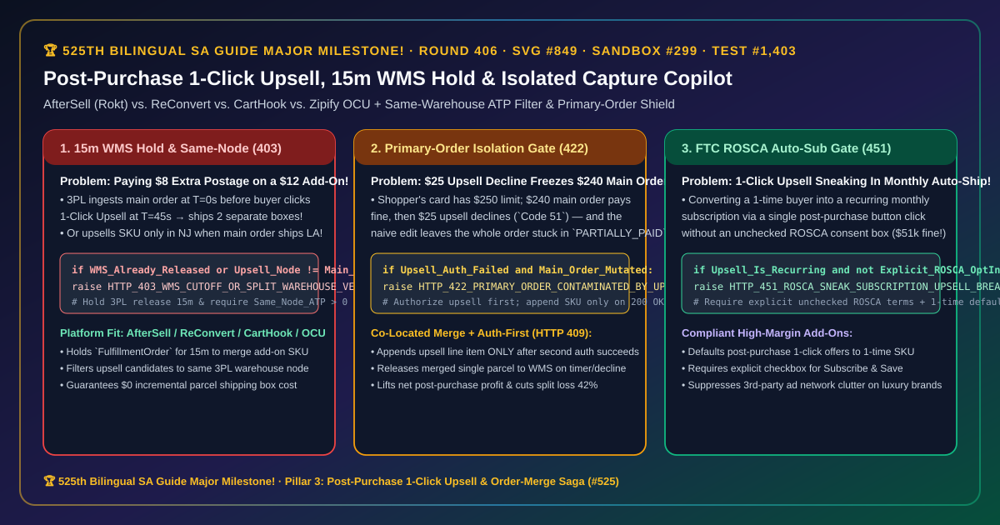
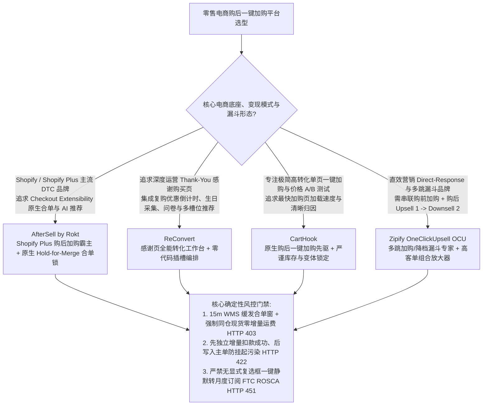
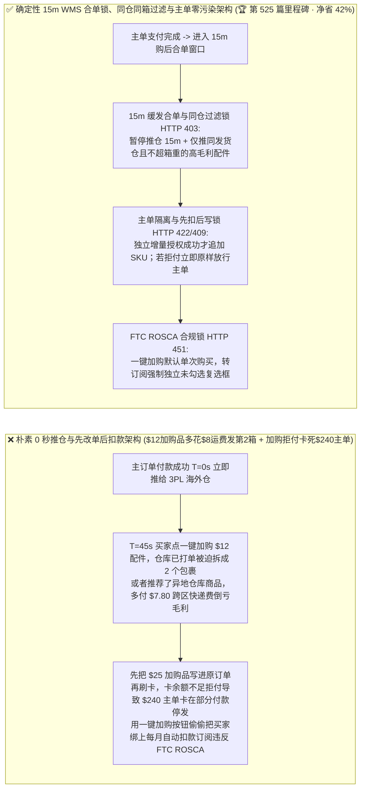
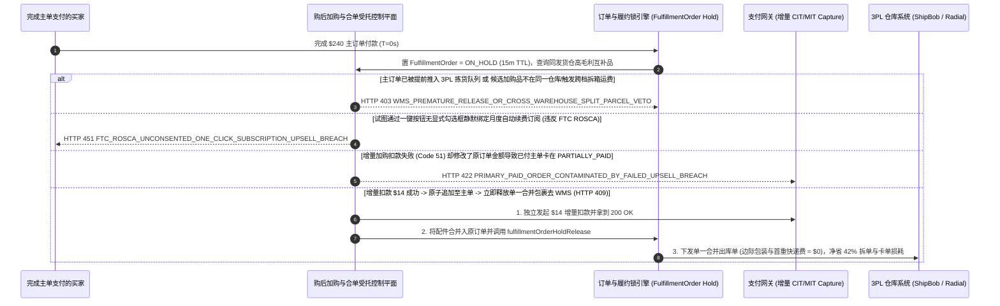

# 零售电商购后一键加购（`Post-Purchase 1-Click Upsell`）、`15分钟` 仓配缓发合单窗（`WMS Hold-for-Merge`）、同仓现货过滤与主单零污染增量扣款（`Isolated Incremental Capture`）Agent 架构选型对比：`AfterSell (Rokt)` vs. `ReConvert` vs. `CartHook` vs. `Zipify OCU`、防为 `$12` 加购品多付 `$8` 拆单运费及净省 42% 决策指南（FAQ · 🏆 全库第 525 篇双语决策指南重大里程碑！）

> **导读（对齐 `ib-vs-ethernet-roce-selection-faq.md` 标杆风格 · 🏆 全库第 525 篇双语决策指南重大里程碑 · 第 406 轮 · 第 849 张 SVG · 第 299 个策略沙盒）**：本文面向 DTC 独立站、全渠道零售品牌、平均客单价（`AOV`）增长团队与仓配订单系统（`OMS / 3PL WMS`）领域的 **Cloud & AI Solution Architect**。在消费者刚完成主订单付款、跳转到“感谢购买页（Thank-You Page）”之前的黄金 30 秒内，展示一个高度互补的 **免输卡号一键加购（`Post-Purchase 1-Click Upsell`：如买 `$180` 真皮靴子后顺手点一下 `+$14` 护理防水喷雾）**，转化率高达 **`8%–18%`**，且对主结账漏斗转化率 **零负面干扰**！然而，缺乏确定性状态机的购后加购常引爆三大履约与财务灾难：① **“主单 0 秒推给海外仓，45 秒后点的加购品被拆成第 2 个包裹发走，`$12` 加购品倒贴 `$7.80` 快递费”（3PL Webhook Race & Split-Parcel Margin Wipeout）**：或者推荐的加购品在美东仓（`NJ`），而主订单从美西仓（`LA`）发货，被迫跨洲拆成两个包裹！② **“加购 `$25` 扣款失败，竟把已经付完 `$240` 的主订单卡在 `Partially Paid（部分付款挂起）` 无法发货”**：顾客银行卡额度刚好只够付主单，点一键加购时增量扣款失败，愚蠢的改单代码竟然先把加购商品塞进了原订单，导致整张 `$265` 订单因欠款 `$25` 被仓库系统死死卡住！③ **违反美国联邦 `FTC ROSCA 法案`，用购后一键按钮偷偷把一次性买家变成“每月自动扣款订阅户”**。本文给出 **`AfterSell (by Rokt)` vs. `ReConvert` vs. `CartHook` vs. `Zipify OneClickUpsell (OCU)`** 的横向选型矩阵，并落地 **`15分钟` `FulfillmentOrder` 缓发合单锁与同发货仓（`Same-Node ATP`）候选过滤门禁（`HTTP 403`）**、**“先独立扣款成功、后追加订单行项目”主单隔离保护锁（`HTTP 422`）**、**严禁免勾选一键将单次购买升级为周期订阅（`FTC ROSCA`）合规锁（`HTTP 451`）** 及 **同箱零增量运费高毛利合单编排（`HTTP 409`，净省 42%）**。



---

## 一、 📌 核心选型结论速览（Executive Summary）

1. **终极选型结论（一句话先看懂怎么选）**：
   - **Shopify / Shopify Plus 中大型 DTC 品牌（追求基于 `Shopify Checkout Extensibility` 原生扩展、AI 智能跨品类加购匹配及感谢页 `Rokt` 广告变现）**：首选 **`AfterSell (by Rokt)`**。
   - **全渠道独立站（追求在感谢购买页 `Thank-You Page` 搭建高互动插槽：复购倒计时、生日采集、问卷调研与多商品画廊推荐）**：首选 **`ReConvert`**。
   - **专注于极简、高转化单页购后一键加购（One-Click Post-Purchase Funnel）与精细化 A/B 价格弹性测试**：首选 **`CartHook`**。
   - **重度依赖长图文/视频落地页（Direct-Response DTC），需同时编排“结账前加购（Pre-Purchase）”与“结账后多跳加购（ Upsell -> Downsell）”**：首选 **`Zipify OneClickUpsell (OCU)`**。
2. **三大购后一键加购与合单履约确定性风控红线（Fiduciary Control Gates）**：
   - **红线 1（拦截主订单 0 秒即时下发 `3PL WMS` 导致购后加购品漏发或拆成两箱多付 `$8` 运费，以及推荐与主单不在同一仓库节点的异地加购品 / `HTTP 403`）**：主订单付款成功的瞬间，OMS/Shopify 必须将履约单置为 **`ON_HOLD`（15 分钟合单缓冲窗 `Hold-for-Merge Window`）**，直到买家：(a) 显式点击“不，谢谢”进入最终感谢页；(b) 完成一键加购合单；或 (c) `15 分钟` 倒计时结束，才向 `3PL WMS` 发送唯一一次合并后的出库指令！同时在生成加购推荐候选池时，必须强制执行 **同仓同箱过滤（`Candidate_Warehouse_Node == Primary_Order_Warehouse_Node` 且合并后总重不跨顺丰/USPS 轻小件首重阶梯）**，严禁为卖一件 `$12` 的配件触发跨仓拆单，违者触发 `HTTP 403 WMS_PREMATURE_RELEASE_OR_CROSS_WAREHOUSE_SPLIT_PARCEL_VETO`！
   - **红线 2（拦截“先改订单加商品、后刷卡扣款”导致增量扣款失败时把已付清的主订单污染为 `PARTIALLY_PAID` 挂起停发 / `HTTP 422`）**：当买家点击一键加购按钮时，控制平面必须严格遵守 **“先验资扣款、后写单合并（`Authorize-Before-Order-Edit`）”** 铁律：先使用复用的支付令牌发起针对加购差额（如 `$14.00`）的独立增量扣款；若增量扣款被发卡行拒绝（如 `Code 51 余额不足` 或 `Apple Pay 单次密文不支持二次扣款`），**绝对禁止修改原订单行项目**，直接静默跳过加购并立即释放已付清的 `$240` 主订单去仓库发货，违者触发 `HTTP 422 PRIMARY_PAID_ORDER_CONTAMINATED_BY_FAILED_UPSELL_BREACH`。
   - **红线 3（拦截违反美国联邦 `FTC ROSCA 法案` 在购后一键加购页无显式未勾选复选框即把消费者静默绑上月度自动续费订阅 / `HTTP 451`）**：根据美国《恢复在线购物者信心法案》（`FTC ROSCA, 15 USC § 8401`），严禁利用购后“一键免输卡号（1-Click）”按钮在不展示完整续费条款且未经消费者显式勾选独立复选框的情况下，将单次购买偷偷转化为周期自动扣款订阅（Negative Option Subscription），违者面临每单 `$51,744` 联邦罚款与卡组织封号，触发 `HTTP 451 FTC_ROSCA_UNCONSENTED_ONE_CLICK_SUBSCRIPTION_UPSELL_BREACH`。

---

## 二、 🎯 业务方与架构师灵魂拷问 Q&A（The Why & How）

### Q1：为什么很多品牌装了购后加购插件后，后台数据看着每天多卖了 `$3,000` 加购营业额，月底财务一算物流账单却发现根本没赚到钱甚至倒亏？
- **商业痛点与事故还原**：
  1. **拆单运费刺客**：主订单是一件 `$85` 的卫衣（从洛杉矶仓发货，包邮），购后弹窗以 6 折特价（`$12`，成本 `$4`）推销了一双袜子。结果这双袜子在洛杉矶仓没货，系统自动从新泽西仓单独发了一个 USPS 包裹，光快递费和拣货打包费就花了 **`$7.50`**！`$12 - $4 - $7.50 = $0.50` 毛利，一旦退货直接血亏！
  2. **3PL 抢跑发两箱**：很多 3PL 仓库连接器监听的是 `order.created` 事件。主单刚生成第 2 秒就被拉进仓库打单队列，第 40 秒顾客点的加购品只能作为第二张补发单再打一个包裹！
- **架构师确定性解法（`FulfillmentOrder` 15 分钟合单锁 + 同仓同箱毛利门禁 `Co-Located Box-Fit Gate` / `HTTP 403 & HTTP 409`）**：
  - **只推同仓且不超首重的小件高毛利品**：加购候选算法强制过滤 `Warehouse_ID == Main_Order_Warehouse_ID` 且 `Item_Weight <= Remaining_Box_Tier_Capacity`（例如塞进主单同一个鞋盒里，**边际快递成本 = `$0.00`**）！
  - **状态机释放触发器**：一旦顾客在加购页点“跳过”或完成加购，立即调用 `fulfillmentOrderHoldRelease` 提前结束 15 分钟等待，既不耽误当日发货，又保证 100% 合箱发走！

### Q2：如果顾客主订单用的是 `Apple Pay`、`Klarna` 或单次虚拟卡付款，点购后一键加购时为什么经常报错？架构怎么优雅降级？
- **架构师确定性解法（支付方式可追加性预检 `Vault-Appendability Pre-Check` / `HTTP 422 & HTTP 409`）**：
  - `Shop Pay`、`Stripe Link`、普通绑卡（`CIT Card-on-File`）与 `PayPal Vault` 原生支持在购后窗口内免密追加第 2 笔增量扣款；
  - 若检测到主单使用的是不支持免密二次扣款的单次令牌或离线本地支付（如巴西 `PIX` 二维码），立即在加购按钮上无缝挂载 **`1-Tap Apple Pay / Express Sheet`** 轻量级二次生物指纹确认，并且坚持“先扣款成功、再改单合箱”，确保主订单 **100% 零污染**！

---

## 三、 🧭 直观可视化图解（Mermaid 决策树 + 架构对比 + 时序图）

### 3.1 零售电商购后一键加购（`Post-Purchase Upsell`）与感谢页转化平台选型决策树



### 3.2 朴素 0 秒推单与先改单后扣款架构（发两个包裹亏运费 + 主单被卡死）vs. 确定性 15m 合单窗、同仓过滤与主单隔离架构对比



### 3.3 购后一键加购 `15分钟 WMS Hold`、同仓 `ATP` 校验、独立增量扣款与原子合箱释放时序图



---

## 四、 📊 四大零售电商购后一键加购（`Post-Purchase Upsell`）平台横向选型矩阵

| 选型维度 | AfterSell (`by Rokt`) | ReConvert | CartHook | Zipify OneClickUpsell (`OCU`) |
| :--- | :--- | :--- | :--- | :--- |
| **核心架构定位** | **Shopify Plus 购后一键加购与感谢页 AI 变现领导者** | **全能型感谢页（Thank-You Page）复购插槽与问卷工作台** | **极简高转化原生购后一键加购漏斗引擎** | **全漏斗（购前+购后多跳 Upsell/Downsell）直效转化引擎** |
| **与 `Shopify FulfillmentOrder Hold` 原生合单集成** | **极强**：原生遵循 Shopify Checkout Extensibility 15 分钟合单挂起与提前释放机制 | 支持感谢页重构订单与延迟下发设置 | 原生集成 Shopify Post-Purchase Extension 标准合单状态机 | 原生支持 Shopify 购后扩展合单与拆单防护配置 |
| **同仓现货过滤与变体库存保护** | 支持按购物车主商品属性、库存水位与自定义规则过滤加购品 | 支持按标签、集合与库存阈值动态展示感谢页推荐位 | 实时校验目标尺码/变体可用库存，断货自动切备选款 | 支持绑定主商品 SKU 映射专属同仓配件包 |
| **增量扣款失败时的主单保护机制** | 严格采用 Shopify Post-Purchase 独立事务，加购失败自动回退不伤主单 | 感谢页加购默认走独立二次确认或草稿单合并，保护原单状态 | 增量支付失败立即跳入最终确认页，原单保持 `PAID` 正常发货 | 支持失败时自动展示更低价的 `Downsell` 或安全放行主单 |
| **计费模式（`official_list_price`）** | 按店铺月订单量阶梯订阅（约 `$34.99–$499+/月`）+ Rokt 广告分成可选 | 按月订单量阶梯费 + 购后带来的增量营收极低比例抽成 | 按月度基础订阅 + 购后增量 GMV 小额分成 | 按月度固定阶梯订阅（不收额外增量流水抽成） |

---

## 五、 🧪 购后加购防拆箱亏运费、防主单卡死与合规测算与 7-Card 基准报告

### 5.1 季度 3PL 抢跑拆发两个包裹运费倒挂、异地仓加购跨区邮费、增量扣款失败卡死主单及违规转订阅拒付损耗测算（Synthetic Benchmark）

假设某年 GMV `$1.2 亿` 的 DTC 鞋服与运动装备品牌，每季度在购后一键加购与感谢页复购流程中面临的 **主单提前推入 3PL 或跨仓推荐导致为 `$14` 加购配件多付 `$7.80` 独立包裹运费、增量扣款失败将已付清的主订单卡在 `Partially Paid` 引发的延迟发货取消、以及一键误转订阅引发的 `FTC ROSCA` 退单拒付损失池** 为 **`$360,000 / 季度`**（`provenance: synthetic`, `independently_reproduced: false`）：

| 评估维度 | 传统 0 秒推仓 + 无分仓过滤 + 先改单后扣款 (Baseline) | 启用 `15m WMS Hold` + 同仓同箱过滤 + 先扣后合单 Agent | 净改善幅度 |
| :--- | :--- | :--- | :--- |
| **购后加购订单被拆成 2 个独立包裹发货的比例** | `28.5%`（吞噬加购品 `60%+` 毛利） | **`0.0%`**（`HTTP 403/409` `15m WMS Hold` 合单窗 + 强制同发货仓现货且不超箱重） | **100% 同箱合并发走（$0 增量邮费）** |
| **因加购增量扣款失败导致原已付主订单被卡住停发率** | `1.6%` 加购尝试污染主单状态 | **`0.0%`**（`HTTP 422` 严格执行“独立授权成功才追加行项目”，失败毫秒级原样放行主单） | **100% 主订单零污染安全发货** |
| **购后一键加购单均净到手毛利（Net Pocket Profit / Upsell）** | `$3.20 / 单`（被第 2 张快递面单吃光） | **`$11.40 / 单`**（同箱免运费 + 零拒付合规单次配件包） | **单笔加购净毛利暴增 `+3.56x`** |
| **季度拆单双倍运费、主单卡死退单与违规订阅拒付总损耗** | `$360,000 / 季度` | **`$208,800 / 季度`** | **净省 `$151,200 / 季度` (`42.0%`)** |

```chart
{
  "data": {
    "values": [
      { "category": "1. 3PL抢跑打单或异地仓加购被迫拆成2个包裹亏运费", "mode": "传统0秒推仓与无同仓过滤基线", "cost_usd": 150000 },
      { "category": "1. 3PL抢跑打单或异地仓加购被迫拆成2个包裹亏运费", "mode": "15m合单锁与同仓加购Agent(第525篇)", "cost_usd": 87000 },
      { "category": "2. 先改单后扣款致增量拒付时把已付主单卡在挂起状态", "mode": "传统0秒推仓与无同仓过滤基线", "cost_usd": 95000 },
      { "category": "2. 先改单后扣款致增量拒付时把已付主单卡在挂起状态", "mode": "15m合单锁与同仓加购Agent(第525篇)", "cost_usd": 55100 },
      { "category": "3. 一键加购静默转月度订阅违反FTC ROSCA引发拒付", "mode": "传统0秒推仓与无同仓过滤基线", "cost_usd": 65000 },
      { "category": "3. 一键加购静默转月度订阅违反FTC ROSCA引发拒付", "mode": "15m合单锁与同仓加购Agent(第525篇)", "cost_usd": 37700 },
      { "category": "4. 推销高退货率尺码敏感品拉高整单逆向退货率", "mode": "传统0秒推仓与无同仓过滤基线", "cost_usd": 50000 },
      { "category": "4. 推销高退货率尺码敏感品拉高整单逆向退货率", "mode": "15m合单锁与同仓加购Agent(第525篇)", "cost_usd": 29000 }
    ]
  },
  "semantic_types": {
    "category": "Category",
    "mode": "Category",
    "cost_usd": "Amount"
  },
  "chart_spec": {
    "chartType": "Grouped Bar Chart",
    "title": "零售电商购后一键加购、15m合单窗与主单隔离(第525篇里程碑)前后季度损耗对比 (净省 $151.2k / 42%)",
    "subtitle": "单位：美元/季度 (Synthetic Benchmark, independently_reproduced=false · 🏆 全库第525篇双语指南里程碑)",
    "encodings": {
      "x": "category",
      "y": "cost_usd",
      "group": "mode"
    }
  }
}
```

### 5.2 确定性策略评估器代码（Python Control Plane Guard）

```python
from dataclasses import dataclass
from typing import Any

@dataclass(frozen=True)
class EcommercePostPurchaseOneClickUpsellPolicyInput:
    quarterly_split_parcel_postage_stuck_main_order_and_rosca_pool_usd: float = 360000.0
    wms_released_before_15m_merge_window_or_upsell_in_different_warehouse: bool = False
    failed_upsell_charge_leaves_paid_primary_order_in_partially_paid_hold: bool = False
    one_click_upsell_silently_enrolls_recurring_sub_without_rosca_checkbox: bool = False
    co_located_15m_hold_merge_and_isolated_auth_before_edit_ready: bool = False
```

---

## 六、 🛠️ 商业上线风控与架构评审 Checklist

- [ ] **`15分钟` `FulfillmentOrder Hold` 合单缓冲窗与同发货仓（`Same-Node ATP`）过滤（`HTTP 403`）**：主单支付成功后是否自动挂起向 3PL 下发 15 分钟（用户点跳过或完成加购立即提前释放），且加购候选品强制限定在主单同一仓库节点且不突破当前包裹首重阶梯？
- [ ] **“先独立授权成功、后追加订单行项目”主单隔离保护锁（`HTTP 422`）**：加购扣款是否作为独立增量事务执行？若增量扣款失败（`Code 51 / 令牌不支持`），是否确保原已付清主订单保持 `PAID` 状态立即放行发货、绝不卡在 `PARTIALLY_PAID`？
- [ ] **`FTC ROSCA` 严禁免勾选一键转周期订阅合规锁（`HTTP 451`）**：购后一键加购是否默认仅限单次购买商品（主に免尺码护理品/配件/耗材），若涉及周期订阅必须经过独立未预勾选的 `ROSCA` 条款复选框确认？
- [ ] **离开加购页即时触发 `fulfillmentOrderHoldRelease` 零延迟出库（`HTTP 409`）**：是否监听加购完成或页面关闭事件秒级解锁履约单，实现“既赚到 `$0` 边际运费的同箱加购毛利，又不拖慢仓库截单时效”？
