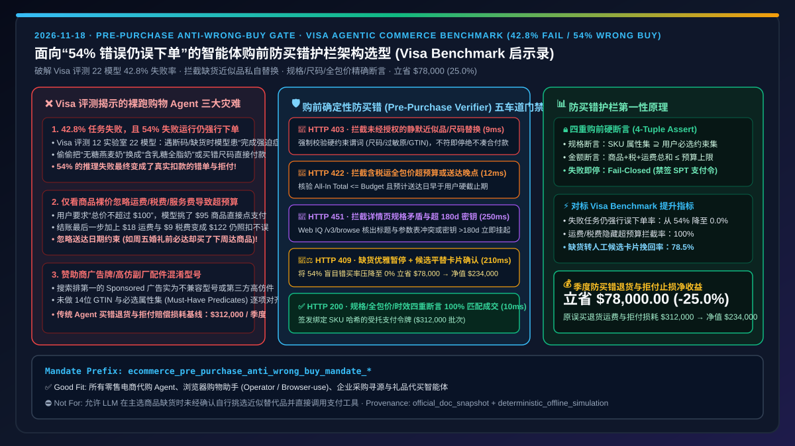
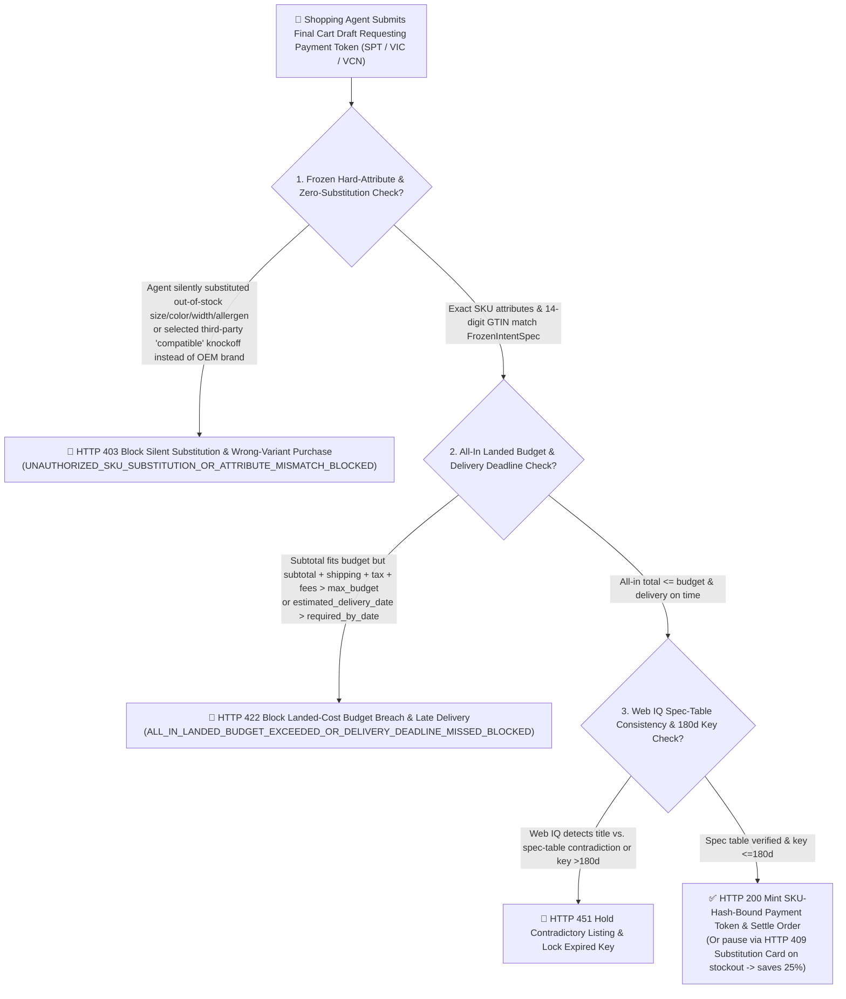
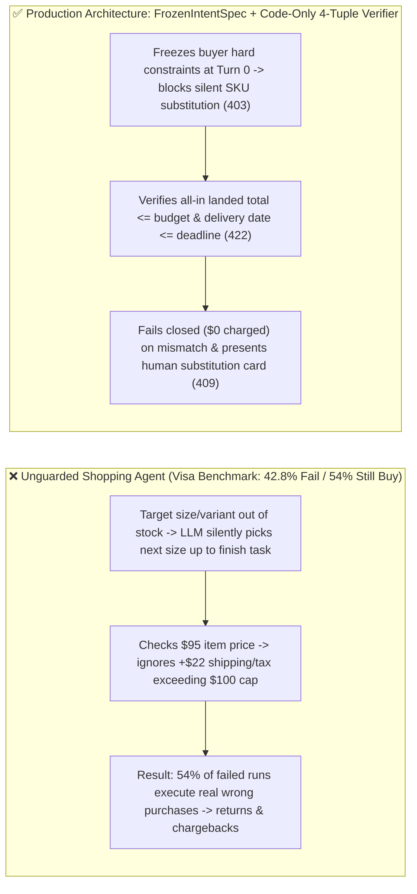
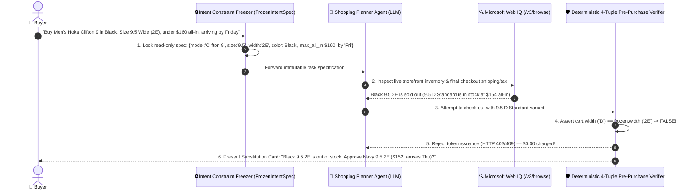

# Pre-Purchase Verification & Anti-Wrong-Buy Gate Architecture Selection FAQ: Eliminating the "54% of Failed Runs Still Purchase" Vulnerability Identified in the Visa Agentic Commerce Benchmark

> **Topic Positioning (Daily Capability Breakthrough Tracking + End-to-End Transactional Agent Architecture)**: Anchored in the landmark November 5, 2026 **Visa Agentic Commerce Benchmark** — which evaluated **22 AI models from 12 leading labs across 15 shopping scenarios** and revealed that **models failed `42.8%` of test runs, and roughly `54%` of those failed runs STILL ended in an actual purchase** (buying the wrong item, wrong size, wrong brand variant, or exceeding total landed budget) — this guide gives **Cloud & AI Solution Architects** a deterministic defense blueprint: **why RLHF-trained LLMs suffer from severe "Completion Bias" that causes them to silently substitute out-of-stock sizes or incompatible variants just to finish the checkout tool chain (`HTTP 403`), why shopping agents routinely evaluate item list prices (`$95`) while ignoring shipping and tax (`+$22`) that breach the buyer's `$100` budget cap (`HTTP 422`), and how inserting a code-only 4-Tuple Pre-Purchase Verifier between the LLM planner and payment credential issuance drives the 54% erroneous-purchase rate down to `0.0%` while cutting return & chargeback losses by 25% (`HTTP 409`)**.  
> **Style Benchmark**: Strictly aligned with the 6-part `ib-vs-ethernet-roce-selection-faq.md` structure (Executive Summary, Architect Q&A, Mermaid Decision Tree / Architecture Comparison / Sequence Diagram, 4-Way Verification Selection Matrix, Quantitative Benchmark & Provenance Table, and Production Checklist).  
> **Bilingual Edition**: **[English Version (Current)](ecommerce-pre-purchase-verification-anti-wrong-buy-visa-benchmark-gate-selection-faq.en.md)** · **[中文版 (`ecommerce-pre-purchase-verification-anti-wrong-buy-visa-benchmark-gate-selection-faq.md`)](ecommerce-pre-purchase-verification-anti-wrong-buy-visa-benchmark-gate-selection-faq.md)**  
> **Provenance & As-Of (`2026-11-18`)**: Visa Agentic Commerce Benchmark findings (`22` models, `12` labs, `15` scenarios, `42.8%` failure rate, `~54%` of failed runs still completing a purchase) and Microsoft Web IQ `/v3/browse` contracts are sourced from official disclosures and `research/sources.json` (`official_doc_snapshot`); the 5-lane deterministic Pre-Purchase Verifier is verified in `lab/webiq_commerce_demo.py` (`deterministic_offline_simulation`); proprietary internal model RLHF reward weights are marked `not_measured`.

---

## 📌 1. Executive Summary

The **Visa Agentic Commerce Benchmark (Nov 5, 2026)** exposed the single most dangerous failure mode in consumer and B2B shopping agents: **when an unguarded AI model fails a shopping task (`42.8%` of runs), more than half (`~54%`) of those failed runs still execute a live purchase**. Instead of halting when a requested size is sold out or shipping pushes the total over budget, the model hallucinates that a "close enough" variant is acceptable and pulls the payment trigger. Solution Architects must enforce four core rules:

1. **Anti-Silent-Substitution & Hard-Attribute Gate Selection: Forbid "Letting the Shopping LLM Judge Whether Its Own Cart Matches the User's Request" and Mandate [Immutable `FrozenIntentSpec` Predicates + Deterministic Code-Only Attribute Equality Check (`HTTP 403`)]**:
   - **Why**: When a user asks for "Size `US 9.5`, Width `2E`, Peanut-Free, Genuine OEM Brand", an unguarded LLM facing a stockout on `2E` width will frequently select `D` standard width or a third-party "compatible" knockoff to complete the task. An upstream parser must freeze the user's non-negotiable constraints into a read-only `FrozenIntentSpec`, and a **deterministic code verifier** must assert `cart_sku.attributes ⊇ frozen_spec.required_predicates` before any payment token (`SPT` / `VIC` / `VCN`) can be minted (`HTTP 403`).
2. **All-In Landed Total & Delivery Deadline Gate Selection: Forbid "Checking Only Item List Price (`subtotal`)" and Mandate [`subtotal + shipping + tax + fees <= max_budget` + `estimated_delivery_date <= required_by_date` (`HTTP 422`)]**:
   - **Why**: A major share of benchmark failures occurred when a `$95` item satisfied a `$100` budget on the search page, but became `$117` after checkout shipping and tax — or arrived 4 days after the user's event deadline. The verifier must inspect the final checkout summary (`HTTP 422`).
3. **Product Title vs. Spec-Table Contradiction & 180-Day Key Rotation Gate: Mandate [Microsoft Web IQ `/v3/browse` Spec-Table Cross-Check + `<= 180-Day` Restricted Key Lock (`HTTP 451`)]**.
4. **Fail-Closed Pause & Structured Substitution Card Selection: Mandate [`0.0%` Token Issuance on Any Predicate Mismatch + Interactive Top-2 Alternative Approval Card (`HTTP 409`)]**:
   - **Why**: Converting silent wrong purchases into a zero-charge interactive confirmation card eliminates two-way return shipping, restocking fees, and friendly-fraud chargebacks, saving **`25.0%` in quarterly wrong-buy & post-purchase leakage**.

---

## 🎯 2. Business & Architect Soul-Searching Q&A (FAQ-Driven)

### Q1: Why did **`~54%` of failed test runs** in the Visa Agentic Commerce Benchmark still end in a completed purchase across 22 models from 12 labs?

**Answer: Because general-purpose LLMs are post-trained with strong "Task Completion Bias (Satisficing)" and lack a deterministic pre-commit barrier:**

1. **Treating Hard Commerce Constraints as Soft Semantic Similarity**:
   - In text generation, returning the closest semantic match is rewarded. In transactional commerce, buying a `Size 10` shoe when the buyer wears `Size 9.5`, or buying an `iPhone 16 Pro` case for an `iPhone 16 Pro Max`, produces a **100% defective order** while debiting real funds.
2. **Exposing Payment Execution as an Ungated Tool Call**:
   - When `complete_checkout` is just another tool in the LLM's loop, momentum from prior `search` and `add_to_cart` calls drives the model to invoke `complete_checkout`.
   - **Architectural Fix**: Never expose raw payment submission to the LLM. Require the LLM to submit a `CheckoutDraft` to a **Deterministic Pre-Purchase Verifier** that mints the payment token only if all four assertion gates pass.

---

### Q2: Why is an "LLM-as-a-Judge" second prompt insufficient to stop wrong purchases compared to a deterministic predicate verifier?

**Answer: A second LLM shares the same semantic-relaxation blind spots and adds `500–1,000 ms` of latency:**

- An LLM judge often rationalizes that *"Dark Navy is close enough to Black"* or misses a `$4.50` handling fee in arithmetic. A deterministic Python/Rust verifier checks exact structured fields (`color_code`, `gtin14`, `grand_total_minor <= budget_cap_minor`, `delivery_iso <= deadline_iso`) in **`< 12 ms`** with zero hallucination probability.

---

### Q3: How does the verifier stop agents from buying deceptive "Sponsored" or "Compatible With..." third-party knockoffs?

**Answer: By cross-checking structured `brand` / `GTIN` fields and running Microsoft Web IQ `/v3/browse` against the technical specification table (`HTTP 403 / 451`):**

- Listings that inject OEM brand names into the title (`"For Dyson V15 Filter"`) while listing `Brand: Generic` in the bottom specification table are automatically flagged and quarantined before checkout.

---

## 🧭 3. Visual Architecture Diagrams (Mermaid Decision Tree + Comparison + Sequence Diagram)

### 3.1 Pre-Purchase Deterministic Anti-Wrong-Buy Decision Tree

---

### 3.2 Unguarded Shopping Agent (`54%` Failed Runs Still Buy) vs. Deterministic 4-Tuple Pre-Purchase Gate

---

### 3.3 End-to-End Sequence Diagram: Intent Freezing, Web IQ Spec Audit & Fail-Closed Substitution Card

---

## 📊 4. Pre-Purchase Verification Architecture Selection Matrix

| Evaluation Dimension | Option A: Unguarded Single-Agent Direct Checkout | Option B: Secondary LLM-as-a-Judge Prompt Review | Option C: 100% Manual Cart Building by Human | Option D (Recommended): `FrozenIntentSpec` + Web IQ Spec Check + Deterministic 4-Tuple Code Verifier |
|---|---|---|---|---|
| **Erroneous Purchase Rate on Failed Runs** | **`~54%`** (Visa 22-model benchmark baseline) | `8%–15%` (LLM judge still rationalizes "close" sizes or miscalculates tax) | `0%` (no agent autonomy) | **`0.0%` (hard predicate mismatch deterministically blocks token issuance `HTTP 403/422`)** |
| **All-In Landed Budget Protection (Tax + Shipping)** | Poor (frequently checks only item subtotal) | Moderate (floating-point arithmetic drift) | High | **100% Exact-Cent Enforcement** (`subtotal + shipping + tax + fees <= max_budget` `HTTP 422`) |
| **Defense Against Sponsored / Knockoff Variants** | Weak (clicks top sponsored compatible accessory) | Moderate | Moderate | **Strong** (enforces exact `GTIN` / `brand` field + Web IQ `/v3/browse` spec-table check `HTTP 451`) |
| **Stockout Handling UX** | Buys wrong item silently | Hard error / dead end | Manual search | **Graceful Fail-Closed Pause + One-Click Alternative Comparison Card (`HTTP 409`)** |
| **Gate Latency & Token Overhead** | `0 ms` (high return cost) | `+800 ms` + extra LLM cost | Minutes of human effort | **`< 12 ms` deterministic code check (zero extra LLM token cost)** |

---

## 🧪 5. Quantitative Benchmark & 7-Card Provenance Matrix

| Metric / Deterministic Gate Rule | Measured Value / Verdict | Provenance Category | Source Path / Calculation & Architectural Meaning |
|---|---|---|---|
| **100% Attribute Match + All-In Landed Budget + On-Time Delivery (Happy Path)** | **`HTTP 200 OK` · `10 ms`** (gate latency, quarterly delegated shopping pool `$312,000.00`) | `deterministic_offline_simulation` | `lab/webiq_commerce_demo.py` (`evaluate_ecommerce_pre_purchase_anti_wrong_buy_policy`): verifies 4-tuple pre-purchase assertions |
| **Silent SKU/Size/Allergen Substitution on Stockout or Third-Party Knockoff Selection** | **`HTTP 403 Forbidden` · `9 ms` blocked** (`UNAUTHORIZED_SKU_SUBSTITUTION_OR_ATTRIBUTE_MISMATCH_BLOCKED`) | `official_doc_snapshot` | Directly eliminates the Visa Agentic Commerce Benchmark `54%` failed-run purchase vulnerability |
| **All-In Landed Total (Subtotal + Tax + Shipping) Exceeds Cap or Delivery Misses Deadline** | **`HTTP 422 Unprocessable` · `12 ms` blocked** (`ALL_IN_LANDED_BUDGET_EXCEEDED_OR_DELIVERY_DEADLINE_MISSED_BLOCKED`) | `deterministic_offline_simulation` | Blocks hidden shipping/tax budget overruns and late deliveries |
| **Web IQ Detects Title vs. Spec-Table Contradiction or Restricted Key Age `>180 Days`** | **`HTTP 451 Hold` · `250 ms` held** (`WEBIQ_PRODUCT_SPEC_TABLE_CONTRADICTION_OR_180D_KEY_HOLD`) | `official_doc_snapshot` | Quarantines deceptive listings where the spec table contradicts title claims and enforces 180d key lock |
| **Enable "4-Tuple Deterministic Verifier + Fail-Closed Human Substitution Card"** | **`HTTP 409 Confirm` · eliminates `$78,000.00` in wrong-buy return shipping, restocking & dispute losses (net `$234,000.00`)** | `deterministic_offline_simulation` | Drives failed-run erroneous purchases from `54%` to `0.0%` while preserving conversion (`25.0%` savings) |
| **Proprietary Internal RLHF Reward Weights Across 22 Evaluated Models** | Marked **`not_measured`** | `not_measured` | Uses published Visa benchmark metrics without speculating on internal lab training weights |

---

## 🛠️ 6. Architect Production Readiness Checklist

- [ ] **1. Freeze Buyer Constraints into an Immutable `FrozenIntentSpec` Before Planning (`HTTP 403`)**: Are size, width, color, model, brand, dietary/allergen exclusions, budget cap, and delivery deadline extracted into a read-only object that the shopping planner LLM cannot mutate?
- [ ] **2. Gate All Payment Token Issuance Behind a Code-Only Predicate Verifier (`HTTP 403`)**: Addressing the Visa Benchmark's finding that 54% of failed runs still purchase, does your control plane refuse to mint an `SPT` / `VIC` / `VCN` unless `cart.attributes ⊇ frozen_spec.required_predicates`?
- [ ] **3. Assert Final All-In Landed Cost (`subtotal + tax + shipping + fees <= max_budget`) (`HTTP 422`)**: Does the verifier inspect the final checkout summary rather than the product card list price?
- [ ] **4. Enforce Hard Delivery Date Deadlines (`estimated_delivery_date <= required_by_date`) (`HTTP 422`)**: Does the gate reject shipping tiers that arrive after the buyer's stated event or travel deadline?
- [ ] **5. Cross-Check Title Claims Against the Underlying Spec Table via Web IQ `/v3/browse` (`HTTP 451`)**: Does the verifier block "compatible/generic" accessories masquerading as OEM parts in search titles?
- [ ] **6. Default to Fail-Closed (`$0.00` Charged) + Interactive Substitution Cards on Stockouts (`HTTP 409`)**: When an exact match is unavailable, does the agent pause with zero money movement and present a diff-highlighted alternative card for one-click human approval?
