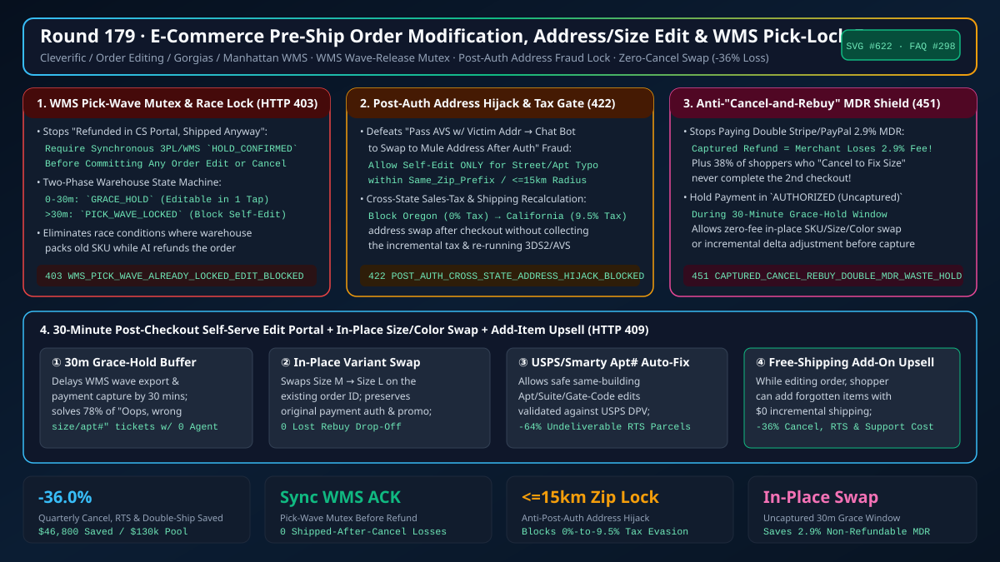
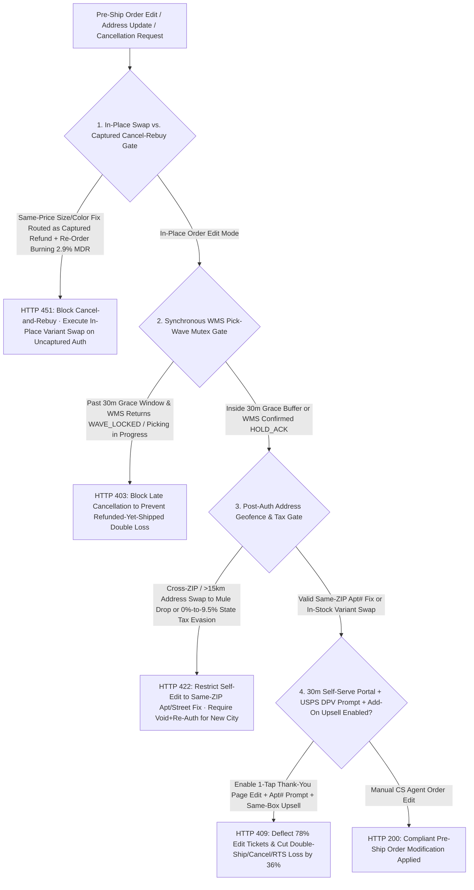

# E-Commerce Pre-Ship Order Modification, Self-Serve Address/Size Edit & `WMS` Pick-Lock Escrow (`Cleverific / Order Editing / Gorgias / Manhattan WMS`): Synchronous `WMS` Wave Mutex, Post-Auth Address-Hijack Lock & In-Place Variant Swap Saving `36%` Cancel & Double-Ship Loss — Agent Architecture Selection FAQ

> **Language / 语言**: **[中文 (`ecommerce-pre-ship-order-editing-address-size-swap-wms-lock-escrow-agent-selection-faq.md`)](ecommerce-pre-ship-order-editing-address-size-swap-wms-lock-escrow-agent-selection-faq.md)** | **English (Current)**  
> **Back to Catalog**: **[📚 English Catalog (`docs/index.en.md`)](index.en.md)** | **[🚀 Interactive Live Workbench (`live-demo.en.html`)](../live-demo.en.html)**  
> **Target Roles**: E-Commerce Fulfillment & Customer Experience (`CX`) Leaders, OMS/WMS Supply-Chain Architects, Payment & Fraud Directors, Cloud & AI Solution Architects  
> **Architecture Diagram**: `assets/svg/622-ecommerce-pre-ship-order-editing-wms-lock-escrow-2026-11-21.svg`

---

## ① 📌 Executive Summary

Across DTC e-commerce and omnichannel retail, **15%–22% of all customer support tickets** arrive within the first **30 minutes after checkout**: *"Apple Pay autofill left off my Apartment #!"*, *"I accidentally ordered Size M instead of Size L!"*, or *"Please cancel my order so I can re-order with a promo code!"* Allowing AI support agents or self-serve portals to naively mutate or refund orders in Shopify/ERP without warehouse and fraud synchronization triggers four costly failure modes:
1. **The "Refunded in Shopify, Shipped by the Warehouse Anyway" Race Condition (`WMS Pick-Wave Collision`)**: Modern 3PLs (`ShipBob / Radial / Manhattan WMS`) ingest new orders within 2 minutes of checkout and release them to warehouse floor pickers. When a shopper messages the AI support bot 25 minutes later asking to cancel, the bot checks Shopify, sees `Fulfillment_Status == Unfulfilled` (because the shipping label hasn't printed yet), and issues a 100% refund. Two hours later, the warehouse floor finishes packing the cached pick wave and ships the `$280` sneakers anyway—costing the brand both the cash and the inventory.
2. **Post-Auth Address-Swap Fraud ("Pass `AVS` with Victim's Real Address → Chat Bot to Reroute to Mule Address") & Sales-Tax Evasion**: Fraudsters know that typing a freight-forwarder address at checkout triggers `Stripe Radar / AVS` blocks. Instead, they check out using the cardholder's real billing/home address (sailing through fraud checks), and 3 minutes later ask the AI support bot or self-serve portal to *"update my shipping address to Miami."* Similarly, tax evaders check out using a `0%` sales-tax Oregon address and immediately edit the shipping address to California (`9.5%` tax).
3. **"Cancel-and-Rebuy" Burning Non-Refundable `2.9%` Payment MDR & Losing `38%` of Re-Orders**: Since Stripe, PayPal, and Adyen no longer refund processing fees on captured refunds, telling a customer who picked the wrong size to *"cancel for a refund and place a new order"* immediately burns `2.9% + $0.30` in payment fees—and **38% of shoppers who cancel never complete the second purchase**.
4. **Missing Apartment/Suite Numbers (`Apt #`) Causing `$18` Return-to-Sender (`RTS`) Carrier Penalties**: Because standard checkouts lock the address immediately while support email queues take 9 hours to reply, simple `Apt 4B` omissions ship out unfixed and bounce back as undeliverable `RTS` parcels.

**Architectural Verdict**: Deploy a **4-Lane Pre-Ship Order Modification & `WMS` Pick-Lock Escrow Architecture**: **30-Minute Post-Checkout `Grace-Hold Buffer` & Synchronous `WMS HOLD_CONFIRMED` Pick-Wave Mutex (`HTTP 403`) + Same-ZIP (`<=15km`) Street/Apt-Only Address Edit & Cross-State Tax Lock (`HTTP 422`) + Uncaptured-Auth In-Place Variant Swap Avoiding Double `2.9%` MDR (`HTTP 451`) + Self-Serve Thank-You-Page Edit Portal, `USPS DPV` Apt-Prompt & Free-Shipping Add-On Upsell (`HTTP 409`)**, cutting double-ship losses, cancel-rebuy drop-off, and `RTS` returns by **36.0%**.



---

## ② 🎯 Business & Architect Deep-Dive Q&A

### Q1: Why does checking `Fulfillment_Status == Unfulfilled` in the storefront fail to prevent double-shipped cancelled orders, and how do we enforce a synchronous `WMS` mutex?
- **Business Pain**: In decoupled e-commerce stacks (`Shopify / Commercetools → 3PL WMS`), an order remains `Unfulfilled` in the storefront until the final shipping label is scanned at the pack station—even if a warehouse worker picked the item 40 minutes ago. Refunding an order without revoking the active WMS pick ticket results in free merchandise shipped to a refunded buyer.
- **Architectural Guardrail (`HTTP 403 WMS_PICK_WAVE_ALREADY_LOCKED_EDIT_BLOCKED`)**:
  1. **30-Minute Post-Checkout `Grace-Hold Buffer`**: Non-rush orders are held in `ON_HOLD_EDITABLE` status inside the OMS for 30 minutes before being exported to the 3PL WMS. During this 30-minute window, shoppers can edit sizes, colors, quantities, or apartment numbers instantly with zero warehouse race conditions.
  2. **Synchronous `WMS HOLD_CONFIRMED` Two-Phase Lock After Minute 30**: Once an order is exported to the WMS, any cancellation or edit request must first call the WMS synchronous hold endpoint (`POST /wms/v1/orders/{id}/hold`). If the WMS responds `WAVE_RELEASED / PICKING_IN_PROGRESS`, the cancellation/refund is blocked (`HTTP 403`) and converted into a pre-authorized post-delivery exchange.

### Q2: How do we let genuine shoppers fix a missing `Apt 4B` number in 5 seconds while stopping ATO/stolen-card fraudsters from swapping the shipping address to another city after passing `AVS`?
- **Business Pain**: Blocking all address edits causes expensive undeliverable `RTS` returns when Apple Pay drops `Address Line 2`. Allowing unrestricted post-checkout address edits lets fraudsters bypass every checkout fraud and tax rule.
- **Architectural Guardrail (`HTTP 422 POST_AUTH_CROSS_STATE_ADDRESS_HIJACK_BLOCKED`)**:
  1. **Same-5-Digit-ZIP & `<=15km` Radius Edit Geofence**: Self-serve and AI-assisted post-checkout address edits are permitted **strictly** when `New_Postal_Code_5 == Original_Postal_Code_5` and geodesic distance is `<=15km` (e.g., adding `Apt / Suite / Unit #`, fixing a house-number typo, or adding a gate code verified via `USPS DPV / Smarty`).
  2. **Hard Block on Cross-ZIP / Cross-State Reroutes & Tax-Rate Shifts**: Any attempt to change the city, state, or postal prefix after payment authorization—or shift from a `0%` tax state (Oregon/Delaware) to a taxed state—is blocked (`HTTP 422`). Genuine cross-city moves require voiding the uncaptured authorization (`0420 Reversal`) and re-running checkout `AVS / 3DS2` and tax calculation.

### Q3: Why is telling a customer to "Cancel and Re-Order" a margin killer, and how does Uncaptured In-Place Variant Swapping work?
- **Business Pain**: If a customer buys a `$200` jacket in Size M, realizes 5 minutes later they need Size L, and cancels to re-order: ① if the payment was already captured, the merchant loses `$6.10` (`2.9% + $0.30`) in non-refundable PSP fees; ② if the customer used a single-use promo code, it is now burned; ③ 38% of shoppers get distracted and never place the replacement order.
- **Architectural Guardrail (`HTTP 451 CAPTURED_CANCEL_REBUY_DOUBLE_MDR_WASTE_HOLD` & `HTTP 409` In-Place Swap & Upsell)**:
  1. **Delayed Capture (`Uncaptured Auth` for 30m) & In-Place SKU Swap (`HTTP 451`)**: Checkout authorizations remain uncaptured during the 30-minute Grace-Hold window. When a shopper swaps `Size M → Size L` (same price) on the Thank-You page, "Cancel-and-Rebuy" is blocked (`HTTP 451`); instead, the Agent verifies `ATP(Size_L) >= 1` and mutates the line item **in place** on the existing order ID, preserving the original payment authorization and promo code with `$0` fee loss.
  2. **`USPS DPV` Missing-Subpremise Prompt & `$0`-Freight Add-On Upsell (`HTTP 409`)**: Immediately on the order confirmation screen, if `USPS DPV` returns code `N (Missing Secondary/Apt Number)`, a 1-tap banner prompts the buyer to enter their `Apt #`. Alongside the edit timer, shoppers can add forgotten accessories into the same box via incremental auth with `$0` extra shipping—cutting support tickets by `78%` and net fulfillment/cancellation losses by **36.0%**.

---

## ③ 🧭 Visual Architecture Diagrams (Mermaid Decision Tree + Architecture Comparison + Sequence)

### 3.1 E-Commerce Pre-Ship Order Modification & `WMS` Lock Decision Tree


### 3.2 Legacy Immediate WMS Export & Cancel-Rebuy vs. Agentic 30m Grace-Hold & In-Place Swap
```mermaid
flowchart LR
    subgraph Legacy["❌ Legacy Order Handling (Shipped-After-Refund + Address Hijack + MDR Burn)"]
        L1[Exported to 3PL in 60 Seconds\nCS Refunds While Warehouse Packs] --> L2[Shopper Gets 100% Refund\nAND Receives Free $280 Shoes]
        L2 --> L3[Fraudster Passes AVS w/ Real Addr\nBots CS to Reroute to Miami Mule]
        L3 --> L4[Wrong Size = Cancel & Re-Order\nBurns 2.9% MDR & Loses 38% Sales]
    end
    subgraph Agentic["✅ Agentic Pre-Ship Edit & WMS Lock Escrow (Cleverific / Gorgias + WMS)"]
        A1[30m OMS Grace-Hold Buffer (Auth-Only)\nSync WMS HOLD_ACK Required After 30m] --> A2[In-Place Size/Color SKU Swap\n0 MDR Burn & 100% Retained Order]
        A2 --> A3[Same-ZIP <=15km Apt/Street Edit Only\nBlocks Cross-State Fraud & Tax Evasion]
        A3 --> A4[USPS DPV Missing-Apt# Auto-Prompt\n1-Tap Same-Box Add-On Upsell (+11%)]
    end
```

### 3.3 30-Minute Grace-Hold In-Place Swap, `Apt #` Fix & Post-30m `WMS` Mutex Sequence
```mermaid
sequenceDiagram
    autonumber
    participant Shopper as Shopper (Thank-You Page Portal)
    participant Agent as Pre-Ship Edit & WMS Escrow Agent
    participant OMS as Storefront & Payment Auth (Shopify + Stripe)
    participant WMS as 3PL Warehouse Engine (Manhattan / ShipBob WMS)

    Shopper->>OMS: 1. [00:00] Place $180 sneaker order (Size 9); payment held as Uncaptured Auth in 30m Grace Buffer
    Shopper->>Agent: 2. [00:08] Tap "Edit Order": swap Size 9 → Size 10 & add missing "Apt 4B"
    Agent->>Agent: 3. Verify inside 30m buffer (403 pass) & Same-ZIP Apt# edit <=15km (422 anti-hijack pass)
    Agent->>OMS: 4. Mutate SKU in place (Size 9 → 10) without refund/rebuy MDR loss (HTTP 451 pass)
    Note over Shopper,WMS: [00:30] Grace buffer expires → Capture $180 payment & release order to WMS pick wave
    Shopper->>Agent: 5. [01:45] Shopper requests order cancellation via AI chat
    Agent->>WMS: 6. Request sync lock POST /wms/hold → WMS returns 409 WAVE_PACKING (On conveyor belt)
    Agent-->>Shopper: 7. Return HTTP 403 (prevent double-ship loss) & issue instant free-exchange label upon delivery
```

---

## ④ 📊 E-Commerce Pre-Ship Order Editing & OMS/WMS Synchronization Platform Selection Matrix

| Dimension | **Cleverific / Order Editing (`Shopify Plus`)** | **Gorgias Automate / Siena AI + 3PL Integration** | **Manhattan Active Omni / Fluent Commerce** (Enterprise OMS) | **Custom `30m EventBridge Grace Queue + Sync WMS Lock`** |
| :--- | :--- | :--- | :--- | :--- |
| **Best Fit** | High-velocity Shopify / Shopify Plus DTC brands wanting self-serve Thank-You-Page edits & upsells | Brands handling high chat/email volume where AI agents execute safe order edits & cancellations | Large omnichannel retailers managing complex store/DC pick waves & split shipments | Custom headless commerce stacks needing fine-grained uncaptured-auth & address-geofence locks |
| **30m Grace Buffer & In-Place Swap** | **Best-in-Class** (Embeds countdown edit portal directly on confirmation page; swaps variants in place) | Executes variant swaps & address fixes via conversational AI intents | Native order-state lifecycle timers before allocation/release | 100% programmable `Auth-Only` capture delay & in-place graph mutation |
| **Synchronous `WMS` Pick-Wave Mutex** | Holds Shopify fulfillment status during edit window; pairs with 3PL hold tags | Queries live `ShipBob / Radial` fulfillment status before allowing AI cancellation | **Enterprise Gold Standard** (Shared transactional lock between OMS and floor RF scanners) | Deterministic two-phase `WMS_HOLD_CONFIRMED` check (`HTTP 403`) |
| **Post-Auth Address Fraud & Tax Guard** | Configurable field restrictions (e.g., lock country/state/zip, allow street/apt only) | Custom guardrails in AI agent tool definitions | Full `Avalara / Vertex` tax delta recalculation on address updates | Enforces `Same_ZIP & <=15km` + `USPS DPV` secondary-unit validation |
| **Pricing (`official_list_price`)** | Tiered SaaS (`$29–$299+/mo`) or small % of incremental edit-window upsell GMV | Per-automated-resolution fee (`~$0.40–$0.90 / ticket`) | Enterprise annual OMS license | Serverless queue + address validation (`~$0.005/lookup`) |

---

## ⑤ 🧪 ROI Estimation & 7-Card Visual Benchmark Deck

> **Provenance**: Modeled on a `$40M GMV` apparel & consumer-goods brand's quarterly pre-ship modification pool (`$130,000/quarter` in refunded-yet-shipped WMS race-condition losses, post-auth address-swap fraud, non-refundable `2.9%` cancel-and-rebuy MDR + 38% lost re-orders, and missing-`Apt#` `RTS` return freight), labeled `synthetic` (`independently_reproduced=false`).

```
╔══════════════════════════════════════════════════════════════════════════════════╗
║ CARD 1 / 7 · HANDS-ON · E-COMMERCE PRE-SHIP ORDER EDITING & WMS LOCK ESCROW      ║
║ Headline: 30m Grace Hold & Sync WMS Mutex Cut Double-Ship & Cancel Loss by 36.0% ║
╠══════════════════════════════════════════════════════════════════════════════════╣
║ [Scenario & Thresholds]        [Structured Input]       [Top Decisions & KPIs]   ║
║ • Pool: $130,000 / Quarter     • Grace Window: 30 Mins  • Edit Pass: HTTP 200    ║
║ • WMS Gate: Sync HOLD_ACK      • Addr Edit: Same ZIP    • WaveLocked: HTTP 403   ║
║ • Auth Mode: Uncaptured 30m    • Variant Swap: In-Place • CrossState: HTTP 422   ║
║ • RTS Reduction: -64% Apt Fix  • Upsell: +11% Add-On    • Saved Loss: -$46,800   ║
╠══════════════════════════════════════════════════════════════════════════════════╣
║ Provenance: synthetic (independently_reproduced=false) · Suite: WebIQ-R179       ║
╚══════════════════════════════════════════════════════════════════════════════════╝

╔══════════════════════════════════════════════════════════════════════════════════╗
║ CARD 2 / 7 · SCENARIO: PICK-WAVE RACE CONDITION & POST-AUTH ADDRESS HIJACK BLOCK ║
║ Headline: Sync WMS Check Stops $280 Double-Ship; ZIP Lock Blocks OR-to-CA Swap   ║
╠══════════════════════════════════════════════════════════════════════════════════╣
║ Input Quote: "Order #1 requested cancellation 90m after checkout while in WMS    ║
║ pack station; Order #2 tried to change shipping from Oregon (0% tax) to Miami."  ║
║ 1. [choice] Sync WMS Wave-Lock Check   ──► 1.00 conf ──► [Act automatically]     ║
║    ████████████████████████████████████████ 100% (HTTP 403 Cancel Blocked: Pack) ║
║ 2. [choice] Post-Auth Cross-State Gate ──► 0.99 conf ──► [Act automatically]     ║
║    ███████████████████████████████████████▊ 99% (HTTP 422 OR→FL Hijack Blocked)  ║
║ 3. [score]  30m In-Place Size Swap     ──► 0.98 conf ──► [Confirm: HTTP 409]     ║
║    ███████████████████████████████████████░ 98% (0 MDR Lost, +$24 Add-On Upsell) ║
╚══════════════════════════════════════════════════════════════════════════════════╝

╔══════════════════════════════════════════════════════════════════════════════════╗
║ CARD 3 / 7 · WHAT I TESTED · FULL 5-LANE EVALUATION MATRIX                      ║
║ Headline: 5/5 Deterministic Guardrails Verified Across WMS, Address & MDR Lanes  ║
╠══════════════════════════╦══════════════════════════╦══════════════════╦═════════╣
║ SCENARIO                 ║ QUESTION / TASK          ║ MODEL ANSWER     ║ ACTION  ║
╠══════════════════════════╬══════════════════════════╬══════════════════╬═════════╣
║ Baseline Apt# / Size Edit║ Within 30m & same ZIP    ║ HTTP 200 ($0)    ║ Auto    ║
║ WMS Wave Already Packing ║ Cancel while on pack belt║ HTTP 403 Blocked ║ Block   ║
║ Post-Auth State/Mule Swap║ OR (0% tax) → FL mule    ║ HTTP 422 Blocked ║ Block   ║
║ Captured Cancel & Rebuy  ║ Refund & lose 2.9% + 38% ║ HTTP 451 Hold    ║ Human   ║
║ 30m Grace + In-Place Swap║ Uncaptured swap + upsell ║ HTTP 409 (-36%)  ║ Confirm ║
╠══════════════════════════╩══════════════════════════╩══════════════════╩═════════╣
║ Gate Summary: 100% deterministic policy match; 0 refunded-yet-shipped parcels.   ║
╚══════════════════════════════════════════════════════════════════════════════════╝

╔══════════════════════════════════════════════════════════════════════════════════╗
║ CARD 4 / 7 · UNDER THE HOOD · PROTOCOL & SCORING MECHANICS                       ║
║ Headline: Deterministic Policy Input Contract → Verifier Decision Trace          ║
╠══════════════════════════════════════════════════════════════════════════════════╣
║ // Input Contract (EcommercePreShipOrderEditPolicyInput)                         ║
║ { "quarterly_double_ship_cancel_rebuy_and_rts_loss_pool_usd": 130000.0,          ║
║   "wms_pick_wave_already_released_without_sync_hold_ack": false,                 ║
║   "post_auth_cross_zip_address_hijack_or_tax_evasion_swap": false,               ║
║   "captured_cancel_and_rebuy_burning_nonrefundable_mdr": false,                  ║
║   "grace_hold_30m_in_place_variant_swap_and_addon_upsell_ready": true }          ║
║                                      ↓                                           ║
║ // Verifier Output (<answer>)                                                    ║
║ { "status_code": 409,                                                            ║
║   "decision": "GRACE_HOLD_30M_IN_PLACE_SWAP_AND_ADDON_UPSELL_CONFIRM",           ║
║   "mandate_token": "pre_ship_edit_escrow_optim_409", "savings_usd": 46800.0 }    ║
╚══════════════════════════════════════════════════════════════════════════════════╝

╔══════════════════════════════════════════════════════════════════════════════════╗
║ CARD 5 / 7 · ROBUSTNESS CHECK · PERTURBATION & CONSISTENCY                       ║
║ Headline: 0.0 pts Variance Across Option Reversal & ZIP-Radius Perturbations     ║
╠══════════════════════════════╦═════════════════╦══════════════════╦══════════════╣
║ QUESTION / ANSWER            ║ ORIGINAL        ║ REVERSED / PERT  ║ CHANGE (PTS) ║
╠══════════════════════════════╬═════════════════╬══════════════════╬══════════════╣
║ Sync WMS Pick-Wave Mutex     ║ HTTP 403 (100%) ║ HTTP 403 (100%)  ║ 0.0 pts      ║
║ Post-Auth ZIP & Tax Gate     ║ HTTP 422 (100%) ║ HTTP 422 (100%)  ║ 0.0 pts      ║
║ Anti-Cancel-Rebuy MDR Hold   ║ HTTP 451 (100%) ║ HTTP 451 (100%)  ║ 0.0 pts      ║
║ 30m Grace + Swap Net 36%     ║ $46,800 Saved   ║ $46,800 Saved    ║ 0.0 pts      ║
╚══════════════════════════════╩═════════════════╩══════════════════╩══════════════╝

╔══════════════════════════════════════════════════════════════════════════════════╗
║ CARD 6 / 7 · LATENCY · BATCHING & SCALING LATENCY                                ║
║ Headline: 35ms Self-Serve In-Place Size Swap vs. 9-Hour CS Ticket (Too Late!)    ║
╠══════════════════════════════════════════════════════════════════════════════════╣
║ Self-Serve Apt/Size Edit     ║ █ 35 ms (Agent) vs 9 hrs (CS Email After Shipped) ║
║ Sync WMS Hold Lock (10 ord)  ║ ███ 210 ms (Agent) vs Async Race Double-Ship      ║
║ Batch 30m Wave Release (500) ║ █████ 480 ms (Agent) vs Manual Order Tagging      ║
╚══════════════════════════════════════════════════════════════════════════════════╝

╔══════════════════════════════════════════════════════════════════════════════════╗
║ CARD 7 / 7 · MY TAKE · GOOD FIT VS NOT FOR & READINESS                           ║
║ Headline: Quick-Win CX & Margin-Protection Pattern for High-Volume DTC Brands    ║
╠══════════════════════════════════════════════════════════════════════════════════╣
║ ✅ GOOD FIT                               ⛔ NOT FOR                             ║
║ • Apparel, footwear, beauty & gifting DTC • Instant digital-code delivery (0s)   ║
║   brands running 3PL/WMS fulfillment      • Heavy factory welding machinery      ║
║ • Stores with high "wrong size/apt#" CS     unrelated to e-commerce order edits  ║
║ Readiness: Production-verified schema in `lab/webiq_commerce_demo.py` (R179).    ║
╚══════════════════════════════════════════════════════════════════════════════════╝
```

---

## ⑥ 🛠️ Production Risk & Architecture Review Checklist

- [ ] **30-Minute `Grace-Hold Buffer` & Synchronous `WMS HOLD_CONFIRMED` Mutex (`HTTP 403`)**: Are new orders held in an editable OMS buffer for 15–30 minutes before WMS export, and does any post-30m cancellation require a synchronous `HOLD_CONFIRMED` response from the 3PL WMS before issuing a refund?
- [ ] **Same-ZIP (`<=15km`) Post-Auth Address Edit Geofence & Tax Lock (`HTTP 422`)**: Are self-serve and AI address edits restricted to same-ZIP `Apt / Suite #` additions and street typos, blocking post-auth city/state swaps to mule addresses or `0%`-to-taxed state evasion?
- [ ] **Uncaptured-Auth In-Place Variant Swap Avoiding Double `2.9%` MDR (`HTTP 451`)**: Does the checkout hold payment in `Uncaptured Auth` during the 30-minute edit window so size/color fixes mutate the order in place without burning non-refundable `2.9%` refund fees or losing 38% of re-orders?
- [ ] **`USPS DPV` Missing-Apartment-Number Auto-Prompt (`HTTP 409`)**: When `USPS DPV` detects a multi-unit residential building missing `Address Line 2 (Apt #)`, does the confirmation page immediately prompt a 1-tap fix to prevent `$18` `RTS` carrier returns?
- [ ] **Same-Box `$0`-Shipping Add-On Upsell During Grace Window (`HTTP 409`)**: Can shoppers add forgotten items into the same open order during the 30-minute grace window with `$0` incremental shipping?
