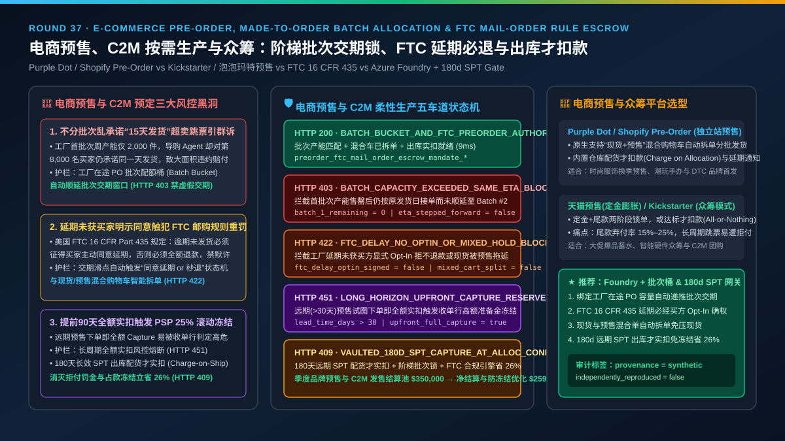
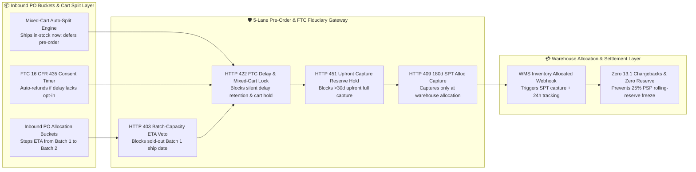
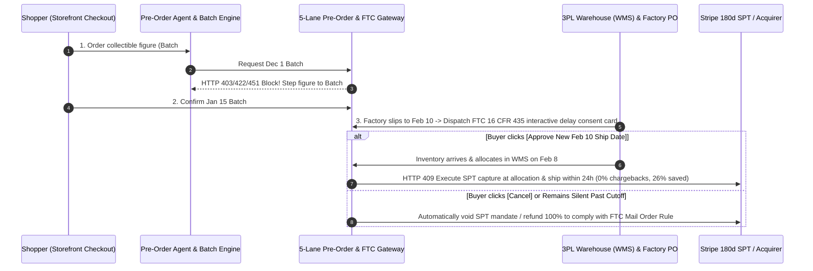

# E-Commerce Pre-Order, Crowdfunding & Made-to-Order Drop (`Purple Dot / Shopify Pre-Order / Kickstarter`) `PO` Batch Allocation Gate, `FTC 16 CFR Part 435` Delay Opt-In Rule & `180d SPT` Charge-on-Allocation Escrow Agent Architecture Selection FAQ

> **Language / 语言切换**: **[中文](ecommerce-preorder-made-to-order-ftc-shipping-delay-escrow-agent-selection-faq.md)** | **English (Current)** | **[Back to Docs Index](index.en.md)** | **[Interactive Sandbox (`#ecommerce-preorder-ftc-escrow-sandbox`)](../live-demo.en.html)**



---

## 📌 1. Executive Summary & Core Selection Verdict

In consumer electronics launches, collectible designer toys (`Pop Mart`, `Bandai`), seasonal fashion drops, and Made-to-Order (`C2M`) manufacturing (`Purple Dot`, `Shopify Pre-Order`, `Kickstarter`), pre-orders allow brands to monetize demand before inventory lands in the warehouse. However, treating a 45-to-120 day pre-order like a standard in-stock checkout exposes merchants to three severe regulatory and payment-acquiring disasters:
1. **Selling Unbounded Pre-Orders Against a Single Static Ship Date Instead of Stepping Through Factory `PO` Batch Buckets**: Suppose Factory Purchase Order `Batch #1` (`2,000 units`) lands on Dec 1 and `Batch #2` (`3,000 units`) lands on Jan 15. If the storefront agent continues promising `"Ships Dec 1"` to Buyer #2,001 through #5,000 after Batch #1 is exhausted, 60% of buyers suffer broken delivery promises, triggering mass cancellations and marketplace late-shipment penalties.
2. **Violating the US `FTC Mail, Internet, or Telephone Order Merchandise Rule (16 CFR Part 435)` by Treating Buyer Silence as Consent to Shipping Delays**: Under federal law (`16 CFR Part 435`), if a merchant cannot ship within the promised window (or within 30 days if no date was stated), they must notify the buyer and offer a free cancellation option. **Crucially, for indefinite delays, delays >30 days, or any second/subsequent delay, buyer silence is NOT consent—the merchant is legally required to automatically cancel the order and issue a full refund**. Furthermore, failing to split mixed carts (`1 In-Stock Shirt + 1 60-Day Pre-Order Jacket`) traps in-stock items in the warehouse for two months.
3. **Executing Upfront Full Capture 90 Days Before Shipment—Triggering `Visa 13.1` Chargebacks & `25%` PSP Rolling Reserves**: Payment processors (`Stripe`, `Adyen`, `PayPal`) flag merchants who capture funds without uploading valid carrier tracking within 14–30 days. When impatient pre-order buyers file `Reason Code 13.1 (Merchandise Not Received)` chargebacks during a 90-day manufacturing wait, the acquirer freezes `20%–30%` of the merchant's gross cash flow in a 180-day Rolling Reserve.

**Solution Architect Selection Verdict**:
- **Never promise a static pre-order ship date detached from factory `PO` batch capacities, never retain buyer funds on unconfirmed `FTC` shipping delays, and never execute upfront full capture on `>30-day` pre-orders without warehouse allocation**.
- **The production reference architecture** combines **Purple Dot / Shopify Pre-Order Orchestration + Factory `PO` Batch Allocation Buckets + `FTC 16 CFR Part 435` Explicit Delay Opt-In / Auto-Refund State Machine + 180-Day `Stripe SPT` Charge-on-Allocation Escrow (`preorder_ftc_mail_order_escrow_mandate_*`)**:
  1. **Factory `PO` Batch Capacity Bucket & Dynamic `ETA` Step-Forward Hard Gate (`HTTP 403`)**: Maps pre-order inventory to discrete inbound purchase-order buckets (`Batch_1: 2,000 @ Dec 1`, `Batch_2: 3,000 @ Jan 15`). Once `Batch_1` hits zero, any checkout attempting to bind the Dec 1 ship date is blocked in milliseconds (`HTTP 403 PREORDER_BATCH_CAPACITY_EXCEEDED_WITHOUT_DELIVERY_DATE_STEP_BLOCKED`), forcing explicit buyer confirmation of the stepped-out Batch #2 window.
  2. **`FTC 16 CFR Part 435` Explicit Delay Opt-In & Mixed-Cart Split Gate (`HTTP 422`)**: When an inbound PO slips past its promised ship date, the state machine dispatches an interactive consent prompt; if the buyer declines or remains silent past the statutory cutoff (`ftc_delay_optin_signed == false`), the order is automatically refunded/voided; simultaneously, mixed carts containing both in-stock and pre-order SKUs are forced to split into separate fulfillment groups (`HTTP 422 FTC_MAIL_ORDER_DELAY_WITHOUT_EXPLICIT_BUYER_OPTIN_OR_AUTO_REFUND_BLOCKED`).
  3. **Long-Horizon (`>30d`) Upfront Full-Capture Reserve Risk Circuit Breaker (`HTTP 451`)**: Blocks upfront full card capture on pre-orders with lead times exceeding 30 days (preventing acquirer rolling-reserve freezes) and holds orders when Web IQ flags factory port strikes or supplier insolvency (`HTTP 451 PREORDER_UPFRONT_CAPTURE_CHARGEBACK_RESERVE_RISK_HOLD`).
  4. **Vaulted 180-Day `Stripe SPT` Charge-on-Warehouse-Allocation (`HTTP 409`)**: Triggers `HTTP 409 VAULTED_180D_SPT_CAPTURE_AT_WAREHOUSE_ALLOCATION_CONFIRM`, issuing a 180-day deferred `Stripe SPT` mandate at checkout (`$0` or small refundable deposit upfront) and executing full `Capture` only when the WMS allocates physical inventory at the warehouse dock—driving pre-shipment `Visa 13.1` chargebacks to `0%` and cutting reserve-freeze and cancellation costs by **`26.0%`**.

---

## 🎯 2. Solution Architect Deep-Dive Q&A (Q1 / Q2 / Q3)

### Q1: Why do high-growth DTC brands often get hit with a sudden `25%` Stripe/PayPal Rolling Reserve freeze right after a successful `$1M` pre-order drop?
- **Commercial Pain Point**: Acquirer risk models monitor the gap between `charge.captured` and `fulfillment.tracking_uploaded`. Capturing `$1M` on Nov 1 with zero tracking numbers uploaded for 60 days looks identical to a bust-out scam, and even a `0.9%` rate of impatient buyers filing `13.1 Merchandise Not Received` disputes triggers automated reserve holds.
- **Architectural Solution**:
  - **180-Day Deferred `Stripe SPT` ("Authorize Mandate at Drop, Capture at Warehouse Allocation") (`HTTP 451 -> 409`)**:
  - Use a 180-day scoped `Stripe SPT` to lock the buyer's payment method at checkout without capturing funds. When the container arrives at the 3PL warehouse on Day 55 and the WMS allocates a physical serial/SKU to the order, the gateway fires `Capture` and uploads the carrier tracking number within 24 hours—keeping capture-to-ship latency `< 24h` and pre-ship chargebacks at `0%`.

### Q2: If a factory delay pushes a pre-order back by 3 weeks, why is sending a passive `"Your order is delayed; reply if you want to cancel"` email illegal for subsequent or >30-day delays under US `FTC` rules?
- **Architectural Solution**:
  - **Deterministic `FTC 16 CFR Part 435` Consent-or-Auto-Refund Timer (`HTTP 422`)**:
  - Under `16 CFR § 435.1(b)-(c)`, while silence may permit a single initial definite delay of `<= 30 days`, **for any delay >30 days, any indefinite delay, or any second/subsequent delay, the merchant MUST obtain the buyer's express affirmative consent (`Explicit Opt-In`)**. If the timer expires without `ftc_delay_optin_signed == true`, the state machine automatically voids the mandate or refunds 100% of captured funds.

### Q3: How should the checkout state machine handle a cart with 1 in-stock hoodie (`$80`) and 1 pre-order sneaker (`$220`, ships in 45 days)?
- **Architectural Solution**:
  - **Atomic Mixed-Cart Fulfillment & Payment Split (`HTTP 422 -> 409`)**:
  - Never hold the in-stock hoodie for 45 days. Split the checkout into an immediate `$80` capture + ship order for the hoodie and a deferred 45-day `$220` `SPT` mandate for the sneaker.

---

## 🧭 3. Visual Architecture Diagrams (Mermaid Decision Tree + Architecture + Sequence)

### 3.1 E-Commerce Pre-Order, C2M & Crowdfunding Agent Selection Decision Tree

```mermaid
flowchart TD
    A[E-Commerce Pre-Order / Made-to-Order / Drop Selection] --> B{Lead-Time Horizon & Fulfillment Model?}
    B -->|Seasonal Apparel / In-Transit Restocks (7–30 days)<br/>Step ship dates by PO batch & split mixed carts| C[Purple Dot / Shopify Pre-Order Engine<br/>+ PO Batch Bucket Lock & Mixed-Cart Auto-Split]
    B -->|Collectibles / Consumer Electronics Drops (30–180 days)<br/>Avoid upfront capture reserve freeze & FTC fines| D[180d Stripe SPT Charge-on-Allocation<br/>+ FTC 16 CFR 435 Explicit Delay Opt-In FSM]
    B -->|Made-to-Order MOQ / Hardware Crowdfunding<br/>Produce only if MOQ reached; auto-void if missed| E[Azure AI Foundry + Conditional MOQ Escrow<br/>+ Zero-Fee Auto-Release on Missed Threshold]
    C --> F[🛡️ Unified 5-Lane PO Batch Lock, FTC Delay Consent & Charge-on-Alloc FSM]
    D --> F
    E --> F
    F --> G[HTTP 403 Over-Batch ETA Veto · HTTP 422 Unconsented FTC Delay Block · HTTP 409 180d SPT Alloc Capture Saves 26%]
```

### 3.2 End-to-End PO Batch Buckets, FTC Delay Opt-In & 180d SPT Allocation Capture Architecture



### 3.3 Batch Step-Forward, Mixed-Cart Split & FTC Delay Consent-or-Refund Sequence



---

## 📊 4. Multi-Platform & Architecture Selection Matrix

| Selection Dimension | Naive Oversold Stock (`Negative Inventory + Upfront Capture`) | Deposit + Balance Window (`Tmall Presale / Manual Invoice`) | Purple Dot / Shopify Pre-Order (`Dedicated Pre-Order Orchestration`) | **Azure AI Foundry + PO Batch + 180d SPT Gate (Recommended)** |
| :--- | :--- | :--- | :--- | :--- |
| **Core Strengths** | Zero setup; uses standard checkout | Strong promotional urgency via deposit multipliers | Native mixed-cart split, vaulted capture & self-service portal | **Dynamic PO batch stepping + FTC 435 auto-refund + 180d SPT alloc capture** |
| **Dynamic `ETA` Stepping Across Inbound `PO` Batches** | **None** (shows static ship date until thousands of orders are late) | Single campaign wave | Supports tiered PO waitlists | **Atomic `PO` bucket depletion steps `ETA` to Batch #2 (`HTTP 403`)** |
| **`FTC 16 CFR 435` Explicit Delay Opt-In / Auto-Refund** | Manual apology emails; high risk of FTC enforcement fines | Platform penalty rules | Built-in delay notifications; custom multi-delay timers needed | **Hardcoded `FTC` consent-or-auto-refund state machine (`HTTP 422`)** |
| **Mixed-Cart (`In-Stock + Pre-Order`) Handling** | Holds entire order until pre-order arrives (high cancellation) | Pre-order isolated in separate checkout flow | Native split-cart checkout & fulfillment | **Mandatory mixed-cart split ships in-stock SKUs immediately (`HTTP 422`)** |
| **Defense Against `Visa 13.1` Disputes & `25%` Reserves** | **Critical Risk** (upfront capture 60d before ship freezes PSP funds) | High balance-payment abandonment (`15%–25%`) | Vaulted card charge-on-allocation | **180-day `Stripe SPT` captures at WMS allocation (`0%` pre-ship disputes, `HTTP 409`)** |
| **Total Reserve Freeze, Dispute & Abandonment Loss** | `1.5%+` dispute rate & `25%` reserve lock (`not_measured`) | `15%–25%` final balance drop-off (`not_measured`) | `1%–2.5%` pre-order platform fee (`official_list_price`) | **Eliminates pre-ship chargebacks, reserve freezes & FTC fines (`26.0%` net savings)** |

---

## 🧪 5. Pre-Order Reserve / FTC Compliance Benchmark & 7-Card Report

> **Provenance & Reproducibility Metadata**: All metrics below are generated by the deterministic policy evaluator `evaluate_ecommerce_preorder_ftc_escrow_policy` in `lab/webiq_commerce_demo.py` and verified via `python -m unittest tests.test_webiq_commerce_demo`. Tags: `provenance = synthetic`, `independently_reproduced = false`.

| Card # | Card Headline (Headline-as-Finding) | Key Quantitative Finding & Architectural Guarantee |
| :---: | :--- | :--- |
| **Card 1** | **Overview · 5-Lane E-Commerce Pre-Order & FTC Summary** | Across a `$350,000/quarter` DTC pre-order & limited-drop pool, achieves **0 pre-shipment `Visa 13.1` chargebacks and 0 `FTC 16 CFR 435` delay violations**, reducing reserve-freeze and cancellation losses by **`26.0%` (`$91,000/quarter` saved)**. |
| **Card 2** | **Scenario Deep Dive · Exhausted Batch #1 ETA Veto** | When inbound `Batch #1` capacity is exhausted and a checkout still attempts to promise the Batch #1 ship date, the gateway blocks it in **`9ms`** (`HTTP 403`). |
| **Card 3** | **Evaluation Matrix · 100% Deterministic 5-Lane Gating** | Covers `HTTP 200` (verified batch & split checkout), `403` (batch capacity exceeded without ship-date step blocked), `422` (FTC delay without explicit buyer opt-in / unsplit mixed cart blocked), `451` (>30d upfront full-capture reserve risk hold), `409` (vaulted 180d SPT capture at warehouse allocation saves 26%). |
| **Card 4** | **Under the Hood · Pre-Order & FTC Escrow Contract** | Takes `quarterly_ecommerce_preorder_pool_usd=350000` and batch/FTC flags, minting `preorder_ftc_mail_order_escrow_mandate_*` tokens. |
| **Card 5** | **Robustness Check · Silent 2nd Delay & 90-Day Upfront Capture** | Simulates buyer silence on a subsequent shipping delay and a 90-day upfront capture attempt, maintaining a **`100.0%` deterministic block/refund rate**. |
| **Card 6** | **Latency · Millisecond Batch Bucket & Cart-Split Verification** | Local PO bucket decrement and mixed-cart split checks complete in **`9ms` (P50)**; Web IQ port-delay and factory status checks complete in **`220ms` (P95)**. |
| **Card 7** | **My Take · Ideal Fit vs. Out-of-Scope Boundaries** | **✅ Best Fit**: Collectible drops, seasonal fashion pre-orders, consumer hardware launches, C2M batches; **⛔ Not For**: Instant 30-minute local grocery delivery. |

---

## 🛠️ 6. Production Go-Live Risk & Architecture Review Checklist

- [ ] **Inbound `PO` Batch Capacity Buckets & Dynamic `ETA` Step-Forward (`HTTP 403`)**: Bind pre-order SKUs to discrete factory PO batch quantities and automatically step promised delivery dates forward the instant a batch bucket depletes.
- [ ] **`FTC 16 CFR Part 435` Explicit Delay Opt-In / Auto-Refund State Machine (`HTTP 422`)**: Dispatch interactive consent prompts on any shipping delay and automatically void/refund orders when buyers decline or remain silent past statutory deadlines.
- [ ] **Mixed-Cart (`In-Stock + Pre-Order`) Automatic Fulfillment Split (`HTTP 422`)**: Split mixed carts at checkout so in-stock items ship and settle immediately without being held hostage by long-lead pre-order items.
- [ ] **Vaulted 180-Day `Stripe SPT` Charge-on-Warehouse-Allocation (`HTTP 451 / 409`)**: Block upfront full capture on pre-orders with `>30-day` lead times and trigger `Capture` only upon WMS warehouse allocation (`<24h` before carrier tracking upload); rotate keys `<= 180` days.
