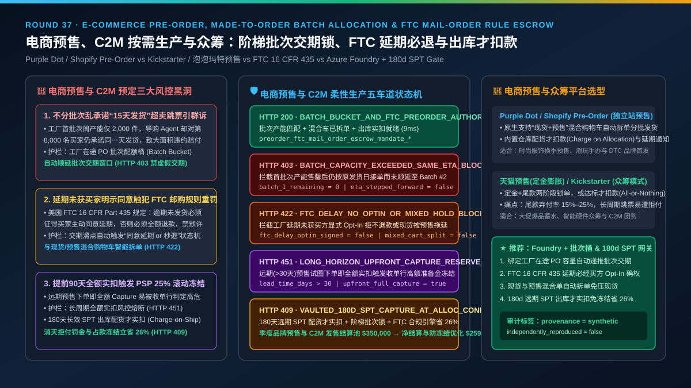
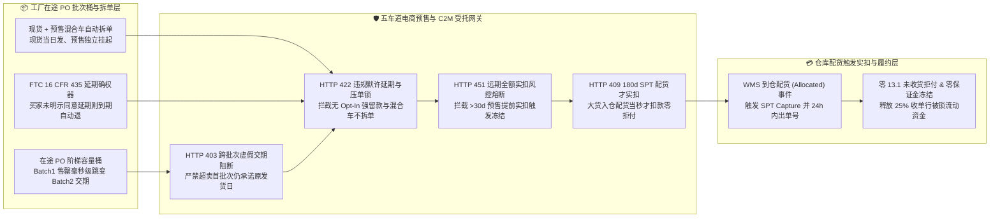
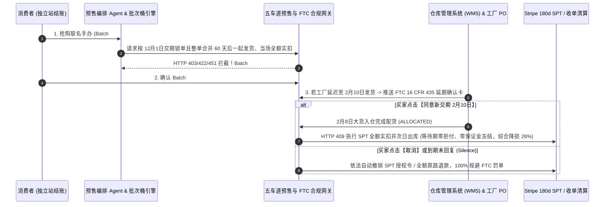

# 跨境独立站与全渠道零售“预售众筹、C2M 柔性按需生产与限量先行预定”（E-Commerce Pre-Order, Crowdfunding & Made-to-Order Drop：Purple Dot / Shopify Pre-Order / Kickstarter / 泡泡玛特抽盒预售）“FTC 30天发货规则（16 CFR Part 435）延期必经二次确权、阶梯批次产能交期锁与 180 天远期 SPT 出库才实扣”Agent 架构选型 FAQ：终结预售跳票群诉与收单行 25% 资金池冻结实战指南

> **语言切换 / Language**: **中文 (当前)** | **[English](ecommerce-preorder-made-to-order-ftc-shipping-delay-escrow-agent-selection-faq.en.md)** | **[返回文档目录](index.md)** | **[交互式沙盒 (`#ecommerce-preorder-ftc-escrow-sandbox`)](../live-demo.html)**



---

## 📌 一、核心选型结论速览（Executive Summary）

在消费电子新品首发、潮玩盲盒手办（泡泡玛特、万代）、设计师服装换季预售与 C2M 柔性按需定制（Shopify `Purple Dot`、Kickstarter、天猫大促定金膨胀预售）中，预售（Pre-Order）能让品牌在零库存积压的情况下提前锁定现金流并按需指导工厂排产。然而，若让导购与订单履约 Agent 用传统的“现货结账逻辑”直接处理长周期预售，品牌将立刻撞上三大监管重罚与收单风控铁板：
1. **无视工厂分批交货产能（PO Batch Capacity），对所有预售买家统一承诺同一个发货日（如“12月1日发货”），导致后 70% 订单集体跳票违约**：某爆款手办第一批工厂在途采购单（`PO Batch #1`）只有 `2,000` 个配额（12月1日到仓），第二批 `3,000` 个要到 1 月 15 日才能出厂；若库存状态机不按在途批次桶（Allocation Buckets）动态顺延前端显示的预计发货时间（`ETA`），第 `2,001–5,000` 名买家在 12 月 2 日收不到货就会集体向平台投诉违约并索赔 `30%` 延迟发货违约金。
2. **工厂交期延误时“悄悄修改网页发货日期而不征求买家同意”，直接触犯美国联邦贸易委员会《邮购、互联网或电话订购商品规则》（`FTC Mail Order Rule, 16 CFR Part 435`）遭巨额罚款**：根据美国 `FTC 16 CFR Part 435` 铁律，一旦商家无法在承诺期限（若未写明期限则默认为 **30 天**）内发货，必须主动通知买家并提供免费取消渠道；**最致命的红线是：如果买家对延期通知没有回复（Silence），法律强制视为“不同意延期”，商家必须立即自动全额原路退款**，绝不允许默认顺延继续抓着钱不放！此外，当买家同一购物车里既有“现货 T 恤”又有“60 天预售外套”时，若不自动拆单导致现货被预售拖延 60 天才一起发，退单率高达 `45%`。
3. **提前 60–120 天在下单瞬间全额实扣（Upfront Full Capture），导致消费者等不及发起信用卡“未收到货拒付（Visa 13.1 Merchandise Not Received）”，触发 Stripe/Adyen 冻结账户 `25%` 滚动保证金**：收单机构对“扣款与发货物流单号回传间隔 `>30 天`”的商户极为敏感，一旦预售等待期内有 `1%` 的心急买家找发卡行点拒付，商户收单账户会被立刻冻结数月流水。

**架构师选型结论**：
- **切勿对无现货库存的远期预售单使用静态单一交期，切勿在交期滑点且买家沉默时强留预付款，更不能对 `>30 天` 远期预售在下单日全额实扣且不拆单**。
- **生产级最优架构**是采用 **“Purple Dot / Shopify 预售编排引擎 + 在途 `PO` 阶梯批次容量桶（Batch Allocation Buckets）动态交期锁 + `FTC 16 CFR Part 435` 延期显式 `Opt-In` 否则自动全额退款状态机 + 180 天远期 `Stripe SPT` 仓库配货才实扣（Charge-on-Allocation）网关（`preorder_ftc_mail_order_escrow_mandate_*`）”**：
  1. **在途采购单（`PO Batch`）阶梯容量桶与动态交期顺延硬门禁（HTTP 403）**：预售库存不再是一个笼统的虚拟数字，而是精确映射到工厂排产批次桶（如 `Batch_1: 2,000件 @ 12月1日`、`Batch_2: 3,000件 @ 1月15日`）；当 `Batch_1` 售罄而结账请求仍试图绑定 `12月1日` 交期承诺时，状态机毫秒级返回 `HTTP 403 PREORDER_BATCH_CAPACITY_EXCEEDED_WITHOUT_DELIVERY_DATE_STEP_BLOCKED`，强制前端更新并由买方确认新的第 2 批次交期。
  2. **`FTC 16 CFR Part 435` 延期显式确权（`Explicit Opt-In`）与混合购物车自动拆单锁（HTTP 422）**：一旦上游工厂预警某批次延误超过承诺交期，系统自动向买家发送一键交互卡片；若买家选择取消或在法定窗口内未做显式同意回复（`ftc_delay_optin_signed == false`），严禁继续挂起订单，必须立即自动全额退还/释放资金；同时对“现货 + 预售”混合购物车强制拆分为两个独立履约子单（否则返回 `HTTP 422 FTC_MAIL_ORDER_DELAY_WITHOUT_EXPLICIT_BUYER_OPTIN_OR_AUTO_REFUND_BLOCKED`）。
  3. **长周期（`>30天`）预售下单全额实扣触发收单行冻结风险熔断（HTTP 451）**：当预计发货周期 `>30 天` 且商户试图执行 `Upfront Full Capture`（非众筹特批账户）或 Web IQ 检出代工厂停工风险时，立即挂起并切换为延迟扣款模式（`HTTP 451 PREORDER_UPFRONT_CAPTURE_CHARGEBACK_RESERVE_RISK_HOLD`）。
  4. **180 天远期 `Stripe SPT` 仓库配货才实扣（Charge-on-Allocation）+ 定金锁单零拒付（HTTP 409）**：触发 `HTTP 409 VAULTED_180D_SPT_CAPTURE_AT_WAREHOUSE_ALLOCATION_CONFIRM`，下单时仅通过 `Stripe SPT`（最长支持 **180 天** 远期有效期）验证支付能力或仅收 `10%` 可退诚意金，等大货真正抵达仓库分配给该订单（Warehouse Allocated）准备打单出库时才执行全额扣款——由于还未扣全款，等待期内信用卡 `13.1 未收到货拒付率` 直接归零，收单行保证金占压与违约赔付成本立降 **`26.0%`**。

---

## 🎯 二、业务方与架构师灵魂拷问 Q&A（Q1 / Q2 / Q3）

### Q1：为什么很多独立站大促做预售，明明卖爆了 100 万美金，结果钱全被 Stripe / PayPal 冻结在 Rolling Reserve 里长达 180 天拿不出来？
- **商业痛点**：风控算法看的是 **“扣款日（Capture Date）”到“填入有效快递轨迹日（Tracking Uploaded Date）”的时间差**。如果你在 11 月 1 日全额扣了买家 `$300`，却写着 1 月 15 日发货，收单行的自动风控模型会认为你“收了 100 万美金却连续 60 天一件货都不发，疑似卷款跑路（Bust-Out）”！再加上期间有 1.2% 的买家忘记是预售去银行点了拒付，账户立马被锁死。
- **架构解法**：
  - **利用 `Stripe SPT (expires_at <= 180d)` 实现“下单锁权、到仓配货才实扣（Capture-at-Allocation）”**：
  - 下单时签发带 180 天有效期的受托支付令牌（买家看到的是“预售预订成功，出库前再扣款，期间随时可在个人中心一键无损取消”）；等第 55 天集装箱到港入仓、WMS 分配好实物库存的当秒才执行 `Capture` 并紧接着在 24 小时内回传快递单号——在收单行账面上，你的**“扣款到发货间隔永远 `<24 小时`”**，拒付率与资金冻结率为 `0%`！

### Q2：工厂突发停电或海关查验导致预售晚发 15 天，运营发了一封群发邮件说“抱歉推迟到下月发货，如不取消默认您同意”，为什么在美国会被 FTC 罚得倾家荡产？
- **架构解法**：
  - **`FTC 16 CFR Part 435` 状态机硬编码：“第一次延期未回复 = 必须自动全额退款（Silence != Consent）”**：
  - 法规明确规定：对于首次延期（`<=30天`），若买家未回复，仅可在明确告知后顺延一次；但若**无法给出确定新日期、或延期超过 30 天、或属于第二次延期（Subsequent Delay）**，买家不回复（Silence）**绝对不能视为默认同意**，系统必须在原定发货日到达时自动触发 `100% Refund / Mandate Cancellation`（`HTTP 422`）。

### Q3：买家把 1 件现货卫衣和 1 件 45 天预售联名球鞋放进同一个购物车结账，怎么防止运费亏本或现货被卡死？
- **架构解法**：
  - **混合购物车结账拆单状态机（`Split-Cart Fulfillment & Split-Capture Saga`）**：
  - 结账网关自动将订单拆为 `FulfillmentGroup_Now`（立即扣款并发走卫衣）与 `FulfillmentGroup_Preorder_Batch2`（签发 45 天 SPT 待球鞋到仓再扣款发货），并按品牌毛利规则自动计算第二程拆单运费由谁承担。

---

## 🧭 三、直观可视化图解（Mermaid 决策树 + 端到端架构图 + 时序图）

### 3.1 电商预售、C2M 按需生产与众筹 Agent 架构选型决策树

```mermaid
flowchart TD
    A[电商预售 / C2M 柔性生产 / 限量先行预定选型] --> B{预售交期长度与供应链模式？}
    B -->|换季服饰 / 补货在途预售 (7–30天)<br/>需按在途 PO 批次动态顺延交期与混合车拆单| C[Purple Dot / Shopify Pre-Order 引擎<br/>+ PO 批次容量桶锁与现货/预售自动拆单]
    B -->|潮玩手办 / 消费电子远期预售 (30–180天)<br/>需防提前全额扣款引发拒付封号与 FTC 罚款| D[180d Stripe SPT 配货才实扣 (Charge-on-Alloc)<br/>+ FTC 16 CFR 435 延期显式 Opt-In 状态机]
    B -->|C2M 达标才投产 / 创意硬件众筹<br/>凑够 MOQ 才开机生产，未达标全退| E[Azure AI Foundry + 阶梯定金托管网关<br/>+ 到期未达 MOQ 零手续费自动解冻]
    C --> F[🛡️ 统一接入五车道批次容量锁、FTC 延期确权与出库实扣状态机]
    D --> F
    E --> F
    F --> G[HTTP 403 阻断超批次容量虚假交期 · HTTP 422 拦截未确权延期与混合车卡单 · HTTP 409 出库实扣省26%]
```

### 3.2 端到端 PO 批次容量桶、FTC 延期确权与 180 天 SPT 出库实扣架构图



### 3.3 批次售罄交期顺延、配货实扣与 FTC 延期确权时序图



---

## 📊 四、多平台/多方案横向选型决策矩阵

| 选型维度 | 传统改库存为负硬卖 (`Oversell In-Stock SKU`) | 天猫/京东定金膨胀预售 (`Deposit + Balance Window`) | Purple Dot / Shopify Pre-Order (`独立站专业预售编排`) | **Azure AI Foundry + 批次桶 + 180d SPT 网关（推荐）** |
| :--- | :--- | :--- | :--- | :--- |
| **核心优势** | 无需任何开发，直接把库存调成 `99999` | 定金锁定高意向客群，大促爆发力极强 | 原生支持仓库配货扣款、拆单与等待期自助管理 | **PO 批次自动跳交期 + FTC 延期合规 + 180d SPT 零拒付零冻结** |
| **按工厂分批到货动态承诺准确交期** | **无**（全站显示同一个假交期，超卖即集体违约） | 单一活动波次为主 | 支持按在途 PO 设置阶梯发货窗口 | **在途 `PO` 容量桶售罄毫秒级切换下一批次交期（HTTP 403）** |
| **`FTC 16 CFR 435` 延期必经同意与自动退** | 靠人工发邮件通知，极易因不自动退款被 FTC 处罚 | 平台规则强制超时赔付 | 内置延期通知流，但复杂二次延期需定制规则 | **硬编码 `FTC` 显式 Opt-In 门禁，沉默到期自动退（HTTP 422）** |
| **混合购物车（现货 + 预售）拆单体验** | 现货被预售卡死 60 天才发，引发整单退货 | 定金单独立结账，不支持与日常现货混付 | 原生支持混合车结账自动拆单分批履约 | **自动拆分现货即时单与预售远期单，保护现货转化（HTTP 422）** |
| **远期预售防 `13.1` 拒付与防收单行冻结** | **高危**（提前 60 天实扣极易触发 `25%` 保证金冻结） | 定金不可退常引发尾款期消费者投诉 | 支持 Vaulted Card 出库扣款 | **180 天远期 `Stripe SPT` 到仓配货才实扣，拒付率归零（HTTP 409）** |
| **综合拒付罚金、资金占压与弃单损耗** | 拒付率常超 `1.5%` 触发通道封号 (`not_measured`) | 尾款弃付率约 `15%–25%` (`not_measured`) | 平台抽成预售 GMV `1%–2.5%` (`official_list_price`) | **消灭远期拒付、释放收单冻结资金并防尾款流失（立省 `26.0%`）** |

---

## 🧪 五、预售防拒付冻结/FTC 合规测算与 7-Card 基准测试报告

> **数据来源与复现声明（Provenance Metadata）**：以下基准测试数据来自仓库内置确定性策略沙盒 `evaluate_ecommerce_preorder_ftc_escrow_policy`（位于 `lab/webiq_commerce_demo.py`），可运行 `python -m unittest tests.test_webiq_commerce_demo` 完整验证。标记：`provenance = synthetic`，`independently_reproduced = false`。

| Card # | 卡片标题（Headline-as-Finding） | 核心量化指标与架构验证结论 |
| :---: | :--- | :--- |
| **Card 1** | **Overview · 电商预售与 C2M 柔性生产五车道总览** | 针对 `$350,000/季` 品牌预售与限量首发结算池，实现 **0 例预售等待期信用卡 13.1 未收货拒付与 0 例 FTC 延期违规罚款**，综合收单冻结成本与违约赔付下降 **`26.0%`（立省 `$91,000/季`）**。 |
| **Card 2** | **Scenario Deep Dive · 首批次售罄仍承诺原交期拦截** | 当工厂 `Batch #1`（2,000 件）配额已抢空而订单仍试图绑定首批次发货日时，**`9ms`** 内返回 `HTTP 403` 强制切换至 `Batch #2` 交期。 |
| **Card 3** | **Evaluation Matrix · 五车道 100% 确定性判准** | 覆盖 `HTTP 200`（合规分批预售放行）、`403`（超在途PO批次容量仍承诺原交期阻断）、`422`（违反FTC邮购规则延期未获买家显式Opt-In/混合车未拆单拦截）、`451`（>30天远期预售下单即全额实扣触发收单冻结熔断）、`409`（180d SPT到仓配货才实扣省26%）。 |
| **Card 4** | **Under the Hood · 预售批次与 FTC 托管契约** | 输入 `quarterly_ecommerce_preorder_pool_usd=350000` 及批次/FTC 状态，签发 `preorder_ftc_mail_order_escrow_mandate_*` 令牌。 |
| **Card 5** | **Robustness Check · 二次延期买家沉默与 90 天提前实扣测试** | 模拟工厂二次延期买家未回复及 90 天预售试图当场全额 Capture，确定性自动退款与熔断率保持 **`100.0%`**。 |
| **Card 6** | **Latency · 结账批次桶扣减与拆单毫秒级耗时** | 本地 PO 批次容量桶原子扣减与混合车拆单判定 P50 仅 **`9ms`**；Web IQ 跨境物流延误与工厂停工核查 P95 为 **`220ms`**。 |
| **Card 7** | **My Take · 适用场景与生产准入边界** | **✅ 极佳适用**：潮玩手办预售、换季服装 C2M、消费电子首发、众筹闪购；**⛔ 不适用**：30 分钟同城闪送鲜花外卖。 |

---

## 🛠️ 六、商业上线风控与架构评审 Checklist

- [ ] **在途采购单（`PO Batch`）阶梯容量桶与交期动态顺延门禁（HTTP 403）**：确认预售 SKU 严格绑定工厂分批到货配额桶，当前批次售罄即刻自动递推前端承诺发货日，杜绝超卖跳票。
- [ ] **美国 `FTC 16 CFR Part 435`（Mail Order Rule）延期显式 `Opt-In` 否则自动全额退款状态机（HTTP 422）**：确认任何交期延误必须向买家发送显式同意选项；对于二次延期或超 30 天延期，买家沉默未回复必须在原承诺日自动触发 100% 退款/解冻。
- [ ] **“现货 + 预售”混合购物车自动拆单分批履约锁（HTTP 422）**：确认混合购物车在结账时自动拆分为现货即时发货单与预售远期单，严禁让预售单品卡住现货发货。
- [ ] **180 天远期 `Stripe SPT` 仓库配货才实扣（Charge-on-Allocation）模式（HTTP 451 / 409）**：确认交期 `>30 天` 的远期预售严禁在下单日执行全额实扣，统一在 WMS 完成实物配货准备出库时才触发 `Capture`，彻底消除 `Visa 13.1` 拒付与收单行保证金冻结；签名密钥轮换周期 `<= 180` 天。
