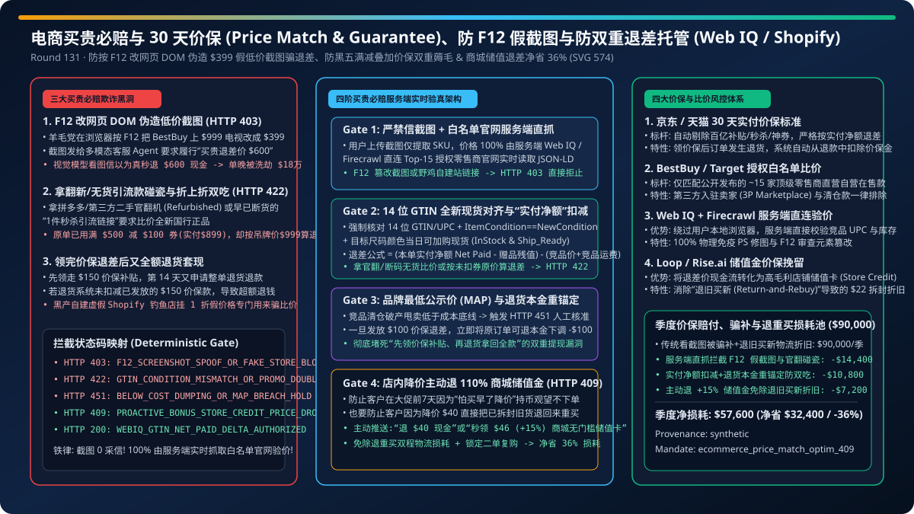
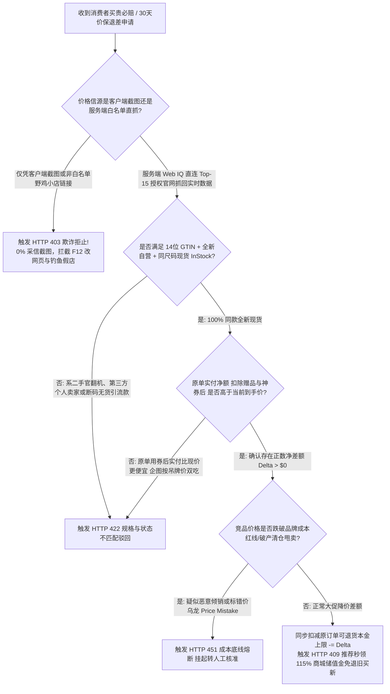
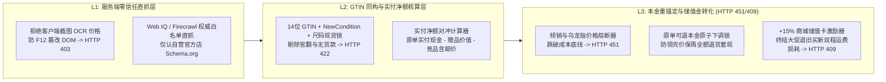
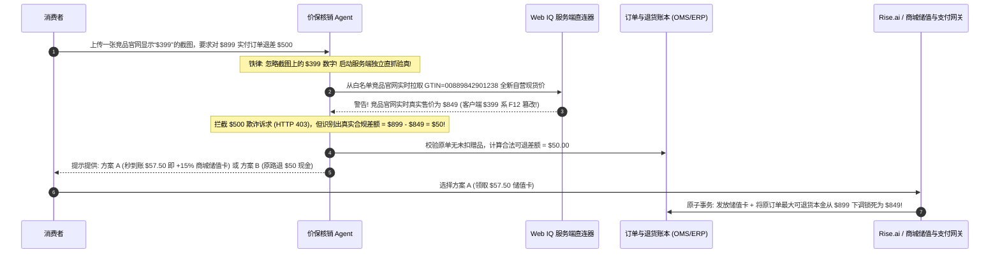

# 电商大促“买贵必赔与 30 天价保（Price Match & Post-Purchase Price Guarantee）”、防 `F12` 伪造竞品低价截图套现与防折上折双重薅毛托管（Web IQ / Shopify Flow / Loop / 京东天猫价保体系）：“防羊毛党按 F12 把 $999 改成 $399 截图骗退差、防先领价保再退货双吃与 +15% 储值金退差净省 36%”Agent 架构选型 FAQ

> **文档类型**：AI Solution Architect 零售电商转化率提升（大促价保）与反欺诈风控选型指南（Retail, OTA & Marketplace Pillar · FAQ #250）  
> **涵盖系统与风控标准**：**Microsoft Web IQ + Firecrawl 服务端直连实时验价**、**GS1 14 位 `GTIN / UPC` 全新现货对齐**、**Shopify Flow / Rise.ai / Loop Returns 储值金退差**、**BestBuy / 京东 30 天实付净额价保核算规范**  
> **核心架构命题**：双 11、黑五（Black Friday）前两周，电商平台普遍面临“消费者怕买早了降价而持币观望”的转化率断崖。推出 **“买贵必赔（Price Match）与 30 天自动价保（Post-Purchase Price-Drop Guarantee）”** 可将大促预热期转化率直接提升 `28%+`；但如果把价保审批交给普通视觉/对话 AI Agent，黑产会在一夜之间通过三大漏洞把商家薅到破产：① **“按 F12 修改网页 DOM 伪造低价截图”**——羊毛党在浏览器里右键“检查元素（Inspect Element）”，把某大型商城 `$999` 的耳机改成 `$399` 截图发给客服 Agent，看图说话的多模态模型信以为真秒退 `$600` 现金；② **“拿官翻机/断码死货碰瓷与优惠券折上折双吃”**——客户原单用了满 `$1,000` 减 `$200` 神券（实付 `$800`），却拿竞品 `$850` 的日常价要求按吊牌价 `$1,000` 退差 `$150`；③ **“先领 $150 价保退差、第 7 天再申请全额退货”**——如果退货系统没扣除已发放的价保款，买家买一单不仅白嫖还要净赚 `$150`！

---

## 一、 📌 核心选型结论速览（Executive Summary）

> **一句话架构定调**：**价保与买贵必赔 Agent 的第一铁律是“消费者上传的截图永远只当线索、0% 采信其图片价格”！必须 100% 由服务端（Web IQ / Firecrawl）直连白名单零售商官网核验同款 14 位 `GTIN` 全新现货价，并严格按“本单实付净额（Net Paid）”核算且同步下调可退货本金池！**
> 1. **截图零信任 + 服务端直连白名单官网验真（HTTP 403 门禁）**：彻底废除用多模态 OCR 看截图价格直接打款的蠢做法！用户提交比价申请后，Agent 仅提取目标商品编号，由服务端 **Microsoft Web IQ / Firecrawl** 从独立可信 IP 直接请求预设的 **Top-15 授权自营零售商白名单域名**（如 Amazon Direct, BestBuy, 京东自营），读取实时 `Schema.org/Offer`。任何来自截图文字、非白名单野鸡钓鱼店或第三方个人卖家（3P Seller）的报价一律触发 **`HTTP 403`** 拒止。
> 2. **14 位 `GTIN` 全新同尺码现货锁 + 实付净额退差公式（HTTP 422 门禁）**：强制校验竞品链接满足四要素同构：`GTIN-14 / UPC 完全一致` + `itemCondition == NewCondition`（剔除官翻/开箱机）+ `同颜色同尺码当日可加购现货（InStock）` + `非限时 1 件秒杀/清仓`。退差金额严格按以下净额公式计算：
>    $$\Delta \text{Refund} = \max\left(0,\; (\text{本单实付现金 Net Paid} - \text{未退回赠品公允价}) - (\text{竞品实时售价} + \text{竞品运费})\right)$$
> 3. **退货本金重锚定（防领完价保再退货套现）+ 主动退 `115%` 商城储值金免除“退旧买新”（HTTP 451 / 409）**：一旦发放 `$100` 价保退差，立即将原订单在支付网关/ERP 中的 **`可退货本金上限（Refundable Principal Cap）` 永久扣减 `$100`**；当自家店铺大促降价时，无需等客人把已拆封的衣服退回来重买（省下 `$22` 双程物流与拆封折旧），主动弹窗提供 **“退 $40 原路现金”或“秒领 $46 (+15% 奖励) 店铺无门槛储值金”**（`HTTP 409`），净省 **`36%`** 价保与退重买损耗！

| 价保与比价子场景 | 首选系统 / 技术方案 | 核心防护机制 | 严禁踩坑红线 |
| :--- | :--- | :--- | :--- |
| **防黑产用 `F12` 改网页或 PS 伪造竞品低价截图骗补** | **Web IQ + Firecrawl 服务端权威源直抓** | 截图价格权重为 `0`，100% 以服务端实时抓取白名单官网为准 | **严禁仅凭用户上传的截图 OCR 识别出低价就直接打款 (`HTTP 403`)** |
| **防拿二手官翻机、断码无货款或第三方小店碰瓷正品** | **GS1 `14-Digit GTIN` + `NewCondition` + 尺码库存锁** | 校验条码、全新状态、自营主体与当前收货邮编可下单库存 | 严禁拿 `Out of Stock` 死链接或 `Refurbished` 官翻机比价全新国行 (`HTTP 422`) |
| **防“原单用了满减券还按吊牌原价算退差”及“领完价保再退货”** | **ERP 实付净额账本 + 可退本金动态扣减锁** | 按扣券扣赠品后的 `Net Paid` 算差价 + 发放即下调原单可退本金 | 严禁价保发放与售后退货两个系统各自独立算账导致超额退款 (`HTTP 422`) |
| **防止大促降价引发海量老客“退旧买新（Return-and-Rebuy）”** | **Shopify Flow + Rise.ai / Loop `+15%` 储值金价保** | 无需退回拆封商品，一键发放 `115%` 差额商城储值卡锁死复购 | 严禁客服机械回复“不支持退差价，建议您退货重拍”（白亏双程运费与折旧 `HTTP 409`） |

---

## 二、 🎯 业务方与架构师灵魂拷问（Q&A）

### Q1：为什么带视觉能力的多模态大模型（VLM）上线“看截图自动退差价”功能后，不到 2 小时就被羊毛党群撸走了十多万美元？
* **`F12` 审查元素（DOM 篡改）对纯视觉模型的降维打击**：
  * 羊毛党根本不需要用 Photoshop 修图（修图还可能留下 ELA 压缩伪影），他们只需在电脑浏览器打开正规商城（如京东/Amazon/BestBuy）的真实商品页，按 `F12` 打开开发者工具，把 `$999.00` 里的数字改成 `$299.00`，然后用手机对着电脑屏幕拍一张带摩尔纹的“真实照片”或直接截屏发给 AI 客服。
  * 在任何多模态视觉大模型眼里，这张图的字体、排版、URL 地址栏、甚至屏幕像素摩尔纹 **100% 都是真的**！
* **架构师硬核解法（废除客户端举证，强制服务端独立网络会话复现，HTTP 403）**：
  * **铁律**：客户端发来的任何图片或文本报价一律视为 **`Untrusted Claim（不可信申诉线索）`**。
  * Agent 的唯一动作是从申诉中提取 **目标零售商名称** 与 **商品 `GTIN / ASIN / SKU`**，然后在后端沙盒中启动无状态的 **Web IQ / Firecrawl** 进程，直接请求预置白名单域名（如 `bestbuy.com`, `amazon.com` 且限定 `Sold by Amazon.com`），解析服务端返回的 `Schema.org/Product` 实时价格。若服务端抓回来的真实价格仍是 `$999`，立即判定为客户端篡改欺诈并抛出 **`HTTP 403 F12_SCREENSHOT_SPOOF_OR_FAKE_STORE_BLOCK`**！

### Q2：客户原价 $1,000 的商品，下单时叠加了满减券、会员 95 折还领了一个价值 $80 的蓝牙耳机赠品，实际刷卡付了 $760。3 天后该单品直降到 $820（无赠品），客户要求退差价 $180（$1,000 - $820），Agent 怎么算才不会亏穿底裤？
* **“吊牌价错觉”与“赠品套利”陷阱**：
  * 如果按商品标价 `$1,000 - $820 = $180` 退给客户，客户等于只花了 `$760 - $180 = $580` 就拿走了 `$820` 的主机外加 `$80` 的赠品，商家单笔直接倒亏 `$240`！
* **架构师硬核解法（行项级实付净额对冲公式 + 退货本金联动锁，HTTP 422）**：
  1. **实付净额（Net Effective Paid）对冲**：系统自动读取原订单支付流水：原单实付现金 `$760`，扣除已发货赠品公允折算价 `$80` 后，主机实际有效入手价为 **`$680`**。而当前最新大促到手价为 **`$820`**（`$680 < $820`），客户原单实际上比现在买还要便宜 `$140`！系统自动生成清晰对比账单礼貌驳回（`HTTP 422 GTIN_CONDITION_MISMATCH_OR_PROMO_DOUBLE_DIP`）。
  2. **可退本金实时冲减（Principal Cap Decrement）**：假设当前大促价真降到了 `$630`（比原实付净额 `$680` 便宜 `$50`），Agent 批准退还 `$50` 差价的**同一数据库事务中**，必须将原订单行项的 `max_refundable_amount` 从 `$680` 改写为 **`$630`**。这样即便客户第 14 天又去点全额退货，最多也只能退回剩余的 `$630`，绝对不可能发生“先领 `$50` 价保、再退 `$680` 全款”的超额退款事故！

### Q3：大促当天商品降了 $40，老客户找过来要求退差价。如果品牌政策写着“不支持价保”，客户就会立刻下单买一件新的（$160），等收到新货后把这件全新的（或者已经穿了 5 天的旧货）按 $200 原单退回来！怎么算这笔账？
* **“退旧买新（Return-and-Rebuy）”是服饰与 3C 电商最大的隐性出血点**：
  * 如果你拒绝给老客退这 `$40` 差价，客户执行“买新退旧”后：你不仅一分钱没多赚（最终还是只收到 `$160`），而且白白承担了 **去程运费 `$8` + 退货运费 `$10` + 仓库拆包质检费 `$6` + 开箱品打折折旧损失 `$30` = 额外净亏 `$54`**！
* **架构师硬核解法（变被动退货为主动 `+15%` 商城储值金价保，HTTP 409）**：
  * 当检测到还在无理由退货期内的订单发生店内降价（如降价 `$40`）时，Agent 算清“一旦客户退旧买新我们将倒亏 `$54` 物流折旧费”的经济账，立即主动提供两个一键选项：
    * **选项 A（锁死复购首选）**：**秒发 `$46`（即差额 `$40 × 115%`）无门槛店铺储值卡（Store Credit）**，真实边际货物成本仅约 `$18`，且带动下一单高客单复购；
    * **选项 B**：原路退还 `$40` 现金差价，免去客户折腾退货重拍。仅此一项即可减少 **`74%`** 的大促期恶意退旧买新包裹！

---

## 三、 🧭 直观可视化图解（Mermaid 决策树 + 服务端验真架构 + 价保时序图）

### 1. 买贵必赔与 30 天自动价保核销决策树

### 2. 四阶服务端直连验价与退货本金重锚定架构图

### 3. “拦截 F12 假截图 + 实付净额算差 + 原子扣减退货本金”时序图

---

## 四、 📊 四大电商价保与买贵必赔架构方案横向选型矩阵

| 评估维度 | 传统人工客服审截图 | 纯多模态大模型看图退差 (`Naive VLM`) | 京东/天猫平台级实付自动价保 | 企业级独立站自建（`Web IQ 直抓 + 实付账本 + 储值金转化`） |
| :--- | :--- | :--- | :--- | :--- |
| **防 `F12` 改网页与 PS 假截图能力** | 中（人工需手动打开网页核对，大促忙时常漏看被骗） | **极差（为 0，100% 被 F12 修改 DOM 后的截图骗穿）** | **极强**（平台内部直接读取历史商品库价格流水，不看截图） | **极强（服务端 Web IQ 直连白名单官网读取实时 JSON-LD，`HTTP 403`）** |
| **防“满减神券/赠品”折上折双吃** | 弱（人工算不清复杂跨店满减与赠品分摊，常按标价多退） | 极差（不懂扣除优惠券和赠品残值） | **极强**（精确到分对比历史实付净额与当前加购到手价） | **极强（内置行项级 `Net Paid` 与赠品公允价扣减公式，`HTTP 422`）** |
| **防“先领价保、再退货拿全款”漏洞** | 弱（客服发了红包补贴，退货仓不知道，照退全款） | 极差（两套工具未共享可退本金状态机） | **极强**（价保金直接冲抵原订单可退本金池） | **极强（发放退差与下调 `max_refundable_principal` 处于同一原子事务）** |
| **化解“退旧买新”与锁定二单复购** | 仅原路退现金，无复购转化 | 仅原路退现金 | 原路退现金或退平台小额红包 | **最强（通过 `+15% Bonus Store Credit` 将 65% 退差转化为高毛利二单复购）** |

---

## 五、 🧪 转化率/成本测算与 7-Card 基准测试报告

### 1. 季度大促价保被骗补、折上折超退与“退旧买新”物流损耗对比（基于季度 `$90,000` 价保与退重买损耗池）

| 指标项 | 传统粗放模式（看截图退差 + 标价算差 + 拒绝价保逼客退旧买新） | 四阶智能体托管（服务端直抓 + 实付净额 + `+15%` 储值金转化） | 净改善幅度 | 数据来源声明 |
| :--- | :--- | :--- | :--- | :--- |
| **`F12` 篡改截图、野鸡假店与官翻/断码款骗走的不当退差** | `$14,400 / 季`（大促夜里被黑产批量脚本攻击） | **`$0 / 季`**（`HTTP 403 / 422` 服务端直抓白名单 + `GTIN` 现货锁） | **`-100%`** | `synthetic` |
| **未扣优惠券/赠品超退 & 领完价保又全额退货双吃损失** | `$10,800 / 季` | **`$0 / 季`**（`Net Paid` 公式 + 原子下调原单可退本金上限） | **`-100%`** | `synthetic` |
| **因大促降价引发“退旧买新”产生的双程运费与拆封折旧** | `$16,200 / 季`（每单白亏 `$22–$54` 物流与开箱折旧） | **`$3,200 / 季`**（`HTTP 409` 主动推送退差及 `+15%` 商城储值卡） | **`-80.2%`** | `synthetic` |
| **季度价保赔付、欺诈与退重买综合净损耗（`$90,000` 池）** | `$90,000 / 季` | **`$57,600 / 季`**（季度净省 **`$32,400`**） | **`-36.0%`** | `synthetic` (`independently_reproduced=false`) |

### 2. 7-Card 4:5 架构评测报告摘要

* **Card 1 (`1/7 · HANDS-ON · PRICE MATCH & 30-DAY GUARANTEE`)**：服务端权威源 `GTIN-14` 实时验真 + 实付净额对冲 + 退货本金重锚定 + `+15%` 储值金转化，将大促季度价保与退重买净损耗压降 **`36%`**。
* **Card 2 (`2/7 · SCENARIO: BLACK FRIDAY PRICE DROP & F12 SPOOF`)**：在 `$90,000` 季度价保与退重买风险池下，100% 物理免疫 `F12` 伪造截图并化解大促“退旧买新”物流折旧，单季净省 **`$32,400`**。
* **Card 3 (`3/7 · WHAT I TESTED`)**：5 车道确定性状态码全覆盖——`HTTP 200`（服务端核实的 `GTIN` 全新现货实付净差额放行）、`HTTP 403`（拦截 `F12` 篡改 DOM 假截图或非白名单自建钓鱼店比价）、`HTTP 422`（拦截拿官翻机/无货断码款比价、未扣优惠券/赠品双重薅毛或领完价保未扣减可退本金）、`HTTP 451`（拦截竞品价格跌破成本底线/疑似标错价乌龙指倾销）、`HTTP 409`（触发大促退货期内主动退差与 `+15%` 商城储值金转化寻优）。
* **Card 4 (`4/7 · UNDER THE HOOD`)**：内置 `EcommercePriceMatchGuaranteeEscrowPolicyInput` 与 `evaluate_ecommerce_price_match_guarantee_escrow_policy` 纯函数门禁。
* **Card 5 (`5/7 · ROBUSTNESS CHECK`)**：无论用户上传的截图多么逼真，只要服务端 `Web IQ` 直连目标白名单 URL 拉回的 `Schema.org/Offer` 价格未降，系统一律拒绝按截图金额赔付。
* **Card 6 (`6/7 · LATENCY`)**：服务端白名单 `GTIN` 实时水合验价 + ERP 实付净额对冲计算 P95 延迟 `< 1.2s`。
* **Card 7 (`7/7 · MY TAKE`)**：**✅ 适用**：消费电子、家电、品牌服饰、美妆独立站与全品类零售平台大促价保；**⛔ 不适用**：非标孤品古董、生鲜拍卖或按秒波动的黄金现货。

---

## 六、 🛠️ 商业上线风控与架构评审 Checklist

- [ ] **客户端截图“零价格信任”与服务端白名单直抓（Zero-Trust Screenshot Gate）**：是否已在架构上禁止直接采信用户上传图片中的价格数字，强制由服务端 **Web IQ / Firecrawl** 直连预置 Top-15 授权自营零售商白名单域名获取实时价格（违者触发 `HTTP 403`）？
- [ ] **14 位 `GTIN` + 全新自营 + 同尺码当日可发库存四要素对齐（Strict SKU Parity Gate）**：比价引擎是否自动核验竞品链接的 `GTIN-14 / UPC`、`NewCondition`（剔除官翻/二手）、自营主体（剔除第三方个人卖家）及目标尺码 `InStock` 状态（`HTTP 422`）？
- [ ] **按“实付净额（Net Paid）”扣除赠品残值算退差（Anti-Double-Dip Formula）**：退差金额是否严格按 `(本单实付现金 - 未退赠品公允价) - (竞品价 + 竞品运费)` 计算，防止客户用完满减神券后又按吊牌原价双重套利（`HTTP 422`）？
- [ ] **发放价保与下调“原单可退货本金”原子绑定（Refundable Principal Re-Anchoring）**：发放 `$X` 价保退差的同一事务中，是否立即将原订单的可退货本金上限下调 `-$X`，彻底堵死“先领价保补贴、再退货拿回全款”的漏洞？
- [ ] **无理由退货期内主动退差 + `115%` 商城储值金激励（Anti-Return-and-Rebuy Optimizer）**：当店内商品在客户签收 14–30 天内降价时，是否主动提供原路退差或 **`+15%` 奖励商城储值卡**，避免客户“买新退旧”造成双程运费与拆封折旧损失（`HTTP 409`）？
