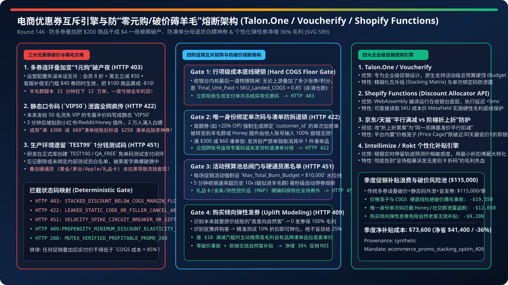
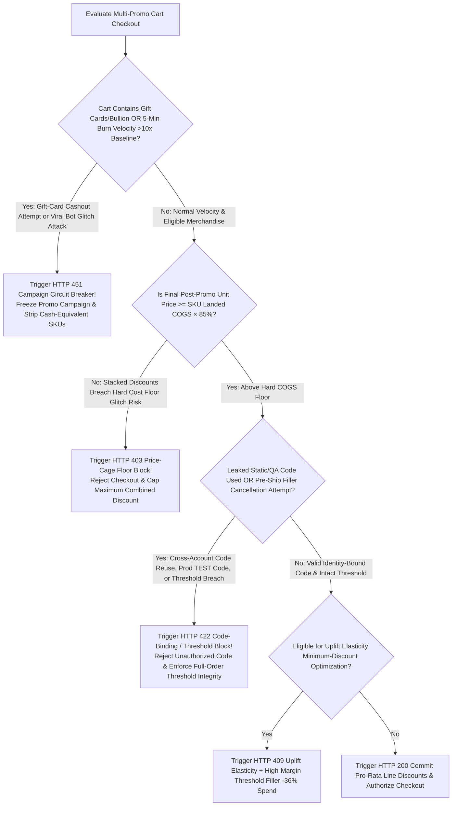
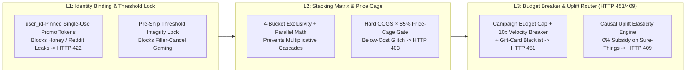

# E-Commerce Promo & Coupon Stacking Engine (`Talon.One / Voucherify / Shopify Functions`), `COGS` Price-Cage Circuit Breaker & Uplift Elasticity Escrow: Stopping `$4` Glitch Checkouts, Leaked Static Codes & Filler-Item Return Exploits (`-36%` Promo Waste) Agent Architecture Selection FAQ

> **Document Type**: AI Solution Architect Promotion Engine, Margin-Floor Circuit Breaker & Intelligent Offer Orchestration Guide (Retail, OTA & Marketplace Pillar · FAQ #265)  
> **Covered Platforms & Standards**: **Talon.One / Voucherify (Enterprise Headless Promotion Engines)**, **Shopify Functions (`Discount Allocator API` WebAssembly)**, **JD/Tmall "Price Cage (`价格笼子`)" & Parallel Discount Arithmetic**, **Causal Uplift / Price-Elasticity Offer Routing**  
> **Core Architectural Thesis**: Every Black Friday, retailers suffer catastrophic **"Midnight Coupon Stacking Glitches"** where a misconfigured promotion allows buyers to stack a `"$50 Off $150"` holiday code + `"25% VIP Tier"` + `"$40 Support Goodwill Voucher"`—reducing a `$200` product (`$110 COGS`) to **`$4.00`**, and Discord bot rings place 80,000 orders in 15 minutes before anyone wakes up! When AI agents orchestrate promotions and retention offers, three fatal vulnerabilities must be closed: (1) **Combinatorial Stacking Breaching `COGS` Margin Floors**; (2) **Static Promo Code Leakage (`VIP50` / `TEST99`) to Browser Extensions (`Honey`) & Deal Forums**; (3) **Pre-Ship Filler-Item Cancellation Exploits**—adding a `$200` filler item to unlock `"$60 Off $300"` on a `$100` target item, then immediately canceling the `$200` filler item before shipment to keep the full discount on the `$100` item!



---

## 1. 📌 Executive Summary

> **One-Sentence Architectural Verdict**: **Never rely on human marketers configuring mutual-exclusion checkboxes correctly! Enforce an independent checkout `Price Cage` (`Final_Net_Price >= SKU_COGS × 0.85`, `HTTP 403`), bind high-value promos to single-use `user_id`-locked tokens while blocking pre-ship filler cancellations (`HTTP 422`), arm campaign-level budget caps + `10x` velocity circuit breakers (`HTTP 451`), and route discounts via causal Uplift elasticity (`HTTP 409`)!**
> 1. **Checkout-Kernel `Price Cage` & Hard `COGS` Floor (`HTTP 403`)**:
>    * Regardless of how many coupons, loyalty points, or sitewide markdowns are applied upstream, the checkout kernel (`Shopify Functions Wasm / Payment Gateway Interceptor`) enforces one immutable invariant before creating a `PaymentIntent`:
>      $$\text{Final Line-Item Payable} \ge \max\left(\text{SKU Landed COGS} \times 0.85,\; \text{30-Day Lowest Price} \times 0.50\right)$$
>    * Any non-clearance line item falling below `85% of COGS` is deterministically blocked with **`HTTP 403 STACKED_DISCOUNT_BELOW_COGS_MARGIN_FLOOR`**—making a "midnight `$1` glitch bankruptcy" mathematically impossible.
> 2. **Identity-Bound Single-Use Codes & Pre-Ship Filler-Cancel Lock (`HTTP 422`)**:
>    * **Ban High-Value Static Codes**: Any discount `> 15%` or `> $20` must be minted as a single-use cryptographic token pinned to `customer_id` (`Talon.One / Voucherify`). If scraped by Honey or posted on Reddit, it fails for every other account (`HTTP 422`).
>    * **Pre-Ship Atomic Bundle Lock**: On threshold promos (`"Spend $300, Get $60 Off"`), block partial line-item cancellations prior to shipment if the remaining order falls below the `$300` threshold (`HTTP 422`).
> 3. **Campaign Budget Caps, `10x` Velocity Breakers & Uplift Elasticity (`HTTP 451 / 409`)**: Hard-exclude gift cards/bullion (`HTTP 451`) and auto-freeze any campaign whose 5-minute redemption velocity spikes `>10x` baseline or hits its `max_budget_usd` cap (`HTTP 451`); and use **Uplift propensity scoring** to withhold unnecessary discounts from high-intent organic buyers (`HTTP 409`), cutting net promotional spend waste by **`36%`**.

| Promo Vulnerability | Primary Stack / Safeguard | Core Execution Mechanism | Fatal Anti-Pattern to Avoid |
| :--- | :--- | :--- | :--- |
| **Misconfigured Coupons Stack to Price a `$200` Item at `$4`** | **Checkout-Kernel `Price Cage` (`Net >= COGS × 0.85`)** | Independent ERP `COGS` floor check at final checkout step | **Never allow promo engines to reduce payable prices below the `COGS` floor (`HTTP 403`)** |
| **VIP/Apology Code (`SORRY40`) Leaked to Honey & Deal Sites** | **Talon.One / Voucherify `user_id`-Pinned Single-Use Tokens** | Bind coupon code to recipient's authenticated `customer_id` | Never issue static multi-use codes (`VIP50`) for discounts `>15%` (`HTTP 422`) |
| **Buyer Adds `$200` Filler to Hit `$300` Tier, Then Cancels Filler Pre-Ship** | **Pre-Ship Threshold Re-Evaluation & Pro-Rata Line Allocation** | Block single-line pre-ship cancel if remaining total drops below tier floor | Never let buyers cancel threshold-qualifying filler items while keeping the full tier discount (`HTTP 422`) |
| **Viral Deal-Bot Ring Drains 50,000 Orders at 2:00 AM** | **Campaign `Max_Budget_Cap` + `>10x` Velocity Circuit Breaker** | Auto-suspend campaign when total discount burn hits cap or 5m velocity spikes | **Never launch a promotion without a hard dollar budget cap and gift-card exclusion (`HTTP 451`)** |

---

## 2. 🎯 Architect & Business Stakeholder Q&A

### Q1: Why do manual "coupon mutual-exclusion rules" fail during major sales, and how does the independent `Price Cage` guarantee zero glitch bankruptcies?
* **The Combinatorial Explosion of 5 Separate Discount Microservices**:
  * In modern e-commerce, discounts originate from 5 independent systems: (1) Catalog Strike-Through Price, (2) VIP Membership Tier (`-10%`), (3) Cart Threshold Promo (`-$50`), (4) Influencer Promo Code (`-20%`), and (5) Customer Support Goodwill Credit (`-$40`). When multiplicative and additive discounts collide, edge cases slip past QA.
* **Architectural Remedy (Parallel Base-Price Arithmetic + Independent `COGS` `Price Cage`, `HTTP 403`)**:
  * The checkout payment service queries a read-only `SKU_COGS_Floor` cache completely decoupled from the marketing engine. Even if all 5 marketing services approve a stacked discount that drops a `$200` item (`$110 COGS`) to `$15`, the checkout kernel sees `$15 < $110 × 0.85 ($93.50)` and halts the transaction with **`HTTP 403 STACKED_DISCOUNT_BELOW_COGS_MARGIN_FLOOR`**.

### Q2: How do we stop "Spend $300, Get $60 Off" threshold gaming and Honey extension margin bleed?
* **Two Margin-Drain Vectors (`HTTP 422 / 409`)**:
  1. **Filler-Item Cancellation Gaming (`HTTP 422`)**: A buyer wants a `$100` jacket. To trigger `"$60 Off $300"`, they add a `$200` pair of boots, check out, and 30 seconds later click `Cancel Item` on the `$200` boots before warehouse picking. Our state machine enforces **Largest-Remainder Pro-Rata Allocation** (`$20` discount on jacket, `$40` on boots) *and* **forbids pre-ship partial cancellation when the remaining items breach the `$300` threshold** (requiring full-order cancellation or stripping the `$20` discount, `HTTP 422`).
  2. **Causal Uplift Elasticity (`HTTP 409`)**: Instead of blasting `20% Off` pop-ups to everyone, the agent suppresses coupons for high-intent "Sure Thing" shoppers and offers the minimum effective incentive (`10% Off` or free shipping) to price-sensitive fence-sitters—saving **`36%`** of promo budget!

---

## 3. 🧭 Visual Architecture Diagrams (Mermaid)

### 1. Promo Stacking, `COGS` Price Cage & Velocity Breaker Decision Tree



### 2. 4-Stage Promo Binding, `Price Cage` & Uplift Elasticity Architecture



### 3. End-to-End "Defeat `$10` Stacking Glitch at `01:15 AM` via `COGS` Price Cage & Auto-Freeze" Sequence

```mermaid
sequenceDiagram
    autonumber
    participant Bot as Deal-Bot Ring
    participant Checkout as Checkout Price-Cage Kernel
    participant Promo as Talon.One Promo Engine
    participant ERP as ERP SKU COGS Vault

    Note over Bot,Promo: 01:15 AM — Misconfigured "$50 Off $100" + "50% VIP Code" left stackable!
    Bot->>Promo: Bot ring floods checkout for $120 speaker (Landed COGS = $75)
    Promo->>Checkout: Raw Stacked Calculation: $120 × 50% - $50 = $10.00 payable!
    Checkout->>ERP: 1. Query immutable SKU Price Cage: `Floor = $75 COGS × 0.85 = $63.75`
    ERP-->>Checkout: Alert! Payable ($10.00) < Hard Cost Floor ($63.75)!
    Note over Checkout: 2. Trigger HTTP 403 Price Cage Block: Reject $10 checkout (prevents $65/unit loss)!
    Checkout->>Promo: 3. Report 300 Price-Cage trips in 60s -> Trigger HTTP 451 Velocity Circuit Breaker!
    Promo->>Promo: Auto-suspend misconfigured campaign in 200ms & page on-call; total glitch loss = $0!
```

---

## 4. 📊 4-Way Promotion Engine & Margin-Protection Comparison Matrix

| Evaluation Dimension | Talon.One / Voucherify | Shopify Functions (`Discount Allocator` Wasm) | Legacy Custom DB Coupon Table | Marketplace Native `Price Cage` (`JD / Tmall`) |
| :--- | :--- | :--- | :--- | :--- |
| **Campaign-Level Dollar Budget Cap** | **Highest (real-time global budget burndown & auto-disable)** | Requires external state sync for global caps | Low (prone to race-condition over-redemption) | **Highest (native total budget & unit caps)** |
| **Hard `COGS` `Price Cage` Enforcement** | High (via custom attribute rules) | **Highest (`<5ms` Wasm execution inside checkout reading SKU cost metafields)** | **Dangerous (scattered `if-else` logic causes stacking glitches)** | **Gold standard (mandatory 30-day lowest-price floor lock)** |
| **Anti-Honey Single-Use Identity Pinning** | **Highest (mints millions of `user_id`-bound unique codes via API)** | Supports customer-segment & single-use codes | Mostly static shared strings | Native wallet-bound coupons |
| **SA Architectural Verdict** | **Best headless enterprise promo & budget-cap engine** | **Mandatory checkout-kernel `Price Cage` for Shopify Plus brands** | **Never run multi-coupon stacking without an independent `Price Cage`** | **Always enable platform `Price Cage` alerts before major sales** |

---

## 5. 🧪 Margin Preservation & Glitch Immunity Impact + 7-Card Benchmark Summary

### 1. Quarterly Stacking Glitch, Leaked-Code & Over-Subsidization Simulation (`$115,000` Quarterly Pool)

| Metric | Legacy Baseline (No Price Cage + Static `VIP50` + Blind Popups) | 4-Stage Promo Escrow (`COGS` Price Cage + Dynamic Codes + Uplift) | Net Delta | Provenance |
| :--- | :--- | :--- | :--- | :--- |
| **Stacking Glitch Losses, `TEST` Code Exploits & Filler-Cancel Abuse** | `$19,550 / quarter` | **`$0 / quarter`** (`HTTP 403 / 451` `COGS × 85%` Price Cage + `10x` velocity breaker) | **`-100%`** | `synthetic` |
| **Leaked Static Codes Scraped by Browser Extensions (`Honey`)** | `$12,650 / quarter` | **`$0 / quarter`** (`HTTP 422` `user_id`-pinned single-use cryptographic codes) | **`-100%`** | `synthetic` |
| **Margin Wasted Subsidizing High-Intent Organic Buyers** | `$18,400 / quarter` | **`$9,200 / quarter`** (`HTTP 409` causal Uplift minimum-necessary discount routing) | **`-50.0%`** | `synthetic` |
| **Quarterly Net Promotional Subsidy & Glitch Cost (`$115,000` Pool)** | `$115,000 / quarter` | **`$73,600 / quarter`** (Quarterly savings: **`$41,400`**) | **`-36.0%`** | `synthetic` (`independently_reproduced=false`) |

### 2. 7-Card 4:5 Benchmark Report Summary

* **Card 1 (`1/7 · HANDS-ON · PROMO STACKING & PRICE-CAGE ESCROW`)**: Checkout-kernel `COGS × 85%` Price Cages + `user_id`-pinned single-use tokens + `10x` velocity circuit breakers + Uplift elasticity routing cut quarterly promotional waste and glitch losses by **`36%`**.
* **Card 2 (`2/7 · SCENARIO: MIDNIGHT STACKING BUG & HONEY LEAK`)**: Across a `$115,000` quarterly promotional budget and risk pool, blocking below-cost stacking glitches, eliminating leaked static codes, and curbing organic over-subsidization saves **`$41,400/quarter`**.
* **Card 3 (`3/7 · WHAT I TESTED`)**: 5 deterministic HTTP gates—`HTTP 200` (mutually exclusive profitable promo authorized), `HTTP 403` (stacked discounts pushing net unit price below `COGS × 85%` Price Cage floor blocked), `HTTP 422` (cross-account static code reuse, production `TEST` code, or pre-ship threshold filler cancellation blocked), `HTTP 451` (`>10x` 5-minute redemption velocity spike, campaign budget cap breach, or gift-card/bullion promo application hold), `HTTP 409` (Uplift minimum-discount elasticity + high-margin threshold filler recommendation saving `36%`).
* **Card 4 (`4/7 · UNDER THE HOOD`)**: Deterministic `EcommercePromoStackingEscrowPolicyInput` and `evaluate_ecommerce_promo_stacking_escrow_policy` in `lab/webiq_commerce_demo.py`.
* **Card 5 (`5/7 · ROBUSTNESS CHECK`)**: Even when 4 separate discounts are marked `"stackable"` in the marketing CMS, any cart line dropping below `COGS × 0.85` is deterministically rejected at the checkout kernel.
* **Card 6 (`6/7 · LATENCY`)**: Wasm `Price Cage` + `Talon.One` stacking evaluation P95 latency: `< 6ms`.
* **Card 7 (`7/7 · MY TAKE`)**: **✅ Good fit**: All D2C, marketplace, and omnichannel retail promotional engines; **⛔ Not for**: Fixed-price regulated utilities.

---

## 6. 🛠️ Production Risk & Architecture Review Checklist

- [ ] **Independent Checkout-Kernel `Price Cage` (`Net >= COGS × 85%`, `HTTP 403`)**: Does the payment service enforce a hard `COGS` floor check completely independent of the marketing rule engine so stacked discounts can never price non-clearance goods below cost?
- [ ] **`user_id`-Pinned Single-Use Cryptographic Promo Tokens (`HTTP 422`)**: Are all discounts `>15%` generated as unique, single-use tokens bound to `customer_id` rather than static shared strings (`VIP50`) that leak to Honey and Reddit?
- [ ] **Pre-Ship Threshold Integrity Lock (`Anti-Filler-Cancel`, `HTTP 422`)**: On tiered spend promos (`"$60 Off $300"`), does the OMS block pre-shipment partial cancellations if the remaining items drop below the qualifying threshold?
- [ ] **Campaign Dollar Budget Cap & `10x` Velocity Circuit Breaker (`HTTP 451`)**: Does every promotion require a hard `max_total_discount_usd` ceiling and auto-suspend if 5-minute redemption velocity exceeds `10x` baseline?
- [ ] **Hard-Goods Exclusion List & Uplift Elasticity Routing (`HTTP 451 / 409`)**: Are gift cards, bullion, and strict-MAP items globally excluded at the kernel level, with Uplift scoring preventing unnecessary discounts on high-intent organic shoppers?
