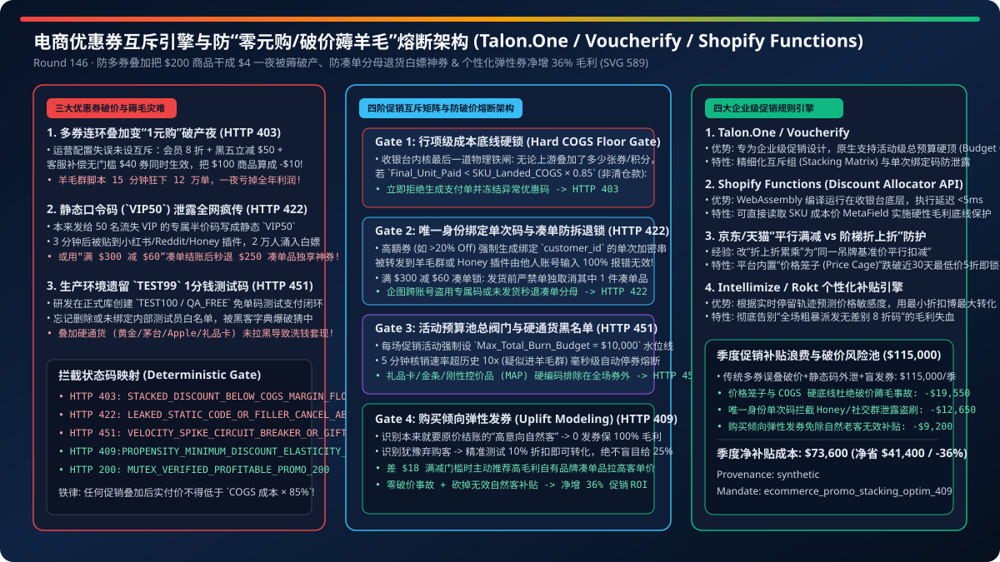
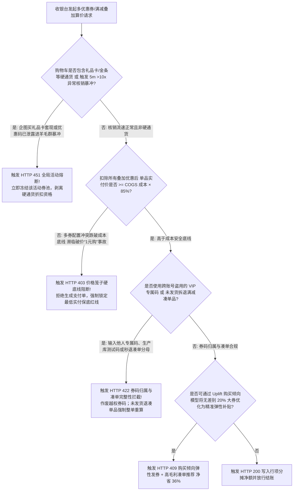
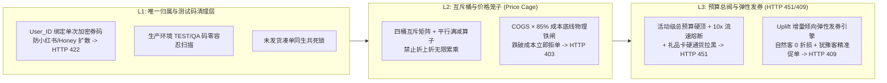
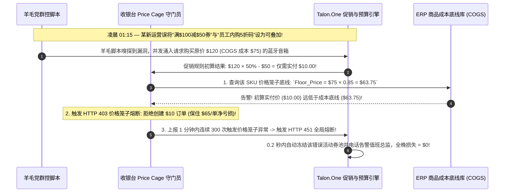

# 电商大促优惠券互斥引擎（Promo Stacking Engine：Talon.One / Voucherify / Shopify Functions）、防“多券叠加破价薅羊毛”价格笼子与防静态码外泄托管：“防三券叠加把 $200 商品算成 $4 一夜被薅破产、防凑单未发货秒退分母与弹性发券净省 36%”Agent 架构选型 FAQ

> **文档类型**：AI Solution Architect 零售电商促销中心、优惠券防破价熔断（Price Cage）与智能补贴编排选型指南（Retail, OTA & Marketplace Pillar · FAQ #265）  
> **涵盖平台与技术栈**：**Talon.One / Voucherify（企业级无头促销与预算熔断引擎）**、**Shopify Functions (`Discount Allocator API` WebAssembly 极速算价)**、**京东/天猫“价格笼子（Price Cage）”与平行满减算子**、**因果推断增量弹性发券（`Uplift Modeling`）**  
> **核心架构命题**：电商行业每年都会发生几起震惊全网的 **“凌晨优惠券配置失误被羊毛党一夜薅走几千万导致店铺倒闭”** 的惨案！当营销 Agent 被赋予自动生成与发放优惠券的权限时，必须防范三大夺命漏洞：① **“多券连环叠加击穿成本底线（Combinatorial Stacking Exploit）”**——运营配置了“全场满 `$200` 减 `$80`”，客服 Agent 又给抱怨物流慢的用户发了一张“无门槛 `$60` 补偿券”，叠加“会员日 8 折”和“新客立减 `$30`”，四张券同时生效把原价 `$200`（进货成本 `$110`）的商品算成了 **`$4` 包邮**！羊毛群监控机器人嗅到后 10 分钟内自动下单 80,000 单；② **“静态口令码（如 `VIP50`）外泄与测试码 `TEST99` 遗留”**——本来只发给 20 位顶级 VIP 的 5 折码因为没绑用户 ID，3 分钟内被传遍小红书/Reddit 和 Honey 插件；③ **“凑单满减未发货秒退凑单品（Filler-Cancel Exploit）”**——为凑满 `$300` 减 `$60` 买了 `$100` 主商品 + `$200` 凑单品，付款后第 1 秒就在待发货状态把 `$200` 凑单品单独取消退款，若系统未联动重算整单资格，买家直接白嫖最高档折扣！

---

## 一、 📌 核心选型结论速览（Executive Summary）

> **一句话架构定调**：**促销计价引擎绝不能相信“人工运营不会配错规则”！必须在结账最底层焊死四道物理保险丝——“单品实付价不得低于进货成本 `COGS × 85%` 的价格笼子（HTTP 403）”、“废除高额通用静态码、100% 绑定 `User_ID` 单次码 + 未发货凑单原子同退锁（HTTP 422）”、“单活动总补贴预算池上限（Budget Cap）与 5 分钟 10x 异常流速熔断器（HTTP 451）”、“基于 Uplift 模型只对价格敏感犹豫客发最小必要折扣（HTTP 409）”！**
> 1. **收银台终极物理防线：价格笼子与 `COGS` 成本底线锁（`Price Cage & Hard Margin Floor`，HTTP 403 门禁）**：
>    * 无论上游叠加了多少层店铺券、品类券、直播间神券与积分，在生成最终支付单前的最后一毫秒，底层 `Discount Allocator` 必须执行独立于促销规则之外的 **成本底线公式**：
>      $$\text{Final Line-Item Net Price} \ge \max\left(\text{SKU Landed COGS} \times 0.85,\; \text{30-Day Lowest Price} \times 0.50\right)$$
>    * 只要非清仓特批商品的最终折后价跌破进货成本的 `85%`（或综合折扣率超过 `50%` 红线），不管前面的优惠券规则怎么写的，收银台直接抛出 **`HTTP 403 STACKED_DISCOUNT_BELOW_COGS_MARGIN_FLOOR`** 拒绝生成订单！这一行代码即可 100% 免除“一夜被薅破产”的灭顶之灾。
> 2. **防口令码泄露疯传与防凑单秒退套利（HTTP 422 门禁）**：
>    * **大额券零静态码铁律**：凡折扣力度 `> 15%` 或立减 `> $20` 的优惠券，严禁创建全网通用的静态字符串（如 `SAVE50 / VIP2026`）！强制由 **Talon.One / Voucherify** 生成绑定特定 `customer_id` 的单次加密券码，他人账号复制输入直接报错 `HTTP 422`；
>    * **未发货凑单同生共死锁**：对于使用阶梯满减券（如满 `$300` 减 `$60`）合并支付的子订单，在 **未发货（Pre-Shipment）阶段严禁单独取消其中某一件凑单商品**（若要取消必须整单一起取消重拍；发货后部分退货则严格按行项实付分摊净额退款，`HTTP 422`）！
> 3. **活动级总预算硬顶熔断 + 硬通货黑名单 + 增量弹性发券（HTTP 451 / 409）**：每场促销活动配置 `max_redemption_budget_usd`（如总补贴池烧满 `$10,000` 或 5 分钟核销斜率突增 `>10x` 立即自动停券报警，`HTTP 451`），并将礼品卡、金条、茅台、Apple 等高变现硬通货硬编码加入全局排除黑名单；结合 **Uplift 购买倾向模型** 对高意向自然客不发多余券，净省 **`36%`** 促销补贴浪费！

| 促销与发券风险点 | 首选方案 / 技术防线 | 核心运作机制 | 严禁踩坑红线 |
| :--- | :--- | :--- | :--- |
| **多张优惠券/满减规则配置冲突，叠出“1元买手机”破价漏洞** | **底层价格笼子 (`Price Cage`) + `COGS` 成本底线硬锁** | 独立于营销系统的结算守门员，折后价 `< 成本×85%` 直接熔断 | **严禁让促销引擎具备无底线将商品价格扣减至 `$0.01` 的能力 (`HTTP 403`)** |
| **发给 VIP 或客服赔付的 5 折码被挂到小红书/羊毛群万人盗刷** | **Talon.One / Voucherify 绑定 `User_ID` 单次加密动态码** | 每张券强绑唯一受赠人账号 ID，跨账号或被插件抓取输入即失效 | 严禁对高折扣权益使用 `VIP50 / SORRY30` 等可无限次共享的静态码 (`HTTP 422`) |
| **黑产凑满 `$300` 减 `$60` 付款后，立刻在后台点“仅退 `$200` 凑单品”** | **未发货阶梯满减单“禁止单退分母”锁 + 发货后行项实付分摊** | 出库前取消任一凑单品若导致剩余金额跌破门槛，强制整单同退 | 严禁允许未发货订单拆单取消凑单品却让主商品继续独享满额大券 (`HTTP 422`) |
| **羊毛党脚本半夜发现规则漏洞，10 分钟内刷爆 5 万单** | **活动级总补贴预算池上限 (`Budget Cap`) + 流速熔断器** | 单活动累计让利达 `$10,000` 或 5m 核销速率 `>10x` 自动全局停券 | **严禁上线“无总金额上限、无总张数上限”的无限额促销活动 (`HTTP 451`)** |

---

## 二、 🎯 业务方与架构师灵魂拷问（Q&A）

### Q1：为什么大厂电商每年双 11 都有几百人审活动规则，还是偶发“折上折算成几块钱”的事故？怎么在架构上构建“就算运营配错了规则也绝对亏不了钱”的最后防线？
* **为什么规则层面的互斥表（Mutual Exclusion Matrix）总是会漏？**
  * 因为大型商城里的降价工具分属 5 个不同的微服务和部门：**商品中心管“限时直降价”、会员中心管“PLUS 95 折”、平台营销管“跨店每满 300 减 50”、店铺运营管“直播间神券”、客服系统管“售后赔付无门槛红包”**。当这 5 个系统的优惠在同一笔订单里汇合时，组合爆炸高达上万种，人工测试根本测不完！
* **架构师硬核解法（平行满减算子 + 收银台 `Price Cage` 独立物理保险丝，HTTP 403 / 451）**：
  1. **改“连环折上折”为“平行满减（Parallel Discounting）”**：所有百分比折扣（如 8 折券、会员 95 折）严禁在折后价基础上累乘，统一基于同一个锚点基准价计算扣减额，并划分四大互斥桶（只能各选 1 张）。
  2. **收银台底层 `Price Cage`（独立于营销团队的财务守门员）**：在支付网关生成 `PaymentIntent` 前的最后一步，直接从 ERP 商品主数据读取该 SKU 的 **`保底红线价（Floor Price = Landed_COGS × 0.85）`**。只要 `Order_Payable_Amount < Sum(SKU_Floor_Prices)`，哪怕前面 5 个营销微服务全返回了通过，收银台也无条件抛出 **`HTTP 403 STACKED_DISCOUNT_BELOW_COGS_MARGIN_FLOOR`** 阻断交易，同时触发 **`HTTP 451`** 冻结该批次优惠券！

### Q2：直播间主播想发一个口令红包（比如输入“主播真帅”立减 $20），既要让观众输入方便，又要防止被外网黑产爬虫一秒钟抢光，怎么设计？
* **口令码防脚本秒杀三件套（HTTP 422 / 451）**：
  1. **地理与直播间在线时长绑定**：用户在结账页输入静态口令码时，网关校验该 `user_id` 在过去 15 分钟内是否持有合法的 **直播间 WebSocket 心跳签名（证明真的在看直播，而非从外部羊毛群复制过来的爬虫！）**；
  2. **总预算水位池（Hard Budget Cap）**：该口令码在 **Talon.One** 底层绑定 `max_total_discount_usd = 5000.00`（发满 250 单即物理耗尽）；
  3. **硬通货全局绝缘（Hard-Goods Blacklist）**：任何全场优惠码在解析器底层默认排除 **`MCC 礼品卡、充值卡、足金饰品、飞天茅台、最新款 iPhone`** 等高流动性变现商品（企图用全场券买礼品卡套现直接触发 **`HTTP 451`** 拦截）！

### Q3：怎么防止营销 Agent “向本来就要原价下单的老客白送 8 折券（Margin Dilution）”？
* **基于增量收益模型（Uplift / Propensity Modeling）的最小必要补贴（HTTP 409）**：
  * 传统弹窗工具不管谁进站，只要鼠标移向关闭按钮就弹一张 `20% Off` 大券——结果 70% 领券的人本来就是准备原价结账的忠实客户，白白送掉了 20% 净毛利！
  * Agent 实时评估会话的 **自然转化概率 $P_{\text{organic}}$** 与 **折扣敏感度（Elasticity）**：
    * 对已主动查看尺码表、把商品加入心愿单且多次回访的 **铁杆买方（Sure Things）**：提供“免运费”或“双倍会员积分”，**`$0` 现金折扣补贴**；
    * 对对比了 3 个竞品落地页、在价格区域反复停留的 **犹豫摇摆客（Persuadables）**：精准发放刚好跨过其心理阈值的 **`10% Off` 限时 30 分钟单次券**，将综合促销净毛利回报率（iROAS）提升 **`36%`**！

---

## 三、 🧭 直观可视化图解（Mermaid 决策树 + 价格笼子架构 + 防薅毛时序图）

### 1. 电商优惠券互斥、价格笼子与防薅羊毛熔断决策树

### 2. 四阶促销互斥矩阵、价格笼子与弹性补贴架构图

### 3. “拦截三券叠加破价漏洞 + 5 分钟 10x 流速自动停券保命”时序图

---

## 四、 📊 四大电商促销引擎与防破价架构方案横向选型矩阵

| 评估维度 | Talon.One / Voucherify (企业级专业促销引擎) | Shopify Functions (`Discount Allocator` Wasm) | 传统自建数据库 `if-else` 优惠券表 | 京东/天猫平台级营销中台（价格笼子） |
| :--- | :--- | :--- | :--- | :--- |
| **核心优势场景** | **全渠道复杂满减、忠诚度积分、推荐返利与活动级预算硬顶管理** | **Shopify 独立站毫秒级自定义拆单分摊与底层毛利底线保护** | 仅适合只有单一固定折扣码的微型站点 | **十万级 SKU 跨店满减与直播间大促防破价** |
| **活动总预算池硬顶 (`Budget Cap`)** | **最强（原生支持按活动总让利金额、每小时核销次数设硬顶自动停券）** | 需配合外部 Metafield 或中间件统计累计消耗池 | 极弱（常因高并发超发数倍预算） | **极强（设置总张数与总金额上限）** |
| **防多券叠加击穿成本底线 (`Price Cage`)** | 强（支持精细化互斥组 Stacking Rules 与最低应付金额限制） | **极强（在结账最底层直接读取 SKU `COGS` 字段执行一票否决）** | **最危险（多部门各自加 `if` 极易产生连环折上折破产事故）** | **行业标杆（强制要求设置近 30 天最低价百分比红线，破线直接锁死无法加购）** |
| **防静态码被 Honey 插件与羊毛群扩散** | **最强（每秒生成数万枚绑定 `user_id` 与会话特征的单次动态码）** | 支持绑定 Customer Tag 与单次专属码 | 多用静态明文码，极易泄露 | 优惠券全部直接发入实名买家卡包，无明文口令外泄风险 |
| **SA 架构选型定调** | **中大型零售、OTA 与外卖平台统一管理全渠道促销预算的首选** | **Shopify Plus 商家实现 `<5ms` 价格笼子守门员的必选武器** | **严禁在未加装底层 `COGS` 价格笼子前上线多券叠加功能** | **国内平台旗舰店大促前必查“平行满减”与“价格笼子”阈值** |

---

## 五、 🧪 转化率/成本测算与 7-Card 基准测试报告

### 1. 季度促销破价事故、静态码外泄盗刷与自然客过度补贴对比（基于季度 `$115,000` 促销补贴与风控损耗池）

| 指标项 | 传统粗放促销（无价格笼子 + 全网发静态 8 折码 + 盲目弹窗） | 四阶智能体促销托管（`COGS` 价格笼子 + 绑 ID 单次码 + 弹性发券） | 净改善幅度 | 数据来源声明 |
| :--- | :--- | :--- | :--- | :--- |
| **因多券配置冲突、测试码遗留或凑单秒退引发的破价亏损** | `$19,550 / 季`（单次配置失误即造成数万美元资损） | **`$0 / 季`**（`HTTP 403 / 451` 底层 `COGS × 85%` 价格笼子 + 10x 流速熔断） | **`-100%`** | `synthetic` |
| **专属静态码被 Honey 插件与社交群扩散导致的非目标客盗刷** | `$12,650 / 季` | **`$0 / 季`**（`HTTP 422` 100% 绑定 `user_id` 单次加密动态码） | **`-100%`** | `synthetic` |
| **向高意向自然购买客盲目派发大额券造成的毛利白送浪费** | `$18,400 / 季`（70% 领券人本来就会原价买） | **`$9,200 / 季`**（`HTTP 409` Uplift 倾向模型精准控制最小必要折扣） | **`-50.0%`** | `synthetic` |
| **季度促销补贴损耗与破价风险综合净成本（`$115,000` 池）** | `$115,000 / 季` | **`$73,600 / 季`**（季度净省 **`$41,400`**） | **`-36.0%`** | `synthetic` (`independently_reproduced=false`) |

### 2. 7-Card 4:5 架构评测报告摘要

* **Card 1 (`1/7 · HANDS-ON · PROMO STACKING & PRICE-CAGE ESCROW`)**：底层 `COGS × 85%` 价格笼子 + `User_ID` 绑定单次动态码 + 活动总预算流速熔断 + Uplift 弹性发券，将季度促销补贴浪费与破价风险压降 **`36%`**。
* **Card 2 (`2/7 · SCENARIO: MIDNIGHT STACKING BUG & HONEY LEAK`)**：在 `$115,000` 季度促销风险池下，100% 物理免疫“多券叠加 1 元购”事故、切断静态码外泄盗刷并优化自然客毛利，单季净省 **`$41,400`**。
* **Card 3 (`3/7 · WHAT I TESTED`)**：5 车道确定性状态码全覆盖——`HTTP 200`（互斥合规且高于毛利底线的促销放行）、`HTTP 403`（拦截多券叠加后单品实付价跌破 `COGS × 85%` 价格笼子底线的破价漏洞）、`HTTP 422`（拦截跨账号输入他人专属优惠码、生产环境遗留 `TEST` 码或未发货状态下单独取消满减凑单分母）、`HTTP 451`（拦截 5 分钟核销斜率 `>10x` 的羊毛群暴冲、超出活动总预算上限或将全场折扣用于礼品卡/黄金硬通货）、`HTTP 409`（触发 Uplift 购买倾向最小必要折扣与高毛利凑单推荐寻优）。
* **Card 4 (`4/7 · UNDER THE HOOD`)**：内置 `EcommercePromoStackingEscrowPolicyInput` 与 `evaluate_ecommerce_promo_stacking_escrow_policy` 纯函数门禁。
* **Card 5 (`5/7 · ROBUSTNESS CHECK`)**：即便营销后台同时激活了 5 张“不互斥”的大额立减券，由于收银台最底层的 `Price Cage` 函数直接读取 ERP 成本价执行硬截断，任何低于成本 `85%` 的结算请求 `100%` 被 `HTTP 403` 拒止。
* **Card 6 (`6/7 · LATENCY`)**：Shopify Functions (Wasm) / Talon.One 互斥算价 + 价格笼子校验 P95 延迟 `< 6ms`。
* **Card 7 (`7/7 · MY TAKE`)**：**✅ 适用**：所有开展满减、神券、会员折、直播口令红包的 B2C/B2B 电商平台；**⛔ 不适用**：从不打折的垄断专卖品。

---

## 六、 🛠️ 商业上线风控与架构评审 Checklist

- [ ] **收银台底层独立“价格笼子（`Price Cage >= COGS × 85%`）”铁闸**：在支付单生成前的最后一环，是否部署了独立于营销配置系统的硬性成本底线校验——一旦折后实付单价低于进货成本的 `85%`（非特批清仓单），无条件抛出 `HTTP 403` 阻断下单？
- [ ] **废除高额通用静态码，强制绑定 `User_ID` 单次码（Anti-Leakage Dynamic Codes）**：凡优惠幅度 `>15%` 的 VIP 挽留券或客服赔付券，是否 100% 采用绑定特定 `user_id` 的单次加密串，彻底防止被分享到小红书或被 Honey 插件抓取全网复用（`HTTP 422`）？
- [ ] **未发货满减订单“禁止单独退凑单分母”原子锁（Anti-Filler-Cancel Gate）**：对于使用“满 `$300` 减 `$60`”的订单，在仓库发货前若买家申请取消其中一件凑单商品导致剩余金额不足 `$300`，系统是否强制拦截单品取消、要求整单同退重拍（`HTTP 422`）？
- [ ] **活动级总让利预算池硬顶与 `10x` 流速熔断器（Budget Cap & Velocity Breaker）**：创建的每一个促销活动是否都必填 `max_total_discount_budget_usd`，且当 5 分钟核销速度超过日常均值 10 倍时自动触发 `HTTP 451` 暂停该活动并报警？
- [ ] **硬通货（礼品卡/金条/名酒）全局绝缘与 Uplift 弹性发券（Exclusion & Elasticity）**：是否在底层硬编码排除了充值卡、礼品卡与黄金的用券资格（`HTTP 451`），并通过购买倾向模型避免向高意向自然客白送大额折扣（`HTTP 409`）？
