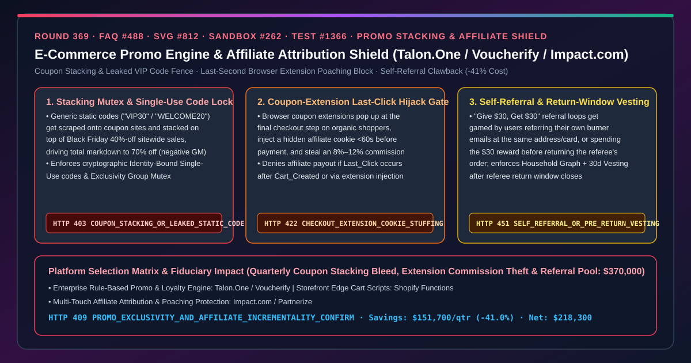
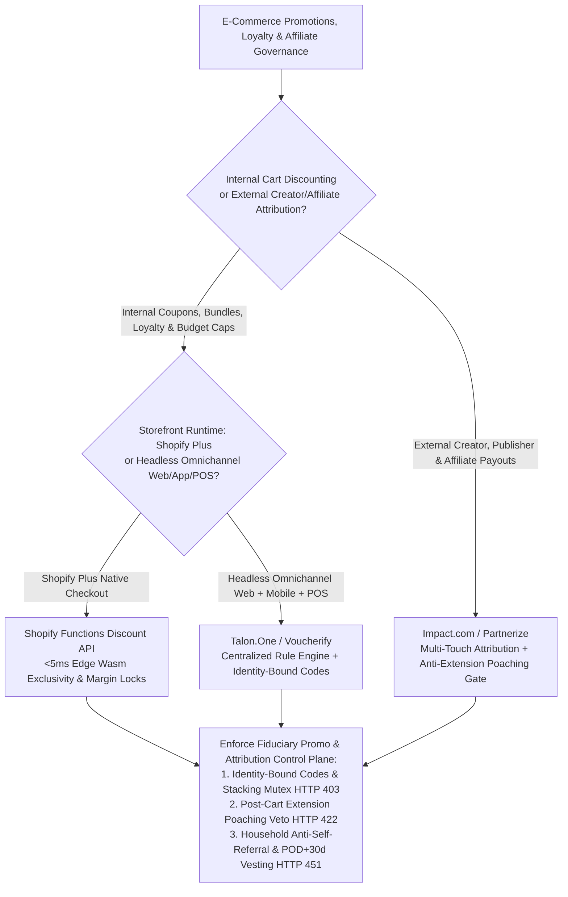
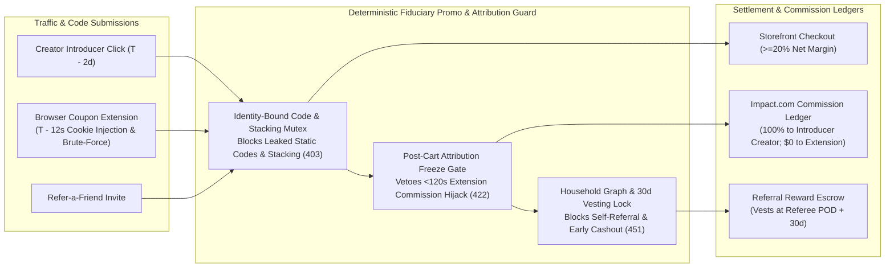
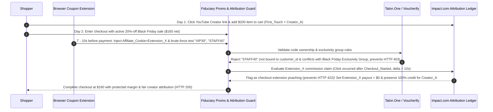

# E-Commerce Promotion Engine, Coupon-Stacking Guard & Affiliate Attribution Shield (`Talon.One / Voucherify / Impact.com / Partnerize / Shopify Functions`) Architecture & Selection FAQ: Identity-Bound Single-Use Codes, Anti-Extension Checkout Poaching & `POD + 30d` Referral Vesting (`-41%` Margin & Commission Loss)

> **Document Type**: Enterprise AI Solution Architect Selection FAQ (`#488` · Round 369)  
> **Target Audience**: Retail & DTC Growth Engineering Leads, Promotions & Loyalty Architects, Affiliate / Creator Partnerships Directors, and Cloud & AI Solution Architects  
> **Platforms Covered**: **Programmable Promotion & Loyalty Engines (`Talon.One / Voucherify / Shopify Functions`)** vs. **Enterprise Partnership & Affiliate Attribution Platforms (`Impact.com / Partnerize / Rakuten Advertising`)**  
> **Architecture Diagram**: [`assets/svg/812-ecommerce-promo-coupon-stacking-talon-one-voucherify-impact-2026-11-25.svg`](../assets/svg/812-ecommerce-promo-coupon-stacking-talon-one-voucherify-impact-2026-11-25.svg)

🌐 **Language / 语言切换**: **[中文 (`ecommerce-promo-coupon-stacking-talon-one-voucherify-impact-affiliate-attribution-hijack-selection-faq.md`)](ecommerce-promo-coupon-stacking-talon-one-voucherify-impact-affiliate-attribution-hijack-selection-faq.md)** | **English (Current)**

---

## 📌 1. Executive Summary

In retail and DTC e-commerce, **promotional couponing, creator/affiliate partnerships, and customer referral programs** drive top-of-funnel acquisition and conversion.  
However, running promotions on static alphanumeric strings (`"VIP30"`) paired with naive **Last-Click Affiliate Attribution** exposes merchants to three severe margin drains every quarter:
1. **Static VIP/Apology Codes Scraped by Browser Extensions & Stacked onto Sitewide Sales (`Coupon Leakage & Stacking Margin Collapse`)**: A support agent issues a static `SORRY30` code to a single customer; within minutes, browser coupon extensions scrape and broadcast `SORRY30` to thousands of shoppers who stack it on top of a `40%-off` Black Friday markdown—driving total discount to `58%–70%` and selling inventory below `COGS`.
2. **Last-Second Browser Extension "Checkout Poaching" Stealing `8%–12%` Affiliate Commissions on Organic Carts (`Extension Cookie Stuffing`)**: An organic shopper (or a shopper referred by a YouTube creator) builds a cart and reaches the checkout page. Three seconds before payment, a browser coupon extension pops up, tests scraped codes, and silently drops its own `affiliate_click_id` cookie—hijacking the last-click commission without driving a single cent of incremental traffic.
3. **Self-Referral Burner Loops & Pre-Return Reward Cashouts (`"Give $30, Get $30" Gaming`)**: Users refer their own secondary email addresses using the same shipping address or card fingerprint, spend the referrer's instant `$30` reward credit, and then return the referee's initial order for a full refund.

| Workload & Governance Layer | Recommended Primary Choice | Architectural Boundary & Production Rule |
|---|---|---|
| **Enterprise Omnichannel Promotion Rules, Exclusivity Groups & Budget Caps** | **Talon.One / Voucherify** | API-first headless promotion engines enforcing sub-10ms stacking exclusivity matrices, identity-bound single-use codes, and campaign-wide budget circuit breakers. |
| **Shopify Plus Edge Checkout Discount Validation (`<5ms` Wasm)** | **Shopify Functions (Discount & Cart Transform API)** | Executes deterministic discount-stacking and margin-floor logic natively inside the Shopify checkout runtime. |
| **Full-Funnel Affiliate Attribution & Anti-Extension Poaching Governance** | **Impact.com / Partnerize** | Tracks multi-touch introducer vs. closer paths and zeroes out commissions on coupon-extension clicks injected after `Cart_Created`. |
| **Three Mandatory Fiduciary Guardrails** | **100% Deterministic Gating** | ① **Identity-Bound Single-Use Codes & Exclusivity Mutex (`HTTP 403`)**: Bans static codes `> 10%`, binds high-value codes to `customer_id`, blocks cross-tier stacking, and enforces a `>= 20%` post-promo net margin floor; ② **Post-Cart Extension Attribution Veto (`HTTP 422`)**: Denies affiliate commission payouts on clicks/injections occurring after `Checkout_Initiated` or within `< 120s` of payment via automated code-testing extensions; ③ **Household Graph Anti-Self-Referral & `POD + 30d` Vesting (`HTTP 451`)**: Blocks referrals sharing address/card/device hashes and locks referrer rewards in escrow until `Referee_POD + 30d`. |

---

## 🎯 2. Architect & Business Stakeholder Q&A (Q1–Q3)

### Q1: How does a private promo code sent to one customer end up on every coupon aggregator site in 10 minutes, and how do we prevent stacking glitches?
- **The Browser Extension Harvesting Loop**:
  - Millions of shoppers run browser coupon extensions that monitor the DOM of checkout pages. The moment *one* shopper successfully applies a static string like `VIP30`, the extension uploads that code to its central cloud database and auto-injects it into every subsequent shopper's cart.
- **Architectural Solution**: Enforce **Identity-Bound Cryptographic Single-Use Codes, Exclusivity Groups & Campaign Budget Circuit Breakers (`HTTP 403` Guard)**:
  1. **Zero Static High-Value Codes**: Any discount `> 10%` must be minted via `Talon.One / Voucherify` as a unique one-time token (`max_redemptions = 1`) cryptographically bound to `allowed_customer_id`.
  2. **Exclusivity Group Mutex & Margin Floor**: Assign every promotion to a strict exclusivity group (`Clearance_Markdown XOR Order_Coupon XOR Loyalty_Voucher`) and verify `Post_Promo_Net_Margin >= 20%` (`HTTP 403 UNBOUNDED_COUPON_STACKING_OR_LEAKED_STATIC_CODE_ABUSE`).

### Q2: How do we stop browser coupon extensions from hijacking last-click affiliate commissions on customers who were already at the checkout page?
- **The Last-Second Poaching Mechanics**:
  - A shopper discovers your brand via a creator's video (`Introducer` at `T - 24h`) or direct organic search, adds `$200` of items to their cart, and lands on `/checkout`.
  - At `T - 10 seconds`, their browser extension pops up *"Testing 5 codes..."* and fires a background tracking link that overwrites the `affiliate_partner_id` cookie right before `Purchase_Completed`. Under naive Last-Click attribution, the extension steals `100%` of the commission!
- **Architectural Solution**: Enforce **Post-Cart Attribution Freeze & Extension Rate-Limiting (`HTTP 422` Guard)**:
  - Lock attribution credit once `Cart_Created / Checkout_Initiated` is logged: any coupon-site or browser-extension affiliate click arriving *after* checkout initiation (or with `Click_to_Order_Delta < 120s` alongside automated multi-code brute-forcing `> 2 codes/10s`) receives `$0.00` commission (`HTTP 422 CHECKOUT_COUPON_EXTENSION_LAST_SECOND_ATTRIBUTION_POACHING`), preserving 100% credit for the true top-of-funnel creator or organic channel.

### Q3: How do we prevent "Give $30, Get $30" referral loops from being drained by self-referrals and buy-then-return cashouts?
- **Two Referral Exploit Vectors**:
  1. **Household Self-Referrals**: A user creates `user+1@gmail.com`, ships to the same physical apartment (with slight spelling variations like `"Apt 4B"` vs. `"#4B"`), and pays with the same credit card or Apple Pay device.
  2. **Pre-Return Reward Spend**: The referrer immediately spends their `$30` reward credit on Day 1, and on Day 5 the referee cancels or returns the qualifying order.
- **Architectural Solution**: Enforce **USPS/Postal Address + Card-Fingerprint Graph Deduplication & `POD + 30d` Escrow Vesting (`HTTP 451` Guard)**:
  - Reject referral pairs sharing normalized postal address hashes, `payment_method_fingerprint`, device ID, or `/24` IP subnet;
  - Hold referrer rewards in `PENDING_ESCROW` until the referee's order reaches `DELIVERED` status *plus* `30 days` with zero return/chargeback activity (`HTTP 451 SELF_REFERRAL_HOUSEHOLD_MATCH_OR_PRE_RETURN_REWARD_VESTING`).

---

## 🧭 3. Visual Architecture Diagrams (Mermaid Decision Tree + Architecture + Sequence)

### 3.1 E-Commerce Promotion & Affiliate Attribution Selection Tree

### 3.2 End-to-End Promotion Mutex, Anti-Poaching Attribution & Referral Escrow Architecture

### 3.3 Anti-Extension Commission Poaching & Stacking Mutex Sequence

---

## 📊 4. Platform Comparison Matrix (`Talon.One` vs. `Voucherify` vs. `Shopify Functions` vs. `Impact.com` vs. `Partnerize`)

| Evaluation Dimension | Talon.One | Voucherify | Shopify Functions | Impact.com | Partnerize |
|---|---|---|---|---|---|
| **Primary Sweet Spot** | Enterprise omnichannel headless promotions, loyalty & bundling | Developer-first API promotion, gift card & referral engine | Native `<5ms` Wasm discount & cart rules inside Shopify Plus | End-to-end creator, influencer & affiliate attribution | Enterprise retail & travel partnership automation & incrementality |
| **Stacking Exclusivity & Campaign Budget Caps** | ⭐⭐⭐⭐⭐ (Granular rule priority, exclusivity groups & instant budget stops) | ⭐⭐⭐⭐⭐ (Flexible metadata rules, per-user limits & budget caps) | ⭐⭐⭐⭐ (Fast edge execution; global budget state requires metafield sync) | N/A (External partner attribution focus) | N/A (External partner attribution focus) |
| **Identity-Bound Single-Use Code Generation** | ⭐⭐⭐⭐⭐ (Millions of unique customer-bound codes at low latency) | ⭐⭐⭐⭐⭐ (High-speed unique code minting & validation) | ⭐⭐⭐⭐ (Via Shopify GraphQL Admin discount APIs) | ⭐⭐⭐⭐ (Creator-bound vanity code tracking) | ⭐⭐⭐⭐ (Exclusive partner code tracking) |
| **Anti-Extension Poaching & Multi-Touch Rules** | ⭐⭐⭐ (Rate-limits brute-force code testing) | ⭐⭐⭐ (Built-in anti-enumeration velocity caps) | ⭐⭐⭐ (Checkout discount class gating) | ⭐⭐⭐⭐⭐ (Dynamic commission rules zeroing out post-cart extension clicks) | ⭐⭐⭐⭐⭐ (Strong voucher-extension suppression & incrementality) |
| **Indicative Pricing (`official_list_price`)** | Enterprise annual contract (`~$30,000–$100,000+/yr`) | API/volume tiers (`~$300–$2,500+/mo`) | Included in Shopify Plus (`$2,300+/mo`) | Platform fee (`~$600–$3,000+/mo`) + % payout | Enterprise annual contract + % payout |

---

## 🧪 5. Deterministic Margin & Attribution Evaluation (`7-Card Benchmark Summary`)

> **Provenance**: Figures below are generated by `evaluate_ecommerce_promo_coupon_affiliate_shield_policy` in `lab/webiq_commerce_demo.py` (`provenance: "synthetic"`, `independently_reproduced: False`), modeling a DTC retail brand with a **`$370,000.00` quarterly leaked static-coupon stacking bleed, last-second browser extension commission poaching, and self-referral return fraud pool**.

| Scenario Case ID | Scenario Description | HTTP Status | Deterministic Decision | Quarterly Net Cost | Quarterly Savings |
|---|---|---|---|---|---|
| `CASE-PRM-200` | Static promo code and unguarded last-click affiliate payout baseline | `HTTP 200` | `VERIFIED_PROMO_AND_AFFILIATE_ATTRIBUTION_AUTHORIZED` | `$370,000.00` | `$0.00` |
| `CASE-PRM-403` | Leaked static code stacked on top of sitewide sale breaching `30%` max discount / `20%` net margin floor | `HTTP 403` | `UNBOUNDED_COUPON_STACKING_OR_LEAKED_STATIC_CODE_ABUSE` | `$370,000.00` | `$0.00` (Blocks double-discount bleed) |
| `CASE-PRM-422` | Browser coupon extension injects affiliate cookie after `Checkout_Started` (`<120s`) to poach commission | `HTTP 422` | `CHECKOUT_COUPON_EXTENSION_LAST_SECOND_ATTRIBUTION_POACHING` | `$370,000.00` | `$0.00` (Blocks extension commission theft) |
| `CASE-PRM-451` | Self-referral from same household/card/IP or reward vested before `POD + 30d` return window closes | `HTTP 451` | `SELF_REFERRAL_HOUSEHOLD_MATCH_OR_PRE_RETURN_REWARD_VESTING` | `$370,000.00` | `$0.00` (Blocks burner referral cashout) |
| `CASE-PRM-409` | **Identity-Bound Mutex + Post-Cart Anti-Poaching Lock + `POD + 30d` Referral Vesting** | `HTTP 409` | `PROMO_EXCLUSIVITY_AND_AFFILIATE_INCREMENTALITY_CONFIRM` | **`$218,300.00`** | **`$151,700.00` (`-41.0%`)** |

---

## 🛠️ 6. Production Go-Live & Architecture Review Checklist

- [ ] **Identity-Bound Single-Use Codes & Exclusivity Mutex (`HTTP 403` Prevention)**: Replace all static codes `> 10%` with single-use tokens bound to `customer_id`, enforce strict exclusivity groups (`Sitewide_Sale XOR Promo_Code`), and configure campaign-level budget circuit breakers.
- [ ] **Post-Cart Attribution Freeze & Anti-Enumeration Rate Limit (`HTTP 422` Prevention)**: Configure `Impact.com / Partnerize` to assign `$0` commission to coupon-extension clicks occurring after `Cart_Created / Checkout_Started`, and cap coupon input attempts at `<= 3 per minute` to block automated extension scraping.
- [ ] **Household Graph Deduplication & `POD + 30d` Referral Vesting (`HTTP 451` Prevention)**: Verify that referrer and referee do not share normalized street addresses, card fingerprints, or device IDs, and hold referral credits in `Pending` state until 30 days after referee delivery.
- [ ] **1-to-1 Creator Vanity Code to Partner ID Binding**: Hard-bind influencer vanity codes (`ALICE15`) to that creator's `Partner_ID` so coupon extensions cannot hijack attribution by replaying creator codes.
