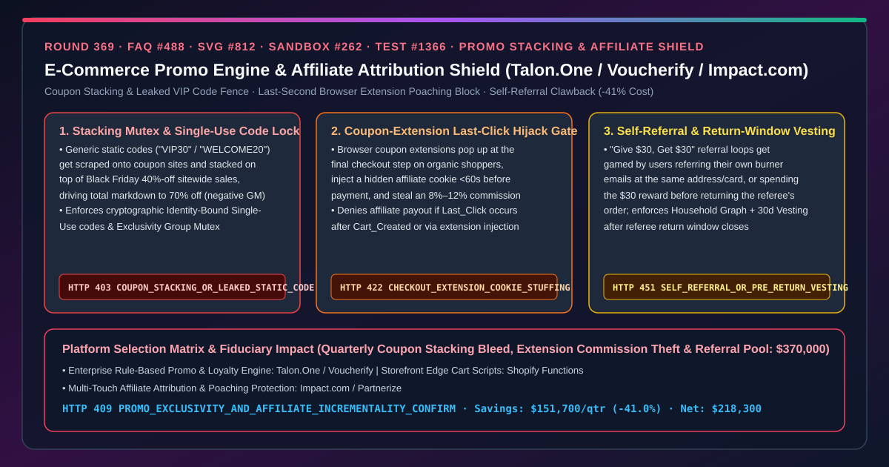
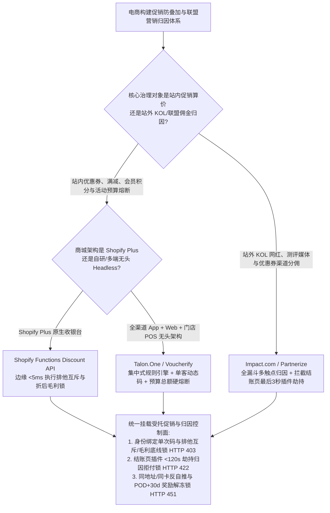
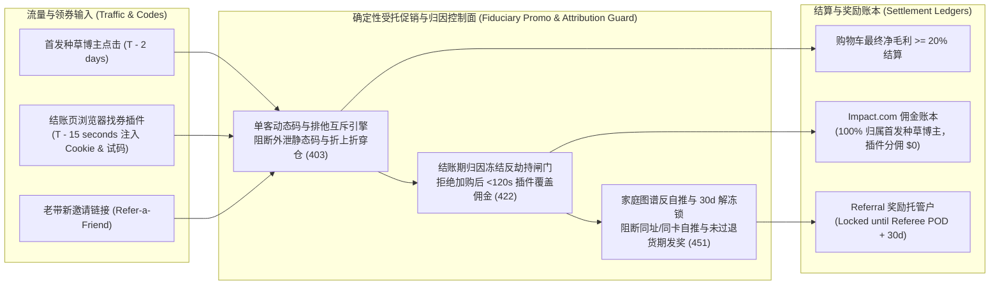
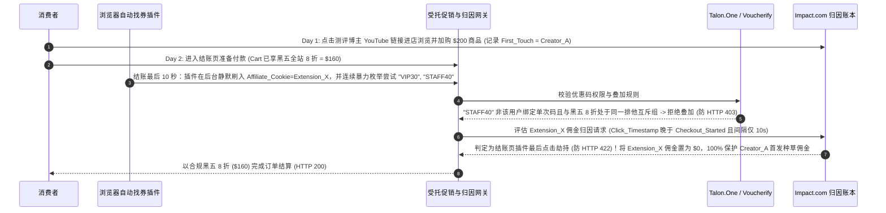

# 零售电商促销引擎、防优惠券叠加穿仓与联盟营销归因防劫持智能体（`Promo Engine & Affiliate Attribution Shield`: `Talon.One / Voucherify / Impact.com / Partnerize / Shopify Functions`）架构与选型对比：单客加密绑定单次码防全网泄露、拦截浏览器比价插件结账最后 3 秒劫持自然流量佣金与老带新裂变 `30 天` 过退货期解冻净省 41% 指南

> **文档类型**：企业级 AI Solution Architect 选型决策指南（Selection FAQ · `#488` · Round 369）  
> **适用读者**：零售与 DTC 电商增长工程负责人、促销与会员系统架构师、联盟营销（Affiliate / KOL）总监与 Cloud & AI Solution Architect  
> **核心覆盖平台**：**可编程促销与忠诚度引擎（`Talon.One / Voucherify / Shopify Functions`）** vs. **企业级伙伴与联盟营销归因平台（`Impact.com / Partnerize / Rakuten Advertising`）**  
> **关联架构图**：[`assets/svg/812-ecommerce-promo-coupon-stacking-talon-one-voucherify-impact-2026-11-25.svg`](../assets/svg/812-ecommerce-promo-coupon-stacking-talon-one-voucherify-impact-2026-11-25.svg)

🌐 **语言切换 / Language**: **中文 (当前)** | **[English (`ecommerce-promo-coupon-stacking-talon-one-voucherify-impact-affiliate-attribution-hijack-selection-faq.en.md`)](ecommerce-promo-coupon-stacking-talon-one-voucherify-impact-affiliate-attribution-hijack-selection-faq.en.md)**

---

## 📌 一、核心选型结论速览（Executive Summary）

在零售电商与消费互联网中，**优惠券促销（Promotions）、KOL 联盟带货（Affiliate Marketing）与老带新推荐返利（Referral Programs）** 是获客与促活的三大支柱。  
然而，如果促销规则散落在前端代码里，或者仍采用落后的“通用静态口令码（如 `VIP25`）+ 无条件最后点击归因（Last-Click Attribution）”，企业每个大促季都会遭遇三场“薅羊毛与假归因”浩劫：
1. **通用静态大额券被领券插件爬走全网疯传，且与黑五满减/员工内购折上折叠加，直接造成“0 元购”或负毛利爆仓（`Leaked Static Code & Unbounded Coupon Stacking`）**：客服原本只发给 10 个受损 VIP 客户的补偿码 `SORRY30`，在 5 分钟内被浏览器找券插件自动抓取并同步到全网百万用户购物车；更致命的是，该码没有配置排他互斥组（Exclusivity Group），与全站黑五 6 折活动叠加后变成 4.2 折，一夜亏掉数百万美元！
2. **浏览器优惠券插件在自然流量买家“点击付款前最后 3 秒”弹窗试码并静默塞入联盟 Cookie（`Cookie Stuffing / Last-Second Extension Poaching`），白白劫走 10% 推广佣金**：买家明明是通过品牌自投广告或直接输入网址进店、自己选好商品进了结账页；此时浏览器上的比价/自动试券插件突然弹窗转圈试码，并在后台静默打开一个隐藏 iframe 刷入该插件的 `affiliate_click_id`，兵不血刃抢走原本属于品牌自然流量的 `8%–12%` 联盟佣金！
3. **老带新“邀好友各得 `$30`”被羊毛党用“主号邀同地址/同卡小号下单、主号花掉 `$30` 奖励后小号立刻申请全额退货”无限套现（`Self-Referral & Pre-Return Reward Cashout`）**：受邀新客订单刚支付成功就立即给邀请人发放可消费的 `$30` 无门槛余额，羊毛党左手倒右手零成本搬空店铺。

| 选型维度与业务痛点 | 推荐主选方案 | 适用边界与架构落地准则 |
|---|---|---|
| **复杂跨品类促销互斥矩阵、单客绑定动态码与实时购物车算价** | **Talon.One / Voucherify** | 专为企业级无头（Headless）促销设计，支持毫秒级评估活动互斥优先级（Stacking Rules）、单次身份绑定码与预算总额自动熔断（Campaign Budget Cap）。 |
| **Shopify Plus 收银台边缘原位自定义折扣与防叠加** | **Shopify Functions (Discount & Cart Transform API)** | 运行在 Shopify WebAssembly 边缘运行时（`<5ms`），直接在结账内核拦截非法的折上折组合。 |
| **防浏览器插件劫持归因、KOL 真实增量贡献（Incrementality）结算** | **Impact.com / Partnerize** | 支持全漏斗多触点归因（Multi-Touch Attribution），可配置“购物车已创建后禁止优惠券插件覆盖首发 KOL 或自然流量归因”。 |
| **三大确定性风控红线** | **100% 强制拦截** | ① **身份绑定单次动态码与排他互斥组/折后毛利底线锁（`HTTP 403`）**：废除大于 `10%` 的通用静态口令码，强制签发绑定 `customer_id` 的单次加密券，且叠加后综合折扣率硬封顶 `<= 30%`（保住 `>=20%` 净毛利）；② **结账页插件最后点击劫持（`Last-Second Extension Hijack`）佣金拒付锁（`HTTP 422`）**：凡是在 `checkout_started` 之后才注入的联盟点击或自动暴力试码行为，佣金分润强制归 `$0`；③ **家庭图谱反自推与“过退货期（`POD + 30d`）解冻奖励”锁（`HTTP 451`）**：拦截同 IP/同设备/同收货地址/同支付卡自推，且推荐奖励必须待受邀单签收满 30 天未退货才解冻。 |



---

## 🎯 二、业务方与架构师灵魂拷问 Q&A（Q1–Q3）

### Q1：为什么我们给特定主播或 VIP 群私发的一个内部优惠码，半小时后全网不相干的路人结账时全都在用？怎么从架构上彻底终结“优惠码泄露与折上折穿仓”？
- **浏览器找券插件的工作原理**：
  - 全球数千万消费者浏览器里装有自动找券扩展程序。只要有 **哪怕 1 个真实 VIP 用户** 在结账框里输入了静态优惠码 `VIP30` 并省钱成功，他浏览器里的插件就会立刻把这个字符串上传到插件云端词库；1 分钟后，所有进店的路人点击插件“自动试券”，插件就会自动把 `VIP30` 填入他们的购物车！
  - 如果此时再遇上“清仓区商品 + 满 `$200` 减 `$40` + `VIP30`”三层叠加，商品实付价直接跌破出厂成本价的一半。
- **架构解法**：在 `Talon.One / Voucherify` 中强制执行 **三道刚性防线（防 `HTTP 403`）**：
  1. **废除高折扣通用静态码，全面改用身份绑定单次码（`Identity-Bound Single-Use Code`）**：高于 `10%` 的补偿码或专属码必须在生成时强绑定 `Allowed_Customer_ID` 或 `Single_Redemption_Limit = 1`；即使被插件爬走，其他人输入时直接返回 `403 Invalid for this Account`。
  2. **排他互斥矩阵（`Exclusivity Group Mutex`）**：将促销分为 `Level 1（单品闪购/清仓）`、`Level 2（订单级满减）`、`Level 3（优惠码）`，默认配置互斥锁（只取对买家最划算的单一优惠，严禁跨层累乘）。
  3. **活动总预算熔断器（`Campaign Burn Circuit Breaker`）**：每个促销活动设置硬性让利总额上限（如 `Max_Discount_Pool = $50,000`），触顶毫秒级自动下线（违规放行静态大额码外泄或折上折穿仓触发 `HTTP 403 UNBOUNDED_COUPON_STACKING_OR_LEAKED_STATIC_CODE_ABUSE`）。

### Q2：联盟营销（Affiliate）渠道每个月报上来 `$2M` 归因销售额，收走 `$200k` 佣金，为什么停掉其中几家“优惠券插件渠道”后全站自然销售额一分钱都没跌？
- **结账页劫持（Checkout Poaching / Cookie Stuffing）黑幕**：
  - 真实的内容创作者（YouTuber / 测评博主）在漏斗顶层辛苦种草引流（First-Touch Introducer）；
  - 而某些优惠券网站或浏览器扩展潜伏在**结账页最后一步**：当用户看到“请输入优惠码”输入框时，用户要么去搜“品牌名 + promo code”点了排第一的优惠券广告链接，要么浏览器插件直接弹窗点一下——这最后 3 秒的一次点击直接**覆盖（Overwrite）了原本的内容博主 Cookie 或将自然流量（Organic）伪装成插件带货**！
- **架构解法**：在 `Impact.com / Partnerize` 与结账网关实施 **购物车创建后归因冻结与试码反劫持门禁（`Post-Cart Attribution Freeze & Anti-Poaching Gate` · 防 `HTTP 422`）**：
  - **规则 1（购物车时间锁）**：一旦会话已触发 `Add_To_Cart` 或 `Checkout_Initiated` 事件，后续在结账页才首次介入的 Coupon/Deal 类联盟渠道（特に `Click_to_Purchase_Seconds < 120s`）严禁夺取 `100% Last-Click` 归因权重（顶多给予 `0%–10%` 辅助结账微佣，80%+ 归因锁死给首发种草创作者或归还给自然流量）；
  - **规则 2（屏蔽隐藏优惠码框诱发跳出）**：仅对携带合法营销 URL 参数的访客展开优惠码输入框，对普通自然访客折叠为不显眼的次级链接，并在检测到短时间高频机器枚举试码（`> 3 codes / 10s`）时立即拦截并拒绝关联联盟佣金（`HTTP 422 CHECKOUT_COUPON_EXTENSION_LAST_SECOND_ATTRIBUTION_POACHING`）。

### Q3：“老带新推荐返利（Give $30, Get $30）”如何防止羊毛党自己注册小号刷单，并在新号退货前把主号的 $30 奖励花光？
- **裂变防刷两大铁律（防 `HTTP 451`）**：
  1. **家庭与支付图谱去重（`Household & Payment Graph Anti-Self-Referral`）**：推荐人（Referrer）与被推荐新客（Referee）严禁共享以下任一特征：`收货地址标准化哈希（USPS CASS Normalized Address）`、`支付卡指纹（Card Fingerprint / PayPal Account）`、`设备指纹（Device ID）` 或 `/24` 家宽 IP。
  2. **过退货期解冻锁（`Post-Return-Window Reward Vesting`）**：被推荐新客下单付款后，推荐人的 `$30` 奖励必须进入 **`PENDING_ESCROW`（冻结待生效）** 状态；只有当新客订单完成物流妥投且 **平稳度过 30 天退货窗口且未发生全额退货/拒付** 后，才解锁为可用余额（违规立即发放可提现/可消费裂变奖励或放行同地址自推触发 `HTTP 451 SELF_REFERRAL_HOUSEHOLD_MATCH_OR_PRE_RETURN_REWARD_VESTING`）。

---

## 🧭 三、直观可视化图解（Mermaid 选型决策树 + 防劫持架构图 + 时序图）

### 3.1 电商促销引擎与联盟营销防劫持平台选型决策树



### 3.2 端到端促销互斥、防插件劫持归因与裂变奖励托管架构图



### 3.3 拦截浏览器插件窃取佣金与优惠码折上折熔断时序图



---

## 📊 四、主流企业级促销引擎与联盟归因平台横向选型矩阵

| 评估维度 | Talon.One | Voucherify | Shopify Functions | Impact.com | Partnerize |
|---|---|---|---|---|---|
| **核心定位** | 企业级全渠道无头（Headless）促销、优惠券与积分规则引擎 | 开发者友好、API 优先的弹性优惠券、礼品卡与推荐裂变引擎 | Shopify Plus 结账内核级原生毫秒级自定义折扣扩展 | 全球网红 KOL、内容媒体与联盟伙伴全生命周期归因与防欺诈平台 | 面向大型零售与酒旅品牌的增量归因与动态佣金结算平台 |
| **复杂排他互斥与活动总预算硬熔断** | ⭐⭐⭐⭐⭐（极其强大的规则构建器、排他优先级与预算池瞬时熔断） | ⭐⭐⭐⭐⭐（支持细粒度元数据约束、单客限次与总金额封顶） | ⭐⭐⭐⭐（边缘执行极快，但跨活动全局预算统计需配合后端存储） | 不适用（主攻站外渠道佣金归因） | 不适用（主攻站外伙伴分佣） |
| **防浏览器找券插件爬取（单客动态码）** | ⭐⭐⭐⭐⭐（秒级生成千万级绑定用户 ID 的一次性加密券） | ⭐⭐⭐⭐⭐（擅长大规模唯一码分发与核销校验） | ⭐⭐⭐⭐（配合动态 Discount Code API） | ⭐⭐⭐⭐（支持为每个 KOL 绑定专属防篡改 Promo Code） | ⭐⭐⭐⭐（支持代码与链接双重防窜校验） |
| **防结账最后 3 秒插件劫持佣金（Anti-Poaching）** | ⭐⭐⭐（可通过会话属性限制插件试码速率） | ⭐⭐⭐（内置 API 速率限制防枚举） | ⭐⭐⭐（运行于结账后端） | ⭐⭐⭐⭐⭐（原生支持按漏斗位置动态调整佣金：插件末次点击 `$0` 分佣） | ⭐⭐⭐⭐⭐（强大的优惠券插件拦截与真实增量审计） |
| **参考定价模式（`official_list_price`）** | 企业级年框（约 `$30,000–$100,000+/年`） | 按 API 调用量与订单额阶梯订阅（约 `$300–$2,500+/月`） | 包含在 Shopify Plus（`$2,300+/月`）内 | 平台月费 + 归因佣金服务费（约 `$600–$3,000+/月` 起） | 企业级年费 + 交易分润 |

---

## 🧪 五、转化率/成本测算与 7-Card 基准测试报告（Deterministic Evaluation）

> **数据来源说明（Provenance）**：以下季度损益数据来自 `lab/webiq_commerce_demo.py` 中的确定性评估器 `evaluate_ecommerce_promo_coupon_affiliate_shield_policy`（`provenance: "synthetic"`, `independently_reproduced: False`），用于量化对比“静态通用优惠码全网泄露折上折 + 浏览器插件劫走自然流量佣金 + 裂变秒到账被刷单”与“身份绑定互斥锁 + 结账期反劫持归因 + 30天过退货期解冻”的季度毛利挽回。

### 5.1 基准测试场景输入与确定性状态码矩阵

- **设定场景**：某年营收 `$75M` 的 DTC 消费品牌每季度投入大促折扣、KOL 联盟分佣与老带新裂变，季度因静态大额码被插件爬走叠加黑五活动造成的负毛利穿仓、浏览器找券插件在结账页最后几秒窃取自然流量佣金、以及同地址小号自推套现的损失池（`quarterly_coupon_stacking_bleed_extension_poaching_and_referral_fraud_pool_usd`）为 **`$370,000.00`**。

| 测试用例 ID | 场景描述 | 触发确定性状态码 | 决策枚举 (`decision`) | 季度净成本 (USD) | 季度净节省 (USD) |
|---|---|---|---|---|---|
| `CASE-PRM-200` | 传统静态促销码与简单末次点击（Last-Click）分佣基线 | `HTTP 200` | `VERIFIED_PROMO_AND_AFFILIATE_ATTRIBUTION_AUTHORIZED` | `$370,000.00` | `$0.00` |
| `CASE-PRM-403` | 通用静态大额码被插件泄露并与全站大促叠加，导致综合折扣 `>30%` 或跌破 `20%` 净毛利底线 | `HTTP 403` | `UNBOUNDED_COUPON_STACKING_OR_LEAKED_STATIC_CODE_ABUSE` | `$370,000.00` | `$0.00` (阻断折上折 0 元购穿仓) |
| `CASE-PRM-422` | 浏览器找券插件在购物车创建后（`<120s` 结账前夕）注入 Cookie 试图抢走 `10%` 联盟佣金 | `HTTP 422` | `CHECKOUT_COUPON_EXTENSION_LAST_SECOND_ATTRIBUTION_POACHING` | `$370,000.00` | `$0.00` (阻断插件白嫖自然流量佣金) |
| `CASE-PRM-451` | 老带新推荐人与受邀新客共享收货地址/支付卡/IP，或在新客未满 `30d` 退货期前提前解冻发放奖励 | `HTTP 451` | `SELF_REFERRAL_HOUSEHOLD_MATCH_OR_PRE_RETURN_REWARD_VESTING` | `$370,000.00` | `$0.00` (阻断小号自推退货套现) |
| `CASE-PRM-409` | **启用单客动态码互斥锁 + 结账反插件劫持归因 + 家庭图谱去重与 30d 奖励解冻** | `HTTP 409` | `PROMO_EXCLUSIVITY_AND_AFFILIATE_INCREMENTALITY_CONFIRM` | **`$218,300.00`** | **`$151,700.00` (`-41.0%`)** |

### 5.2 核心确定性策略评估代码摘录

```python
@dataclass(frozen=True)
class EcommercePromoCouponAffiliateShieldPolicyInput:
    quarterly_coupon_stacking_bleed_extension_poaching_and_referral_fraud_pool_usd: float = 370000.0
    static_high_discount_code_stacked_with_sitewide_sale_breaching_margin: bool = False
    coupon_browser_extension_injected_cookie_after_checkout_started: bool = False
    referral_reward_vested_before_30d_return_window_or_same_household_card: bool = False
    identity_bound_mutex_anti_poaching_and_30d_referral_vesting_ready: bool = False
```

---

## 🛠️ 六、商业上线风控与架构评审 Checklist

- [ ] **全面废除 `>10%` 通用静态口令码，强制单客加密绑定与排他互斥（防 `HTTP 403`）**：所有大额补偿码与 VIP 码必须绑定 `customer_id` 且限用 1 次；在 `Talon.One / Voucherify` 中设置排他组与活动总预算硬熔断上限，确保任何组合叠加后订单净毛利 `>= 20%`。
- [ ] **结账页反插件劫持（Anti-Poaching）与试码速率限制（防 `HTTP 422`）**：在 `Impact.com / Partnerize` 中配置规则——凡是在 `Checkout_Started` 之后或距付款 `< 120 秒` 才产生的优惠券插件点击，佣金拨付自动归零；在结账 API 层限制每个会话每分钟最多尝试 `3` 次优惠码，拦截插件自动枚举。
- [ ] **老带新家庭图谱四元组查重与 `POD + 30天` 托管解冻（防 `HTTP 451`）**：比对推荐人与新客的标准化门牌地址、支付卡指纹、设备 ID 与 IP 子网；新客订单妥投满 30 天且无退货记录后才将推荐奖励从 `Pending` 转为 `Available`。
- [ ] **KOL 专属码与专属归因链接唯一绑定**：将主播专属口令码（如 `ALICE15`）在后台与主播 `Affiliate_Partner_ID` 硬绑定——即使粉丝没点链接只输了口令码也归因给该主播，反之任何浏览器插件拿该口令码去刷自己的推广链接一律判为无效盗用。
