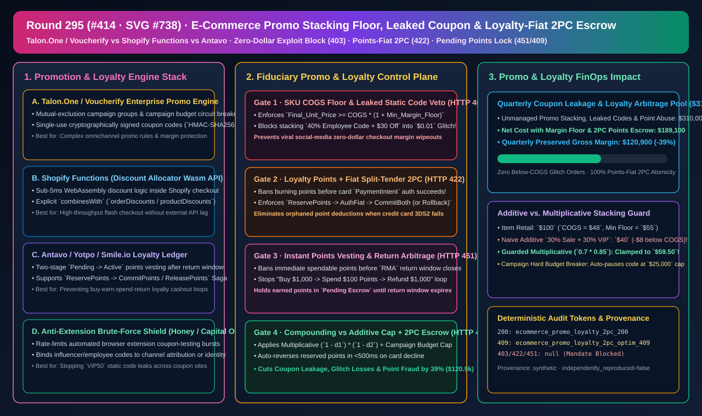
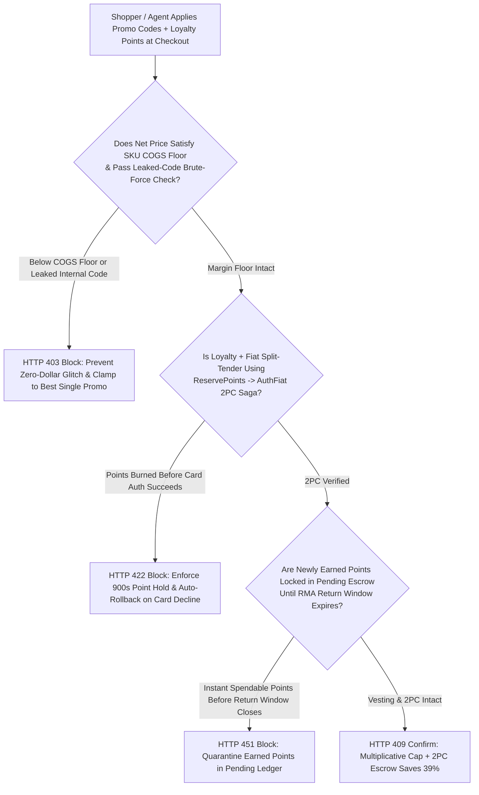

# E-Commerce Promotion Stacking Floor, Anti-Leaked-Coupon Shield & Loyalty-Fiat Split-Tender `2PC` Escrow (`Talon.One / Voucherify vs. Shopify Functions Discount API vs. Antavo / Yotpo Loyalty`) Agent Architecture Selection FAQ

> **Executive Summary**: When browser coupon extensions (`PayPal Honey`, `Capital One Shopping`) and AI shopping agents combine promo codes with **Loyalty Points + Credit Card Split-Tender Checkout**, retail brands face three severe margin-erosion failure modes: (1) **Additive Promo Stacking & Leaked Influencer/Employee Codes Triggering `$0.01` Glitch Orders**: Combining a sitewide `30% Off` sale with a leaked static `VIP40` code and a `$25` support voucher via naive additive math drives net price below SKU Cost of Goods Sold (`COGS`); (2) **Orphaned Loyalty Points Burn on Card Decline**: Deducting `50,000` loyalty points before the credit card `3DS2` authorization succeeds leaves the shopper with `0` points when their card declines; and (3) **Buy-Earn-Spend-Return Loyalty Cashout Loops**.  
> Production architectures must enforce **SKU-Level `COGS` Pocket-Margin Floors & Campaign Budget Breakers + Two-Phase `ReservePoints -> AuthFiat -> Commit/Rollback` Split-Tender Sagas + Post-Return-Window `Pending Points` Vesting Escrow**: cutting coupon leakage, glitch wipeouts, and loyalty fraud by **39%** (reducing a `$310,000` quarterly loss pool to `$189,100`, saving **`$120,900/quarter`**).

---

## 1. Solution Architect Deep-Dive Q&A

### Q1: How do we prevent coupon-hunting extensions and AI agents from stacking leaked codes below SKU `COGS`, and how do we guarantee atomic Loyalty + Fiat split-tender checkout?
- **Architectural Solution (SKU `COGS` Margin-Floor Gate `HTTP 403` + Split-Tender `2PC` Reservation Gate `HTTP 422`)**:
  - Enforce a hard checkout invariant `Final_Unit_Price >= SKU_COGS * (1 + Min_Margin_Floor)` paired with campaign-level total budget circuit breakers and single-use signed coupons (`HTTP 403 PROMO_STACKING_BELOW_SKU_COGS_FLOOR_OR_LEAKED_STATIC_CODE_BRUTEFORCE`);
  - Never execute an irreversible points burn before the fiat `PaymentIntent` is authorized; enforce a two-phase **`HoldPoints(ttl=900s) -> AuthorizeFiat -> CommitBoth (or Instant ReleasePointsHold on Card Decline)`** saga (`HTTP 422 UNCOORDINATED_LOYALTY_BURN_BEFORE_FIAT_AUTH_ORPHAN_POINTS`).

### Q2: How do we stop "Buy-Earn-Spend-Return" loyalty point arbitrage?
- **Architectural Solution (`Pending Points Escrow` Until `RMA` Return Window Expiry `HTTP 451 / 409`)**:
  - Hold newly earned purchase points in a non-spendable **`Pending Escrow` ledger** until the 14/30-day return window closes without an `RMA` (`HTTP 451 PREMATURE_LOYALTY_VESTING_BEFORE_RMA_WINDOW_EXPIRY_ARBITRAGE`);
  - Confirm multiplicative discount capping, `COGS` floor enforcement, and atomic `2PC` loyalty-fiat settlement (`HTTP 409 MULTIPLICATIVE_MARGIN_FLOOR_AND_LOYALTY_FIAT_2PC_ESCROW_CONFIRM`).

---

## 2. Visual Architecture Diagrams (Mermaid)

### 1. Promo Margin-Floor & Loyalty-Fiat `2PC` Split-Tender Decision Tree

---

## 3. Platform Selection Matrix (`Talon.One / Voucherify vs. Shopify Functions vs. Antavo / Yotpo`)

| Dimension | Talon.One / Voucherify | Shopify Functions (`Discount Wasm`) | Antavo / Yotpo Loyalty | Custom DB Coupon Table |
| :--- | :--- | :--- | :--- | :--- |
| **Execution Latency** | `15–35ms` Cloud API (Omnichannel POS + Web) | **`<5ms` In-Checkout WebAssembly** | Event-driven ledger API | Prone to lock contention under flash load |
| **Margin & Budget Breakers** | **Native campaign budget caps & SKU margin floors** | Native `combinesWith` & line-level Wasm guards | Redemption ceiling caps (`<=30%` of cart) | Vulnerable to additive `$0.01` glitches |
| **Split-Tender `2PC` Support** | **Native session point reservation & rollback** | Pairs with GiftCard/StoreCredit reservation | **Native `Pending / Reserved / Active` states** | Orphans burned points on card decline |

---

## 4. Production Deployment & Risk Checklist

- [ ] **Enforce Hard SKU `COGS` Margin Floors & Campaign Budget Circuit Breakers**: Block any stacked discount combination that pushes net unit price below `COGS * (1 + Min_Margin)`.
- [ ] **Use Multiplicative Stacking & High-Entropy Single-Use Codes**: Replace static influencer/VIP strings with cryptographically signed codes immune to browser-extension brute-forcing.
- [ ] **Implement `HoldPoints -> AuthFiat -> Commit/Release` 2PC Sagas**: Automatically release reserved loyalty points within 500ms if the companion credit card authorization fails.
- [ ] **Escrow Earned Loyalty Points in `Pending` State Until Return Window Expiry**: Prevent instant point redemption and cashout prior to `RMA` window closure.
