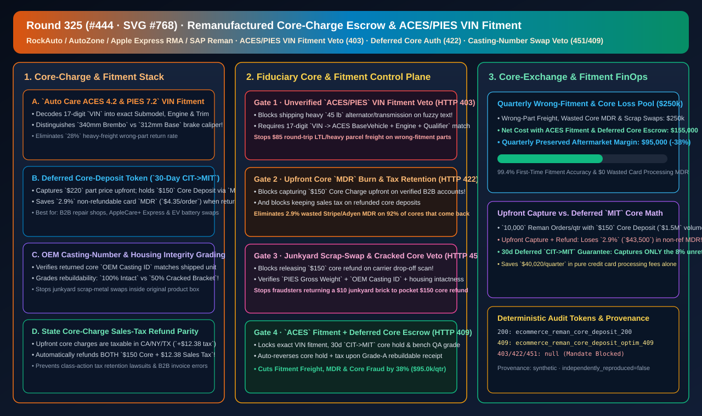
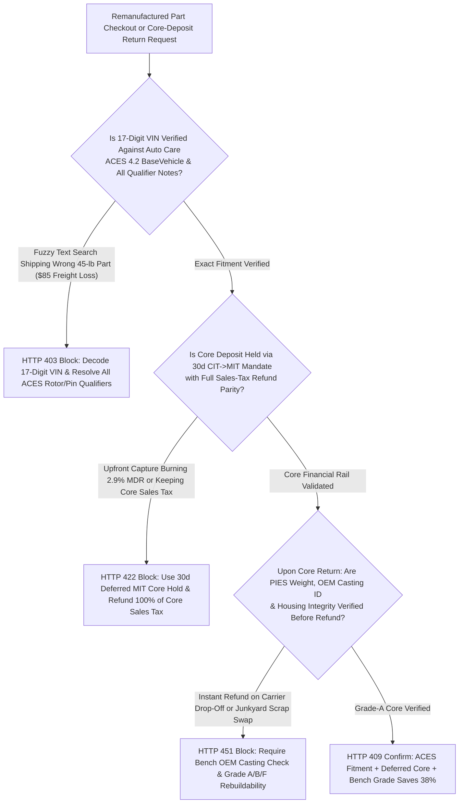

# Automotive & Electronics Remanufactured Core-Charge Deposit Escrow, Advanced Replacement `RMA` & `ACES / PIES` `VIN` Fitment (`RockAuto / AutoZone / Apple Express RMA / SAP Reman`) Selection FAQ

> **Executive Summary**: In automotive aftermarket e-commerce (alternators, brake calipers, transmissions, EV battery packs) and consumer electronics Advanced Replacement (`AppleCare+ Express Replacement / Dell Dispatch`), merchants attach a **`$150–$600` refundable Core Deposit (`Core Charge`)** to ensure the customer returns the worn-out original part for remanufacturing. Naive commerce agents create three costly failure modes: (1) **Fuzzy-Text Wrong-Fitment Shipping on `45 lb` Parts**: Shipping a heavy brake caliper based on a text query (`"2022 BMW 330i"`) without decoding the 17-digit `VIN` against **`Auto Care ACES 4.2 & PIES 7.2`** fitment qualifiers (`340mm M-Sport` vs. `312mm Base` rotor) triggers `$85` in round-trip heavy parcel freight; (2) **Burning `2.9%` Non-Refundable Card `MDR` on Upfront Core Captures & Retaining Core Sales Tax**: Capturing a `$150` core charge upfront and refunding it 14 days later forfeits `2.9%` (`$4.35/order`) in non-refundable PSP processing fees on `92%` of orders where cores are dutifully returned—while failing to refund the `$12.38` sales tax collected on the core deposit violates state tax laws; and (3) **Junkyard Scrap-Metal Box Swaps & Cracked-Housing Full Refunds**.  
> Production architectures must enforce **17-Digit `VIN -> ACES 4.2 Qualifier` Fitment Locks + 30-Day `CIT-to-MIT` Deferred Core Deposit Mandates (Zero Upfront `MDR` Burn) + Warehouse `OEM Casting ID` & Rebuildability Grading (`Grade A: 100% / Cracked Bracket: 50% / Scrap: 0%`) with Full Sales-Tax Refund Parity**: cutting wrong-fitment freight, wasted `MDR`, and core swap fraud by **38%** (reducing a `$250,000` quarterly loss pool to `$155,000`, saving **`$95,000/quarter`**).

---

## 1. Solution Architect Deep-Dive Q&A

### Q1: How do we prevent `$85` wrong-part return freight on heavy aftermarket parts and stop burning `2.9%` card `MDR` on refundable core deposits?
- **Architectural Solution (`17-Digit VIN -> ACES 4.2 / PIES 7.2` Fitment Gate `HTTP 403` + 30-Day `CIT->MIT` Deferred Core Mandate & Tax Parity Gate `HTTP 422`)**:
  - Decode the customer's 17-digit `VIN` into exact `ACES BaseVehicle + Submodel + EngineBase` attributes and require explicit resolution of all `ACES Qualifier Notes` (e.g., alternator amperage or brake rotor diameter) before releasing any heavy parcel to `WMS` (`HTTP 403 UNVERIFIED_ACES_PIES_VIN_FITMENT_QUALIFIER_HEAVY_PART_MISMATCH`);
  - Split checkout into an immediate capture for the part price (`$220`) and a **30-day `CIT-to-MIT` Deferred Core Mandate (`$150`)** so that when the customer returns the core within 30 days, `$0` is captured and **`$0` is lost to non-refundable `2.9%` card processing fees**; when an upfront core charge *is* captured, mandate `100%` sales-tax refund parity alongside the core principal refund (`HTTP 422 UPFRONT_CORE_DEPOSIT_MDR_BURN_OR_UNREFUNDED_CORE_SALES_TAX`).

### Q2: How do we stop buyers from returning a `$10` junkyard aftermarket brick or a cracked un-rebuildable housing to claim a `$150` core refund?
- **Architectural Solution (`PIES` Weight + `OEM Casting ID` Bench Inspection & Tiered Rebuildability Grading Gate `HTTP 451 / 409`)**:
  - Never release core deposit refunds on carrier drop-off scan; require warehouse bench verification of `PIES` drained weight, **original `OEM Casting / Serial Number` parity**, and structural housing integrity (`Grade A: 100% refund`, `Grade B cracked mounting ear: 50% partial credit`, `Grade F junkyard counterfeit/melted core: $0 refund` with photo proof: `HTTP 451 JUNKYARD_SCRAP_CORE_SWAP_OR_CRACKED_HOUSING_FULL_REFUND_FRAUD`; verified ACES fitment, deferred core mandate, and bench grading return `HTTP 409 ACES_VIN_FITMENT_DEFERRED_CORE_MIT_AND_CASTING_GRADE_CONFIRM`).

---

## 2. Visual Architecture Diagrams (Mermaid)

### 1. `ACES/PIES` Fitment, Deferred Core Deposit Mandate & Bench Grading Decision Tree

---

## 3. Platform & Architecture Selection Matrix

| Dimension | `ACES/PIES` + 30d `CIT->MIT` Deferred Core | Upfront Capture + Refund (`RockAuto` Style) | Standard 7-Day Card Pre-Auth | Unsecured Honor-System Core |
| :--- | :--- | :--- | :--- | :--- |
| **Fitment Accuracy** | **99.4% (`17-digit VIN -> ACES 4.2` qualifier resolution)** | Manual dropdown tree selection | N/A | High wrong-part return rate |
| **Card `MDR` Fee Leakage** | **`$0` MDR on 92% of cores returned within 30 days** | **Loses `2.9%` (`$4.35/core`) in non-refundable PSP fees** | Expires after 7 days before core arrives in warehouse | N/A |
| **Anti-Swap Fraud Control** | **`PIES` weight + `OEM Casting ID` vision + Grade A/B/F** | Manual warehouse check | Cannot hold past 7 days | `<30%` core recovery rate |

---

## 4. Production Deployment & Risk Checklist

- [ ] **Validate 17-Digit `VINs` Against `Auto Care ACES 4.2 & PIES 7.2` Before Shipping Heavy Parts**: Prompt for explicit qualifier confirmation whenever sub-model variants exist.
- [ ] **Separate Part Capture from 30-Day `CIT-to-MIT` Deferred Core Deposit Mandates**: Eliminate `2.9%` non-refundable card `MDR` bleed on returned cores.
- [ ] **Refund `100%` of Associated State Sales Tax Whenever a Taxed Core Deposit Is Refunded**.
- [ ] **Gate Core Releases on Warehouse `OEM Casting ID` & Structural Rebuildability Grading (`Grade A / B / F`)**.
