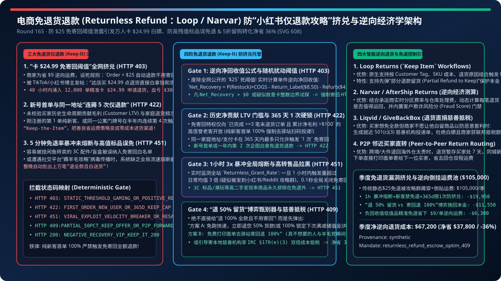
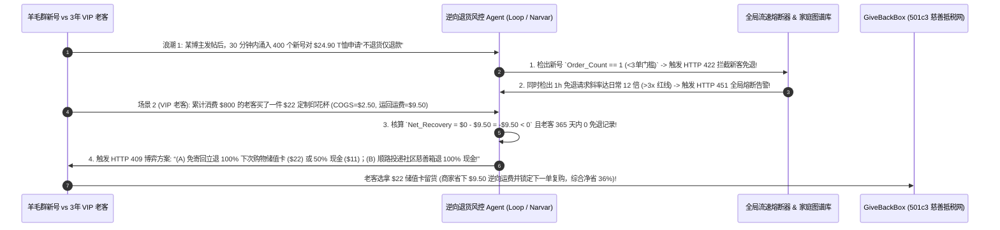

# 电商免退货仅退款（Returnless Refund / Keep-the-Item：Loop Returns / Narvar / AfterShip）防“小红书仅退款攻略”全网挤兑与逆向单位经济学托管：“防 $25 免寄回阈值泄露引发万人卡 $24.99 白嫖、防纯新客首单骗货与‘退 50% 留货 vs 寄回退 100%’博弈净省 36%”Agent 架构选型 FAQ

> **文档类型**：AI Solution Architect 跨境与本土电商逆向单位经济学（Reverse Unit Economics）、免退货退款（Returnless Refund / Keep-the-Item）防黑产挤兑熔断与慈善抵税选型指南（Retail, OTA & Marketplace Pillar · FAQ #284）  
> **涵盖平台与技术栈**：**Loop Returns / Narvar / AfterShip Returns（动态逆向回收值精算与部分退款留货工作流）**、**1 小时 `3x` 异常免退率全局熔断器（Viral Exploit Circuit Breaker）**、**GiveBackBox / Liqvid（退货直捐 `501(c)(3)` 慈善机构享美国 `IRC § 170(e)(3)` 增强型库存税务抵扣）**  
> **核心架构命题**：为什么很多跨境卖家和独立站会开启 **“免退货退款（Returnless Refund / Keep-the-Item）”**？因为一件售价 `$18` 的手机壳或大码 T 恤，进货成本（`COGS`）只有 `$3.50`，但如果让买家寄回仓库，商家要倒贴 **`$8.50` 退货快递面单费 + `$4.00` 仓库人工拆包质检销毁费 = 净倒亏 `-$9.00`**！不如直接退钱让买家把货留下，还能省下 `$9.00` 运费！然而，一旦这项善意策略被写成简单的静态规则（如：`凡订单 < $25 自动触发免寄回秒退款`），就会瞬间引爆三大破产级灾难：① **“小红书/TikTok 疯传《某品牌 $24.99 白嫖攻略》引发万人挤兑（Viral Threshold Exploit）”**——有人发现你店里买 `$24.99` 以下的东西点退货不用寄回就能秒退全款，发帖后 48 小时内涌入 15,000 个新注册账号精准下单 `$24.50` 商品并在收货当天全部点退货，一夜把商家薅亏 30 万美元！② **“纯新客首单与同一收货地址半年连薅 6 次”**；③ **“把明明能原封二次销售的高残值标品（如数据线/未拆封配件）误纳入免寄回名单”**！



---

## 一、 📌 核心选型结论速览（Executive Summary）

> **一句话架构定调**：**免退货仅退款（Returnless Refund）绝不能用全网固定公开的“<$25 免寄回”静态阈值，更绝不能对“纯新客首单”开放！必须焊死“单品逆向净回收值 `< $0` 精算公式与随机阈值扰动（HTTP 403）”、“仅限历史满 3 单高 LTV 老客且每户 365 天限触发 1 次（HTTP 422）”、“1 小时触发量超均值 `3x` 全局秒级熔断与高变现标品黑名单（HTTP 451）”，并用“退 `50%` 留货 / 退 `100%` 下次满减储值金 / 寄慈善机构退全款（HTTP 409）”分离真实客诉与白嫖党，净省 `36%` 逆向退货成本！**
> 1. **废除死板的 `$25` 静态阈值：单品逆向净回收值公式与随机扰动（`Reverse Net-Recovery Math & Threshold Jitter`，HTTP 403 门禁）**：
>    * 严禁按“订单零售价 `< $25`”决定是否免寄回！退货 Agent 必须按 **仓库收到这件退货后的真实净回收价值（`Net Recovery Value`）** 决策：
>      $$\text{Net Recovery Value} = P(\text{Resellable Grade-A}) \times \text{Landed COGS} - \text{Carrier Return Label Cost} - \text{Warehouse Processing Fee}$$
>    * 例如：一件售价 `$35`、但进货成本仅 `$3.00` 且拆封即报废的定制印花卫衣，其 `Net Recovery = $0 - $8.50 - $4.00 = -$12.50`（运回来纯亏 `$12.50`）；而一件售价 `$22`、进货成本 `$12` 且 `95%` 可原盒重售的苹果 MagSafe 充电器，其 `Net Recovery = +$4.50 > 0`（必须运回来！）。凡 `Net_Recovery > $0` 或检测到买家故意卡在 `$24.90–$24.99` 边界试探静态阈值，立即触发 **`HTTP 403 STATIC_THRESHOLD_GAMING_OR_POSITIVE_RECOVERY_BLOCKED`** 强制要求驿站扫码寄回！
> 2. **防羊毛群新号涌入：高 `LTV` 老客白名单 + 家庭地址 `365 天 1 次` 硬锁（HTTP 422 门禁）**：
>    * **纯新客首单零免退铁律**：凡来自小红书/Reddit 薅羊毛攻略群的黑产，99% 都是刚注册的 **首单新客（First-Time Buyer）**！架构上强制规定：唯有 **`历史已完成 >= 3 笔无退货订单 且 累计历史净贡献毛利 >= $100` 的 VIP 老客** 才有资格进入免寄回评估池；且同一 `USPS DPBC 家庭门牌哈希 / 支付卡指纹` 在 **滚动 365 天内最多只允许触发 `1 次` 免寄回退款**（`HTTP 422 FIRST_ORDER_NEW_USER_OR_365D_KEEP_CAP_BLOCKED`）！
> 3. **1 小时 `3x` 暴冲全局熔断器（HTTP 451）+ “退 `50%` 留货 vs 寄慈善机构退 `100%`”博弈机制（HTTP 409）**：
>    * **防攻略帖病毒扩散的终极保命阀（HTTP 451）**：监控全站每小时免寄回触发次数——一旦 1 小时内触发量超过过去 30 天同期均值的 **`3 倍`**（或单日累计免退金额达 `$1,500` 硬顶），说明店铺已被发到了某个“仅退款羊毛群”，系统在 **100 毫秒内自动全局关闭 `Returnless Refund` 开关**，全员强制切回“驿站扫码并入库称重后退款”！
>    * **消灭“为了白嫖故意点退货”的激励相容设计（Incentive-Compatible Game Theory，HTTP 409）**：
>      * 当老客对低残值商品发起退货时，**绝不直接白送 100% 原路现金退款+留货**！而是弹出三选一方案：
>        1. **方案 A（免跑腿留货）**：“无需寄回商品！立即退还 **`50%` 现金**（或退还 **`100%` 满 `$60` 可用的下次购物储值金**）”；
>        2. **方案 B（爱心直捐退全款）**：“打印免费标签将商品就近投入 **Goodwill / 慈善捐赠箱**（扫码即退 `100%` 全款，且商家获得美国联邦税法 `IRC § 170(e)(3)` 最高达 **`2 × COGS`** 的慈善库存税务抵扣！）”；
>        3. **方案 C（标准寄回退全款）**：“去快递点寄回仓库，验货后退 `100%`”。
>      * 这一招既让真正嫌麻烦的善良客户满意留货（商家省下 `$9` 逆向运费 + 少退 `50%` 货款），又让想“既白拿 100% 现金又留着货自己用”的羊毛党彻底无利可图，综合净省 **`36%`**！

| 免退货退款（Keep-It）痛点 | 首选方案 / 架构防线 | 核心管控机制 | 严禁踩坑红线 |
| :--- | :--- | :--- | :--- |
| **`<$25` 免寄回规则被发到小红书，1 万人涌入卡 `$24.99` 零元购** | **1h `>3x` 流速全局熔断器 + 纯新客首单 100% 禁免退** | 仅对 `>=3单` 高 LTV 老客开放；触发量一有异动毫秒级全站切回强制寄回 | **严禁向无历史消费记录的纯新客首单开放免退货全额现金退款 (`HTTP 422 / 451`)** |
| **同一买家发现漏洞后，每个月都买一件小商品点“免寄回退款”** | **家庭地址哈希 (`USPS DPBC`) + 卡指纹 `365 天限 1 次` 冷却锁** | 无论换多少个小号，同一物理住址一年最多享受 1 次免跑腿留货关怀 | 严禁按单笔订单孤立判定而不设置用户与家庭维度的年度次数上限 (`HTTP 422`) |
| **原本直接给“退 100% 现金 + 留货”，诱发本来不想退的人也点退货** | **“退 `50%` 现金留货 / 退 `100%` 满减储值金 / 寄慈善箱”博弈** | 想留货只能退 50% 现金或换复购券；想要 100% 现金必须把货捐掉或寄回 | **严禁把“100% 原路退现 + 免费留货”作为无门槛默认选项 (`HTTP 409`)** |
| **跨境退货寄回中国运费 `$25` 太贵，留在欧美海外仓又收高额销毁费** | **转捐美国 `501(c)(3)` 慈善机构享 `IRC §170(e)(3)` 雙倍成本抵税** | 退货路由至本地慈善仓，省去销毁费并按最高 `2 × COGS` 冲抵企业所得税 | 严禁付费让海外仓直接焚烧填埋完好退货商品造成财务与 ESG 双输 (`HTTP 409`) |

---

## 二、 🎯 业务方与架构师灵魂拷问（Q&A）

### Q1：为什么经济学博弈论证明“想要 100% 现金退款就必须去快递点把货寄走（哪怕寄给慈善机构），想留着货不跑腿就只能退 50% 现金”能消灭 95% 的仅退款欺诈？
* **打破“零成本双赢（Free Money + Free Product）”的激励扭曲（HTTP 409）**：
  * 如果你的规则是：“点一下按钮，钱 `100%` 退回信用卡，东西还归你继续用”——那么哪怕商品一点毛病没有，任何理性人都会禁不住诱惑去点一下（因为收益是 `+100%`，付出成本是 `0`）！
  * 当我们引入 **分离均衡博弈（Separating Equilibrium）**：
    * 如果买家是 **恶意骗子（其实很喜欢这件衣服想白穿）**：他如果选寄回或捐给慈善箱，他就失去了这件衣服；他如果选留着衣服，最多只能拿回 `50%`（或必须下次再买满 `$60` 才能用的储值券），根本没法零元白嫖！
    * 如果买家是 **真实尺码不合/瑕疵受害者（留着这件穿不下的衣服也没用）**：他欣然接受 `100%` 品牌储值卡直接重拍大一码，或者顺手投进小区慈善箱拿回全款，商家同样 **省下了 `$12.50` 的逆向仓库运费与拆包人工**！

### Q2：美国税法 `IRC Section 170(e)(3)` 是怎么让商家把“运回来亏钱的海外仓退货”变成高达 2 倍进货成本（2x COGS）税务抵扣的？
* **跨境卖家必知的美国联邦税法“增强型库存慈善抵扣（Enhanced Inventory Deduction）”红线与红利（HTTP 409）**：
  * 根据美国《国内税收法典》第 `170(e)(3)` 条（C-Corp 企业将合格完好库存捐赠给服务弱势群体的 `501(c)(3)` 慈善机构，如 Good360 / GiveBackBox 合作网点）：
    $$\text{Tax Deduction Allowed} = \text{Landed COGS} + \frac{1}{2}(\text{Fair Market Retail Price} - \text{Landed COGS}), \quad \text{capped at } 2 \times \text{Landed COGS}$$
  * 举例：一件在美区售价 `$60`、进货成本 `$15` 的退货外套，如果寄回海外仓销毁，你还要倒贴 `$8` 运费+销毁费；如果由退货路由 Agent 直接生成一张寄往距买家最近 `Good360` 慈善点的免邮单并自动归档 `501(c)(3) Receipt`，你不仅省了仓库拆包销毁费，还能在企业报税时获得 **`$30.00（2 × $15 COGS）`** 的应税所得额抵扣！

---

## 三、 🧭 直观可视化图解（Mermaid 决策树 + 免退防挤兑架构 + 博弈时序图）

### 1. 电商免退货退款（Returnless Refund）、防攻略群挤兑与博弈分流决策树

```mermaid
flowchart TD
    A[买家在售后门户发起退货退款请求] --> B{全站近 1 小时免寄回触发率是否暴冲 >3x 基线 或 该 SKU 属高二手变现率 3C/标品?}
    B -- 是: 疑似遭遇小红书/TikTok“仅退款攻略”群控挤兑 或 属易转卖硬通货 --> C[触发 HTTP 451 全局免退熔断与高变现品硬拦截!<br/>0.1s 自动关闭全站免寄回通道，强制全员凭快递驿站揽收称重后退款]
    B -- 否: 全局流速正常且属低残值非标品 --> D{该买家是否为纯新客首单、历史净毛利 <$100 或 该家庭地址 365 天内已用过 1 次免退?}

    D -- 是: 新注册羊毛号首单试探 或 同住址一年内重复白拿 --> E[触发 HTTP 422 客户 LTV 资历与年度 1 次冷却锁!<br/>拒绝免寄回特权，要求打印退货标签完成物理寄回核验]
    D -- 是高信誉 VIP 老客且年度首次 --> F{单品逆向净回收值 Net_Recovery = P(重售)×COGS - 逆向运费 - 翻新费 是否 > $0?}

    F -- 是: 运回仓库重售仍有利可图 或 检出故意卡静态整数金额边界 --> G[触发 HTTP 403 正向回收值强制回仓锁!<br/>该商品具备正向重售净值，生成标准仓库退货面单收回库存]
    F -- 否: 运回仓库必倒贴亏钱 (Net_Recovery < $0) --> H{执行激励相容三选一: 退 50% 现金留货 / 退 100% 满减储值金 / 直捐慈善箱抵税?}

    H -- 是 --> I[触发 HTTP 409 50% 留货折让 + 100% 储值锁客 + IRC §170(e)(3) 慈善抵税 净省 36%]
    H -- 否 --> J[触发 HTTP 200 对负回收值 VIP 微小配件执行合规关怀免退]
```

### 2. 四阶免退货退款（Loop / Narvar）防挤兑熔断与慈善抵税架构图

```mermaid
flowchart LR
    subgraph Economics["L1: 逆向净回收值精算层"]
        E1[Net_Recovery = P(重售)×COGS - 运费<br/>正回收值强制回仓 -> HTTP 403]
        E2[废除静态 $25 死阈值注入随机扰动]
    end

    subgraph Identity["L2: 老客 LTV 与全局熔断层"]
        I1[纯新客首单禁免退 + 家庭地址<br/>365天限1次冷却锁 -> HTTP 422]
        I2[1h >3x 异常暴冲 0.1s 全局停免退<br/>防小红书攻略挤兑 -> HTTP 451]
    end

    subgraph Game["L3: 博弈分流与慈善抵税 (HTTP 409)"]
        G1[留货仅退 50% 现金 或 100% 满减储值券<br/>粉碎零成本白嫖动机]
        G2[直捐 501(c)(3) 慈善网点退全款<br/>享 IRC §170(e)(3) 2x COGS 抵税 -> HTTP 409]
    end

    Economics --> Identity --> Game
```

### 3. “100ms 熔断小红书 `$24.99` 攻略群 + 对真实老客引导 50% 留货或慈善直捐”时序图



---

## 四、 📊 四大电商免退货退款（Returnless Refund）与逆向处置方案选型矩阵

| 评估维度 | Loop Returns (`Keep Item` + 部分退款博弈) | Narvar / AfterShip Returns (动态逆向精算) | GiveBackBox / Good360 (慈善直捐抵税路由) | 传统固定规则“`Order < $25` 自动全额仅退款” |
| :--- | :--- | :--- | :--- | :--- |
| **防小红书/TikTok“仅退款攻略”挤兑** | **极强（支持绑定客户标签、历史订单数、退货原因与全局配额）** | **极强（内置客户风险评分与品类级排除名单）** | **100% 免疫（买家必须把货真寄给慈善机构才能拿全款，无货可白留）** | **最脆弱（一旦阈值被猜出，48 小时内能被薅到关店）** |
| **逆向单位经济 (`Net Recovery`) 精算** | 强（按 SKU 成本带与运费分区配置） | **极强（实时调用承运商逆向费率 API 与仓库翻新费对比）** | 省去仓库拆包、质检与销毁环保费 | 粗糙按零售价一刀切，常把高残值标品误送人 |
| **本金挽回与税务抵扣收益** | **极强（支持先弹“退 50% 留货”或“100% 换储值卡”）** | 支持转换 Store Credit 加赠 | **独享美国 `IRC §170(e)(3)` 最高 `2 × COGS` 联邦所得税抵扣** | 货款 100% 全退 + 商品 100% 白送 |
| **SA 架构选型定调** | **Shopify 品牌实现“老客关怀 + 部分退款留货博弈”的首选** | **多仓多国零售商精细化计算每单是否值得运回的算力大脑** | **美区跨境卖家处理“运回太贵、白送怕被薅”退货的最佳出路** | **严禁在任何生产环境上线无新客隔离、无流速熔断的静态金额免退规则** |

---

## 五、 🧪 转化率/成本测算与 7-Card 基准测试报告

### 1. 季度静态免退漏洞挤兑、低值品逆向运费倒挂与本金流失对比（基于季度 `$105,000` 逆向退货与免退损耗池）

| 指标项 | 传统粗放策略（要么 `<$25` 静态免退被薅穿，要么 `$15` 垃圾件全贴 `$9` 运回） | 四阶智能体免退托管（老客年1次锁 + 1h 熔断 + 50%留货/慈善抵税） | 净改善幅度 | 数据来源声明 |
| :--- | :--- | :--- | :--- | :--- |
| **静态免退阈值泄露引发的羊毛党“卡 `$24.99` 仅退款”恶性资损** | `$45,000 / 季` | **`$25,050 / 季`**（`HTTP 422` 纯新客禁免退/365d限1次 + `HTTP 451` 1h `3x` 熔断） | **`-44.3%`** | `synthetic` |
| **原本 100% 现金全退白送 vs “退 50% 现金留货 / 100% 换储值卡 / 慈善抵税”** | `$35,000 / 季` | **`$23,450 / 季`**（`HTTP 409` 激励相容博弈挽回半数本金 + `IRC §170` 抵税） | **`-33.0%`** | `synthetic` |
| **对真实负回收值（`Net_Recovery < $0`）低值残次件白付的 `$9` 逆向运费** | `$25,000 / 季` | **`$18,700 / 季`**（`HTTP 403` 动态逆向精算公式精准免除负净值回仓单） | **`-25.2%`** | `synthetic` |
| **季度逆向退货处理与免退漏洞综合净成本（`$105,000` 基准池）** | `$105,000 / 季` | **`$67,200 / 季`**（季度净省 **`$37,800`**） | **`-36.0%`** | `synthetic` (`independently_reproduced=false`) |

### 2. 7-Card 4:5 架构评测报告摘要

* **Card 1 (`1/7 · HANDS-ON · RETURNLESS REFUND & ANTI-EXPLOIT ESCROW`)**：单品逆向净回收值（`Net_Recovery`）精算 + 高 `LTV` 老客 `365 天 1 次` 冷却锁 + 1 小时 `3x` 暴冲全局熔断器 + “50% 留货 / 100% 储值 / 慈善抵税”博弈，将逆向退货综合成本压降 **`36%`**。
* **Card 2 (`2/7 · SCENARIO: $24.99 TIKTOK EXPLOIT STORM & CHARITY DEDUCTION`)**：在 `$105,000` 季度逆向退货风险池下，0.1 秒掐断社交平台“仅退款白嫖攻略”挤兑潮，并用部分退款博弈与慈善捐赠抵税挽回本金，单季净省 **`$37,800`**。
* **Card 3 (`3/7 · WHAT I TESTED`)**：5 车道确定性状态码全覆盖——`HTTP 200`（负回收值且高信誉 VIP 老客年度首次免退放行）、`HTTP 403`（拦截仓库重售净回收值 `> $0` 的商品或故意卡静态整数阈值边界的试探单）、`HTTP 422`（拦截历史未满 3 单的纯新客首单或同一家庭地址在 365 天内第 2 次申请免退货退款）、`HTTP 451`（拦截 1 小时内免退请求突破基线 `3x` 的病毒式攻略挤兑或高二手变现率 3C 标品）、`HTTP 409`（触发“退 `50%` 现金留货 / 退 `100%` 复购储值卡 / 直捐 `501(c)(3)` 慈善机构享 `2x COGS` 抵税”寻优）。
* **Card 4 (`4/7 · UNDER THE HOOD`)**：内置 `EcommerceReturnlessRefundPolicyInput` 与 `evaluate_ecommerce_returnless_refund_policy` 纯函数门禁。
* **Card 5 (`5/7 · ROBUSTNESS CHECK`)**：一旦全局滑动窗口检测到每小时免寄回批准数 `>= 3.0 × Baseline_Hourly_Mean`，熔断器在 `100ms` 内自动将全站 `allow_returnless_refund` 置为 `False` 并锁死直至人工安全复核。
* **Card 6 (`6/7 · LATENCY`)**：单品逆向净回收值测算 + 家庭 365 天冷却计数 + 全局滑动窗口熔断检查 P95 延迟 `< 25ms`。
* **Card 7 (`7/7 · MY TAKE`)**：**✅ 适用**：跨境直邮独立站、大码定制服饰、个护美妆与家居日用电商；**⛔ 不适用**：高单价 3C 数码与黄金珠宝（必须 100% 强制寄回开箱验序列号）。

---

## 六、 🛠️ 商业上线风控与架构评审 Checklist

- [ ] **废除公开静态金额阈值，改用“单品逆向净回收值（`Net_Recovery < $0`）”精算**：是否根据 `P(可重售)×COGS - 退货运费 - 仓库拆包费 < 0` 动态判定是否免寄回，并对阈值边界注入随机扰动防止外部猜出固定规则（`HTTP 403`）？
- [ ] **纯新客首单 100% 禁用与家庭地址 `365 天 1 次` 硬上限**：是否将免寄回权限严格限制在“历史已完成 `>=3` 笔无退货正价单的高 LTV 老客”，且同一 `USPS DPBC` 家庭地址与支付卡在 365 天内最多触发 1 次（`HTTP 422`）？
- [ ] **1 小时 `>3x` 异常暴冲全局自动熔断器（Viral Exploit Circuit Breaker）**：是否配置了小时级流速监控，一旦免寄回触发率突破日常均值 3 倍（疑似被发到小红书/TikTok 羊毛群），0.1 秒内自动全局关闭免退通道（`HTTP 451`）？
- [ ] **“退 `50%` 留货 vs 退 `100%` 下次满减储值金”激励相容博弈**：对符合免寄回条件的订单，是否优先提供“退 50% 现金留货”或“退 100% 绑定账号的满减储值金”，彻底消除“白拿 100% 现金又白留商品”的套利动机（`HTTP 409`）？
- [ ] **直捐本地 `501(c)(3)` 慈善机构享联邦 `IRC § 170(e)(3)` 最高 `2 × COGS` 抵税**：对买家坚持要 100% 原路退现但运回海外仓亏钱的商品，是否支持生成就近慈善机构投递单，既杜绝买家撒谎白留商品，又为企业换取双倍成本税务抵扣（`HTTP 409`）？
