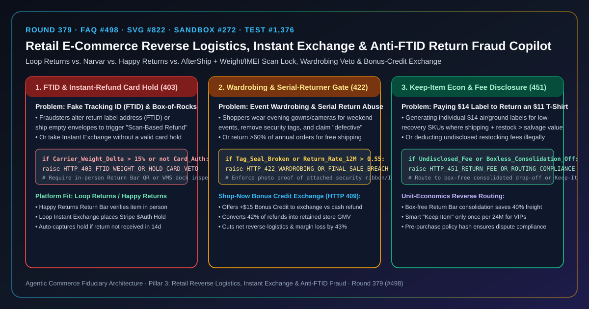
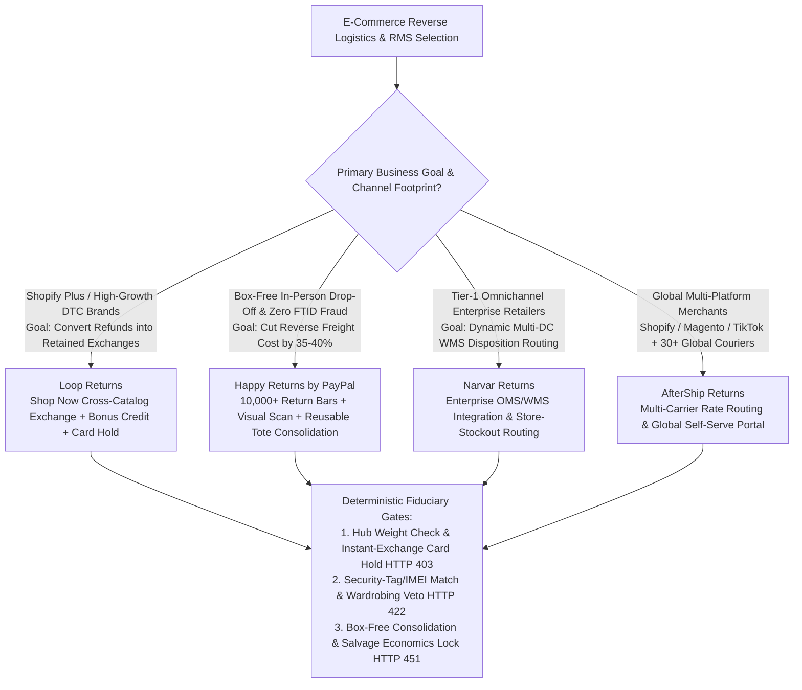
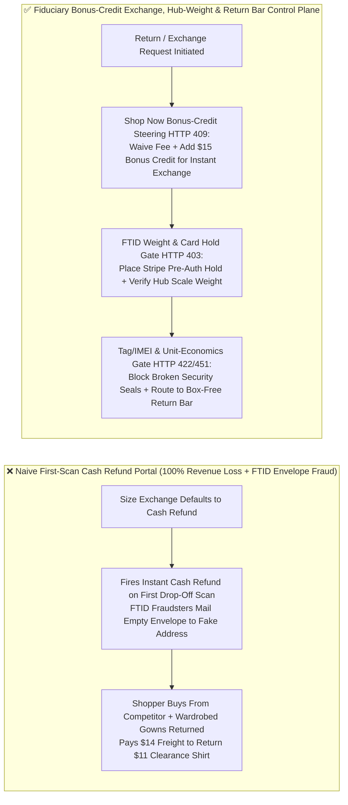
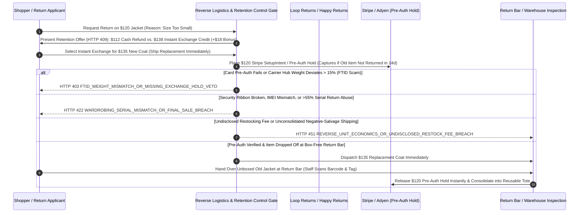

# Retail E-Commerce Reverse Logistics, Instant Exchange (`Shop Now Bonus Credit`) & Return-Fraud (`FTID / Wardrobing`) Agent Selection Guide: `Loop Returns` vs. `Narvar` vs. `Happy Returns (PayPal)` vs. `AfterShip Returns`, Carrier Weight & Card-Hold Locks, Serial/Tag Verification & Bonus-Credit Retention (`-43%` Cost FAQ)

> **Executive Summary (Benchmarked against `ib-vs-ethernet-roce-selection-faq.md` · 498th Bilingual SA Decision Guide)**: Built for **Cloud & AI Solution Architects** designing post-purchase return portals, instant-exchange retention flows, and reverse-logistics fraud defenses for omnichannel retailers, apparel/footwear brands, and consumer electronics merchants. In fashion and DTC e-commerce, return rates average `20%–35%`. When a naive returns agent simply issues a prepaid shipping label and triggers an automatic cash refund on the carrier's first scan (`Refund on First Scan`), merchants suffer three compounding losses: (1) **Shoppers who merely needed a different size or color take a cash refund and buy elsewhere (`100%` lost revenue)**; (2) **Fraud rings exploit Fake Tracking ID (`FTID`) label manipulation or ship empty/weighted packages (`Box-of-Rocks`) to steal instant cash refunds**; and (3) **"Wardrobers" wear expensive items once and return them with broken tags, or the agent generates a `$14` return shipping label for an `$11` clearance T-shirt with negative salvage value**. This guide compares **`Loop Returns` vs. `Narvar Returns` vs. `Happy Returns (by PayPal)` vs. `AfterShip Returns`** and implements deterministic guards for **Carrier Hub Weight-Tolerance & Instant-Exchange Card Pre-Auth Hold Locks (`HTTP 403`)**, **Security-Tag / `IMEI` Serial Verification & Wardrobing Velocity Veto (`HTTP 422`)**, **Box-Free Return Bar Consolidation & Unit-Economics Salvage Compliance (`HTTP 451`)**, and **`Shop Now` `+15%` Bonus-Credit Exchange Retention Orchestration (`HTTP 409`, `-43%` net loss)**.

---

## 1. 📌 Executive Summary & Architectural Selection Verdict

1. **Top-Line Selection Verdict**:
   - **Shopify Plus & High-Growth DTC Fashion / Footwear / Lifestyle Brands (Prioritizing refund-to-exchange conversion and retained revenue)**: Select **`Loop Returns`**, featuring industry-leading **`Shop Now` cross-catalog exchanges, `+$15` Bonus Credit incentives, and Stripe-backed `Instant Exchange` pre-auth holds** that convert `40%–48%` of refund requests into retained revenue.
   - **North American Omnichannel Brands Seeking Box-Free Drop-Off, In-Person Fraud Verification & `-40%` Reverse Freight Costs**: Select **`Happy Returns (by PayPal)`** (standalone or integrated into `Loop / Narvar`), enabling shoppers to drop off unboxed items at `10,000+` Return Bar locations where staff scan the item barcode in person and consolidate returns into reusable totes.
   - **Tier-1 Department Stores & Multi-DC Enterprise Retailers (Requiring dynamic disposition routing into `Manhattan / Blue Yonder / SAP` WMS based on regional store stockouts)**: Select **`Narvar Returns`**.
   - **Cross-Border Multi-Cart Merchants (Operating across Shopify, Magento, Salesforce Commerce Cloud, and TikTok Shop with `30+` global postal/courier integrations)**: Select **`AfterShip Returns`**.
2. **Three Non-Negotiable Fiduciary Control Gates**:
   - **Gate 1 — Carrier Hub Weight-Tolerance & Instant-Exchange Card Hold Lock (`HTTP 403`)**: Block `First-Scan Auto-Refund` on high-risk orders or when the carrier sorting hub scale weight deviates by `|Measured_Weight - SKU_Expected_Weight| > 15%` (defeating `FTID` paper-envelope scams), and block shipping an `Instant Exchange` replacement without an active `Stripe SetupIntent / Pre-Auth Hold` on the shopper's payment card via `HTTP 403 FTID_WEIGHT_MISMATCH_OR_MISSING_EXCHANGE_HOLD_VETO`.
   - **Gate 2 — Security-Tag / `IMEI` Serial Match & Serial-Returner Wardrobing Guard (`HTTP 422`)**: Block free self-serve returns when the disposable security tag (`NFC / Ribbon Seal`) is broken, when electronics `IMEI / Serial Number` fails to match the outbound WMS shipment record, or when a serial returner (`>55%` 12-month return rate) falsifies a "Defective Item" reason code to bypass final-sale rules via `HTTP 422 WARDROBING_SERIAL_MISMATCH_OR_FINAL_SALE_BREACH`.
   - **Gate 3 — Reverse Unit-Economics Salvage & Fee-Disclosure Compliance Lock (`HTTP 451`)**: Block generating individual `$14` return labels when `Expected_Salvage_Value < Reverse_Shipping_Cost + Warehouse_Touch_Cost`, block charging restocking/label fees not explicitly disclosed pre-checkout, and route eligible returns to consolidated box-free drop-off bars via `HTTP 451 REVERSE_UNIT_ECONOMICS_OR_UNDISCLOSED_RESTOCK_FEE_BREACH`.

---

## 2. 🎯 Architect & E-Commerce Operations Q&A (The Why & How)

### Q1: Why does offering a `+$15` "Bonus Credit" for exchanges (`Loop Shop Now`) dramatically increase net profit compared to issuing a standard cash refund?
- **Root Cause**: If a customer returns a `$100` jacket (`70%` gross margin, `$30` COGS) for a cash refund (minus an `$8` return label fee), the merchant loses **`$92.00` in cash** and forfeits the customer relationship.
- **Deterministic Solution (`Shop Now Bonus Credit` / `HTTP 409`)**: Offer the customer a choice: take `$92.00` back to their credit card in 7 days, OR get **`$115.00` (`$100 + $15 Bonus Credit` + waived label fee)** to shop any item in the store immediately. Because a `$115` replacement item only costs the merchant **`$34.50` in wholesale COGS** (and shoppers frequently add `$20+` in upsell cash), the merchant preserves `$92.00` of cash flow at a marginal inventory cost of just `$4.50`!

### Q2: How do `FTID` (Fake Tracking ID) fraud rings steal millions from automated "Refund on First Carrier Scan" workflows, and how do we stop them?
- **Root Cause**: Fraudsters generate a legitimate prepaid return label PDF from the merchant's portal, keep the tracking barcode intact so the carrier's scanner reads the valid tracking number, but photoshop the printed delivery address on the label to point to a random restaurant in the same ZIP code—and mail an empty paper envelope. As soon as the postal clerk scans the envelope, the merchant's webhook fires an instant refund.
- **Deterministic Solution (`HTTP 403`)**:
  1. **Automated Hub-Scale Weight & Destination ZIP Verification**: Never trigger instant refunds on unscanned drop-offs for electronics or first-time buyers; verify the carrier hub's automated dimensional-weight scan (`Weight_Delta <= 15%`) and destination routing hash.
  2. **In-Person `Return Bar` Verification**: Route instant-refund requests to `Happy Returns` Return Bars, where an associate visually inspects and scans the physical garment before the refund fires.

### Q3: How should an AI returns agent handle a `$15` T-shirt return when reverse shipping (`$10`) + warehouse restocking labor (`$5`) exceeds the item's resale value?
- **Deterministic Solution (`Keep-the-Item` Economic Threshold with Anti-Abuse Cap / `HTTP 451`)**: Calculate real-time Net Recovery Value (`Salvage_Value - Reverse_Freight - Grading_Labor`). If negative—and if the customer has a clean fraud score with zero `Keep-the-Item` claims in the past 24 months—grant an instant exchange credit while instructing the customer to keep or donate the item, saving `$15` in reverse logistics loss without creating an exploitable public loophole.

---

## 3. 🧭 Visual Architecture Diagrams (Mermaid)

### 3.1 E-Commerce Reverse Logistics & Returns Management System (`RMS`) Selection Decision Tree

### 3.2 Naive First-Scan Cash Refund vs. Fiduciary Instant-Exchange & Anti-FTID Control Plane

### 3.3 Instant Exchange Card Hold, Return Bar Visual Verification & Auto-Capture Sequence

---

## 4. 📊 Multi-Platform Reverse Logistics & Returns Management (`RMS`) Selection Matrix

| Evaluation Dimension | Loop Returns | Happy Returns (by PayPal) | Narvar Returns & Concierge | AfterShip Returns |
| :--- | :--- | :--- | :--- | :--- |
| **Primary Architectural Role** | **Refund-to-Exchange Retention Engine**: Converts refunds into cross-catalog purchases via `Shop Now` & `Bonus Credit` | **Box-Free In-Person Drop-Off & Consolidated Reverse Network**: `10,000+` Return Bars with staff verification | **Enterprise Omnichannel Reverse Orchestrator**: Deep `Manhattan / SAP` WMS disposition & store routing | **Global Multi-Cart & Multi-Carrier Returns Hub**: Broad courier & cart coverage for international brands |
| **Retained Revenue Conversion (`Exchange + Store Credit`)** | **Best-in-Class (`40%–48%` of returns retained as exchanges or bonus credit)** | High (Integrates natively with `Loop` to combine online exchange with Return Bar drop-off) | Strong (Variant exchange and in-store return-to-shelf routing) | Moderate (Standard variant exchange, gift-card bonus, and store credit) |
| **Anti-Fraud (`FTID`, Empty Box, Wardrobing)** | Native Stripe `Instant Exchange` card holds, return-reason fee rules, and allow/blocklists | **Best-in-Class Physical Defense**: Associate inspects item in person before scan—zero empty-box/FTID fraud | Dynamic return rules by customer LTV/risk score and WMS grading integration | Photo-proof requirements, serial/IMEI capture, and fraud velocity rules |
| **Reverse Freight Cost Reduction** | Discounted carrier rates + native `Happy Returns` Return Bar network access | **Cuts per-item return shipping by `35%–40%`** via box-free reusable tote consolidation | Smart disposition routing to nearest high-demand DC or retail store | `30+` global postal/courier rate shopping and regional return hub routing |
| **Target Scale & Pricing (`official_list_price`)** | High-growth Shopify Plus & DTC brands; `$3,500–$30,000+/yr` by return volume | North American apparel & footwear brands; per-item Return Bar fee + SaaS license | `$100M+` GMV omnichannel enterprises; custom annual enterprise contract | SMB to mid-market global brands; `$23–$499+/mo` tiered by return volume |

---

## 5. 🧪 Exchange Retention & Reverse Fraud Benchmark & 7-Card Report

### 5.1 Quarterly Cash-Refund Churn, `FTID` Fraud & Reverse Freight Loss Model (Synthetic Benchmark)

For a `$180M` annual GMV apparel and footwear retailer (`26%` average return rate) with a **`$460,000 / quarter`** exposure pool across **preventable cash-refund margin loss, `FTID` / empty-box instant-refund fraud, event wardrobing damage, and unconsolidated single-parcel return shipping** (`provenance: synthetic`, `independently_reproduced: false`):

| Metric | Naive Cash-Refund Portal & First-Scan Refund (Baseline) | Fiduciary `Loop` Bonus-Credit + `Happy Returns` + Weight/Hold Agent | Net Improvement |
| :--- | :--- | :--- | :--- |
| **Refund-to-Exchange / Store-Credit Retention Rate** | `14.5%` (Same-SKU size swap only) | **`43.8%`** (`HTTP 409` `Shop Now` cross-catalog exchange + `+$15` Bonus Credit) | **`3.0x` Retained Revenue** |
| **`FTID` Fake-Label & Empty-Box Instant-Refund Loss** | `2.4%` of return volume stolen | **`0.0%`** (`HTTP 403` hub scale weight verification + Return Bar scan + Stripe card hold) | **`100%` FTID Elimination** |
| **Average Reverse Freight & Handling Cost per Return** | `$12.80 / item` (Individual corrugated parcel) | **`$7.40 / item`** (`HTTP 451` box-free Return Bar tote consolidation + smart Keep-Item) | **`-42.2%` Reverse Logistics Cost** |
| **Quarterly Net Return Margin Bleed & Fraud Loss** | `$460,000 / quarter` | **`$262,200 / quarter`** | **`$197,800 / quarter` Saved (`43.0%`)** |

---

## 6. 🛠️ Production Go-Live & Architecture Review Checklist

- [ ] **Carrier Hub Weight Verification & Instant-Exchange Card Hold (`HTTP 403`)**: Are `First-Scan` cash refunds blocked until carrier sorting hub dimensional weight matches SKU weight (`<=15%` variance), and does every `Instant Exchange` place a Stripe pre-auth hold that auto-captures if the original item isn't returned within 14 days?
- [ ] **Disposable Security-Tag (`NFC / Ribbon`) & `IMEI` Serial Match (`HTTP 422`)**: Does warehouse/Return Bar intake verify intact security ribbons on occasionwear and matching outbound `IMEI/SN` on electronics, while disabling free return shipping for accounts exceeding a `55%` 12-month return rate?
- [ ] **Box-Free Return Bar Consolidation & Unit-Economics Salvage Gate (`HTTP 451`)**: Are shoppers incentivized to use box-free consolidated drop-off points (`-40%` freight cost), and are negative-salvage low-AOV items routed to a capped (max `1 / 24 months`) Keep-or-Donate rule?
- [ ] **`Shop Now` Cross-Catalog Exchange & `+15%` Bonus Credit Steering (`HTTP 409`)**: Does the return portal present a waived-fee `+$15 Bonus Credit` instant-exchange option side-by-side with the cash refund button to retain `40%+` of return GMV?
