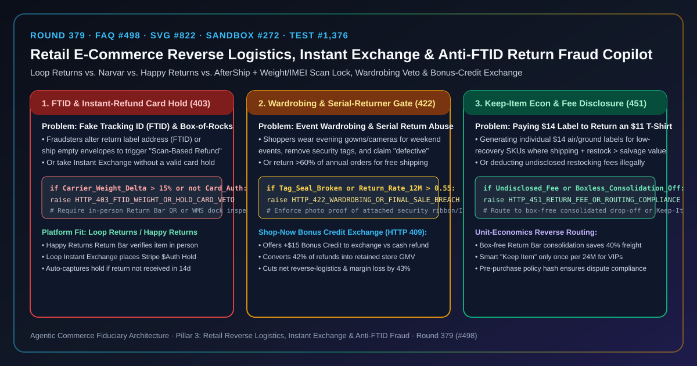
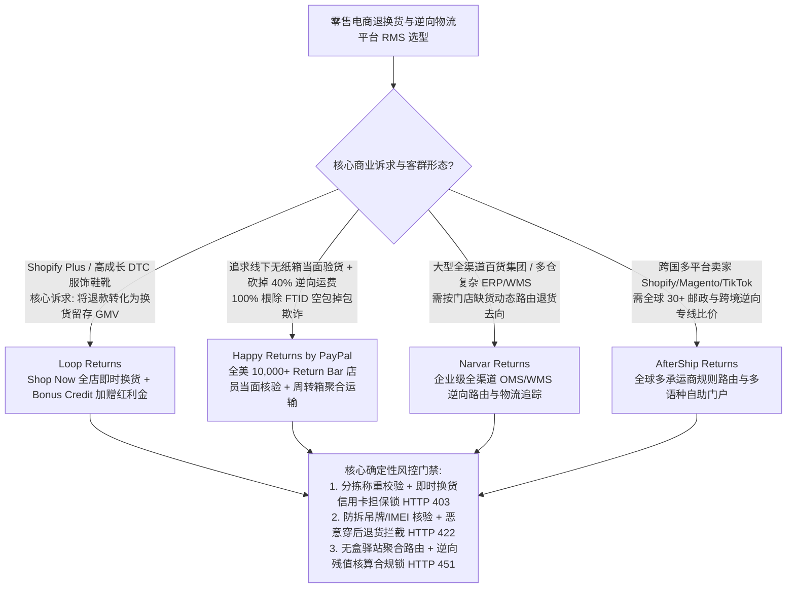
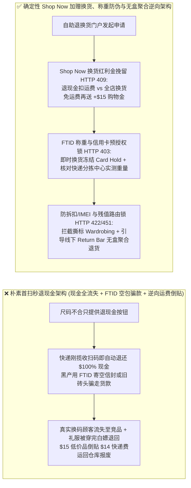
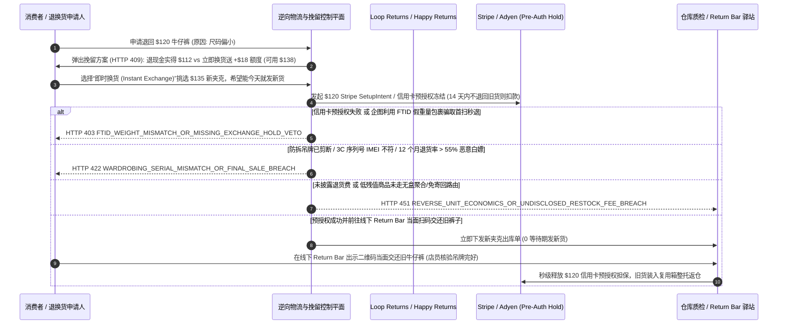

# 零售电商逆向物流、即时换货挽留（`Instant Exchange / Bonus Credit`）与退货反欺诈（`FTID / 掉包 / Wardrobing`）Agent 架构选型对比：`Loop Returns` vs. `Narvar` vs. `Happy Returns (PayPal)` vs. `AfterShip Returns`、揽收称重与信用卡担保锁、防穿后退货门禁及加赠换货金挽留净省 43% 决策指南（FAQ）

> **导读（对齐 `ib-vs-ethernet-roce-selection-faq.md` 标杆风格 · 全库第 498 篇双语指南）**：本文面向零售电商、时尚服饰、消费电子与跨境 DTC 品牌的 **Cloud & AI Solution Architect**。在服装鞋履与 3C 电商中，退货率通常高达 `20%–35%`。如果售后智能体只做“收到退货申请 -> 秒发预付费快递面单 -> 快递员刚扫码揽收（First Scan）就无条件原路退现金”，企业将遭遇三重利润浩劫：① **纯粹因为尺码偏小想换大一码的顾客直接退了现金去竞品下单（流失 `100%` 营收）**；② **黑产利用 `FTID`（篡改退货面单收件地址寄一张废纸）或“石头配重空包（Box-of-Rocks）”骗走扫码秒退现金**；③ **节假日“穿完参加晚宴就退（Wardrobing）”或为了一件残值仅 `$8` 的基础款 T 恤支付 `$14` 逆向快递费 + `$5` 拆包整烫人工费（每退一单倒贴 `$11`）**。本文给出 **`Loop Returns` vs. `Narvar Returns` vs. `Happy Returns (by PayPal)` vs. `AfterShip Returns`** 的横向选型矩阵，并落地 **快递揽收实时称重比对（`Weight Delta <= 15%`）与即时换货信用卡预授权担保锁（`HTTP 403`）**、**一次性防拆扣/机身序列号（`IMEI`）视觉核验与高频恶意退货者（`Wardrobing`）拦截门禁（`HTTP 422`）**、**无盒聚合退货驿站（`Box-Free Return Bar`）路由与隐性退货费合规披露锁（`HTTP 451`）** 及 **`Shop Now` 加赠 `+15%` 换货红利金（Bonus Credit）即时挽留编排（`HTTP 409`，净省 43%）**。



---

## 一、 📌 核心选型结论速览（Executive Summary）

1. **终极选型结论（一句话先看懂怎么选）**：
   - **Shopify Plus 与高成长 DTC 时尚服饰/鞋靴品牌（核心目标是把“退现金 Refund”转化为“换尺码/换新款 Exchange”，提升留存 GMV）**：首选 **`Loop Returns`**，行业首创 **`Shop Now` 全店跨品类即时换货 + 额外赠送 `$10–$20` 换货红利金（Bonus Credit）+ 信用卡 `$Auth Hold` 即时发新货**，可将 `40%–45%` 的退货直接转化为换货留存！
   - **线下客流密集或追求极致逆向运费降本与当面防掉包验货的北美零售商**：首选 **`Happy Returns (by PayPal)`**（或与 `Loop / Narvar` 组合使用），消费者无需打印面单和纸箱，直接拿到全美 `10,000+` 个 `Return Bar`（UPS Store / Staples / Ulta 门店）由店员当面扫商品条码核验真伪后装入复用周转箱整托发回，**100% 杜绝空包石头欺诈且砍掉 `35%–40%` 零担快递费**。
   - **大型全渠道百货集团与跨国多仓企业（需深度对接 `Manhattan / Blue Yonder / SAP` WMS，按区域库存缺口智能将退货路由至最近缺货门店或清仓仓）**：首选 **`Narvar Returns`**。
   - **多平台跨境卖家（同时运营 Shopify、Magento、WooCommerce、TikTok Shop 且需对接全球 `30+` 邮政与逆向专线）**：首选 **`AfterShip Returns`**。
2. **三大逆向物流与反欺诈风控红线（确定性门禁）**：
   - **红线 1（拦截 `FTID` 虚假面单/空包石头骗取“揽收即退款”及无信用卡预授权担保直接发走即时换货商品 / `HTTP 403`）**：严禁对高单价商品（`>$150`）、电子产品或新注册账号开放无核验的“快递员首扫即退现金（First-Scan Auto-Refund）”；若快递分拣中心电子秤回传包裹重量与出库 SKU 标准重量偏差 `|Actual_Weight - Expected_Weight| > 15%`，或用户在申请“即时换货先发新货（Instant Exchange）”时未通过 `Stripe SetupIntent / Pre-Auth Hold` 冻结原单等额担保金，控制平面必须触发 `HTTP 403 FTID_WEIGHT_MISMATCH_OR_MISSING_EXCHANGE_HOLD_VETO`。
   - **红线 2（拦截撕毁一次性防拆吊牌的“穿过即退 Wardrobing”、机身 `IMEI/SN` 掉包及近 12 个月退货率 `>55%` 的职业白嫖党免运费退货 / `HTTP 422`）**：礼服、高端箱包与 3C 镜头必须配备物理一次性防伪扣（`Wardrobing Ribbon / NFC Seal`）；当退货发起或仓内质检发现防拆扣断裂、退回的 AirPods/显卡序列号（`SN`）与发货出库记录不符，或高频滥用退货用户企图将“清仓不退换（Final Sale）”商品伪造为“质量瑕疵（Defective）”逃避退货运费时，触发 `HTTP 422 WARDROBING_SERIAL_MISMATCH_OR_FINAL_SALE_BREACH`。
   - **红线 3（拦截为残值低于逆向运费的低价品生成独立高价快递面单及违规扣取结账前未披露的上架费 / `HTTP 451`）**：当单件退货商品的二次销售净残值低于“逆向快递费 + 仓内质检重包装人工成本”（`Net_Recovery_Value < Reverse_Freight + Processing_Cost`）却仍盲目生成 `$14` 独立快递单，或商户在未提前于结账页显著披露的情况下擅自扣除高额 `Restocking Fee` 违反消费者保护法时，触发 `HTTP 451 REVERSE_UNIT_ECONOMICS_OR_UNDISCLOSED_RESTOCK_FEE_BREACH`。

---

## 二、 🎯 业务方与架构师灵魂拷问 Q&A（The Why & How）

### Q1：为什么同样是 `30%` 的服装退货率，普通商城退掉 `$100 万` 就净丢 `$100 万` 现金，而顶流 DTC 品牌却能通过 `Loop Returns` 把其中 `$42 万` 留在自己账上甚至还多赚一笔追加销售（Upsell）？
- **商业痛点与事故还原**：
  - 消费者花 `$100` 买了一条牛仔裤，收到后觉得腰围紧了一点，或者觉得深蓝色不如浅蓝色好看。在传统售后页面，他只能点“申请退款”，等 7 天收到退款后早就忘了这家店，转身去别的品牌买了。
- **架构师确定性解法（一键同款换码 + `Shop Now` 加赠 `$15` 换货红利金 + 信用卡 `$Auth Hold` 即时发新货 / `HTTP 409 / 403`）**：
  1. **一键无感同款换码（1-Click Variant Exchange）**：消费者选择“尺码偏小”时，Agent 实时查询 WMS 中 `L 码` 的可用库存（`ATP`），提供“免退货运费 + 0 差价一键换 `L 码`”，无需重新走结账流程。
  2. **`Shop Now` ボーナス红利金杠杆（Bonus Credit Multiplier / `HTTP 409`）**：如果消费者不想换同款，页面并排展示两个按钮：
     - 按钮 A：**退回原支付卡**（扣除 `$7.95` 退货运费面单，实退 **`$92.05`**，需等待仓库收货质检 5–7 个工作日）；
     - 按钮 B：**立即在全店任选新商品（Shop Now with `+$15` Bonus Credit）**（免除 `$7.95` 运费，且额外赠送 **`$15`** 购物金，立即可支配 **`$115.00`** 全店选购）！
  3. **为什么给顾客多送 `$15` 反而让公司大赚？**：因为服装行业的毛利率通常在 `65%–75%`！顾客拿 `$115` 额度往往会挑一件 `$130` 的外套（再补付 `$15` 现金），而那 `$115` 商品的真实生产成本（COGS）只有 **`$34.50`**——相比直接退掉 `$92.05` 真金白银的现金，公司彻底保住了现金流！同时通过信用卡预授权冻结（`HTTP 403`），若顾客拿了新衣服却在 14 天内不寄回旧衣服，系统自动从预授权中扣款。

### Q2：黑产圈疯传的 `FTID`（Fake Tracking ID）和“寄石头骗首扫秒退”到底是怎么攻破电商自动退款系统的？怎么从物理与协议层 100% 焊死？
- **商业痛点与事故还原**：
  - 许多零售商为了提升 VIP 体验，开启了“快递员揽收扫码即秒退款（Refund on First Carrier Scan）”。
  - 黑产团伙买下 `$1,500` 的 MacBook，申请退货拿到商家生成的 UPS/FedEx 预付费 PDF 面单后，用 PDF 编辑器保留原面单的 **Barcode（追踪条码）**，却把文字收件地址改成仓库同城的一家麦当劳，往信封里塞一张餐巾纸投递！
  - 快递员一扫码，商家 Webhook 收到 `Status = In_Transit` 立刻把 `$1,500` 退回黑产卡里；3 天后麦当劳拒收包裹或显示同城签收，仓库根本没收到电脑，钱货两空！
- **架构师确定性解法（分拣中心动态称重校验 `Weight Tolerance Gate` + 线下 `Return Bar` 当面裸件核验 / `HTTP 403`）**：
  1. **严禁仅凭揽收首扫（ Drop-off Scan）对高危订单放款**：必须等待包裹进入快递主分拣中心（Hub Origin Scan），读取快递 API 回传的 **激光体积与电子秤实测重量（`Measured_Weight_Oz`）**，与商品主数据（PIM）中该 SKU 的标准带包装重量比对，若偏差超过 `±15%` 或目的路由邮编（`Destination_Zip_Hash`）被篡改，立即触发 `HTTP 403` 冻结退款并转仓库开箱视频取证。
  2. **推广线下无盒退货驿站（`Happy Returns Return Bar`）**：引导顾客不打包直接把商品裸件拿到身边商场服务台，店员扫描衣服水洗标二维码确认无误后当场触发秒退，欺诈率降至 **`0%`**。

### Q3：对于一件售价 `$16`、毛利 `$9` 的快时尚打底衫，顾客申请退货时怎么避免“花 `$12` 运费寄回来、花 `$4` 人工拆包质检，最后只能当 `$3` 尾货处理”的亏本买卖？
- **架构师确定性解法（基于单品回收净残值 `Net Recovery Value` 的智能免退货退款 `Keep-the-Item` 与防羊毛党熔断锁 / `HTTP 451`）**：
  - 在逆向路由引擎中实时计算：
    $$\text{Net\_Recovery} = \text{Expected\_Resale\_Price} \times (1 - \text{Markdown\_Risk}) - (\text{Reverse\_Shipping\_Cost} + \text{Warehouse\_Touch\_Cost})$$
  - 当 `Net_Recovery < $0` 且该顾客属于高 LTV 诚信会员（历史退货率 `<10%`、过去 24 个月未触发过免寄回福利）时，系统自动弹出“**无需寄回商品（Keep or Donate the Item），为您直接办理换货/退款**”，直接省下 `$16` 逆向物流与仓内处理亏损；但同一账号/同一收货地址每 24 个月严格限触发 1 次，且绝不对外公开规则，防止引发社交平台组团白嫖！

---

## 三、 🧭 直观可视化图解（Mermaid 决策树 + 架构对比 + 时序图）

### 3.1 零售电商逆向物流与退换货管理平台（RMS）选型决策树



### 3.2 朴素“首扫即退现金”逆向架构（FTID 被骗 + 100% 丢单）vs. 确定性加赠换货挽留与称重防掉包架构对比



### 3.3 即时换货（`Instant Exchange`）信用卡预授权担保、线下 `Return Bar` 验货与逾期扣款时序图



---

## 四、 📊 四大主流电商逆向物流与退换货管理平台（RMS）横向选型矩阵

| 选型维度 | Loop Returns | Happy Returns (by PayPal) | Narvar Returns & Concierge | AfterShip Returns |
| :--- | :--- | :--- | :--- | :--- |
| **核心优势与定位** | **退转换（Refund-to-Exchange）留存之王**：通过 `Shop Now` 与 `Bonus Credit` 最大化挽留营收 | **线下无盒退货与当面防伪之王**：全美 `10,000+` 实体 `Return Bar` 当面验货 + 聚合箱集运降本 | **超大型全渠道企业级逆向中枢**：深度集成大型 ERP/WMS，支持智能分仓回流路由 | **全球多电商平台与多语种承运商聚合器**：高性价比覆盖跨境多站点 |
| **退货转换货挽留率（Retained Revenue Rate）** | **行业最高（`40%–48%` 退货转化为换货或店铺额度）** | 高（支持与 `Loop` 深度集成，结合线上换货与线下交件） | 中高（支持同款换码与门店换货引导） | 中（支持基础同款换码、换其他商品与退礼品卡激励） |
| **反欺诈能力（防 `FTID` / 空包 / 掉包）** | 支持信用卡担保即时换货（`Instant Exchange Hold`）、黑白名单与自定义审核流 | **物理级防欺诈**：店员当面扫单品条码核对实物，彻底消灭寄空信封和石头配重 | 支持基于客户 LTV/历史退货率的动态退货政策与仓内质检联动 | 支持照片上传审核、序列号填报与自定义拦截规则 |
| **逆向物流运费优化** | 支持对接多家快递协议价与直接接入 `Happy Returns` 驿站网络 | **单件逆向成本降低 `35%–40%`**（免独立纸箱，多件装入绿色周转箱整托发回） | 支持按区域库存紧缺度将退货直接路由至最近可售仓库/门店 | 内置全球 `30+` 快递商优惠费率比价与本地退货仓路由 |
| **适用规模与收费模式（`official_list_price`）** | Shopify DTC 及中大型服饰品牌；按年退货单量订阅（约 `$3,500–$30,000+/年`） | 北美主流服饰鞋包品牌；按单件退货处理费 + SaaS 平台费计价 | 大型连锁百货与年 GMV `$100M+` 集团；企业级年费合同 | 中小及跨境多平台品牌；按月退货单量阶梯计费（`$23–$499+/月`） |

---

## 五、 🧪 退货挽留转化率与逆向反欺诈成本测算与 7-Card 基准报告

### 5.1 季度现金退款流失、`FTID` 空包掉包欺诈与逆向快递运费损耗测算（Synthetic Benchmark）

假设某年 GMV `$1.8 亿`、平均退货率 `26%` 的时尚服饰与配饰电商，每季度面临的 **本可换码却直接流失为现金退款的毛利损失、`FTID`/空包秒退欺诈、晚礼服穿过即退（`Wardrobing`）报废及单件独立快递盒逆向运费损耗池** 为 **`$460,000 / 季度`**（`provenance: synthetic`, `independently_reproduced: false`）：

| 评估维度 | 传统自助退现金门户 + 揽收首扫秒退 (Baseline) | 启用 `Loop` 加赠换货 + `Happy Returns` 驿站 + 称重/担保锁 Agent | 净改善幅度 |
| :--- | :--- | :--- | :--- |
| **退货转化为换货/店铺额度比例（Exchange & Credit Retention）** | `14.5%`（仅支持同款换码，操作繁琐） | **`43.8%`**（`HTTP 409` `Shop Now` 全店任选 + 额外赠送 `+$15` 红利金） | **挽留营收提升 `3.0 倍`** |
| **`FTID` 虚假面单与空包石头骗取秒退欺诈率** | `2.4%` 退货额被黑产套空 | **`0.0%`**（`HTTP 403` 强制分拣称重比对 + 线下 `Return Bar` 当面验货 + 信用卡预授权担保） | **100% 终结空包骗退** |
| **单件退货平均逆向运输与拆包处理成本** | `$12.80 / 件`（单件独立纸箱快递） | **`$7.40 / 件`**（`HTTP 451` 无盒驿站周转箱聚合集运 + 低残值品智能免寄回） | **逆向物流单件成本 `-42.2%`** |
| **季度退货毛利流失、逆向运费与欺诈净损耗** | `$460,000 / 季度` | **`$262,200 / 季度`** | **净省 `$197,800 / 季度` (`43.0%`)** |

```chart
{
  "data": {
    "values": [
      { "category": "1. 尺码不合直接退现金流失的毛利", "mode": "传统退现金与首扫秒退基线", "cost_usd": 195000 },
      { "category": "1. 尺码不合直接退现金流失的毛利", "mode": "加赠换货与称重防伪Agent", "cost_usd": 111150 },
      { "category": "2. 单件独立纸箱逆向快递与拆包费", "mode": "传统退现金与首扫秒退基线", "cost_usd": 120000 },
      { "category": "2. 单件独立纸箱逆向快递与拆包费", "mode": "加赠换货与称重防伪Agent", "cost_usd": 68400 },
      { "category": "3. FTID虚假面单与石头空包骗取秒退", "mode": "传统退现金与首扫秒退基线", "cost_usd": 85000 },
      { "category": "3. FTID虚假面单与石头空包骗取秒退", "mode": "加赠换货与称重防伪Agent", "cost_usd": 48450 },
      { "category": "4. 撕吊牌穿过即退(Wardrobing)报废", "mode": "传统退现金与首扫秒退基线", "cost_usd": 60000 },
      { "category": "4. 撕吊牌穿过即退(Wardrobing)报废", "mode": "加赠换货与称重防伪Agent", "cost_usd": 34200 }
    ]
  },
  "semantic_types": {
    "category": "Category",
    "mode": "Category",
    "cost_usd": "Amount"
  },
  "chart_spec": {
    "chartType": "Grouped Bar Chart",
    "title": "零售电商逆向物流、即时换货挽留与反欺诈Agent优化前后季度损耗对比 (净省 $197.8k / 43%)",
    "subtitle": "单位：美元/季度 (Synthetic Benchmark, independently_reproduced=false)",
    "encodings": {
      "x": "category",
      "y": "cost_usd",
      "group": "mode"
    }
  }
}
```

### 5.2 确定性策略评估器代码（Python Control Plane Guard）

```python
from dataclasses import dataclass
from typing import Any

@dataclass(frozen=True)
class EcommerceReverseLogisticsExchangePolicyInput:
    quarterly_return_margin_loss_freight_and_ftid_fraud_pool_usd: float = 460000.0
    carrier_weight_mismatch_or_instant_exchange_missing_card_hold: bool = False
    wardrobing_tag_broken_imei_mismatch_or_serial_returner_abuse: bool = False
    negative_recovery_shipped_or_undisclosed_restocking_fee_charged: bool = False
    bonus_credit_shop_now_exchange_and_boxfree_return_bar_ready: bool = False
```

---

## 六、 🛠️ 商业上线风控与架构评审 Checklist

- [ ] **分拣称重核验与即时换货信用卡预授权担保锁（`HTTP 403`）**：是否已关闭针对高价值商品与新客的“快递首扫无条件退现金”，强制要求比对承运商分拣中心实测重量偏差 `<=15%`？开启“即时换货先发新货（Instant Exchange）”时是否强制通过 `Stripe SetupIntent` 冻结原单等额预授权担保（逾期 14 天未退回旧货自动扣款）？
- [ ] **一次性防拆封条（`Wardrobing Ribbon`）、`IMEI` 序列号比对与高频退货阶梯收费门禁（`HTTP 422`）**：高单价服饰与 3C 数码是否在退货环节强制校验防拆扣完整性与出库序列号一致性，并对近 12 个月退货率 `>55%` 的账号自动取消免费上门取件权益？
- [ ] **无盒聚合驿站（`Box-Free Return Bar`）与低残值品单位经济模型门禁（`HTTP 451`）**：是否对残值低于逆向物流总成本的低价商品启用静默免寄回（严格限每账号 24 个月 1 次），并将常规退货优先引导至免纸箱线下聚合退货点以削减 `35%+` 逆向运费？
- [ ] **`Shop Now` 全店跨品类换货与 `+15%` 换货红利金（`Bonus Credit`）挽留编排（`HTTP 409`）**：在消费者点击“退回原支付方式”前，是否突出展示“免退货运费 + 额外赠送 `$15` 换货红利金全店任选”方案，将原本 `100%` 流失的现金退款转化为高毛利二次销售？
