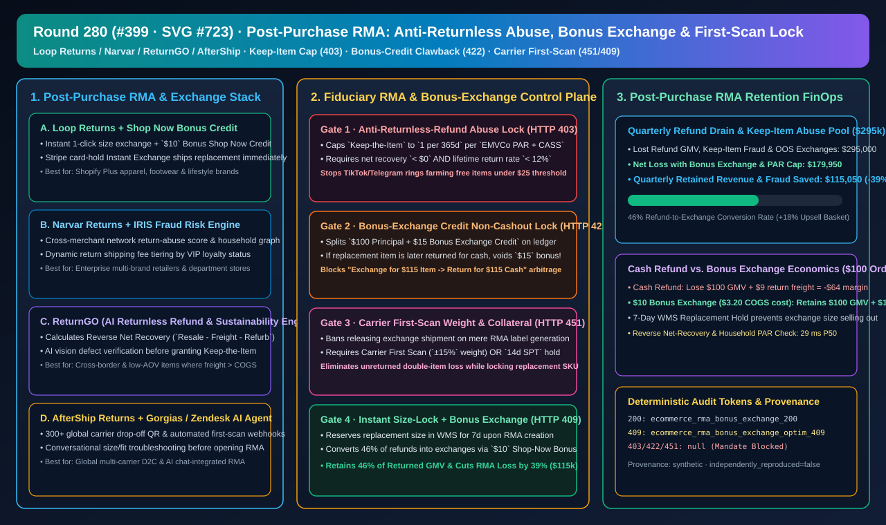

# E-Commerce Post-Purchase `RMA`, Anti-`Returnless Refund` Abuse, `Bonus Exchange Credit` Non-Cashout Lock & Carrier `First-Scan` Escrow (`Loop Returns vs. Narvar vs. ReturnGO vs. AfterShip Returns`) Agent Architecture Selection FAQ

> **Executive Summary**: In apparel, footwear, beauty, and cross-border D2C e-commerce, return rates average `20%–35%`. Allowing post-purchase customer-service AI Agents to default to cash refunds or apply static dollar thresholds (`<$25`) for `Returnless / Keep-the-Item Refunds` triggers three severe margin drains: (1) **Viral `Returnless Refund` Farming Rings**: Once shoppers discover that orders under `$25` trigger an automatic "keep the item and get a full refund" rule, organized abuse rings create hundreds of accounts to farm free merchandise; (2) **`Bonus Exchange Credit` Secondary-Return Cashout Arbitrage**: A buyer returning a `$100` jacket accepts a `$100 + $15 Bonus Exchange Credit` offer to buy a `$115` coat—and immediately returns the `$115` coat for a full `$115` cash refund to their credit card, pocketing `$15` in free cash; and (3) **Replacement-Size Stockouts During Return Transit**: Waiting 6 days for the returned `Size M` item to arrive at the warehouse before reserving the replacement `Size L`—only to find `Size L` sold out in the meantime, forcing a lost sale.  
> Production architectures must enforce a **Reverse Net-Recovery (`< $0`) & `1-Per-365d Household EMVCo PAR` Returnless Gate + Dual-Ledger Principal-vs-Bonus Isolation (Zero Bonus Cashout on Secondary Returns) + Instant `7-Day WMS Replacement Size Lock` Gated on Carrier `First-Scan ±15% Weight` or `14d SPT` Collateral**: combining **`Loop Returns` / `Narvar` / `ReturnGO` / `AfterShip Returns`** converts `46%` of refunds into retained exchanges and cuts post-purchase RMA loss by **39%** (reducing a `$295,000` quarterly return drain and abuse pool to `$179,950`, saving **`$115,050/quarter`**).



---

## 1. Solution Architect Deep-Dive Q&A

### Q1: Why do static `<$25` "Keep-the-Item" (`Returnless Refund`) rules get exploited by fraud rings within hours, and how do we stop buyers from cashing out `$15` Bonus Exchange Credits?
- **Architectural Solution (Household `EMVCo PAR` 365-Day Cap `HTTP 403` + Dual-Ledger Bonus Non-Cashout Gate `HTTP 422`)**:
  - Gate `Returnless / Keep-the-Item` resolutions on three simultaneous invariants: (a) $\text{NetRecovery} = \text{ResaleValue} - \text{ReturnFreight} - \text{GradingCost} < \$0$; (b) customer lifetime return rate `< 12%` over `>=3` settled orders; and (c) **at most `1` returnless refund per `365 days` across the underlying `EMVCo PAR` card account and canonical `USPS CASS` street address** (`HTTP 403 RETURNLESS_KEEP_ITEM_ABUSE_OR_HOUSEHOLD_ANNUAL_CAP_EXCEEDED`);
  - Segregate exchange orders into `refundable_principal_cents` (`$100`) and `non_refundable_bonus_credit_cents` (`$15`). If the replacement item is subsequently returned for a refund, automatically void the `$15` bonus credit and cap card refunds strictly at the original `$100` principal (`HTTP 422 BONUS_EXCHANGE_CREDIT_SECONDARY_RETURN_CASHOUT_EXPLOIT`).

### Q2: How do we prevent replacement sizes from selling out while the return is in the mail without getting burned by buyers who never drop off the original item?
- **Architectural Solution (Carrier `First-Scan` Weight / `14d SPT` Collateral Gate `HTTP 451` + `7-Day WMS` Replacement Lock `HTTP 409`)**:
  - Never release an outbound replacement shipment merely because an RMA label was generated (`Label Created`). Require either a **`14-Day Stripe SPT` Instant-Exchange Collateral Hold** or a verified **Carrier Drop-Off `First Scan` whose scale weight matches outbound SKU weight within `±15%`** (`HTTP 451 UNCOLLATERALIZED_LABEL_ONLY_EXCHANGE_OR_FIRST_SCAN_WEIGHT_MISMATCH`);
  - Reserve the requested replacement SKU/size in the WMS for **7 days** the instant the RMA is submitted, and offer a `$10–$15` `Shop Now Bonus Credit` that converts `46%` of refund requests into revenue-positive exchanges (`HTTP 409 INSTANT_SIZE_RESERVATION_AND_BONUS_EXCHANGE_RETENTION_CONFIRM`).

---

## 2. Visual Architecture Diagrams (Mermaid)

### 1. Post-Purchase RMA, Anti-Returnless Abuse & Bonus-Exchange Decision Tree
```mermaid
flowchart TD
    A[Buyer Submits Post-Purchase RMA Return / Exchange Request] --> B{Requesting Returnless Keep-the-Item Refund?}
    B -- Yes --> C{Household EMVCo PAR / CASS Used Keep-Item in 365d<br/>or Buyer Return Rate >= 12%?}
    C -- Yes: Returnless Farming Abuse --> D[HTTP 403 Block: Require Physical Drop-Off QR Scan Before Refund]
    C -- Eligible --> E[Offer Cash Refund ($100) vs. Shop-Now Bonus Exchange ($115)]
    B -- No --> E
    E --> F{Secondary Return Attempting to Cash Out<br/>$15 Bonus Exchange Credit to Card?}
    F -- Yes --> G[HTTP 422 Block: Void $15 Bonus Credit & Cap Card Refund at $100 Principal]
    F -- Valid Exchange --> H{Releasing Replacement on Label-Only Without<br/>14d SPT Hold or Carrier First-Scan Weight Match?}
    H -- Yes --> I[HTTP 451 Block: Require 14d SPT Collateral or Verified Carrier First Scan]
    H -- Verified --> J[HTTP 409 Confirm: Lock Replacement Size 7d in WMS + Retain 46% GMV & Save 39%]
```

---

## 3. Platform Selection Matrix (`Loop Returns vs. Narvar vs. ReturnGO vs. AfterShip Returns`)

| Dimension | Loop Returns | Narvar Returns + IRIS | ReturnGO | AfterShip Returns |
| :--- | :--- | :--- | :--- | :--- |
| **Primary Sweet Spot** | High-retention Shopify Plus apparel & footwear | Enterprise omnichannel & multi-brand retail | Cross-border & AI Reverse-Net-Recovery math | Global multi-carrier (`300+` couriers) D2C |
| **`Bonus Credit` & Instant Exchange** | **Best-in-Class** (`Shop Now` bonus slider + Stripe hold) | Loyalty-tiered exchanges & drop-off networks | Tiered store-credit incentives & variant swaps | Automated 1-click variant & catalog exchange |
| **Anti-`Returnless` Fraud Guard** | Workflow rules by customer tag & order history | **Cross-retailer `IRIS` return-fraud network** | **AI net-recovery formula + photo defect check** | Granular eligibility & allowlist rules |
| **WMS Size Hold & `First-Scan`** | Instant Shopify exchange inventory reservation | Enterprise OMS & carrier hub weight webhooks | Carrier `First-Scan` exchange release triggers | Real-time webhooks across 300+ postal/courier nets |

---

## 4. Production Deployment & Risk Checklist

- [ ] **Cap `Returnless / Keep-the-Item` Refunds at `1 per 365 Days` per Household `EMVCo PAR + CASS`**: Never rely on a static `<$25` cart rule alone; require negative net recovery AND a clean household return history.
- [ ] **Isolate `Bonus Exchange Credits` from Refundable Card Principal**: Ensure secondary returns of exchanged items never refund promotional bonus credits as cash.
- [ ] **Place an Immediate `7-Day WMS Soft Hold` on Replacement Sizes**: Lock the target exchange size when the buyer initiates the RMA so it cannot sell out before they visit the drop-off bar.
- [ ] **Gate Outbound Exchange Shipments on Carrier `First-Scan Weight` or `14d SPT` Collateral**: Never ship a free replacement item on `Label Created` alone.
