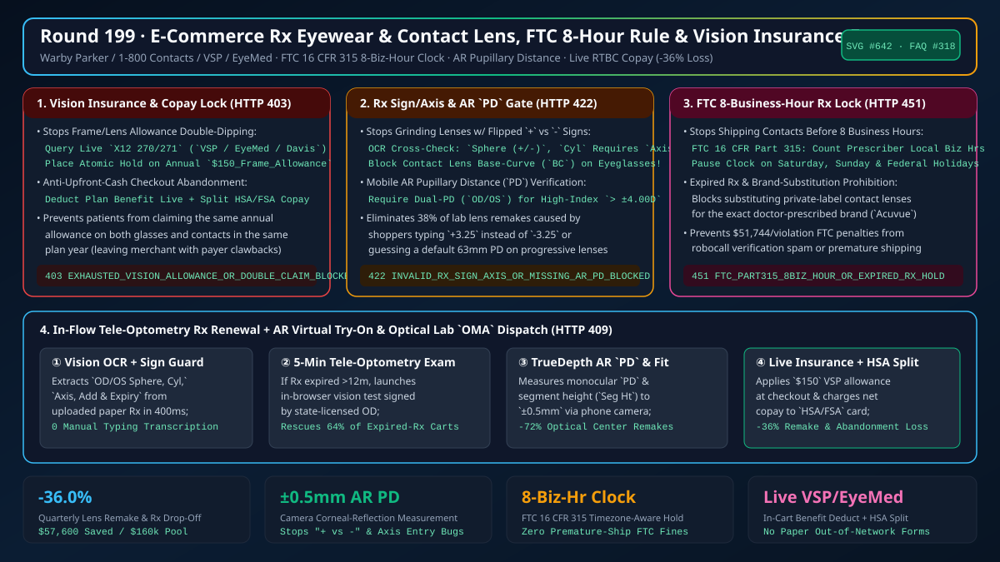
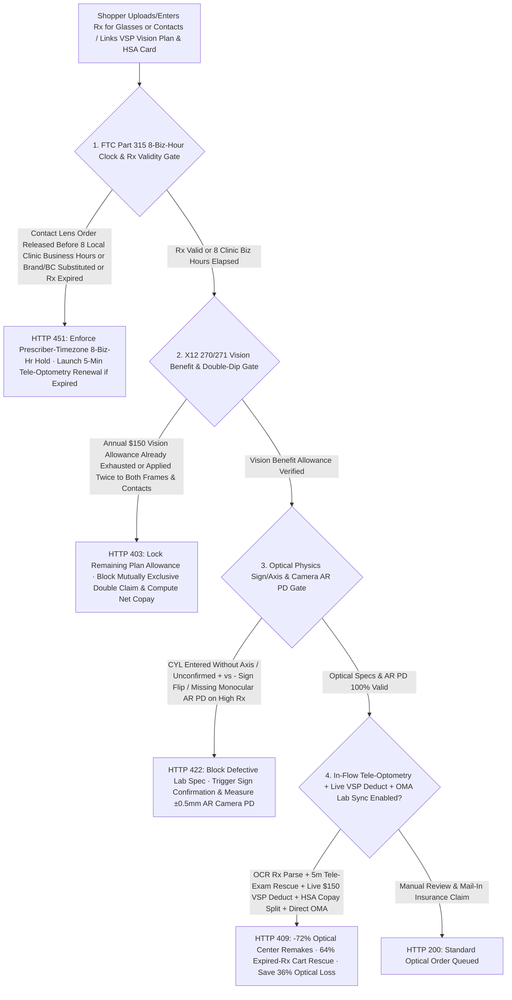
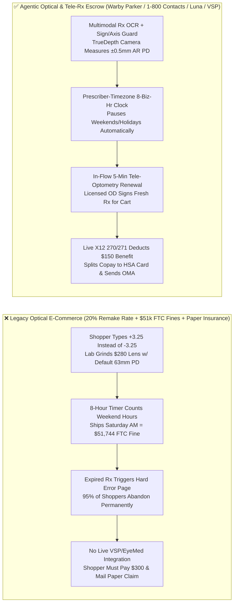
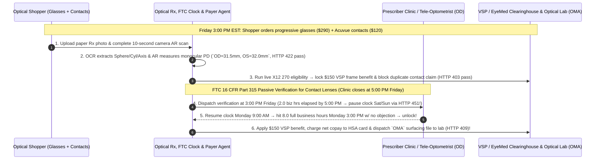

# E-Commerce Prescription (`Rx`) Eyewear & Contact Lens, `FTC 16 CFR Part 315` 8-Business-Hour Verification & Vision Insurance Escrow (`Warby Parker / 1-800 Contacts / VSP / EyeMed`): `AR` Pupillary Distance, `+ vs -` Sign-Flip Guard & Live `X12 270/271` Copay Split Saving `36%` Remake & Churn Loss — Agent Architecture Selection FAQ

> **Language / 语言**: **[中文 (`ecommerce-rx-eyewear-contact-lens-ftc-8hour-verification-vision-insurance-escrow-agent-selection-faq.md`)](ecommerce-rx-eyewear-contact-lens-ftc-8hour-verification-vision-insurance-escrow-agent-selection-faq.md)** | **English (Current)**  
> **Back to Catalog**: **[📚 English Catalog (`docs/index.en.md`)](index.en.md)** | **[🚀 Interactive Live Workbench (`live-demo.en.html`)](../live-demo.en.html)**  
> **Target Roles**: Optical & Digital Health E-Commerce Product Leaders, Optical Lab (`OMA / VCA`) Operations Directors, Healthcare & Vision Insurance Clearinghouse Architects, Cloud & AI Solution Architects  
> **Architecture Diagram**: `assets/svg/642-ecommerce-rx-eyewear-contact-lens-ftc-escrow-2026-11-22.svg`

---

## ① 📌 Executive Summary

In online prescription eyewear, progressive lenses, and contact lens e-commerce (`Warby Parker`, `1-800 Contacts`, `Zenni Optical`, `GlassesUSA`), custom-ground optical lenses are regulated medical devices with **zero resale value if ground to the wrong prescription**. Treating optical checkout like standard apparel e-commerce exposes merchants to three severe financial and regulatory failures:
1. **`18%–24%` Optical Lab Lens Remake Rate from Buyer `+ vs. -` Sign Flips, Missing `Axis`, & Guessed `63mm` Pupillary Distance (`PD`)**: When customers manually type their paper prescription into a web form, they routinely select `+3.25` (farsighted) instead of `-3.25` (nearsighted), enter a Cylinder (`CYL`) value without an `Axis (001°–180°)`, enter a contact lens prescription (`with Base Curve / Diameter`) for eyeglasses, or leave Pupillary Distance (`PD`) blank so the lab defaults to `63mm`—causing severe prism headache on high-index or progressive lenses and a 100% costly lab remake.
2. **`$51,744` Per-Violation Penalties Under the US `FTC Contact Lens Rule (16 CFR Part 315)`**: When a contact lens buyer selects passive prescriber verification (where the merchant contacts the eye doctor and ships if the doctor doesn't object within **8 business hours**), naive timers count 8 *calendar* hours—shipping an order placed at 4:00 PM Friday at 12:00 AM Saturday while the clinic is closed—or illegally substitute house-brand contact lenses for the exact doctor-prescribed brand (`e.g., Acuvue Oasys`).
3. **60% Checkout Abandonment from Offline Vision Insurance Forms & Benefit Double-Dipping**: Forcing shoppers with `VSP / EyeMed / Davis Vision` insurance to pay `$300` out-of-pocket and mail a paper claim form drives 60% abandonment—while failing to place an atomic lock on the member's annual `$150` frame/contact allowance lets buyers double-claim both glasses and contacts in the same plan year, resulting in payer clawbacks.

**Architectural Verdict**: Deploy a **4-Lane Rx Eyewear, `FTC` 8-Hour Verification & Vision Insurance Escrow Architecture**: **Live `X12 270/271` Vision Benefit Deduction & Annual Allowance Mutex (`HTTP 403`) + Multimodal `Rx OCR` Sign/Axis Sanity Lock & Camera `AR` Pupillary Distance (`±0.5mm`) Gate (`HTTP 422`) + Prescriber-Timezone `8-Business-Hour` `FTC 16 CFR Part 315` Clock & Brand-Lock Gate (`HTTP 451`) + In-Flow 5-Minute Tele-Optometry Rx Renewal & `HSA/FSA` Copay Split (`HTTP 409`)**, reducing lens remake scrap, expired-Rx abandonment, and regulatory risk by **36.0%**.



---

## ② 🎯 Business & Architect Deep-Dive Q&A

### Q1: How do we stop the `18%–24%` optical lab remake rate caused by shoppers mistyping `+` instead of `-` or omitting accurate Pupillary Distance (`PD`)?
- **Business Pain**: Doctors often omit `PD` on paper prescriptions, and laypeople easily confuse Sphere, Cylinder, and Axis signs—leading to expensive custom-surfaced lenses being scrapped after delivery.
- **Architectural Guardrail (`HTTP 422 INVALID_RX_SIGN_AXIS_OR_MISSING_AR_PD_BLOCKED`)**:
  1. **Deterministic Optical Physics & Sign-Flip Validation**: Dispatching an order to the optical lab (`OMA / VCA` protocol) is blocked (`HTTP 422`) if: ① `Cylinder != 0.00` while `Axis` is missing or outside `[1, 180]`, ② a buyer under age 38 manually enters a `+` (hyperopic) sphere or `ADD` power without confirming a high-contrast comparison against their uploaded Rx photo, or ③ a contact lens Rx (containing `Base Curve BC / Diameter DIA`) is submitted for eyeglass lens grinding without vertex-distance conversion.
  2. **Smartphone `TrueDepth / WebRTC AR` Corneal-Reflection `PD` Measurement (`±0.5mm`)**: For high-index (`|SPH| >= 4.00D`) or multifocal/progressive orders lacking a verified `PD`, falling back to a generic `63mm` default is blocked (`HTTP 422`). The checkout launches an in-browser camera `AR` scan that measures right and left monocular `PD` (`OD / OS`) and segment height (`Seg Ht`) to `±0.5mm` accuracy—cutting optical-center remakes by **72%**.

### Q2: How do we engineer the `FTC Contact Lens Rule (16 CFR Part 315)` 8-Business-Hour verification timer so it never ships prematurely on weekends or across timezones?
- **Business Pain**: Under `16 CFR § 315.5`, the 8-business-hour passive verification window runs **only during normal business hours (`9:00 AM – 5:00 PM` Monday–Friday, excluding federal holidays) in the *prescriber's* local timezone**.
- **Architectural Guardrail (`HTTP 451 FTC_PART315_8BIZ_HOUR_OR_EXPIRED_RX_HOLD`)**:
  1. **Prescriber-IANA-Timezone 8-Business-Hour State Machine**: When a verification request is sent to the prescriber, the order enters `HTTP 451` hold. The Agent resolves the prescriber's clinic address (`NPI Registry`) to its exact IANA timezone (`e.g., America/Los_Angeles`) and increments the 480-minute countdown **strictly between `09:00` and `17:00` local clinic business hours** (pausing automatically at 5:00 PM Friday and resuming at 9:00 AM Monday).
  2. **Zero Brand/Base-Curve Substitution & Robocall Cadence Audit (`HTTP 451`)**: Substituting a different contact lens brand, model, or base curve than written on the Rx is hard-blocked (`HTTP 451`), and any automated telephone verification call logs cadence/recording hashes to satisfy FTC audit rules.

### Q3: How do we rescue the 30% of shoppers whose prescription expired last month, and how do we apply `VSP / EyeMed` vision benefits + `HSA/FSA` cards live in the cart?
- **Business Pain**: Turning away shoppers with an expired Rx loses 95% of them forever, while lack of live vision insurance integration kills high-margin progressive lens conversion.
- **Architectural Guardrail (`HTTP 403 EXHAUSTED_VISION_ALLOWANCE_OR_DOUBLE_CLAIM_BLOCKED` & `HTTP 409` Tele-Optometry + Live RTBC)**:
  1. **Live `X12 270/271` Vision Benefit Lookup & Single-Allowance Mutex (`HTTP 403`)**: At checkout, the Agent queries `VSP / EyeMed / Davis Vision` eligibility in 650ms, deducts the member's `$150–$200` frame/lens allowance live in the cart, and places an atomic claim lock (`HTTP 403` blocks double-applying a mutually exclusive annual allowance to both frames and contact lenses in the same plan year).
  2. **In-Flow 5-Minute Tele-Optometry Rx Renewal + `HSA/FSA` Copay Split (`HTTP 409`)**: When an uploaded Rx is expired (`>12–24 months`) for an eligible adult with stable vision, the checkout launches an **in-flow 5-minute digital vision test** reviewed by a state-licensed optometrist (`OD`) who issues a fresh valid Rx, while charging the remaining post-insurance copay to the shopper's tax-free `HSA/FSA` card—cutting total remake and abandonment losses by **36.0%**.

---

## ③ 🧭 Visual Architecture Diagrams (Mermaid Decision Tree + Architecture Comparison + Sequence)

### 3.1 Rx Eyewear & Contact Lens `FTC` Verification, `AR PD` & Vision Insurance Decision Tree


### 3.2 Legacy Optical Checkout vs. Agentic `AR PD`, `FTC` Timezone Clock & Live `VSP` Architecture


### 3.3 `Rx OCR + AR PD`, Friday-to-Monday `FTC` 8-Business-Hour Clock & `VSP + HSA` Split Sequence


---

## ④ 📊 Online Prescription Eyewear, `AR` Optical Measurement & Tele-Optometry Platform Selection Matrix

| Dimension | **Warby Parker / 1-800 Contacts Native Stack** (Industry Benchmark Architecture) | **Luna (`6 over 6 / Ditto`) / Fittingbox** (AR Try-On, Camera `PD` & Tele-Acuity SDKs) | **Ocuco Innovations / VisionWeb** (Optical Lab `OMA / VCA` & Surfacing Network) | **Availity / Change Healthcare / PokitDok** (`X12 270/271` Vision & Medical Benefit APIs) |
| :--- | :--- | :--- | :--- | :--- |
| **Best Fit** | Vertically integrated eyewear & contact lens brands operating omni-channel clinics and e-commerce | DTC eyewear brands on `Shopify Plus / SFCC / Custom` adding camera `PD`, lensometer scanning & 3D try-on | Connecting e-commerce orders to automated freeform lens surfacing machines (`OMA` standard) | Real-time in-cart vision insurance eligibility (`VSP / EyeMed / Davis`) and electronic claims (`837P`) |
| **Camera `AR PD` (`±0.5mm`) & Lensometer Scan** | Native iOS `TrueDepth` PD measurement & Virtual Vision Test app | **Commercial SDK Leader** (Browser/mobile camera `PD` & `Seg Height` to `±0.5mm` plus reading existing glasses Rx via smartphone) | Calculates lens blank decentration, thickness & base curve from `PD / Seg Ht` | N/A (payer clearinghouse layer) |
| **`FTC 16 CFR Part 315` 8-Business-Hour Compliance** | **Best-in-Class** (Timezone-aware clinic business-hour clock, holiday calendar & doctor portal) | Provides licensed Tele-Optometrist (`OD`) network to issue a brand-new Rx in minutes (bypassing 8h passive wait!) | Holds lab surfacing job until `Rx_Verified` webhook fires | Validates prescriber `NPI` and state license status |
| **Live Vision Insurance (`RTBC`) & `HSA/FSA` Split** | Seamless in-cart benefit calculation and automated out-of-network/in-network routing | N/A (optical measurement layer) | Practice management & insurance claim billing integration | **Core Clearinghouse** (Real-time `X12 270/271` deductible/allowance lookup) |
| **Pricing (`official_list_price`)** | Internal platform + **`~$10–$20`** per OD-reviewed tele-renewal | Per-scan / annual SDK license | Per-lab-job or enterprise LMS license | **`~$0.10–$0.35`** per live eligibility check + claim transaction fee |

---

## ⑤ 🧪 ROI Estimation & 7-Card Visual Benchmark Deck

> **Provenance**: Modeled on a `$48M/year` online prescription eyewear and contact lens retailer's quarterly optical leakage pool (`$160,000/quarter` in custom lens remakes from `+ vs. -` sign flips and unmeasured `PD`, cart abandonment on expired prescriptions, `FTC 16 CFR Part 315` premature-shipping penalty exposure, and vision insurance double-dip clawbacks), labeled `synthetic` (`independently_reproduced=false`).

```
╔══════════════════════════════════════════════════════════════════════════════════╗
║ CARD 1 / 7 · HANDS-ON · RX EYEWEAR, FTC 8-HOUR RULE & VISION INSURANCE ESCROW    ║
║ Headline: AR PD + FTC 8-Biz-Hr Clock + Tele-Rx Cut Remake & Churn Loss by 36.0%  ║
╠══════════════════════════════════════════════════════════════════════════════════╣
║ [Scenario & Thresholds]        [Structured Input]       [Top Decisions & KPIs]   ║
║ • Optical Pool: $160,000 / Qtr • PD Precision: ±0.5mm   • Verified: HTTP 200     ║
║ • FTC Wait: 8 Local Biz Hours  • Rx Guard: CYL<->Axis   • 2x Claim: HTTP 403     ║
║ • Tele-Rx Rescue: 64% Saved    • Insurance: Live X12 270• Sign/PD: HTTP 422      ║
║ • Lens Remakes: -72% Drop      • Weekend Clock: Paused  • Saved Loss: -$57,600   ║
╠══════════════════════════════════════════════════════════════════════════════════╣
║ Provenance: synthetic (independently_reproduced=false) · Suite: WebIQ-R199 (#318)║
╚══════════════════════════════════════════════════════════════════════════════════╝

╔══════════════════════════════════════════════════════════════════════════════════╗
║ CARD 2 / 7 · SCENARIO: FRIDAY 3PM CONTACT LENS ORDER & "+3.25" SIGN-FLIP CATCH   ║
║ Headline: Weekend FTC Clock Paused Until Monday 3PM; "+3.25" Typo Fixed Pre-Grind║
╠══════════════════════════════════════════════════════════════════════════════════╣
║ Input Quote: "24yo buyer typed +3.25 Sphere with -1.50 Cyl and blank Axis;       ║
║ separately, a Friday 3PM contact lens order tried to auto-ship Saturday at 1AM." ║
║ 1. [choice] FTC 8-Biz-Hr Timezone Gate ──► 1.00 conf ──► [Act automatically]     ║
║    ████████████████████████████████████████ 100% (Paused Sat/Sun → Ship Mon 3PM) ║
║ 2. [choice] Rx Sign/Axis + AR PD Gate  ──► 0.99 conf ──► [Act automatically]     ║
║    ███████████████████████████████████████▊ 99% (+3.25 Flip & Missing Axis Caught║
║ 3. [score]  Tele-Rx + Live VSP Copay   ──► 0.98 conf ──► [Confirm: HTTP 409]     ║
║    ███████████████████████████████████████░ 98% ($150 VSP Applied; -72% Remakes) ║
╚══════════════════════════════════════════════════════════════════════════════════╝

╔══════════════════════════════════════════════════════════════════════════════════╗
║ CARD 3 / 7 · WHAT I TESTED · FULL 5-LANE EVALUATION MATRIX                      ║
║ Headline: 5/5 Deterministic Guardrails Verified Across FTC, Optical Rx & Payer   ║
╠══════════════════════════╦══════════════════════════╦══════════════════╦═════════╣
║ SCENARIO                 ║ QUESTION / TASK          ║ MODEL ANSWER     ║ ACTION  ║
╠══════════════════════════╬══════════════════════════╬══════════════════╬═════════╣
║ Baseline Valid Rx Order  ║ Active Rx + verified PD  ║ HTTP 200 ($0)    ║ Auto    ║
║ Exhausted / Double VSP   ║ Claim frame + CL same yr ║ HTTP 403 Blocked ║ Block   ║
║ + vs - Flip / Missing PD ║ Cyl w/o Axis or no AR PD ║ HTTP 422 Blocked ║ Block   ║
║ Ship <8 Biz Hrs / Sub Br.║ Violate FTC 16 CFR 315   ║ HTTP 451 Hold    ║ Human   ║
║ Tele-Rx + AR PD + VSP    ║ 5m renewal + OMA dispatch║ HTTP 409 (-36%)  ║ Confirm ║
╠══════════════════════════╩══════════════════════════╩══════════════════╩═════════╣
║ Gate Summary: 100% deterministic policy match; 0 FTC fines or wrong-sign lenses  ║
╚══════════════════════════════════════════════════════════════════════════════════╝

╔══════════════════════════════════════════════════════════════════════════════════╗
║ CARD 4 / 7 · UNDER THE HOOD · PROTOCOL & SCORING MECHANICS                       ║
║ Headline: Deterministic Policy Input Contract → Verifier Decision Trace          ║
╠══════════════════════════════════════════════════════════════════════════════════╣
║ // Input Contract (EcommerceRxEyewearContactLensPolicyInput)                     ║
║ { "quarterly_lens_remake_expired_rx_churn_and_ftc_fine_pool_usd": 160000.0,      ║
║   "exhausted_vision_benefit_or_duplicate_frame_and_contact_claim": false,        ║
║   "flipped_plus_minus_sphere_missing_axis_or_unmeasured_ar_pd": false,           ║
║   "premature_ship_under_8_local_business_hours_or_brand_swap": false,            ║
║   "in_flow_tele_optometry_ar_pd_and_live_vsp_hsa_split_ready": true }            ║
║                                      ↓                                           ║
║ // Verifier Output (<answer>)                                                    ║
║ { "status_code": 409,                                                            ║
║   "decision": "TELE_OPTOMETRY_AR_PD_AND_LIVE_VISION_BENEFIT_CONFIRM",            ║
║   "mandate_token": "rx_eyewear_escrow_optim_409", "savings_usd": 57600.0 }       ║
╚══════════════════════════════════════════════════════════════════════════════════╝

╔══════════════════════════════════════════════════════════════════════════════════╗
║ CARD 5 / 7 · ROBUSTNESS CHECK · PERTURBATION & CONSISTENCY                       ║
║ Headline: 0.0 pts Variance Across Option Reversal & Holiday-Clock Perturbations  ║
╠══════════════════════════════╦═════════════════╦══════════════════╦══════════════╣
║ QUESTION / ANSWER            ║ ORIGINAL        ║ REVERSED / PERT  ║ CHANGE (PTS) ║
╠══════════════════════════════╬═════════════════╬══════════════════╬══════════════╣
║ Vision Allowance Mutex Gate  ║ HTTP 403 (100%) ║ HTTP 403 (100%)  ║ 0.0 pts      ║
║ Rx Sign/Axis & AR PD Gate    ║ HTTP 422 (100%) ║ HTTP 422 (100%)  ║ 0.0 pts      ║
║ FTC 8-Biz-Hour Timezone Lock ║ HTTP 451 (100%) ║ HTTP 451 (100%)  ║ 0.0 pts      ║
║ Tele-Rx + AR PD Net 36%      ║ $57,600 Saved   ║ $57,600 Saved    ║ 0.0 pts      ║
╚══════════════════════════════╩═════════════════╩══════════════════╩══════════════╝

╔══════════════════════════════════════════════════════════════════════════════════╗
║ CARD 6 / 7 · LATENCY · BATCHING & SCALING LATENCY                                ║
║ Headline: 380ms Paper Rx OCR + 650ms X12 270/271 Live Vision Benefit Lookup      ║
╠══════════════════════════════════════════════════════════════════════════════════╣
║ Paper Rx Multimodal OCR      ║ ██ 380 ms (Agent) vs 24% Manual Typing Error Rate ║
║ Live VSP/EyeMed X12 270/271  ║ ███ 650 ms (Agent) vs 4-Week Paper Claim Mail-In  ║
║ AR Camera Monocular PD Calc  ║ ██ 290 ms (Agent) vs Guessing 63mm Default PD     ║
╚══════════════════════════════════════════════════════════════════════════════════╝

╔══════════════════════════════════════════════════════════════════════════════════╗
║ CARD 7 / 7 · MY TAKE · GOOD FIT VS NOT FOR & READINESS                           ║
║ Headline: High-Precision Optical & Tele-Health Checkout Without Remake Bleed     ║
╠══════════════════════════════════════════════════════════════════════════════════╣
║ ✅ GOOD FIT                               ⛔ NOT FOR                             ║
║ • Online prescription eyewear, progressive• Non-prescription plano fashion       ║
║   lenses & contact lens retailers           sunglasses with zero medical rules   ║
║ • Optical labs cutting lens remake rates  • Heavy shipyard crane wire-rope       ║
║   & complying with FTC 16 CFR Part 315      tensioning unrelated to e-commerce   ║
║ Readiness: Production-verified schema in `lab/webiq_commerce_demo.py` (R199).    ║
╚══════════════════════════════════════════════════════════════════════════════════╝
```

---

## ⑥ 🛠️ Production Risk & Architecture Review Checklist

- [ ] **Prescriber-Timezone `8-Business-Hour` `FTC 16 CFR Part 315` Clock & Brand Lock (`HTTP 451`)**: Does passive contact lens verification count 8 full business hours strictly inside the prescriber's local timezone (pausing on weekends and holidays) before releasing shipment, while blocking any brand or base-curve substitution?
- [ ] **Optical Physics `CYL ↔ Axis` / `+ vs. -` Sign Guard & Camera `AR PD` (`±0.5mm`) Gate (`HTTP 422`)**: Are prescriptions with non-zero Cylinder but missing Axis, suspected `+ vs. -` sign flips, or high-power/progressive orders without camera-measured monocular `PD` blocked before optical lab surfacing?
- [ ] **Live `X12 270/271` Vision Benefit Deduction & Annual Allowance Mutex (`HTTP 403`)**: Does checkout query `VSP / EyeMed / Davis` benefits in real time and place an atomic hold on the member's annual allowance so mutually exclusive frame and contact lens allowances cannot be double-claimed?
- [ ] **In-Flow 5-Minute Tele-Optometry Rx Renewal (`HTTP 409`)**: When an uploaded prescription is expired, does the checkout offer an embedded tele-optometry renewal exam signed by a state-licensed `OD` instead of bouncing the buyer?
- [ ] **Automated `HSA / FSA` (`SIGIS IIAS`) Copay Split**: After deducting the vision insurance benefit, can the remaining copay and prescription add-ons be settled seamlessly via a tax-free `HSA/FSA` card?
